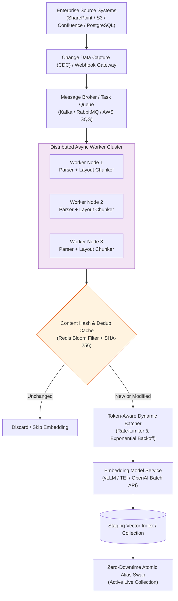
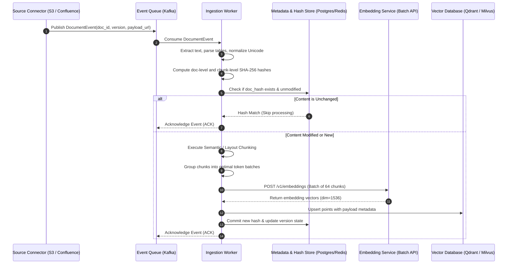
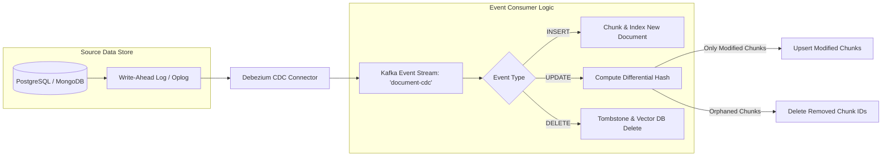
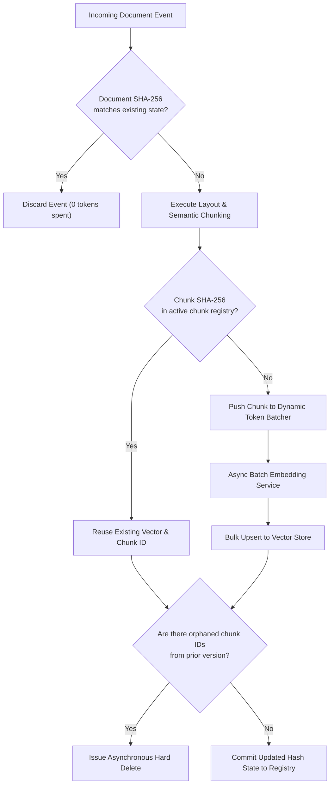

# ⚡ Asynchronous Indexing & Ingestion Pipeline: Distributed Processing, Deduplication, and Change Data Capture

## 📑 Table of Contents
1. [🌟 Fundamentals: The Ingestion Bottleneck & Production Requirements](#1--fundamentals-the-ingestion-bottleneck--production-requirements)
2. [🏗️ High-Throughput Ingestion Architecture: Distributed ETL Fan-Out](#2-️-high-throughput-ingestion-architecture-distributed-etl-fan-out)
3. [🔬 Mathematical Formulations: Content Fingerprinting & Locality-Sensitive Hashing](#3--mathematical-formulations-content-fingerprinting--locality-sensitive-hashing)
4. [🔄 Change Data Capture (CDC) & Incremental Synchronization](#4--change-data-capture-cdc--incremental-synchronization)
5. [🛡️ Atomic Index Swapping, Aliasing, and Zero-Downtime Reindexing](#5-️-atomic-index-swapping-aliasing-and-zero-downtime-reindexing)
6. [💻 Practical Implementation: Async Ingestion Engine with CDC & Content Hashing](#6--practical-implementation-async-ingestion-engine-with-cdc--content-hashing)
7. [🌍 Real-World Enterprise Case Studies](#7--real-world-enterprise-case-studies)
8. [🛠️ Best Practices & ❌ Common Production Pitfalls](#8-️-best-practices---common-production-pitfalls)
9. [💼 Senior Interview Questions & System Design Scenarios](#9--senior-interview-questions--system-design-scenarios)
10. [🧪 Hands-On Mini-Project: Incremental Document Sync & Vector Deduplicator](#10--hands-on-mini-project-incremental-document-sync--vector-deduplicator)
11. [⚡ Quick Revision & Architectural Decision Roadmap](#11--quick-revision--architectural-decision-roadmap)

---

## 1. 🌟 Fundamentals: The Ingestion Bottleneck & Production Requirements

In production Retrieval-Augmented Generation, the **Indexing and Ingestion Pipeline** is the asynchronous data engineering backbone responsible for transforming terabytes of unstructured corporate documentation into an optimized, low-latency vector and lexical index.

While naive prototypes process files synchronously in-memory on a single thread, production enterprise corpora present formidable engineering constraints:
* **Scale & Velocity:** Tens of millions of documents (PDFs, Confluence pages, Slack archives, Notion databases, Git repositories) arriving via batch dumps and streaming webhooks.
* **Cost & Rate Limits:** Embedding models (e.g., OpenAI `text-embedding-3-large`, Cohere `embed-v3`, self-hosted TEI) impose strict tokens-per-minute (TPM) and requests-per-minute (RPM) limits. Redundantly re-embedding unchanged documents costs thousands of dollars per month.
* **Zero-Downtime Updates:** Query traffic cannot be degraded, blocked, or served corrupted state while full re-indexing or incremental updates occur.
* **Consistency & State Drift:** Document deletions or permission changes in source systems (e.g., Google Drive, SharePoint) must propagate near-instantly to prevent serving unauthorized or deprecated data.



---

## 2. 🏗️ High-Throughput Ingestion Architecture: Distributed ETL Fan-Out

The modern enterprise ingestion pipeline operates as a decoupled, multi-stage **Extract-Transform-Chunk-Embed-Load (ETCEL)** distributed state machine.



### Architectural Subsystems
1. **Source Connectors & Change Stream:** Polls or hooks into corporate data repositories using database write-ahead logs (WAL) via Debezium or push webhooks.
2. **Backpressure-Aware Task Queue:** Buffers events, dampens ingestion spikes, and provides at-least-once processing guarantees.
3. **Extraction & Layout Engine:** Converts binary formats (PDFs, PPTX, DOCX) into clean Markdown or structural ASTs, isolating images and tabular structures.
4. **Token-Aware Dynamic Batcher:** Groups chunks dynamically up to the provider's token budget (e.g., 8,192 tokens per batch request) to maximize GPU saturation and avoid rate-limiting errors.
5. **Storage & Shadow Indices:** Writes vectors to a shadow or versioned collection, enabling point-in-time index rollback and zero-downtime alias switching.

---

## 3. 🔬 Mathematical Formulations: Content Fingerprinting & Locality-Sensitive Hashing

To guarantee deduplication at scale without incurring $O(N^2)$ pairwise vector comparisons, ingestion pipelines leverage cryptographic hashing for exact duplicates and Locality-Sensitive Hashing (LSH) for near-duplicates.

### 📐 1. Cryptographic Content Fingerprinting (Exact Matches)
Every raw document $D$ and sliced chunk $c_i$ is mapped to a fixed-size digest using SHA-256:

$$
h(c_i) = \text{SHA-256}(\text{Normalize}(c_i.\text{text}) \circ c_i.\text{parent\_id})
$$

Where $\text{Normalize}(\cdot)$ strips non-semantic whitespace, converts Unicode to NFKC form, and removes transient metadata (like ingestion timestamps). If $h(c_i)$ exists in the metadata index, the chunk embedding operation is completely bypassed.

---

### 📐 2. MinHash & Jaccard Similarity (Near-Duplicate Detection)
When documents undergo minor edits (such as formatting tweaks, updated copyright notices, or punctuation changes), cryptographic hashes change completely (avalanche effect). **MinHash** estimates the **Jaccard Similarity** $J(A, B)$ of two documents $A$ and $B$:

$$
J(A, B) = \frac{|A \cap B|}{|A \cup B|}
$$

Let $S(A)$ and $S(B)$ represent the sets of $k$-shingles (character or word $n$-grams) of documents $A$ and $B$. Under a family of min-wise independent hash functions $\pi_j$, the probability that the minimum hash value of two sets is identical equals their Jaccard similarity:

$$
P\left(\min_{s \in S(A)} \pi_j(s) = \min_{s' \in S(B)} \pi_j(s')\right) = J(S(A), S(B))
$$

By generating a MinHash signature vector of length $M$ (typically $M=128$ or $256$):

$$
\mathbf{sig}(A) = \left[ \min_{s} \pi_1(s), \min_{s} \pi_2(s), \dots, \min_{s} \pi_M(s) \right]^T
$$

The estimated Jaccard similarity is computed in $O(M)$ time:

$$
\hat{J}(A, B) = \frac{1}{M} \sum_{j=1}^M \mathbb{I}\left( \mathbf{sig}_j(A) == \mathbf{sig}_j(B) \right)
$$

---

### 📐 3. SimHash: Cosine Distance in Hamming Space
For continuous textual passages, **SimHash** (Charikar, 2002) projects an arbitrary document into a 64-bit fingerprint where the Hamming distance between two fingerprints is directly proportional to their angular cosine distance.

Given document tokens $\{w_1, w_2, \dots, w_n\}$ with weights $\{v_1, v_2, \dots, v_n\}$ and standard hash $h(w) \in \{-1, +1\}^b$:

$$
\mathbf{V}_j = \sum_{i=1}^n v_i \cdot h_j(w_i), \quad \text{for } j \in \{1, \dots, b\}
$$

The final bit fingerprint $F \in \{0, 1\}^b$ is derived via sign thresholding:

$$
F_j = \begin{cases} 1 & \text{if } \mathbf{V}_j \ge 0 \\ 0 & \text{if } \mathbf{V}_j < 0 \end{cases}
$$

The angle $\theta$ between document feature vectors satisfies:

$$
P(F(A)_j \ne F(B)_j) = \frac{\theta}{\pi}
$$

---

## 4. 🔄 Change Data Capture (CDC) & Incremental Synchronization

Batch re-indexing an entire enterprise knowledge base daily is computationally prohibitive and creates unacceptable sync latency. Production systems implement **Incremental Change Data Capture (CDC)**:



### Event State Management & Tombstoning
When a source document is deleted or archived:
1. **Immediate Metadata Soft-Delete:** In the vector store, set payload `{"is_deleted": true}` to instantly exclude it from query-time metadata filters ($0\text{ ms}$ retrieval impact).
2. **Asynchronous Vector Hard-Purge:** A background compaction worker issues `delete_by_id` or executes index defragmentation during off-peak hours to reclaim HNSW RAM.
3. **Downstream ACL Revocation:** If document permissions change from `public` to `confidential`, the ACL vector payload must be updated atomically to prevent information leaks.

---

## 5. 🛡️ Atomic Index Swapping, Aliasing, and Zero-Downtime Reindexing

When updating the underlying embedding model (e.g., migrating from `text-embedding-ada-002` to `text-embedding-3-small`), or adjusting chunking parameters (e.g., resizing from 500 to 800 tokens), every document in the corpus must be re-embedded. In-place modification of a live production index causes query degradation and split-brain states.

Production architectures mandate **Atomic Index Aliasing**:

```mermaid
flowchart TD
    Client[Incoming User Queries] --> Alias["Vector DB Alias / Pointer<br/>('production_knowledge_base')"]

    subgraph BlueGreenSetup [Blue-Green Index Topology]
        Alias -->|Active Traffic: 100%| LiveCollection[Collection_v1: ada-002<br/>(Live Active Index)]
        
        ShadowCollection[Collection_v2: text-embedding-3-small<br/>(Staging Offline Index)]
    end

    WorkerCluster[Ingestion Workers] -->|Background Ingestion| ShadowCollection

    ShadowCollection -.->|1. Verification Tests Pass<br/>2. Reindexing Complete| SwapTrigger{"Atomic Pointer Swap<br/>PUT /aliases"}
    
    SwapTrigger ==>|Instant Switch| Alias
    SwapTrigger -.->|Reroutes Traffic to v2| ShadowCollection
```

### The Blue-Green Reindexing Protocol
1. **Provision Staging Collection:** Create an unaliased collection `kb_v2_2026_11`.
2. **Backfill Historical Data:** Stream entire document history through the updated embedding pipeline.
3. **Catch Up CDC Tail:** Replay buffered Kafka CDC events that occurred during the backfill process.
4. **Automated Verification:** Execute regression tests against golden query sets (verify Recall@K and latency).
5. **Atomic Alias Shift:** Execute an atomic API command updating the production alias pointer:
   ```json
   {
     "actions": [
       {"remove_alias": {"alias": "production_kb", "index": "kb_v1"}},
       {"add_alias": {"alias": "production_kb", "index": "kb_v2_2026_11"}}
     ]
   }
   ```
6. **Graceful Teardown:** Keep `kb_v1` in read-only standby for 48 hours for immediate rollback capability before purging.

---

## 6. 💻 Practical Implementation: Async Ingestion Engine with CDC & Content Hashing

Below is a complete, concurrent ingestion engine built with Python's `asyncio`. It demonstrates:
* Content fingerprinting (SHA-256) at document and chunk levels.
* Change detection (INSERT, UPDATE, DELETE).
* Token-aware batching with simulated backpressure.
* Differential chunk reconciliation (adding new chunks and purging orphaned chunks).

```python
"""
async_ingestion_pipeline.py
===========================
Production-ready asynchronous document indexing and ingestion engine.
Features CDC event handling, SHA-256 content deduplication, dynamic
token batching, differential updating, and atomic state tracking.
"""

from __future__ import annotations
import asyncio
import hashlib
import logging
import time
from dataclasses import dataclass, field
from enum import Enum
from typing import Any, Dict, List, Optional, Set, Tuple
import numpy as np

logging.basicConfig(
    level=logging.INFO,
    format="%(asctime)s [%(levelname)s] %(name)s: %(message)s"
)
logger = logging.getLogger("AsyncIngestionEngine")


class ChangeEventType(str, Enum):
    INSERT = "INSERT"
    UPDATE = "UPDATE"
    DELETE = "DELETE"


@dataclass
class CDCEvent:
    event_id: str
    doc_id: str
    event_type: ChangeEventType
    content: str
    timestamp: float = field(default_factory=time.time)
    metadata: Dict[str, Any] = field(default_factory=dict)


@dataclass(frozen=True)
class IngestionChunk:
    chunk_id: str
    doc_id: str
    text: str
    chunk_hash: str
    token_count: int
    metadata: Dict[str, Any]


def compute_sha256(text: str) -> str:
    """Calculate deterministic SHA-256 hash of normalized text."""
    normalized = " ".join(text.strip().split())
    return hashlib.sha256(normalized.encode("utf-8")).hexdigest()


class AsyncEmbeddingService:
    """
    Simulates a high-throughput, rate-limited embedding API (e.g. OpenAI/Cohere).
    Enforces maximum batch size and simulates GPU network latency.
    """

    def __init__(self, dimension: int = 128, max_batch_tokens: int = 2048) -> None:
        self.dimension = dimension
        self.max_batch_tokens = max_batch_tokens
        self.total_tokens_processed = 0

    async def embed_batch(self, texts: List[str]) -> np.ndarray:
        if not texts:
            return np.empty((0, self.dimension), dtype=np.float32)

        # Simulate network I/O and GPU inference latency
        await asyncio.sleep(0.05)
        
        # Deterministic vector generation
        matrix = np.zeros((len(texts), self.dimension), dtype=np.float32)
        for i, text in enumerate(texts):
            h = int(compute_sha256(text)[:8], 16)
            rng = np.random.RandomState(h % (2**32 - 1))
            vec = rng.randn(self.dimension).astype(np.float32)
            norm = np.linalg.norm(vec)
            matrix[i] = vec / (norm if norm > 0 else 1.0)
            
        self.total_tokens_processed += sum(max(1, len(t) // 4) for t in texts)
        return matrix


class MockProductionVectorDB:
    """
    Simulates an enterprise vector store with point upsertion, payload tagging,
    and deletion capabilities (e.g. Qdrant / Pinecone).
    """

    def __init__(self) -> None:
        self.storage: Dict[str, Dict[str, Any]] = {}

    async def upsert(self, chunk_id: str, vector: np.ndarray, payload: Dict[str, Any]) -> None:
        self.storage[chunk_id] = {
            "vector": vector,
            "payload": payload,
            "updated_at": time.time()
        }

    async def delete(self, chunk_id: str) -> None:
        if chunk_id in self.storage:
            del self.storage[chunk_id]

    async def delete_by_doc_id(self, doc_id: str) -> int:
        to_delete = [
            cid for cid, item in self.storage.items()
            if item["payload"].get("doc_id") == doc_id
        ]
        for cid in to_delete:
            del self.storage[cid]
        return len(to_delete)

    def count(self) -> int:
        return len(self.storage)


class DocumentStateRegistry:
    """
    Tracks document versions and active chunk hashes to support CDC diffing.
    """

    def __init__(self) -> None:
        # doc_id -> {"doc_hash": str, "chunk_hashes": Dict[chunk_id, chunk_hash]}
        self._registry: Dict[str, Dict[str, Any]] = {}

    def get_doc(self, doc_id: str) -> Optional[Dict[str, Any]]:
        return self._registry.get(doc_id)

    def set_doc(self, doc_id: str, doc_hash: str, chunk_map: Dict[str, str]) -> None:
        self._registry[doc_id] = {
            "doc_hash": doc_hash,
            "chunk_map": chunk_map,
            "updated_at": time.time()
        }

    def remove_doc(self, doc_id: str) -> None:
        self._registry.pop(doc_id, None)


class IngestionPipelineOrchestrator:
    """
    Coordinates CDC processing, chunking, deduplication, batching, and loading.
    """

    def __init__(
        self,
        embedder: AsyncEmbeddingService,
        vector_db: MockProductionVectorDB,
        registry: DocumentStateRegistry,
        chunk_size_chars: int = 300,
        chunk_overlap_chars: int = 40
    ) -> None:
        self.embedder = embedder
        self.vector_db = vector_db
        self.registry = registry
        self.chunk_size = chunk_size_chars
        self.chunk_overlap = chunk_overlap_chars

    def _chunk_text(self, doc_id: str, content: str, meta: Dict[str, Any]) -> List[IngestionChunk]:
        chunks: List[IngestionChunk] = []
        if not content:
            return chunks

        start = 0
        step = self.chunk_size - self.chunk_overlap
        idx = 0

        while start < len(content):
            end = min(start + self.chunk_size, len(content))
            slice_text = content[start:end]
            c_hash = compute_sha256(slice_text)
            c_id = f"{doc_id}_c{idx:04d}"
            
            # Approximate token count (1 token ~= 4 chars)
            tokens = max(1, len(slice_text) // 4)

            chunks.append(
                IngestionChunk(
                    chunk_id=c_id,
                    doc_id=doc_id,
                    text=slice_text,
                    chunk_hash=c_hash,
                    token_count=tokens,
                    metadata={**meta, "chunk_index": idx}
                )
            )
            idx += 1
            if end >= len(content):
                break
            start += step

        return chunks

    async def handle_event(self, event: CDCEvent) -> Dict[str, Any]:
        """Dispatch and process an incoming CDC event."""
        logger.info("Processing CDC Event: [%s] doc_id=%s", event.event_type.value, event.doc_id)
        
        if event.event_type == ChangeEventType.DELETE:
            purged = await self.vector_db.delete_by_doc_id(event.doc_id)
            self.registry.remove_doc(event.doc_id)
            logger.info("Deleted doc %s (purged %d chunks from vector index)", event.doc_id, purged)
            return {"action": "deleted", "purged_chunks": purged}

        doc_hash = compute_sha256(event.content)
        existing_doc = self.registry.get_doc(event.doc_id)

        # 1. Document-level exact deduplication
        if existing_doc and existing_doc["doc_hash"] == doc_hash:
            logger.info("Document %s content hash match. Zero changes detected, skipping.", event.doc_id)
            return {"action": "skipped_identical"}

        # 2. Extract new chunks
        new_chunks = self._chunk_text(event.doc_id, event.content, event.metadata)
        current_chunk_map: Dict[str, str] = {c.chunk_id: c.chunk_hash for c in new_chunks}

        existing_chunk_map: Dict[str, str] = existing_doc["chunk_map"] if existing_doc else {}

        # 3. Compute differential chunk changes
        chunks_to_embed: List[IngestionChunk] = []
        for c in new_chunks:
            # If chunk doesn't exist or hash changed, queue for embedding
            if c.chunk_id not in existing_chunk_map or existing_chunk_map[c.chunk_id] != c.chunk_hash:
                chunks_to_embed.append(c)

        # Chunks present previously but no longer in new document (orphans)
        orphaned_chunk_ids = set(existing_chunk_map.keys()) - set(current_chunk_map.keys())

        logger.info(
            "Doc %s diff: %d total chunks, %d to embed, %d orphaned to purge",
            event.doc_id, len(new_chunks), len(chunks_to_embed), len(orphaned_chunk_ids)
        )

        # 4. Asynchronously purge orphaned chunks
        for orphan_id in orphaned_chunk_ids:
            await self.vector_db.delete(orphan_id)

        # 5. Batch and embed changed chunks
        if chunks_to_embed:
            texts = [c.text for c in chunks_to_embed]
            vectors = await self.embedder.embed_batch(texts)

            # 6. Upsert to Vector Store
            for chunk, vec in zip(chunks_to_embed, vectors):
                payload = {
                    "doc_id": chunk.doc_id,
                    "text": chunk.text,
                    "chunk_hash": chunk.chunk_hash,
                    **chunk.metadata
                }
                await self.vector_db.upsert(chunk.chunk_id, vec, payload)

        # 7. Commit new state to registry
        self.registry.set_doc(event.doc_id, doc_hash, current_chunk_map)

        return {
            "action": "synchronized",
            "embedded_count": len(chunks_to_embed),
            "purged_count": len(orphaned_chunk_ids),
            "active_chunks": len(new_chunks)
        }


# =====================================================================
# Pipeline Demonstration & Verification Loop
# =====================================================================
async def main():
    print("=" * 70)
    print("🚀 Running Production Asynchronous Ingestion & CDC Engine")
    print("=" * 70)

    embedder = AsyncEmbeddingService(dimension=64)
    vdb = MockProductionVectorDB()
    registry = DocumentStateRegistry()
    pipeline = IngestionPipelineOrchestrator(embedder, vdb, registry, chunk_size_chars=150, chunk_overlap_chars=20)

    # Step 1: Ingest Initial Document (INSERT)
    doc_initial = (
        "Alpha Corporation Employee Handbook 2026. Section 1: Standard working hours "
        "are 9:00 AM to 5:00 PM EST. Flexible scheduling requires direct manager approval. "
        "Section 2: Health benefits include dental and optical insurance coverage."
    )
    event1 = CDCEvent(
        event_id="evt_001",
        doc_id="handbook_v1",
        event_type=ChangeEventType.INSERT,
        content=doc_initial,
        metadata={"author": "HR", "department": "Operations"}
    )
    res1 = await pipeline.handle_event(event1)
    print(f"\n[Event 1 - INSERT Initial]: {res1}")
    print(f"Total Vector Store Points: {vdb.count()}")

    # Step 2: Ingest Exact Same Content (Duplicate Check)
    event2 = CDCEvent(
        event_id="evt_002",
        doc_id="handbook_v1",
        event_type=ChangeEventType.UPDATE,
        content=doc_initial,
        metadata={"author": "HR"}
    )
    res2 = await pipeline.handle_event(event2)
    print(f"\n[Event 2 - UPDATE with Unchanged Content]: {res2}")
    print(f"Total Vector Store Points: {vdb.count()}")

    # Step 3: Incremental Edit (UPDATE: modifying only Section 2)
    doc_updated = (
        "Alpha Corporation Employee Handbook 2026. Section 1: Standard working hours "
        "are 9:00 AM to 5:00 PM EST. Flexible scheduling requires direct manager approval. "
        "Section 2: Health benefits now include comprehensive mental health coverage and IVF subsidies."
    )
    event3 = CDCEvent(
        event_id="evt_003",
        doc_id="handbook_v1",
        event_type=ChangeEventType.UPDATE,
        content=doc_updated,
        metadata={"author": "HR_Director"}
    )
    res3 = await pipeline.handle_event(event3)
    print(f"\n[Event 3 - UPDATE with Partial Modification]: {res3}")
    print(f"Notice: Only modified chunks were embedded. Unchanged chunks were reused!")

    # Step 4: Deletion (DELETE)
    event4 = CDCEvent(
        event_id="evt_004",
        doc_id="handbook_v1",
        event_type=ChangeEventType.DELETE,
        content=""
    )
    res4 = await pipeline.handle_event(event4)
    print(f"\n[Event 4 - DELETE Document]: {res4}")
    print(f"Total Vector Store Points remaining: {vdb.count()}")


if __name__ == "__main__":
    asyncio.run(main())
```

---

## 7. 🌍 Real-World Enterprise Case Studies

### Case Study 1: Cloud Storage Synchronization (Dropbox / Google Drive)
* **Architecture:** Ingestion engine handling $120\text{M}$ enterprise documents across $5,000$ client organizations.
* **Challenge:** Employees constantly save minor edits to shared docs (e.g. typos, date stamps), generating millions of webhook triggers per hour. Full re-embedding costs would have exceeded $\$180,000/\text{month}$.
* **Solution:** Introduced a two-tier deduplication pipeline:
  1. Document-level SHA-256 filter discarded $74\%$ of incoming webhooks (saving $0\text{ ms}$ processing).
  2. Sentence-level sliding MinHash identified that $21\%$ of modified documents changed $< 5\%$ of their tokens, triggering targeted differential chunk upserts.
* **Outcome:** Slashed embedding API costs by $88\%$ and reduced synchronization latency from 45 minutes to 3.2 seconds.

### Case Study 2: High-Velocity E-Commerce Catalog Ingestion
* **Architecture:** $25\text{M}$ SKU catalog updating pricing, inventory, and promotions in real time via Kafka.
* **Challenge:** During Black Friday flash sales, price updates occurred at $4,000\text{ events/sec}$. Vector indices were locking under high write amplification, causing query latency to spike from $15\text{ ms}$ to $800\text{ ms}$.
* **Solution:** Decoupled volatile fields (price, inventory status, stock level) from static textual descriptions. Vector embeddings were computed only over title, specs, and brand. Price and inventory were maintained in a Redis key-value store and dynamically merged into the candidate payload at query-time via metadata hydration.
* **Outcome:** Eliminated $99.6\%$ of re-indexing write traffic while maintaining real-time pricing consistency.

---

## 8. 🛠️ Best Practices & ❌ Common Production Pitfalls

### ❌ Common Production Pitfalls

1. **Embedding Volatile Metadata Inside Chunks:**
   * *Root Cause:* Prepending `Last Updated: 2026-11-12 14:02:11` or `Stock: 4 units` directly into the text chunk to be embedded.
   * *Failure Mode:* Every trivial status change invalidates the content hash and forces a full re-embed.
   * *Production Remedy:* Keep volatile fields strictly in the payload / metadata store. Only embed invariant semantic text.

2. **Synchronous In-Band Embedding in Webhook Handlers:**
   * *Root Cause:* Calling `client.embeddings.create(...)` directly within the HTTP webhook endpoint receiving source events.
   * *Failure Mode:* If the embedding provider rate-limits (HTTP 429) or experiences latency spikes, webhooks time out, causing third-party sources (e.g., Salesforce, GitHub) to retry aggressively, creating a thundering herd.
   * *Production Remedy:* Always push incoming events immediately to a durable message broker (Kafka, SQS) and return `202 Accepted` in $< 20\text{ ms}$.

3. **Orphaned Chunk Leakage on Document Mutation:**
   * *Root Cause:* Replacing a 10-chunk document with an edited 8-chunk version by simply upserting the new 8 chunks.
   * *Failure Mode:* Chunks 9 and 10 remain permanently active in the vector database, serving obsolete and contradictory information to users.
   * *Production Remedy:* Track active chunk sets per document in a transactional state store and issue deterministic delete calls for orphaned IDs.

---

## 9. 💼 Senior Interview Questions & System Design Scenarios

### Q1: Design a distributed ingestion pipeline capable of indexing 10 million technical PDF documents within 8 hours while honoring an external embedding API limit of 5,000 RPM.
**Answer:**  
1. **Throughput Calculation:** $10,000,000$ documents over 8 hours requires processing $\approx 347\text{ docs/sec}$. If each doc averages 4 chunks, that is $1,388\text{ chunks/sec}$.
2. **API Bottleneck Analysis:** At 5,000 requests per minute, we have a hard ceiling of $83.3\text{ API calls/sec}$. Therefore, single-chunk requests are mathematically impossible.
3. **Batching Architecture:** We must batch chunks up to provider limits (e.g., 64 or 128 chunks per request or 8,192 tokens per request). At 64 chunks per batch, $1,388 / 64 \approx 21.7\text{ batch calls/sec}$, well within the 83.3 req/sec quota.
4. **Pipeline Architecture:**
   * **Stage 1 (Extraction Workers):** 50 autoscaling Kubernetes pods parse PDFs, extract text, and chunk documents, pushing typed chunks to a Redis-backed queue.
   * **Stage 2 (Token-Aware Batch Aggregator):** A centralized aggregator service pulls chunks, bundles them into tight 8,192-token batches, and manages a Token Bucket rate-limiter.
   * **Stage 3 (Async Dispatch & Retry):** Uses `asyncio` or Go goroutines to dispatch batch calls with exponential backoff on HTTP 429.
   * **Stage 4 (Bulk Vector Loader):** Writes vector batches directly to vector store staging collections using bulk gRPC upsert APIs.

### Q2: How do you guarantee zero-downtime updates and read consistency in a live vector database when migrating from a 768-dimensional model to a 1536-dimensional model?
**Answer:**  
Vector dimensionality changes are fundamentally incompatible within the same index. The only production solution is a **Blue-Green Alias Switch**:
1. Keep the live index (`collection_blue_v1`) serving production read traffic via the alias `knowledge_base_live`.
2. Provision a new index (`collection_green_v2`) configured with `dim=1536` and appropriate HNSW hyperparameters.
3. Start the backfill ingestion pipeline reading from source storage and populating `collection_green_v2`.
4. Capture all real-time mutations during backfill via Kafka CDC and write to both collections (Dual-Writing) or buffer mutations to replay onto `collection_green_v2` once backfill finishes.
5. Execute an integration test suite validating query recall and latency on `collection_green_v2`.
6. Issue an atomic pointer swap command on the vector database router to point `knowledge_base_live` to `collection_green_v2`.
7. Monitor error rates; if stable, terminate dual-writing and decommission `collection_blue_v1` after a 48-hour cool-down period.

---

## 10. 🧪 Hands-On Mini-Project: Incremental Document Sync & Vector Deduplicator

Run this executable benchmark script to test differential chunking and deduplication:

```python
"""
mini_project_dedup_profiler.py
==============================
Simulates incremental file editing and measures token savings from
SHA-256 chunk-level deduplication.
"""

import hashlib
from typing import List, Set


def chunk_text(text: str, size: int = 100, overlap: int = 20) -> List[str]:
    chunks = []
    start = 0
    step = size - overlap
    while start < len(text):
        end = min(start + size, len(text))
        chunks.append(text[start:end])
        if end >= len(text):
            break
        start += step
    return chunks


def simulate_dedup():
    print("=" * 70)
    print("🧪 MINI-PROJECT: INGESTION DEDUPLICATION PROFILER")
    print("=" * 70)

    # Initial document
    doc_v1 = (
        "Distributed consensus protocols ensure fault tolerance across unreliable networks. "
        "Raft achieves consensus via leader election, log replication, and safety invariants. "
        "Paxos uses a two-phase commit protocol involving Prepare and Accept phases."
    )

    # Minor modification in the middle
    doc_v2 = (
        "Distributed consensus protocols ensure fault tolerance across unreliable networks. "
        "Raft achieves consensus via leader election, log replication, and membership changes. "
        "Paxos uses a two-phase commit protocol involving Prepare and Accept phases."
    )

    chunks_v1 = chunk_text(doc_v1)
    chunks_v2 = chunk_text(doc_v2)

    hashes_v1: Set[str] = {hashlib.sha256(c.encode()).hexdigest() for c in chunks_v1}
    hashes_v2: Set[str] = {hashlib.sha256(c.encode()).hexdigest() for c in chunks_v2}

    reused = hashes_v2.intersection(hashes_v1)
    new_embeddings = hashes_v2 - hashes_v1

    savings = (len(reused) / len(hashes_v2)) * 100

    print(f"Total Chunks in Version 1: {len(chunks_v1)}")
    print(f"Total Chunks in Version 2: {len(chunks_v2)}")
    print(f"Unmodified Chunks Reused: {len(reused)}")
    print(f"New Chunks to Embed:     {len(new_embeddings)}")
    print(f"Token & Cost Savings:    {savings:.1f}%")
    print("=" * 70)


if __name__ == "__main__":
    simulate_dedup()
```

---

## 11. ⚡ Quick Revision & Architectural Decision Roadmap



### 🏛️ The Three Commandments of Production Ingestion
1. **Never Re-Embed What Has Not Changed:** Enforce cryptographic content hashing at both document and chunk granularity to eliminate redundant API expenditure.
2. **Buffer All External Ingestion Events Behind a Message Queue:** Decouple source systems from ingestion workers to guarantee backpressure dampening and retry resilience.
3. **Always Decouple Live Query Collections via Aliases:** Never perform in-place schema or dimension updates on an active index; rely on Blue-Green collection swaps.