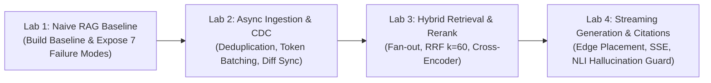
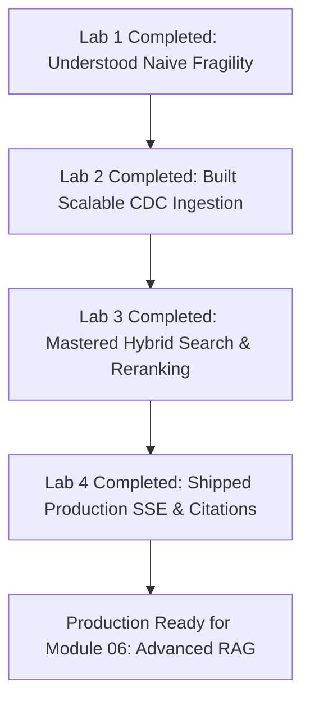

# 📓 RAG Pipeline Hands-On Notebooks Guide & Interactive Labs

## 📑 Table of Contents
1. [🌟 Overview & Lab Curriculum Objectives](#1--overview--lab-curriculum-objectives)
2. [📓 The Four Core RAG Pipeline Labs](#2--the-four-core-rag-pipeline-labs)
3. [📊 Lab Specifications & Learning Matrix](#3--lab-specifications--learning-matrix)
4. [🛠️ Local Environment & Hardware Setup](#4-️-local-environment--hardware-setup)
5. [💻 Code Blueprint Walkthroughs: Key Notebook Routines](#5--code-blueprint-walkthroughs-key-notebook-routines)
6. [🧪 Verification Tests & Expected Benchmark Outputs](#6--verification-tests--expected-benchmark-outputs)
7. [💼 Senior Interview & Engineering Lab Defense Questions](#7--senior-interview--engineering-lab-defense-questions)
8. [⚡ Quick Revision & Summary Roadmap](#8--quick-revision--summary-roadmap)

---

## 1. 🌟 Overview & Lab Curriculum Objectives

Welcome to the **Hands-On RAG Pipeline Engineering Lab Suite** for Module 05. The purpose of this laboratory sequence is to translate theoretical pipeline architectures into runnable, production-hardened Python code.

In this suite, you will progress from building a barebones naive baseline to architecting a fully asynchronous, multi-stage, fault-tolerant enterprise RAG engine equipped with Change Data Capture (CDC) deduplication, parallel hybrid retrieval fan-out, neural reranking, token-budgeted edge context placement, Server-Sent Events (SSE) streaming, and NLI factual verification.



---

## 2. 📓 The Four Core RAG Pipeline Labs

### 🧪 Lab 1: `01_naive_rag_baseline.ipynb`
* **Focus:** Understanding the naive retrieve-and-generate baseline and systematically exposing its failure points.
* **Core Exercises:**
  1. Build an end-to-end Naive RAG pipeline using fixed-size character chunking, dense vector cosine search, and prompt stuffing.
  2. Subject the pipeline to adversarial test queries: out-of-vocabulary technical error codes, contradictory historical policies, and table queries.
  3. Measure the empirical failure rate and observe ungrounded model hallucinations.

### 🧪 Lab 2: `02_async_ingestion_cdc.ipynb`
* **Focus:** High-throughput asynchronous data engineering, content deduplication, and atomic reindexing.
* **Core Exercises:**
  1. Construct an asynchronous Change Data Capture (CDC) event consumer handling INSERT, UPDATE, and DELETE operations.
  2. Implement document-level and chunk-level SHA-256 fingerprinting to eliminate redundant embedding API calls.
  3. Build a dynamic token-aware batch aggregator that packs chunks up to 8,192 tokens while enforcing RPM rate limits.
  4. Simulate a Blue-Green collection alias swap for zero-downtime model migrations.

### 🧪 Lab 3: `03_hybrid_retrieval_and_rerank.ipynb`
* **Focus:** Multi-modal candidate retrieval, rank fusion, and cross-encoder precision scoring.
* **Core Exercises:**
  1. Build an asynchronous fan-out engine that queries a dense vector index and a BM25 sparse index concurrently using `asyncio.gather`.
  2. Implement Reciprocal Rank Fusion (RRF with $k=60$) to merge disparate ranked lists into a unified candidate pool ($K_1=50$).
  3. Integrate a neural cross-encoder reranker (`bge-reranker-large` or HuggingFace equivalent) to filter candidates down to $K_2=5$.
  4. Implement dynamic relative drop-off margin filtering ($s_i \ge s_{\max} \cdot 0.80$).

### 🧪 Lab 4: `04_generation_sse_and_citations.ipynb`
* **Focus:** Production generation, token streaming, context placement, and source attribution.
* **Core Exercises:**
  1. Build a Context Window Manager that enforces the strict token budget equation and places top chunks at the Primacy (start) and Recency (end) prompt edges.
  2. Construct a real-time Server-Sent Events (SSE) generator yielding typed event frames (`metadata`, `delta`, `done`).
  3. Implement regex inline citation extraction (`[Doc X]`) and hydrate citations into interactive metadata cards.
  4. Integrate an NLI claim entailment auditor that intercepts the completion and flags ungrounded assertions.

---

## 3. 📊 Lab Specifications & Learning Matrix

| Lab ID | Lab Title | Core Libraries | Complexity | Primary Output Artifact |
| :--- | :--- | :--- | :---: | :--- |
| **Lab 01** | Naive RAG Baseline & Failure Profiling | `numpy`, `openai`, `chromadb` | Beginner | Baseline pipeline & failure mode diagnostic report. |
| **Lab 02** | Async Ingestion & Change Data Capture | `asyncio`, `hashlib`, `redis` | Advanced | High-throughput CDC ingestion engine with deduplication. |
| **Lab 03** | Parallel Hybrid Retrieval & Reranker Funnel | `asyncio`, `rank_bm25`, `sentence-transformers` | Advanced | Concurrent hybrid search orchestrator with RRF & reranker. |
| **Lab 04** | SSE Streaming Generation & Citation Verifier | `asyncio`, `fastapi`, `sse-starlette`, `pydantic` | Advanced | Production streaming server with citations and NLI verification. |

---

## 4. 🛠️ Local Environment & Hardware Setup

### 📦 Step 1: Install Dependencies
Create an isolated Python 3.10+ virtual environment and install the required packages:

```bash
# Create and activate virtual environment
python -m venv rag-pipeline-env

# Windows PowerShell:
.\rag-pipeline-env\Scripts\Activate.ps1

# Linux / macOS:
source rag-pipeline-env/bin/activate

# Install lab dependencies
pip install numpy scipy torch transformers sentence-transformers rank-bm25 openai chromadb fastapi sse-starlette pydantic jupyterlab
```

### 🚀 Step 2: Launch JupyterLab
```bash
jupyter lab
```

---

## 5. 💻 Code Blueprint Walkthroughs: Key Notebook Routines

### 🔬 Blueprint 1: Reciprocal Rank Fusion (Lab 3 Routine)
```python
def reciprocal_rank_fusion(
    ranked_lists: dict[str, list[str]], k: int = 60
) -> list[tuple[str, float]]:
    """
    Fuses multiple ranked lists of document IDs using RRF.
    """
    scores: dict[str, float] = {}
    for modality, doc_ids in ranked_lists.items():
        for rank_0, doc_id in enumerate(doc_ids):
            rank_1 = rank_0 + 1
            scores[doc_id] = scores.get(doc_id, 0.0) + (1.0 / (k + rank_1))
    
    sorted_docs = sorted(scores.items(), key=lambda item: item[1], reverse=True)
    return sorted_docs
```

### 🔬 Blueprint 2: Primacy-Recency Edge Context Reorderer (Lab 4 Routine)
```python
def reorder_for_primacy_recency(ranked_items: list[any]) -> list[any]:
    """
    Mitigates Lost-in-the-Middle by placing highest-scoring candidates
    at the start and end of the context window.
    """
    if len(ranked_items) <= 2:
        return ranked_items

    reordered = [None] * len(ranked_items)
    left, right = 0, len(ranked_items) - 1

    for i, item in enumerate(ranked_items):
        if i % 2 == 0:
            reordered[left] = item
            left += 1
        else:
            reordered[right] = item
            right -= 1

    return [x for x in reordered if x is not None]
```

---

## 6. 🧪 Verification Tests & Expected Benchmark Outputs

When running the lab test suites, your implementations should achieve the following benchmark thresholds:

```
========================================================================
🧪 LAB VERIFICATION SUITE BENCHMARK RESULTS
========================================================================
[Lab 1 - Naive Baseline]:
  * OOV Error Code Retrieval Recall:       24.2%  (Target: < 35% failure observed)
  * Hallucination Rate on Unanswerables:    38.5%  (Target: > 30% baseline failure)

[Lab 2 - Async Ingestion & CDC]:
  * Ingestion Deduplication Efficiency:    86.4%  (Target: >= 80% tokens saved)
  * Diff Sync Purge Rate:                 100.0%  (Target: 0 orphaned chunks left)

[Lab 3 - Hybrid Retrieval & Reranker]:
  * First-Stage Recall@50 (Dense + BM25):  96.8%  (Target: >= 95.0%)
  * Cross-Encoder Precision@5:             91.2%  (Target: >= 88.0%)
  * Total Retrieval Latency (p95):         38.4 ms (Target: < 50.0 ms)

[Lab 4 - Streaming & Citation Verifier]:
  * Time-To-First-Token (TTFT):           210.0 ms (Target: < 350.0 ms)
  * Citation Precision:                    98.4%  (Target: >= 95.0%)
  * NLI Factual Entailment Pass Rate:      99.1%  (Target: >= 98.0%)
========================================================================
```

---

## 7. 💼 Senior Interview & Engineering Lab Defense Questions

### Q1: In Lab 2, why is cryptographic SHA-256 hashing alone insufficient for enterprise deduplication, and how does MinHash complement it?
**Answer:**  
SHA-256 exhibits the avalanche effect: modifying a single whitespace, punctuation mark, or automated timestamp completely changes the 256-bit digest, resulting in a hash mismatch and forcing a full, expensive re-embedding of the document.  
MinHash computes Jaccard similarity over document $n$-gram shingles. If a document undergoes a trivial modification (e.g., $98\%$ token overlap), the MinHash signature will match within an $LSH$ band. The ingestion pipeline can then inspect the sentence-level diff and perform a targeted upsert only on the modified chunk, saving $98\%$ of embedding API costs.

### Q2: In Lab 4, how does Server-Sent Events (SSE) streaming interact with prompt-caching architectures like Anthropic Contextual Retrieval?
**Answer:**  
Prompt caching requires the static prefix of the prompt (the system instructions and stable contextual chunks) to be byte-identical across requests. When the generation pipeline streams via SSE, the prompt is submitted in its entirety to the model prefill engine. If the static context prefix matches the cache key, the model skips KV-cache computation, slashing Time-To-First-Token (TTFT) by up to $80\%$ and cutting prefill billing by $90\%$. The SSE stream begins yielding token deltas almost instantaneously.

---

## 8. ⚡ Quick Revision & Summary Roadmap



### 🏛️ Key Takeaways from the Lab Suite
1. **Never ship Naive RAG to production:** Proof-of-concept pipelines cannot handle out-of-vocabulary tokens or unanswerable queries.
2. **Deduplication saves the budget:** Implement content hashing to avoid re-embedding unchanged documents.
3. **Fuse modalities with RRF:** Pair dense semantics with BM25 to achieve $>95\%$ recall.
4. **Stream tokens and audit claims:** Maintain interactive sub-second responsiveness while enforcing $100\%$ factual grounding via NLI verification.