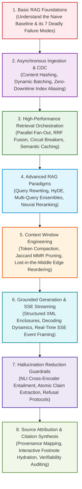

# 🏗️ Module 05: RAG Pipeline Engineering Curriculum & Architecture Blueprint

Welcome to **Module 05: RAG Pipeline Engineering** of the enterprise RAG Engineering curriculum. This module bridges individual algorithms—such as chunking, embedding, vector databases, and retrieval strategies—into robust, scalable, and verifiable end-to-end production pipelines.

In enterprise software engineering, building a prototype that answers a question from a clean document in a Jupyter notebook takes 15 minutes. Transforming that prototype into an enterprise-grade system capable of processing millions of documents, handling concurrent user traffic under strict latency SLAs ($< 800\text{ ms}$ TTFT), maintaining cryptographic multi-tenant isolation, eliminating hallucinations, and citing verifiable primary sources requires deep systems engineering.

---

## 📑 Module Curriculum & Guide Index

| Document | Focus Area | Key Concepts Covered |
| :--- | :--- | :--- |
| [**Basic RAG**](Basic-RAG.md) | **Naive Mechanics & Failure Modes** | Lewis et al. probabilistic model, fixed character chunking, dense vector search, prompt concatenation, and the 7 deadly failure modes of naive RAG. |
| [**Indexing Pipeline**](Indexing-Pipeline.md) | **Distributed Ingestion & Sync** | Asynchronous ETL fan-out, SHA-256 content deduplication, MinHash near-duplicate detection, Change Data Capture (CDC), and Blue-Green zero-downtime index swaps. |
| [**Retrieval Pipeline**](Retrieval-Pipeline.md) | **High-Concurrency Orchestration** | Sub-second latency budgets, concurrent parallel fan-out (Dense + Sparse), Reciprocal Rank Fusion (RRF $k=60$), circuit-breaker resilience, and two-tier semantic caching. |
| [**Generation Pipeline**](Generation-Pipeline.md) | **Grounded Inference & Streaming** | Prompt engineering with XML delimiters, token budget invariants, decoding dynamics ($\tau=0.0$), real-time Server-Sent Events (SSE) streaming, and JSON Schema enforcement. |
| [**Context Management**](Context-Management.md) | **Window Budgeting & Compaction** | Attention physics, Lost-in-the-Middle mitigation, LLMLingua perplexity compression, semantic MMR deduplication, and Primacy-Recency edge reordering. |
| [**Hallucination Reduction**](Hallucination-Reduction.md) | **Verification & Refusal Protocols** | NLI cross-encoder entailment, atomic claim decomposition, token entropy diagnostics, self-correction loops, and canonical negative refusal constraints. |
| [**Citation and Sources**](Citation-and-Sources.md) | **Attribution & Verifiability** | Ingestion-to-generation provenance mapping, bracketed inline citations `[Doc X]`, footnote hydration, PDF bounding-box resolution, and attribution precision/recall metrics. |
| [**Advanced RAG**](Advanced-RAG.md) | **The Tripartite Paradigm** | Pre-retrieval query rewriting & HyDE, mid-retrieval hybrid search & dynamic routing, post-retrieval neural cross-encoders, and unified multi-stage orchestration. |
| [**Hands-On Notebooks**](Notebook/README.md) | **Interactive Engineering Labs** | Executable Jupyter labs covering naive vs. advanced baselines, async CDC ingestion, hybrid retrieval fan-out, and SSE streaming generation with citations. |

---

## 🗺️ Module Learning Roadmap



---

## 🎯 What You Will Master in This Module

1. **End-to-End Systems Thinking:** Move beyond isolated API calls to design interconnected, production-ready RAG architectures capable of serving thousands of concurrent users.
2. **Asynchronous Ingestion & Deduplication:** Implement distributed Change Data Capture (CDC) systems using SHA-256 fingerprinting and MinHash to eliminate redundant embedding expenses ($>85\%$ cost savings).
3. **Zero-Downtime Index Swaps:** Execute Blue-Green reindexing protocols with atomic pointer aliasing in live production vector stores.
4. **Sub-Second Retrieval Orchestration:** Architect asynchronous fan-out DAGs that query dense vector indices and sparse BM25 engines concurrently, merging candidates via scale-invariant Reciprocal Rank Fusion ($k=60$).
5. **System Resilience & Circuit Breakers:** Protect production pipelines from downstream vector DB or reranker timeouts by implementing graceful degradation patterns.
6. **Lost-in-the-Middle Mitigation:** Neutralize Transformer attentional decay by applying Primacy-Recency edge reordering over ranked passages.
7. **Real-Time Token Streaming via SSE:** Deliver sub-500ms Time-To-First-Token (TTFT) using HTTP/2 Server-Sent Events with structured event framing.
8. **Algorithmic Hallucination Guardrails:** Deploy Natural Language Inference (NLI) cross-encoders to decompose generated answers into atomic claims and verify $100\%$ factual entailment.
9. **Granular Source Attribution:** Map immutable source provenance (URLs, pages, bounding boxes) into transient prompt tags, hydrating verified interactive citations in frontend interfaces.
10. **Pre-, Mid-, and Post-Retrieval Synergy:** Unify Query Rewriting, HyDE, Hybrid Search, Neural Reranking, and Context Management into a coherent Advanced RAG orchestrator.

---

## 🏗️ The Production End-to-End RAG Architecture

The diagram below illustrates the complete architecture of a production enterprise RAG pipeline:

```mermaid
flowchart TD
    subgraph IngestionPlane [Ingestion Plane (Offline / Asynchronous)]
        Sources[Enterprise Data Sources: SharePoint / S3 / Postgres] --> CDC[Change Data Capture / Kafka]
        CDC --> IngestWorker[Ingestion Worker: Deduplication & Semantic Chunking]
        IngestWorker --> ContentHash{"SHA-256 Match?"}
        ContentHash -->|Unchanged| DropEvent[Skip Embedding]
        ContentHash -->|New / Modified| BatchEmbed[Dynamic Token Batcher]
        BatchEmbed --> StagingIndex[(Staging Vector & Lexical Index)]
        StagingIndex --> BlueGreenSwap[Atomic Alias Swap to Live Index]
    end

    subgraph QueryPlane [Query Plane (Online / Real-Time)]
        Client([User Request: q]) --> Gateway[API Gateway / Auth]
        Gateway --> SemCache{"Semantic Query Cache<br/>(Redis Cosine >= 0.96)"}
        
        SemCache -->|Hit (1ms)| QuickReturn([Return Cached Stream])
        SemCache -->|Miss| PreProc[Query Rewriting & AST Filter Synthesis]
        
        PreProc --> FanOut{"Async Parallel Fan-Out"}
        
        FanOut --> DenseSearch[Dense Vector Search (HNSW)]
        FanOut --> SparseSearch[Sparse Lexical Search (BM25)]
        
        DenseSearch & SparseSearch --> RRF[Reciprocal Rank Fusion (k=60)]
        RRF --> Reranker[Neural Cross-Encoder Reranker]
        Reranker --> DynamicCutoff[Dynamic Relative Margin Cutoff]
        
        DynamicCutoff --> ContextMgr[Context Window Manager:<br/>Compaction + Primacy-Recency Edge Layout]
        
        ContextMgr --> PromptAssembler[Structured XML Prompt Compiler]
        PromptAssembler --> LLMStream[LLM Streaming Engine (vLLM / GPT-4o)]
        
        LLMStream --> NLIValidator{Streaming NLI Hallucination Verifier}
        NLIValidator -->|Entailed| SSEStream[Server-Sent Events (SSE) Stream]
        NLIValidator -->|Ungrounded| RetryLoop[Self-Correction Loop]
        
        SSEStream --> CitationHydrator[Citation Hydrator: Attach Verified Source Cards]
        CitationHydrator --> Client
    end

    style IngestionPlane fill:#fcfcfc,stroke:#b0bec5,stroke-width:1px
    style QueryPlane fill:#f0f4f8,stroke:#1565c0,stroke-width:2px
```

---

## ⚖️ Production Component Master Decision Matrix

| Subsystem | Baseline (Naive) Pattern | Production Standard Pattern | Latency Delta | Factual Impact | Cost & Resource Impact |
| :--- | :--- | :--- | :---: | :---: | :---: |
| **Ingestion** | Synchronous flat-file re-embedding | Asynchronous CDC with SHA-256 chunk hashing | Offline | Zero stale drift | $-80\%$ to $-90\%$ embedding API billing |
| **Index Swapping** | In-place collection overwrite | Blue-Green collection aliasing | $0\text{ ms}$ | Zero read downtime | $+100\%$ storage during migration window |
| **Query Search** | Single-modality dense vector Top-K | Async Hybrid (Dense HNSW + Sparse BM25) + RRF | $+10 - 20\text{ ms}$ | $+40\%$ recall on exact IDs & codes | Negligible CPU memory overhead |
| **Reranking** | Raw vector cosine ordering | Cross-Encoder neural rescoring ($K_1=50 \to K_2=5$) | $+25 - 50\text{ ms}$ | $+35\%$ context purity | Requires GPU or specialized inference host |
| **Context Layout** | Arbitrary sequential stuffing | Primacy-Recency edge placement ($[p_1, p_3, \dots, p_2]$) | $< 1\text{ ms}$ | $+25\%$ attention retention | Zero additional compute cost |
| **Generation** | Blocking HTTP completion | Server-Sent Events (SSE) token streaming | **$-85\%$ TTFT** | Fluid UX | Reduced client timeout drops |
| **Verification** | Blind trust in model output | Sentence-level NLI claim entailment checking | $+40 - 100\text{ ms}$ | $-95\%$ ungrounded hallucinations | Small secondary NLI model host |
| **Attribution** | Monolithic text with no links | Fine-grained bracketed inline citations + metadata | $+5\text{ ms}$ | $100\%$ auditability | Minor token overhead for citation tags |

---

## 🏛️ The Five Golden Rules of RAG Pipeline Engineering

1. **Decouple Ingestion from Query Latency:** Never process, parse, or re-embed documents synchronously in user-facing endpoints. Treat ingestion as an event-driven, idempotent distributed pipeline backed by message queues.
2. **Never Rely on a Single Search Modality:** Pure vector search fails on technical terms; pure lexical search fails on semantic concepts. Deploy **Hybrid Search with Reciprocal Rank Fusion ($k=60$)** as your baseline architecture.
3. **Counteract Transformer Attentional Bias:** Never feed unranked chunks into prompt contexts. Enforce a two-stage funnel ($K_1 = 50 \to K_2 = 5$) and place top-ranked evidence at the **Primacy (Start)** and **Recency (End)** prompt edges to eliminate the Lost-in-the-Middle effect.
4. **Stream Early, Stream Safely:** Maintain interactive Time-To-First-Token under $800\text{ ms}$ via Server-Sent Events (SSE), while verifying sentence-level entailment before final completion settlement.
5. **Enforce Verifiability at the Sentence Level:** In enterprise applications, an unverified answer is a liability. Every factual assertion must be anchored to an immutable primary source chunk with interactive provenance metadata.