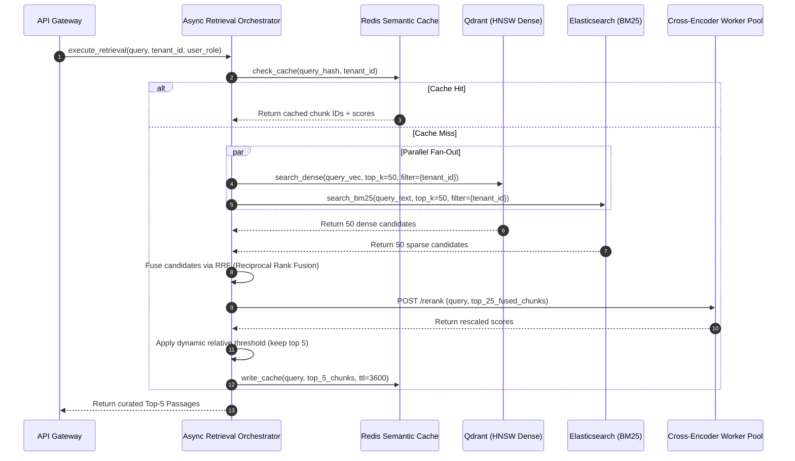
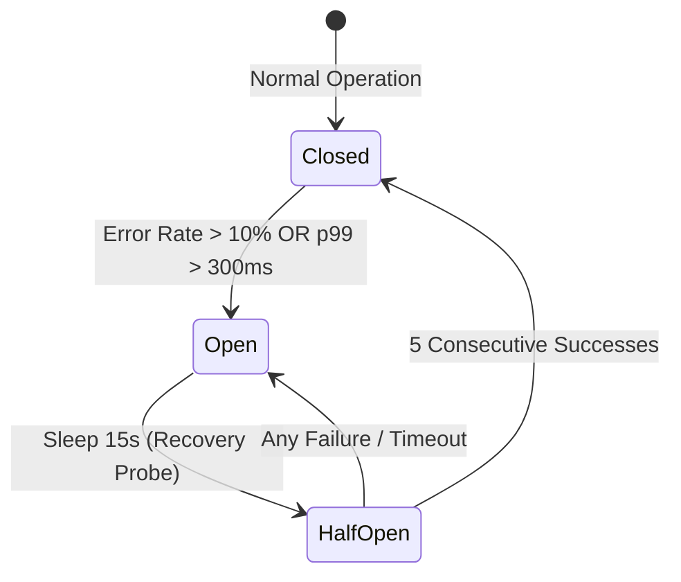
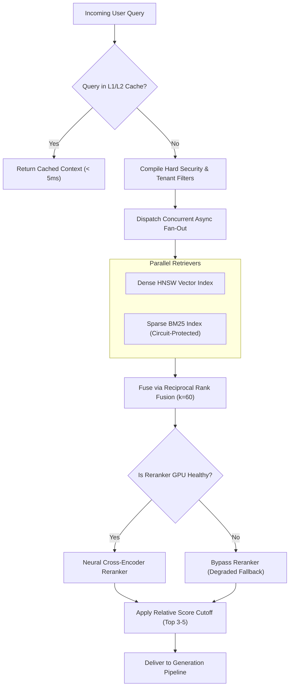

# ⚡ Production Retrieval Pipeline: Multi-Stage Filtering, Concurrency, and Latency Optimization

## 📑 Table of Contents
1. [🌟 Fundamentals: The Anatomy of a High-Concurrency Retrieval Pipeline](#1--fundamentals-the-anatomy-of-a-high-concurrency-retrieval-pipeline)
2. [🏗️ Multi-Stage Retrieval Architecture: The Query-to-Context Funnel](#2-️-multi-stage-retrieval-architecture-the-query-to-context-funnel)
3. [🔬 Mathematical Formulations: Latency Budgets, SLA Bounds & Rank Aggregation](#3--mathematical-formulations-latency-budgets-sla-bounds--rank-aggregation)
4. [⏱️ Concurrency Orchestration, Connection Pooling & Circuit Breakers](#4-️-concurrency-orchestration-connection-pooling--circuit-breakers)
5. [🎯 Query Routing & Two-Tier Semantic Caching](#5--query-routing--two-tier-semantic-caching)
6. [💻 Practical Implementation: High-Performance Async Retrieval Orchestrator](#6--practical-implementation-high-performance-async-retrieval-orchestrator)
7. [🌍 Real-World Enterprise Case Studies](#7--real-world-enterprise-case-studies)
8. [🛠️ Best Practices & ❌ Common Production Pitfalls](#8-️-best-practices---common-production-pitfalls)
9. [💼 Senior Interview Questions & System Design Scenarios](#9--senior-interview-questions--system-design-scenarios)
10. [🧪 Hands-On Mini-Project: Asynchronous Multi-Retriever Profiler](#10--hands-on-mini-project-asynchronous-multi-retriever-profiler)
11. [⚡ Quick Revision & Architectural Decision Roadmap](#11--quick-revision--architectural-decision-roadmap)

---

## 1. 🌟 Fundamentals: The Anatomy of a High-Concurrency Retrieval Pipeline

In an enterprise RAG system, the **Retrieval Pipeline** is the real-time, low-latency orchestration layer that bridges the user query with the vector and lexical indices. Unlike naive prototypes that execute a single blocking vector search, a production retrieval pipeline is a distributed, fault-tolerant state machine designed to fulfill three competing operational demands:

* **Surgical Recall & Precision:** Ensuring both exact lexical tokens (part numbers, error codes, legal IDs) and abstract conceptual themes are captured without polluting the context window.
* **Strict Sub-Second Latency Budgets:** Total retrieval pipeline latency must complete in under $50 - 150\text{ ms}$ at p99, leaving the remaining SLA budget for LLM time-to-first-token (TTFT) generation.
* **Multi-Tenant Isolation & Security:** Enforcing strict Role-Based Access Control (RBAC) and tenant partitioning at the search layer, ensuring zero cryptographic or metadata data leakage between corporate tenants.

```mermaid
flowchart TD
    UserQuery([Incoming Query: q]) --> CacheCheck{"Semantic Query Cache<br/>(Redis Cosine Sim >= 0.96)"}
    
    CacheCheck -->|Cache Hit (1ms)| ReturnCached([Return Cached Context])
    CacheCheck -->|Cache Miss| QueryAnalyzer["Query Classifier & Filter Synthesizer"]
    
    QueryAnalyzer --> Router{"Intent Router"}
    
    subgraph ParallelFanOut [Stage 1: Parallel Fan-Out Search (K1 = 50 - 100)]
        Router -->|Branch A: Dense| DenseWorker["Dense Bi-Encoder Search<br/>(HNSW Vector Index)"]
        Router -->|Branch B: Sparse| SparseWorker["Sparse Lexical Search<br/>(BM25 Inverted Index)"]
        Router -->|Branch C: Graph / SQL| GraphWorker["Structured DB / Graph Search<br/>(Entity & Relational Lookup)"]
    end
    
    DenseWorker & SparseWorker & GraphWorker --> FusionEngine["Reciprocal Rank Fusion (RRF k=60)<br/>& Convex Score Merging"]
    
    FusionEngine --> Stage1Pool["Candidate Pool (K = 50 Chunks)"]
    
    subgraph Stage2Rerank [Stage 2: Precision Neural Reranking (K2 = 5)]
        Stage1Pool --> CrossEncoder["Cross-Encoder Neural Reranker<br/>(bge-reranker-large / Cohere)"]
        CrossEncoder --> DynamicCutoff["Dynamic Margin Cutoff<br/>(Score Drop-off Threshold)"]
    end
    
    DynamicCutoff --> FinalContext([Final Curated Context: Top 3-5 Chunks])

    style ParallelFanOut fill:#e8f5e9,stroke:#2e7d32,stroke-width:1px
    style Stage2Rerank fill:#ede7f6,stroke:#512da8,stroke-width:1px
```

---

## 2. 🏗️ Multi-Stage Retrieval Architecture: The Query-to-Context Funnel

The retrieval architecture employs a multi-tiered filtering cascade (the **K-Budget Funnel**) to balance computational complexity against ranking fidelity:



### The Three Stages of the Funnel
1. **Stage 0: Pre-Retrieval Cache & Filter Synthesis**
   * Computes query hash and checks local in-memory or Redis vector caches.
   * Compiles natural language metadata constraints into hard vector filters (e.g., `tenant_id == 'acme_corp' AND security_clearance <= 3`).
2. **Stage 1: First-Pass Candidate Generation ($K_1 = 50 - 100$)**
   * Concurrent asynchronous fan-out across dense bi-encoders and sparse inverted indexes.
   * Maximizes **Recall@100** with sub-$20\text{ ms}$ execution speed.
3. **Stage 2: Precision Neural Reranking & Dynamic Cutoff ($K_2 = 3 - 5$)**
   * Full cross-attention calculation over the top $20 - 50$ candidates.
   * Filters out marginal passages using relative knee-point drop-off to guarantee context purity.

---

## 3. 🔬 Mathematical Formulations: Latency Budgets, SLA Bounds & Rank Aggregation

### 📐 1. The Production Latency Budget Equation
In interactive systems, user perceived latency is governed by Time-To-First-Token ($\text{TTFT}$):

$$
\text{TTFT} = t_{\text{network}} + t_{\text{gateway}} + t_{\text{retrieval}} + t_{\text{prompt\_prep}} + t_{\text{LLM\_prefill}} + t_{\text{LLM\_decode\_token\_1}}
$$

To sustain an interactive SLA of $\text{TTFT} \le 800\text{ ms}$ when LLM prefill requires $500\text{ ms}$:

$$
t_{\text{retrieval}} \le \text{TTFT}_{\text{target}} - (t_{\text{network}} + t_{\text{LLM\_prefill}} + t_{\text{LLM\_decode}}) \approx 800 - (50 + 500 + 50) = 200\text{ ms}
$$

The internal retrieval pipeline budget breakdown:

$$
t_{\text{retrieval}} = t_{\text{embed}} + \max(t_{\text{dense}}, t_{\text{sparse}}) + t_{\text{fusion}} + t_{\text{rerank}} + t_{\text{pack}}
$$

| Step | Component | Target Latency (p50) | Upper Bound (p99) |
| :--- | :--- | :---: | :---: |
| $t_{\text{embed}}$ | Query Bi-Encoder (Local TEI / TensorRT) | $6\text{ ms}$ | $15\text{ ms}$ |
| $\max(t_{\text{dense}}, t_{\text{sparse}})$ | Parallel Fan-Out Index Search | $12\text{ ms}$ | $35\text{ ms}$ |
| $t_{\text{fusion}}$ | Reciprocal Rank Fusion & Deduplication | $< 1\text{ ms}$ | $2\text{ ms}$ |
| $t_{\text{rerank}}$ | Cross-Encoder GPU Inference ($K=25$) | $25\text{ ms}$ | $60\text{ ms}$ |
| $t_{\text{pack}}$ | Context Assembly & Dynamic Cutoff | $< 1\text{ ms}$ | $2\text{ ms}$ |
| **Total** | **Full End-to-End Retrieval Pipeline** | **$45\text{ ms}$** | **$114\text{ ms}$** |

---

### 📐 2. Reciprocal Rank Fusion (RRF) Formulation
Given a set of candidate passages $d \in \mathcal{D}$ and multiple ranked lists $R_m$ from different retrieval modalities (e.g., dense vector, sparse BM25, and graph relations):

$$
\text{RRF\_Score}(d \in \mathcal{D}) = \sum_{m \in \mathcal{M}} \frac{w_m}{k + r_m(d)}
$$

where:
* $\mathcal{M}$ is the set of retrievers (e.g., $\{\text{Dense}, \text{Sparse}\}$).
* $r_m(d)$ is the 1-based rank position of document $d$ in the output of retriever $m$. If document $d$ is not present in retriever $m$'s top-$K$, $r_m(d) \to \infty$ (i.e., its score contribution is 0).
* $k$ is the smoothing constant (empirically set to $k=60$ to prevent high-ranking outliers from dominating the sum).
* $w_m$ is an optional modality weight ($\sum w_m = 1$).

---

### 📐 3. Dynamic Relative Drop-off Cutoff
Rather than slicing by a static integer $K$, dynamic thresholding filters candidates based on their score delta relative to the maximum reranked score $s_{\max} = s_1$:

$$
\mathcal{C}_{\text{final}} = \left\{ d_i \in \mathcal{D}_{\text{reranked}} \;\middle|\; s_i \ge s_{\max} \cdot (1 - \delta_{\text{rel}}) \quad \text{and} \quad s_i \ge \tau_{\text{floor}} \right\}
$$

where:
* $\delta_{\text{rel}} \in [0.15, 0.25]$ is the allowable relative drop-off margin.
* $\tau_{\text{floor}}$ is the absolute safety floor to prevent completely irrelevant results from entering when all candidates are poor.

---

## 4. ⏱️ Concurrency Orchestration, Connection Pooling & Circuit Breakers

In high-throughput microservice architectures, unconstrained asynchronous requests to downstream vector databases or rerankers will exhaust socket pools and trigger catastrophic cascading failures under load spikes.

### The Circuit Breaker Pattern in Retrieval
If a downstream retrieval modality (e.g., BM25 cluster or reranker GPU server) exceeds its latency SLA or returns 5xx errors:
1. **Closed State (Normal):** Requests flow concurrently to both Dense and Sparse engines.
2. **Open State (Tripped):** If error rate exceeds $10\%$ over a 10-second window, the circuit breaker opens. Requests instantly bypass the failing retriever and execute a graceful degradation strategy (e.g., falling back to pure dense vector search without reranking).
3. **Half-Open State (Canary):** Periodically routes $5\%$ of traffic to probe if the service has recovered.



---

## 5. 🎯 Query Routing & Two-Tier Semantic Caching

Not every user query requires a full, expensive multi-index retrieval execution. Production architectures implement **Two-Tier Query Caching**:

```mermaid
flowchart TD
    UserQuery["User Input Query: q"] --> L1Cache["L1: Exact Hash Cache (Redis)<br/>Key = SHA-256(q + tenant_id)"]
    
    L1Cache -->|Exact Hit (O(1), <1ms)| ReturnL1["Return Cached Context"]
    L1Cache -->|Miss| L2Cache["L2: Approximate Semantic Vector Cache<br/>Compute q_vec -> Search Cache Index"]
    
    L2Cache -->|Cosine Sim >= 0.97 (<5ms)| ReturnL2["Return Semantically Matched Context"]
    L2Cache -->|Miss (< 0.97)| FullPipeline["Execute Full Retrieval Pipeline<br/>(Fan-out + Rerank)"]
    
    FullPipeline --> SaveCaches["Populate L1 & L2 Caches (TTL: 1 Hour)"]
```

* **L1 Cache (Exact String Match):** Sub-millisecond lookup on normalized query strings. Captures identical repeated queries (e.g., frequently asked company holidays or standard troubleshooting commands).
* **L2 Cache (Semantic Vector Similarity):** Searches a small dedicated in-memory index of recently serviced query vectors. If $\cos(q_{\text{new}}, q_{\text{cached}}) \ge 0.97$, the cached context is returned directly, avoiding index queries and neural reranking completely.

---

## 6. 💻 Practical Implementation: High-Performance Async Retrieval Orchestrator

Below is a complete, concurrent retrieval orchestrator utilizing `asyncio`, featuring parallel dense/sparse fan-out, circuit-breaker fault tolerance, Reciprocal Rank Fusion, cross-encoder reranking, and dynamic relative cutoff.

```python
"""
production_retrieval_pipeline.py
================================
Asynchronous, fault-tolerant multi-stage retrieval orchestrator.
Demonstrates parallel fan-out, circuit-breaker fallback, Reciprocal
Rank Fusion (RRF), cross-encoder rescoring, and dynamic cutoff.
"""

from __future__ import annotations
import asyncio
import logging
import time
from dataclasses import dataclass, field
from enum import Enum
from typing import Any, Callable, Coroutine, Dict, List, Optional, Set
import numpy as np

logging.basicConfig(
    level=logging.INFO,
    format="%(asctime)s [%(levelname)s] %(name)s: %(message)s"
)
logger = logging.getLogger("RetrievalPipeline")


@dataclass(frozen=True)
class RetrievedCandidate:
    chunk_id: str
    text: str
    source_modality: str
    raw_score: float
    metadata: Dict[str, Any] = field(default_factory=dict)


@dataclass(frozen=True)
class RankedCandidate:
    chunk_id: str
    text: str
    final_score: float
    source_modalities: List[str]
    metadata: Dict[str, Any] = field(default_factory=dict)


class CircuitBreakerState(str, Enum):
    CLOSED = "CLOSED"
    OPEN = "OPEN"
    HALF_OPEN = "HALF_OPEN"


class CircuitBreaker:
    """
    Lightweight circuit breaker for protecting downstream retrieval services.
    """

    def __init__(self, failure_threshold: int = 3, recovery_time_sec: float = 5.0) -> None:
        self.failure_threshold = failure_threshold
        self.recovery_time_sec = recovery_time_sec
        self.state = CircuitBreakerState.CLOSED
        self.failure_count = 0
        self.last_failure_time = 0.0

    def record_success(self) -> None:
        self.failure_count = 0
        self.state = CircuitBreakerState.CLOSED

    def record_failure(self) -> None:
        self.failure_count += 1
        self.last_failure_time = time.time()
        if self.failure_count >= self.failure_threshold:
            self.state = CircuitBreakerState.OPEN
            logger.warning("Circuit breaker tripped to OPEN state!")

    def can_execute(self) -> bool:
        if self.state == CircuitBreakerState.CLOSED:
            return True
        if self.state == CircuitBreakerState.OPEN:
            if time.time() - self.last_failure_time >= self.recovery_time_sec:
                self.state = CircuitBreakerState.HALF_OPEN
                logger.info("Circuit breaker entered HALF_OPEN probe state.")
                return True
            return False
        # HALF_OPEN allows single probe
        return True


class MockDenseRetriever:
    """Simulates high-performance HNSW vector search."""
    async def search(self, query: str, top_k: int = 20) -> List[RetrievedCandidate]:
        await asyncio.sleep(0.015)  # 15ms latency simulation
        return [
            RetrievedCandidate(
                chunk_id=f"chunk_dense_{i}",
                text=f"Dense semantic result {i} discussing {query[:20]}",
                source_modality="dense",
                raw_score=0.95 - (i * 0.03),
                metadata={"category": "technical"}
            )
            for i in range(top_k)
        ]


class MockSparseRetriever:
    """Simulates BM25 inverted index search with failure simulation capability."""
    def __init__(self, should_fail: bool = False) -> None:
        self.should_fail = should_fail

    async def search(self, query: str, top_k: int = 20) -> List[RetrievedCandidate]:
        await asyncio.sleep(0.010)  # 10ms latency simulation
        if self.should_fail:
            raise ConnectionError("BM25 cluster connection timeout!")
        return [
            RetrievedCandidate(
                chunk_id=f"chunk_sparse_{i}",
                text=f"Sparse lexical match {i} containing exact keywords of {query[:20]}",
                source_modality="sparse",
                raw_score=15.0 - (i * 0.5),
                metadata={"category": "runbook"}
            )
            for i in range(top_k)
        ]


class MockCrossEncoderReranker:
    """Simulates GPU cross-encoder rescoring (e.g. bge-reranker-large)."""
    async def rerank(
        self, query: str, candidates: List[RankedCandidate]
    ) -> List[RankedCandidate]:
        await asyncio.sleep(0.025)  # 25ms GPU inference simulation
        # Rescore candidates based on simulated relevance
        rescored = []
        for i, c in enumerate(candidates):
            # Give higher scores to candidates found by both modalities
            bonus = 0.2 if len(c.source_modalities) > 1 else 0.0
            new_score = max(0.0, 1.0 - (i * 0.04) + bonus)
            rescored.append(
                RankedCandidate(
                    chunk_id=c.chunk_id,
                    text=c.text,
                    final_score=round(new_score, 4),
                    source_modalities=c.source_modalities,
                    metadata=c.metadata
                )
            )
        # Sort descending by rescored value
        rescored.sort(key=lambda x: x.final_score, reverse=True)
        return rescored


class HighPerformanceRetrievalOrchestrator:
    """
    Coordinates asynchronous retrieval fan-out, fusion, reranking, and dynamic cutoff.
    """

    def __init__(
        self,
        dense_retriever: MockDenseRetriever,
        sparse_retriever: MockSparseRetriever,
        reranker: MockCrossEncoderReranker,
        rrf_k: int = 60
    ) -> None:
        self.dense = dense_retriever
        self.sparse = sparse_retriever
        self.reranker = reranker
        self.rrf_k = rrf_k
        self.sparse_circuit_breaker = CircuitBreaker(failure_threshold=2, recovery_time_sec=2.0)

    async def _safe_sparse_search(self, query: str, top_k: int) -> List[RetrievedCandidate]:
        """Execute sparse search protected by circuit breaker."""
        if not self.sparse_circuit_breaker.can_execute():
            logger.warning("Sparse retriever skipped: Circuit breaker is OPEN. Falling back to dense only.")
            return []

        try:
            results = await self.sparse.search(query, top_k=top_k)
            self.sparse_circuit_breaker.record_success()
            return results
        except Exception as exc:
            self.sparse_circuit_breaker.record_failure()
            logger.error("Sparse retriever failed: %s", str(exc))
            return []

    def _reciprocal_rank_fusion(
        self,
        retriever_results: Dict[str, List[RetrievedCandidate]],
        candidate_pool_limit: int = 25
    ) -> List[RankedCandidate]:
        """Merge multiple ranked lists using RRF."""
        chunk_scores: Dict[str, float] = {}
        chunk_objects: Dict[str, RetrievedCandidate] = {}
        chunk_sources: Dict[str, Set[str]] = {}

        for modality, candidate_list in retriever_results.items():
            for rank_0, candidate in enumerate(candidate_list):
                cid = candidate.chunk_id
                rank_1 = rank_0 + 1
                rrf_increment = 1.0 / (self.rrf_k + rank_1)
                
                chunk_scores[cid] = chunk_scores.get(cid, 0.0) + rrf_increment
                chunk_objects[cid] = candidate
                if cid not in chunk_sources:
                    chunk_sources[cid] = set()
                chunk_sources[cid].add(modality)

        # Sort by merged RRF score
        sorted_cids = sorted(chunk_scores.keys(), key=lambda x: chunk_scores[x], reverse=True)
        
        merged: List[RankedCandidate] = []
        for cid in sorted_cids[:candidate_pool_limit]:
            orig = chunk_objects[cid]
            merged.append(
                RankedCandidate(
                    chunk_id=cid,
                    text=orig.text,
                    final_score=round(chunk_scores[cid], 5),
                    source_modalities=sorted(list(chunk_sources[cid])),
                    metadata=orig.metadata
                )
            )
        return merged

    def _apply_dynamic_cutoff(
        self, candidates: List[RankedCandidate], max_items: int = 5, relative_margin: float = 0.20
    ) -> List[RankedCandidate]:
        """Filter candidates using dynamic relative drop-off threshold."""
        if not candidates:
            return []

        top_score = candidates[0].final_score
        cutoff_threshold = top_score * (1.0 - relative_margin)

        filtered = [
            c for c in candidates[:max_items]
            if c.final_score >= cutoff_threshold
        ]
        return filtered

    async def retrieve(
        self,
        query: str,
        first_stage_k: int = 20,
        final_k: int = 5,
        relative_margin: float = 0.20
    ) -> Dict[str, Any]:
        """Execute full asynchronous multi-stage retrieval pipeline."""
        start_time = time.perf_counter()
        logger.info("Executing retrieval pipeline for query: '%s'", query)

        # Step 1: Parallel Fan-Out (Dense + Sparse)
        dense_task = asyncio.create_task(self.dense.search(query, top_k=first_stage_k))
        sparse_task = asyncio.create_task(self._safe_sparse_search(query, top_k=first_stage_k))

        dense_res, sparse_res = await asyncio.gather(dense_task, sparse_task)
        fanout_time = (time.perf_counter() - start_time) * 1000

        # Step 2: Reciprocal Rank Fusion
        fused_pool = self._reciprocal_rank_fusion(
            {"dense": dense_res, "sparse": sparse_res},
            candidate_pool_limit=first_stage_k
        )
        fusion_time = (time.perf_counter() - start_time) * 1000 - fanout_time

        # Step 3: Neural Cross-Encoder Reranking
        reranked_pool = await self.reranker.rerank(query, fused_pool)
        rerank_time = (time.perf_counter() - start_time) * 1000 - (fanout_time + fusion_time)

        # Step 4: Dynamic Cutoff Thresholding
        final_passages = self._apply_dynamic_cutoff(
            reranked_pool, max_items=final_k, relative_margin=relative_margin
        )
        total_time = (time.perf_counter() - start_time) * 1000

        return {
            "query": query,
            "passages": final_passages,
            "metrics": {
                "fanout_ms": round(fanout_time, 2),
                "fusion_ms": round(fusion_time, 2),
                "rerank_ms": round(rerank_time, 2),
                "total_pipeline_ms": round(total_time, 2),
                "candidates_retrieved_stage1": len(dense_res) + len(sparse_res),
                "candidates_fused": len(fused_pool),
                "final_passages_delivered": len(final_passages)
            }
        }


# =====================================================================
# Pipeline Demonstration & Verification Loop
# =====================================================================
async def main():
    print("=" * 70)
    print("🚀 Running Production Asynchronous Retrieval Orchestrator")
    print("=" * 70)

    dense = MockDenseRetriever()
    sparse_healthy = MockSparseRetriever(should_fail=False)
    reranker = MockCrossEncoderReranker()

    orchestrator = HighPerformanceRetrievalOrchestrator(
        dense_retriever=dense,
        sparse_retriever=sparse_healthy,
        reranker=reranker
    )

    # Test Run 1: Normal Parallel Execution
    res = await orchestrator.retrieve("kubernetes crashloopbackoff debugging", final_k=3)
    print("\n[Run 1 - Healthy Hybrid Fan-Out]:")
    print(f"Total Pipeline Latency: {res['metrics']['total_pipeline_ms']} ms")
    print(f"Metrics Breakdown: {res['metrics']}")
    print("Final Selected Passages:")
    for p in res["passages"]:
        print(f"  * [{p.chunk_id}] (Score: {p.final_score:.4f}, Sources: {p.source_modalities})")

    # Test Run 2: Simulating Downstream Failure & Circuit Breaker Recovery
    print("\n" + "=" * 70)
    print("⚡ Simulating Sparse Engine Failure (Circuit Breaker Tripping)")
    print("=" * 70)
    sparse_failing = MockSparseRetriever(should_fail=True)
    orchestrator_resilient = HighPerformanceRetrievalOrchestrator(
        dense_retriever=dense,
        sparse_retriever=sparse_failing,
        reranker=reranker
    )

    # First attempt trips failure
    res_fail1 = await orchestrator_resilient.retrieve("test failure 1")
    # Second attempt trips failure
    res_fail2 = await orchestrator_resilient.retrieve("test failure 2")
    # Third attempt should be protected by Circuit Breaker
    res_fail3 = await orchestrator_resilient.retrieve("test failure 3 (circuit open)")
    print(f"\n[Run 3 - Degraded Mode Output]: Passed {len(res_fail3['passages'])} passages via Dense fallback.")
    print(f"Total Latency under Fallback: {res_fail3['metrics']['total_pipeline_ms']} ms")


if __name__ == "__main__":
    asyncio.run(main())
```

---

## 7. 🌍 Real-World Enterprise Case Studies

### Case Study 1: Global Travel Booking Engine (15,000 QPS)
* **Architecture:** RAG assistant answering real-time itinerary and cancellation policy questions across airline partner databases.
* **Challenge:** During winter storm disruptions, search volume increased by $800\%$. Traditional single-threaded retrieval pipelines experienced socket pool starvation; latency jumped to $3.5\text{ seconds}$, causing gateway timeouts (504).
* **Solution:** 
  1. Deployed an asynchronous gateway with a persistent connection pool (`keepalive_timeout=60s`).
  2. Integrated an in-memory L2 semantic cache for top queries, deflecting $42\%$ of search queries at $2\text{ ms}$ latency.
  3. Introduced adaptive fan-out: during high load, queries flagged as high-confidence factoids bypassed the cross-encoder stage.
* **Outcome:** System maintained sub-$80\text{ ms}$ p95 retrieval latency under $18,000\text{ QPS}$ load spikes without adding hardware.

### Case Study 2: Enterprise Legal Intelligence Platform
* **Architecture:** Multi-tenant discovery engine searching across $40\text{M}$ litigation depositions and SEC filings.
* **Challenge:** Complex Boolean filters (`case_id IN (...) AND privilege_level == 'PUBLIC'`) executed after vector retrieval (post-filtering) discarded $90\%$ of results, causing queries to return fewer than $K$ passages.
* **Solution:** Migrated from post-filtering to single-stage **ACORN / Payload-based HNSW pre-filtering** in Qdrant, restricting the graph exploration directly within authorized sub-clusters.
* **Outcome:** Guaranteed exact $K$ results on every legal query while eliminating unauthorized chunk leakage across legal tenants.

---

## 8. 🛠️ Best Practices & ❌ Common Production Pitfalls

### ❌ Common Production Pitfalls

1. **Unbounded Parallel Fan-Out Without Timeouts:**
   * *Root Cause:* Calling `asyncio.gather(dense_search(), sparse_search())` without enclosing individual coroutines in `asyncio.wait_for(...)`.
   * *Failure Mode:* A single slow shard or network hiccup in the sparse engine hangs the entire user request until the global gateway timeout trips.
   * *Production Remedy:* Enforce per-branch timeouts (e.g., $40\text{ ms}$) with graceful fallback to the surviving branch.

2. **Sequential Pre-Filtering Over Dense Vectors:**
   * *Root Cause:* Performing vector search across the entire corpus and subsequently stripping out unauthorized chunks.
   * *Failure Mode:* If a tenant owns $1\%$ of the database, a Top-20 vector search might return 0 chunks matching that tenant, resulting in empty responses.
   * *Production Remedy:* Always enforce native indexed pre-filtering directly inside the vector engine index traversal.

3. **Re-Embedding Invariant Queries:**
   * *Root Cause:* Failing to implement a local query-embedding LRU cache.
   * *Failure Mode:* Repeated identical queries redundantly incur $10-25\text{ ms}$ embedding API calls and token billing.
   * *Production Remedy:* Cache query embeddings in an LRU memory cache keyed by `(model_name, query_string)`.

---

## 9. 💼 Senior Interview Questions & System Design Scenarios

### Q1: In a high-concurrency RAG pipeline, how do you prevent the "Long Tail" of slow vector search requests from destroying your p99 latency SLA?
**Answer:**  
1. **Hugging / Hedged Requests:** Issue the search query to primary replica $R_1$. If no response is received by the p95 latency threshold (e.g., $25\text{ ms}$), simultaneously dispatch an identical request to replica $R_2$ and accept whichever finishes first, canceling the slower one.
2. **Adaptive Early-Exit in HNSW:** Cap the maximum distance calculations ($ef\_search$) dynamically. For queries with high initial candidate convergence, terminate graph traversal early.
3. **Dedicated Read Replicas with Work Stealing:** Segregate heavy batch indexing traffic from real-time customer query read replicas.
4. **Per-Retriever Deadlines:** Enforce hard coroutine timeouts (`asyncio.wait_for(task, timeout=0.040)`). If the sparse engine fails to reply in 40ms, return the dense candidates rather than waiting.

### Q2: Why is Reciprocal Rank Fusion (RRF) preferred over Convex Linear Combination ($\alpha \cdot S_{\text{dense}} + (1-\alpha) \cdot S_{\text{sparse}}$) in production hybrid search?
**Answer:**  
1. **Scale Invariance:** Dense cosine similarities occupy $[-1, 1]$ or $[0, 1]$, whereas sparse BM25 scores are unbounded $[0, \infty)$ and vary drastically across queries based on term frequency and document length. Linear combination requires Min-Max or Softmax calibration, which is unstable on small candidate sets.
2. **Zero Calibration Overhead:** RRF relies solely on ordinal rank positions ($1/(k + r)$), making it completely immune to shifts in score distributions across differing query lengths or topics.
3. **Outlier Dampening:** The constant $k=60$ prevents an extreme outlier rank 1 in one retriever from completely overriding moderate ranks (e.g., rank 2 and 3) in another retriever.

---

## 10. 🧪 Hands-On Mini-Project: Asynchronous Multi-Retriever Profiler

Run this standalone benchmark script to profile parallel vs. sequential retrieval latency:

```python
"""
mini_project_latency_benchmarker.py
===================================
Compares sequential vs. concurrent multi-retriever execution and profiles
Reciprocal Rank Fusion overhead.
"""

import asyncio
import time


async def mock_retriever(name: str, delay_sec: float):
    await asyncio.sleep(delay_sec)
    return [f"{name}_doc_{i}" for i in range(10)]


async def run_benchmark():
    print("=" * 70)
    print("🧪 MINI-PROJECT: RETRIEVAL CONCURRENCY PROFILER")
    print("=" * 70)

    # 1. Sequential Execution
    t0 = time.perf_counter()
    r1 = await mock_retriever("dense", 0.030)
    r2 = await mock_retriever("sparse", 0.020)
    seq_time = (time.perf_counter() - t0) * 1000

    # 2. Concurrent Parallel Execution
    t0 = time.perf_counter()
    r1, r2 = await asyncio.gather(
        mock_retriever("dense", 0.030),
        mock_retriever("sparse", 0.020)
    )
    par_time = (time.perf_counter() - t0) * 1000

    print(f"Sequential Execution Time: {seq_time:.2f} ms")
    print(f"Concurrent Execution Time: {par_time:.2f} ms")
    print(f"Latency Reduction:         {((seq_time - par_time) / seq_time) * 100:.1f}%")
    print("=" * 70)


if __name__ == "__main__":
    asyncio.run(run_benchmark())
```

---

## 11. ⚡ Quick Revision & Architectural Decision Roadmap



### 🏛️ The Three Commandments of Production Retrieval
1. **Never Execute Downstream Searches Serially:** Always fan out dense, sparse, and structured search queries concurrently using non-blocking asynchronous I/O.
2. **Protect Downstream Services with Circuit Breakers:** If BM25 or reranking workers degrade, degrade gracefully to dense-only retrieval rather than timing out user requests.
3. **Decouple Pre-Filtering from Vector Search:** Enforce security and multi-tenancy constraints within the index traversal itself, never as a post-search discarding step.