# ⚡ Module 06: Advanced RAG Architectures & Next-Gen Paradigms Curriculum

Welcome to **Module 06: Advanced RAG Architectures & Next-Gen Paradigms** of the enterprise RAG Engineering curriculum. This module guides you through state-of-the-art information retrieval architectures, moving beyond simple vector similarity into deep cross-attention, multi-vector late interaction, self-reflective loops, hierarchical trees, knowledge graphs, and multi-modal vision systems.

---

## 📑 Module Curriculum & Guide Index

| Topic File | Focus Domain | Architectural Breakthrough & Key Concepts |
| :--- | :--- | :--- |
| [**06.1 Reranking**](Reranking.md) | **Multi-Stage IR Foundations** | The Two-Stage Retrieval Cascade, $O(\log N)$ recall candidate generation vs. $O(K \cdot L^2)$ precision reranking, calibrated cutoff thresholds, and rank inversion defense. |
| [**06.2 Cross-Encoder Reranking**](Cross-Encoder-Reranking.md) | **Deep Neural Attention** | All-to-all query-document cross-attention, BAAI `bge-reranker-v2-m3`, Cohere Rerank v3.5, MarginMSE distillation, INT8/FP16 quantization, and hard-negative discrimination. |
| [**06.3 ColBERT**](ColBERT.md) | **Contextualized Late Interaction** | Multi-vector token representations, the `MaxSim` operator, ColBERTv2 residual 2-bit quantization, and the PLAID sub-30ms search engine. |
| [**06.4 HyDE**](HyDE.md) | **Zero-Shot Query Expansion** | Resolving question-document asymmetry via hallucinated synthetic documents, manifold projection geometry, expectation centroid vectors, and RRF hybrid safeguarding. |
| [**06.5 Small-to-Big Retrieval**](Small-to-Big-Retrieval.md) | **Decoupled Search & Context** | Overcoming the chunk granularity paradox, sentence-window radius extraction, hierarchical parent-child trees, adjacent window interval stitching, and external KV storage. |
| [**06.6 Corrective RAG (CRAG)**](Corrective-RAG.md) | **Self-Correction & Fallbacks** | Closed-loop retrieval evaluation, tripartite decision boundaries (`CORRECT`, `INCORRECT`, `AMBIGUOUS`), decompose-and-filter sentence knowledge stripping, and live web search fallback. |
| [**06.7 Self-RAG**](Self-RAG.md) | **Introspective Reflection Tokens** | End-to-end self-reflective generation, vocabulary-level reflection tokens (`[Retrieve]`, `[IsRel]`, `[IsSup]`, `[IsUse]`), and segment-level beam search with factual attribution. |
| [**06.8 Adaptive RAG**](Adaptive-RAG.md) | **Dynamic Complexity Routing** | Slaying the one-size-fits-all anti-pattern: sub-10ms SLM classification routing queries into Tier 0 (Parametric), Tier 1 (Single-Hop RAG), or Tier 2 (Multi-Hop Iterative Graph). |
| [**06.9 RAPTOR**](RAPTOR.md) | **Recursive Abstractive Trees** | Unsupervised GMM soft-clustering with BIC selection, UMAP projection, recursive bottom-up LLM summarization, and unified collapsed multi-scale search. |
| [**06.10 GraphRAG**](GraphRAG.md) | **Knowledge Graphs & Communities** | RDF entity-relation triples, Newman-Girvan modularity optimization, the hierarchical Leiden community algorithm, Local Ego Search vs. Global Map-Reduce Community Summarization. |
| [**06.11 Multi-Modal RAG**](Multi-Modal-RAG.md) | **Vision-Language Document Search** | Eliminating destructive OCR: raw page image rendering, SigLIP contrastive loss, ColPali visual patch MaxSim late interaction, and Vision-Language Model (VLM) context injection. |

---

## 🗺️ Module Learning Roadmap

```mermaid
flowchart TD
    M1["1. Reranking Foundations<br/>(The Multi-Stage Retrieval Cascade & Candidate Funnel)"] --> M2["2. Deep Neural Cross-Encoders<br/>(Full All-to-All Cross-Attention Scoring & Quantization)"]
    
    M2 --> M3["3. ColBERT & Late Interaction<br/>(Multi-Vector Token Matrices, MaxSim & PLAID Indexing)"]
    
    M3 --> M4["4. HyDE Manifold Projection<br/>(Hypothetical Document Embeddings & Centroid Vectors)"]
    
    M4 --> M5["5. Small-to-Big Retrieval<br/>(Decoupling Search Granularity from LLM Context Assembly)"]
    
    M5 --> M6["6. Corrective RAG (CRAG)<br/>(Confidence Grading, Knowledge Stripping & Fallback Web Search)"]
    
    M6 --> M7["7. Self-Reflective RAG (Self-RAG)<br/>(Adaptive Retrieval & Inline Reflection Tokens: IsRel, IsSup, IsUse)"]
    
    M7 --> M8["8. Adaptive Complexity Routing<br/>(Sub-10ms SLM Classifier: Tier 0 vs Tier 1 vs Tier 2)"]
    
    M8 --> M9["9. RAPTOR Recursive Trees<br/>(GMM Soft Clustering, Hierarchical Summaries & Collapsed Search)"]
    
    M9 --> M10["10. GraphRAG Knowledge Graphs<br/>(Leiden Community Detection & Global Map-Reduce Synthesis)"]
    
    M10 --> M11["11. Multi-Modal Visual RAG<br/>(ColPali Vision Transformers, Visual Patches & VLM Context)"]

    style M1 fill:#e3f2fd,stroke:#1565c0,stroke-width:2px
    style M2 fill:#f3e5f5,stroke:#7b1fa2,stroke-width:2px
    style M3 fill:#e8f5e9,stroke:#2e7d32,stroke-width:2px
    style M4 fill:#fffde7,stroke:#fbc02d,stroke-width:2px
    style M5 fill:#e0f2f1,stroke:#00796b,stroke-width:2px
    style M6 fill:#ffebee,stroke:#c62828,stroke-width:2px
    style M7 fill:#ede7f6,stroke:#512da8,stroke-width:2px
    style M8 fill:#e1f5fe,stroke:#0288d1,stroke-width:2px
    style M9 fill:#f1f8e9,stroke:#558b2f,stroke-width:2px
    style M10 fill:#fff3e0,stroke:#e65100,stroke-width:2px
    style M11 fill:#fce4ec,stroke:#d81b60,stroke-width:2px
```

---

## ⚖️ Architectural Decision & Trade-Off Matrix

| Architectural Pattern | Ingestion Compute Cost | Query Latency (P95) | Factual Precision | Global Thematic Capability | Best Suited Enterprise Domains |
| :--- | :--- | :--- | :--- | :--- | :--- |
| **Two-Stage Cross-Encoder** | Low ($1\times$) | $40\text{--}80\,\text{ms}$ | **Maximum (Local)**| Weak | High-volume search, customer support, enterprise intranets |
| **ColBERTv2 / PLAID** | Moderate ($2.5\times$) | **$15\text{--}35\,\text{ms}$** | **Very High** | Moderate | API documentation, technical specs, code libraries |
| **HyDE + Hybrid RRF** | Low ($1.2\times$) | $350\text{--}600\,\text{ms}$ | High | Weak | Obscure diagnostic search, IT runbooks, cold-start queries |
| **Small-to-Big Windowing** | Low ($1.5\times$) | $25\text{--}50\,\text{ms}$ | **Very High** | Moderate | Legal contracts, compliance covenants, insurance policies |
| **Corrective RAG (CRAG)** | Low ($1\times$) | $150\text{--}800\,\text{ms}$ | High | Moderate | Fast-moving markets, breaking financial news, hybrid IT support |
| **Self-RAG** | Very High (Model SFT) | $200\text{--}1,200\,\text{ms}$| **Maximum** | Moderate | Medical diagnosis, clinical trial guidance, compliance validation |
| **Adaptive Routing** | Low ($1.1\times$) | **$10\text{--}400\,\text{ms}$** | High | Dynamic | Large-scale multi-intent enterprise portals (60% cost reduction) |
| **RAPTOR Recursive Trees** | Moderate ($4\times$) | $45\text{--}90\,\text{ms}$ | High | **Exceptional** | Long legal dockets, academic literature, SEC 10-K filings |
| **Microsoft GraphRAG** | **Highest ($10\text{--}15\times$)**| $350\text{--}3,500\,\text{ms}$| **Exceptional** | **Maximum** | Anti-money laundering, biomedical pathways, intelligence dockets |
| **ColPali Multi-Modal** | Moderate ($3\times$) | $45\text{--}75\,\text{ms}$ | **Exceptional** | Moderate | Complex PDF tables, engineering blueprints, financial slide decks |

---

## 🎯 Master Learning Objectives

By completing Module 06, you will possess staff-level mastery of advanced RAG engineering:
1. **Precision Neural Reranking:** Eliminate false-positive vector neighbors by deploying GPU-accelerated cross-encoders (`bge-reranker-v2-m3`, Cohere Rerank) with calibrated sigmoid thresholds.
2. **Late-Interaction Retrieval:** Build high-speed multi-vector search engines using ColBERTv2 and PLAID, achieving cross-encoder accuracy at sub-30ms latencies.
3. **Overcoming Information Bottlenecks:** Apply Small-to-Big sentence windowing and interval stitching to decouple retrieval search granularity from generative context window assembly.
4. **Self-Correcting Closed Loops:** Architect CRAG control loops that audit internal candidate confidence, strip distractor sentences, and trigger live web search fallback.
5. **Introspective Generative Models:** Understand Self-RAG reflection tokens (`[Retrieve]`, `[IsRel]`, `[IsSup]`, `[IsUse]`) and segment-level beam search decoding for mathematically provable factual attribution.
6. **Cost-Optimized Adaptive Routing:** Implement sub-10ms SLM classifiers that route queries across parametric generation, single-hop hybrid RAG, and iterative multi-hop graphs, slashing production costs by $> 50\%$.
7. **Hierarchical Macro-Sensemaking:** Construct recursive abstractive trees (RAPTOR) and entity-relationship knowledge graphs (GraphRAG) with Leiden community detection, solving dataset-wide thematic synthesis.
8. **End-to-End Visual Retrieval:** Retire fragile text OCR pipelines by deploying ColPali vision transformers to index raw document page images directly for Vision-Language Models.
