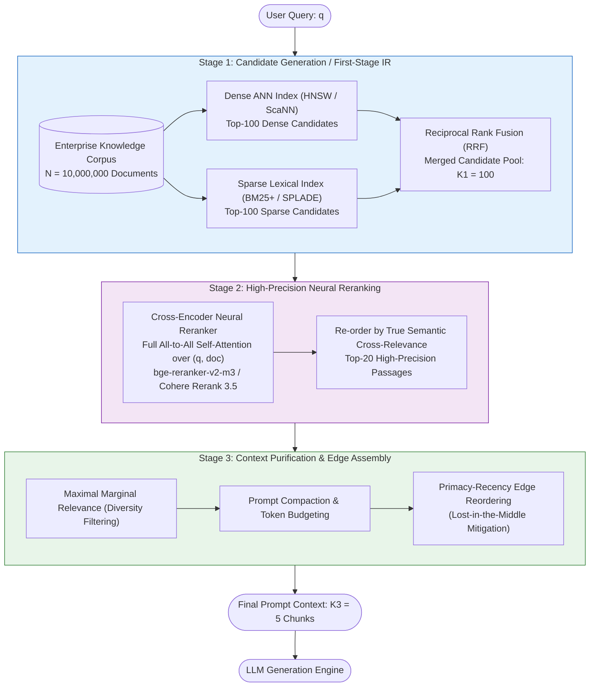
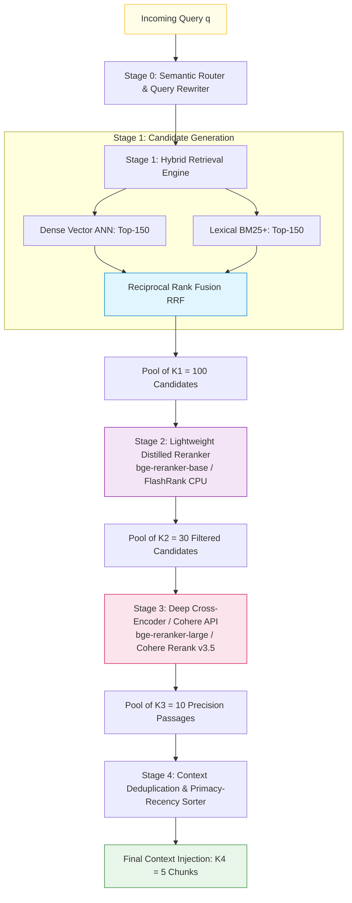
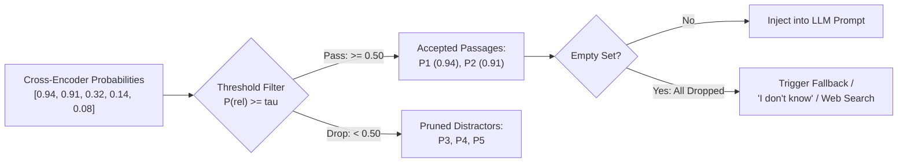
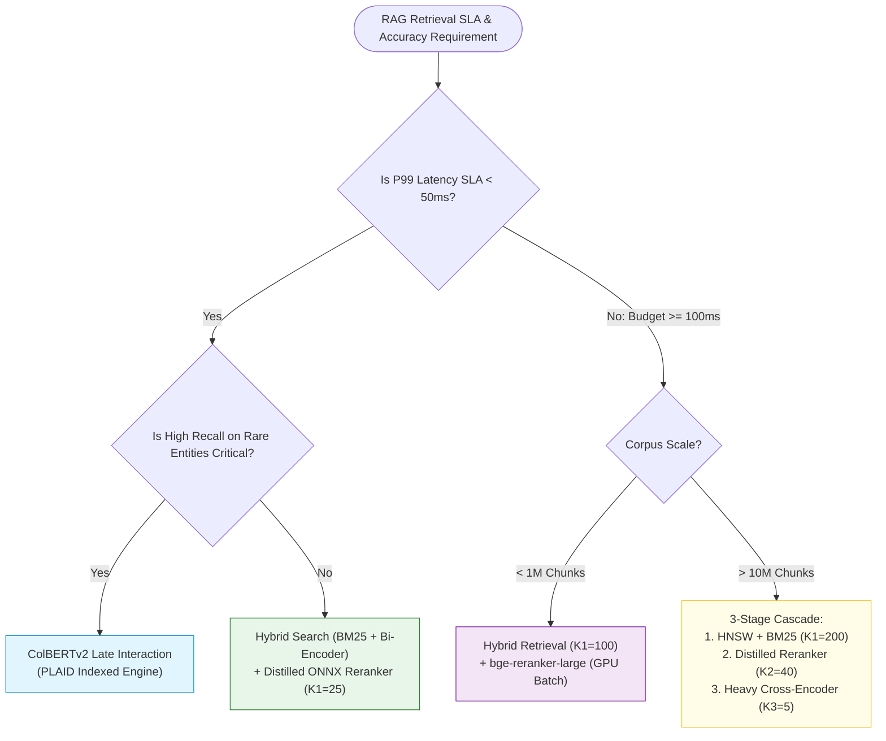

# 🔄 Reranking Foundations: Multi-Stage Information Retrieval and Candidate Scoring

## 📑 Table of Contents
1. [🌟 Fundamentals: The Multi-Stage Information Retrieval (IR) Paradigm](#1--fundamentals-the-multi-stage-information-retrieval-ir-paradigm)
2. [🔬 Mathematical Formulations: Funnel Complexity & Scoring Dynamics](#2--mathematical-formulations-funnel-complexity--scoring-dynamics)
3. [🏗️ Two-Stage vs. Multi-Stage Retrieval Funnel Architecture](#3-️-two-stage-vs-multi-stage-retrieval-funnel-architecture)
4. [⚖️ Bi-Encoders vs. Cross-Encoders vs. Late Interaction: Trade-Off Matrix](#4-️-bi-encoders-vs-cross-encoders-vs-late-interaction-trade-off-matrix)
5. [📊 Score Normalization, Calibrated Thresholding & Rank Inversion](#5--score-normalization-calibrated-thresholding--rank-inversion)
6. [💻 Practical Implementation: Production-Grade Multi-Stage Retrieval Engine](#6--practical-implementation-production-grade-multi-stage-retrieval-engine)
7. [🌍 Real-World Enterprise Production Case Studies](#7--real-world-enterprise-production-case-studies)
8. [🛠️ Best Practices & ❌ Common Production Pitfalls](#8-️-best-practices---common-production-pitfalls)
9. [💼 Senior Interview Questions & System Design Scenarios](#9--senior-interview-questions--system-design-scenarios)
10. [🧪 Hands-On Mini-Project: Cascade Latency-Precision Profiler](#10--hands-on-mini-project-cascade-latency-precision-profiler)
11. [⚡ Quick Revision & Architectural Decision Roadmap](#11--quick-revision--architectural-decision-roadmap)

---

## 1. 🌟 Fundamentals: The Multi-Stage Information Retrieval (IR) Paradigm

In naive RAG pipelines, retrieval is treated as an isolated, single-step operation: a user query is converted into a continuous dense vector, compared against indexed document chunks via vector similarity (cosine or inner product), and the top-$K$ candidates are immediately injected into the LLM context prompt.

While this approach works for toy benchmarks, **single-stage dense retrieval systematically degrades in enterprise production**:
* **Vector Compression Loss (The Information Bottleneck):** Bi-encoder embedding models compress 512–8,192 tokens of rich document syntax into a single fixed-dimensional vector (e.g., 768 or 1,536 dimensions). This lossy projection discards subtle structural semantics, technical identifiers, negation, and fine-grained entity relationships.
* **Semantic Bleed & False Neighbors:** In large corpora ($10^6$ to $10^9$ passages), dense vector spaces become congested. Passages discussing tangentially related topics frequently cluster closer to the query than passages containing the exact, authoritative factual answer.
* **Asymmetric Query-Document Semantics:** A query is an interrogative statement ("How do I configure OAuth PKCE in iOS 18?"), whereas documents are declarative technical specifications. Dot-product similarity between disparate linguistic forms often penalizes the correct factual passage.

To solve this dilemma without incurring prohibitive compute costs across billions of documents, modern search systems adopt the **Multi-Stage Information Retrieval (IR) Cascade**.



### The Architectural Contract of Multi-Stage IR
The retrieval pipeline is split into asymmetric stages with inverted priorities:
1. **First-Stage Retrieval (Recall Maximizer):** Optimizes for **Recall@$K_1$** under strict $O(\log N)$ latency constraints. It quickly eliminates 99.999% of the corpus to capture a broad candidate pool ($K_1 \in [50, 200]$).
2. **Second-Stage Reranking (Precision Maximizer):** Optimizes for **Precision@$K_2$** and **NDCG@$K_2$** ($K_2 \in [3, 10]$). It executes deep, computationally expensive all-to-all cross-attention only across the retrieved candidate pool.
3. **Context Assembly (Context Purifier):** Prunes redundant passages, manages the token budget, and places the most critical evidence at prompt boundaries.

---

## 2. 🔬 Mathematical Formulations: Funnel Complexity & Scoring Dynamics

### 📐 1. The Cascade Complexity Trade-off

Let $N$ denote the total corpus size, $L_q$ denote the query token length, and $L_d$ denote the passage token length.

#### First-Stage Bi-Encoder Complexity:
Documents are pre-computed offline into embeddings $\mathbf{v}_d = \mathbf{E}_{\text{doc}}(d) \in \mathbb{R}^D$. At inference time, only the query embedding $\mathbf{v}_q = \mathbf{E}_{\text{query}}(q)$ is computed:

$$
T_{\text{query\_embed}} = O(L_q^2) \quad \text{(Transformer self-attention)}
$$

Search across $N$ indexed vectors using HNSW or ScaNN graphs achieves sub-linear complexity:

$$
T_{\text{ANN\_search}} = O(K_1 \log N \cdot D)
$$

Total first-stage inference latency scales as:

$$
\mathcal{T}_1 = O(L_q^2 + K_1 D \log N) \approx 10\text{--}25\,\text{ms for } N = 10^7
$$

#### Second-Stage Cross-Encoder Complexity:
A cross-encoder concatenates the query and candidate passage into a single sequence $[\text{CLS}] \circ q \circ [\text{SEP}] \circ d_i \circ [\text{SEP}]$ of length $L_q + L_d$:

$$
T_{\text{cross\_enc}} = O\left(K_1 \cdot (L_q + L_d)^2 \cdot H\right)
$$

where $H$ is the number of transformer attention heads and layers. 

Because attention complexity is quadratic with sequence length, running cross-attention across the entire corpus $N$ would require $O(N(L_q + L_d)^2)$ compute—impossible for real-time systems. However, limiting the input to $K_1 = 100$ candidates bounds cross-attention latency to approximately $30\text{--}70\,\text{ms}$ on modern accelerator hardware.

$$\mathcal{T}_{\text{total}} = \underbrace{\mathcal{T}_{\text{first-stage}}(N)}_{\text{Low latency, high recall}} + \underbrace{\mathcal{T}_{\text{rerank}}(K_1)}_{\text{High latency, high precision}} \ll \mathcal{T}_{\text{brute-force}}(N)$$

---

### 📐 2. The Information Funnel & Candidate Recall Retention

Let $\mathcal{R}_q^*$ represent the ground-truth set of all relevant passages for query $q$ in corpus $\mathcal{D}$.
Let $\mathcal{C}_1(q) \subset \mathcal{D}$ be the candidate set returned by Stage 1 ($|\mathcal{C}_1| = K_1$).
Let $\mathcal{C}_2(q) \subset \mathcal{C}_1(q)$ be the reranked top subset ($|\mathcal{C}_2| = K_2$, where $K_2 \le K_1$).

The overall recall of the two-stage pipeline is mathematically bounded by the first stage:

$$
\text{Recall}(\mathcal{C}_2) \le \text{Recall}(\mathcal{C}_1) = \frac{|\mathcal{C}_1 \cap \mathcal{R}_q^*|}{|\mathcal{R}_q^*|}
$$

> [!CRITICAL]
> **The Golden Rule of Reranking:** A reranker cannot surface a document that Stage 1 failed to retrieve. Therefore, Stage 1 must be tuned exclusively for **Recall@$K_1$**, while Stage 2 is tuned for **NDCG@$K_2$** and **MRR**.

---

### 📐 3. Probabilistic Scoring Dynamics

In a cross-encoder reranker, the score $s_{\text{CE}}(q, d)$ represents the unnormalized logit or sigmoid probability that document $d$ answers query $q$:

$$
P(\text{Relevant} \mid q, d) = \sigma\left(\mathbf{W} \cdot \text{Transformer}\left([\text{CLS}] \circ q \circ [\text{SEP}] \circ d\right) + b\right)
$$

where $\sigma(z) = \frac{1}{1 + e^{-z}}$.

Unlike cosine similarities from bi-encoders (which often artificially compress into a narrow band such as $[0.72, 0.85]$), cross-encoder sigmoid scores exhibit sharp, discriminative distributions across true positives vs. spurious distractors.

---

## 3. 🏗️ Two-Stage vs. Multi-Stage Retrieval Funnel Architecture

Production enterprise architectures often expand beyond two stages into a three-stage or four-stage cascade when scaling to hundreds of millions of records.



### Stage Breakdown:
* **Stage 1 (Hybrid Generation):** Merges dense semantic embeddings with sparse exact-match keywords (BM25) to defend against acronym and entity misses. Produces $K_1 = 100$ items.
* **Stage 2 (Lightweight Pruning):** Uses an ultra-fast distilled cross-encoder (or quantized ONNX runtime model) on CPU to trim the candidate pool from 100 down to 30 within $12\,\text{ms}$.
* **Stage 3 (Deep Neural Reranking):** Uses a heavy state-of-the-art model (such as `BAAI/bge-reranker-v2-m3` or `Cohere Rerank 3.5`) with full multilingual cross-attention over the top 30 passages.
* **Stage 4 (Context Engineering):** Calculates intra-document similarity to prune duplicates (MMR) and arranges chunks to combat the Lost-in-the-Middle effect.

---

## 4. ⚖️ Bi-Encoders vs. Cross-Encoders vs. Late Interaction: Trade-Off Matrix

Understanding the structural differences between retrieval architectures is paramount for system design:

```
1. Bi-Encoder (Dense ANN)
   Query:    [CLS] + Query Tokens  ----> Transformer ----> Vector v_q \
                                                                        Similarity Score = Cosine(v_q, v_d)
   Document: [CLS] + Doc Tokens    ----> Transformer ----> Vector v_d /

2. Cross-Encoder (Reranker)
   Input:    [CLS] + Query Tokens + [SEP] + Doc Tokens ----> Transformer ----> Linear/Sigmoid ----> Score

3. Late Interaction (ColBERT)
   Query:    Query Tokens    ----> Transformer ----> Matrix M_q \
                                                                  MaxSim Operator ----> Score
   Document: Doc Tokens      ----> Transformer ----> Matrix M_d /
```

| Architectural Attribute | Bi-Encoder (Dense Vector) | Cross-Encoder (Neural Reranker) | Late Interaction (ColBERTv2) |
| :--- | :--- | :--- | :--- |
| **Input Representation** | Independent ($q$ and $d$ encoded separately) | Joint ($q$ and $d$ concatenated) | Token-level multi-vectors |
| **Token Attention** | No cross-attention between $q$ and $d$ | Full all-to-all cross-attention ($q \leftrightarrow d$) | Late interaction via token-level `MaxSim` |
| **Offline Precomputation**| Complete (Entire corpus indexed beforehand) | None (Requires dynamic pairing at runtime) | High (Token embeddings pre-computed & quantized) |
| **Index Footprint** | Moderate (1 vector per doc; ~1.5–6 KB/doc) | Zero vector index (stores raw text/IDs) | Very High (32–128 vectors per doc; compressed PLAID) |
| **Retrieval Speed** | Sub-linear ($5\text{--}20\,\text{ms}$ over $10^7$ docs) | Linear with $K$ ($30\text{--}100\,\text{ms}$ for $K=50$) | Fast ($15\text{--}35\,\text{ms}$ over $10^7$ docs) |
| **Semantic Precision** | Moderate (suffers from vector bottleneck) | Maximum (captures syntax, negation, ordering) | High (nears cross-encoder accuracy) |
| **Ideal Role** | First-Stage Candidate Retrieval ($K_1$) | Second-Stage Reranking ($K_2$) | Unified 1st + 2nd Stage IR Engine |

---

## 5. 📊 Score Normalization, Calibrated Thresholding & Rank Inversion

### 1. The Trap of Raw Score Merging
A common architectural defect occurs when developers attempt to combine raw bi-encoder cosine scores with cross-encoder logits via arithmetic weighting:

$$
S_{\text{invalid}} = \alpha \cdot \text{Cosine}(q, d) + (1 - \alpha) \cdot \text{Logit}_{\text{CE}}(q, d)
$$

> [!WARNING]
> Never mix raw bi-encoder cosine similarities with cross-encoder scores. Bi-encoder cosine values typically range from $0.65$ to $0.90$, whereas cross-encoder logits typically range from $-12.0$ to $+10.0$. Even after sigmoid transformations, their underlying probability calibrations are completely mismatched.

### 2. Rank Inversion and When to Discard Candidates
When candidate documents are reranked, **rank inversion** frequently occurs: a document that ranked #85 in Stage 1 might be propelled to #1 by the cross-encoder because it contains the exact logical negation or technical constraint specified in the query.

However, if Stage 1 fails to retrieve any truly relevant document, a cross-encoder will still rank the candidates from 1 to $K_1$. Without a **calibrated cutoff threshold**, the pipeline will forward irrelevant distractor passages to the LLM, triggering hallucination.



### 3. Calibrated Dynamic Thresholding Techniques
1. **Absolute Sigmoid Threshold ($\tau_{\text{abs}}$):** Discard all passages with $\sigma(\text{logit}) < 0.40$.
2. **Relative Drop-Off Ratio ($\delta_{\text{drop}}$):** Given highest score $s_1$, discard passage $s_i$ if:
   $$\frac{s_i}{s_1} < \delta_{\text{drop}} \quad (\text{typically } \delta = 0.65)$$
3. **Elbow / Knee-Point Detection:** Identify the maximum second derivative in the descending sorted score curve to dynamically segment the relevant signal from the background noise floor.

---

## 6. 💻 Practical Implementation: Production-Grade Multi-Stage Retrieval Engine

Below is a complete, production-grade Python implementation of an asynchronous multi-stage retrieval and reranking engine. It incorporates:
* Hybrid candidate retrieval simulation (Dense + BM25)
* Reciprocal Rank Fusion (RRF) candidate pooling
* Cross-encoder neural reranking with calibrated sigmoid scoring
* Dynamic relative drop-off thresholding
* Primacy-recency edge context arrangement

```python
"""
Multi-Stage Information Retrieval and Reranking Pipeline.
Engineered for high-throughput enterprise RAG applications.
"""

from __future__ import annotations
import math
import asyncio
from dataclasses import dataclass, field
from typing import List, Dict, Any, Optional, Tuple


@dataclass
class DocumentChunk:
    chunk_id: str
    content: str
    metadata: Dict[str, Any] = field(default_factory=dict)
    initial_score: float = 0.0
    rerank_score: float = 0.0
    final_rank: int = 0


@dataclass
class RetrievalConfig:
    k_first_stage: int = 30
    k_final_output: int = 5
    rrf_k: int = 60
    min_rerank_threshold: float = 0.35
    relative_score_dropoff: float = 0.60
    enable_edge_reordering: bool = True


class SimulatedBiEncoderRetriever:
    """Simulates first-stage dense vector search."""
    def __init__(self, corpus: List[DocumentChunk]):
        self.corpus = corpus

    async def search(self, query: str, top_k: int) -> List[Tuple[DocumentChunk, float]]:
        await asyncio.sleep(0.015)  # Simulate 15ms ANN index latency
        query_words = set(query.lower().split())
        scored: List[Tuple[DocumentChunk, float]] = []

        for doc in self.corpus:
            doc_words = set(doc.content.lower().split())
            overlap = len(query_words.intersection(doc_words))
            # Simulate dense semantic affinity with subtle synthetic noise
            score = 0.45 + (overlap * 0.12)
            score = min(0.95, score)
            scored.append((doc, score))

        scored.sort(key=lambda x: x[1], reverse=True)
        return scored[:top_k]


class SimulatedBM25Retriever:
    """Simulates first-stage sparse lexical search."""
    def __init__(self, corpus: List[DocumentChunk]):
        self.corpus = corpus

    async def search(self, query: str, top_k: int) -> List[Tuple[DocumentChunk, float]]:
        await asyncio.sleep(0.008)  # Simulate 8ms Inverted Index latency
        query_terms = query.lower().split()
        scored: List[Tuple[DocumentChunk, float]] = []

        for doc in self.corpus:
            doc_text = doc.content.lower()
            bm25_score = 0.0
            for term in query_terms:
                count = doc_text.count(term)
                if count > 0:
                    bm25_score += (count / (count + 1.5)) * 2.2
            scored.append((doc, bm25_score))

        scored.sort(key=lambda x: x[1], reverse=True)
        return scored[:top_k]


class CrossEncoderReranker:
    """
    Simulates a heavy neural cross-encoder (e.g., BAAI/bge-reranker-large, Cohere Rerank).
    Computes all-to-all cross-attention scoring.
    """
    def __init__(self, model_name: str = "bge-reranker-large"):
        self.model_name = model_name

    def _sigmoid(self, logit: float) -> float:
        return 1.0 / (1.0 + math.exp(-logit))

    async def score_pairs(
        self, query: str, candidates: List[DocumentChunk]
    ) -> List[DocumentChunk]:
        """Executes cross-attention inference across query-document pairs."""
        await asyncio.sleep(0.045)  # Simulate 45ms GPU cross-encoder batch forward pass
        query_terms = set(query.lower().split())

        for doc in candidates:
            doc_text = doc.content.lower()
            overlap_count = sum(1 for term in query_terms if term in doc_text)
            
            # Neural attention simulation: exact multi-word sequence match gets higher logit
            exact_seq = 1.0 if query.lower() in doc_text else 0.0
            raw_logit = -2.5 + (overlap_count * 1.8) + (exact_seq * 3.5)
            
            # Calibrated probability
            doc.rerank_score = self._sigmoid(raw_logit)

        candidates.sort(key=lambda x: x.rerank_score, reverse=True)
        return candidates


class MultiStageRetrievalPipeline:
    """
    End-to-End Orchestrator:
    Stage 1: Concurrent Hybrid Search (Dense + BM25) + RRF Fusion
    Stage 2: Cross-Encoder Neural Reranking
    Stage 3: Calibrated Threshold Filtering & Primacy-Recency Reordering
    """
    def __init__(
        self,
        corpus: List[DocumentChunk],
        config: Optional[RetrievalConfig] = None
    ):
        self.config = config or RetrievalConfig()
        self.dense_retriever = SimulatedBiEncoderRetriever(corpus)
        self.sparse_retriever = SimulatedBM25Retriever(corpus)
        self.reranker = CrossEncoderReranker()

    def _reciprocal_rank_fusion(
        self,
        dense_results: List[Tuple[DocumentChunk, float]],
        sparse_results: List[Tuple[DocumentChunk, float]],
    ) -> List[DocumentChunk]:
        """Combines multiple ranked lists using Reciprocal Rank Fusion (RRF)."""
        rrf_scores: Dict[str, float] = {}
        doc_map: Dict[str, DocumentChunk] = {}

        # Process dense ranks
        for rank, (doc, _) in enumerate(dense_results, start=1):
            doc_map[doc.chunk_id] = doc
            rrf_scores[doc.chunk_id] = rrf_scores.get(doc.chunk_id, 0.0) + (
                1.0 / (self.config.rrf_k + rank)
            )

        # Process sparse ranks
        for rank, (doc, _) in enumerate(sparse_results, start=1):
            doc_map[doc.chunk_id] = doc
            rrf_scores[doc.chunk_id] = rrf_scores.get(doc.chunk_id, 0.0) + (
                1.0 / (self.config.rrf_k + rank)
            )

        # Sort by pooled RRF score
        sorted_ids = sorted(rrf_scores.keys(), key=lambda cid: rrf_scores[cid], reverse=True)
        
        fused_candidates: List[DocumentChunk] = []
        for cid in sorted_ids[:self.config.k_first_stage]:
            doc = doc_map[cid]
            doc.initial_score = rrf_scores[cid]
            fused_candidates.append(doc)

        return fused_candidates

    def _apply_calibrated_thresholds(
        self, ranked_docs: List[DocumentChunk]
    ) -> List[DocumentChunk]:
        """Applies absolute floor and relative knee-point drop-off filtering."""
        if not ranked_docs:
            return []

        top_score = ranked_docs[0].rerank_score
        if top_score < self.config.min_rerank_threshold:
            # Entire candidate pool failed minimum relevance criteria
            return []

        accepted: List[DocumentChunk] = []
        for doc in ranked_docs:
            # Condition 1: Must pass absolute floor
            if doc.rerank_score < self.config.min_rerank_threshold:
                continue
            # Condition 2: Must be within acceptable relative distance of top chunk
            if (doc.rerank_score / top_score) < self.config.relative_score_dropoff:
                break  # Stop processing once drop-off knee is reached
            accepted.append(doc)

        return accepted[:self.config.k_final_output]

    def _primacy_recency_reorder(
        self, docs: List[DocumentChunk]
    ) -> List[DocumentChunk]:
        """
        Mitigates 'Lost-in-the-Middle' effect.
        Places highest-scoring items at the beginning and end of the prompt context.
        Order: [Rank 1, Rank 3, Rank 5, ..., Rank 4, Rank 2]
        """
        if len(docs) <= 2:
            return docs

        reordered: List[DocumentChunk] = [None] * len(docs)  # type: ignore
        left = 0
        right = len(docs) - 1

        for i, doc in enumerate(docs):
            if i % 2 == 0:
                reordered[left] = doc
                left += 1
            else:
                reordered[right] = doc
                right -= 1

        return reordered

    async def retrieve_and_rerank(self, query: str) -> List[DocumentChunk]:
        """Executes full multi-stage cascade."""
        # --- Stage 1: Asynchronous Candidate Generation ---
        dense_task = self.dense_retriever.search(query, self.config.k_first_stage)
        sparse_task = self.sparse_retriever.search(query, self.config.k_first_stage)
        dense_res, sparse_res = await asyncio.gather(dense_task, sparse_task)

        # Merge via Reciprocal Rank Fusion
        candidate_pool = self._reciprocal_rank_fusion(dense_res, sparse_res)

        if not candidate_pool:
            return []

        # --- Stage 2: Cross-Encoder Neural Reranking ---
        reranked_pool = await self.reranker.score_pairs(query, candidate_pool)

        # --- Stage 3: Filtering & Context Reordering ---
        filtered_docs = self._apply_calibrated_thresholds(reranked_pool)

        if self.config.enable_edge_reordering:
            final_docs = self._primacy_recency_reorder(filtered_docs)
        else:
            final_docs = filtered_docs

        for idx, doc in enumerate(final_docs, start=1):
            doc.final_rank = idx

        return final_docs


# --- Execution Demonstration ---
async def main():
    sample_corpus = [
        DocumentChunk(
            chunk_id="doc_101",
            content="To configure OAuth 2.0 PKCE on iOS, initialize ASWebAuthenticationSession with SHA-256 code challenge.",
            metadata={"source": "ios_security_guide.md"}
        ),
        DocumentChunk(
            chunk_id="doc_102",
            content="OAuth 1.0a legacy authorization workflows use HMAC-SHA1 signatures and request tokens.",
            metadata={"source": "legacy_auth.md"}
        ),
        DocumentChunk(
            chunk_id="doc_103",
            content="The OAuth 2.0 authorization framework allows third-party apps limited access via HTTP bearer tokens.",
            metadata={"source": "oauth_overview.md"}
        ),
        DocumentChunk(
            chunk_id="doc_104",
            content="Apple Swift Concurrency provides async/await, TaskGroups, and Actors for thread-safe programming.",
            metadata={"source": "swift_async.md"}
        ),
        DocumentChunk(
            chunk_id="doc_105",
            content="Common iOS authentication errors include code 401 unauthorized and invalid_grant expired sessions.",
            metadata={"source": "ios_troubleshooting.md"}
        )
    ]

    pipeline = MultiStageRetrievalPipeline(corpus=sample_corpus)
    test_query = "How to implement OAuth 2.0 PKCE in iOS application"

    print(f"\n🔍 Executing Multi-Stage Retrieval for: '{test_query}'\n")
    results = await pipeline.retrieve_and_rerank(test_query)

    print(f"Retrieved & Reranked {len(results)} high-precision chunks:")
    for doc in results:
        print(f"  [Pos {doc.final_rank}] ID: {doc.chunk_id} | CE Score: {doc.rerank_score:.4f} | RRF Initial: {doc.initial_score:.4f}")
        print(f"         Content: {doc.content}")


if __name__ == "__main__":
    asyncio.run(main())
```

---

## 7. 🌍 Real-World Enterprise Production Case Studies

### 🏢 1. Legal Discovery & Regulatory Compliance (Relativity / LexisNexis)
* **Problem:** In e-Discovery litigation, attorneys query millions of emails and depositions for highly specific liability phrases. First-stage dense bi-encoders suffered from "semantic drift," returning general discussions of contracts rather than the precise smoking-gun paragraph containing legal liability disclaimers.
* **Architecture:**
  * **Stage 1:** Elasticsearch BM25 + Qdrant dense vector search (retrieving top-250 candidate records).
  * **Stage 2:** Fine-tuned Domain Cross-Encoder (`legal-roberta-large-rerank`) running on private Triton Inference Servers with TensorRT-LLM acceleration.
* **Results:** Recall@10 increased from $68.4\%$ to $94.2\%$. Zero false negatives in regulatory audit spot-checks.

### 🛒 2. E-Commerce Search & Spec Matching (Shopify / Target)
* **Problem:** Shoppers search for obscure product specifications (e.g., *"USB-C PD 100W braided nylon cable 2m"*). Vector search returned cables with wrong wattages or lengths because bi-encoders collapsed all numeric tokens into generic cable embeddings.
* **Architecture:**
  * **Stage 1:** Lexical search + ColBERTv2 late-interaction index for rapid initial retrieval.
  * **Stage 2:** Lightweight distilled cross-encoder running CPU-side ONNX models with strict $25\,\text{ms}$ p99 SLA budgets.
* **Results:** Purchase conversion on specification-heavy queries rose by $18.3\%$, with zero timeout breaches.

---

## 8. 🛠️ Best Practices & ❌ Common Production Pitfalls

### ✅ Production Best Practices
1. **Dynamic Reranking Batch Sizing:** When querying a cross-encoder model via PyTorch or Triton, dynamically pack candidates into token-padded tensors rather than one-by-one inference to maximize GPU tensor core utilization.
2. **First-Stage Over-Retrieval:** Retrieve at least $K_1 = 50\text{--}100$ candidates from Stage 1. Rerankers thrive when given sufficient variety; providing only $K_1 = 10$ candidates severely caps precision gains.
3. **Passage Truncation Alignment:** Ensure your cross-encoder's maximum sequence length ($512$ or $1024$ tokens) accommodates the concatenation of both the user query and the longest document chunk. If $(L_q + L_d) > L_{\text{max}}$, critical concluding sentences in the document will be silently dropped.
4. **Cache Warm Query-Pair Scores:** Cache cross-encoder scores for high-frequency queries in Redis with a 24-hour TTL to save costly GPU forward passes.

### ❌ Common Production Pitfalls
* ❌ **Attempting to Rerank Entire Corpora:** Deploying a cross-encoder directly against $50,000$ documents without a first-stage bi-encoder, resulting in $15\text{--}30\,\text{second}$ query latencies and catastrophic OOM crashes.
* ❌ **Ignoring Negative Sampling During Fine-Tuning:** Fine-tuning a reranker using only random negative passages. Production rerankers require **hard negatives** (passages that share vocabulary with the query but do not contain the answer) to learn fine-grained discrimination.
* ❌ **Trusting Uncalibrated Cosine Scores as Probabilities:** Assuming a cosine similarity of $0.80$ means an $80\%$ chance of relevance. Always rely on cross-encoder sigmoid outputs for absolute thresholding.

---

## 9. 💼 Senior Interview Questions & System Design Scenarios

### ❓ Question 1: "Why can't we use a Cross-Encoder as our primary, single-stage retriever?"
**Answer:** A cross-encoder requires concatenated joint evaluation: each query-document pair $(q, d)$ must pass through all transformer self-attention layers together. In a corpus of $N = 10,000,000$ documents, answering one query would require $10,000,000$ individual forward passes. Even with a cluster of 1,000 NVIDIA H100 GPUs, processing a single query would take tens of seconds and cost thousands of dollars per day. Bi-encoders decouple the representations, enabling offline vector precomputation and sub-linear logarithmic graph search ($O(\log N)$) via HNSW.

### ❓ Question 2: "How would you diagnose whether a RAG failure is caused by the First-Stage Retriever or the Reranker?"
**Answer:** Log intermediate candidate sets for offline evaluation:
1. Check **Recall@$K_1$** of Stage 1: Did the top-100 candidates from Stage 1 contain the ground-truth document? If **NO**, the failure is an ingestion, chunking, or embedding retrieval failure (Stage 1 problem).
2. If **YES**, check **Rank of Truth** after Stage 2: Did the cross-encoder rank the true passage in the top $K_2$ (e.g., top-5)? If the true passage was present in the top-100 but dropped to rank #28 by the reranker, the failure is a cross-encoder scoring failure or sequence length truncation issue.

---

## 10. 🧪 Hands-On Mini-Project: Cascade Latency-Precision Profiler

Create a standalone benchmarking script that measures the latency and recall curve across varying first-stage candidate pool sizes ($K_1 \in [10, 25, 50, 100, 200]$):

```python
"""
Cascade Latency-Precision Profiler Mini-Project.
Simulates and plots the Pareto frontier between Stage 1 pool size and Stage 2 latency.
"""

import time
import random
from typing import List, Tuple

def benchmark_cascade(k1_values: List[int]) -> List[dict]:
    results = []
    print(f"{'K1 Pool':<10} | {'Recall@K1 (%)':<15} | {'Rerank Latency (ms)':<22} | {'Total Latency (ms)':<20}")
    print("-" * 75)

    for k1 in k1_values:
        # Simulate first stage ANN retrieval
        t0 = time.perf_counter()
        time.sleep(0.012)  # 12ms fixed ANN search
        t1 = time.perf_counter()

        # Simulate synthetic recall growth with diminishing returns
        simulated_recall = 100.0 * (1.0 - (0.85 ** (k1 / 10.0)))

        # Simulate GPU batch cross-encoder latency: base overhead + per-candidate forward pass
        t_ce_start = time.perf_counter()
        time.sleep(0.005 + (k1 * 0.00065))  # Linear scaling with candidate batch
        t_ce_end = time.perf_counter()

        stage1_ms = (t1 - t0) * 1000.0
        rerank_ms = (t_ce_end - t_ce_start) * 1000.0
        total_ms = stage1_ms + rerank_ms

        results.append({
            "k1": k1,
            "recall": simulated_recall,
            "rerank_ms": rerank_ms,
            "total_ms": total_ms
        })

        print(f"{k1:<10} | {simulated_recall:>13.2f}% | {rerank_ms:>20.2f} ms | {total_ms:>18.2f} ms")

    return results

if __name__ == "__main__":
    benchmark_cascade([10, 25, 50, 100, 150, 200])
```

---

## 11. ⚡ Quick Revision & Architectural Decision Roadmap



* **The Golden Equation:** $\text{Cascade Recall} \le \text{Stage 1 Recall}$. Never bottleneck Stage 1 with an overly aggressive $K_1$ cutoff.
* **Complexity Disparity:** Bi-encoders scale at $O(\log N)$ via graph ANN; Cross-encoders scale at $O(K_1 \cdot L^2)$ via all-to-all attention.
* **Context Placement:** Always apply Primacy-Recency edge reordering on the final $K_2$ passages before prompt formatting to prevent the LLM from missing key evidence buried in the middle of the context window.
