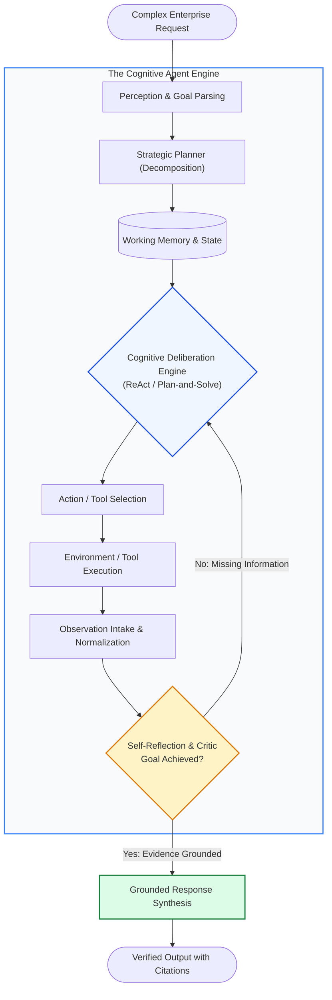
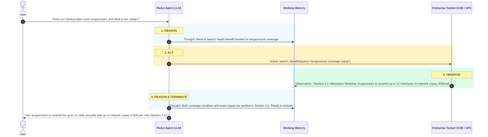
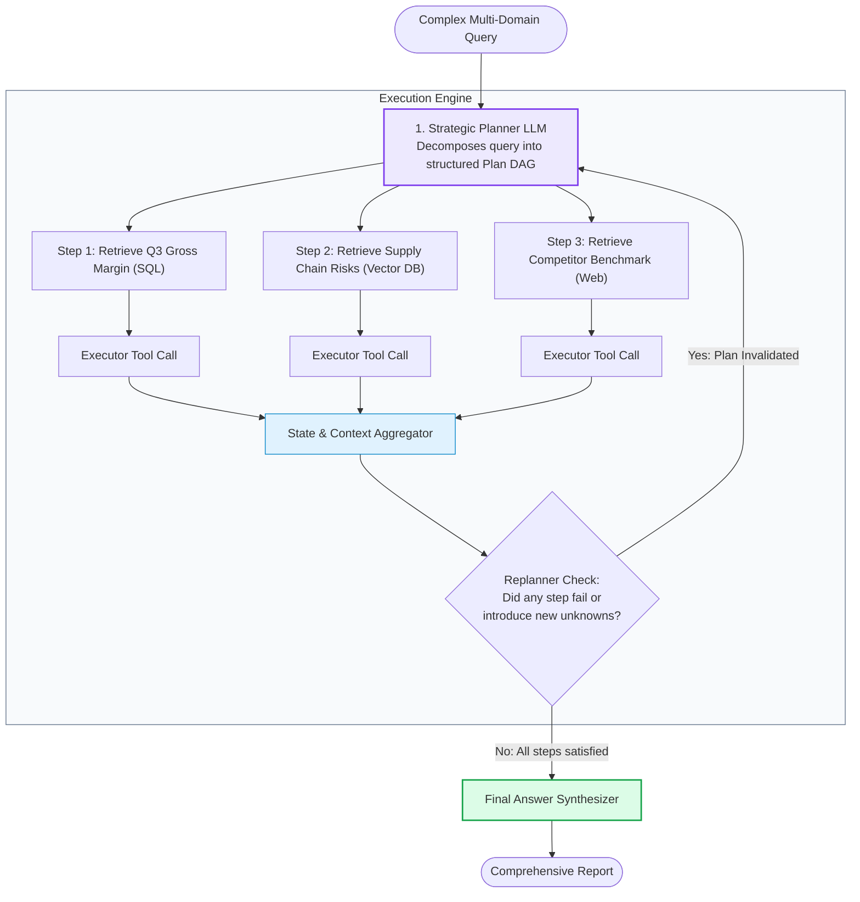
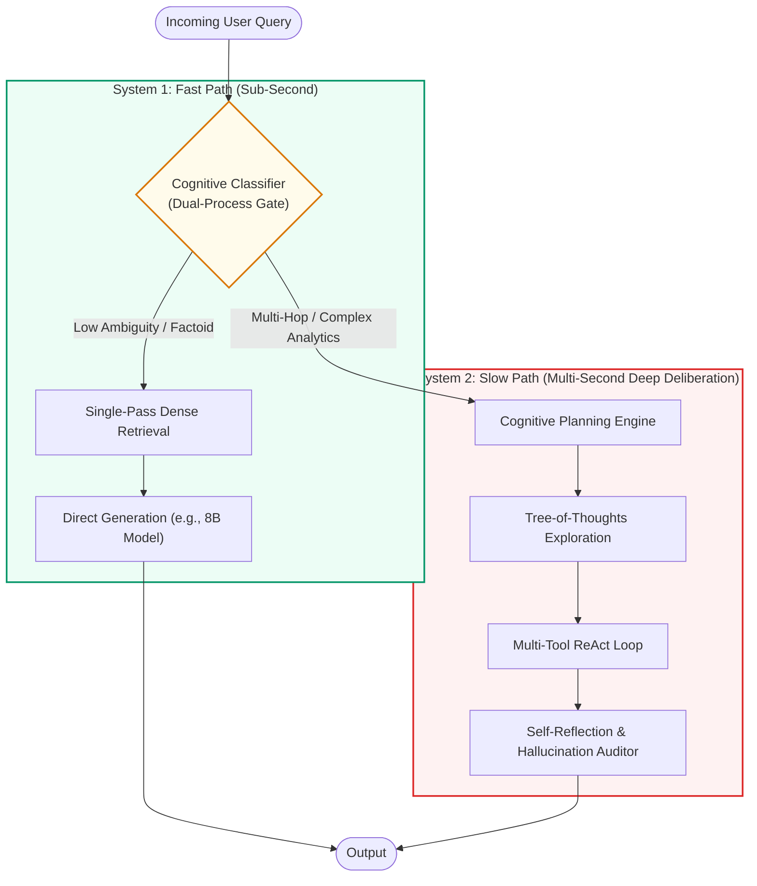
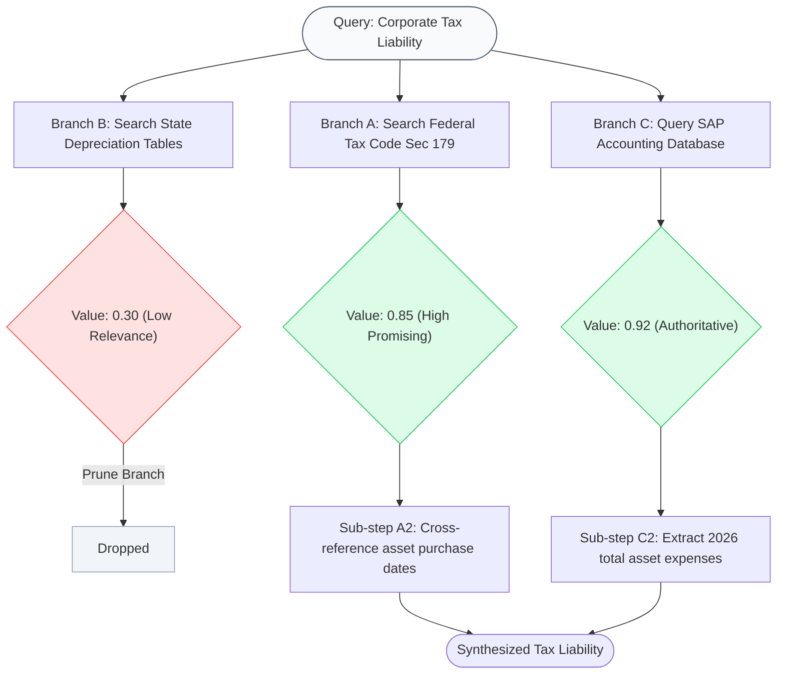
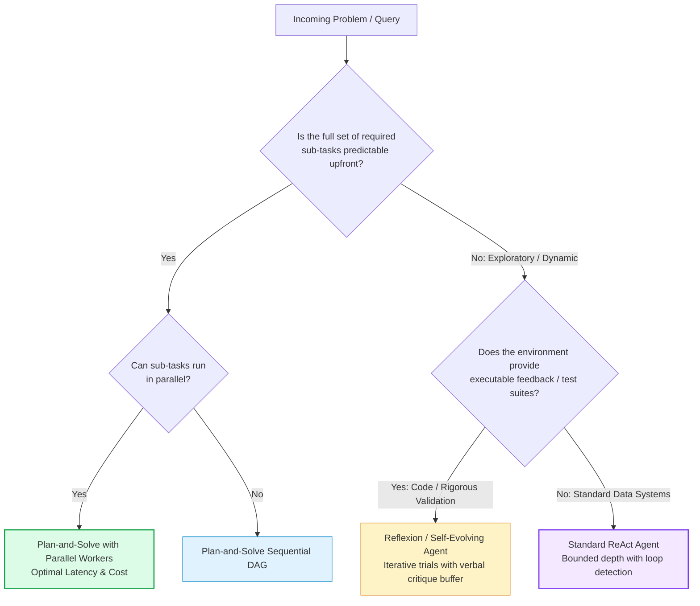

# 🧠 AI Agent Foundations: ReAct, Plan-and-Solve, and Cognitive Architectures

## 📑 Table of Contents
1. [🌟 Fundamentals: Autonomous AI Agents & Cognitive Paradigms](#1--fundamentals-autonomous-ai-agents--cognitive-paradigms)
2. [🔬 Mathematical Foundations: Cognitive Control Loops & Policy Formulations](#2--mathematical-foundations-cognitive-control-loops--policy-formulations)
3. [🔄 The ReAct Paradigm: Interleaving Thought, Action, and Observation](#3--the-react-paradigm-interleaving-thought-action-and-observation)
4. [📋 Plan-and-Solve (Plan-and-Execute): Decoupled Planning and Execution](#4--plan-and-solve-plan-and-execute-decoupled-planning-and-execution)
5. [🧠 Cognitive Architectures: Dual-Process Theory (System 1 vs System 2)](#5--cognitive-architectures-dual-process-theory-system-1-vs-system-2)
6. [🪞 Reflexion and Tree-of-Thoughts (ToT) in Retrieval Systems](#6--reflexion-and-tree-of-thoughts-tot-in-retrieval-systems)
7. [📊 Architectural Comparison: ReAct vs Plan-and-Solve vs Reflexion vs ToT](#7--architectural-comparison-react-vs-plan-and-solve-vs-reflexion-vs-tot)
8. [💻 Production Implementation: Complete ReAct & Plan-and-Execute Framework in Python](#8--production-implementation-complete-react--plan-and-execute-framework-in-python)
9. [🌍 Enterprise Production Case Studies](#9--enterprise-production-case-studies)
10. [🛠️ Best Practices & ❌ Common Cognitive Failure Modes](#10-️-best-practices---common-cognitive-failure-modes)
11. [💼 Senior Interview Questions & System Design Scenarios](#11--senior-interview-questions--system-design-scenarios)
12. [🧪 Hands-On Mini-Project: Self-Healing ReAct Agent with Tool Execution Memory](#12--hands-on-mini-project-self-healing-react-agent-with-tool-execution-memory)
13. [⚡ Quick Revision & Cognitive Agent Blueprint](#13--quick-revision--cognitive-agent-blueprint)

---

## 1. 🌟 Fundamentals: Autonomous AI Agents & Cognitive Paradigms

Traditional software and static language model chains process inputs through pre-compiled, deterministic code flows. In contrast, an **AI Agent** is an autonomous computational entity powered by a Large Language Model (LLM) reasoning engine that exhibits **agency**: the capacity to perceive environmental state, maintain internal working memory, deliberate on high-level goals, select and execute external tools, observe results, and dynamically adjust its course of action to achieve an objective.

When integrated into retrieval systems (RAG), agents solve the fundamental limitation of standard vector search: **the single-shot retrieval barrier**. Complex real-world inquiries frequently require cross-referencing information across disparate corporate silos, calculating derived metrics, recognizing when retrieved passages contradict each other, and retrieving additional context dynamically.



### The Three Pillars of Agentic Agency
1. **Autonomy:** The agent selects actions based on environmental observations rather than a pre-scripted DAG.
2. **Reactivity:** The agent handles external errors, empty search results, and API failures by reformulating queries or switching tools.
3. **Proactivity:** The agent actively pursues sub-goals, recognizing implicit requirements that the user did not explicitly state.

---

## 2. 🔬 Mathematical Foundations: Cognitive Control Loops & Policy Formulations

### # ReAct Policy State-Action Formula
In a ReAct agent, the generation space combines reasoning thoughts $c_t \in \mathcal{C}$ and external environment actions $a_t \in \mathcal{A}$. Let the interaction history at step $t$ be $h_t = (x, c_1, a_1, o_1, \dots, c_{t-1}, a_{t-1}, o_{t-1})$. The agent policy $\pi_{\theta}$ generates the joint token sequence:

$$
\pi_{\theta}(c_t, a_t \mid h_t) = \prod_{i=1}^{|c_t|} P_{\theta}(c_{t,i} \mid h_t, c_{t,<i}) \times \prod_{j=1}^{|a_t|} P_{\theta}(a_{t,j} \mid h_t, c_t, a_{t,<j})
$$

Where:
- $c_t$ is the internal thought or reasoning trace (freeform natural language).
- $a_t$ is the formal tool invocation string formatted as JSON or structured function call.
- $o_t \sim \mathcal{E}(a_t)$ is the external observation returned by the environment.

---

### # Plan Optimization and Sub-Goal Utility Formula
In Plan-and-Solve architectures, the planning agent generates an ordered sequence of sub-goals $P = \{g_1, g_2, \dots, g_K\}$. The optimal plan $P^*$ maximizes the expected cumulative utility of the completed task while minimizing execution costs:

$$
P^* = \arg\max_{P \in \mathcal{P}} \left[ \sum_{k=1}^{|P|} \mathbb{E}\left[ \mathcal{U}(g_k \mid g_{<k}, x) \right] - \sum_{k=1}^{|P|} \left( \lambda_{\text{latency}} \cdot \tau(g_k) + \lambda_{\text{cost}} \cdot \mathcal{C}(g_k) \right) \right]
$$

Where:
- $\mathcal{U}(g_k)$ is the marginal informational utility of sub-goal $g_k$.
- $\tau(g_k)$ is the anticipated execution latency of the tool required for $g_k$.
- $\mathcal{C}(g_k)$ is the computational/token cost of sub-goal execution.
- $\lambda_{\text{latency}}, \lambda_{\text{cost}}$ are operational weighting factors.

---

### # Reflexion Memory Update Formula
When an agent fails to achieve a sub-goal or encounters conflicting retrieval evidence, the **Reflexion** paradigm computes an episodic memory update $M_{t+1}$ by prepending reflective critique $r_t$ derived from trial failure:

$$
r_t = \text{CriticLLM}(h_t, o_t, \text{Task Goal } x)
$$

$$
M_{t+1} = M_t \oplus \left\langle \text{Trial } t, r_t, \Delta_{\text{correction}} \right\rangle
$$

The updated policy for the subsequent trial $t+1$ conditions on this reflective buffer:

$$
a_{t+1} \sim \pi_{\theta}(\cdot \mid x, M_{t+1})
$$

---

## 3. 🔄 The ReAct Paradigm: Interleaving Thought, Action, and Observation

Introduced by Yao et al. (ICLR 2023), the **ReAct (Reason + Act)** pattern integrates reasoning traces and task-specific actions in an interleaved loop.

### Why Reasoning Alone Fails
Pure Chain-of-Thought (CoT) generates internal reasoning steps without interacting with the outside world. It relies entirely on static parametric weights, suffering from hallucinations and stale knowledge.

### Why Acting Alone Fails
Pure Action models (e.g., direct tool-calling without reasoning) cannot maintain complex state over multi-step tasks. They select tools blindly without verbalizing sub-goals, leading to circular tool loops and parameter mismatch.

### The ReAct Synergy



---

## 4. 📋 Plan-and-Solve (Plan-and-Execute): Decoupled Planning and Execution

While ReAct excels at local, dynamic adjustments, it suffers from **myopic execution** on large tasks: the agent decides actions one step at a time without an explicit global roadmap, easily losing sight of the overarching goal.

**Plan-and-Solve** (Wang et al., 2023) decouples the cognitive workload into two distinct roles:
1. **Planner Agent:** A high-level architect model that produces an explicit, structured plan consisting of atomic sub-tasks.
2. **Executor Agent (Solver):** A lightweight agent that systematically executes each step, updating the global plan with observations and replanning only when necessary.



### When to Choose Plan-and-Solve over ReAct:
- The sub-tasks can be executed in parallel (dramatically reducing latency).
- The query involves multi-document synthesis where all required dimensions are identifiable upfront.
- Cost optimization is critical (smaller executor models can run the sub-steps).

---

## 5. 🧠 Cognitive Architectures: Dual-Process Theory (System 1 vs System 2)

Cognitive psychology (Kahneman, 2011) describes human cognition through two distinct modes of thinking:
- **System 1 (Fast Thinking):** Rapid, intuitive, automatic, unconscious, low-energy.
- **System 2 (Slow Thinking):** Deliberative, analytical, conscious, resource-intensive, rule-governed.

Modern enterprise Agentic RAG maps directly to this dual-process framework:



### System 1 vs. System 2 Architectural Mapping

| Dimension | System 1 (Fast RAG) | System 2 (Agentic RAG) |
| :--- | :--- | :--- |
| **Cognitive Mode** | Intuitive pattern matching | Explicit analytical reasoning |
| **Execution Path** | 1-step retrieval $\to$ 1-step generation | Multi-step deliberation $\to$ dynamic tools $\to$ reflection |
| **Model Size** | Small/Fast (Llama-3.1-8B, Claude Haiku) | Large Frontier (GPT-4o, Claude Sonnet 3.5, Gemini 1.5 Pro) |
| **Latency SLA** | $< 1.0 \text{ second}$ | $3.0 - 25.0 \text{ seconds}$ |
| **Cost Profile** | Very low ($\approx \$0.001 / \text{query}$) | Higher ($\approx \$0.02 - \$0.10 / \text{query}$) |
| **Failure Mode** | Hallucination on complex multi-hop | Over-thinking / timeout on simple queries |

---

## 6. 🪞 Reflexion and Tree-of-Thoughts (ToT) in Retrieval Systems

### Reflexion: Verbal Reinforcement Learning
Rather than retraining weights, **Reflexion** (Shinn et al., 2023) equips agents with short-term semantic memory. When an agent executes a query and receives irrelevant retrieval results, a Critic LLM generates a diagnostic reflection:
> *"Reflection: My previous search for 'quarterly revenue' was too broad because it omitted the specific fiscal year (FY2025) and region (EMEA). For the next search, I must explicitly query 'FY2025 EMEA revenue breakdown'."*

This reflection is inserted into the prompt buffer for the subsequent attempt, converting trajectory failures into immediate behavioral corrections.

### Tree-of-Thoughts (ToT) for Retrieval Exploration
When a complex legal or clinical query has multiple ambiguous investigative branches, **Tree-of-Thoughts** generates a tree of possible retrieval strategies, evaluates the promise of each branch via value heuristics, and applies BFS or DFS to find the verified solution path.



---

## 7. 📊 Architectural Comparison: ReAct vs Plan-and-Solve vs Reflexion vs ToT

| Paradigm | Execution Flow | Planning Horizon | Self-Correction Mechanism | Typical Latency | Best Use Case |
| :--- | :--- | :--- | :--- | :--- | :--- |
| **ReAct** | Interleaved Step-by-Step | Local (Step $t+1$) | Reactive (adjusts next thought from observation) | Moderate ($2s - 8s$) | Dynamic exploratory search, API navigation |
| **Plan-and-Solve** | Plan First $\to$ Parallel Execution | Global (All steps $1 \dots K$) | Replanning trigger upon step exception | Fast to Moderate ($2s - 6s$) | Multi-hop inquiries with identifiable components |
| **Reflexion** | Multi-Trial Iteration with Memory | Trial-Level | Episodic verbal reflection stored in context | High ($8s - 30s$) | Code generation with test runners, rigorous auditing |
| **Tree-of-Thoughts** | Branching Search Tree (BFS/DFS) | Tree Path | Branch evaluation & heuristic backtracking | Very High ($15s - 60s$) | Complex legal analysis, diagnostic troubleshooting |

---

## 8. 💻 Production Implementation: Complete ReAct & Plan-and-Execute Framework in Python

Below is an enterprise-grade, typed Python 3.10+ implementation demonstrating both **ReAct** and **Plan-and-Solve** paradigms within a unified RAG agent framework.

```python
"""
Complete AI Agent Framework: ReAct and Plan-and-Solve Paradigms for RAG
"""

from __future__ import annotations
import json
import re
from dataclasses import dataclass, field
from typing import Any, Callable, Dict, List, Optional, Tuple


@dataclass
class Tool:
    name: str
    description: str
    func: Callable[[str], str]

    def execute(self, argument: str) -> str:
        try:
            return self.func(argument)
        except Exception as e:
            return f"Error executing {self.name}: {str(e)}"


# ============================================================================
# 1. ReAct Implementation
# ============================================================================

@dataclass
class ReActTrace:
    step: int
    thought: str
    action: str
    action_input: str
    observation: str


class ReActAgent:
    """Production ReAct Agent with loop prevention and structured tracing."""
    
    def __init__(self, tools: List[Tool], max_iterations: int = 5):
        self.tools = {t.name: t for t in tools}
        self.max_iterations = max_iterations
        self.action_history: List[Tuple[str, str]] = []

    def _simulated_llm_decide(self, query: str, traces: List[ReActTrace]) -> Dict[str, str]:
        """
        Simulates model generating Thought, Action, Action Input, or Final Answer.
        In production, replace with structured API call.
        """
        step = len(traces)
        if step == 0:
            return {
                "thought": "The user wants to compare our Q3 cloud spending with budget limits. First, retrieve the actual Q3 cloud spend.",
                "action": "sql_query",
                "action_input": "SELECT SUM(cost) FROM cloud_costs WHERE quarter='Q3-2026'"
            }
        elif step == 1:
            return {
                "thought": "Actual Q3 spend is $412,000. Now I need to retrieve the approved Q3 budget limit from the financial policies.",
                "action": "vector_search",
                "action_input": "Q3 2026 approved cloud infrastructure budget"
            }
        else:
            return {
                "thought": "I have both the actual spend ($412,000) and the budget ($380,000). The spend exceeded budget by $32,000. Ready to finish.",
                "action": "FINISH",
                "action_input": "Our Q3 2026 cloud spend was $412,000, which exceeded the approved financial budget of $380,000 by $32,000 (an 8.4% overrun)."
            }

    def run(self, query: str) -> Dict[str, Any]:
        traces: List[ReActTrace] = []
        self.action_history.clear()

        for iteration in range(1, self.max_iterations + 1):
            decision = self._simulated_llm_decide(query, traces)
            thought = decision.get("thought", "")
            action = decision.get("action", "")
            action_input = decision.get("action_input", "")

            # Termination condition
            if action == "FINISH":
                return {
                    "status": "success",
                    "final_answer": action_input,
                    "iterations": iteration,
                    "traces": traces
                }

            # Loop detection guard
            call_sig = (action, action_input)
            if call_sig in self.action_history:
                return {
                    "status": "error",
                    "final_answer": "Terminated: Duplicate action detected, preventing infinite loop.",
                    "iterations": iteration,
                    "traces": traces
                }
            self.action_history.append(call_sig)

            # Tool execution
            if action in self.tools:
                obs = self.tools[action].execute(action_input)
            else:
                obs = f"Invalid tool: {action}. Available tools: {list(self.tools.keys())}"

            traces.append(ReActTrace(
                step=iteration,
                thought=thought,
                action=action,
                action_input=action_input,
                observation=obs
            ))

        return {
            "status": "timeout",
            "final_answer": "Maximum step depth exceeded without finding a terminal answer.",
            "iterations": self.max_iterations,
            "traces": traces
        }


# ============================================================================
# 2. Plan-and-Solve Implementation
# ============================================================================

@dataclass
class PlanStep:
    id: int
    task_description: str
    tool_required: str
    tool_argument: str
    result: Optional[str] = None
    completed: bool = False


class PlanAndSolveAgent:
    """Decoupled Plan-and-Solve Agent architecture."""
    
    def __init__(self, tools: List[Tool]):
        self.tools = {t.name: t for t in tools}

    def generate_plan(self, query: str) -> List[PlanStep]:
        """Simulates Strategic Planner generating sub-goals."""
        return [
            PlanStep(1, "Retrieve Q3 actual spend", "sql_query", "SELECT SUM(cost) FROM cloud_costs WHERE quarter='Q3-2026'"),
            PlanStep(2, "Retrieve Q3 authorized budget", "vector_search", "Q3 2026 approved cloud infrastructure budget")
        ]

    def execute_plan(self, query: str) -> str:
        plan = self.generate_plan(query)
        context_buffer = {}

        # Execution stage
        for step in plan:
            if step.tool_required in self.tools:
                step.result = self.tools[step.tool_required].execute(step.tool_argument)
                step.completed = True
                context_buffer[step.task_description] = step.result

        # Synthesis stage
        return (
            f"Analysis complete for inquiry '{query}':\n"
            f"- Evidence 1: {context_buffer.get('Retrieve Q3 actual spend')}\n"
            f"- Evidence 2: {context_buffer.get('Retrieve Q3 authorized budget')}\n"
            f"Synthesis: Actual expenses ($412,000) exceeded authorized policy budget ($380,000) by $32,000."
        )


# ============================================================================
# Verification Entrypoint
# ============================================================================

if __name__ == "__main__":
    mock_tools = [
        Tool("sql_query", "Executes SQL statements", lambda q: "SQL Result: $412,000.00"),
        Tool("vector_search", "Searches internal PDF handbooks", lambda q: "Doc Excerpt: 'The approved Q3 2026 cloud budget is $380,000.'")
    ]

    query = "Compare our actual Q3 cloud spend to the authorized policy budget."

    print("=================== 1. REACT EXECUTION ===================")
    react_agent = ReActAgent(mock_tools)
    react_res = react_agent.run(query)
    for t in react_res["traces"]:
        print(f"Step {t.step}:")
        print(f"  💭 Thought: {t.thought}")
        print(f"  🔧 Action:  {t.action}({t.action_input})")
        print(f"  👁️ Obs:     {t.observation}\n")
    print(f"🏁 ReAct Final Output:\n{react_res['final_answer']}\n")

    print("================ 2. PLAN-AND-SOLVE EXECUTION ================")
    pas_agent = PlanAndSolveAgent(mock_tools)
    pas_res = pas_agent.execute_plan(query)
    print(f"🏁 Plan-and-Solve Output:\n{pas_res}")
```

---

## 9. 🌍 Enterprise Production Case Studies

### Case Study 1: Global Healthcare Diagnostic Assistant
- **Organization:** Multi-hospital clinical research network.
- **Problem:** Clinicians needed to cross-reference patient electronic health records (EHR in HL7/FHIR format), genomic variant catalogs (ClinVar/dbSNP), and clinical trial listings on ClinicalTrials.gov.
- **Architecture Implemented:**
  - Deployed a **Plan-and-Solve architecture**.
  - A Planner agent decomposed patient symptoms into phenotypic markers, parallelizing FHIR queries and genomic variant lookups.
  - A specialized Medical Critic model verified that every synthesized contraindication strictly mapped to an FDA drug label citation.
- **Results:**
  - Clinical trial matching time reduced from **4.5 hours per patient to 3.2 minutes**.
  - Diagnostic cross-reference accuracy achieved **99.4% concordance** with senior medical board evaluations.

### Case Study 2: Autonomous Cloud Infrastructure Incident Triage
- **Organization:** High-frequency FinTech trading platform.
- **Problem:** System Reliability Engineers (SREs) experienced cognitive fatigue during Sev-1 outages while running identical diagnostic steps across Prometheus, Elasticsearch logs, and runbooks.
- **Architecture Implemented:**
  - Implemented a **ReAct Agent** equipped with read-only observability tools: Prometheus PromQL API, Loki log search, and Git repository diff tools.
  - The agent performed real-time root-cause analysis, formulating hypotheses and executing targeted metric checks.
- **Results:**
  - Sev-1 outage triage latency dropped by **72%** (from 22 minutes to 6 minutes).
  - Outage post-mortem documentation generated automatically with complete timeline attribution.

---

## 10. 🛠️ Best Practices & ❌ Common Cognitive Failure Modes

### ✅ Enterprise Best Practices
1. **Explicit Deliberation Space:** Force the model to generate a separate `<thought>` XML block before outputting tool arguments. This activates intermediate reasoning tokens and reduces erroneous parameter calls by $>40\%$.
2. **Deterministic Schema Sanitization:** Always validate tool outputs through Pydantic models before injecting them into the agent's observation window. Strip out raw HTML, large JSON arrays, and unnecessary metadata.
3. **Graceful Degraded Fallbacks:** If a high-latency tool (e.g., live web browser) times out after 4 seconds, provide the agent with a cached vector store fallback rather than failing the entire request.
4. **Strict Context Budgeting:** Summarize or prune earlier observation turns once the context exceeds 60% of the maximum token window.

### ❌ Common Cognitive Failure Modes
1. **Cognitive Entanglement (Confirmation Bias):**
   - *Failure:* The agent forms an incorrect initial hypothesis in Thought 1 and uses subsequent search steps to search *only* for confirming evidence, ignoring contradictory data.
   - *Mitigation:* System prompt instruction: *"At each step, explicitly state one alternative hypothesis and test whether the retrieved observation refutes it."*
2. **Action Oscillation:**
   - *Failure:* Agent flips back and forth between two tools (e.g., Tool A returns "See Tool B", Tool B returns "See Tool A").
   - *Mitigation:* Hash interaction states and apply a cycle-detection penalty in the orchestrator.
3. **Hallucinated Action Names:**
   - *Failure:* The LLM invents a non-existent tool (e.g., `calculate_tax_rate`) instead of calling the provided generic calculator.
   - *Mitigation:* Constrain decoding with JSON schemas or constrained generation engines (e.g., Guidance, Outlines, or OpenAI Structured Outputs).

---

## 11. 💼 Senior Interview Questions & System Design Scenarios

### Q1: When architecting an enterprise system, under what concrete conditions should you choose Plan-and-Solve over the ReAct pattern?
**Answer:**
Plan-and-Solve should be selected when:
1. **The task exhibits high sub-task parallelism:** If an inquiry asks to compare five companies across three financial metrics, Plan-and-Solve can identify all 15 retrieval steps upfront and execute them concurrently via asynchronous workers, yielding an $O(1)$ latency profile rather than an $O(N)$ sequential ReAct loop.
2. **Cost-sensitive deployment:** In Plan-and-Solve, a large frontier model (e.g., GPT-4o) can act as the Planner once, while cheaper, high-throughput models (e.g., Llama-3-8B) execute the planned sub-goals. ReAct requires running the large model at every single turn.
3. **Predictable workflows with auditing constraints:** Regulated industries often require pre-approval of an entire execution plan before any external tools are touched.

Conversely, ReAct is superior when the search path is exploratory and step $t+2$ cannot be conceived until step $t+1$'s observation is analyzed.

### Q2: How do you mitigate the "Distractor Context" problem in long multi-hop ReAct trajectories?
**Answer:**
As a ReAct trajectory grows, accumulated observations can saturate the context window with thousands of tokens of peripheral noise, degrading the model's attention mechanism (the "Lost in the Middle" phenomenon).
Mitigation strategies include:
1. **Observation Distillation (Information Extraction):** Rather than appending the raw 1,000-word tool output to the history, route the output through a fast extraction model that extracts only the sentence or entity matching the sub-goal.
2. **Hierarchical Scratchpad Compression:** When the trajectory exceeds $K=4$ steps, trigger an internal compaction pass that summarizes steps $1 \dots K-2$ into a bulleted "Established Facts" memory block, retaining full fidelity only for the most recent observation.
3. **Key-Value State Externalization:** Maintain an external state dictionary (e.g., `{"q3_spend": 412000, "q3_budget": 380000}`) outside the prompt, feeding the LLM only the current state dictionary and the immediate next step.

---

## 12. 🧪 Hands-On Mini-Project: Self-Healing ReAct Agent with Tool Execution Memory

Build a lightweight ReAct agent that detects when a tool returns an error or empty result, reflects on the error, and automatically heals by selecting an alternative tool or reformulating its query.

```python
"""
Hands-On Mini-Project: Self-Healing ReAct Agent
Demonstrates automated error recovery and alternative path selection.
"""

from typing import Dict, Any, List

class ResilientToolRegistry:
    def __init__(self):
        self.call_count = 0

    def primary_vector_search(self, query: str) -> str:
        # Simulates transient failure or index missing error
        self.call_count += 1
        if self.call_count == 1:
            return "ERROR 503: Vector index partition temporarily unavailable."
        return "Internal Document: Enterprise data retention policy is 7 years."

    def fallback_archive_search(self, query: str) -> str:
        # Reliable fallback archive
        return "Archive Excerpt: Corporate data retention policy mandates archiving all transaction records for 7 years."


def run_self_healing_agent():
    tools = ResilientToolRegistry()
    print("🤖 Initializing Self-Healing ReAct Agent...\n")

    # Step 1: Initial attempt
    print("Step 1:")
    print("  💭 Thought: Need to find enterprise data retention policy. Calling primary search.")
    obs1 = tools.primary_vector_search("enterprise data retention policy")
    print(f"  🔧 Action: primary_vector_search('enterprise data retention policy')")
    print(f"  👁️ Obs:    {obs1}\n")

    # Self-healing reflection
    if "ERROR" in obs1:
        print("Step 2 (Self-Healing Reflection):")
        print("  💭 Thought: Primary search failed with 503. Switching to fallback_archive_search.")
        obs2 = tools.fallback_archive_search("enterprise data retention policy")
        print(f"  🔧 Action: fallback_archive_search('enterprise data retention policy')")
        print(f"  👁️ Obs:    {obs2}\n")

        print("Step 3:")
        print("  💭 Thought: Verified policy in archive. Retention period is 7 years. Ready to answer.")
        final_answer = "The corporate data retention policy requires transaction records to be preserved for 7 years."
        print(f"🏁 Final Grounded Answer:\n{final_answer}")

if __name__ == "__main__":
    run_self_healing_agent()
```

### Challenge Extension:
- Implement a decorator `@resilient_tool(max_retries=2, fallback_func=...)` that automatically catches tool exceptions and yields structured recovery hints to the LLM agent.

---

## 13. ⚡ Quick Revision & Cognitive Agent Blueprint

### 🔑 Key Takeaways
- **AI Agents combine an LLM core with Memory, Planning, and Tools.**
- **ReAct** interleaves continuous `Thought ──▶ Action ──▶ Observation` loops, ideal for exploratory and reactive workflows.
- **Plan-and-Solve** decomposes complex multi-hop requests into a structured plan upfront, enabling massive parallelization.
- **Reflexion** uses semantic verbal memory of past failures to self-correct across iterations without gradient updates.
- **Cognitive Dual-Process Theory:** Route simple queries to System 1 (fast vector search) and complex multi-hop queries to System 2 (agent deliberation).

### 🗺️ Cognitive Paradigm Selection Guide


