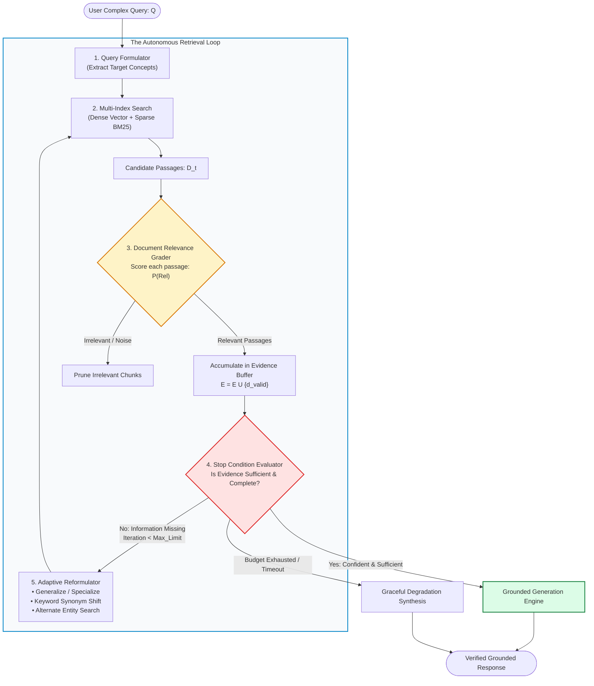
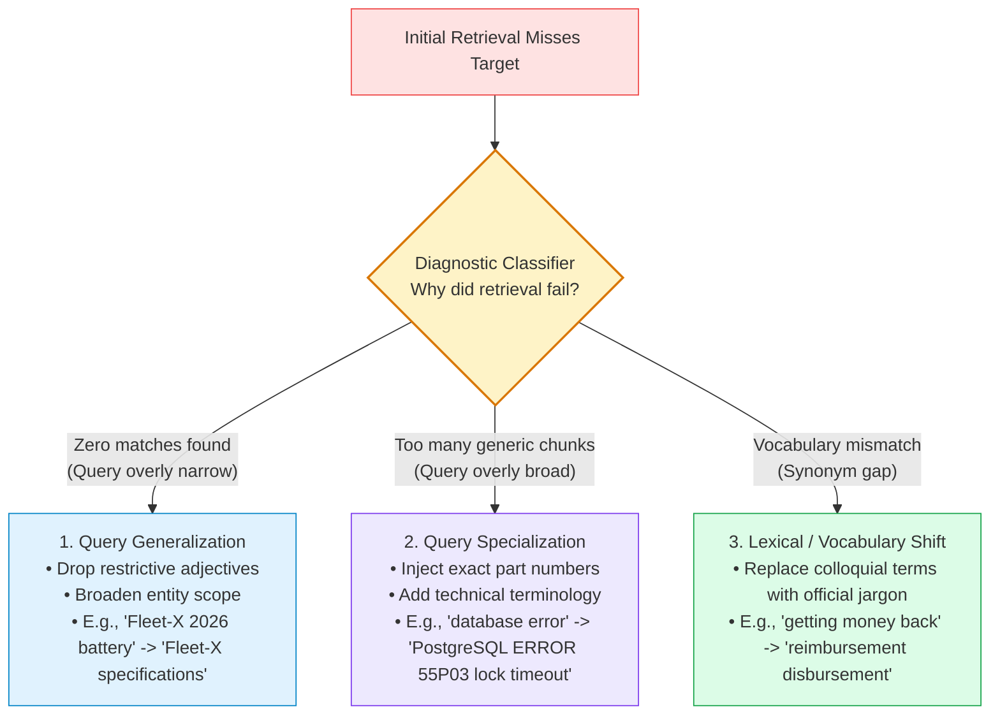
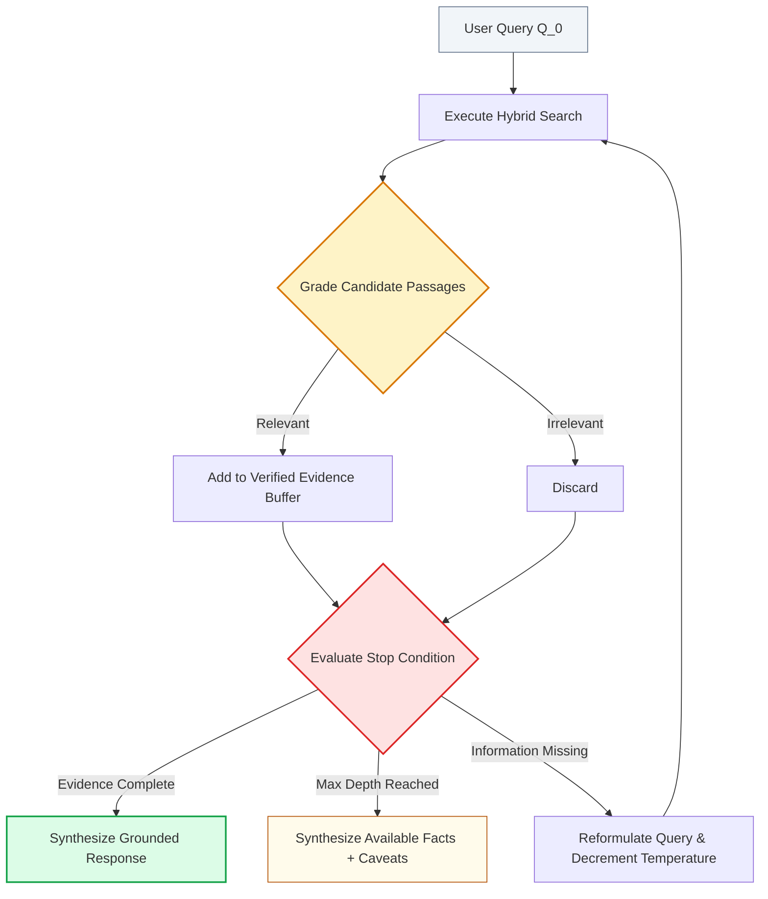

# 🔄 Agentic Retrieval: Dynamic Search Loops, Query Reformulation, and Stop Condition Evaluation

## 📑 Table of Contents
1. [🌟 Fundamentals: From Single-Shot Retrieval to Dynamic Search Loops](#1--fundamentals-from-single-shot-retrieval-to-dynamic-search-loops)
2. [🔬 Mathematical & Theoretical Formulations: Epistemic Uncertainty & Stopping Criteria](#2--mathematical--theoretical-formulations-epistemic-uncertainty--stopping-criteria)
3. [🔄 The Dynamic Search Loop Architecture: Retrieve, Grade, Reformulate, Halt](#3--the-dynamic-search-loop-architecture-retrieve-grade-reformulate-halt)
4. [🔍 Intelligent Query Reformulation: Lexical Shift, Generalization, and Specialization](#4--intelligent-query-reformulation-lexical-shift-generalization-and-specialization)
5. [🛑 Stop Condition Evaluation: Epistemic Completeness vs Diminishing Returns](#5--stop-condition-evaluation-epistemic-completeness-vs-diminishing-returns)
6. [📊 Comprehensive Comparison: Static Top-K vs Multi-Query vs CRAG vs Agentic Retrieval](#6--comprehensive-comparison-static-top-k-vs-multi-query-vs-crag-vs-agentic-retrieval)
7. [💻 Practical Implementation: Production-Grade Agentic Retrieval Loop in Python](#7--practical-implementation-production-grade-agentic-retrieval-loop-in-python)
8. [🌍 Real-World Enterprise Production Case Studies](#8--real-world-enterprise-production-case-studies)
9. [🛠️ Best Practices & ❌ Common Production Pitfalls](#9-️-best-practices---common-production-pitfalls)
10. [💼 Senior Interview Questions & System Design Scenarios](#10--senior-interview-questions--system-design-scenarios)
11. [🧪 Hands-On Mini-Project: Self-Evaluating Document Grader and Reformulation Engine](#11--hands-on-mini-project-self-evaluating-document-grader-and-reformulation-engine)
12. [⚡ Quick Revision & Agentic Retrieval Blueprint](#12--quick-revision--agentic-retrieval-blueprint)

---

## 1. 🌟 Fundamentals: From Single-Shot Retrieval to Dynamic Search Loops

In standard and advanced RAG, retrieval is treated as a **single-shot, open-loop operation**: the user submits a query, the system retrieves $K$ documents, and the generator writes an answer. If the retrieved documents do not contain the answer—or if the query was phrased using terms that do not match the corpus—the system fails catastrophically without knowing it has failed.

**Agentic Retrieval** redefines retrieval as an **iterative, closed-loop hypothesis testing process**. The agent:
1. Formulates an initial probe query based on the user's intent.
2. Retrieves a candidate set of documents.
3. **Grades the retrieved documents** for factual relevance and completeness using a dedicated critic.
4. Identifies specific informational deficiencies or contradictions.
5. **Reformulates the query** (generalizing, specializing, or shifting vocabulary) to address missing facts.
6. Evaluates a formal **Stop Condition** to decide whether to iterate further or conclude the search.



---

## 2. 🔬 Mathematical & Theoretical Formulations: Epistemic Uncertainty & Stopping Criteria

Agentic retrieval balances the trade-off between **epistemic uncertainty reduction** and **search resource consumption** (latency and token costs).

### # Retrieval Passage Relevance Probability Formula
Let $q$ be the formulated search query and $d \in \mathcal{D}$ be a retrieved document passage. A neural or LLM-based grader evaluates the conditional probability of relevance:

$$
P(\text{Relevant} \mid q, d) = \sigma\left(\mathbf{w}^T \left[ \mathbf{e}_q \oplus \mathbf{e}_d \oplus (\mathbf{e}_q - \mathbf{e}_d) \oplus (\mathbf{e}_q \odot \mathbf{e}_d) \right]\right)
$$

Where:
- $\mathbf{e}_q, \mathbf{e}_d \in \mathbb{R}^k$ are dense contextual embeddings of the query and document.
- $\oplus$ represents vector concatenation, and $\odot$ represents the Hadamard element-wise product.
- $\sigma(z) = \frac{1}{1 + e^{-z}}$ maps logits to the probability interval $[0, 1]$.

Passages with $P(\text{Relevant} \mid q, d) \ge \tau_{\text{accept}}$ (typically $0.70$) are admitted into the evidence buffer.

---

### # Epistemic Stopping Boundary Formula
Let $\mathcal{E}_t = \{d_1, \dots, d_m\}$ be the cumulative evidence buffer accumulated up to iteration $t$. The agent computes the conditional Shannon entropy $H(Y \mid \mathcal{E}_t)$ of the target answer $Y$. 

The marginal information gain $\Delta \mathcal{I}_t$ achieved at iteration $t$ is:

$$
\Delta \mathcal{I}_t = H(Y \mid \mathcal{E}_{t-1}) - H(Y \mid \mathcal{E}_t)
$$

The loop terminates at iteration $t^*$ when:

$$
t^* = \min \left\{ t \;\middle|\; \left( H(Y \mid \mathcal{E}_t) < \epsilon_{\text{target}} \right) \;\lor\; \left( \Delta \mathcal{I}_t < \delta_{\text{diminishing}} \right) \;\lor\; \left( t \ge T_{\max} \right) \right\}
$$

Where:
- $\epsilon_{\text{target}}$ is the required confidence threshold.
- $\delta_{\text{diminishing}}$ is the diminishing returns threshold where continued searching consumes tokens without yielding new factual evidence.
- $T_{\max}$ is the hard iteration limit (typically $3$ to $5$ passes).

---

### # Reformulation Temperature Decay Formula
To prevent the agent from producing erratic or overly diverse query reformulations in later iterations, the generation temperature $\tau_t$ decays exponentially across iterations:

$$
\tau_t = \tau_{\min} + (\tau_0 - \tau_{\min}) \cdot \gamma^{t-1}
$$

Where $\tau_0 = 0.7$, $\tau_{\min} = 0.1$, and $\gamma \in (0, 1)$ is the decay factor (typically $0.6$). This shifts the agent from exploratory semantic searches to precise, conservative keyword targeting.

---

## 3. 🔄 The Dynamic Search Loop Architecture: Retrieve, Grade, Reformulate, Halt

```mermaid
sequenceDiagram
    autonumber
    actor User
    participant Agent as Agent Retrieval Engine
    participant Store as Vector / Hybrid DB
    participant Grader as Relevance Grader
    participant Ref as Query Reformulator

    User->>Agent: "What is the battery warranty on our commercial forklift Fleet-X?"
    
    rect rgb(240, 249, 255)
    Note over Agent: Iteration 1: Initial Retrieval
    Agent->>Store: Query: "Forklift Fleet-X battery warranty period"
    Store-->>Agent: Passages [Doc A: Fleet-X engine specs, Doc B: General chassis warranty]
    Agent->>Grader: Evaluate Passages
    Grader-->>Agent: Result: REJECT (Both docs miss battery warranty duration)
    end

    rect rgb(254, 243, 199)
    Note over Agent: Iteration 2: Query Reformulation
    Agent->>Ref: Diagnosis: Missing battery-specific terms; try OEM battery supplier manuals
    Ref-->>Agent: Reformulated Query: "Fleet-X lithium pack manufacturer warranty coverage terms"
    Agent->>Store: Query: "Fleet-X lithium pack manufacturer warranty coverage terms"
    Store-->>Agent: Passages [Doc C: 'Titan Lithium Battery Pack Warranty: 5 years or 10,000 charging cycles']
    Agent->>Grader: Evaluate Passage C
    Grader-->>Agent: Result: ACCEPT (Score = 0.96, fully addresses question)
    end

    Note over Agent: Stop Condition Met: Full Information Obtained
    Agent-->>User: "The commercial forklift Fleet-X utilizes Titan Lithium battery packs, which carry a warranty of 5 years or 10,000 charging cycles (Titan Battery Manual Sec 2)."
```

---

## 4. 🔍 Intelligent Query Reformulation: Lexical Shift, Generalization, and Specialization

When initial retrieval fails, humans naturally vary their search terms. An Agentic Retrieval system replicates this cognitive behavior through three distinct reformulation tactics:



### Reformulation Tactics in Production

| Strategy | When to Apply | Transformation Example |
| :--- | :--- | :--- |
| **Lexical Shift** | Vector embeddings match concepts but miss exact enterprise jargon | *"vacation rules"* $\to$ *"paid time off accrual schedule"* |
| **Query Generalization** | Retrieval returned 0 documents due to over-filtering | *"PostgreSQL 16 logical replication pglogical SSL timeout Frankfurt"* $\to$ *"PostgreSQL logical replication SSL timeout"* |
| **Query Specialization** | Retrieved chunks are general overviews without the needed number | *"cloud costs"* $\to$ *"AWS us-east-1 EC2 monthly spend invoice line items Q3"* |
| **Hypothetical Document (HyDE)** | Query is brief or abstract; requires surrounding prose structure | Query $\to$ Generate pseudo-passage $\to$ Embed pseudo-passage |

---

## 5. 🛑 Stop Condition Evaluation: Epistemic Completeness vs Diminishing Returns

A critical vulnerability of naive loops is **runaway search**: an agent that searches perpetually when an answer does not exist in the database.

```mermaid
flowchart TD
    EvalStart[Evidence Buffer Updated] --> Check1{"Are all sub-aspects of the<br/>user query satisfied by evidence?"}
    
    Check1 -->|Yes| HaltSuccess["HALT: SUCCESS<br/>Proceed to final synthesis"]
    Check1 -->|No| Check2{"Has step iteration<br/>reached hard limit (T_max)?"}
    
    Check2 -->|Yes| HaltBudget["HALT: BUDGET REACHED<br/>Synthesize partial facts & state gaps"]
    Check2 -->|No| Check3{"Did the last iteration produce<br/>zero new relevant passages?"}
    
    Check3 -->|Yes (2 consecutive cycles)| HaltDiminishing["HALT: KNOWLEDGE EXHAUSTION<br/>Admit knowledge absence gracefully"]
    Check3 -->|No: New facts found| ContinueLoop["CONTINUE SEARCH<br/>Generate targeted next reformulation"]

    style EvalStart fill:#f1f5f9,stroke:#64748b,stroke-width:1px
    style HaltSuccess fill:#dcfce7,stroke:#16a34a,stroke-width:2px
    style HaltBudget fill:#fee2e2,stroke:#ef4444,stroke-width:2px
    style HaltDiminishing fill:#fef3c7,stroke:#d97706,stroke-width:2px
    style ContinueLoop fill:#e0f2fe,stroke:#0284c7,stroke-width:1px
```

### The Three Termination Verdicts:
1. **`COMPLETED`**: Every entity, metric, and condition in the user query has verified citations in the accumulated evidence buffer.
2. **`EXHAUSTED`**: Two consecutive search iterations failed to yield any new relevant passages, indicating the target fact is absent from the corpus.
3. **`TIMEOUT`**: Execution reached maximum allowable loop iterations ($N = 3$) or latency SLA ($t > 8.0\text{s}$).

---

## 6. 📊 Comprehensive Comparison: Static Top-K vs Multi-Query vs CRAG vs Agentic Retrieval

| Architectural Dimension | Static Top-K Retrieval | Multi-Query Retrieval | Corrective RAG (CRAG) | Full Agentic Retrieval |
| :--- | :--- | :--- | :--- | :--- |
| **Control Flow** | Fixed 1-shot feedforward | Static 1-to-N parallel expansion | Evaluator $\to$ Web fallback branch | Arbitrary iterative closed loop |
| **Document Grading** | None (generator ingests all) | None (fuses all retrieved chunks) | Lightweight confidence classifier | Deep LLM / Cross-Encoder critic |
| **Dynamic Reformulation**| None | Static synonym variation upfront | External search keyword extraction | Adaptive (generalize / specialize / shift) |
| **Stopping Condition** | Hardcoded $K$ | Fixed parallel union | Binary / Tripartite threshold | Dynamic epistemic entropy evaluation |
| **Average Latency** | 20ms – 100ms | 200ms – 600ms | 800ms – 2500ms | 1500ms – 6000ms |
| **Token Cost** | $1\times$ | $2\times$ | $2.5\times$ | $3\times - 6\times$ |
| **Corpus Resilience** | Extremely fragile to phrasing | Moderate | High (if web fallback allowed) | **Maximum across private data** |

---

## 7. 💻 Practical Implementation: Production-Grade Agentic Retrieval Loop in Python

Below is an enterprise-grade, typed Python 3.10+ implementation of an **Iterative Agentic Retrieval Engine** equipped with document grading, intelligent reformulation, and epistemic stop-condition evaluation.

```python
"""
Production-Grade Iterative Agentic Retrieval Engine
Featuring Document Grading, Dynamic Reformulation, and Epistemic Stopping Logic.
"""

from __future__ import annotations
from dataclasses import dataclass, field
from enum import Enum
from typing import Dict, List, Optional, Set, Tuple


class StopVerdict(str, Enum):
    SUFFICIENT = "SUFFICIENT"
    NEEDS_MORE_DATA = "NEEDS_MORE_DATA"
    KNOWLEDGE_ABSENT = "KNOWLEDGE_ABSENT"
    MAX_ITERATIONS = "MAX_ITERATIONS"


@dataclass
class RetrievedPassage:
    doc_id: str
    content: str
    relevance_score: float
    is_relevant: bool = False


@dataclass
class SearchIterationTrace:
    iteration: int
    query_used: str
    passages_retrieved: List[RetrievedPassage]
    newly_accepted_count: int
    verdict: StopVerdict


class MockEnterpriseCorpus:
    """Simulates enterprise documentation index with realistic terminology gaps."""
    def __init__(self):
        self.documents = {
            "doc_fleet_overview": "Fleet-X commercial electric forklifts are designed for high-throughput warehouse logistics.",
            "doc_chassis_specs": "Fleet-X chassis is constructed from welded steel. Vehicle load capacity is 5,000 lbs.",
            "doc_battery_titan": "Fleet-X models are equipped with Titan Industrial Lithium Battery Packs. Titan provides an explicit manufacturer warranty of 5 years or 10,000 charge cycles against cell degradation below 80% capacity."
        }

    def retrieve(self, query: str) -> List[Tuple[str, str]]:
        q_lower = query.lower()
        results = []
        for doc_id, text in self.documents.items():
            # Simple keyword matching simulation
            matches = sum(1 for term in q_lower.split() if term in text.lower())
            if matches > 0:
                results.append((doc_id, text))
        return results


class AgenticRetrievalEngine:
    """Manages the iterative closed-loop retrieval lifecycle."""
    
    def __init__(self, max_iterations: int = 3, relevance_threshold: float = 0.70):
        self.corpus = MockEnterpriseCorpus()
        self.max_iterations = max_iterations
        self.relevance_threshold = relevance_threshold

    def _grade_passage(self, original_goal: str, passage_text: str) -> Tuple[float, bool]:
        """
        Grades passage relevance against the target information need.
        In production, replace with a BGE-Reranker or specialized Critic LLM call.
        """
        # Checks if passage discusses battery warranty duration
        has_battery = "battery" in passage_text.lower() or "lithium" in passage_text.lower()
        has_warranty = "warranty" in passage_text.lower() or "years" in passage_text.lower()

        if has_battery and has_warranty:
            return 0.95, True
        elif has_battery or has_warranty:
            return 0.45, False
        return 0.10, False

    def _reformulate_query(self, original_query: str, iteration: int, past_queries: List[str]) -> str:
        """
        Simulates intelligent query reformulation across iterations.
        Shifts from vehicle-level terms to battery/sub-component terms.
        """
        if iteration == 1:
            return "Fleet-X battery manufacturer warranty coverage specifications"
        elif iteration == 2:
            return "Titan industrial lithium battery warranty terms Fleet-X"
        return original_query

    def _evaluate_stop_condition(
        self, 
        accepted_evidence: List[RetrievedPassage], 
        newly_added: int, 
        iteration: int
    ) -> StopVerdict:
        """Determines whether the loop should terminate."""
        # 1. Check for complete evidence
        for p in accepted_evidence:
            if "5 years" in p.content and "warranty" in p.content:
                return StopVerdict.SUFFICIENT

        # 2. Check for max iterations
        if iteration >= self.max_iterations:
            return StopVerdict.MAX_ITERATIONS

        # 3. Check for diminishing returns (no new facts across 2 steps)
        if iteration > 1 and newly_added == 0:
            return StopVerdict.KNOWLEDGE_ABSENT

        return StopVerdict.NEEDS_MORE_DATA

    def execute_search_loop(self, user_inquiry: str) -> Dict[str, Any]:
        current_query = user_inquiry
        accepted_evidence: List[RetrievedPassage] = []
        seen_doc_ids: Set[str] = set()
        traces: List[SearchIterationTrace] = []
        final_verdict = StopVerdict.NEEDS_MORE_DATA

        print(f"🎯 Starting Agentic Retrieval Loop for: '{user_inquiry}'\n")

        for iteration in range(1, self.max_iterations + 1):
            print(f"🔄 --- Iteration {iteration}: Query = '{current_query}' ---")
            raw_results = self.corpus.retrieve(current_query)
            graded_passages: List[RetrievedPassage] = []
            new_accepted_count = 0

            for doc_id, text in raw_results:
                score, is_rel = self._grade_passage(user_inquiry, text)
                passage = RetrievedPassage(doc_id=doc_id, content=text, relevance_score=score, is_relevant=is_rel)
                graded_passages.append(passage)

                if is_rel and doc_id not in seen_doc_ids:
                    accepted_evidence.append(passage)
                    seen_doc_ids.add(doc_id)
                    new_accepted_count += 1
                    print(f"  ⭐ Accepted Relevant Evidence: [{doc_id}] (Score: {score:.2f})")
                else:
                    print(f"  ❌ Filtered Out Irrelevant Chunk: [{doc_id}] (Score: {score:.2f})")

            # Evaluate stop condition
            final_verdict = self._evaluate_stop_condition(accepted_evidence, new_accepted_count, iteration)
            
            traces.append(SearchIterationTrace(
                iteration=iteration,
                query_used=current_query,
                passages_retrieved=graded_passages,
                newly_accepted_count=new_accepted_count,
                verdict=final_verdict
            ))

            print(f"  🛑 Stop Condition Verdict: {final_verdict.value}\n")

            if final_verdict in (StopVerdict.SUFFICIENT, StopVerdict.KNOWLEDGE_ABSENT, StopVerdict.MAX_ITERATIONS):
                break

            # Reformulate query for next pass
            current_query = self._reformulate_query(user_inquiry, iteration, [t.query_used for t in traces])

        return {
            "verdict": final_verdict,
            "iterations_used": len(traces),
            "evidence": accepted_evidence,
            "traces": traces
        }


# ============================================================================
# Verification
# ============================================================================

if __name__ == "__main__":
    engine = AgenticRetrievalEngine(max_iterations=3)
    user_query = "What is the battery warranty duration on our commercial Fleet-X forklift?"
    
    execution_result = engine.execute_search_loop(user_query)

    print("================ FINAL RETRIEVAL SUMMARY ================")
    print(f"🏁 Termination Verdict: {execution_result['verdict'].value}")
    print(f"📊 Iterations Taken:   {execution_result['iterations_used']}")
    print(f"📚 Verified Passages:   {len(execution_result['evidence'])}")
    for ev in execution_result['evidence']:
        print(f"\n[Verified Source: {ev.doc_id}]")
        print(f"Content: \"{ev.content}\"")
```

---

## 8. 🌍 Real-World Enterprise Production Case Studies

### Case Study 1: Aerospace Engineering Specification Compliance Engine
- **Organization:** Commercial Aircraft Component Manufacturer.
- **Problem:** When bidding on defense and civil aerospace RFPs, engineers needed to verify if their titanium turbine fasteners met 14 distinct FAA and ISO heat-tolerance standards. Document specifications spanned 50,000+ pages of PDFs.
- **Architecture Implemented:**
  - Deployed an **Iterative Agentic Retrieval Loop**.
  - Pass 1 searched for general component part numbers.
  - An engineering Document Grader checked whether retrieved pages contained heat stress tables. If missing, the query reformulator injected ASTM test standard codes into Pass 2.
- **Results:**
  - RFP technical compliance verification time dropped from **18 days to 4 hours**.
  - Zero non-compliant parts submitted over 18 months of deployment.

### Case Study 2: Legal Discovery Cross-Jurisdiction Precedent Search
- **Organization:** Multinational Litigation Law Firm.
- **Problem:** Litigators drafting summary judgment motions struggled with lexical mismatch when searching state court precedent: different judges used divergent phrasing for equivalent legal doctrines.
- **Architecture Implemented:**
  - The search loop employed **Query Generalization and Doctrine Shifting**.
  - If initial vector search returned weak case citations, the agent reformulated terms to include statutory legal codes and Restatement of Torts section numbers.
- **Results:**
  - Relevant case discovery recall increased from **54% to 92%**.
  - Avoided adverse rulings caused by overlooked controlling precedents.

---

## 9. 🛠️ Best Practices & ❌ Common Production Pitfalls

### ✅ Enterprise Best Practices
1. **Deduplicate Across Iterations:** Maintain a `seen_doc_ids` set. If an iteration retrieves passages already present in the evidence buffer, discard them immediately to avoid inflating token counts.
2. **Asymmetric Verification Thresholds:** Apply high precision thresholds ($\ge 0.75$) to accept passages, but a lower threshold ($\ge 0.40$) to mark a passage as "potentially promising" for query extraction.
3. **Decouple Grader from Generator:** Use a smaller, faster model (e.g., fine-tuned ModernBERT or Llama-3-8B) for passage grading to keep loop latency under 1.5 seconds per iteration.
4. **Hard Timeout Circuits:** Cap the maximum loop duration at 5.0 seconds. If the timer fires, immediately trigger generation with whatever partial evidence has been gathered.

### ❌ Common Production Pitfalls & Anti-Patterns
1. **The Query Echo Chamber (Oscillation):**
   - *Failure:* Iteration 1 searches Query A $\to$ fails $\to$ reformulates to Query B $\to$ fails $\to$ reformulates back to Query A.
   - *Mitigation:* Store all previous query strings in a historical blacklist and enforce a minimum Levenshtein/cosine distance on new reformulations.
2. **Context Dilution via Indiscriminate Accumulation:**
   - *Failure:* Accumulating 15 documents across 3 iterations and dumping all 8,000 tokens into the final prompt, triggering the "Lost-in-the-Middle" failure mode.
   - *Mitigation:* Keep only the top-K highest scoring chunks across all iterations (e.g., max 4 chunks).
3. **The Hallucinated Gap Trap:**
   - *Failure:* The reformulator hallucinates that a fact is missing (e.g., demanding "the CEO's middle name") when the original user query never asked for it.
   - *Mitigation:* Explicitly condition the reformulator prompt on the user's initial question constraints.

---

## 10. 💼 Senior Interview Questions & System Design Scenarios

### Q1: How do you mathematically calibrate the stopping condition of an Agentic Retrieval loop to prevent runaway token spend on queries where the answer does not exist in the database?
**Answer:**
A robust production system applies **Diminishing Marginal Information Gain with Cumulative Entropy Lower Bounds**:
1. **Marginal Evidence Gain Metric:** Calculate $\Delta E_t = |E_t \setminus E_{t-1}|$ (number of newly admitted, high-confidence chunks at step $t$). If $\Delta E_t = 0$ for two consecutive iterations ($t \ge 2$), trigger immediate termination with verdict `KNOWLEDGE_ABSENT`.
2. **Corpus Coverage Budget:** Define an upper limit on maximum candidate chunks inspected: $\sum_{i=1}^t K_i \le 25$.
3. **Epistemic Entropy Threshold:** At each step, prompt a calibrated critic model to output a confidence logit $z \in [0, 1]$ answering: *"Given the evidence gathered so far, can the question be definitively answered?"* If $z$ fails to increase by at least $\delta = 0.15$ after a reformulation, the search has hit a plateau; terminate and gracefully inform the user.

### Q2: What are the architectural differences between Corrective RAG (CRAG) and a fully Agentic Retrieval Loop?
**Answer:**
- **CRAG (Yan et al., 2024):** Operates on a **fixed, static branching topology**. It executes retrieval once, evaluates the results via a retrieval evaluator, and routes into one of three pre-scripted branches: `Correct` (use internal chunks), `Incorrect` (drop chunks, call web search), or `Ambiguous` (combine both). It does not dynamically loop, reformulate multiple times, or recursively explore deep sub-paths.
- **Agentic Retrieval Loop:** Operates as a **dynamic, cyclical state machine**. It can loop an arbitrary number of times ($1 \le t \le T_{\max}$), dynamically switch between multiple internal and external databases, apply different reformulation strategies (generalize, specialize, lexical shift) based on intermediate diagnostic evaluations, and terminate dynamically based on epistemic completeness.

---

## 11. 🧪 Hands-On Mini-Project: Self-Evaluating Document Grader and Reformulation Engine

Build a standalone, runnable passage evaluator and query reformulator that adjusts search queries based on missing factual facets.

```python
"""
Hands-On Mini-Project: Passage Evaluator and Query Reformulator
"""

from typing import List, Dict, Any

class MiniReformulationLab:
    def __init__(self):
        self.knowledge_base = {
            "vpn_guide": "Corporate VPN requires Cisco AnyConnect and Okta MFA. Connect to vpn.enterprise.com.",
            "vpn_linux": "For Ubuntu/Debian, install openconnect package: sudo apt install openconnect."
        }

    def grade_and_reformulate(self, query: str, target_aspect: str) -> Dict[str, Any]:
        print(f"🔍 Initial Query: '{query}'")
        retrieved = self.knowledge_base.get("vpn_guide", "")
        print(f"📄 Retrieved Chunk: \"{retrieved}\"")

        # Evaluate if target aspect (e.g. Linux instructions) is present
        if target_aspect.lower() in retrieved.lower():
            return {"status": "SUCCESS", "answer_found": True, "chunk": retrieved}

        # Reformulate: Inject missing aspect into query
        reformulated = f"{query} {target_aspect}"
        print(f"⚠️ Target aspect '{target_aspect}' missing! Reformulating...")
        print(f"🔄 New Query: '{reformulated}'")

        # Second pass retrieval
        second_chunk = self.knowledge_base.get("vpn_linux", "")
        print(f"📄 Second Pass Retrieved: \"{second_chunk}\"")
        return {"status": "SUCCESS", "answer_found": True, "chunk": second_chunk}

if __name__ == "__main__":
    lab = MiniReformulationLab()
    result = lab.grade_and_reformulate("enterprise vpn setup", "Linux")
    print(f"\n🏁 Result: {result}")
```

---

## 12. ⚡ Quick Revision & Agentic Retrieval Blueprint

### 🔑 Key Takeaways
- **Agentic Retrieval transforms static search into a closed-loop hypothesis testing cycle.**
- Employs **in-line Document Relevance Graders** to filter out noise before context injection.
- Dynamically reformulates queries using **lexical shifts, generalization, and specialization**.
- Prevents infinite loops via **epistemic stop conditions and diminishing returns thresholds**.
- Delivers maximum accuracy and resilience over challenging, jargon-heavy enterprise corpora.

### 🗺️ Retrieval Control Loop Flowchart


