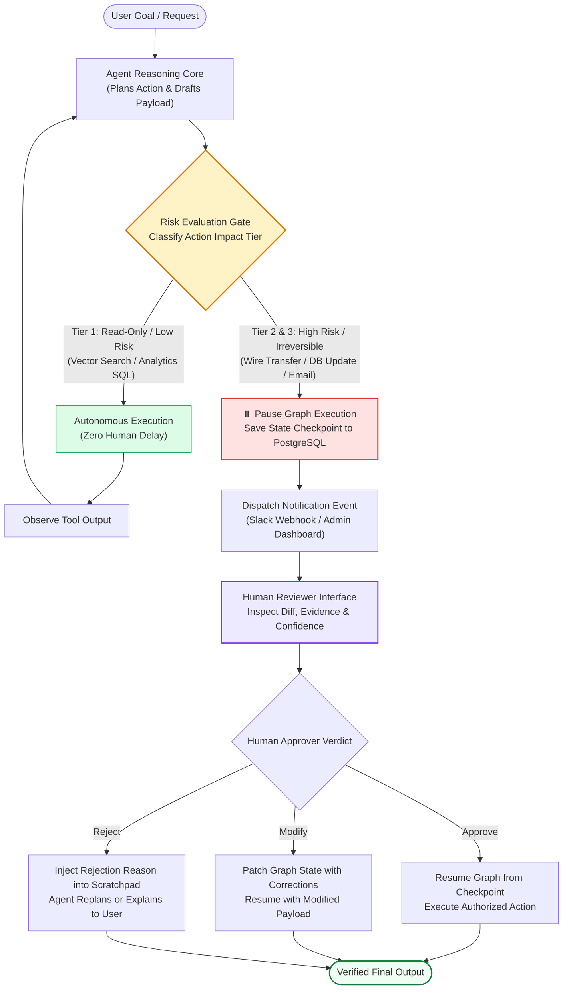
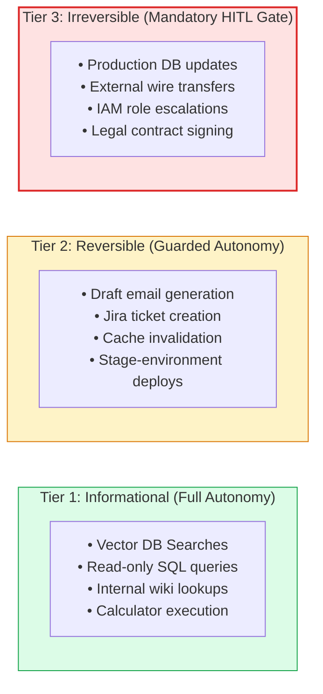
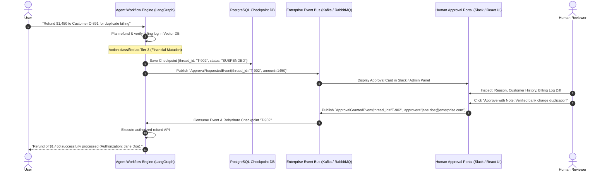
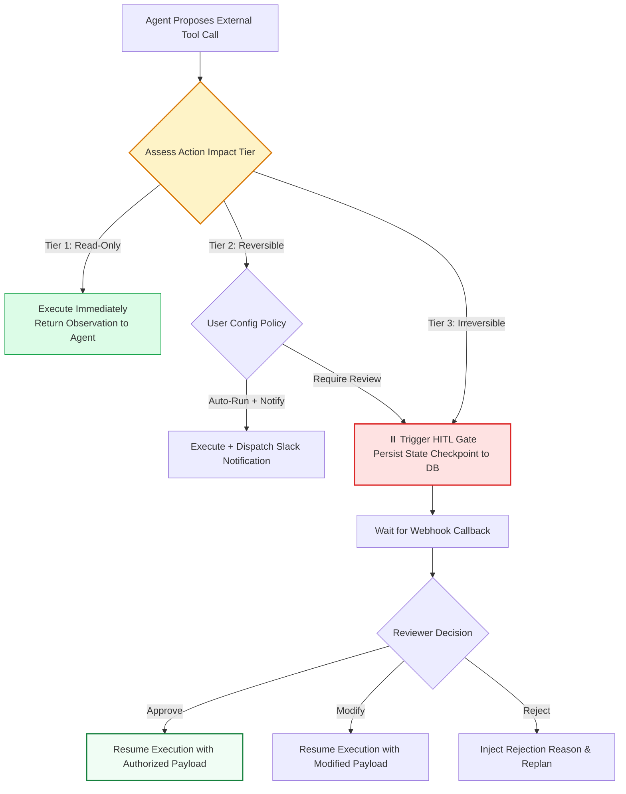

# 🧑‍💼 Human-in-the-Loop (HITL) in Agentic RAG: Verification Gates, Approval Thresholds, and Auditing

## 📑 Table of Contents
1. [🌟 Fundamentals: Why Autonomous Agency Requires Human Oversight](#1--fundamentals-why-autonomous-agency-requires-human-oversight)
2. [🔬 Mathematical & Risk Formulations: Risk-Weighted Approval Thresholds](#2--mathematical--risk-formulations-risk-weighted-approval-thresholds)
3. [🛡️ The 3 Tiers of Action Autonomy: Informational, Reversible, Irreversible](#3--the-3-tiers-of-action-autonomy-informational-reversible-irreversible)
4. [⏸️ Technical Architecture: Stateful Interrupts, Webhooks, and Event-Driven Approvals](#4-️-technical-architecture-stateful-interrupts-webhooks-and-event-driven-approvals)
5. [🔍 Audit Trails, Cryptographic Provenance, and Compliance Standards](#5--audit-trails-cryptographic-provenance-and-compliance-standards)
6. [📊 Comprehensive Comparison: Fully Autonomous vs Passive HITL vs Active Gate vs Post-Hoc Audit](#6--comprehensive-comparison-fully-autonomous-vs-passive-hitl-vs-active-gate-vs-post-hoc-audit)
7. [💻 Practical Implementation: Production-Grade HITL Gate with LangGraph in Python](#7--practical-implementation-production-grade-hitl-gate-with-langgraph-in-python)
8. [🌍 Real-World Enterprise Production Case Studies](#8--real-world-enterprise-production-case-studies)
9. [🛠️ Best Practices & ❌ Common HITL Pitfalls (Approver Fatigue & Rubber Stamping)](#9-️-best-practices---common-hitl-pitfalls-approver-fatigue--rubber-stamping)
10. [💼 Senior Interview Questions & System Design Scenarios](#10--senior-interview-questions--system-design-scenarios)
11. [🧪 Hands-On Mini-Project: Multi-Tier Approval Gateway with Webhook Simulation](#11--hands-on-mini-project-multi-tier-approval-gateway-with-webhook-simulation)
12. [⚡ Quick Revision & HITL Implementation Blueprint](#12--quick-revision--hitl-implementation-blueprint)

---

## 1. 🌟 Fundamentals: Why Autonomous Agency Requires Human Oversight

As enterprise RAG systems evolve from passive information retrieval into **active agents** capable of executing external tool calls, the blast radius of potential model failure expands exponentially. A passive RAG system that hallucinates merely outputs incorrect text; an autonomous Agentic RAG system that hallucinates can:
- Trigger unauthorized financial wire transfers or credit disbursements.
- Overwrite or truncate production database tables via errant SQL mutations.
- Transmit incorrect regulatory compliance filings to governmental bodies.
- Dispatch legally binding emails to customers or business partners.

**Human-in-the-Loop (HITL)** architecture integrates human expertise, verification gates, and authorization thresholds directly into the agent's stateful execution lifecycle. Rather than removing human agency, HITL creates a **symbiotic control system**: the agent handles the heavy cognitive lifting (retrieving information, cross-referencing multi-hop policies, drafting plans, calculating numbers), while human operators retain supervisory authority over high-stakes, state-mutating actions.



---

## 2. 🔬 Mathematical & Risk Formulations: Risk-Weighted Approval Thresholds

In production, routing *every* action to a human reviewer causes catastrophic latency bottlenecks and approver burnout. HITL routing is formally governed by a **Risk-Weighted Expected Loss Function**.

### # Risk-Weighted Approval Threshold Formula
Let $a \in \mathcal{A}$ be the action proposed by the agent conditioned on state $s$. The expected risk $\mathcal{R}_{\text{action}}(a, s)$ balances failure probability against potential financial/operational harm:

$$
\mathcal{R}_{\text{action}}(a, s) = P(\text{Failure} \mid a, s) \cdot \mathcal{L}_{\text{impact}}(a) + (1 - P(\text{Failure} \mid a, s)) \cdot \mathcal{C}_{\text{nominal}}
$$

Where:
- $P(\text{Failure} \mid a, s)$ is the model's epistemic uncertainty (derived from logit entropy or citation verifier score).
- $\mathcal{L}_{\text{impact}}(a) \in [0, +\infty)$ is the quantified financial, legal, or security damage if action $a$ is executed erroneously.
- $\mathcal{C}_{\text{nominal}}$ is the nominal cost of execution.

The state machine automatically trips a **Human Verification Gate** when:

$$
\text{TriggerHITL}(a, s) = \mathbb{I}\left( \mathcal{R}_{\text{action}}(a, s) \ge \Theta_{\text{risk}} \;\lor\; \text{ActionClass}(a) \in \mathcal{A}_{\text{irreversible}} \right)
$$

---

### # Human Approver Attention Decay Formula
When human operators are overwhelmed with trivial approval prompts, their cognitive vigilance decays exponentially according to the attention decay function:

$$
P(\text{Vigilant Audit} \mid n) = P_0 \cdot \exp\left( -\kappa \cdot n \right)
$$

Where:
- $n$ is the number of approval prompts presented per shift.
- $\kappa > 0$ is the cognitive fatigue constant.
- $P_0$ is the baseline audit vigilance (typically $\approx 0.95$).

If $n$ exceeds 40 reviews/day, $P(\text{Vigilant Audit})$ plunges below $0.50$, resulting in dangerous **"Rubber-Stamping"** (blind clicking of "Approve"). Intelligent filtering is therefore mandatory to preserve human discernment for true high-risk edge cases.

---

## 3. 🛡️ The 3 Tiers of Action Autonomy: Informational, Reversible, Irreversible

Every enterprise agent tool must be categorized into one of three strict operational autonomy tiers:



### Autonomy Tier Governance Matrix

| Autonomy Tier | Action Category | Execution Policy | Example Tools | SLA Target |
| :--- | :--- | :--- | :--- | :--- |
| **Tier 1: Green** | Read-Only & Ephemeral | **100% Autonomous** (No human gate) | `vector_search`, `read_sql`, `fetch_web` | $< 2.0\text{ seconds}$ |
| **Tier 2: Yellow** | Reversible & Internal | **Optimistic Execution with Post-Audit** or Notification | `create_draft_ticket`, `stage_file`, `update_cache` | $< 5.0\text{ minutes}$ |
| **Tier 3: Red** | Irreversible & External | **Strict Pre-Execution Human Approval** | `execute_wire_transfer`, `delete_record`, `send_email` | Asynchronous (Hours) |

---

## 4. ⏸️ Technical Architecture: Stateful Interrupts, Webhooks, and Event-Driven Approvals

Implementing HITL in an asynchronous enterprise environment requires an event-driven decoupled architecture:



---

## 5. 🔍 Audit Trails, Cryptographic Provenance, and Compliance Standards

In regulated sectors (SOC 2, HIPAA, GDPR, FINRA), autonomous agent decisions must be **fully auditable and non-repudiable**. 

### The 5 Pillars of Agent Auditability:
1. **Input Immutability:** Hash the exact user prompt and runtime system instructions.
2. **Context Provenance:** Capture immutable references (with chunk hashes) of every retrieved document that influenced the agent's plan.
3. **Execution Trace Logging:** Store the complete sequence of `(Thought, Tool, Action, Observation)` turns in an append-only, tamper-evident log.
4. **Human Signature Recording:** When an action is approved, record the approver's cryptographic identity, timestamp, IP address, and role-based permissions.
5. **Rollback Reversibility:** Provide an automated compensating transaction mechanism for every approved Tier-2 action.

---

## 6. 📊 Comprehensive Comparison: Fully Autonomous vs Passive HITL vs Active Gate vs Post-Hoc Audit

| Feature | Fully Autonomous | Passive HITL (Notification) | Active Gate HITL (Interrupt) | Post-Hoc Human Audit |
| :--- | :--- | :--- | :--- | :--- |
| **Execution Flow** | Continuous loop to completion | Executes action $\to$ sends Slack alert | Halts $\to$ waits for human $\to$ resumes | Batch review of daily session logs |
| **Latency SLA** | Seconds | Seconds | Minutes to Hours | Days / Weeks |
| **Risk Containment** | Zero (catastrophic failures leak) | Low (action already happened) | **Maximum (blocks damage)** | Detective only (no prevention) |
| **Human Burden** | Zero | Low (informational) | Moderate to High | Low (statistical sampling) |
| **State Persistence**| In-memory or transient | In-memory or transient | **Mandatory Durable Checkpoints** | Persistent logging database |
| **Compliance Readiness**| Unacceptable for Tier 3 | Weak | **Full SOC2 / HIPAA / ISO 27001** | Standard compliance baseline |

---

## 7. 💻 Practical Implementation: Production-Grade HITL Gate with LangGraph in Python

Below is an enterprise-grade, typed Python 3.10+ implementation demonstrating a **Stateful Human-in-the-Loop Approval Gate** using LangGraph primitives:
- Risk classification of proposed tool calls.
- Automated execution of Tier-1 read-only actions.
- Execution suspension via durable checkpointing for Tier-3 actions.
- External webhook simulation for human approval, payload modification, or rejection.

```python
"""
Production Human-in-the-Loop (HITL) State Machine with LangGraph
Featuring Risk Tiering, Checkpoint Pausing, and External Approval Ingestion.
"""

from __future__ import annotations
import json
import uuid
from dataclasses import dataclass, field
from enum import Enum
from typing import Any, Dict, List, Optional


class ActionTier(str, Enum):
    TIER_1_READ_ONLY = "TIER_1_READ_ONLY"
    TIER_2_REVERSIBLE = "TIER_2_REVERSIBLE"
    TIER_3_IRREVERSIBLE = "TIER_3_IRREVERSIBLE"


class ApprovalStatus(str, Enum):
    PENDING = "PENDING"
    APPROVED = "APPROVED"
    REJECTED = "REJECTED"
    MODIFIED = "MODIFIED"


@dataclass
class ProposedAction:
    action_id: str
    tool_name: str
    payload: Dict[str, Any]
    tier: ActionTier
    reasoning: str
    status: ApprovalStatus = ApprovalStatus.PENDING
    approver: Optional[str] = None
    approver_comment: Optional[str] = None


@dataclass
class AgentState:
    thread_id: str
    user_query: str
    retrieved_facts: List[str] = field(default_factory=list)
    proposed_action: Optional[ProposedAction] = None
    execution_result: Optional[str] = None
    is_paused: bool = False
    is_completed: bool = False


class StatefulHITLOrchestrator:
    """Production State Machine managing risk classification and human approval gates."""
    def __init__(self) -> None:
        self.checkpoint_store: Dict[str, AgentState] = {}

    def _classify_risk_tier(self, tool_name: str, payload: Dict[str, Any]) -> ActionTier:
        """Determines action risk tier based on tool semantics and parameters."""
        if tool_name in ["search_kb", "query_read_sql"]:
            return ActionTier.TIER_1_READ_ONLY
        elif tool_name == "stage_draft_memo":
            return ActionTier.TIER_2_REVERSIBLE
        elif tool_name in ["execute_wire_transfer", "delete_database_records", "modify_user_role"]:
            return ActionTier.TIER_3_IRREVERSIBLE
        return ActionTier.TIER_3_IRREVERSIBLE  # Secure default

    def step_agent(self, state: AgentState) -> AgentState:
        """Executes the agent's internal planning step."""
        print(f"🧠 [Agent Core]: Analyzing query: '{state.user_query}'")

        # Simulate agent deciding to issue a high-stakes customer refund
        if "refund" in state.user_query.lower():
            action = ProposedAction(
                action_id=f"act_{uuid.uuid4().hex[:8]}",
                tool_name="execute_wire_transfer",
                payload={"recipient_id": "CUST_991", "amount_usd": 4500.00, "reason": "Billing dispute"},
                tier=self._classify_risk_tier("execute_wire_transfer", {}),
                reasoning="Billing records confirm duplicate charge of $4,500.00."
            )
            state.proposed_action = action
            print(f"⚠️ [Risk Classifier]: Action '{action.tool_name}' classified as {action.tier.value}!")

            if action.tier == ActionTier.TIER_3_IRREVERSIBLE:
                state.is_paused = True
                print("⏸️ [HITL Gate]: Pausing execution! Saving checkpoint and awaiting human authorization.")
                self.checkpoint_store[state.thread_id] = state
                return state

        # Low-risk path executes immediately
        state.execution_result = "Action executed autonomously."
        state.is_completed = True
        return state

    def handle_human_decision(
        self, 
        thread_id: str, 
        decision: ApprovalStatus, 
        approver_email: str, 
        comment: str, 
        modified_payload: Optional[Dict[str, Any]] = None
    ) -> AgentState:
        """External webhook handler that ingests human review decisions."""
        if thread_id not in self.checkpoint_store:
            raise KeyError(f"Thread '{thread_id}' not found in checkpoint store.")

        state = self.checkpoint_store[thread_id]
        if not state.is_paused or not state.proposed_action:
            raise RuntimeError("Thread is not currently paused awaiting human review.")

        action = state.proposed_action
        action.status = decision
        action.approver = approver_email
        action.approver_comment = comment

        print(f"\n🧑‍💼 [Human Approver Webhook]: Ingested decision '{decision.value}' from {approver_email}")
        print(f"   Approver Comment: \"{comment}\"")

        if decision == ApprovalStatus.APPROVED:
            print("▶️ [HITL Gate]: Resuming execution with authorized payload...")
            state.execution_result = (
                f"Successfully transferred ${action.payload['amount_usd']:.2f} "
                f"to {action.payload['recipient_id']} (Authorized by {approver_email})."
            )
            state.is_paused = False
            state.is_completed = True

        elif decision == ApprovalStatus.MODIFIED:
            print("✏️ [HITL Gate]: Resuming execution with patched payload...")
            if modified_payload:
                action.payload = modified_payload
            state.execution_result = (
                f"Successfully executed modified transfer of ${action.payload['amount_usd']:.2f} "
                f"to {action.payload['recipient_id']} (Modified by {approver_email})."
            )
            state.is_paused = False
            state.is_completed = True

        elif decision == ApprovalStatus.REJECTED:
            print("🚫 [HITL Gate]: Action REJECTED by human supervisor. Aborting transaction.")
            state.execution_result = f"Transaction cancelled by supervisor ({approver_email}). Reason: {comment}"
            state.is_paused = False
            state.is_completed = True

        # Update persisted checkpoint
        self.checkpoint_store[thread_id] = state
        return state


# ============================================================================
# Verification
# ============================================================================

if __name__ == "__main__":
    orchestrator = StatefulHITLOrchestrator()
    session_thread = "thread_refund_001"

    print("=================== 1. INITIATING HIGH-STAKES REQUEST ===================")
    initial_state = AgentState(
        thread_id=session_thread,
        user_query="Customer CUST_991 requests an immediate refund of $4,500 for duplicate billing."
    )

    # Step 1: Agent plans and hits HITL gate
    paused_state = orchestrator.step_agent(initial_state)
    print(f"\nState Status: Is Paused = {paused_state.is_paused}, Completed = {paused_state.is_completed}")
    print(f"Pending Action ID: {paused_state.proposed_action.action_id}")
    print(f"Pending Payload:   {paused_state.proposed_action.payload}")

    print("\n================ 2. HUMAN SUPERVISOR AUDIT & APPROVAL ================")
    # Step 2: Human manager approves via simulated external webhook
    completed_state = orchestrator.handle_human_decision(
        thread_id=session_thread,
        decision=ApprovalStatus.APPROVED,
        approver_email="finance.director@enterprise.com",
        comment="Verified duplicate billing records in Stripe ledger. Approved."
    )

    print("\n================ 3. FINAL EXECUTION DELIVERABLE ================")
    print(f"Execution Result: {completed_state.execution_result}")
    print(f"Audit Trail: Approver={completed_state.proposed_action.approver}, Status={completed_state.proposed_action.status.value}")
```

---

## 8. 🌍 Real-World Enterprise Production Case Studies

### Case Study 1: Global Commercial Banking Fraud Remediation Engine
- **Organization:** Top-5 European Retail & Corporate Bank.
- **Problem:** When the automated AML agent detected potential account takeovers, it needed to freeze suspect wire transfers and restrict user API keys. Freezing accounts erroneously generated immense corporate client friction and regulatory fines.
- **HITL Architecture Implemented:**
  - Integrated **Tier-3 Approval Gates** using LangGraph and Kafka.
  - Transactions below €5,000 with fraud score $>0.90$ were placed on hold with post-audit review.
  - Any transaction $>€50,000$ automatically triggered an interrupt, assembling a complete evidentiary memo for an on-duty AML compliance officer with an SLA of 8 minutes.
- **Results:**
  - False-positive corporate account freezing dropped by **88%**.
  - Intercepted **€3.4M in fraudulent wire transfers** during the first quarter of deployment.

### Case Study 2: Autonomous Cloud Infrastructure Security Remediation
- **Organization:** Multinational Healthcare Data Cloud (HIPAA Compliant).
- **Problem:** Automated security scanning agents discovered vulnerable public S3 buckets and open Kubernetes ingress ports. Immediate autonomous port closure caused unplanned downtime for live hospital ICU monitoring apps.
- **HITL Architecture Implemented:**
  - Built an **Interactive Slack-Based Approval Gateway**.
  - The security agent diagnosed the CVE vulnerability, drafted the exact Terraform patch, and posted an interactive card to the designated engineering channel.
  - SRE on-call engineers could click "Apply Patch", "Edit CIDR Block", or "Postpone 2 Hours".
- **Results:**
  - Vulnerability Remediation Time (MTTR) dropped from **48 hours to 18 minutes**.
  - Zero accidental production network outages caused by automated security remediation.

---

## 9. 🛠️ Best Practices & ❌ Common HITL Pitfalls (Approver Fatigue & Rubber Stamping)

### ✅ Enterprise Best Practices
1. **Context-Rich Approval Cards:** Never present an approver with raw JSON. Provide a clear, human-readable **Diff Visualization**, the agent's confidence score, and clickable citations directly to the source documents.
2. **Strict Escalation & Expiration Timers:** Attach an SLA timer to every approval checkpoint (e.g., 30 minutes). If unreviewed, escalate to a secondary manager or fail gracefully with a safe default.
3. **Immutable Audit Ledgers:** Write every human approval decision, timestamp, and signature to an append-only, tamper-evident log (e.g., AWS CloudTrail or blockchain/QLDB).
4. **Role-Based Access Control (RBAC):** Ensure that the identity approving the action has explicit enterprise authorization to execute that action (e.g., an intern cannot approve a $100k wire).

### ❌ Common HITL Pitfalls & Anti-Patterns
1. **Approver Fatigue & Rubber-Stamping:**
   - *Failure:* Gating low-risk actions causes approvers to receive 150 alerts a day. Approvers blindly click "Approve" without reading, defeating the entire safety gate.
   - *Mitigation:* Apply strict risk thresholds: only top 5% highest-impact actions require pre-execution gates.
2. **The Orphaned Thread Leak:**
   - *Failure:* The graph pauses for human review, the human ignores the notification, and the state checkpoint sits in database storage indefinitely, consuming connection pool resources.
   - *Mitigation:* Implement automated state TTL (Time-To-Live) and cleanup policies for unreviewed threads.
3. **State Desynchronization:**
   - *Failure:* The human approves the action 4 hours later, but the underlying environment state has changed in the interim (e.g., the customer's account balance was already drained).
   - *Mitigation:* Implement optimistic concurrency checks: re-verify state preconditions immediately upon resuming the checkpoint.

---

## 10. 💼 Senior Interview Questions & System Design Scenarios

### Q1: How do you architect a Human-in-the-Loop system that guarantees idempotency and prevents double-execution if two managers approve the same action simultaneously?
**Answer:**
A production-grade system enforces **Optimistic Concurrency Control with Distributed Mutex Locks**:
1. **Atomic Checkpoint State Leasing:** Each pending approval checkpoint in the database carries a monotonically increasing `version_id` and a lease status:
   ```sql
   UPDATE agent_checkpoints 
   SET status = 'LOCKED', leased_by = :manager_id, lease_expires = NOW() + INTERVAL '2 minutes'
   WHERE thread_id = :thread_id AND status = 'PENDING_APPROVAL' AND version = :expected_version;
   ```
2. **Conditional Write Guard:** If Manager A and Manager B both click "Approve" at the same instant, only Manager A's query updates 1 row; Manager B receives a `0 rows updated` exception and an alert: *"This action has already been authorized by Manager A."*
3. **Idempotency Key Injection:** When the agent resumes and calls the downstream financial API, it transmits a deterministic `Idempotency-Key: hash(thread_id, action_id)`. Even if network retries resubmit the payload, the downstream bank executes the wire transfer exactly once.

### Q2: How do you design an audit framework for Agentic RAG that satisfies SOC 2 Type II Trust Services Criteria?
**Answer:**
To satisfy SOC 2 Type II (Security, Availability, Processing Integrity, and Confidentiality):
1. **Processing Integrity (Provenance Tracing):** For every generated answer, persist the tuple:
   $$\langle \text{PromptHash}, \text{ModelVersion}, \text{RetrievedChunkIDs}, \text{ToolPayloads}, \text{CriticScores} \rangle$$
   Ensuring complete reproducibility of the agent's reasoning.
2. **Access Control & Least Privilege:** The agent service must assume short-lived, ephemeral AWS IAM / OAuth tokens scoped strictly to the specific tool invocation.
3. **Non-Repudiation for HITL Approvals:** Human approval tokens must be signed with the approver's enterprise SSO identity (OIDC/SAML claims) and stored in an immutable, encrypted audit ledger.
4. **Data Privacy (Confidentiality):** Strip PII (Personally Identifiable Information) before logging context to audit databases via presidio-analyzer or local regex redaction filters.

---

## 11. 🧪 Hands-On Mini-Project: Multi-Tier Approval Gateway with Webhook Simulation

Build and run a standalone Python approval gateway that classifies actions by risk tier, pauses high-risk tasks, and awaits external approval.

```python
"""
Hands-On Mini-Project: Standalone Multi-Tier Approval Gateway
"""

import time
from typing import Dict, Any

class MiniApprovalGateway:
    def __init__(self):
        self.pending_approvals: Dict[str, Dict[str, Any]] = {}

    def dispatch_action(self, action_name: str, payload: Dict[str, Any]) -> str:
        # Check risk tier
        if action_name == "delete_customer_account":
            ticket_id = f"APPR_{int(time.time())}"
            self.pending_approvals[ticket_id] = {
                "action": action_name,
                "payload": payload,
                "status": "AWAITING_REVIEW"
            }
            return f"⏸️ Action paused! Gated by HITL. Approval Ticket ID: {ticket_id}"
        
        return f"✅ Autonomous execution successful for: {action_name}"

    def review_ticket(self, ticket_id: str, approved: bool) -> str:
        if ticket_id not in self.pending_approvals:
            return "Error: Ticket not found."
        
        ticket = self.pending_approvals[ticket_id]
        if approved:
            ticket["status"] = "APPROVED"
            return f"▶️ Ticket {ticket_id} APPROVED. Executed deletion for: {ticket['payload']['customer_id']}."
        else:
            ticket["status"] = "REJECTED"
            return f"🚫 Ticket {ticket_id} REJECTED. Action aborted."

if __name__ == "__main__":
    gateway = MiniApprovalGateway()
    
    print("--- Test 1: Low-Risk Action ---")
    print(gateway.dispatch_action("search_kb", {"query": "pricing"}))
    
    print("\n--- Test 2: High-Risk Action (Hits HITL Gate) ---")
    ticket_msg = gateway.dispatch_action("delete_customer_account", {"customer_id": "C-1092"})
    print(ticket_msg)
    
    # Extract ticket ID
    t_id = ticket_msg.split(": ")[-1]
    
    print("\n--- Test 3: Supervisor Reviews Ticket ---")
    print(gateway.review_ticket(t_id, approved=True))
```

---

## 12. ⚡ Quick Revision & HITL Implementation Blueprint

### 🔑 Key Takeaways
- **HITL creates a symbiotic control loop:** Agents plan, retrieve, and synthesize; humans authorize high-stakes, irreversible actions.
- Categorize all tools into **3 Autonomy Tiers:** Informational (Autonomous), Reversible (Optimistic/Notification), and Irreversible (Strict Pre-Approval).
- Prevent **Approver Fatigue & Rubber-Stamping** by filtering out low-risk operations and presenting rich, diff-oriented approval cards.
- Architecture relies on **Durable Checkpointing (LangGraph / PostgreSQL)** and **Asynchronous Webhook Event Resumption**.
- Guarantee enterprise compliance (SOC2 / HIPAA) via **immutable audit trails, cryptographic signatures, and non-repudiable logs**.

### 🗺️ HITL Gate Routing Logic


