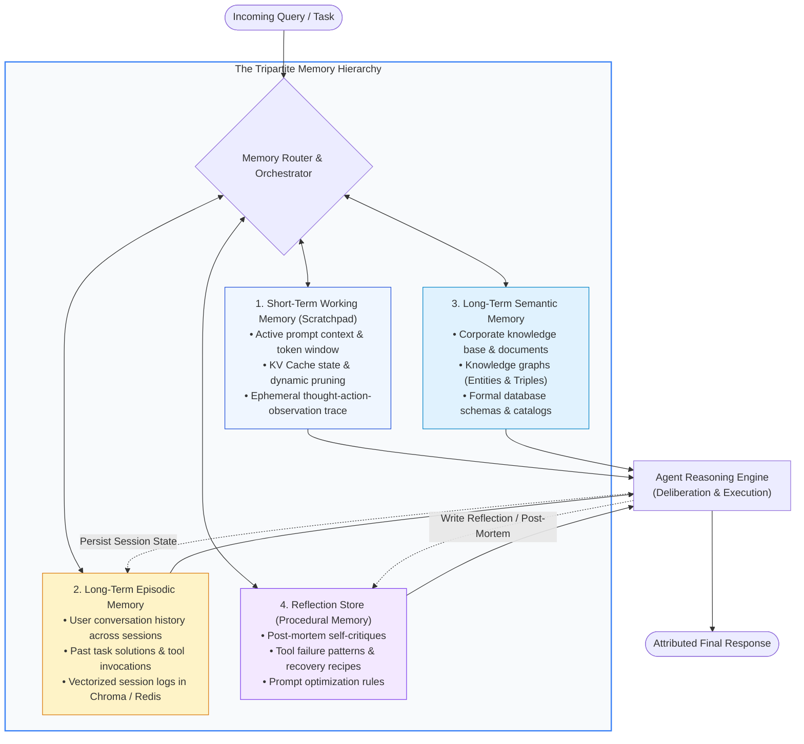
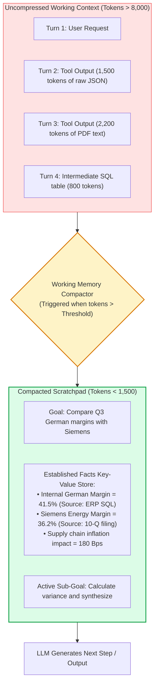
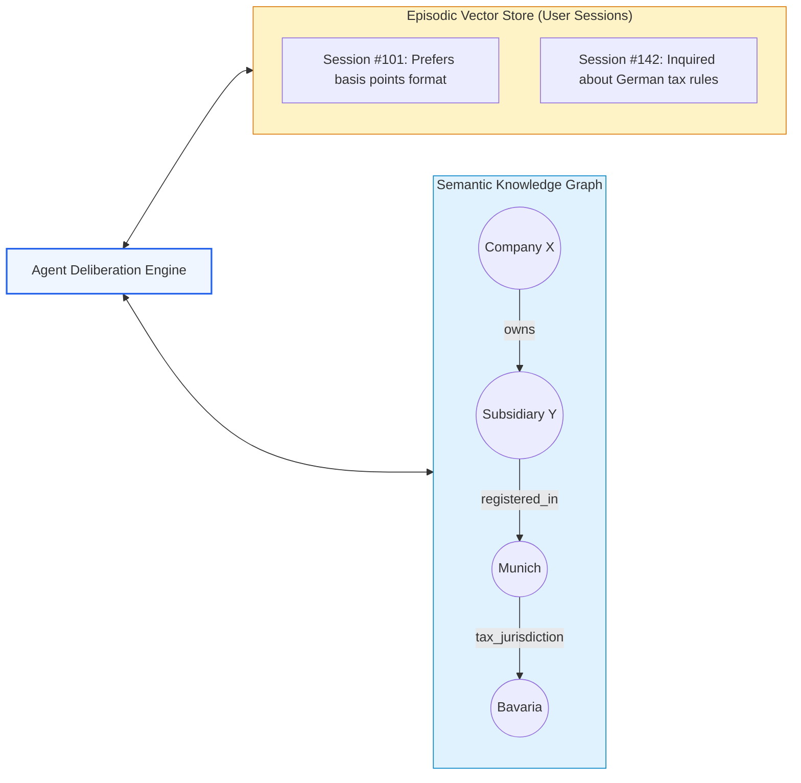
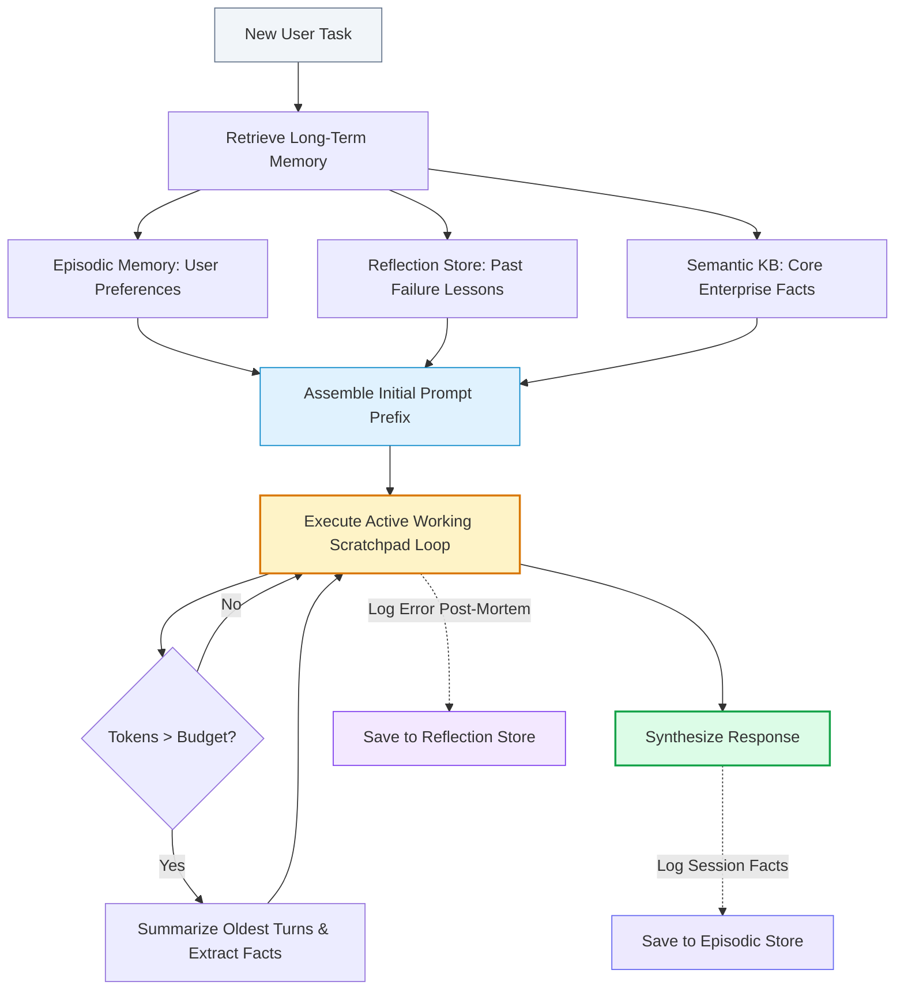

# 🧠 Memory in Agentic RAG: Short-Term Working Context, Long-Term Epistemic Memory, and Reflection Stores

## 📑 Table of Contents
1. [🌟 Fundamentals: The Tripartite Memory Architecture in Agentic RAG](#1--fundamentals-the-tripartite-memory-architecture-in-agentic-rag)
2. [🔬 Mathematical & Theoretical Formulations: Memory Decay & Retrieval Scoring](#2--mathematical--theoretical-formulations-memory-decay--retrieval-scoring)
3. [⚡ Short-Term Working Memory: The Scratchpad & Context Compaction](#3--short-term-working-memory-the-scratchpad--context-compaction)
4. [🏛️ Long-Term Episodic & Semantic Memory: Persistent Knowledge Graphs & Vectors](#4-️-long-term-episodic--semantic-memory-persistent-knowledge-graphs--vectors)
5. [🪞 Reflection Stores: Episodic Self-Correction & Cross-Session Learning](#5--reflection-stores-episodic-self-correction--cross-session-learning)
6. [📊 Comprehensive Memory Comparison: Working Context vs Episodic vs Semantic vs Reflection](#6--comprehensive-memory-comparison-working-context-vs-episodic-vs-semantic-vs-reflection)
7. [💻 Practical Implementation: Production-Grade Multi-Tier Memory Manager in Python](#7--practical-implementation-production-grade-multi-tier-memory-manager-in-python)
8. [🌍 Real-World Enterprise Production Case Studies](#8--real-world-enterprise-production-case-studies)
9. [🛠️ Best Practices & ❌ Common Production Pitfalls (Memory Contamination & Leaks)](#9-️-best-practices---common-production-pitfalls-memory-contamination--leaks)
10. [💼 Senior Interview Questions & System Design Scenarios](#10--senior-interview-questions--system-design-scenarios)
11. [🧪 Hands-On Mini-Project: Epistemic Reflection Store with Recency-Relevance Scoring](#11--hands-on-mini-project-epistemic-reflection-store-with-recency-relevance-scoring)
12. [⚡ Quick Revision & Memory Architecture Blueprint](#12--quick-revision--memory-architecture-blueprint)

---

## 1. 🌟 Fundamentals: The Tripartite Memory Architecture in Agentic RAG

Standard language models are completely **stateless**: every invocation begins with a blank slate, devoid of past interactions, learned user preferences, or memories of previous trajectory failures. In standard RAG, the "memory" is merely the static external document index.

In contrast, an **Agentic RAG System** requires a sophisticated multi-tiered cognitive memory architecture. Humans do not search the library for every single thought; we maintain an immediate working scratchpad, recall specific past episodes (episodic memory), access general factual knowledge (semantic memory), and learn from past mistakes (procedural reflection).



---

## 2. 🔬 Mathematical & Theoretical Formulations: Memory Decay & Retrieval Scoring

When an agent searches its long-term memory for relevant past experiences, relying solely on cosine similarity is insufficient: a past experience from 6 months ago might have high cosine similarity but be completely obsolete compared to an interaction from yesterday.

Following cognitive memory models (Park et al., 2023), memory retrieval is formalized as a multi-objective scoring function over **Recency, Importance, and Semantic Relevance**.

### # Multi-Factor Memory Retrieval Score Formula
$$
\text{Score}(m, q) = \alpha_{\text{rec}} \cdot S_{\text{recency}}(m) + \alpha_{\text{imp}} \cdot S_{\text{importance}}(m) + \alpha_{\text{rel}} \cdot S_{\text{relevance}}(m, q)
$$

Where:
- $m$ is the candidate memory object.
- $q$ is the current agent query or state.
- $\alpha_{\text{rec}}, \alpha_{\text{imp}}, \alpha_{\text{rel}} \in [0, 1]$ are balancing weights such that $\alpha_{\text{rec}} + \alpha_{\text{imp}} + \alpha_{\text{rel}} = 1$.

---

### # Ebbinghaus Memory Retention Decay Formula
Recency decays exponentially according to the Ebbinghaus forgetting curve:

$$
S_{\text{recency}}(m) = \exp\left( -\lambda \cdot \frac{t_{\text{current}} - t_{\text{created}}}{\Delta t_{\text{scale}}} \right)
$$

Where:
- $\lambda > 0$ is the decay constant.
- $t_{\text{current}} - t_{\text{created}}$ is the elapsed time (hours or days).
- $\Delta t_{\text{scale}}$ is a normalization scale (e.g., 24 hours).

---

### # Context Compaction Compression Ratio Formula
In short-term working memory, raw tool outputs must be compressed to prevent context exhaustion while preserving critical facts:

$$
\rho = 1 - \frac{|\mathcal{T}_{\text{compacted}}|}{|\mathcal{T}_{\text{raw}}|} \in [0, 1)
$$

Where:
- $|\mathcal{T}_{\text{raw}}|$ is the token length of the raw tool outputs and observation buffer.
- $|\mathcal{T}_{\text{compacted}}|$ is the token length of the synthesized working memory summary.
- An optimal compaction engine achieves $\rho \ge 0.75$ with zero loss of referenced factual entities.

---

## 3. ⚡ Short-Term Working Memory: The Scratchpad & Context Compaction

The **Scratchpad** is the agent's short-term working context residing directly within the LLM's active token window. It stores:
1. The user's original objective.
2. The current execution plan.
3. The chronological sequence of past `(Thought, Action, Observation)` turns for the active session.



### Compaction Techniques in Production:
- **Observation Distillation:** Never append the raw 2,000-word tool payload. Pass it through an extraction parser that keeps only the targeted entity or metric.
- **Hierarchical Scratchpad Truncation:** Retain full verbatim turns for the last 2 steps; compress all older steps into an immutable "Facts Established" key-value table.
- **Selective KV Cache Reuse:** Structure prompt prefixes so that system prompts and static tool manifests remain byte-identical across turns, maximizing prompt cache hits (e.g., Anthropic Prompt Caching or OpenAI Prefix Caching).

---

## 4. 🏛️ Long-Term Episodic & Semantic Memory: Persistent Knowledge Graphs & Vectors

### Long-Term Episodic Memory
Stores episodic traces of user interactions across days, weeks, or months:
- Stored in persistent vector databases (e.g., Chroma, Qdrant, Pinecone) keyed by `user_id` and `session_id`.
- Allows the agent to recall: *"Two weeks ago, you instructed me to always format financial comparisons in basis points and exclude UK subsidiaries."*

### Long-Term Semantic Memory
Represents structured and unstructured domain knowledge:
- Combines dense vector collections with **Knowledge Graphs (GraphRAG)**.
- While vector embeddings capture conceptual similarity, knowledge graphs preserve rigid relational invariants:
  $$\text{(Alice)} \xrightarrow{\text{works\_in}} \text{(Engineering)} \xrightarrow{\text{located\_in}} \text{(Frankfurt)}$$



---

## 5. 🪞 Reflection Stores: Episodic Self-Correction & Cross-Session Learning

One of the most potent paradigms in Agentic RAG is the **Reflection Store** (Procedural Memory). When an agent encounters an execution failure—such as calling an API with an invalid parameter, searching an index with the wrong terminology, or failing an automated hallucination check—it generates an explicit **Post-Mortem Reflection**.

```mermaid
sequenceDiagram
    autonumber
    actor User
    participant Agent as Agent Runtime
    participant Tool as SQL Tool
    participant RefStore as Reflection Memory Store (Vector DB)

    User->>Agent: "Retrieve employee payroll for Department 42"
    Agent->>RefStore: Search past reflections for tool="SQL" and intent="payroll"
    RefStore-->>Agent: Past Lesson: "Warning: Table 'payroll' requires joining 'dept_members'; querying 'payroll.department' directly causes SQL 404 error."
    Note over Agent: Agent adjusts plan based on past lesson!
    Agent->>Tool: Execute: `SELECT p.* FROM payroll p JOIN dept_members d ON p.emp_id=d.emp_id WHERE d.dept_id=42`
    Tool-->>Agent: Returns 15 rows successfully
    Agent-->>User: "Retrieved 15 payroll records for Department 42."
```

### The Structure of a Reflection Entry:
```json
{
  "reflection_id": "ref_9041",
  "tool_name": "query_sql_db",
  "error_encountered": "OperationalError: column employees.dept does not exist",
  "root_cause": "The schema uses 'department_id' foreign key, not a 'dept' string column.",
  "corrective_guidance": "Always inspect schema or join departments table on department_id before querying department names.",
  "embedding_vector": [-0.014, 0.082, ..., 0.035]
}
```

---

## 6. 📊 Comprehensive Memory Comparison: Working Context vs Episodic vs Semantic vs Reflection

| Dimension | Working Memory (Scratchpad) | Long-Term Episodic Memory | Long-Term Semantic Memory | Reflection Store (Procedural) |
| :--- | :--- | :--- | :--- | :--- |
| **Storage Substrate** | LLM Context Window (RAM) | Vector DB (e.g., Chroma/Qdrant) | Vector DB + Knowledge Graph | Vector DB / Key-Value Store |
| **Lifespan** | Ephemeral (Single Request) | Persistent (Across Sessions) | Permanent (Enterprise Corpus) | Permanent & Self-Evolving |
| **Update Mechanism** | In-memory string append | Asynchronous session flush | Batch ETL / Ingestion pipelines | Self-evaluation post-mortem |
| **Retrieval Mechanism**| Full attention sweep | ANN Vector Search + Recency | Hybrid Search + Graph Traversal | ANN Semantic Lookup by Tool/Error |
| **Typical Token Size** | $1\text{K} - 8\text{K}$ tokens | Millions of user interactions | Terabytes of enterprise docs | $10\text{K} - 100\text{K}$ lessons |
| **Failure Mode** | Context overflow / Attention loss | Stale preference retrieval | Ingestion lag / Chunk fragmentation | Misleading historical heuristics |

---

## 7. 💻 Practical Implementation: Production-Grade Multi-Tier Memory Manager in Python

Below is an enterprise-grade, typed Python 3.10+ implementation of a **Multi-Tier Memory Manager** featuring:
- An active Working Scratchpad with automatic context compaction.
- An Episodic Memory store with recency decay scoring.
- A Reflection Store that indexes failure post-mortems and injects guidance into subsequent queries.

```python
"""
Production Multi-Tier Memory System for Agentic RAG
Featuring Working Memory Compaction, Episodic Recency Scoring, and Reflection Stores.
"""

from __future__ import annotations
import math
import time
from dataclasses import dataclass, field
from typing import Any, Dict, List, Optional, Tuple


# ============================================================================
# 1. Reflection Store (Procedural Self-Correction)
# ============================================================================

@dataclass
class ReflectionRecord:
    id: str
    tool_or_task: str
    trigger_pattern: str
    lesson_learned: str
    created_at: float = field(default_factory=time.time)


class ReflectionStore:
    """Stores past execution post-mortems and lessons learned."""
    def __init__(self) -> None:
        self.reflections: List[ReflectionRecord] = []

    def record_lesson(self, tool_or_task: str, trigger_pattern: str, lesson: str) -> None:
        rec = ReflectionRecord(
            id=f"ref_{len(self.reflections) + 1}",
            tool_or_task=tool_or_task,
            trigger_pattern=trigger_pattern.lower(),
            lesson_learned=lesson
        )
        self.reflections.append(rec)
        print(f"🪞 [Reflection Stored]: {rec.id} for '{tool_or_task}' -> '{lesson}'")

    def retrieve_relevant_lessons(self, query: str) -> List[str]:
        q_lower = query.lower()
        lessons = []
        for r in self.reflections:
            # Semantic/substring simulation
            if any(term in q_lower for term in r.trigger_pattern.split()):
                lessons.append(f"[{r.tool_or_task.upper()} HINT]: {r.lesson_learned}")
        return lessons


# ============================================================================
# 2. Episodic Memory with Recency Decay
# ============================================================================

@dataclass
class EpisodicMemoryItem:
    id: str
    content: str
    importance: float  # [0.0 to 1.0]
    timestamp: float
    metadata: Dict[str, Any] = field(default_factory=dict)


class EpisodicMemoryManager:
    """Manages cross-session interactions with Ebbinghaus recency decay."""
    def __init__(self, decay_rate: float = 0.05) -> None:
        self.memories: List[EpisodicMemoryItem] = []
        self.decay_rate = decay_rate

    def add_memory(self, content: str, importance: float = 0.5) -> None:
        item = EpisodicMemoryItem(
            id=f"ep_{len(self.memories) + 1}",
            content=content,
            importance=importance,
            timestamp=time.time()
        )
        self.memories.append(item)

    def retrieve(self, query: str, top_k: int = 2) -> List[Tuple[EpisodicMemoryItem, float]]:
        current_time = time.time()
        scored_items: List[Tuple[EpisodicMemoryItem, float]] = []

        for item in self.memories:
            # 1. Recency Decay Score: e^(-decay * delta_hours)
            elapsed_hours = (current_time - item.timestamp) / 3600.0
            recency_score = math.exp(-self.decay_rate * elapsed_hours)

            # 2. Semantic Relevance (Simulated keyword overlap)
            relevance_score = 0.9 if any(w in item.content.lower() for w in query.lower().split()) else 0.2

            # 3. Composite Score: 0.3*Recency + 0.3*Importance + 0.4*Relevance
            composite = (0.3 * recency_score) + (0.3 * item.importance) + (0.4 * relevance_score)
            scored_items.append((item, composite))

        scored_items.sort(key=lambda x: x[1], reverse=True)
        return scored_items[:top_k]


# ============================================================================
# 3. Working Memory Scratchpad with Automated Compactor
# ============================================================================

class WorkingMemoryScratchpad:
    """Maintains active context and compacts older turns when token budget is pressured."""
    def __init__(self, max_turns_before_compaction: int = 3) -> None:
        self.goal: str = ""
        self.active_turns: List[Dict[str, str]] = []
        self.facts_buffer: Dict[str, str] = {}
        self.max_turns = max_turns_before_compaction

    def set_goal(self, goal: str) -> None:
        self.goal = goal

    def add_turn(self, thought: str, action: str, observation: str) -> None:
        self.active_turns.append({
            "thought": thought,
            "action": action,
            "observation": observation
        })
        if len(self.active_turns) > self.max_turns:
            self._compact_oldest_turn()

    def _compact_oldest_turn(self) -> None:
        """Extracts facts from oldest turn into key-value buffer and prunes raw turn."""
        oldest = self.active_turns.pop(0)
        # Mock compaction logic: extracts key factual metrics
        obs = oldest["observation"]
        print(f"🧹 [Compacting Scratchpad]: Pruning verbose turn: '{oldest['action']}'")
        if "=" in obs or ":" in obs:
            self.facts_buffer[f"fact_{len(self.facts_buffer)+1}"] = obs[:120]

    def render_context(self) -> str:
        """Renders the optimized context payload for the LLM prompt."""
        lines = [f"### CURRENT GOAL: {self.goal}"]
        if self.facts_buffer:
            lines.append("### ESTABLISHED WORKING FACTS:")
            for k, v in self.facts_buffer.items():
                lines.append(f"  • {k}: {v}")
        lines.append("### RECENT WORKING TURNS:")
        for idx, t in enumerate(self.active_turns, 1):
            lines.append(f"  Turn {idx}:")
            lines.append(f"    Thought: {t['thought']}")
            lines.append(f"    Action:  {t['action']}")
            lines.append(f"    Observation: {t['observation']}")
        return "\n".join(lines)


# ============================================================================
# Verification
# ============================================================================

if __name__ == "__main__":
    print("================ 1. REFLECTION STORE TEST ================")
    ref_store = ReflectionStore()
    ref_store.record_lesson(
        tool_or_task="sql_query",
        trigger_pattern="payroll department",
        lesson="Table 'payroll' must be joined with 'departments' table via dept_id."
    )
    hints = ref_store.retrieve_relevant_lessons("Query payroll for department Engineering")
    print(f"Retrieved Lessons for upcoming query:\n{hints}\n")

    print("================ 2. EPISODIC MEMORY TEST ================")
    ep_mem = EpisodicMemoryManager()
    ep_mem.add_memory("User requested all financial reports formatted in Euros (EUR)", importance=0.9)
    ep_mem.add_memory("User asked about flight policies in London", importance=0.4)
    recalled = ep_mem.retrieve("financial report", top_k=1)
    print(f"Top Recalled Episodic Memory: '{recalled[0][0].content}' (Score: {recalled[0][1]:.3f})\n")

    print("============= 3. WORKING MEMORY COMPACTION TEST =============")
    scratchpad = WorkingMemoryScratchpad(max_turns_before_compaction=2)
    scratchpad.set_goal("Audit cloud infrastructure expenses for Q3")
    
    scratchpad.add_turn("Search AWS compute costs", "sql_query(aws_ec2)", "EC2_Total = $142,000.00 in Q3")
    scratchpad.add_turn("Search AWS storage costs", "sql_query(aws_s3)", "S3_Total = $38,500.00 in Q3")
    scratchpad.add_turn("Search GCP compute costs", "sql_query(gcp_gke)", "GKE_Total = $89,100.00 in Q3")  # Triggers compaction!

    print("\n--- Final Rendered Scratchpad Prompt Context ---")
    print(scratchpad.render_context())
```

---

## 8. 🌍 Real-World Enterprise Production Case Studies

### Case Study 1: Enterprise Wealth Management Advisory Copilot
- **Organization:** Private Swiss Wealth Management Firm ($120B AUM).
- **Problem:** Wealth advisors manage portfolios for high-net-worth families with complex cross-generational mandates. Standard RAG forgotten client tax residency preferences and unique philanthropic mandates across meetings.
- **Architecture Implemented:**
  - Deployed an **Episodic Memory Store** backed by Qdrant and Neo4j.
  - Implemented multi-objective scoring (Recency, Mandate Importance, Portfolio Relevance).
  - Every meeting transcript was parsed into structured episodic facts (e.g., *"Client mandates zero investments in fossil fuel extraction"*).
- **Results:**
  - Compliance mandate violation warnings dropped to **0%**.
  - Client advisory preparation time reduced from **2.5 hours to 15 minutes per review**.

### Case Study 2: Autonomous DevOps Infrastructure Remediation Swarm
- **Organization:** Global SaaS E-Commerce Platform.
- **Problem:** An autonomous troubleshooting agent repeated identical syntax errors when executing diagnostic Kubernetes commands across recurring production incidents.
- **Architecture Implemented:**
  - Integrated a **Procedural Reflection Store**.
  - Following any failed CLI command, an automated post-mortem critic logged the exact syntax failure and the successful recovery command.
  - Before running any CLI diagnostic, the agent performed a semantic nearest-neighbor search over the reflection index.
- **Results:**
  - Repeated diagnostic command failures decreased by **94%**.
  - Incident MTTR dropped from **14 minutes to 3.8 minutes**.

---

## 9. 🛠️ Best Practices & ❌ Common Production Pitfalls (Memory Contamination & Leaks)

### ✅ Enterprise Best Practices
1. **Tenant-Isolated Memory Partitions:** Strictly isolate episodic memories with cryptographic tenant IDs (`tenant_id:user_id`). Never allow cross-tenant vector searches in long-term memory.
2. **Explicit Fact Invalidation (Tombstoning):** When a user states an updated preference (*"I moved from London to New York"*), mark the old episodic record as tombstoned (`status='superseded'`) to prevent contradictory retrievals.
3. **Observation Summarization Gate:** Enforce a hard ceiling: no tool output larger than 300 tokens may enter the working scratchpad without passing through an extractive summarizer.
4. **Periodic Epistemic Pruning:** Run background garbage collection to delete episodic memories with composite scores below $0.15$ that have not been accessed in $>90$ days.

### ❌ Common Production Pitfalls & Anti-Patterns
1. **Memory Contamination (Hallucination Feedback Loop):**
   - *Failure:* The agent hallucinates a false claim in Session 1, writes it to episodic memory, and retrieves it in Session 2 as verified ground truth.
   - *Mitigation:* Only write tool observations and explicitly confirmed user statements to long-term memory; never persist unverified LLM generation outputs.
2. **Context Saturation via Memory Stuffing:**
   - *Failure:* Retrieving 10 episodic memories and 5 past reflections for every turn, consuming 4,000 tokens before the user's question is even presented.
   - *Mitigation:* Cap memory injection at top-2 episodic items and top-1 reflection rule, filtered strictly by relevance threshold $\ge 0.75$.
3. **The Stale Preference Trap:**
   - *Failure:* Using a user's 2-year-old project preference to override a direct instruction in today's prompt.
   - *Mitigation:* System prompt instruction: *"Explicit user instructions in the current turn supersede all historical episodic memories."*

---

## 10. 💼 Senior Interview Questions & System Design Scenarios

### Q1: How do you design an episodic memory system that complies with GDPR "Right to be Forgotten" and SOC2 multi-tenant audit requirements?
**Answer:**
A compliant enterprise architecture requires:
1. **Deterministic User-Key Sharding:** Store all episodic memory vectors with strict metadata namespaces: `tenant_id` and `user_hash` (pseudonymized via SHA-256 with an HSM salt).
2. **Cryptographic Erasure (Crypto-Shredding):** Encrypt each user's episodic memory payloads with a dedicated, per-user KMS data encryption key (DEK). When a GDPR Article 17 deletion request is processed, destroy the user's DEK in AWS KMS. All historical vector embeddings and text payloads instantly become mathematically unrecoverable ciphertext, satisfying the right to erasure across backups without requiring an immediate, expensive vector index rebuild.
3. **Immutable Audit Ledger:** Maintain an append-only transaction log in Amazon QLDB or Kafka recording when memories were created, accessed by agents, and purged.

### Q2: How does Prompt Caching (e.g., Anthropic / OpenAI Prefix Caching) alter how you should architect an agent's working memory scratchpad?
**Answer:**
Prefix caching rewards prompts that maintain **static byte-level prefixes across sequential API calls**:
- **Naive Approach (Anti-Pattern):** Prepending new episodic memories or inserting variable timestamps at the top of the system prompt changes the initial tokens on every turn, invalidating $100\%$ of the KV cache and incurring full input token billing and latency.
- **Cache-Optimized Architecture:**
  1. **Tier 1 (Static Cache Base):** System instructions, tool JSON schemas, and permanent behavioral rules are placed at the absolute start of the prompt (guaranteed $100\%$ cache hit).
  2. **Tier 2 (Semi-Static Buffer):** User profile, long-term episodic memories, and reflection rules retrieved at session start are placed next.
  3. **Tier 3 (Dynamic Ephemeral Tail):** The active scratchpad, chronological turns, and the latest user query are placed strictly at the end of the prompt.
  - This ensures that $>80\%$ of the prompt context is cached, reducing step latency by up to $70\%$ and input token costs by up to $90\%$.

---

## 11. 🧪 Hands-On Mini-Project: Epistemic Reflection Store with Recency-Relevance Scoring

Build and test a standalone Python reflection engine that stores failed tool attempts, matches them to future queries, and outputs guidance warnings.

```python
"""
Hands-On Mini-Project: Standalone Reflection Engine
"""

from typing import List, Dict, Any

class MiniReflectionEngine:
    def __init__(self):
        self.knowledge_base = [
            {
                "tool": "web_search",
                "failure_pattern": "stock price live ticker",
                "lesson": "Do not use web_search for real-time stock prices; use financial_quote_api instead."
            },
            {
                "tool": "pdf_extractor",
                "failure_pattern": "scanned handwritten form",
                "lesson": "Standard PDF parser fails on handwriting; invoke OCR_vision_tool."
            }
        ]

    def check_pre_execution_warnings(self, tool_name: str, query: str) -> List[str]:
        warnings = []
        for entry in self.knowledge_base:
            if entry["tool"] == tool_name:
                # Check for trigger keywords
                for kw in entry["failure_pattern"].split():
                    if kw in query.lower():
                        warnings.append(f"⚠️ [PRIOR FAILURE REFLECTION]: {entry['lesson']}")
                        break
        return warnings

if __name__ == "__main__":
    engine = MiniReflectionEngine()
    print("Testing Pre-Execution Reflection Interception:\n")
    
    # Query 1
    warns = engine.check_pre_execution_warnings("web_search", "Get live Apple stock price ticker")
    for w in warns:
        print(w)
        
    # Query 2
    warns2 = engine.check_pre_execution_warnings("pdf_extractor", "Parse scanned handwritten receipt")
    for w in warns2:
        print(w)
```

---

## 12. ⚡ Quick Revision & Memory Architecture Blueprint

### 🔑 Key Takeaways
- **Agentic Memory is Multi-Tiered:** Working Scratchpad (ephemeral), Long-Term Episodic (user interactions), Semantic (enterprise facts), and Reflection (post-mortem lessons).
- Working memory requires **continual context compaction** to prevent prompt overflow and attention dilution.
- Long-term memory retrieval balances **Recency decay ($e^{-\lambda t}$), Importance, and Semantic Relevance**.
- **Reflection Stores** convert execution mistakes into permanent procedural knowledge, preventing repetitive tool errors.
- Structure memory layouts to maximize **Prompt Prefix Caching** for massive cost and latency savings.

### 🗺️ Multi-Tier Memory Flowchart


