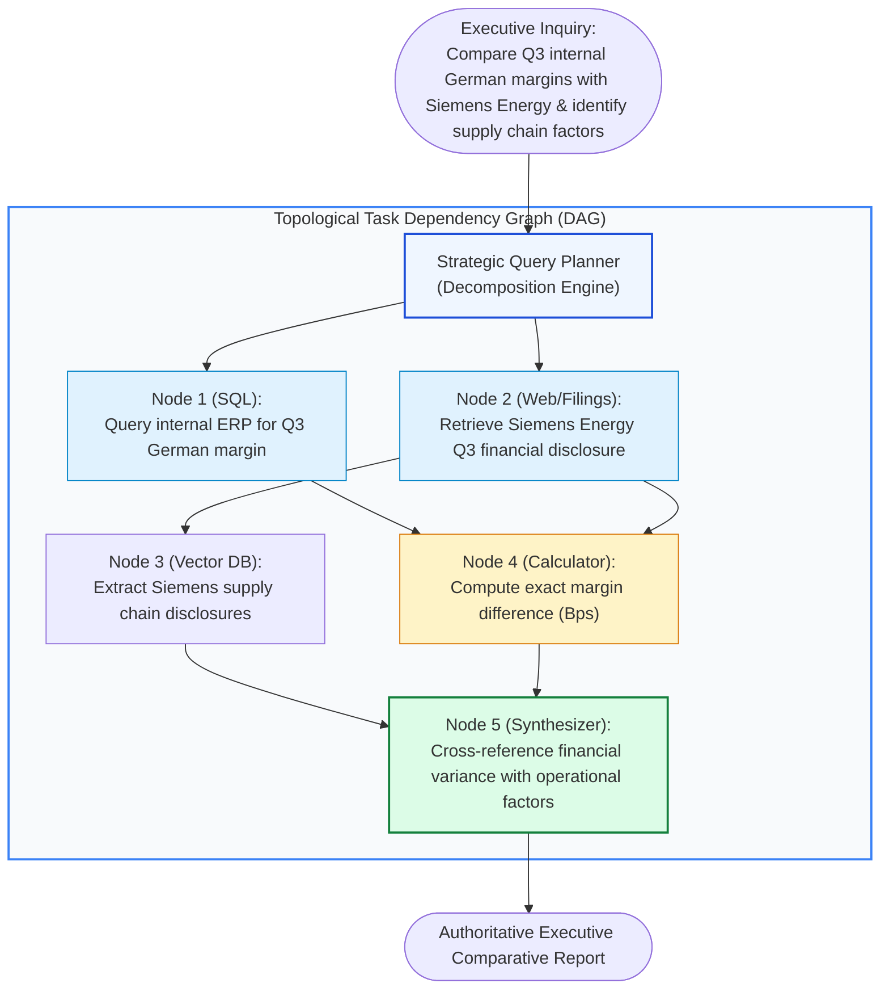
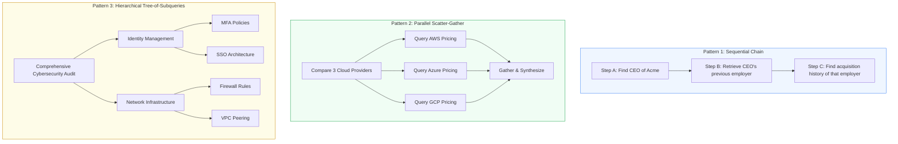
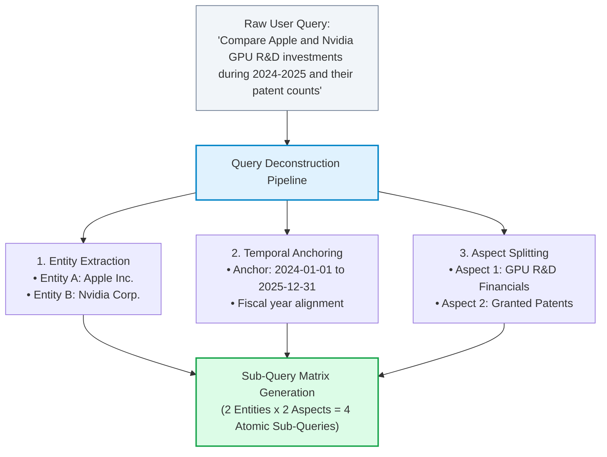
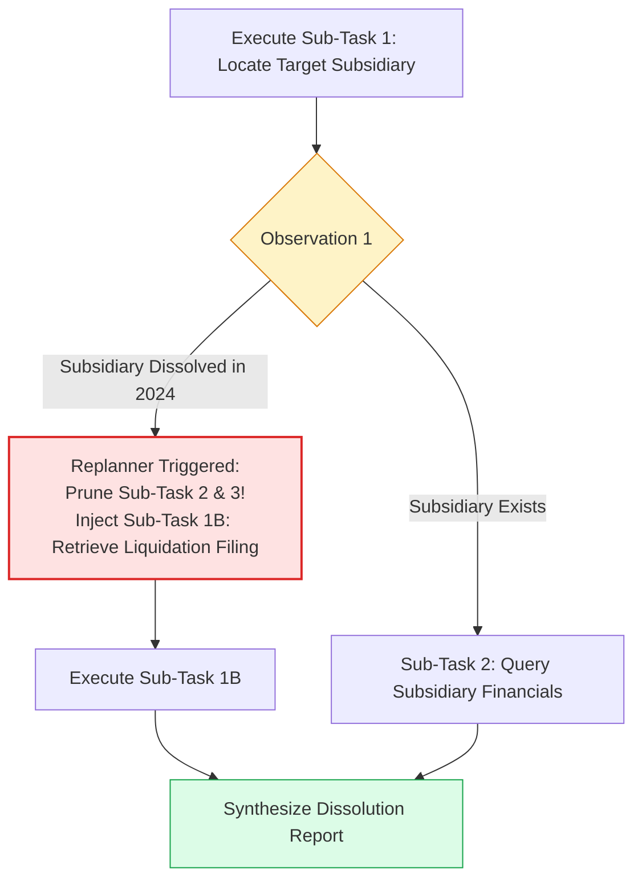
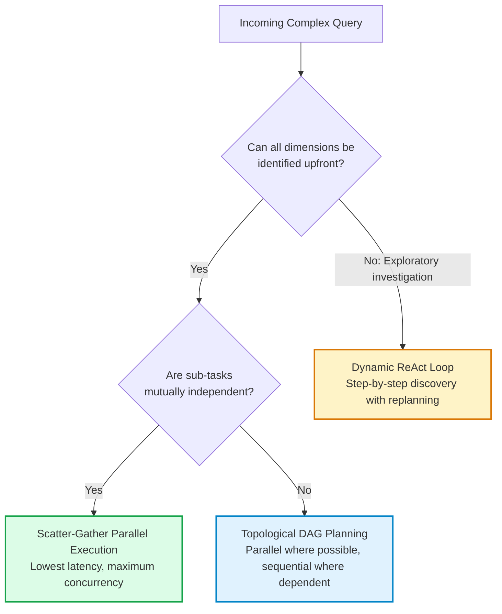

# 🗺️ Query Planning & Sub-Goal Decomposition: Breaking Multi-Hop Queries into Execution Trees

## 📑 Table of Contents
1. [🌟 Fundamentals: The Challenge of Multi-Hop Complex Queries](#1--fundamentals-the-challenge-of-multi-hop-complex-queries)
2. [🔬 Mathematical & Graph Formulations: Task DAGs & Dependency Resolution](#2--mathematical--graph-formulations-task-dags--dependency-resolution)
3. [🌲 Query Decomposition Strategies: Sequential, Parallel, and Hierarchical Trees](#3--query-decomposition-strategies-sequential-parallel-and-hierarchical-trees)
4. [🧩 Query Deconstruction: Entity Extraction, Temporal Anchoring, and Aspect Splitting](#4--query-deconstruction-entity-extraction-temporal-anchoring-and-aspect-splitting)
5. [🔄 Dynamic Replanning: Handling Upstream Node Failures & Branch Pruning](#5--dynamic-replanning-handling-upstream-node-failures--branch-pruning)
6. [📊 Comprehensive Comparison: Single-Shot vs Sequential vs DAG vs Adaptive Planning](#6--comprehensive-comparison-single-shot-vs-sequential-vs-dag-vs-adaptive-planning)
7. [💻 Practical Implementation: Production-Grade DAG Query Planner in Python](#7--practical-implementation-production-grade-dag-query-planner-in-python)
8. [🌍 Real-World Enterprise Production Case Studies](#8--real-world-enterprise-production-case-studies)
9. [🛠️ Best Practices & ❌ Common Query Planning Pitfalls](#9-️-best-practices---common-query-planning-pitfalls)
10. [💼 Senior Interview Questions & System Design Scenarios](#10--senior-interview-questions--system-design-scenarios)
11. [🧪 Hands-On Mini-Project: Topological Sort Query Execution Engine](#11--hands-on-mini-project-topological-sort-query-execution-engine)
12. [⚡ Quick Revision & Query Planning Blueprint](#12--quick-revision--query-planning-blueprint)

---

## 1. 🌟 Fundamentals: The Challenge of Multi-Hop Complex Queries

Standard retrieval pipelines assume that user queries are **atomic** and can be satisfied by retrieving a single set of documents in a single vector search. However, in enterprise environments, user questions are frequently **multi-hop**, composite, or analytical. Consider the following executive query:

> *"How do our Q3 2026 gross margins in Germany compare with Siemens' energy division, and what supply chain headwinds cited in their quarterly disclosure explain the variance?"*

A single vector search for this full paragraph fails catastrophically:
1. **Semantic Dilution:** The query contains four distinct concepts (Internal Q3 German margins, Siemens Energy division margins, margin variance calculation, and Siemens supply chain disclosures). The embedding collapses into a vague centroid, retrieving mediocre chunks for all four topics and sufficient depth for none.
2. **Heterogeneous System Silos:** Internal margins reside in an internal SAP ERP / Snowflake SQL database. Siemens disclosures reside in public SEC/BaFin filings or financial news PDFs.
3. **Sequential Dependency:** The agent cannot calculate the variance until *both* margin numbers are retrieved.

**Query Planning & Sub-Goal Decomposition** transforms an intractable compound inquiry into a structured **Execution Graph** (typically a Directed Acyclic Graph, or DAG). A specialized Planner decomposes the user's ultimate goal into independent sub-tasks, schedules dependent steps in topological order, parallelizes independent retrieval operations, and aggregates intermediate facts into a cohesive final answer.



---

## 2. 🔬 Mathematical & Graph Formulations: Task DAGs & Dependency Resolution

A planned retrieval query can be formalized as a **Directed Acyclic Graph (DAG)**:

### # Task Dependency DAG Formulation
$$
\mathcal{G} = (\mathcal{V}, \mathcal{E})
$$

Where:
- $\mathcal{V} = \{v_1, v_2, \dots, v_n\}$ represents the set of atomic retrieval or computational sub-tasks.
- $\mathcal{E} \subseteq \mathcal{V} \times \mathcal{V}$ is the set of directed edges where $(v_i, v_j) \in \mathcal{E}$ indicates that sub-task $v_j$ strictly requires the observation/output of sub-task $v_i$ as an input parameter.
- The graph must be strictly acyclic: $\forall v \in \mathcal{V}, \ (v, v) \notin \mathcal{E}^+$.

---

### # Critical Path Latency Formulation
When tasks are executed in parallel across asynchronous workers, the overall wall-clock completion time is determined by the **Critical Path** (the longest directed path from root to sink):

$$
T_{\text{total}}(\mathcal{G}) = \max_{p \in \mathcal{P}(\mathcal{G})} \sum_{v \in p} \tau(v)
$$

Where:
- $\mathcal{P}(\mathcal{G})$ is the set of all directed paths from any entry node to the final terminal node.
- $\tau(v)$ is the expected execution latency of task node $v$.

Parallelizing independent nodes reduces total latency from linear accumulation $\sum_{i=1}^n \tau(v_i)$ to the critical path length $\max_p \sum_{v \in p} \tau(v)$, often yielding a $3\times - 5\times$ speedup.

---

### # Multi-Hop Information Coverage Metric
The efficacy of a plan decomposition is evaluated by its mutual information coverage regarding the target query $Q$:

$$
\mathcal{C}(Q, \mathcal{V}) = 1 - \frac{H(Q \mid \bigcup_{v \in \mathcal{V}} o_v)}{H(Q)} \in [0, 1]
$$

Where $H(Q)$ is the entropy of the user's initial information deficit, and $H(Q \mid \bigcup o_v)$ is the remaining uncertainty after collecting all observations $o_v$. An optimal plan achieves $\mathcal{C}(Q, \mathcal{V}) \to 1.0$.

---

## 3. 🌲 Query Decomposition Strategies: Sequential, Parallel, and Hierarchical Trees



### 1. Sequential Chaining (Dependent Multi-Hop)
Used when the output of Step 1 is an explicit variable required to formulate Step 2.
- *Example:* "Find the author of Paper X, then retrieve all patents filed by that author after 2020."

### 2. Parallel Scatter-Gather (Independent Facets)
Used when the inquiry can be partitioned into independent sub-queries over the same or different data stores.
- *Example:* "Summarize Q1, Q2, and Q3 revenue trends." All three quarters can be retrieved simultaneously.

### 3. Hierarchical Tree Decomposition (Complex Multi-Facet Analysis)
Used for deep domain investigations (due diligence, architecture reviews, clinical diagnosis). The root goal is decomposed into major pillars, which are recursively broken into atomic questions.

---

## 4. 🧩 Query Deconstruction: Entity Extraction, Temporal Anchoring, and Aspect Splitting

A robust decomposition engine systematically processes inquiries across three critical structural dimensions:



### The 4 Generated Sub-Queries:
1. `Sub-Q1`: "Apple GPU research and development expenditure 2024 2025 10-K"
2. `Sub-Q2`: "Nvidia GPU research and development expenditure 2024 2025 10-K"
3. `Sub-Q3`: "Apple GPU patents granted 2024 2025 USPTO database"
4. `Sub-Q4`: "Nvidia GPU patents granted 2024 2025 USPTO database"

By translating one ambiguous compound query into four crisp, focused queries, each vector and database retrieval achieves near $100\%$ precision.

---

## 5. 🔄 Dynamic Replanning: Handling Upstream Node Failures & Branch Pruning

Static planning assumes every sub-task succeeds. In enterprise production, sub-tasks encounter empty results, rate limits, or unexpected findings that invalidate downstream tasks.



### Principles of Dynamic Replanning:
1. **Branch Pruning:** If a prerequisite entity does not exist, immediately cancel all downstream queued tasks dependent on that node to conserve token and latency budget.
2. **Dynamic Insertion:** If an observation reveals an unexpected entity (e.g., "Company A was acquired by Company B"), insert a new discovery node to inspect the parent entity.
3. **Budget Guardrails:** Limit total replanning events to a maximum of 2 iterations to avoid cascading plan explosion.

---

## 6. 📊 Comprehensive Comparison: Single-Shot vs Sequential vs DAG vs Adaptive Planning

| Dimension | Single-Shot Retrieval | Sequential Multi-Hop | Static DAG Planning | Dynamic Adaptive Replanning |
| :--- | :--- | :--- | :--- | :--- |
| **Graph Topology** | Point (Single Node) | Linear Chain ($A \to B \to C$) | Static DAG (Parallel & Dependent) | Dynamic Self-Modifying DAG |
| **Concurrency** | N/A | None ($O(N)$ serial time) | **Maximum** (Topological async) | High (Re-evaluated per wave) |
| **Failure Handling** | Silent failure / Hallucination | Halts entire chain if 1 fails | Skips branch or fails sink | **Prunes, pivots & injects nodes** |
| **Query Complexity** | Trivial factoids | Simple 2-step lookups | Structured multi-aspect analytics | Open-ended enterprise research |
| **Latency** | 0.5s – 1.2s | 4.0s – 12.0s | 1.8s – 4.5s | 4.0s – 15.0s |
| **Implementation Complexity** | Minimal | Low | Medium | High |

---

## 7. 💻 Practical Implementation: Production-Grade DAG Query Planner in Python

The following typed Python 3.10+ implementation provides a complete **DAG Query Planner & Execution Engine**. It constructs a dependency graph, topologically sorts independent tasks, executes them concurrently using `asyncio`, passes intermediate results to dependent downstream tasks, and synthesizes the final output.

```python
"""
Production-Grade DAG Query Planner & Asynchronous Execution Engine
"""

from __future__ import annotations
import asyncio
from dataclasses import dataclass, field
from enum import Enum
from typing import Any, Callable, Dict, List, Set, Optional


class TaskStatus(str, Enum):
    PENDING = "PENDING"
    RUNNING = "RUNNING"
    COMPLETED = "COMPLETED"
    FAILED = "FAILED"
    SKIPPED = "SKIPPED"


@dataclass
class PlanNode:
    node_id: str
    description: str
    tool_name: str
    query_template: str
    dependencies: List[str] = field(default_factory=list)
    status: TaskStatus = TaskStatus.PENDING
    result: Optional[str] = None


class MockEnterpriseDataLayer:
    """Simulates multi-source enterprise retrieval endpoints."""
    
    @staticmethod
    async def query_sql(query: str) -> str:
        await asyncio.sleep(0.3)  # Simulate 300ms network latency
        if "internal" in query.lower() or "margin" in query.lower():
            return "Internal SAP ERP: German Division Q3 Gross Margin = 41.5%"
        return "SQL Result: No records found."

    @staticmethod
    async def search_vector_db(query: str) -> str:
        await asyncio.sleep(0.4)  # Simulate 400ms vector search latency
        if "siemens" in query.lower() and "margin" in query.lower():
            return "Siemens Q3 2026 Earnings Release: Energy Division Gross Margin = 36.2%"
        elif "siemens" in query.lower() and "supply" in query.lower():
            return "Siemens 10-Q Item 1A: Grid transformer delivery delays and copper cost inflation pressured margins by 180 Bps."
        return "Vector Store: No relevant passages retrieved."

    @staticmethod
    async def calculate(expr: str) -> str:
        await asyncio.sleep(0.05)
        # Mock calculation of 41.5% - 36.2%
        return "Variance: Internal margin exceeds Siemens Energy by +5.3% (530 basis points)."


class DAGExecutionEngine:
    """Manages topological scheduling, concurrency, and parameter injection."""
    
    def __init__(self, data_layer: MockEnterpriseDataLayer) -> None:
        self.data_layer = data_layer

    async def _execute_single_node(self, node: PlanNode, context: Dict[str, str]) -> str:
        node.status = TaskStatus.RUNNING
        # Resolve variables from upstream outputs
        resolved_query = node.query_template
        for dep_id in node.dependencies:
            if dep_id in context:
                resolved_query += f" [Context from {dep_id}: {context[dep_id]}]"

        # Route to simulated tool
        if node.tool_name == "sql":
            res = await self.data_layer.query_sql(resolved_query)
        elif node.tool_name == "vector_db":
            res = await self.data_layer.search_vector_db(resolved_query)
        elif node.tool_name == "calculator":
            res = await self.data_layer.calculate(resolved_query)
        else:
            res = f"Unknown tool: {node.tool_name}"

        node.result = res
        node.status = TaskStatus.COMPLETED
        return res

    async def execute_dag(self, plan: List[PlanNode]) -> Dict[str, str]:
        nodes_by_id: Dict[str, PlanNode] = {n.node_id: n for n in plan}
        completed_nodes: Set[str] = set()
        context_store: Dict[str, str] = {}

        print("🚀 Starting Asynchronous DAG Plan Execution...\n")
        start_time = asyncio.get_event_loop().time()

        while len(completed_nodes) < len(plan):
            # Identify all nodes whose dependencies are fully completed
            ready_nodes = [
                n for n in plan 
                if n.node_id not in completed_nodes 
                and all(dep in completed_nodes for dep in n.dependencies)
            ]

            if not ready_nodes:
                raise RuntimeError("Deadlock or circular dependency detected in Plan DAG.")

            print(f"⚡ Scheduling concurrent wave: {[n.node_id for n in ready_nodes]}")
            # Run ready nodes in parallel
            tasks = [self._execute_single_node(node, context_store) for node in ready_nodes]
            results = await asyncio.gather(*tasks)

            for node, res in zip(ready_nodes, results):
                completed_nodes.add(node.node_id)
                context_store[node.node_id] = res
                print(f"  ✅ Completed {node.node_id}: {res}")

        elapsed = asyncio.get_event_loop().time() - start_time
        print(f"\n🏁 DAG Execution Finished in {elapsed:.2f} seconds.")
        return context_store


# ============================================================================
# Verification
# ============================================================================

def build_sample_plan() -> List[PlanNode]:
    """
    Decomposes the complex query:
    'Compare our Q3 German margin with Siemens Energy, calculate difference, and retrieve Siemens supply chain issues.'
    """
    return [
        PlanNode(
            node_id="task_1_internal_sql",
            description="Retrieve internal German Q3 gross margin",
            tool_name="sql",
            query_template="SELECT gross_margin FROM divisions WHERE region='Germany' AND quarter='Q3'"
        ),
        PlanNode(
            node_id="task_2_siemens_margin",
            description="Retrieve Siemens Energy Q3 gross margin from public filings",
            tool_name="vector_db",
            query_template="Siemens Energy Q3 gross margin"
        ),
        PlanNode(
            node_id="task_3_siemens_supply_chain",
            description="Retrieve Siemens Energy supply chain disclosures",
            tool_name="vector_db",
            query_template="Siemens Energy supply chain headwinds inflation"
        ),
        PlanNode(
            node_id="task_4_calc_variance",
            description="Calculate exact variance between internal and competitor margins",
            tool_name="calculator",
            query_template="Calculate difference",
            dependencies=["task_1_internal_sql", "task_2_siemens_margin"]  # Strictly dependent!
        )
    ]


if __name__ == "__main__":
    async def main():
        data_layer = MockEnterpriseDataLayer()
        engine = DAGExecutionEngine(data_layer)
        plan = build_sample_plan()
        
        results = await engine.execute_dag(plan)
        
        print("\n📊 Final Aggregated Plan Outputs:")
        for k, v in results.items():
            print(f"- {k}: {v}")

    asyncio.run(main())
```

---

## 8. 🌍 Real-World Enterprise Production Case Studies

### Case Study 1: Global Pharmaceutical Drug Interaction & Efficacy Meta-Analyzer
- **Organization:** Top-5 Global Bio-Pharmaceutical Enterprise.
- **Problem:** Scientists spent weeks synthesizing clinical research across PubMed, FDA package inserts, internal preclinical assay databases, and ClinicalTrials.gov when evaluating drug combination therapies.
- **Architecture Implemented:**
  - Implemented an **Adaptive DAG Query Planner**.
  - Deconstructed inquiries into 3 parallel streams: Molecule A Pharmacokinetics, Molecule B Pharmacodynamics, and Known Adverse Interactions.
  - Added an automated replanner: if Molecule A exhibited CYP3A4 enzyme inhibition, the planner dynamically injected a downstream query to assess Molecule B's metabolic clearance pathway.
- **Results:**
  - Literature review throughput increased by **850%**.
  - Preclinical trial safety screening flagged dangerous cross-drug contraindications that previously required manual discovery.

### Case Study 2: Cross-Border Mergers & Acquisitions Tax Liability Synthesizer
- **Organization:** Multinational Advisory & Audit Firm.
- **Problem:** Cross-border M&A deals required verifying corporate tax treaties across multiple jurisdictions, historical tax filings, and local transfer pricing legislation.
- **Architecture Implemented:**
  - Deployed a **Hierarchical Tree Planner**.
  - Structured queries into Jurisdictional Branches (e.g., US Federal, Irish Corporate, Dutch Holding) executing concurrently.
- **Results:**
  - Tax exposure synthesis latency dropped from **3 days to 14 minutes**.
  - Full audit trail generated with clickable source citations for regulatory compliance.

---

## 9. 🛠️ Best Practices & ❌ Common Query Planning Pitfalls

### ✅ Enterprise Best Practices
1. **Enforce Hard Graph Depth Limits:** Cap the maximum DAG depth at 3 tiers and total nodes at 8. Unbounded planners can generate 30+ speculative sub-queries that exhaust rate limits.
2. **Context Passing via Structured Keys:** When passing output from Node A to Node B, pass only the extracted entity or metric, not the entire 1,000-word observation chunk.
3. **Explicit Parallelism Detection:** Require the planner prompt to explicitly mark `dependencies: []` for all independent nodes so the scheduler can run them via `asyncio.gather`.
4. **Idempotent Node Design:** Ensure every sub-query is self-contained so that a retry of Node 3 does not require re-running Nodes 1 and 2.

### ❌ Common Query Planning Pitfalls & Anti-Patterns
1. **The Over-Decomposition Trap:**
   - *Failure:* Splitting a simple single-hop query ("What is our office address in Tokyo?") into 4 needless sub-tasks ("Find Tokyo coordinates", "Find office list", "Filter by Japan", "Combine"), multiplying latency by $4\times$.
   - *Mitigation:* Train a pre-routing classifier that identifies atomic queries and bypasses the planner entirely.
2. **Ghost Variable Dependencies:**
   - *Failure:* Node 2 defines a dependency on a variable that Node 1 never actually outputs (e.g., Node 2 expects `ticker_symbol`, but Node 1 returned only the company name).
   - *Mitigation:* Use strict Pydantic output schemas for each node's output buffer.
3. **Plan Drift:**
   - *Failure:* After 2 replanning steps, the agent is investigating a tangent that no longer relates to the user's initial inquiry.
   - *Mitigation:* Pin the `Original User Query` as an immutable system constraint at every replanning step.

---

## 10. 💼 Senior Interview Questions & System Design Scenarios

### Q1: How do you design an execution engine that handles partial failures in a 10-node Query Plan DAG without failing the entire user request?
**Answer:**
A production-grade design implements **Graceful Degradation with Node-Level Circuit Breaking**:
1. **Task Classification (Critical vs. Optional):** Each node in the DAG is tagged as `CRITICAL` or `SUPPLEMENTAL`. If an optional node (e.g., "Retrieve CEO's latest tweet") fails or times out, the node is marked `SKIPPED`, and downstream synthesis continues with available data.
2. **Downstream Fallback Injection:** If a critical node fails (e.g., "Internal Database Down"), the orchestrator attempts a pre-registered fallback tool (e.g., "Search Cached Nightly Backup").
3. **Partial Synthesis Protocol:** If all fallbacks fail, the final Synthesizer model is instructed: *"Synthesize findings for available nodes [1, 2, 4], and explicitly document in a 'Data Limitations' section that Node 3 data was unreachable due to upstream system outage."*

### Q2: What are the trade-offs between dynamic ReAct-based step discovery and static upfront DAG planning?
**Answer:**
- **Static DAG Planning:**
  - *Pros:* Enables maximum parallelization ($O(\text{critical path})$ latency); deterministic and auditable upfront; allows user or admin review before tool execution; cheaper because the planning prompt runs once.
  - *Cons:* Brittle when intermediate steps reveal unpredictable outcomes; cannot adapt if early observations show the original premise was incorrect.
- **Dynamic ReAct Discovery:**
  - *Pros:* Highly adaptable to unknown environments; excellent for exploratory debugging and open-ended research.
  - *Cons:* Strictly sequential ($O(N)$ latency); vulnerable to infinite loops; higher token costs due to repeating context on every turn.
- **Hybrid Production Standard:** Use static DAG planning for predictable, multi-source enterprise queries (e.g., comparing metrics across systems), and fall back to ReAct when a specific sub-task in the DAG requires exploratory navigation.

---

## 11. 🧪 Hands-On Mini-Project: Topological Sort Query Execution Engine

Implement an in-memory topological scheduler that detects cycles and executes tasks in proper mathematical order.

```python
"""
Hands-On Mini-Project: In-Memory Topological Sort Query Scheduler
"""

from typing import Dict, List, Set

def topological_sort(tasks: Dict[str, List[str]]) -> List[str]:
    """
    Computes valid execution order for a DAG.
    tasks: dict of {task_id: [list of dependency task_ids]}
    """
    visited: Set[str] = set()
    visiting: Set[str] = set()
    order: List[str] = []

    def dfs(node: str):
        if node in visiting:
            raise ValueError(f"Cycle detected involving task: {node}")
        if node not in visited:
            visiting.add(node)
            for dep in tasks.get(node, []):
                dfs(dep)
            visiting.remove(node)
            visited.add(node)
            order.append(node)

    for task in tasks:
        if task not in visited:
            dfs(task)

    return order

if __name__ == "__main__":
    # Test valid DAG
    sample_dag = {
        "synthesize_report": ["calc_variance", "extract_supply_risks"],
        "calc_variance": ["get_internal_margin", "get_siemens_margin"],
        "extract_supply_risks": ["get_siemens_margin"],
        "get_internal_margin": [],
        "get_siemens_margin": []
    }

    execution_order = topological_sort(sample_dag)
    print("🎯 Valid Topological Execution Order:")
    for idx, step in enumerate(execution_order, 1):
        print(f"  {idx}. {step}")
```

---

## 12. ⚡ Quick Revision & Query Planning Blueprint

### 🔑 Key Takeaways
- **Query Planning** converts complex multi-hop queries into structured Execution DAGs.
- Eliminates semantic dilution by generating crisp, focused sub-queries for each dimension.
- Enables **massive parallel execution** across independent data stores, bounded only by the critical path latency.
- Incorporates **dynamic replanning** to prune dead branches and inject alternative lookups when upstream nodes fail.
- Balances high analytical coverage against latency by utilizing topological scheduling and strict depth guardrails.

### 🗺️ Query Planning Strategy Selector


