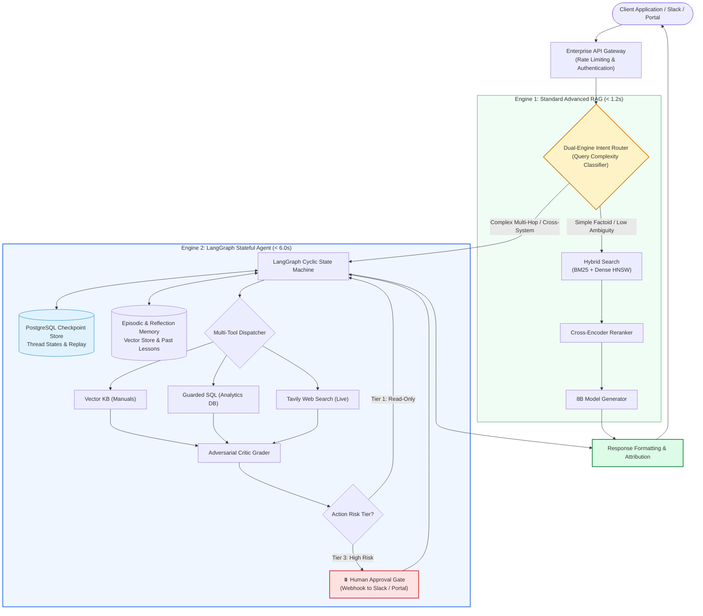

# 🤖 Module 07: Agentic RAG Systems Curriculum & Autonomous Agent Guide

Welcome to **Module 07: Agentic RAG Systems & Autonomous Agents** of the enterprise RAG Engineering curriculum. This module guides you through the transition from static, passive retrieval pipelines to autonomous cognitive systems equipped with dynamic deliberation loops, multi-tool execution, sub-goal planning, multi-agent collaboration, stateful graph orchestration, and human oversight.

---

## 📑 Module Curriculum & Guide Index

| Topic File | Focus Domain | Architectural Breakthrough & Key Concepts |
| :--- | :--- | :--- |
| [**07.1 What is Agentic RAG?**](What-is-Agentic-RAG.md) | **Autonomous Paradigm Foundations** | Transition from passive feedforward pipelines to closed-loop Markov Decision Processes (POMDP), Expected Information Gain (EIG), cognitive anatomy, and budget safety brakes. |
| [**07.2 AI Agents**](AI-Agents.md) | **Cognitive Agent Architectures** | The ReAct (Reason + Act) loop, Plan-and-Solve decoupled planning, Dual-Process Theory (System 1 vs System 2), and Reflexion verbal memory updates. |
| [**07.3 Tool Calling**](Tool-Calling.md) | **Function Execution & Interfacing** | Constrained grammar decoding masks, JSON Schema engineering, Pydantic v2 validation, self-querying vector stores, Text-to-SQL guardrails, and AST validation. |
| [**07.4 Query Planning**](Query-Planning.md) | **Sub-Goal Decomposition** | Multi-hop query deconstruction, Directed Acyclic Graph (DAG) task scheduling, critical path latency optimization, parallel scatter-gather, and dynamic replanning. |
| [**07.5 Agentic Retrieval**](Agentic-Retrieval.md) | **Dynamic Search Loops** | Closed-loop hypothesis testing, in-line Document Relevance Graders, lexical shifts, query generalization/specialization, and epistemic stop condition evaluation. |
| [**07.6 Memory in RAG**](Memory-in-RAG.md) | **Multi-Tier Memory Systems** | Working memory scratchpad compaction, Ebbinghaus exponential decay scoring for episodic recall, persistent knowledge graphs, and cross-session procedural reflection stores. |
| [**07.7 Multi-Agent RAG**](Multi-Agent-RAG.md) | **Collaborative Swarms & Reviewers** | Overcoming monolithic cognitive overload, Orchestrator-Worker parallelization, adversarial Peer Reviewer (Generator-Critic) verification, and Hub-and-Spoke communication topologies. |
| [**07.8 LangGraph for RAG**](LangGraph-RAG.md) | **Stateful Graph Orchestration** | Finite state machines with cyclic loops, centralized `TypedDict` state schemas, custom reducers, conditional edge routing, PostgreSQL durable checkpointing, and time-travel debugging. |
| [**07.9 Human-in-the-Loop**](Human-in-the-Loop.md) | **Verification Gates & Governance** | Risk-weighted expected loss thresholds, 3-tier action autonomy (Informational, Reversible, Irreversible), stateful interrupts, webhooks, and SOC2/HIPAA audit trails. |
| [**07.10 RAG vs. Agentic RAG**](RAG-vs-Agentic-RAG.md) | **Comparative Trade-Off Matrix** | End-to-end latency breakdowns, token economics modeling ($7.4\times$ cost variance), 12-dimensional comparison matrix, and production Dual-Engine Intent Routing. |

---

## 🗺️ Module Learning Roadmap

```mermaid
flowchart TD
    M1["1. What is Agentic RAG?<br/>(Autonomous Active Deliberation & POMDP Retrieval)"] --> M2["2. AI Agent Foundations<br/>(ReAct Loops, Plan-and-Solve & Dual-Process Cognition)"]
    
    M2 --> M3["3. Tool Calling & Execution<br/>(Pydantic Schemas, Guarded SQL & Vector Filter Synthesis)"]
    
    M3 --> M4["4. Query Planning & DAGs<br/>(Multi-Hop Decomposition, Topological Sorting & Critical Path)"]
    
    M4 --> M5["5. Agentic Retrieval Loops<br/>(Relevance Grading, Dynamic Reformulation & Stop Criteria)"]
    
    M5 --> M6["6. Memory in Agentic RAG<br/>(Working Scratchpad, Episodic Decay & Reflection Stores)"]
    
    M6 --> M7["7. Multi-Agent Collaborative RAG<br/>(Orchestrator-Worker Swarms & Adversarial Peer Reviewers)"]
    
    M7 --> M8["8. LangGraph Stateful Orchestration<br/>(Cyclic State Graphs, Conditional Edges & Postgres Checkpoints)"]
    
    M8 --> M9["9. Human-in-the-Loop Guardrails<br/>(Risk-Tiered Verification Gates, Webhooks & SOC2 Auditing)"]
    
    M9 --> M10["10. RAG vs Agentic RAG Strategy<br/>(Dual-Engine Router, Latency SLAs & Token Economics)"]

    style M1 fill:#e0f2fe,stroke:#0369a1,stroke-width:2px
    style M2 fill:#eff6ff,stroke:#1d4ed8,stroke-width:2px
    style M3 fill:#f0fdf4,stroke:#16a34a,stroke-width:2px
    style M4 fill:#f8fafc,stroke:#475569,stroke-width:2px
    style M5 fill:#fffbeb,stroke:#d97706,stroke-width:2px
    style M6 fill:#fef3c7,stroke:#b45309,stroke-width:2px
    style M7 fill:#ede9fe,stroke:#7c3aed,stroke-width:2px
    style M8 fill:#f3e8ff,stroke:#6b21a8,stroke-width:2px
    style M9 fill:#fee2e2,stroke:#dc2626,stroke-width:2px
    style M10 fill:#ecfdf5,stroke:#059669,stroke-width:2px
```

---

## ⚖️ Architectural Decision & Trade-Off Matrix

| Architectural Pattern | Control Topology | Query Latency (P95) | Token Cost Multiplier | Multi-Hop Reasoning | Best Suited Enterprise Domains |
| :--- | :--- | :--- | :---: | :---: | :--- |
| **Standard Advanced RAG** | Linear Feedforward DAG | **$0.6\text{s} - 1.2\text{s}$** | **$1.0\times$ (Baseline)** | Weak | High-volume FAQs, single-document policy search, customer portals |
| **Single ReAct Agent** | Dynamic Cyclic Loop | $3.0\text{s} - 8.0\text{s}$ | $3.5\times - 6.0\times$ | High | Exploratory research, diagnostic IT troubleshooting, API navigation |
| **Plan-and-Solve DAG** | Topological Parallel Graph | $2.0\text{s} - 4.5\text{s}$ | $2.5\times - 4.0\times$ | Very High | Comparative financial analysis, multi-facet product benchmarking |
| **Agentic Retrieval Loop**| Closed-Loop Hypothesis Test| $1.5\text{s} - 5.0\text{s}$ | $2.5\times - 5.0\times$ | High | Complex technical manuals, vocabulary-mismatched corporate repositories |
| **Orchestrator-Worker Swarm**| Hub-and-Spoke Parallelism | $3.0\text{s} - 6.5\text{s}$ | $4.0\text{s} - 8.0\text{s}$ | **Exceptional** | Cross-silo enterprise intelligence (SQL + Vector + Live Web) |
| **Peer Reviewer (Gen-Critic)**| Adversarial Verification | $4.0\text{s} - 9.0\text{s}$ | $3.0\text{s} - 5.0\text{s}$ | **Exceptional** | Regulatory compliance, clinical guidelines, legal brief generation |
| **LangGraph State Machine**| Persistent Cyclic Graph | $2.5\text{s} - 10.0\text{s}$| $3.0\text{s} - 7.0\text{s}$ | **Exceptional** | Enterprise stateful agentic workflows requiring durable sessions |
| **HITL Verification Gates** | Stateful Interrupt / Resume | Asynchronous (Hours)| Minimal added tokens | N/A (Supervisory)| Wire transfers, database mutations, customer email dispatch |
| **Dual-Engine Intent Router**| Dynamic Traffic Dispatch | **$0.8\text{s} - 4.0\text{s}$** | **$1.5\times - 2.5\times$** | Dynamic | **Production Standard:** Slashes costs by 60% while preserving accuracy |

---

## 🎯 Master Learning Objectives

By completing Module 07, you will possess staff-level mastery of autonomous agentic systems:
1. **Autonomous Deliberation:** Implement ReAct and Plan-and-Solve control loops that dynamically formulate sub-goals, evaluate intermediate tool observations, and backtrack from dead ends.
2. **Deterministic Tool Execution:** Build production-grade function calling interfaces with Pydantic v2 schemas, AST-level SQL validation, and constrained grammar decoding masks.
3. **Multi-Hop Task Decomposition:** Construct Directed Acyclic Graphs (DAGs) that schedule and parallelize complex multi-facet inquiries across heterogeneous enterprise data silos.
4. **Dynamic Closed-Loop Retrieval:** Architect self-evaluating retrieval loops with in-line document grading, vocabulary reformulation (generalization/specialization), and epistemic stopping criteria.
5. **Cognitive Multi-Tier Memory:** Design working memory scratchpads with automatic context compaction, episodic recall with Ebbinghaus recency decay, and procedural reflection stores.
6. **Collaborative Agent Swarms:** Deploy high-throughput Orchestrator-Worker swarms with independent Adversarial Critics to achieve near-zero hallucination rates.
7. **Production Graph Orchestration:** Master LangGraph to build cyclic state machines with typed schemas, custom reducers, conditional edges, and PostgreSQL checkpoint persistence.
8. **Enterprise Governance & HITL:** Integrate risk-tiered Human-in-the-Loop verification gates, asynchronous webhooks, and tamper-evident audit trails meeting SOC2 and HIPAA standards.
9. **Economic & SLA Optimization:** Deploy Dual-Engine Intent Routers that balance sub-second, low-cost Standard RAG against high-accuracy Agentic RAG based on query complexity.

---

## 🏗️ Enterprise Production Architecture Blueprint

