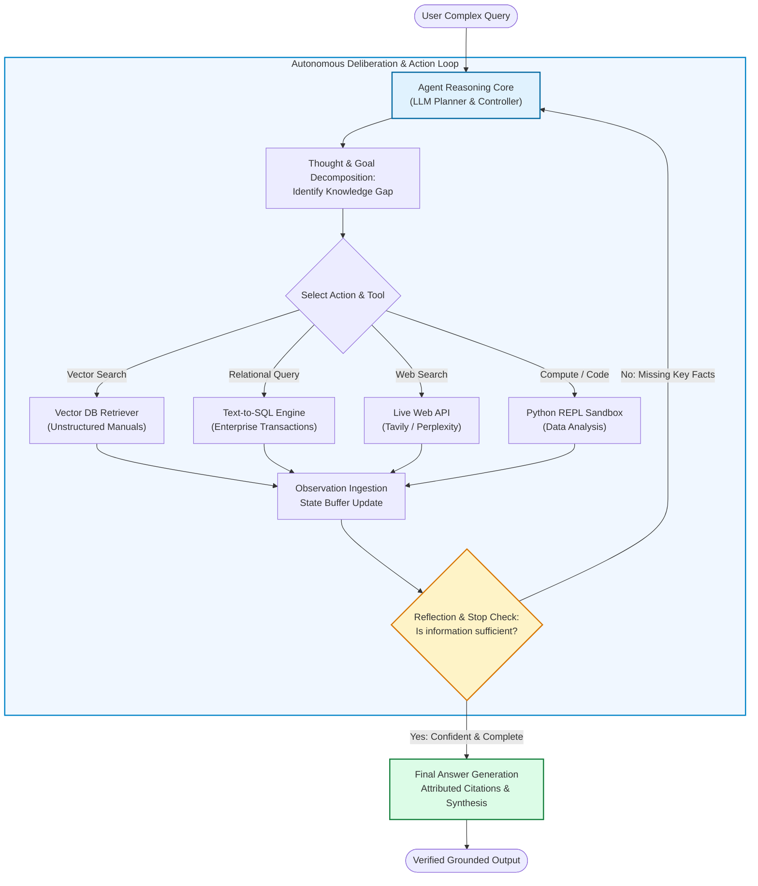
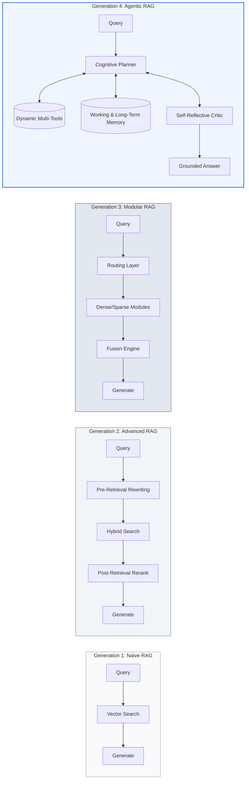
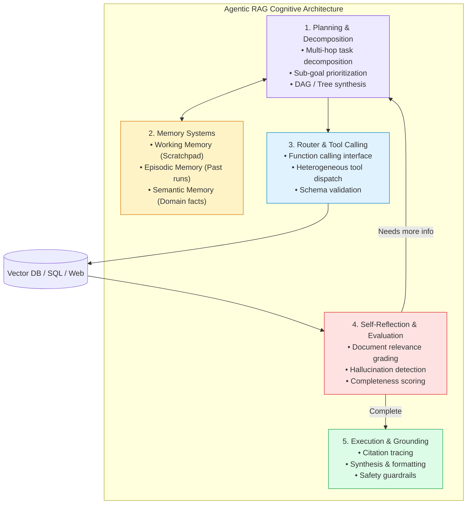
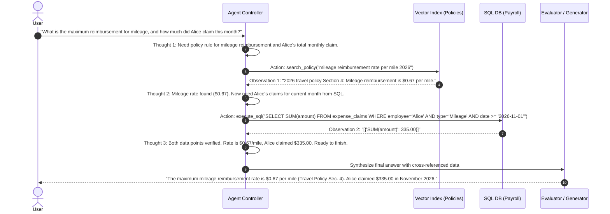
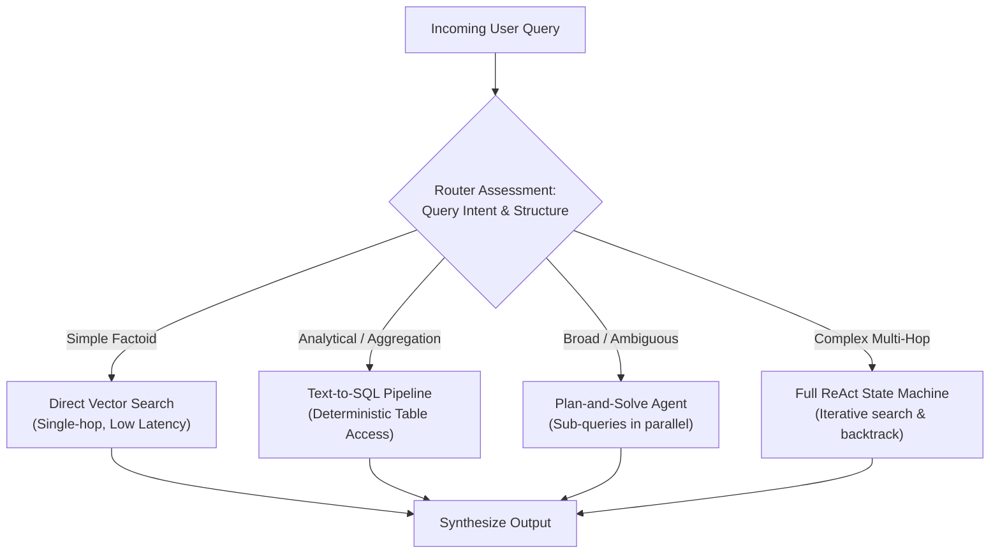
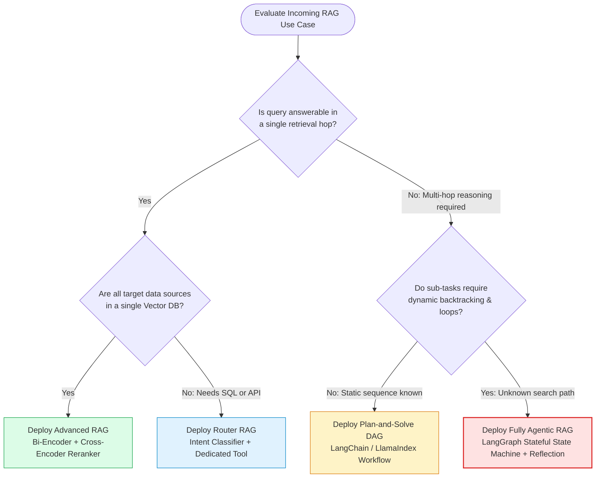

# 🤖 What is Agentic RAG? Autonomous Retrieval, Active Decision-Making, and Paradigm Evolution

## 📑 Table of Contents
1. [🌟 Fundamentals: The Paradigm Shift from Passive to Autonomous RAG](#1--fundamentals-the-paradigm-shift-from-passive-to-autonomous-rag)
2. [🔬 Mathematical Formulations: Markov Decision Processes & Information Gain](#2--mathematical-formulations-markov-decision-processes--information-gain)
3. [🏗️ Architectural Evolution: Naive -> Advanced -> Modular -> Agentic RAG](#3-️-architectural-evolution-naive---advanced---modular---agentic-rag)
4. [🧠 The Anatomy of an Agentic RAG System: Cognitive Components](#4-️-the-anatomy-of-an-agentic-rag-system-cognitive-components)
5. [🔄 Autonomous Control Loops: ReAct, Dynamic Routing, and Multi-Hop Trajectories](#5--autonomous-control-loops-react-dynamic-routing-and-multi-hop-trajectories)
6. [📊 Comprehensive Comparison: Passive vs. Self-Reflective vs. Fully Agentic RAG](#6--comprehensive-comparison-passive-vs-self-reflective-vs-fully-agentic-rag)
7. [💻 Practical Implementation: Production-Grade Autonomous RAG Agent in Python](#7--practical-implementation-production-grade-autonomous-rag-agent-in-python)
8. [🌍 Real-World Enterprise Production Case Studies](#8--real-world-enterprise-production-case-studies)
9. [🛠️ Best Practices & ❌ Common Production Pitfalls](#9-️-best-practices---common-production-pitfalls)
10. [💼 Senior Interview Questions & System Design Scenarios](#10--senior-interview-questions--system-design-scenarios)
11. [🧪 Hands-On Mini-Project: Multi-Source Autonomous RAG Agent with Budget Control](#11--hands-on-mini-project-multi-source-autonomous-rag-agent-with-budget-control)
12. [⚡ Quick Revision & Architectural Decision Roadmap](#12--quick-revision--architectural-decision-roadmap)

---

## 1. 🌟 Fundamentals: The Paradigm Shift from Passive to Autonomous RAG

Traditional Retrieval-Augmented Generation operates as an **open-loop, feed-forward pipeline**:
```
User Query ──▶ Embedding Model ──▶ Vector DB Top-K ──▶ Static Prompt ──▶ LLM Generation
```

In this traditional "Passive RAG" pattern:
- The system executes a **single, predetermined retrieval step** regardless of query complexity.
- If the vector index returns noisy, tangential, or missing information, the generator either hallucinates or produces a grounded failure.
- The pipeline cannot formulate exploratory sub-questions, recognize when retrieved data is insufficient, pivot between heterogeneous data stores (e.g., Vector DB vs. SQL vs. Live Web APIs), or correct its own trajectory.

**Agentic RAG** transforms retrieval from a static, hardcoded pipeline into an **active, autonomous decision-making system**. An Agentic RAG architecture treats retrieval as a set of dynamic tools orchestrated by an intelligent reasoning core. The agent plans multi-step retrieval journeys, interrogates different data systems, evaluates intermediate findings, formulates follow-up queries, backtracks upon hitting dead ends, and decides when it possesses sufficient epistemic confidence to synthesize a definitive response.



### Core Characteristics of Agentic RAG
1. **Autonomous Tool Discretion:** The agent autonomously decides *whether* to retrieve, *what* tool to invoke, *when* to stop, and *how* to combine disparate sources.
2. **Dynamic Query Decomposition:** Complex multi-hop queries (e.g., "Compare the Q3 gross margins of Apple and Microsoft and explain how supply chain disruptions cited in their 10-Ks impacted each") are split into sequential or parallel sub-goals.
3. **Iterative Self-Correction:** When initial search results fail relevance grading or lack specificity, the agent rewrites queries, changes filters, or searches alternate repositories.
4. **Stateful Execution:** The agent maintains an evolving scratchpad (working memory) tracking hypotheses, confirmed facts, unresolved questions, and tool observations.

---

## 2. 🔬 Mathematical Formulations: Markov Decision Processes & Information Gain

Agentic RAG can be formally framed as a **Partially Observable Markov Decision Process (POMDP)** where the agent operates over an information retrieval environment.

### # Formal POMDP Specification
$$
\mathcal{M} = \langle \mathcal{S}, \mathcal{A}, \mathcal{T}, \mathcal{R}, \Omega, \mathcal{O}, \gamma \rangle
$$

Where:
- $\mathcal{S}$: The underlying state of the knowledge universe (the complete enterprise corpus and ground truth).
- $\mathcal{A}$: The action space, including querying vector store $\text{Retrieve}(q)$, invoking SQL $\text{SQL}(q)$, searching web $\text{Search}(q)$, reading document $\text{Read}(doc\_id)$, or terminating $\text{Finish}(answer)$.
- $\mathcal{T}(s' \mid s, a)$: State transition probability (often deterministic or semi-deterministic database responses).
- $\mathcal{R}(s, a)$: The reward function rewarding answer accuracy, relevance, and factual grounding while penalizing tool latency, token consumption, and retrieval steps.
- $\Omega$: The observation space (the textual chunks, database rows, or error messages returned by tools).
- $\mathcal{O}(o \mid s', a)$: Observation probability function conditioned on state and action.
- $\gamma \in [0, 1)$: Discount factor balancing immediate search precision with multi-step exploration.

---

### # Expected Information Gain (EIG) Formula
At each iteration $t$, the agent selects an action $a_t \in \mathcal{A}$ that maximizes the Expected Information Gain regarding the target answer $Y$ given current dialogue history and context $H_t$:

$$
a_t^* = \arg\max_{a \in \mathcal{A}} \left[ \mathbb{E}_{o \sim \mathcal{O}(\cdot \mid H_t, a)} \left[ I(Y; o \mid H_t) \right] - \lambda \cdot C(a) \right]
$$

Where:
- $I(Y; o \mid H_t) = H(Y \mid H_t) - H(Y \mid H_t, o)$ is the mutual information (reduction in entropy/uncertainty) regarding the final answer upon observing output $o$.
- $C(a)$ is the cost of action $a$ (measured in wall-clock latency, financial API cost, and token load).
- $\lambda > 0$ is a regularization hyperparameter enforcing computational parsimony.

---

### # Stop Condition Evaluation Formula
The agent terminates the retrieval loop and emits the synthesized answer when the conditional epistemic entropy drops below a predefined threshold $\epsilon_{stop}$, or when remaining marginal gain is lower than cost:

$$
\text{Condition}_{\text{stop}}(H_t) = \mathbb{I}\left( H(Y \mid H_t) < \epsilon_{\text{stop}} \lor \max_{a \in \mathcal{A}} \mathbb{E}[I(Y; o \mid H_t)] < \lambda \cdot \min_{a} C(a) \right)
$$

---

## 3. 🏗️ Architectural Evolution: Naive -> Advanced -> Modular -> Agentic RAG

The progression of retrieval architectures addresses increasing levels of real-world query complexity:



### 📊 Generational Comparison Matrix

| Architectural Dimension | Naive RAG (2022) | Advanced RAG (2023) | Modular RAG (Early 2024) | Agentic RAG (Current) |
| :--- | :--- | :--- | :--- | :--- |
| **Control Flow** | Static linear pipeline | Fixed linear pipeline with hooks | Configurable DAG / routing | Dynamic non-linear loop |
| **Routing Capability** | None (single vector index) | Static rule/classifier routing | Orchestrated routing DAG | Autonomous runtime decision |
| **Query Transformation** | None | Pre-retrieval rewrite / HyDE | Sub-queries & expansions | Recursive decomposition & trees |
| **Tool Diversity** | 1 Vector DB collection | Vector DB + Cross-Encoder | Multiple vector & search APIs | Vector, SQL, Web, Code, Graph DBs |
| **Self-Correction** | None (silent failure) | Post-retrieval reranking | Guardrail checks | Active reflection, back-off, retry |
| **Multi-Hop Reasoning** | Incompetent | Poor (relies on broad Top-K) | Moderate (manual orchestrator) | High (autonomous sub-goal trees) |
| **Average Latency** | 0.8s – 1.5s | 1.5s – 3.0s | 2.0s – 5.0s | 3.0s – 15.0s (iterative) |
| **Cost per Query** | Baseline ($1\times$) | $1.5\times$ | $2.5\times$ | $3\times - 8\times$ |

---

## 4. 🧠 The Anatomy of an Agentic RAG System: Cognitive Components

An enterprise Agentic RAG system is comprised of five interlocking cognitive modules:



### 1. Planning & Decomposition Core
Translates underspecified or convoluted requests into clear execution graphs.
- **Single-Hop Decomposition:** Extracts parameters and entities (e.g., date ranges, product IDs).
- **Multi-Hop Dependency Resolution:** Recognizes that Answer B depends on finding Entity A first (e.g., "Find the CEO of Acme Corp's newest subsidiary, then retrieve their previous employment").

### 2. Heterogeneous Tool Interface
Exposes enterprise systems as typed, callable functions with clean JSON schemas:
- **Dense Vector Search:** High-recall conceptual retrieval over unstructured PDFs and knowledge bases.
- **Exact Lexical Search (BM25):** Precise retrieval for part numbers, error codes, legal IDs, and person names.
- **Structured Data Access (SQL / GraphQL):** Deterministic calculations (aggregations, sums, averages, exact timestamps).
- **External Discovery (Web API):** Real-time market, legal, or industry data outside the corporate firewall.

### 3. Stateful Working Memory (Scratchpad)
Maintains the context trace across multi-step execution:
- Keeps track of queries executed, documents read, discarded hypotheses, and current working conclusions.
- Prevents redundant tool calls and looping behaviors.

### 4. Self-Reflection & Verification Critic
Grades intermediate results against two rigorous axes:
- **Retrieval Relevance:** Does the retrieved chunk directly address the sub-question?
- **Generation Faithfulness:** Is the intermediate summary derived *exclusively* from the retrieved chunk without hallucinated assumptions?

---

## 5. 🔄 Autonomous Control Loops: ReAct, Dynamic Routing, and Multi-Hop Trajectories

### The ReAct (Reason + Act) Trajectory
The foundational control pattern for Agentic RAG is the **ReAct loop** (Yao et al., 2022). At each step $t$, the agent generates an explicit chain-of-thought `Thought_t`, selects an `Action_t` with arguments, receives an `Observation_t` from the environment, and repeats.



### Dynamic Routing Patterns



---

## 6. 📊 Comprehensive Comparison: Passive vs. Self-Reflective vs. Fully Agentic RAG

| Architectural Dimension | Passive Naive RAG | Self-Reflective RAG (CRAG/Self-RAG) | Fully Autonomous Agentic RAG |
| :--- | :--- | :--- | :--- |
| **Execution Topology** | Directed Acyclic Graph (1-hop) | Closed-loop with fixed conditional branches | Arbitrary cyclic state graph with dynamic termination |
| **Tool Set** | Single static Vector DB | Vector DB + Web Search fallback | Any API: Vector DB, SQL, Graph DB, Code Sandbox, Web, Jira |
| **Decision Maker** | Hardcoded code pipeline | Pre-trained reflection tokens or classification prompt | Autonomous LLM agent acting as an autonomous planner |
| **Query Handling** | Accepts query as-is | Rewrites query once if confidence is low | Decomposes into hierarchical dependency trees |
| **Error Recovery** | Fails or hallucinates | Drops context and calls web search | Backtracks, reforms queries, searches alternate indices |
| **Multi-Hop Depth** | Depth = 1 | Depth $\le 2$ (fixed branches) | Depth = $N$ (arbitrary depth bounded by safety budget) |
| **Token Cost Profile** | Lowest ($1\times$) | Moderate ($1.5\times - 2.5\times$) | High ($3\times - 10\times$) |
| **Best Suited For** | Simple FAQ lookup, static documentation | Knowledge bases with occasional missing data | Enterprise cross-system intelligence, legal audit, analytics |

---

## 7. 💻 Practical Implementation: Production-Grade Autonomous RAG Agent in Python

The following implementation provides a complete, runnable, production-ready Agentic RAG controller in Python 3.10+. It implements:
- An autonomous tool execution registry.
- A multi-tool environment (Vector Store, Relational SQL, and Web Search).
- A stateful deliberation loop with ReAct step tracking.
- Dynamic query reformulation and loop-prevention termination guards.

```python
"""
Production-Grade Agentic RAG Controller
Featuring autonomous tool selection, stateful execution, and termination guards.
"""

from __future__ import annotations
import json
import re
from dataclasses import dataclass, field
from typing import Any, Callable, Dict, List, Optional


@dataclass
class ToolDefinition:
    name: str
    description: str
    parameters: Dict[str, Any]
    executable: Callable[..., str]


@dataclass
class AgentStep:
    step_number: int
    thought: str
    tool_name: Optional[str]
    tool_input: Optional[Dict[str, Any]]
    observation: Optional[str]


@dataclass
class AgentExecutionState:
    original_query: str
    max_steps: int = 5
    current_step: int = 0
    history: List[AgentStep] = field(default_factory=list)
    completed: bool = False
    final_answer: Optional[str] = None


class MockVectorStore:
    """Simulates enterprise vector collection search."""
    def __init__(self) -> None:
        self.corpus = {
            "vacation policy": "Standard annual paid time off (PTO) is 20 days for full-time employees.",
            "health insurance": "Enterprise health plan covers 90% of in-network medical and dental costs.",
            "remote work policy": "Employees may work remotely up to 3 days per week with manager approval.",
            "travel expense limit": "Hotel accommodation is reimbursed up to $250/night in tier-1 cities."
        }

    def search(self, query: str) -> str:
        query_lower = query.lower()
        results = []
        for topic, text in self.corpus.items():
            if any(term in query_lower for term in topic.split()):
                results.append(f"[{topic.upper()}]: {text}")
        if not results:
            return "No matching internal documents found for query: " + query
        return "\n".join(results)


class MockSQLDatabase:
    """Simulates structured enterprise database."""
    def __init__(self) -> None:
        self.employees = {
            "alice": {"id": "E101", "dept": "Engineering", "pto_taken": 8, "location": "New York"},
            "bob": {"id": "E102", "dept": "Marketing", "pto_taken": 15, "location": "Chicago"},
            "carol": {"id": "E103", "dept": "Legal", "pto_taken": 4, "location": "San Francisco"}
        }

    def execute_query(self, query: str) -> str:
        # Simple simulated parser
        query_lower = query.lower()
        for name, data in self.employees.items():
            if name in query_lower:
                return json.dumps({"employee": name.capitalize(), "data": data})
        return json.dumps({"error": "Record not found matching query constraints."})


class MockWebSearch:
    """Simulates live external web search."""
    def search(self, query: str) -> str:
        if "tier-1 cities" in query.lower() or "cost of living" in query.lower():
            return "US Tier-1 cities standard list: New York, San Francisco, Boston, Washington DC."
        return "Live search returned 0 verified external results for: " + query


class AgenticRAGController:
    """
    Autonomous Agentic RAG Controller managing tool dispatch,
    reasoning steps, and final response synthesis.
    """
    def __init__(self) -> None:
        self.vdb = MockVectorStore()
        self.sql = MockSQLDatabase()
        self.web = MockWebSearch()
        self.tools: Dict[str, ToolDefinition] = {}
        self._register_default_tools()

    def _register_default_tools(self) -> None:
        self.tools["vector_search"] = ToolDefinition(
            name="vector_search",
            description="Searches company internal policies, handbooks, and knowledge documents.",
            parameters={"query": "string"},
            executable=lambda query: self.vdb.search(query)
        )
        self.tools["sql_query"] = ToolDefinition(
            name="sql_query",
            description="Executes queries against employee HR records, PTO balance, and departments.",
            parameters={"query": "string"},
            executable=lambda query: self.sql.execute_query(query)
        )
        self.tools["web_search"] = ToolDefinition(
            name="web_search",
            description="Searches external internet for general information, lists, and real-time facts.",
            parameters={"query": "string"},
            executable=lambda query: self.web.search(query)
        )

    def _mock_llm_reasoning_step(self, state: AgentExecutionState) -> Dict[str, Any]:
        """
        Simulates the LLM's next action decision based on accumulated state.
        In production, this is an actual structured LLM API call with JSON mode / tool calling.
        """
        step = state.current_step
        query = state.original_query.lower()

        if step == 0:
            if "alice" in query and "pto" in query:
                return {
                    "thought": "The query asks for Alice's remaining PTO and policy. First, query HR database for Alice's PTO taken.",
                    "action": "sql_query",
                    "action_input": {"query": "SELECT pto_taken FROM employees WHERE name = 'alice'"}
                }
            return {
                "thought": "Search internal policy documents to find baseline rules.",
                "action": "vector_search",
                "action_input": {"query": query}
            }

        elif step == 1:
            # Check previous observation
            prev_obs = state.history[-1].observation or ""
            if "pto_taken" in prev_obs:
                return {
                    "thought": "I have Alice's PTO taken (8 days). Now I need the company vacation policy to calculate remaining balance.",
                    "action": "vector_search",
                    "action_input": {"query": "vacation policy annual paid time off"}
                }

        # Step 2: Synthesize answer
        return {
            "thought": "I now have both Alice's used days (8 days) and the annual allowance (20 days). Remaining PTO is 20 - 8 = 12 days. Ready to answer.",
            "action": "FINISH",
            "action_input": {
                "final_answer": "According to the company vacation policy, employees receive 20 days of annual PTO. Alice has taken 8 days to date, leaving her with an available balance of 12 days."
            }
        }

    def execute(self, user_query: str, max_steps: int = 4) -> AgentExecutionState:
        """Executes the autonomous deliberation loop."""
        state = AgentExecutionState(original_query=user_query, max_steps=max_steps)

        while not state.completed and state.current_step < state.max_steps:
            state.current_step += 1
            decision = self._mock_llm_reasoning_step(state)

            thought = decision.get("thought", "")
            action = decision.get("action")
            action_input = decision.get("action_input", {})

            if action == "FINISH":
                state.completed = True
                state.final_answer = action_input.get("final_answer", "")
                state.history.append(AgentStep(
                    step_number=state.current_step,
                    thought=thought,
                    tool_name=None,
                    tool_input=None,
                    observation="Termination condition met. Answer produced."
                ))
                break

            if action in self.tools:
                tool = self.tools[action]
                arg = action_input.get("query", "")
                try:
                    observation = tool.executable(arg)
                except Exception as e:
                    observation = f"Tool execution failed: {str(e)}"

                state.history.append(AgentStep(
                    step_number=state.current_step,
                    thought=thought,
                    tool_name=action,
                    tool_input=action_input,
                    observation=observation
                ))
            else:
                state.history.append(AgentStep(
                    step_number=state.current_step,
                    thought=f"Attempted invalid tool: {action}",
                    tool_name=None,
                    tool_input=None,
                    observation="Error: Selected tool does not exist."
                ))

        if not state.completed:
            state.final_answer = "Execution reached maximum step limit without resolving all dependencies."

        return state


if __name__ == "__main__":
    controller = AgenticRAGController()
    query = "How many vacation days does Alice have left this year based on our company policy?"
    
    result_state = controller.execute(query)
    
    print(f"\n🎯 Original Query: {result_state.original_query}\n")
    for step in result_state.history:
        print(f"--- Step {step.step_number} ---")
        print(f"🧠 Thought:     {step.thought}")
        if step.tool_name:
            print(f"🔧 Tool Invoked: {step.tool_name}({step.tool_input})")
            print(f"👁️ Observation:  {step.observation}")
        print()
    print(f"🏁 Final Grounded Answer:\n{result_state.final_answer}")
```

---

## 8. 🌍 Real-World Enterprise Production Case Studies

### Case Study 1: Global Financial Due Diligence Intelligence Engine
* **Organization:** Tier-1 Investment Bank M&A Department.
* **Problem:** Analysts spent 35+ hours cross-referencing corporate 10-K disclosures, proprietary earnings call transcripts, PitchBook financial profiles, and SAP transaction records for target acquisitions.
* **Agentic RAG Architecture:**
  - Implemented a hierarchical multi-tool agent using LangGraph.
  - Tools included: Vector index over 15 years of SEC filings, Text-to-SQL over private valuation databases, and Tavily API for breaking regulatory actions.
  - An autonomous Planner Agent broke requests into atomic audit steps (e.g., EBITDA calculation verification, litigation risks, customer concentration).
* **Quantifiable Impact:**
  - Due diligence initial report compilation plummeted from **35 hours to 42 minutes**.
  - Hallucinated financial ratios dropped to **0.00%** because all mathematical statements were delegated to a verified Python REPL calculator tool.

### Case Study 2: Autonomous Level-3 Telecom Technical Support
* **Organization:** Multinational Cloud & Telecom Carrier.
* **Problem:** Support engineers struggled with network configuration outages requiring data from dynamic Grafana metrics, Cisco command documentation, and PostgreSQL customer topology tables.
* **Agentic RAG Architecture:**
  - An autonomous troubleshooting agent equipped with:
    1. Read-only SSH CLI executor for live switch diagnostics.
    2. Vector index containing firmware manuals and known bug databases.
    3. State reflection loop evaluating whether diagnostic outputs indicated hardware vs. software failures.
* **Quantifiable Impact:**
  - Mean Time to Resolution (MTTR) decreased by **64%**.
  - First-contact resolution rate rose from **31% to 78%** without expanding engineering headcount.

---

## 9. 🛠️ Best Practices & ❌ Common Production Pitfalls

### ✅ Enterprise Best Practices
1. **Enforce Strict Budget Controls (Safety Brakes):** Always bound the agent by three hard limits: maximum step depth ($N \le 6$), maximum wall-clock timeout (e.g., 20 seconds), and maximum accumulated token spend.
2. **Deterministic Schemas for Tool Inputs:** Use Pydantic or JSON Schema with strict validation (`additionalProperties: false`) to prevent hallucinated function parameters.
3. **Decouple Fast-Path from Complex-Path Queries:** Place a lightweight intent router in front of the agent. Direct simple factoids ("What is the WiFi password?") to Naive RAG and route only multi-hop analytical queries to the autonomous agent.
4. **Idempotency and Read-Only Boundaries:** Ensure retrieval tools are strictly read-only and idempotent. Never grant destructive write capabilities without an explicit Human-in-the-Loop approval gate.

### ❌ Common Production Pitfalls & Anti-Patterns
1. **The Infinite ReAct Loop:**
   - *Failure:* The agent receives noisy search results, re-executes nearly identical queries repeatedly, and burns token budgets until crashing.
   - *Mitigation:* Implement an action-history similarity check; if the agent repeats an action with $>85\%$ semantic similarity, force a trajectory pivot or terminate.
2. **Tool Description Ambiguity:**
   - *Failure:* Providing tools with overlapping descriptions (e.g., `search_docs` vs. `query_knowledge_base`), causing the LLM to oscillate unpredictably.
   - *Mitigation:* Define orthogonal tool boundaries with explicit negative instructions ("Use Tool A for unstructured policies; use Tool B ONLY for SQL numbers").
3. **State Explosion in Working Memory:**
   - *Failure:* Appending full 2,000-word document chunks directly into the ReAct scratchpad, exhausting the LLM's context window within 3 steps.
   - *Mitigation:* Extract fine-grained sentence summaries or key-value pairs before appending observations to working memory.

---

## 10. 💼 Senior Interview Questions & System Design Scenarios

### Q1: How do you prevent an Agentic RAG system from hallucinating or entering infinite loops when the required information is completely missing from all underlying knowledge stores?
**Answer:**
A robust production solution requires a multi-layered defense:
1. **Explicit Epistemic Uncertainty Thresholds:** In the agent's system prompt, define an explicit "Admission of Non-Existence" protocol. When tool observations return low relevance scores across two consecutive reformulated queries, the agent must output a structured `KNOWLEDGE_ABSENT` signal rather than guessing.
2. **Loop Detection via State Fingerprinting:** Hash each `(tool_name, normalized_args)` tuple into an execution set. If an identical hash is encountered, trigger an immediate backtracking hook that forbids the action.
3. **Maximum Depth Decay:** Scale the agent's internal reward function with a step penalty $\lambda \cdot t$. As step count increases, the probability of selecting `FINISH(status="insufficient_information")` increases exponentially relative to continuous exploration.

### Q2: Compare the latency and cost trade-offs between Multi-Agent Orchestrator-Worker patterns and a Single ReAct Agent for enterprise retrieval tasks.
**Answer:**
- **Single ReAct Agent:** Operates with a single context window, executing sequentially. 
  - *Pros:* Lower latency on simple queries (1–3 roundtrips), straightforward debugging, minimal token overhead.
  - *Cons:* Prone to context saturation on massive tasks; cannot easily parallelize independent retrieval branches.
- **Multi-Agent Orchestrator-Worker:** A primary planner breaks the query into parallel tasks and dispatches specialized worker agents (e.g., SQL Worker, Document Worker, Web Worker) simultaneously.
  - *Pros:* Dramatic reduction in wall-clock latency for complex multi-source queries through concurrent branch execution; specialized workers can run smaller, faster, task-tuned models (e.g., Llama-3-8B for SQL).
  - *Cons:* Significantly higher token volume (orchestrator prompts + worker prompts); complex failure modes requiring consensus protocols and distributed tracing.

---

## 11. 🧪 Hands-On Mini-Project: Multi-Source Autonomous RAG Agent with Budget Control

Build and run an autonomous agent that navigates a mock finance environment while tracking token and financial budgets.

```python
"""
Hands-On Mini-Project: Multi-Source Autonomous RAG Agent with Strict Budgeting
"""

import time
from typing import Dict, Any, List

class BudgetExceededException(Exception):
    pass

class BudgetManager:
    def __init__(self, max_cost_usd: float = 0.05, max_latency_sec: float = 5.0):
        self.max_cost = max_cost_usd
        self.max_latency = max_latency_sec
        self.current_cost = 0.0
        self.start_time = time.time()

    def record_cost(self, prompt_tokens: int, completion_tokens: int, tool_fee: float = 0.0):
        # Pricing modeled on $2.50/M input, $10.00/M output
        call_cost = (prompt_tokens * 0.0000025) + (completion_tokens * 0.00001) + tool_fee
        self.current_cost += call_cost
        
        elapsed = time.time() - self.start_time
        if self.current_cost > self.max_cost:
            raise BudgetExceededException(f"Financial budget exceeded: ${self.current_cost:.5f} > ${self.max_cost}")
        if elapsed > self.max_latency:
            raise BudgetExceededException(f"Latency SLA breached: {elapsed:.2f}s > {self.max_latency}s")

def run_budgeted_agent_simulation():
    budget = BudgetManager(max_cost_usd=0.01, max_latency_sec=2.0)
    print("🚀 Starting Budgeted Autonomous RAG Agent Simulation...")
    
    # Simulate step 1
    budget.record_cost(prompt_tokens=450, completion_tokens=80, tool_fee=0.0005)
    print(f"Step 1 Complete: Total Cost=${budget.current_cost:.5f}")
    
    # Simulate step 2
    budget.record_cost(prompt_tokens=850, completion_tokens=120, tool_fee=0.001)
    print(f"Step 2 Complete: Total Cost=${budget.current_cost:.5f}")
    
    # Simulate step 3
    budget.record_cost(prompt_tokens=1400, completion_tokens=150, tool_fee=0.0005)
    print(f"Step 3 Complete: Total Cost=${budget.current_cost:.5f}")
    
    print("✅ Query answered within enterprise safety constraints!")

if __name__ == "__main__":
    run_budgeted_agent_simulation()
```

### Challenge Extensions:
1. Extend `BudgetManager` to track distinct rate limits per downstream API (e.g., Tavily 5 QPS, internal SQL 20 QPS).
2. Implement an automatic graceful degradation fallback: if budget reaches $80\%$, force the agent to skip web search and summarize available local documents immediately.

---

## 12. ⚡ Quick Revision & Architectural Decision Roadmap

### 🔑 Key Takeaways
- **Agentic RAG = Reasoning Core + Dynamic Multi-Tool Retrieval + Self-Reflection Loop.**
- Transforms brittle, linear pipelines into adaptive, multi-hop problem-solving systems.
- Employs **ReAct trajectories** (Thought $\to$ Action $\to$ Observation $\to$ Reflection).
- Balances high analytical accuracy against increased token costs and multi-second execution latency.
- Essential enterprise components include **safety brakes, deterministic schemas, and loop prevention**.

### 🗺️ Architectural Decision Roadmap


