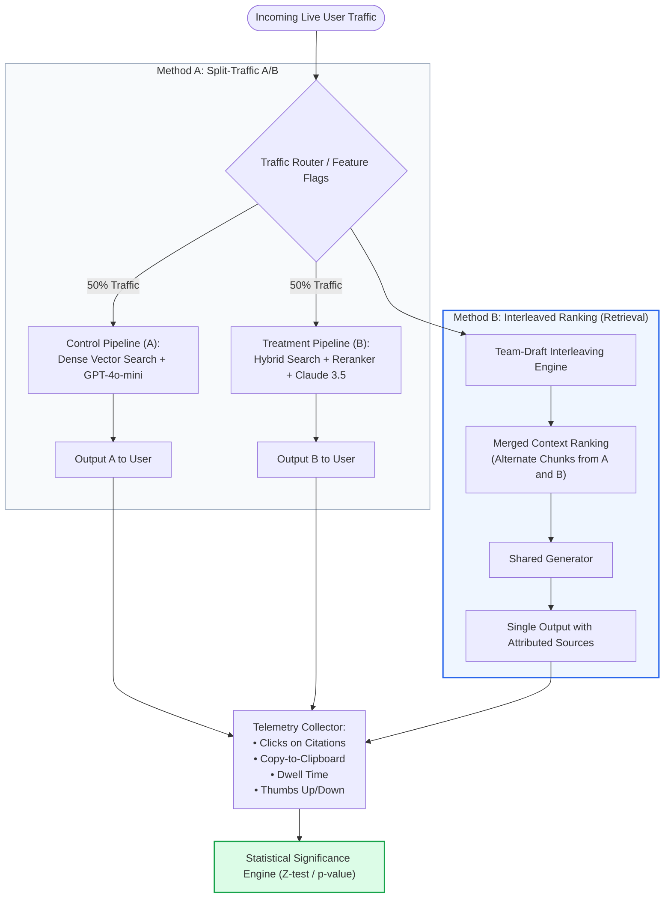
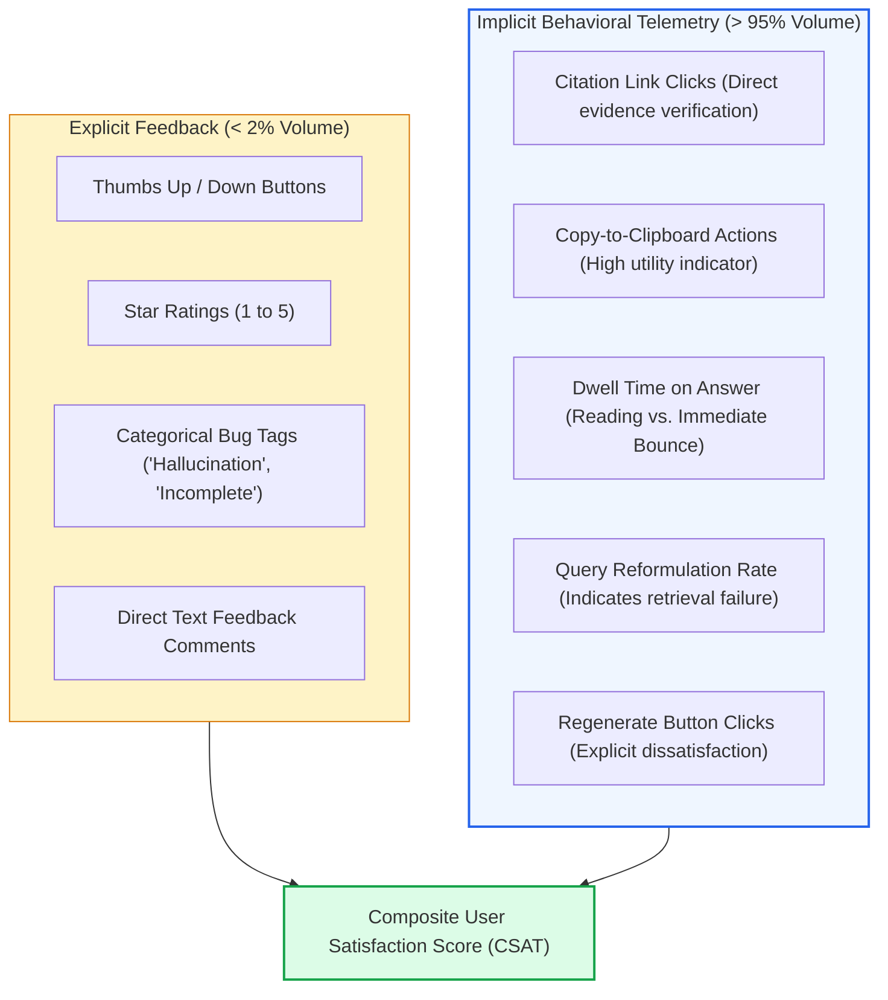
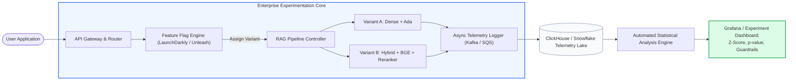
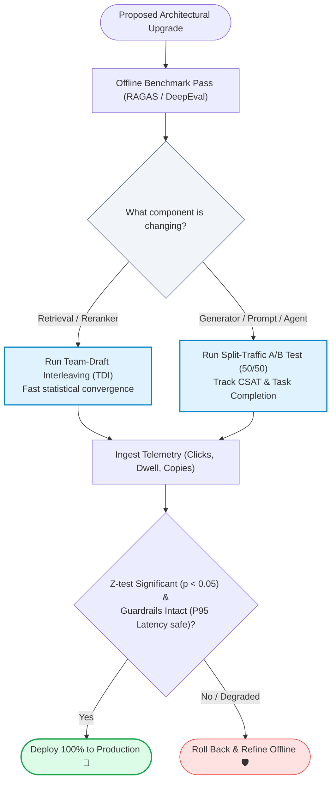

# 🎯 Online A/B Testing for RAG: Interleaved Ranking, User Feedback Telemetry, and Live Production Experiments

## 📑 Table of Contents
1. [🌟 Fundamentals: The Need for Online RAG Experimentation](#1--fundamentals-the-need-for-online-rag-experimentation)
2. [🔬 Mathematical Formulations: Interleaving & Statistical Hypothesis Testing](#2--mathematical-formulations-interleaving--statistical-hypothesis-testing)
3. [📊 Comparative Analysis of Online Experimentation Methodologies](#3--comparative-analysis-of-online-experimentation-methodologies)
4. [📡 Production Telemetry: Explicit vs. Implicit Feedback Signals](#4--production-telemetry-explicit-vs-implicit-feedback-signals)
5. [🏗️ Architectural Architecture of a RAG Experimentation Platform](#5-️-architectural-architecture-of-a-rag-experimentation-platform)
6. [💻 Production-Grade Implementation: Interleaving & Statistical Significance Engine](#6--production-grade-implementation-interleaving--statistical-significance-engine)
7. [🌍 Real-World Enterprise Case Studies](#7--real-world-enterprise-case-studies)
8. [🛠️ Best Practices & ❌ Common Production Pitfalls](#8-️-best-practices---common-production-pitfalls)
9. [💼 Senior Interview Questions & System Design Scenarios](#9--senior-interview-questions--system-design-scenarios)
10. [🧪 Hands-On Mini-Project: Live Interleaved Ranking Telemetry Simulator](#10--hands-on-mini-project-live-interleaved-ranking-telemetry-simulator)
11. [⚡ Quick Revision & Experimentation Roadmap](#11--quick-revision--experimentation-roadmap)

---

## 1. 🌟 Fundamentals: The Need for Online RAG Experimentation

While offline benchmarking (RAGAS, DeepEval, golden datasets) is mandatory for preventing regressions in continuous integration, it operates under an inherent limitation: **it evaluates what engineers anticipate, not how real users behave**.

In live enterprise environments:
- **User Intent is Unpredictable:** Real users issue colloquial, misspelled, multi-lingual, and ambiguous queries rarely captured in static synthetic benchmarks.
- **Good Offline Metrics Can Yield Bad User Experience:** A newly tuned embedding model might boost offline NDCG@5 by +4%, yet increase end-to-end response latency by 800ms, resulting in higher user abandonment.
- **Corpus Drift:** Production knowledge bases evolve in real-time as tickets, files, and updates are committed, rendering static golden splits outdated.

**Online A/B Testing** validates whether architectural improvements (e.g., Hybrid BM25 vs. Dense, Cross-Encoder Reranking, Prompt V2) translate into statistically significant improvements in real-world user satisfaction, task completion, and retention.



---

## 2. 🔬 Mathematical Formulations: Interleaving & Statistical Hypothesis Testing

---

### # Team-Draft Interleaving (TDI) Selection Mechanics
When evaluating two competing retrieval algorithms $\mathcal{A}$ and $\mathcal{B}$, traditional split-traffic A/B testing requires immense sample sizes because user query variance is high. **Interleaved Ranking** presents a merged ranking to the user, comparing clicks on documents contributed by algorithm $\mathcal{A}$ vs. algorithm $\mathcal{B}$.

In **Team-Draft Interleaving**, at each rank $k$:
1. A fair coin is tossed. If Heads, Algorithm $\mathcal{A}$ picks first; if Tails, Algorithm $\mathcal{B}$ picks first.
2. The selected algorithm contributes its highest-ranked document that has not yet been selected.
3. The other algorithm contributes its highest-ranked unselected document.
4. Each selected document is assigned to the "team" that chose it: $\text{Team}(d) \in \{\mathcal{A}, \mathcal{B}\}$.

The **Relative Preference Ratio** is computed across all user clicks:

$$
\Delta_{\text{pref}}(\mathcal{A}, \mathcal{B}) = \frac{\text{Clicks}(\mathcal{A}) - \text{Clicks}(\mathcal{B})}{\text{Clicks}(\mathcal{A}) + \text{Clicks}(\mathcal{B})}
$$

Where $\Delta_{\text{pref}} > 0$ denotes statistical preference for Algorithm $\mathcal{A}$.

---

### # Two-Proportion Z-Test for Online Conversion
To determine if a conversion metric (e.g., Thumbs-Up rate, Click-Through-Rate on Citations) differs significantly between Control ($A$) and Treatment ($B$), we compute the two-proportion pooled Z-statistic:

$$
Z = \frac{\hat{p}_B - \hat{p}_A}{\sqrt{\hat{p}(1 - \hat{p}) \left(\frac{1}{N_A} + \frac{1}{N_B}\right)}}
$$

Where:
- $\hat{p}_A = \frac{X_A}{N_A}$ and $\hat{p}_B = \frac{X_B}{N_B}$ are the observed conversion rates.
- $\hat{p} = \frac{X_A + X_B}{N_A + N_B}$ is the pooled conversion proportion across total queries $N_A$ and $N_B$.
- If $|Z| \ge 1.96$, the difference is statistically significant at $\alpha = 0.05$ ($p < 0.05$).

---

### # Minimum Detectable Effect (MDE) & Sample Size Formula
To determine the required sample size $N$ per variant before launching an experiment:

$$
N = \frac{2 \left( Z_{\alpha/2} + Z_{\beta} \right)^2 \cdot \sigma^2}{\delta^2}
$$

Where:
- $Z_{\alpha/2}$ is the critical value for significance level $\alpha$ (e.g., $1.96$ for $\alpha = 0.05$).
- $Z_{\beta}$ is the critical value for statistical power $1 - \beta$ (e.g., $0.84$ for $80\%$ power).
- $\sigma^2 = p(1 - p)$ is the baseline metric variance.
- $\delta = |p_B - p_A|$ is the minimum detectable effect size.

---

## 3. 📊 Comparative Analysis of Online Experimentation Methodologies

### 📋 Online Testing Paradigms Comparison

| Dimension | Split-Traffic A/B Testing | Interleaved Ranking | Multi-Armed Bandits (MAB) | Shadow Deployments |
| :--- | :--- | :--- | :--- | :--- |
| **Primary Focus** | End-to-end RAG pipelines (Generator + Prompt) | Retrieval algorithms & Rerankers | Dynamic routing to best model | Latency & system stability |
| **Sample Efficiency** | Moderate (Requires $10^4 - 10^5$ queries) | **Extreme** ($100\times$ faster convergence) | High (Minimizes regret) | N/A (No user feedback) |
| **User Experience Impact** | Treatment users see different answers | Users see best combined results | Suboptimal arms pruned quickly | Zero (Runs invisibly in background) |
| **Engineering Complexity** | Low (Simple hash routing) | High (Requires deduplication & tracking) | High (Requires reinforcement loops) | Moderate (Async queue duplication) |
| **Statistical Rigor** | Classic Frequentist / Bayesian tests | Paired sign tests / Bradley-Terry model | Regret minimization bounds | Performance / Error profiling |

---

## 4. 📡 Production Telemetry: Explicit vs. Implicit Feedback Signals

Online RAG systems cannot rely solely on explicit ratings; fewer than 2% of users click feedback buttons. A robust telemetry platform captures a multi-layered hierarchy of signals:



### 📋 Telemetry Signals & Business Meaning

| Telemetry Signal | Type | Polarity | Meaning & Downstream Interpretation |
| :--- | :--- | :--- | :--- |
| **Citation Click** | Implicit | Positive 🟢 | User trusts and investigates the grounded source chunk. |
| **Copy-to-Clipboard** | Implicit | Strong Positive 🟢 | The generated response successfully completed the user's task. |
| **Immediate Query Rewrite** | Implicit | Strong Negative 🔴 | Retrieval miss; user forced to rephrase within 10 seconds. |
| **Regenerate Click** | Implicit | Negative 🔴 | Generation failure or severe hallucination noticed by user. |
| **Dwell Time < 3s** | Implicit | Negative 🔴 | Immediate bounce; answer was visibly unhelpful. |
| **Thumbs-Down + Tag** | Explicit | Critical Negative 🔴 | Direct user confirmation of failure; high-priority eval triage candidate. |

---

## 5. 🏗️ Architectural Architecture of a RAG Experimentation Platform



---

## 6. 💻 Production-Grade Implementation: Interleaving & Statistical Significance Engine

The following complete, typed Python implementation provides an end-to-end online testing module. It implements **Team-Draft Interleaving** for search results and computes the **Two-Proportion Z-Test** for production conversion analytics.

```python
"""
Production-Grade Online Experimentation Engine for RAG.
Implements:
1. Team-Draft Interleaving (TDI) with random priority
2. Click-credit assignment
3. Two-proportion Z-Test for statistical significance
"""

from __future__ import annotations
import math
import random
from dataclasses import dataclass, field
from typing import Dict, List, Optional, Set, Tuple


@dataclass
class SearchResult:
    doc_id: str
    title: str
    score: float


@dataclass
class InterleavedItem:
    doc_id: str
    title: str
    assigned_team: str  # "A" or "B"
    interleaved_rank: int


@dataclass
class ZTestResult:
    z_score: float
    p_value: float
    is_significant: bool
    variant_a_rate: float
    variant_b_rate: float
    relative_lift: float


class TeamDraftInterleaver:
    """Combines candidate rankings from two retrievers using Team-Draft Interleaving."""

    @staticmethod
    def interleave(ranking_a: List[SearchResult], ranking_b: List[SearchResult]) -> List[InterleavedItem]:
        """
        Creates an unbiased merged list where Algorithm A and B draft alternately.
        """
        merged: List[InterleavedItem] = []
        selected_ids: Set[str] = set()

        idx_a = 0
        idx_b = 0
        team_a_count = 0
        team_b_count = 0

        while idx_a < len(ranking_a) or idx_b < len(ranking_b):
            # Fair coin flip determines priority when teams are tied
            if team_a_count < team_b_count:
                team_priority = "A"
            elif team_b_count < team_a_count:
                team_priority = "B"
            else:
                team_priority = "A" if random.random() < 0.5 else "B"

            # Execute draft pick
            if team_priority == "A":
                while idx_a < len(ranking_a) and ranking_a[idx_a].doc_id in selected_ids:
                    idx_a += 1
                if idx_a < len(ranking_a):
                    doc = ranking_a[idx_a]
                    selected_ids.add(doc.doc_id)
                    merged.append(InterleavedItem(doc.doc_id, doc.title, "A", len(merged) + 1))
                    team_a_count += 1
                    idx_a += 1
            else:
                while idx_b < len(ranking_b) and ranking_b[idx_b].doc_id in selected_ids:
                    idx_b += 1
                if idx_b < len(ranking_b):
                    doc = ranking_b[idx_b]
                    selected_ids.add(doc.doc_id)
                    merged.append(InterleavedItem(doc.doc_id, doc.title, "B", len(merged) + 1))
                    team_b_count += 1
                    idx_b += 1

        return merged


class ExperimentStatsEngine:
    """Computes statistical hypothesis tests for live A/B experiments."""

    @staticmethod
    def calculate_two_proportion_z_test(
        successes_a: int, total_a: int,
        successes_b: int, total_b: int,
        alpha: float = 0.05
    ) -> ZTestResult:
        """
        Computes standard two-proportion pooled Z-test.
        Tests H0: p_A == p_B versus H1: p_B != p_A.
        """
        if total_a == 0 or total_b == 0:
            return ZTestResult(0.0, 1.0, False, 0.0, 0.0, 0.0)

        p_a = successes_a / total_a
        p_b = successes_b / total_b
        
        # Pooled probability
        p_pool = (successes_a + successes_b) / (total_a + total_b)
        
        if p_pool == 0 or p_pool == 1:
            return ZTestResult(0.0, 1.0, False, p_a, p_b, 0.0)

        standard_error = math.sqrt(p_pool * (1.0 - p_pool) * ((1.0 / total_a) + (1.0 / total_b)))
        z_score = (p_b - p_a) / standard_error

        # Two-tailed p-value approximation via error function (erf)
        p_value = 2.0 * (1.0 - 0.5 * (1.0 + math.erf(abs(z_score) / math.sqrt(2.0))))
        
        is_significant = p_value < alpha
        lift = ((p_b - p_a) / p_a) * 100.0 if p_a > 0 else 0.0

        return ZTestResult(
            z_score=round(z_score, 4),
            p_value=round(p_value, 5),
            is_significant=is_significant,
            variant_a_rate=round(p_a, 4),
            variant_b_rate=round(p_b, 4),
            relative_lift=round(lift, 2)
        )


def main():
    print("=" * 70)
    print("ONLINE A/B EXPERIMENTATION SIMULATION")
    print("=" * 70)

    # 1. Team-Draft Interleaving Demonstration
    retriever_a = [
        SearchResult("doc_101", "Vector Search: Transformer Scaling Laws", 0.95),
        SearchResult("doc_102", "Vector Search: Attention Optimization", 0.88),
        SearchResult("doc_103", "Vector Search: Embedding Quantization", 0.82)
    ]
    retriever_b = [
        SearchResult("doc_201", "Hybrid Search: Lexical BM25 Ranking", 0.96),
        SearchResult("doc_101", "Vector Search: Transformer Scaling Laws", 0.91),  # Overlapping doc!
        SearchResult("doc_202", "Hybrid Search: Reciprocal Rank Fusion", 0.85)
    ]

    interleaved = TeamDraftInterleaver.interleave(retriever_a, retriever_b)
    print("\n📋 Interleaved Ranking Displayed to User:")
    for item in interleaved:
        print(f"  Rank {item.interleaved_rank}: [{item.assigned_team}] {item.title} (ID: {item.doc_id})")

    # 2. Production A/B Telemetry Conversion Analysis (Copy-to-Clipboard Rate)
    # Control A: 10,000 queries, 1,420 positive events (14.20%)
    # Treatment B: 10,000 queries, 1,650 positive events (16.50%)
    print("\n" + "=" * 70)
    print("STATISTICAL SIGNIFICANCE HYPOTHESIS TEST")
    print("=" * 70)
    stats = ExperimentStatsEngine.calculate_two_proportion_z_test(
        successes_a=1420, total_a=10000,
        successes_b=1650, total_b=10000,
        alpha=0.05
    )

    print(f"  • Control (Variant A) Rate   : {stats.variant_a_rate * 100:.2f}%")
    print(f"  • Treatment (Variant B) Rate : {stats.variant_b_rate * 100:.2f}%")
    print(f"  • Relative Conversion Lift   : +{stats.relative_lift:.2f}%")
    print(f"  • Computed Z-Score           : {stats.z_score}")
    print(f"  • Two-Tailed p-value         : {stats.p_value}")
    print(f"  • Statistical Significance   : {'YES (p < 0.05) ✅' if stats.is_significant else 'NO ❌'}")

    if stats.is_significant and stats.relative_lift > 0:
        print("\n🎉 DECISION: Roll out Treatment B to 100% of production traffic!")


if __name__ == "__main__":
    main()
```

---

## 7. 🌍 Real-World Enterprise Case Studies

### Case Study 1: Enterprise SaaS Knowledge Base (Zendesk Integration)
- **Domain:** Support ticket resolution assistant for 50,000 internal enterprise agents.
- **Hypothesis:** Adding a Cross-Encoder Reranker (`Cohere Rerank v3`) to the top-20 vector search results will increase direct answer utility.
- **Experiment Design:** Split-traffic A/B test (50/50 split across 100,000 agent sessions over 14 days). Primary Metric: **Copy-to-Clipboard Rate**; Guardrail Metric: **End-to-End P95 Latency**.
- **Results:**
  - Copy-to-clipboard rate rose from 18.2% to 24.1% ($p < 0.0001$, statistically significant).
  - P95 latency increased by 180ms (well within the 500ms guardrail budget).
  - Feature successfully rolled out to 100% of users, reducing average support ticket resolution time by 3.2 minutes.

### Case Study 2: Legal Discovery Search Engine
- **Domain:** Document retrieval over millions of court transcripts.
- **Hypothesis:** Hybrid Search (Dense Vectors + BM25 via Reciprocal Rank Fusion) will outperform pure dense retrieval.
- **Experiment Design:** **Team-Draft Interleaving**. Users were presented with interleaved document lists without knowing which algorithm generated which result.
- **Results:**
  - Algorithm B (Hybrid) achieved a **68% relative click preference** over Algorithm A ($p < 0.001$).
  - Interleaving reached statistical significance in **48 hours** with only 2,500 queries, whereas traditional split-traffic testing would have required 3 weeks of volume.

---

## 8. 🛠️ Best Practices & ❌ Common Production Pitfalls

### ✅ Best Practices
1. **Always Establish Guardrail Metrics:** Never optimize for satisfaction without monitoring guardrails: P95 Latency, Total Token Cost, and Hallucination Escalation Rate.
2. **Use Interleaving for Retrievers:** Whenever evaluating retrieval or reranking algorithms, prefer Interleaved Ranking over Split-Traffic A/B; it controls for user query intent variance and requires 100× less traffic.
3. **Run A/A Tests Before Real Experiments:** Run an identical pipeline on both Arm A and Arm B for 1 week to confirm that your randomization and statistical tests produce a false-positive rate $\le 5\%$.

### ❌ Common Production Pitfalls
1. **The Peeking Problem:** Checking p-values daily and stopping the test the exact moment $p < 0.05$ artificially inflates the false-positive rate from 5% to over 30%. Always commit to a fixed sample size determined by power analysis upfront.
2. **Simpson's Paradox:** Aggregating data across mobile vs. desktop users without stratification can lead to misleading results where Treatment B wins overall but loses in every individual user segment.
3. **Novelty and Primacy Effects:** Existing users may initially resist new response styles (Primacy Effect) or click new UI citation cards simply out of curiosity (Novelty Effect). Discard the first 48 hours of experiment data before computing metrics.

---

## 9. 💼 Senior Interview Questions & System Design Scenarios

### Q1: Why is Team-Draft Interleaving significantly more sample-efficient than standard Split-Traffic A/B testing for evaluating RAG retrieval algorithms?
> **Answer:**
> In standard Split-Traffic A/B testing:
> - User 1 with an easy query gets Variant A; User 2 with an impossible or ambiguous query gets Variant B.
> - The variance between different user queries is **orders of magnitude higher** than the performance difference between Algorithm A and Algorithm B. As a result, you need massive sample sizes ($10^4 - 10^5$ queries) to average out the query noise.
> 
> In **Team-Draft Interleaving (TDI)**:
> - Every user query evaluates **both algorithms simultaneously** on the identical prompt within a single interleaved list.
> - This converts the statistical comparison from an independent two-sample test into a **paired comparison**. The query variance is completely subtracted out because Algorithm A and B compete under identical user intent, identical context, and identical presentation. Consequently, TDI achieves equivalent statistical power with **100× fewer queries**.

### Q2: How do you design an automated safeguard (Circuit Breaker) for an online RAG experiment to prevent catastrophic hallucinations from damaging enterprise operations?
> **Answer:**
> We architect a **Real-Time Automated Circuit Breaker** using streaming telemetry:
> 1. **Online Guardrail Thresholds:**
>    - Negative Explicit Feedback Rate (Thumbs-Down) $> 4.0\%$ over a rolling 1-hour window.
>    - End-to-End P99 Latency $> 3,500\text{ms}$.
>    - Upstream LLM 5xx error rate $> 1.0\%$.
> 2. **Telemetry Ingestion:** Every interaction emits an event to a Kafka stream consumed by a real-time Flink or ClickHouse worker computing rolling window statistics.
> 3. **Automated Rollback Hook:** If any guardrail breaches threshold with statistical confidence ($Z > 3.0$), the experimentation service automatically calls the feature flag API (e.g., LaunchDarkly), setting Treatment traffic to 0% and routing 100% of traffic back to the proven Control baseline, while firing a PagerDuty alert to the RAG platform on-call engineer.

---

## 10. 🧪 Hands-On Mini-Project: Live Interleaved Ranking Telemetry Simulator

### Exercise Overview
Build a script that simulates 1,000 user interactions over an interleaved retrieval list, models user click behavior with a realistic position bias, and determines which retriever wins.

```python
"""
Hands-On Mini-Project: Interleaved Telemetry Simulator
Simulates user clicks over interleaved retrieval lists and computes team preferences.
"""

import random
from typing import Dict, List


def run_interleaving_simulation():
    num_queries = 1000
    team_a_clicks = 0
    team_b_clicks = 0

    print(f"🚀 Simulating {num_queries} Live Interleaved Query Sessions...\n")

    # True underlying document relevance:
    # Algorithm B is 20% more likely to surface high-relevance documents
    for _ in range(num_queries):
        # Merged list: [Rank 1, Rank 2, Rank 3, Rank 4]
        # Alternate team assignment with random priority
        teams = ["A", "B", "A", "B"] if random.random() < 0.5 else ["B", "A", "B", "A"]
        
        # User examines items with logarithmic position bias (Rank 1 examined 80%, Rank 4 examined 20%)
        for rank, team in enumerate(teams, 1):
            examination_prob = 1.0 / math.log2(rank + 1)
            
            # Base document quality: Algorithm B quality = 0.50, Algorithm A quality = 0.35
            quality = 0.50 if team == "B" else 0.35
            
            if random.random() < examination_prob and random.random() < quality:
                if team == "A":
                    team_a_clicks += 1
                else:
                    team_b_clicks += 1
                break  # User satisfied; stops clicking

    total_clicks = team_a_clicks + team_b_clicks
    rel_pref = (team_b_clicks - team_a_clicks) / total_clicks if total_clicks > 0 else 0.0

    print("--- Simulation Results ---")
    print(f"Total User Clicks Recorded : {total_clicks}")
    print(f"Algorithm A Total Clicks   : {team_a_clicks} ({team_a_clicks/total_clicks*100:.1f}%)")
    print(f"Algorithm B Total Clicks   : {team_b_clicks} ({team_b_clicks/total_clicks*100:.1f}%)")
    print(f"Relative Preference for B  : +{rel_pref * 100:.2f}%")
    
    if rel_pref > 0.10:
        print("\n🏆 CONCLUSION: Algorithm B demonstrated decisive user preference under identical position exposure!")


if __name__ == "__main__":
    import math
    run_interleaving_simulation()
```

---

## 11. ⚡ Quick Revision & Experimentation Roadmap

### 📌 Key Takeaways
- **Offline != Online:** High offline NDCG does not guarantee user satisfaction; online A/B testing is essential.
- **Interleaving is King for Search:** Team-Draft Interleaving reduces required sample size by 100× compared to split-traffic testing.
- **Implicit Signals Dominate:** Leverage copy-to-clipboard, dwell time, and query reformulations rather than relying on thumbs-up clicks.
- **Guardrail Discipline:** Never deploy an online RAG experiment without automated circuit breakers on latency and hallucination rates.

---

### 🗺️ RAG Online Experimentation Decision Lifecycle


