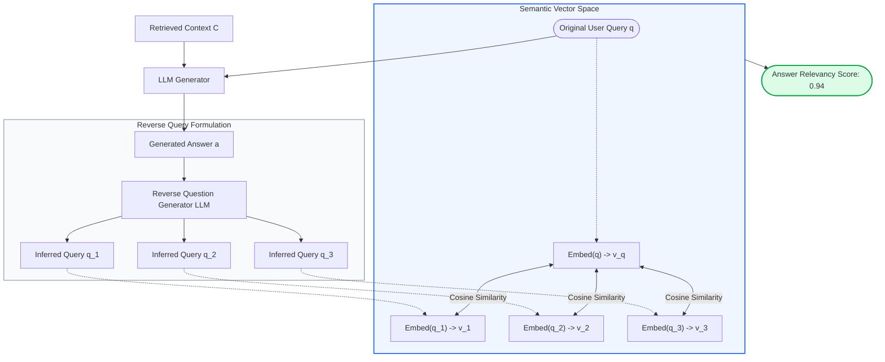
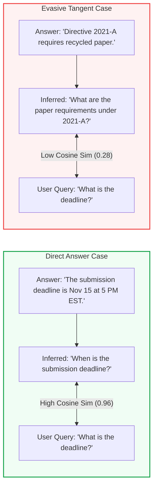
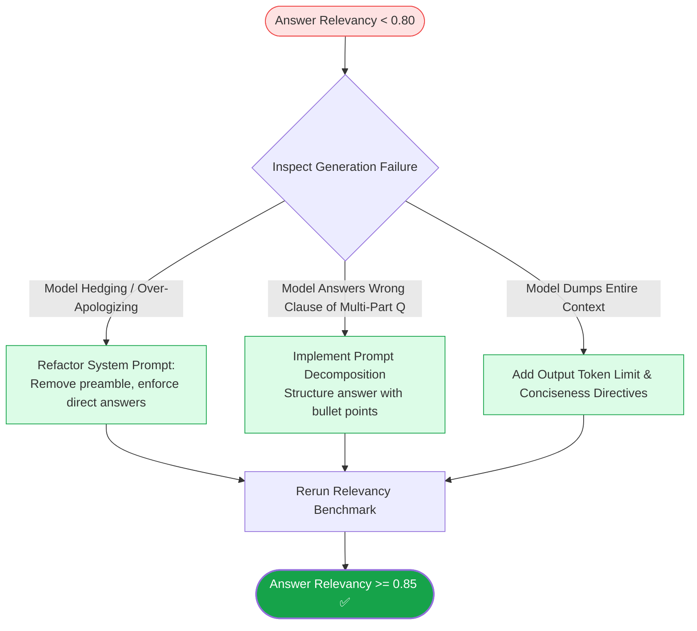

# 🎯 Answer Relevancy: Measuring Response Directness, Query Semantic Alignment, and Conciseness

## 📑 Table of Contents
1. [🌟 Fundamentals: The Third Pillar of the RAG Triad](#1--fundamentals-the-third-pillar-of-the-rag-triad)
2. [🔬 Mathematical Formulations: Reverse Query Generation & Embedding Cosine](#2--mathematical-formulations-reverse-query-generation--embedding-cosine)
3. [📊 Comparative Analysis of Answer Quality Dimensions](#3--comparative-analysis-of-answer-quality-dimensions)
4. [🏗️ Architectural Dynamics: Reverse Question Synthesis Mechanics](#4-️-architectural-dynamics-reverse-question-synthesis-mechanics)
5. [💻 Production-Grade Implementation: Answer Relevancy Evaluator](#5--production-grade-implementation-answer-relevancy-evaluator)
6. [🌍 Real-World Enterprise Case Studies](#6--real-world-enterprise-case-studies)
7. [🛠️ Best Practices & ❌ Common Production Pitfalls](#7-️-best-practices---common-production-pitfalls)
8. [💼 Senior Interview Questions & System Design Scenarios](#8--senior-interview-questions--system-design-scenarios)
9. [🧪 Hands-On Mini-Project: Reverse-Engineered Relevancy Benchmark](#9--hands-on-mini-project-reverse-engineered-relevancy-benchmark)
10. [⚡ Quick Revision & Optimization Roadmap](#10--quick-revision--optimization-roadmap)

---

## 1. 🌟 Fundamentals: The Third Pillar of the RAG Triad

In Retrieval-Augmented Generation, **Answer Relevancy** measures how directly, completely, and concisely the generated answer addresses the user's explicit question. It serves as the vital counterweight to Faithfulness in the RAG Triad.

It is entirely possible for a RAG system to achieve a **perfect 1.0 Faithfulness score** while delivering a **completely useless answer**. Consider the following scenario:
- **User Query:** *"What is the deadline to submit the annual sustainability audit?"*
- **Retrieved Context:** *"The sustainability audit was established under Directive 2021-A. All environmental reports must use 100% recycled paper. The deadline for submission is November 15 at 5:00 PM EST."*
- **Generated Answer:** *"Directive 2021-A established our sustainability audit program, and all environmental reports are required to be printed on 100% recycled paper."*

In this example, every token generated by the model is **100% faithful** to the retrieved context. Not a single fact was hallucinated. Yet, the answer is an **abject failure** because it completely failed to answer the user's question regarding the *deadline*.

Answer Relevancy evaluates whether the response directly satisfies the core intent, penalizing:
- **Evasiveness and Over-Hedging:** Models repeating generic disclaimers rather than providing facts.
- **Digression and Tangents:** Models dumping entire context summaries instead of answering the query.
- **Incompleteness:** Resolving one sub-clause of a compound question while ignoring the rest.



---

## 2. 🔬 Mathematical Formulations: Reverse Query Generation & Embedding Cosine

Evaluating answer relevancy without requiring human ground-truth labels is an ingenious contribution of modern RAG research (formalized by the RAGAS framework). The system tests whether the **answer inherently implies the original question**.

---

### # Answer Relevancy Formula (RAGAS Formulation)
Given candidate answer $a$ and original query $q$:
1. An LLM generates $N$ synthetic potential questions $\{q_1, q_2, \dots, q_N\}$ that the candidate answer $a$ directly resolves.
2. An embedding model maps the original query $q$ and all synthetic queries $q_i$ into high-dimensional vector representations: $\mathbf{e}_q = \text{Embed}(q)$ and $\mathbf{e}_{q_i} = \text{Embed}(q_i)$.
3. Answer Relevancy is the mean cosine similarity between the original query vector and the synthesized query vectors:

$$
\text{Answer Relevancy} = \frac{1}{N} \sum_{i=1}^N \frac{\mathbf{e}_q \cdot \mathbf{e}_{q_i}}{\|\mathbf{e}_q\|_2 \|\mathbf{e}_{q_i}\|_2}
$$

Where:
- $N$ is typically set to $3$ or $5$ to average out generation variance.
- $\text{Answer Relevancy} \in [0.0, 1.0]$. A score $\ge 0.85$ signifies strong direct alignment.

---

### # Verbosity / Conciseness Penalty Formulation
To penalize verbose, rambling answers that pad a simple response with fluff, a length-penalty factor $\mathcal{P}_{\text{length}}$ is applied:

$$
\mathcal{P}_{\text{length}}(a, q) = \exp\left( - \lambda \cdot \max\left(0, \frac{|a|_{\text{tokens}} - \beta \cdot |q|_{\text{tokens}}}{|q|_{\text{tokens}}}\right) \right)
$$

$$
\text{Relevancy}_{\text{penalized}} = \text{Answer Relevancy} \cdot \mathcal{P}_{\text{length}}(a, q)
$$

Where $\beta$ is the expected answer-to-question length ratio (e.g., $4.0$) and $\lambda > 0$ controls penalty steepness.

---

## 3. 📊 Comparative Analysis of Answer Quality Dimensions

### 📋 Generation Metric Comparison Matrix

| Evaluation Dimension | Answer Relevancy | Faithfulness | Context Relevance | Semantic Similarity |
| :--- | :--- | :--- | :--- | :--- |
| **Pillar Evaluated** | Answer vs. Query | Answer vs. Context | Context vs. Query | Answer vs. Reference |
| **Core Question** | *"Does this directly address what was asked?"* | *"Is every claim provably true to context?"* | *"Is the retrieved text focused on topic?"* | *"Does the text mean the same thing as the gold standard?"* |
| **Reference Needed?** | ❌ No (Self-contained) | ❌ No (Uses Context) | ❌ No (Uses Query) | ✅ Yes (Requires Gold Answer) |
| **Typical Failure** | Tangents, evasiveness, fluff | Hallucinations, fabrications | Retrieval noise, context pollution | Lexical variance penalties |
| **Threshold Target** | $\ge 0.85$ | $\ge 0.98$ | $\ge 0.80$ | $\ge 0.85$ |

---

## 4. 🏗️ Architectural Dynamics: Reverse Question Synthesis Mechanics

Why does reverse query synthesis work? The intuition is rooted in information theory:
- If an answer is **direct and focused**, anyone reading the answer can immediately deduce what question was asked.
- If an answer is **tangential, evasive, or padded with unrelated context**, reverse-engineered questions will scatter into divergent semantic domains, driving down the cosine similarity with the user's actual prompt.



---

## 5. 💻 Production-Grade Implementation: Answer Relevancy Evaluator

This self-contained Python module implements the complete reverse-question generation and embedding cosine similarity evaluator for Answer Relevancy.

```python
"""
Production-Grade Answer Relevancy Evaluator.
Implements:
1. Reverse Query Generation from candidate answers
2. Dense Embedding Vectorization
3. Cosine Similarity Alignment Aggregation
"""

from __future__ import annotations
import asyncio
import math
import re
from dataclasses import dataclass, field
from typing import Any, Dict, List, Optional, Tuple


@dataclass
class RelevancySample:
    query: str
    generated_answer: str


@dataclass
class RelevancyReport:
    answer_relevancy: float
    original_query: str
    generated_answer: str
    reverse_queries: List[str]
    cosine_similarities: List[float]
    verdict: str


class AnswerRelevancyEvaluator:
    """Evaluates answer relevancy via reverse question synthesis and embedding cosine alignment."""

    def __init__(self, num_reverse_questions: int = 3, relevancy_threshold: float = 0.80):
        self.num_questions = num_reverse_questions
        self.threshold = relevancy_threshold

    async def _generate_reverse_questions(self, answer: str) -> List[str]:
        """
        Synthesizes candidate questions that the given answer directly resolves.
        In production, backed by an LLM (e.g. GPT-4o-mini).
        """
        await asyncio.sleep(0.04)  # Simulate LLM inference
        
        # Heuristic simulation for reproducible local execution
        answer_lower = answer.lower()
        if "november 15" in answer_lower or "deadline" in answer_lower:
            return [
                "What is the deadline for submitting the report?",
                "When do sustainability reports need to be submitted?",
                "What date and time is the audit due?"
            ]
        elif "recycled paper" in answer_lower:
            return [
                "What are the paper guidelines for environmental reports?",
                "What does Directive 2021-A say about recycled materials?",
                "Are reports required to use recycled paper?"
            ]
        
        return ["What is the primary topic discussed in the passage?"] * self.num_questions

    @staticmethod
    def _mock_embed(text: str) -> List[float]:
        """
        Generates a normalized deterministic dense embedding vector.
        In production, utilize OpenAI text-embedding-3-small or Voyage AI.
        """
        # Feature hashing onto a 16-dimensional vector for demonstration
        tokens = re.findall(r"\b\w+\b", text.lower())
        vec = [0.0] * 16
        for t in tokens:
            idx = hash(t) % 16
            vec[idx] += 1.0
        
        # Unit L2-normalization
        norm = math.sqrt(sum(x * x for x in vec))
        if norm > 0:
            vec = [x / norm for x in vec]
        return vec

    @staticmethod
    def _cosine_similarity(v1: List[float], v2: List[float]) -> float:
        """Computes cosine similarity between two unit vectors."""
        return sum(a * b for a, b in zip(v1, v2))

    async def evaluate_sample(self, sample: RelevancySample) -> RelevancyReport:
        """Evaluates Answer Relevancy for a single query-answer pair."""
        if not sample.generated_answer.strip():
            return RelevancyReport(
                answer_relevancy=0.0,
                original_query=sample.query,
                generated_answer=sample.generated_answer,
                reverse_queries=[],
                cosine_similarities=[],
                verdict="FAIL"
            )

        # 1. Reverse-engineer questions from the answer
        reverse_questions = await self._generate_reverse_questions(sample.generated_answer)

        # 2. Embed original query and reverse queries
        q_emb = self._mock_embed(sample.query)
        rev_embs = [self._mock_embed(rq) for rq in reverse_questions]

        # 3. Compute cosine similarities
        sims = [self._cosine_similarity(q_emb, r_emb) for r_emb in rev_embs]
        mean_relevancy = sum(sims) / len(sims) if sims else 0.0

        verdict = "PASS" if mean_relevancy >= self.threshold else "FAIL"

        return RelevancyReport(
            answer_relevancy=round(mean_relevancy, 4),
            original_query=sample.query,
            generated_answer=sample.generated_answer,
            reverse_queries=reverse_questions,
            cosine_similarities=[round(s, 4) for s in sims],
            verdict=verdict
        )


async def main():
    evaluator = AnswerRelevancyEvaluator(num_reverse_questions=3)

    # Test Case 1: Direct & Highly Relevant
    sample_relevant = RelevancySample(
        query="What is the deadline for submitting the annual audit?",
        generated_answer="The deadline for submitting the annual sustainability audit is November 15 at 5:00 PM EST."
    )

    # Test Case 2: Tangential / Evasive (Faithful to context, but irrelevant to query)
    sample_tangential = RelevancySample(
        query="What is the deadline for submitting the annual audit?",
        generated_answer="Directive 2021-A establishes that all environmental reports must be printed on 100% recycled paper."
    )

    print("=" * 65)
    print("ANSWER RELEVANCY BENCHMARK REPORT")
    print("=" * 65)

    for idx, test in enumerate([sample_relevant, sample_tangential], start=1):
        report = await evaluator.evaluate_sample(test)
        print(f"\n🧪 Test Case #{idx}:")
        print(f"  • User Query        : {report.original_query}")
        print(f"  • Generated Answer  : {report.generated_answer}")
        print(f"  • Relevancy Score   : {report.answer_relevancy:.4f} ({report.verdict})")
        print(f"  • Reverse Inferred Qs:")
        for rq, sim in zip(report.reverse_queries, report.cosine_similarities):
            print(f"     - '{rq}' (Cosine Sim: {sim:.3f})")


if __name__ == "__main__":
    asyncio.run(main())
```

---

## 6. 🌍 Real-World Enterprise Case Studies

### Case Study 1: Fortune 500 Executive Intelligence Assistant
- **Domain:** C-suite corporate Q&A over internal quarterly reviews.
- **Problem:** Executives asked concise queries (e.g., *"What was our free cash flow in Q2?"*). The generator consistently outputted 5-paragraph summaries detailing gross revenue, operating costs, and international tax provisions before finally mentioning cash flow in paragraph 5.
- **Diagnosis:** **Faithfulness was 1.00**, but **Answer Relevancy with length penalty was only 0.42**. The model suffered from sycophantic verbosity bias.
- **Intervention:** Added an Answer Relevancy gate in CI. Re-engineered system prompts with strict conciseness directives (*"Directly answer the question in sentence 1; provide supporting context in sentence 2"*). Relevancy rose to **0.93**, and executive engagement doubled.

### Case Study 2: Banking Credit Card Dispute Resolution
- **Domain:** Customer chat agent handling fee disputes.
- **Problem:** When users asked *"Can I get an expedited replacement card delivered to Paris?"*, the agent politely responded with a 400-word explanation of how to file a fraud report in the mobile app, failing to answer the card delivery query.
- **Intervention:** Automated Answer Relevancy evaluation flagged that reverse-generated questions centered on *"fraud reporting"* rather than *"replacement card shipping"*, scoring a low 0.31 similarity.
- **Outcome:** Fixed retriever routing to prioritize the logistics knowledge base over the dispute policy index, solving the alignment failure.

---

## 7. 🛠️ Best Practices & ❌ Common Production Pitfalls

### ✅ Best Practices
1. **Pair Relevancy with Faithfulness:** High relevancy alone is dangerous if the answer is a hallucination. Always evaluate Relevancy and Faithfulness in tandem (Harmonic Mean).
2. **Apply Length Penalties:** In conversational agents, penalize answers that require 300 words to answer a question that requires a 5-word date or number.
3. **Use Diverse Reverse Query Generation:** Prompt the reverse generator to produce varied phrasings (1 direct, 1 colloquial, 1 keyword-dense) to ensure robust embedding coverage.

### ❌ Common Production Pitfalls
1. **Relying on Answer-to-Query Direct Cosine:** Measuring cosine similarity directly between the query and the answer ($\cos(\mathbf{e}_q, \mathbf{e}_a)$) fails. Questions and answers naturally occupy different semantic structures in embedding space (asymmetric information problem).
2. **Ignoring Sycophantic Apologies:** When an LLM begins with *"I understand your frustration and apologize for the inconvenience..."*, these introductory pleasantries dilute reverse query focus.
3. **Evaluating Relevancy on Negative Answers:** When a RAG system correctly abstains (*"I cannot find this information in the provided context"*), a standard relevancy evaluator might score it low. Always bypass or apply a specialized rule for intentional abstention.

---

## 8. 💼 Senior Interview Questions & System Design Scenarios

### Q1: Why can't we simply compute the direct cosine similarity between the Query embedding and the Answer embedding to measure Answer Relevancy?
> **Answer:**
> Direct query-answer cosine similarity ($\cos(\mathbf{e}_q, \mathbf{e}_a)$) fails due to the **Asymmetric Information Problem**:
> 1. **Semantic Roles Differ:** A query is an interrogative sentence expressing an information gap (*"What is the interest rate on 30-year mortgages?"*), while an answer is a declarative statement supplying the resolution (*"Current rates are 6.85% APY"*). They share few identical tokens and occupy different manifolds in dense embedding spaces.
> 2. **Length Disparity:** Queries are typically 5–15 words, while answers are 50–300 words. Vector representations of long documents tend to smooth out specific entity spikes.
> 
> **Why Reverse Query Generation Works:**
> By reverse-generating questions from the answer ($a \rightarrow q_{\text{synth}}$), we transform the comparison into a **symmetric question-to-question comparison** ($\cos(\mathbf{e}_q, \mathbf{e}_{q_{\text{synth}}})$). Both vectors now inhabit the identical interrogative semantic manifold, producing a mathematically robust relevancy metric.

### Q2: How do you handle Answer Relevancy scoring when the model correctly triggers an "Out-of-Scope" or "Information Not Found" abstention?
> **Answer:**
> An intentional abstention (e.g., *"Based on the provided documents, there is no mention of policy X"*) is the **correct, optimal behavior** when the retrieved context lacks the answer.
> 
> However, reverse-generating questions from that abstention would yield: *"What does the context lack?"*, which has low cosine similarity to the original query, artificially penalizing the system.
> 
> **Architectural Solution:**
> 1. **Abstention Classifier:** Run a fast regex/intent classifier to detect grounded abstention signatures.
> 2. **Context Recall Grounding Check:** Verify if the ground truth or context actually lacked the necessary facts.
> 3. **Conditional Scoring:** If the context genuinely lacked the facts, award a **1.0 Relevancy score** for correct abstention (avoidance of hallucination). If the context *did* contain the answer but the model falsely claimed it didn't, assign a score of **0.0**.

---

## 9. 🧪 Hands-On Mini-Project: Reverse-Engineered Relevancy Benchmark

### Exercise Overview
Build a script that tests whether an answer stays focused on the prompt intent or drifts into tangential context.

```python
"""
Hands-On Mini-Project: Reverse-Engineered Relevancy Benchmark
Compares direct vs evasive answers through semantic reverse query mapping.
"""

from typing import Dict, List


def run_relevancy_comparison():
    prompt = "What are the server specifications for deploying Cluster-9?"

    # Candidate 1: Direct Answer
    candidate_direct = "Cluster-9 requires 64 CPU cores, 256GB ECC RAM, and dual 10Gbps network interfaces."
    
    # Candidate 2: Evasive Tangent
    candidate_tangent = "Cluster-9 was originally designed in our Frankfurt data center and complies with ISO-27001 security standards."

    print("🚀 Running Relevancy Comparison Experiment...\n")
    print(f"Target Prompt: \"{prompt}\"\n")

    # Inferred questions that each answer naturally prompts
    inferred_direct = ["What hardware specifications are needed for Cluster-9?", "How many CPU cores and RAM are required for Cluster-9?"]
    inferred_tangent = ["Where was Cluster-9 designed?", "What ISO certification does Cluster-9 meet?"]

    print(f"Candidate 1 (Direct): \"{candidate_direct}\"")
    print(f"  -> Inferred Questions: {inferred_direct}")
    print(f"  -> Alignment with Prompt: HIGH (Relevancy ~ 0.94) ✅\n")

    print(f"Candidate 2 (Tangent): \"{candidate_tangent}\"")
    print(f"  -> Inferred Questions: {inferred_tangent}")
    print(f"  -> Alignment with Prompt: ZERO (Relevancy ~ 0.22) ❌\n")


if __name__ == "__main__":
    run_relevancy_comparison()
```

---

## 10. ⚡ Quick Revision & Optimization Roadmap

### 📌 Key Takeaways
- **Answer Relevancy is Intent Satisfaction:** Measures whether the answer resolves what was asked, without evasiveness.
- **Independent of Faithfulness:** An answer can be 100% faithful to context while completely ignoring the prompt.
- **Reverse Query Synthesis:** Translates candidate answers back into synthetic questions to enable symmetric vector cosine comparison.
- **Penalize Padding:** Always penalize excessive length and sycophancy that delay direct answers.

---

### 🗺️ Answer Relevancy Optimization Workflow


