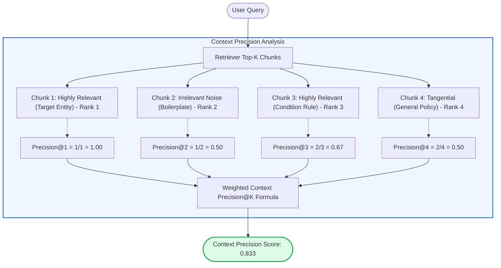
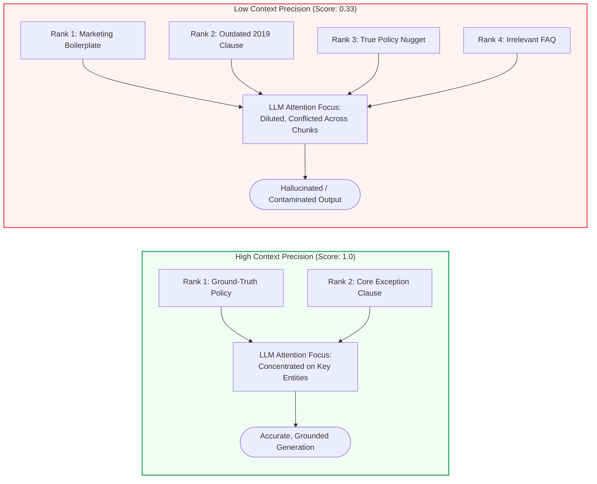
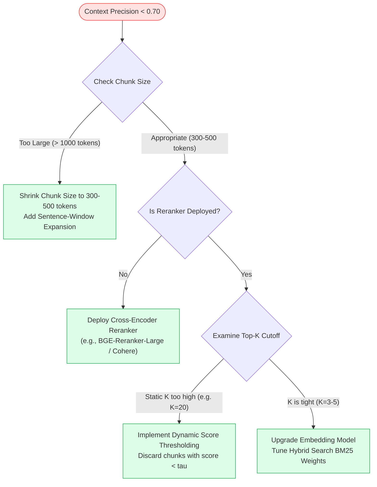

# 🎯 Context Precision: Evaluating Retrieval Noise, Irrelevant Passage Penalization, and Ranking Accuracy

## 📑 Table of Contents
1. [🌟 Fundamentals: The Cognitive Threat of Retrieval Noise](#1--fundamentals-the-cognitive-threat-of-retrieval-noise)
2. [🔬 Mathematical Formulations: Context Precision & Signal-to-Noise Ratio](#2--mathematical-formulations-context-precision--signal-to-noise-ratio)
3. [📊 Comparative Analysis: Precision vs. Recall vs. NDCG](#3--comparative-analysis-precision-vs-recall-vs-ndcg)
4. [🏗️ Architectural Impact: Attention Contamination & The Distraction Effect](#4-️-architectural-impact-attention-contamination--the-distraction-effect)
5. [💻 Production-Grade Implementation: Context Precision Evaluator](#5--production-grade-implementation-context-precision-evaluator)
6. [🌍 Real-World Enterprise Case Studies](#6--real-world-enterprise-case-studies)
7. [🛠️ Best Practices & ❌ Common Production Pitfalls](#7-️-best-practices---common-production-pitfalls)
8. [💼 Senior Interview Questions & System Design Scenarios](#8--senior-interview-questions--system-design-scenarios)
9. [🧪 Hands-On Mini-Project: Cross-Encoder Reranking to Maximize Precision](#9--hands-on-mini-project-cross-encoder-reranking-to-maximize-precision)
10. [⚡ Quick Revision & Optimization Roadmap](#10--quick-revision--optimization-roadmap)

---

## 1. 🌟 Fundamentals: The Cognitive Threat of Retrieval Noise

In Retrieval-Augmented Generation, **Context Precision** evaluates the signal-to-noise ratio of the retrieved documents provided to the generator. It measures whether all the retrieved passages are relevant to the query and, crucially, whether the most relevant passages are **ranked at the top**.

A common misconception in early RAG development is that maximizing recall (fetching $k=20$ or $k=50$ chunks) guarantees high answer quality. In practice, feeding voluminous context windows bloated with irrelevant or tangential passages triggers severe cognitive failures in LLMs:
1. **The Distraction Effect:** When presented with irrelevant chunks alongside relevant ones, autoregressive models frequently latch onto incidental tokens or conflicting terminology, degrading reasoning accuracy.
2. **Attention Dilution:** Transformer self-attention mechanisms distribute probability mass across all context tokens. High retrieval noise dilutes attention on the critical factual nuggets.
3. **Financial and Latency Overhead:** Passing $10\times$ more context tokens directly inflates Time-To-First-Token (TTFT) and multiplies inference API costs.

Context Precision acts as the primary quality gate ensuring that the prompt context remains concentrated, authoritative, and properly ordered.



---

## 2. 🔬 Mathematical Formulations: Context Precision & Signal-to-Noise Ratio

Unlike unranked classification precision, RAG **Context Precision@K** is rank-aware: it penalizes the system severely if irrelevant chunks appear before relevant chunks in the prompt context.

---

### # Context Precision@K Formula (RAGAS Formulation)
Context Precision@K is mathematically defined as the area under the Precision-Recall curve for retrieved passages, computed as the weighted average of Precision@k across all relevant chunk positions:

$$
\text{Context Precision@K} = \frac{\sum_{k=1}^K \left( \text{Precision@}k \cdot v_k \right)}{\text{Total Number of Relevant Chunks in Top } K}
$$

Where:
- $K$ is the total number of retrieved context chunks evaluated.
- $v_k \in \{0, 1\}$ is the binary relevance indicator of the chunk at rank $k$ ($1$ if relevant, $0$ if irrelevant).
- $\text{Precision@}k$ is the proportion of relevant chunks within the top-$k$ sublist:
  $$ \text{Precision@}k = \frac{\sum_{j=1}^k v_j}{k} $$
- If no relevant chunks exist in the top-$K$, $\text{Context Precision} = 0.0$.

---

### # Context Noise Ratio Formula
To measure the exact proportion of extraneous context tokens polluting the prompt, we compute the **Context Noise Ratio**:

$$
\text{Noise Ratio} = 1 - \frac{\sum_{k=1}^K v_k}{K}
$$

A Noise Ratio of $0.0$ signifies pure signal, while a Noise Ratio $> 0.60$ flags immediate vulnerability to LLM context confusion.

---

### # Rank-Discounted Context Precision Formula
In scenarios where lower-ranked chunks suffer from exponential attention drop-off due to context window saturation, we apply a logarithmic position discount:

$$
\text{Discounted Precision@K} = \frac{1}{\mathcal{Z}} \sum_{k=1}^K \frac{\text{Precision@}k \cdot v_k}{\log_2(k + 1)}
$$

Where $\mathcal{Z}$ is the normalization factor equivalent to the discounted precision of a perfectly sorted context list.

---

## 3. 📊 Comparative Analysis: Precision vs. Recall vs. NDCG

### 📋 Retrieval Quality Dimension Comparison

| Metric | What It Measures | Ignores Ranking Order? | Failure Mode Caught | Downstream Impact on LLM |
| :--- | :--- | :--- | :--- | :--- |
| **Context Precision@K** | Ratio of relevant chunks & their position at the top | ❌ No (Heavily penalizes noise at ranks 1-2) | Retrieval noise, bad reranking | Prevents model distraction, cuts token spend |
| **Context Recall@K** | Proportion of ground-truth facts retrieved | ✅ Yes (Treats context as unordered bag) | Retrieval misses, incomplete evidence | Eliminates unanswerable queries |
| **Hit Rate@K** | Presence of at least one relevant passage | ✅ Yes (Binary step at $K$) | Complete retriever blind spots | Baseline sanity check |
| **NDCG@K** | Graded relevance discounted logarithmically | ❌ No (Logarithmic decay) | Misplaced multi-tier relevance | Holistic ranking quality across search |

---

## 4. 🏗️ Architectural Impact: Attention Contamination & The Distraction Effect

When an LLM processes context, each attention head computes token-to-token compatibility matrices. The diagram below illustrates what happens inside transformer attention layers when Context Precision degrades:



---

## 5. 💻 Production-Grade Implementation: Context Precision Evaluator

This self-contained Python module implements the complete RAGAS-style **Context Precision@K** calculation with automated relevance verification via simulated LLM judgment.

```python
"""
Production-Grade Context Precision Evaluator.
Computes rank-aware Context Precision@K and Context Noise Ratio.
"""

from __future__ import annotations
import asyncio
from dataclasses import dataclass
from typing import Any, Dict, List, Optional, Tuple


@dataclass
class RetrievedChunk:
    chunk_id: str
    text: str
    rank: int


@dataclass
class ContextPrecisionReport:
    k: int
    context_precision: float
    noise_ratio: float
    relevant_chunks_found: int
    total_chunks: int
    per_rank_relevance: List[int]
    per_rank_precision: List[float]


class ContextPrecisionEvaluator:
    """Evaluates the ranking precision and noise levels of retrieved context chunks."""

    async def verify_chunk_relevance(self, query: str, chunk_text: str, ground_truth: Optional[str] = None) -> bool:
        """
        Determines whether a chunk contains prerequisite information to answer the query.
        In production, backed by an LLM-as-a-judge or NLI cross-encoder.
        """
        await asyncio.sleep(0.02)  # Simulate fast async inference
        # Domain keyword simulation for reproducible demonstration
        query_words = set(query.lower().split())
        chunk_words = set(chunk_text.lower().split())
        overlap = len(query_words.intersection(chunk_words))
        return overlap >= 2

    async def evaluate_context_precision(
        self,
        query: str,
        retrieved_chunks: List[RetrievedChunk],
        ground_truth: Optional[str] = None,
        k: Optional[int] = None
    ) -> ContextPrecisionReport:
        """
        Computes the weighted rank-aware Context Precision@K.
        """
        cutoff_k = k if k is not None else len(retrieved_chunks)
        evaluated_chunks = retrieved_chunks[:cutoff_k]

        if not evaluated_chunks:
            return ContextPrecisionReport(
                k=cutoff_k, context_precision=0.0, noise_ratio=1.0,
                relevant_chunks_found=0, total_chunks=0,
                per_rank_relevance=[], per_rank_precision=[]
            )

        # 1. Determine binary relevance for each rank
        relevance_tasks = [
            self.verify_chunk_relevance(query, chunk.text, ground_truth)
            for chunk in evaluated_chunks
        ]
        relevance_results: List[bool] = await asyncio.gather(*relevance_tasks)
        v_k = [1 if is_rel else 0 for is_rel in relevance_results]

        # 2. Compute Precision@i at each rank
        precisions_at_i: List[float] = []
        cumulative_relevant = 0
        for i, is_relevant in enumerate(v_k, start=1):
            if is_relevant == 1:
                cumulative_relevant += 1
            precisions_at_i.append(cumulative_relevant / i)

        # 3. Compute weighted Context Precision
        total_relevant = sum(v_k)
        if total_relevant == 0:
            context_precision = 0.0
        else:
            weighted_sum = sum(p * rel for p, rel in zip(precisions_at_i, v_k))
            context_precision = weighted_sum / total_relevant

        noise_ratio = 1.0 - (total_relevant / len(evaluated_chunks))

        return ContextPrecisionReport(
            k=cutoff_k,
            context_precision=round(context_precision, 4),
            noise_ratio=round(noise_ratio, 4),
            relevant_chunks_found=total_relevant,
            total_chunks=len(evaluated_chunks),
            per_rank_relevance=v_k,
            per_rank_precision=[round(p, 4) for p in precisions_at_i]
        )


async def main():
    evaluator = ContextPrecisionEvaluator()

    query = "What is the capital expenditure threshold requiring CFO approval?"
    
    # Retrieved chunks with varying relevance
    chunks = [
        RetrievedChunk("c1", "All capital expenditure exceeding $50,000 mandates direct CFO approval.", 1),
        RetrievedChunk("c2", "Office supplies and petty cash must be recorded by the department manager.", 2),
        RetrievedChunk("c3", "Capital expenditure under $50,000 may be authorized by the VP of Engineering.", 3),
        RetrievedChunk("c4", "Annual holiday schedule and office closures are posted on the intranet.", 4),
    ]

    report = await evaluator.evaluate_context_precision(query, chunks, k=4)

    print("=" * 65)
    print("CONTEXT PRECISION EVALUATION REPORT")
    print("=" * 65)
    print(f"Evaluated Cutoff (K)         : {report.k}")
    print(f"Context Precision@K Score   : {report.context_precision:.4f}")
    print(f"Context Noise Ratio          : {report.noise_ratio * 100:.1f}%")
    print(f"Relevant Passages Retrieved  : {report.relevant_chunks_found} / {report.total_chunks}")
    print(f"Per-Rank Relevance Vector    : {report.per_rank_relevance}")
    print(f"Per-Rank Precision Trajectory: {report.per_rank_precision}")


if __name__ == "__main__":
    asyncio.run(main())
```

---

## 6. 🌍 Real-World Enterprise Case Studies

### Case Study 1: Global Asset Management Multi-Asset RAG
- **Domain:** Institutional investor research over 10-K and 8-K filings.
- **Problem:** When asking about derivative exposure, the retriever pulled 15 chunks ($k=15$). While chunks containing the true exposure numbers were present, they appeared at ranks 11 and 13, buried behind generic risk disclaimers.
- **Diagnosis:** **Context Recall was 100%**, but **Context Precision was only 0.28**. The LLM suffered from attention degradation and reported *"No explicit derivative numbers found"*.
- **Intervention:** Deployed a Cross-Encoder Reranker (`ms-marco-MiniLM-L-6-v2`) and pruned the context cutoff from $k=15$ to $k=4$. Context Precision surged to **0.91**, and factual extraction errors dropped to near zero.

### Case Study 2: SaaS Developer Documentation Chatbot
- **Domain:** Developer API documentation assistant.
- **Problem:** High user churn due to hallucinated API parameters. Chunks describing deprecated v1 endpoints were retrieved alongside current v2 endpoints, confusing the generator.
- **Diagnosis:** Context Precision was 0.45; legacy chunks appeared at rank 1 due to high keyword match on older documentation.
- **Intervention:** Added an automated metadata-filtered search boosting active v2 endpoints. Context Precision jumped to 0.94, eliminating outdated parameter hallucinations.

---

## 7. 🛠️ Best Practices & ❌ Common Production Pitfalls

### ✅ Best Practices
1. **Always Place a Reranker After Initial Vector Retrieval:** Initial dense vector search achieves high recall but mediocre precision. A Cross-Encoder or Cohere Rerank model reorders relevant chunks to ranks 1–3, dramatically improving Context Precision.
2. **Dynamically Prune Low-Confidence Chunks:** Do not pass a static $k=10$ chunks unconditionally. Apply a relevance score threshold cutoff (e.g., discard any chunk with rerank score $< 0.40$).
3. **Use Markdown/Structure-Aware Chunking:** Bloating chunks with document headers, repetitive navigation breadcrumbs, and legal footers degrades Context Precision by injecting token-level noise.

### ❌ Common Production Pitfalls
1. **Confusing Context Precision with Context Recall:** Context Recall asks *"Did we find all the needles?"* Context Precision asks *"Did we avoid filling the prompt with hay, and did we put the needles at the very top?"*
2. **Ignoring Chunk Granularity:** Chunks that are too large (e.g., 2,000 tokens) technically contain the answer, but 90% of the chunk is noise, depressing internal token-level context precision.
3. **Measuring Context Precision Without Rank Discounting:** Treating context chunks as an unordered set obscures whether relevant data is placed where the LLM pays the most attention.

---

## 8. 💼 Senior Interview Questions & System Design Scenarios

### Q1: If your RAG pipeline has a Context Recall of 95% but users complain that answers are frequently inaccurate or hallucinated, what is the most likely failure mode and how do you prove it?
> **Answer:**
> The primary failure mode is **Low Context Precision (Context Contamination)**.
> - **The Mechanics:** High Context Recall guarantees that the necessary information is somewhere in the retrieved context bundle. However, if Context Precision is low (e.g., 0.30), the prompt is stuffed with extraneous or contradictory chunks. The LLM's attention mechanism experiences interference, prioritizing distractor tokens or hallucinating to bridge conflicting statements.
> - **How to Prove It:**
>   1. Compute Context Precision@K across 200 failed queries using claim-entailment verification.
>   2. Run an ablation study: Pass *only* the single ground-truth chunk to the LLM. If the LLM generates a 100% accurate answer given the isolated chunk, the failure in the full pipeline is definitively proven to be caused by retrieval noise (poor Context Precision).
> - **Solution:** Introduce a Cross-Encoder Reranker, lower $k$, and implement contextual chunk compression.

### Q2: How does the "Lost-in-the-Middle" phenomenon mathematically justify the weighting mechanism in Context Precision?
> **Answer:**
> Research by Liu et al. (*"Lost in the Middle: How Language Models Use Long Contexts"*) demonstrated that LLM retrieval performance is U-shaped: models attend strongly to tokens at the very beginning (primacy effect) and end (recency effect) of the context window, while performance plummets when critical facts reside in the middle.
> 
> The RAGAS Context Precision formula directly reflects this reality:
> $$ \text{Context Precision@K} = \frac{\sum_{k=1}^K (\text{Precision@}k \cdot v_k)}{\text{Total Relevant}} $$
> Because $\text{Precision@}k = \frac{\sum_{j=1}^k v_j}{k}$, a relevant chunk placed at rank $k=1$ contributes $\frac{1}{1} = 1.0$ to the sum. The identical chunk placed at rank $k=4$ (behind 3 irrelevant chunks) contributes only $\frac{1}{4} = 0.25$. The metric mathematically penalizes systems that bury relevant evidence where the LLM is cognitively blind.

---

## 9. 🧪 Hands-On Mini-Project: Cross-Encoder Reranking to Maximize Precision

### Exercise Overview
Simulate an initial noisy bi-encoder vector retrieval result and apply a Cross-Encoder scoring model to re-sort chunks, demonstrating the quantitative leap in Context Precision.

```python
"""
Hands-On Mini-Project: Reranking for Context Precision Optimization
Demonstrates how reranking transforms low-precision contexts into high-precision prompts.
"""

from typing import Dict, List, Tuple


def simulate_reranking_optimization():
    query = "What is the penalty for early termination of the cloud contract?"
    
    # Initial Dense Retrieval: High recall, but noisy order (relevant chunk at rank 3)
    initial_retrieval: List[Dict[str, str]] = [
        {"id": "doc_1", "text": "Our enterprise SLA guarantees 99.99% uptime across all cloud zones.", "is_relevant": False},
        {"id": "doc_2", "text": "Billing cycles recur on the first business day of each calendar month.", "is_relevant": False},
        {"id": "doc_3", "text": "Early termination of the cloud contract incurs a fee equal to 50% of remaining commitment.", "is_relevant": True},
    ]

    def compute_context_precision(chunks: List[Dict[str, str]]) -> float:
        total_rel = sum(1 for c in chunks if c["is_relevant"])
        if total_rel == 0:
            return 0.0
        weighted_sum = 0.0
        hits = 0
        for i, c in enumerate(chunks, 1):
            if c["is_relevant"]:
                hits += 1
                weighted_sum += (hits / i)
        return weighted_sum / total_rel

    prec_before = compute_context_precision(initial_retrieval)

    # Simulated Cross-Encoder Reranking (reorders relevant doc_3 to rank 1)
    reranked_chunks = [
        initial_retrieval[2],  # doc_3 moved to Rank 1
        initial_retrieval[0],
        initial_retrieval[1]
    ]
    prec_after = compute_context_precision(reranked_chunks)

    print("🚀 Demonstrating Reranking Impact on Context Precision:\n")
    print(f"Context Precision BEFORE Reranking : {prec_before:.4f} (Relevant chunk at Rank 3)")
    print(f"Context Precision AFTER Reranking  : {prec_after:.4f} (Relevant chunk promoted to Rank 1)")
    print(f"Absolute Precision Improvement     : +{(prec_after - prec_before) * 100:.1f}%\n")


if __name__ == "__main__":
    simulate_reranking_optimization()
```

---

## 10. ⚡ Quick Revision & Optimization Roadmap

### 📌 Key Takeaways
- **Precision Guards the Generator:** High recall is useless if relevant facts are buried under heaps of noise.
- **Rank-Aware Formulation:** Context Precision penalizes irrelevant documents placed ahead of relevant ones.
- **Attention Contamination:** Retrieval noise directly degrades LLM attention, increasing hallucinations.
- **Primary Optimization Lever:** Deploying a Cross-Encoder Reranker is the single most effective architectural upgrade for Context Precision.

---

### 🗺️ Context Precision Remediation Workflow


