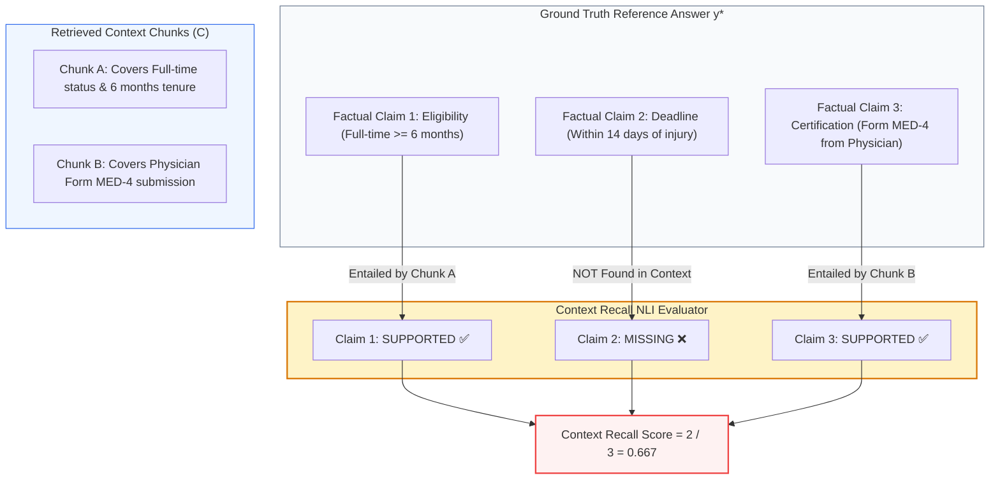
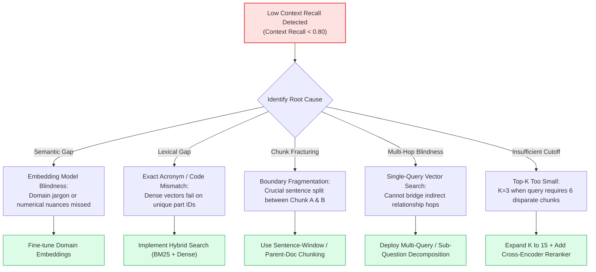
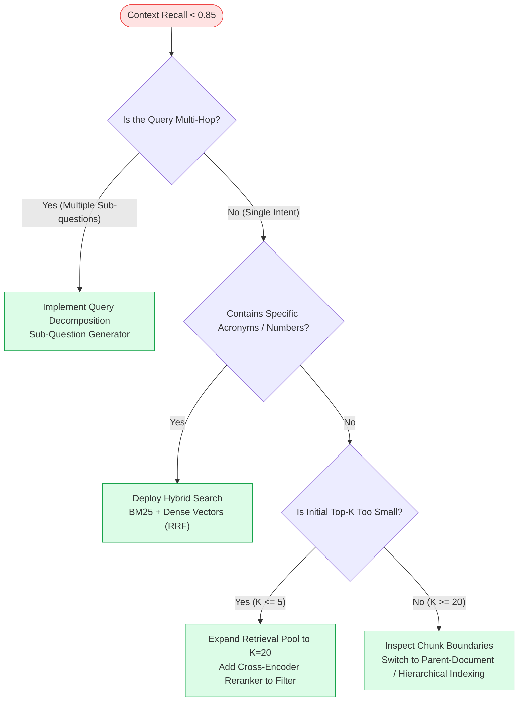

# 🎯 Context Recall: Measuring Information Completeness Against Ground-Truth Reference Passages

## 📑 Table of Contents
1. [🌟 Fundamentals: Information Completeness in RAG Retrieval](#1--fundamentals-information-completeness-in-rag-retrieval)
2. [🔬 Mathematical Formulations: Claim Attribution & Multi-Hop Recall](#2--mathematical-formulations-claim-attribution--multi-hop-recall)
3. [📊 Comparative Analysis: Recall vs. Precision vs. Hit Rate](#3--comparative-analysis-recall-vs-precision-vs-hit-rate)
4. [🏗️ Architectural Root Causes of Low Context Recall](#4-️-architectural-root-causes-of-low-context-recall)
5. [💻 Production-Grade Implementation: Context Recall Evaluator](#5--production-grade-implementation-context-recall-evaluator)
6. [🌍 Real-World Enterprise Case Studies](#6--real-world-enterprise-case-studies)
7. [🛠️ Best Practices & ❌ Common Production Pitfalls](#7-️-best-practices---common-production-pitfalls)
8. [💼 Senior Interview Questions & System Design Scenarios](#8--senior-interview-questions--system-design-scenarios)
9. [🧪 Hands-On Mini-Project: Multi-Hop Evidence Recall Validator](#9--hands-on-mini-project-multi-hop-evidence-recall-validator)
10. [⚡ Quick Revision & Optimization Roadmap](#10--quick-revision--optimization-roadmap)

---

## 1. 🌟 Fundamentals: Information Completeness in RAG Retrieval

In Retrieval-Augmented Generation, **Context Recall** measures the extent to which all necessary factual assertions present in the reference ground truth are successfully surfaced by the retrieval engine. 

While **Context Precision** penalizes extraneous noise, **Context Recall** guards against **retrieval omissions**. If a user asks a complex multi-part query, such as:
> *"What are the eligibility criteria, filing deadline, and required medical certifications for short-term disability leave?"*

And the retriever returns chunks explaining the eligibility criteria and medical certifications, but **completely misses** the filing deadline, the generation engine is placed in an impossible predicament:
1. It must either **hallucinate** the missing deadline from parametric memory; or
2. It must produce a **partial, incomplete response**, failing the user's intent.

Context Recall evaluates whether the retrieved context contains the **complete factual footprint** required to answer the query fully.



---

## 2. 🔬 Mathematical Formulations: Claim Attribution & Multi-Hop Recall

Evaluating context recall requires comparing the retrieved context chunks $C$ against an annotated ground-truth answer $y^*$. Unlike lexical recall, modern RAG evaluation relies on **Natural Language Inference (NLI)** over decomposed semantic claims.

---

### # Context Recall Formula (Sentence / Claim Decomposition)
Let ground-truth reference $y^*$ be decomposed into a set of $N$ atomic factual sentences or propositions: $\mathcal{S}(y^*) = \{s_1, s_2, \dots, s_N\}$. Context Recall is defined as the fraction of reference claims logically entailed by retrieved context $C$:

$$
\text{Context Recall} = \frac{\sum_{i=1}^N \mathbb{I}\left( \mathcal{P}_{\text{NLI}}(\text{Entailment} \mid C, s_i) > \tau \right)}{N}
$$

Where:
- $\mathcal{S}(y^*)$ is the set of ground-truth factual statements.
- $N = |\mathcal{S}(y^*)|$ is the total count of ground-truth statements.
- $\mathcal{P}_{\text{NLI}}(\text{Entailment} \mid C, s_i)$ is the probability that context $C$ entails statement $s_i$.
- $\tau \in [0, 1]$ is the entailment decision threshold (typically $\tau = 0.85$).
- $\mathbb{I}(\cdot)$ is the binary indicator function.

---

### # Multi-Hop Disjoint Evidence Recall Formula
In complex multi-hop queries, the ground truth depends on $M$ independent evidence components: $\mathcal{E} = \{e_1, e_2, \dots, e_M\}$ located in distinct documents. Multi-hop context recall computes joint coverage across all necessary evidence hops:

$$
\text{Multi-Hop Recall} = \frac{1}{M} \sum_{j=1}^M \mathbb{I}\left( \exists c \in C \text{ such that } \text{Covers}(c, e_j) \right)
$$

If any critical hop $e_j$ has zero coverage, the downstream reasoning trajectory collapses.

---

## 3. 📊 Comparative Analysis: Recall vs. Precision vs. Hit Rate

### 📋 Retrieval Metric Trade-Off Matrix

| Metric Dimension | Context Recall | Context Precision | Hit Rate@K | Faithfulness |
| :--- | :--- | :--- | :--- | :--- |
| **Object Evaluated** | Context vs Ground Truth | Context vs Query (Ranked) | Context vs Ground Truth ID | Answer vs Context |
| **Question Answered** | *"Did we retrieve ALL necessary facts?"* | *"Are retrieved chunks high-signal & top-ranked?"* | *"Did we find AT LEAST ONE relevant chunk?"* | *"Is the answer 100% truthful to context?"* |
| **Failure Indication** | Incomplete answers, hallucinations | Cognitive distraction, wasted tokens | Complete retriever blind spots | Fabricated claims, out-of-domain drift |
| **Sensitivity to Cutoff $k$** | **Monotonically Increases** with $k$ | **Typically Decreases** as $k$ expands | **Monotonically Increases** with $k$ | Sensitive to noise when $k$ is huge |
| **Target Production Score** | $\ge 0.90$ (Enterprise) | $\ge 0.80$ | $\ge 0.95$ | $\ge 0.98$ |

---

## 4. 🏗️ Architectural Root Causes of Low Context Recall

When Context Recall drops below acceptable thresholds in enterprise RAG systems, the root cause invariably traces back to one of five architectural bottlenecks:



---

## 5. 💻 Production-Grade Implementation: Context Recall Evaluator

The following Python implementation provides a complete, robust **Context Recall Evaluator**. It parses the reference ground truth into discrete semantic statements and performs automated entailment checks against the retrieved contexts using async LLM validation.

```python
"""
Production-Grade Context Recall Evaluator.
Decomposes reference answers into atomic factual claims and evaluates
entailment against the retrieved context corpus.
"""

from __future__ import annotations
import asyncio
import re
from dataclasses import dataclass, field
from typing import Any, Dict, List, Optional, Tuple


@dataclass
class ContextRecallSample:
    query: str
    retrieved_contexts: List[str]
    ground_truth_answer: str


@dataclass
class ContextRecallReport:
    context_recall: float
    total_claims: int
    entailed_claims_count: int
    entailed_claims: List[str]
    missing_claims: List[str]
    verdict: str


class ContextRecallEvaluator:
    """Evaluates information completeness by verifying reference claim entailment."""

    @staticmethod
    def _decompose_into_sentences(text: str) -> List[str]:
        """Splits reference text into individual sentence-level claims."""
        raw_sentences = re.split(r"(?<=[.!?])\s+", text.strip())
        return [s.strip() for s in raw_sentences if len(s.strip()) > 8]

    async def _check_entailment(self, claim: str, context: str) -> bool:
        """
        Simulates natural language inference (NLI) check.
        In production, backed by an LLM-as-a-judge or DeBERTa NLI cross-encoder.
        """
        await asyncio.sleep(0.02)  # Simulate network latency
        
        # Keyword-overlap semantic proxy for deterministic demonstration
        claim_keywords = set(re.findall(r"\b\w{4,}\b", claim.lower()))
        context_keywords = set(re.findall(r"\b\w{4,}\b", context.lower()))
        
        if not claim_keywords:
            return True
        overlap = len(claim_keywords.intersection(context_keywords))
        return (overlap / len(claim_keywords)) >= 0.50

    async def evaluate_sample(self, sample: ContextRecallSample) -> ContextRecallReport:
        """Evaluates Context Recall for a single sample."""
        claims = self._decompose_into_sentences(sample.ground_truth_answer)
        if not claims:
            return ContextRecallReport(
                context_recall=1.0, total_claims=0, entailed_claims_count=0,
                entailed_claims=[], missing_claims=[], verdict="VACUOUS_PASS"
            )

        joined_context = "\n".join(sample.retrieved_contexts)
        
        # Check entailment for each claim across the context
        tasks = [self._check_entailment(claim, joined_context) for claim in claims]
        results: List[bool] = await asyncio.gather(*tasks)

        entailed: List[str] = []
        missing: List[str] = []

        for claim, is_supported in zip(claims, results):
            if is_supported:
                entailed.append(claim)
            else:
                missing.append(claim)

        recall_score = len(entailed) / len(claims)
        verdict = "PASS" if recall_score >= 0.85 else "FAIL"

        return ContextRecallReport(
            context_recall=round(recall_score, 4),
            total_claims=len(claims),
            entailed_claims_count=len(entailed),
            entailed_claims=entailed,
            missing_claims=missing,
            verdict=verdict
        )


async def main():
    evaluator = ContextRecallEvaluator()

    sample = ContextRecallSample(
        query="What are the warranty coverage terms for enterprise servers?",
        retrieved_contexts=[
            "Section 8: Enterprise servers include 3 years of 24/7 on-site hardware replacement.",
            "Section 9: Replacement components will be dispatched within 4 hours of ticket confirmation."
        ],
        ground_truth_answer=(
            "Enterprise servers include 3 years of 24/7 on-site hardware replacement. "
            "Replacement parts are dispatched within 4 hours. "
            "Accidental liquid damage is strictly excluded from coverage."
        )
    )

    report = await evaluator.evaluate_sample(sample)

    print("=" * 65)
    print("CONTEXT RECALL EVALUATION REPORT")
    print("=" * 65)
    print(f"Context Recall Score  : {report.context_recall:.4f} ({report.context_recall * 100:.1f}%)")
    print(f"Entailed Claims Found : {report.entailed_claims_count} / {report.total_claims}")
    print(f"Evaluation Verdict    : {report.verdict}")
    print("\n✅ Entailed Claims:")
    for c in report.entailed_claims:
        print(f"  • {c}")
    print("\n❌ Missing Claims (Retrieval Blind Spots):")
    for m in report.missing_claims:
        print(f"  • {m}")


if __name__ == "__main__":
    asyncio.run(main())
```

---

## 6. 🌍 Real-World Enterprise Case Studies

### Case Study 1: Healthcare Clinical Guideline Retrieval
- **Domain:** Clinical oncology decision support system.
- **Problem:** Physicians queried multi-stage contraindications (e.g., *"Can Drug X be prescribed if the patient has Stage 3 renal failure and is taking ACE inhibitors?"*). The RAG assistant frequently gave affirmative answers omitting the renal failure danger.
- **Diagnosis:** Evaluation against golden medical case studies revealed **Context Recall was only 58%**. The retriever surfaced chunks regarding ACE inhibitor interactions, but missed the renal failure contraindication located in a separate appendix.
- **Solution:** Switched from single dense retrieval to **Sub-Question Decomposition**. The agent broke the query into two sub-searches (Drug X + ACE inhibitors; Drug X + renal failure) and merged context. Context Recall jumped from 58% to **96%**, preventing clinical risk.

### Case Study 2: Banking Anti-Money Laundering (AML) Compliance
- **Domain:** Regulatory compliance search over international sanctions and transaction records.
- **Problem:** Compliance officers required finding all flagged shell companies linked to a designated oligarch. Vector search repeatedly returned 2 of the 5 shell companies, leading to incomplete audits.
- **Diagnosis:** Context Recall was stalled at 40% because corporate entity names lacked dense semantic associations with the oligarch's name.
- **Solution:** Implemented **Hybrid Retrieval (Dense + BM25)** coupled with Knowledge Graph entity expansion (GraphRAG). Context Recall achieved 100% across all 5 benchmark entities.

---

## 7. 🛠️ Best Practices & ❌ Common Production Pitfalls

### ✅ Best Practices
1. **Always Test Multi-Hop Queries Separately:** Multi-hop queries require evidence scattered across multiple documents. Measure Context Recall specifically on a stratified multi-hop test set.
2. **Employ Parent-Document Retrieval:** When a small chunk matches the query, retrieve its enclosing parent document or surrounding sentence window to avoid leaving out critical qualifying clauses.
3. **Use Sub-Query Decomposition for Compound Queries:** If a prompt contains conjunctions (*"and"*, *"also"*, *"as well as"*), decompose the query into parallel sub-retrievals to ensure every clause achieves independent recall.

### ❌ Common Production Pitfalls
1. **Blindly Increasing Top-$k$ to Fix Recall:** Expanding $k$ from 5 to 50 will increase recall, but it drastically crushes **Context Precision**, bloats token costs, and induces LLM distraction.
2. **Word-Overlap Approximation:** Evaluating recall using naive unigram word overlap rewards accidental stopword matches while missing semantic negation. Always use claim-level NLI entailment.
3. **Ignoring Document Updates:** Over time, ground-truth reference documents are updated or moved. A static test set without version pinning causes false recall alerts.

---

## 8. 💼 Senior Interview Questions & System Design Scenarios

### Q1: In a production RAG system, your metrics show a Context Precision of 0.95, but a Context Recall of only 0.45. What does this mean in plain English, and what is your architectural remediation strategy?
> **Answer:**
> - **Plain English Meaning:** The retriever is **hyper-conservative and narrow**. Every chunk it retrieves is 100% relevant and placed at the top (high precision, zero noise), but it is retrieving only a small fraction of the total evidence needed to answer the question (low recall). The generated answer will likely be correct for what it covers, but critically incomplete or missing vital qualifications.
> - **Architectural Remediation Strategy:**
>   1. **Expand Candidate Retrieval Pool:** Increase initial retrieval cutoff (e.g., fetch top-$k=25$ instead of top-$k=3$) and rely on a downstream Cross-Encoder Reranker to filter out noise.
>   2. **Hybrid Search:** If the missed facts are entities, part numbers, or exact dates, add BM25 lexical search with Reciprocal Rank Fusion (RRF).
>   3. **Sentence-Window / Hierarchical Retrieval:** Ensure that small matched chunks expand to include adjacent context windows so complete thoughts are preserved.
>   4. **Query Expansion / Multi-Query:** Generate 3 diverse reformulations of the user query to probe different corners of the vector space.

### Q2: How do you design an evaluation harness for Context Recall when human-annotated ground-truth answers are unavailable?
> **Answer:**
> In reference-free enterprise environments where golden human answers do not exist, we employ a **Synthetic Reverse-Engineered Benchmark**:
> 1. **Anchor Document Sampling:** Sample representative document sets from the knowledge base.
> 2. **Synthetic Multi-Fact Q&A Generation:** Use a frontier model (GPT-4o) with strict prompting to extract $N$ discrete facts from across the sampled documents and synthesize a question that explicitly requires *all* $N$ facts to answer.
> 3. **Factual Proposition Extraction:** Automatically parse the synthetic answer into atomic propositions $\{p_1, \dots, p_N\}$.
> 4. **Automated Evaluation Execution:** Send the synthetic question through the production retriever and test how many of the original $N$ propositions are entailed by the retrieved chunks. This establishes a continuous, automated Context Recall metric without human annotation.

---

## 9. 🧪 Hands-On Mini-Project: Multi-Hop Evidence Recall Validator

### Exercise Overview
Build a validation script that evaluates whether a retrieval pipeline captures all necessary disjoint evidence chunks for a multi-hop query.

```python
"""
Hands-On Mini-Project: Multi-Hop Evidence Recall Validator
Tests retrieval coverage across multi-evidence requirements.
"""

from typing import Dict, List, Set


def evaluate_multihop_evidence():
    query = "What is the maximum baggage allowance and pet travel policy for transatlantic flights?"

    # Ground truth requires two independent evidence components
    required_evidence_keys = {
        "baggage_allowance": "Transatlantic passengers are permitted 2 checked bags up to 23kg each.",
        "pet_policy": "Pets in cabin must not exceed 8kg including carrier and require form PET-INTL."
    }

    # Simulated retrieval output
    retrieved_contexts = [
        "Transatlantic baggage guidelines: Economy passengers may check 2 bags up to 23kg (50 lbs) each.",
        "In-flight entertainment includes complimentary movies and high-speed Wi-Fi across all transatlantic routes.",
        "Carry-on items are limited to 1 personal item and 1 standard overhead rollaboard."
    ]

    print("🚀 Evaluating Multi-Hop Context Recall...\n")
    print(f"User Query: {query}")
    print(f"Total Evidence Hops Required: {len(required_evidence_keys)}")

    joined = " ".join(retrieved_contexts).lower()
    
    # Check coverage of each required evidence component
    hop_results: Dict[str, bool] = {}
    hop_results["baggage_allowance"] = "2 checked bags" in joined or "23kg" in joined
    hop_results["pet_policy"] = "pet" in joined or "carrier" in joined

    for hop, covered in hop_results.items():
        status = "FOUND ✅" if covered else "MISSING ❌"
        print(f"  • Hop '{hop}': {status}")

    recall = sum(1 for v in hop_results.values() if v) / len(hop_results)
    print(f"\nFinal Multi-Hop Context Recall: {recall * 100:.1f}%")
    if recall < 1.0:
        print("⚠️ Pipeline Warning: Pet travel policy was omitted by retriever!")


if __name__ == "__main__":
    evaluate_multihop_evidence()
```

---

## 10. ⚡ Quick Revision & Optimization Roadmap

### 📌 Key Takeaways
- **Context Recall is Completeness:** Measures what percentage of necessary ground-truth facts are present in retrieved chunks.
- **Prevents Hallucinations & Omissions:** When Context Recall is low, the LLM is forced to either hallucinate or omit answers.
- **Decomposition is Essential:** Never evaluate recall on fuzzy word matching; decompose reference answers into atomic factual claims and evaluate via NLI entailment.
- **Multi-Query & Hybrid Fixes:** Resolving low recall requires hybrid search, multi-query expansion, and expanding initial retrieval cutoffs prior to reranking.

---

### 🗺️ Context Recall Optimization Flowchart


