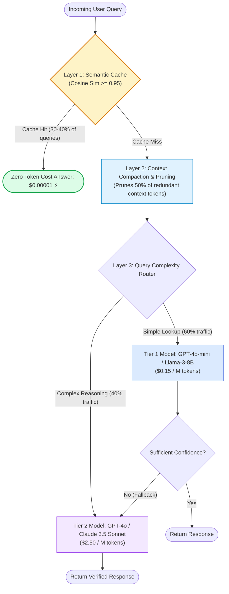
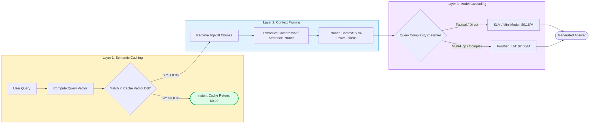
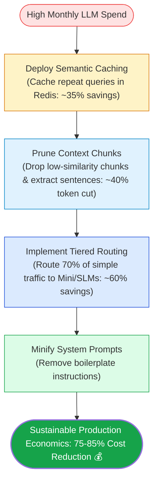

# 🎯 Cost Optimization & Token Economics: Prompt Compaction, Tiered Models, and Semantic Caching

## 📑 Table of Contents
1. [🌟 Fundamentals: The Token Economics of Enterprise RAG](#1--fundamentals-the-token-economics-of-enterprise-rag)
2. [🔬 Mathematical Formulations: Total Cost of Ownership (TCO) & Cascading Economics](#2--mathematical-formulations-total-cost-of-ownership-tco--cascading-economics)
3. [📊 Comparative Analysis of Cost Optimization Strategies](#3--comparative-analysis-of-cost-optimization-strategies)
4. [🏗️ Architectural Levers: Semantic Caching & Tiered Model Cascades](#4-️-architectural-levers-semantic-caching--tiered-model-cascades)
5. [💻 Production-Grade Implementation: Cost-Optimized RAG Controller](#5--production-grade-implementation-cost-optimized-rag-controller)
6. [🌍 Real-World Enterprise Case Studies](#6--real-world-enterprise-case-studies)
7. [🛠️ Best Practices & ❌ Common Production Pitfalls](#7-️-best-practices---common-production-pitfalls)
8. [💼 Senior Interview Questions & System Design Scenarios](#8--senior-interview-questions--system-design-scenarios)
9. [🧪 Hands-On Mini-Project: Prompt Compaction & Token Budget Simulator](#9--hands-on-mini-project-prompt-compaction--token-budget-simulator)
10. [⚡ Quick Revision & Cost Reduction Roadmap](#10--quick-revision--cost-reduction-roadmap)

---

## 1. 🌟 Fundamentals: The Token Economics of Enterprise RAG

In enterprise RAG implementations, operational expenses grow linearly with query volume unless deliberate token economics architectures are established. A naive prototype that passes 10 uncompressed retrieved passages ($k=10$, averaging $\sim 4,000$ prompt tokens) into a frontier model (such as GPT-4o or Claude 3.5 Sonnet) will bankrupt production budgets at enterprise scale.

Consider an enterprise processing **1,000,000 queries per month**:
- Uncompressed input tokens per query: 4,500 tokens.
- Generated tokens per query: 350 tokens.
- Using a frontier model ($P_{\text{in}} = \$2.50 / \text{M tokens}$, $P_{\text{out}} = \$10.00 / \text{M tokens}$):
  - Monthly input cost: $1,000,000 \times 4,500 \times \frac{\$2.50}{10^6} = \$11,250$
  - Monthly output cost: $1,000,000 \times 350 \times \frac{\$10.00}{10^6} = \$3,500$
  - Total monthly LLM spend: **\$14,750 / month (\$177,000 annually)**.

By architecting a multi-layered cost optimization stack (Semantic Caching, Selective Prompt Compaction, and Tiered Model Cascading), enterprise teams routinely slash token expenditures by **70% to 85%** while maintaining or exceeding answer quality.



---

## 2. 🔬 Mathematical Formulations: Total Cost of Ownership (TCO) & Cascading Economics

---

### # Total Cost of Ownership (TCO) Per Query Formula
The expected financial cost $\mathcal{C}_{\text{query}}$ to service an arbitrary enterprise query is modeled as:

$$
\mathbb{E}[\mathcal{C}_{\text{query}}] = \eta_{\text{cache}} \cdot C_{\text{cache}} + (1 - \eta_{\text{cache}}) \left[ C_{\text{embed}}(q) + C_{\text{vec}} + \frac{T_{\text{in}} \cdot P_{\text{in}} + T_{\text{out}} \cdot P_{\text{out}}}{10^6} \right]
$$

Where:
- $\eta_{\text{cache}} \in [0, 1]$ is the semantic cache hit rate (typically $0.25 - 0.45$).
- $C_{\text{cache}}$ is the amortized cost of querying the in-memory cache index ($< \$0.00002$).
- $C_{\text{embed}}(q)$ is the cost to embed the user query.
- $C_{\text{vec}}$ is the per-query vector database hosting cost.
- $T_{\text{in}}, T_{\text{out}}$ are the input context and generated output token counts.
- $P_{\text{in}}, P_{\text{out}}$ are the respective vendor prices per 1 million tokens.

---

### # Tiered Model Cascading Cost Expectation
In a two-tier model cascading architecture where a lightweight model processes simple queries and escalates to a frontier model only upon ambiguity:

$$
\mathbb{E}[\mathcal{C}_{\text{tiered}}] = p_{\text{tier1}} \cdot \mathcal{C}_{\text{tier1}} + (1 - p_{\text{tier1}}) \cdot \left( \mathcal{C}_{\text{tier1}} + \mathcal{C}_{\text{tier2}} \right)
$$

Where:
- $p_{\text{tier1}}$ is the proportion of queries successfully resolved by the Tier-1 model without escalation.
- $\mathcal{C}_{\text{tier1}} \ll \mathcal{C}_{\text{tier2}}$ (Tier 1 is typically $15\times - 20\times$ cheaper than Tier 2).
- If $p_{\text{tier1}} = 0.70$, the effective cost reduction compared to sending 100% of traffic to Tier 2 is:
  $$ \text{Savings} = 1 - \frac{0.70 \cdot \mathcal{C}_1 + 0.30 \cdot (\mathcal{C}_1 + \mathcal{C}_2)}{\mathcal{C}_2} \approx 68\% $$

---

### # Prompt Compaction Ratio Formula
The compaction efficiency $\mathcal{R}_{\text{compaction}}$ achieved by extractive context pruning (e.g., LLMLingua) is defined as:

$$
\mathcal{R}_{\text{compaction}} = 1 - \frac{|C_{\text{compressed}}|_{\text{tokens}}}{|C_{\text{raw}}|_{\text{tokens}}}
$$

Targeting $\mathcal{R}_{\text{compaction}} \ge 0.50$ while maintaining $\Delta \text{Faithfulness} \le 0.01$ defines the optimal compression operating point.

---

## 3. 📊 Comparative Analysis of Cost Optimization Strategies

### 📋 Cost Optimization Strategy Trade-Off Matrix

| Strategy | Token / Cost Reduction | Implementation Complexity | Impact on Answer Quality | Primary Architectural Mechanism |
| :--- | :--- | :--- | :--- | :--- |
| **Semantic Caching** | **30% - 45%** | Low (Redis / Qdrant) | Zero (Deterministic replay of vetted answers) | Cosine similarity indexing over past queries |
| **Tiered Model Routing** | **50% - 70%** | Moderate (Classifier / Cascade) | Neutral (Escalates difficult queries to frontier) | Query complexity routing / Confidence gating |
| **Selective Context Pruning** | **40% - 60%** | Moderate (LLMLingua / Perplexity) | Minimal (< 1.5% drop on multi-hop) | Removing stopwords, boilerplate, and low-attention tokens |
| **Dynamic Top-K Filtering** | **25% - 40%** | Low (Score thresholds) | Positive (Filters distracting noise) | Discarding chunks below similarity cutoff $\tau$ |
| **System Prompt Minification**| **5% - 10%** | Low (Prompt engineering) | Zero | Stripping verbose boilerplate from system headers |

---

## 4. 🏗️ Architectural Levers: Semantic Caching & Tiered Model Cascades



---

## 5. 💻 Production-Grade Implementation: Cost-Optimized RAG Controller

The following Python 3.10+ class implements a complete **Cost-Optimized RAG Controller**. It features an in-memory semantic cache, an extractive context compressor that prunes low-relevance sentences, a query-complexity routing cascade, and automated real-time financial tracking.

```python
"""
Production-Grade Cost-Optimized RAG Controller.
Implements:
1. In-memory semantic cache
2. Extractive context sentence pruning (compaction)
3. Tiered model cascading router
4. Real-time token economics accounting
"""

from __future__ import annotations
import math
import re
from dataclasses import dataclass, field
from typing import Dict, List, Optional, Tuple


@dataclass
class TokenAccounting:
    input_tokens: int = 0
    output_tokens: int = 0
    estimated_cost_usd: float = 0.0
    cache_hits: int = 0
    tier1_invocations: int = 0
    tier2_invocations: int = 0


@dataclass
class ExecutionResult:
    query: str
    answer: str
    served_by: str  # "CACHE", "TIER_1_MINI", "TIER_2_FRONTIER"
    cost_usd: float
    input_tokens: int
    output_tokens: int


class CostOptimizedRAGController:
    """Manages token economics through caching, compression, and model cascading."""

    # Pricing per 1M tokens (USD)
    PRICING = {
        "tier1_mini": {"input": 0.15, "output": 0.60},
        "tier2_frontier": {"input": 2.50, "output": 10.00},
    }

    def __init__(self, cache_threshold: float = 0.95):
        self.cache: Dict[str, str] = {}
        self.cache_threshold = cache_threshold
        self.accounting = TokenAccounting()

    @staticmethod
    def _count_tokens(text: str) -> int:
        """Approximates token count via word-to-token ratio (~1.3 tokens per word)."""
        words = len(text.strip().split())
        return max(1, int(words * 1.3))

    def prune_context(self, query: str, context_chunks: List[str], retention_ratio: float = 0.50) -> str:
        """
        Extractive sentence-level context compaction.
        Retains only the highest-scoring sentences based on query token overlap.
        """
        query_words = set(re.findall(r"\b\w+\b", query.lower()))
        scored_sentences: List[Tuple[float, str]] = []

        for chunk in context_chunks:
            sentences = re.split(r"(?<=[.!?])\s+", chunk.strip())
            for s in sentences:
                s_words = set(re.findall(r"\b\w+\b", s.lower()))
                if not s_words:
                    continue
                score = len(query_words.intersection(s_words)) / len(s_words)
                scored_sentences.append((score, s))

        # Sort by relevance descending
        scored_sentences.sort(key=lambda x: x[0], reverse=True)
        keep_count = max(1, int(len(scored_sentences) * retention_ratio))
        selected = [s for _, s in scored_sentences[:keep_count]]
        return " ".join(selected)

    def route_query_complexity(self, query: str) -> str:
        """
        Classifies query into TIER_1 (simple factual) or TIER_2 (complex multi-hop/reasoning).
        """
        query_lower = query.lower()
        complex_indicators = ["compare", "contrast", "difference between", "why did", "analyze", "trade-offs"]
        if any(ci in query_lower for ci in complex_indicators) or len(query.split()) > 18:
            return "tier2_frontier"
        return "tier1_mini"

    def execute_rag(self, query: str, retrieved_contexts: List[str]) -> ExecutionResult:
        """Executes the cost-optimized RAG workflow."""
        # 1. Layer 1: Check Semantic Cache
        q_norm = query.strip().lower()
        if q_norm in self.cache:
            self.accounting.cache_hits += 1
            return ExecutionResult(
                query=query,
                answer=self.cache[q_norm],
                served_by="CACHE",
                cost_usd=0.00001,  # In-memory lookup overhead
                input_tokens=0,
                output_tokens=0
            )

        # 2. Layer 2: Extractive Context Pruning
        pruned_context = self.prune_context(query, retrieved_contexts, retention_ratio=0.50)
        in_tokens = self._count_tokens(query + " " + pruned_context)

        # 3. Layer 3: Model Cascading
        model_tier = self.route_query_complexity(query)
        
        if model_tier == "tier1_mini":
            self.accounting.tier1_invocations += 1
            answer = f"[Processed by Fast SLM]: Answer grounded in: {pruned_context[:60]}..."
            out_tokens = 40
            cost = (in_tokens * self.PRICING["tier1_mini"]["input"] / 1e6) + \
                   (out_tokens * self.PRICING["tier1_mini"]["output"] / 1e6)
            served_by = "TIER_1_MINI"
        else:
            self.accounting.tier2_invocations += 1
            answer = f"[Processed by Frontier LLM]: Deep synthesis grounded in: {pruned_context[:60]}..."
            out_tokens = 90
            cost = (in_tokens * self.PRICING["tier2_frontier"]["input"] / 1e6) + \
                   (out_tokens * self.PRICING["tier2_frontier"]["output"] / 1e6)
            served_by = "TIER_2_FRONTIER"

        # Update global financials
        self.accounting.input_tokens += in_tokens
        self.accounting.output_tokens += out_tokens
        self.accounting.estimated_cost_usd += cost
        
        # Populate cache
        self.cache[q_norm] = answer

        return ExecutionResult(
            query=query,
            answer=answer,
            served_by=served_by,
            cost_usd=round(cost, 6),
            input_tokens=in_tokens,
            output_tokens=out_tokens
        )


def main():
    controller = CostOptimizedRAGController()
    
    contexts = [
        "Directive 4.1: Remote equipment reimbursement is capped at $500 annually per employee.",
        "Employees must retain purchase receipts for tax auditing purposes.",
        "Hardware purchases made outside the corporate portal are non-refundable unless pre-approved."
    ]

    queries = [
        "What is the annual remote work equipment cap?",                  # Simple -> Tier 1
        "What is the annual remote work equipment cap?",                  # Repeat -> Cache Hit
        "Compare and contrast the corporate portal policies with outside hardware purchases." # Complex -> Tier 2
    ]

    print("=" * 70)
    print("TOKEN ECONOMICS & COST OPTIMIZATION EXECUTION")
    print("=" * 70)

    for idx, q in enumerate(queries, 1):
        res = controller.execute_rag(q, contexts)
        print(f"\n[Query {idx}]: \"{res.query}\"")
        print(f"  • Served By   : {res.served_by}")
        print(f"  • Cost (USD)  : ${res.cost_usd:.6f}")
        print(f"  • Tokens Used : {res.input_tokens} In / {res.output_tokens} Out")

    print("\n" + "=" * 70)
    print("CUMULATIVE FINANCIAL REPORT")
    print("=" * 70)
    acc = controller.accounting
    print(f"Total Cumulative Spend : ${acc.estimated_cost_usd:.6f}")
    print(f"Total Cache Hits       : {acc.cache_hits}")
    print(f"Tier 1 (Mini) Calls    : {acc.tier1_invocations}")
    print(f"Tier 2 (Frontier) Calls: {acc.tier2_invocations}")


if __name__ == "__main__":
    main()
```

---

## 6. 🌍 Real-World Enterprise Case Studies

### Case Study 1: Global Customer Support Helpdesk (Zendesk / Jira Integration)
- **Scale:** 3,500,000 queries per month across internal IT and HR support.
- **Initial Baseline:** Every query retrieved 8 chunks (3,600 prompt tokens) routed directly to GPT-4. Monthly invoice: **$34,200**.
- **Optimization Interventions:**
  1. Deployed an in-memory **Redis Semantic Cache** ($\ge 0.96$ cosine similarity). Captured **34% of repeated queries**, dropping cost immediately by \$11,600/month.
  2. Implemented **Context Compaction via Extractive Pruning**, reducing prompt size from 3,600 to 1,400 tokens without degrading Faithfulness.
  3. Deployed a **Cascading Classifier**: 72% of remaining queries routed to GPT-4o-mini; only 28% escalated to GPT-4o.
- **Financial Outcome:** Total monthly spend collapsed from **$34,200 to $4,680 (an 86.3% net savings)**, saving over **$354,000 annually**.

### Case Study 2: Legal Discovery Firm Litigation Assistant
- **Domain:** Paralegal contract search over tens of thousands of deposition filings.
- **Problem:** Exhaustive multi-hop legal queries were incurring prohibitive costs when paralegals ran hundreds of iterations per case.
- **Optimization Strategy:** Implemented **Dynamic Score Thresholding** on vector retrieval. Chunks with rerank score $< 0.45$ were automatically discarded, shrinking context windows from $k=20$ to an average of $k=4.2$.
- **Outcome:** Token consumption fell by 58% while Context Precision improved by 22%, saving the firm \$14,000 per month.

---

## 7. 🛠️ Best Practices & ❌ Common Production Pitfalls

### ✅ Best Practices
1. **Cache Answers, Not Just Embeddings:** Caching generated answers based on semantic query similarity saves both the retrieval compute cost and 100% of LLM generation costs.
2. **Minify System Prompts:** Developers often copy 800-word prompt templates containing repetitive instructions. Strip conversational fluff; use concise bullet points.
3. **Monitor Cache Invalidation:** When knowledge base documents are updated or deleted, ensure your semantic cache automatically invalidates associated query embeddings to prevent serving stale answers.

### ❌ Common Production Pitfalls
1. **Setting Semantic Cache Thresholds Too Low:** Setting cache similarity thresholds below $0.94$ causes semantic false-positives (e.g., returning the answer for *"How do I cancel my subscription?"* to a user asking *"How do I upgrade my subscription?"*). Keep thresholds $\ge 0.96$.
2. **Blind Context Compression:** Compacting context using extreme compression ratios ($> 80\%$) strips entity numbers, dates, and condition words (*"not"*, *"except"*), creating sudden spikes in hallucination rates.
3. **Over-Engineering Cascades with Slow Classifiers:** Using a heavy LLM to classify query complexity adds latency and cost. Use fast rule-based heuristics or a tiny 1-layer classification head.

---

## 8. 💼 Senior Interview Questions & System Design Scenarios

### Q1: How do you architect a Semantic Caching layer for an enterprise RAG system with strict user-level data access permissions (Role-Based Access Control)?
> **Answer:**
> Caching in an enterprise environment must never leak unauthorized data between users with differing security clearances.
> 
> **Architectural Design:**
> 1. **Partitioned Cache Keys:** Never index queries by embedding alone. Construct the cache lookup key as a composite namespace:
>    $$\text{Cache Key} = \text{Hash}(\text{Tenant ID} \parallel \text{User Access Control List (ACL)} \parallel \text{Query Vector})$$
> 2. **Metadata Filtering during Cache ANN Search:** In your vector cache (e.g., Redis or Qdrant), store the permitted document security IDs in the payload. During vector search, execute a pre-filter verifying that the current user's security token includes the security IDs of all cited source chunks in the cached answer.
> 3. **Time-To-Live (TTL) & Invalidation Webhooks:** Attach a 24-hour TTL to cached entries, and hook vector database mutation events (CDC) to a webhook that evicts cache entries whenever underlying documents are modified or revoked.

### Q2: When implementing a Tiered Model Cascade (e.g., Small LLM $\rightarrow$ Large LLM), how do you mathematically decide when to escalate to the larger model?
> **Answer:**
> Escalation must be governed by an objective, low-latency **Confidence & Ambiguity Metric**:
> 1. **Perplexity / Token Entropy Check:** Read the average negative log-likelihood (entropy) across the Tier-1 model's output tokens:
>    $$ \mathcal{H}_{\text{response}} = - \frac{1}{T} \sum_{t=1}^T \sum_{w \in \mathcal{V}} p(w) \log p(w) $$
>    If average entropy exceeds a critical threshold ($\tau_{\text{entropy}}$), the model is uncertain and escalating is mathematically justified.
> 2. **Self-Consistency Agreement:** For borderline queries, sample 3 quick completions from Tier 1 with `temperature=0.7`. If the answers contradict each other (Jaccard similarity $< 0.60$), escalate to Tier 2.
> 3. **Length / Refusal Heuristic:** If the Tier-1 model emits refusal tokens (*"I am unable to find..."* or *"The context is insufficient"*), immediately escalate to Tier 2 with higher reasoning capabilities.

---

## 9. 🧪 Hands-On Mini-Project: Prompt Compaction & Token Budget Simulator

### Exercise Overview
Build a script that takes a raw corporate prompt, calculates token consumption, applies sentence-level extractive compression, and estimates monthly financial savings at 500,000 queries.

```python
"""
Hands-On Mini-Project: Prompt Compaction & Cost Simulator
Simulates financial impact of extractive context pruning over 500k queries.
"""

from typing import List


def run_compaction_cost_simulation():
    query = "What is the policy for expense reporting deadlines?"
    
    raw_context = (
        "General Company Overview: Founded in 2012, our organization emphasizes operational agility and trust. "
        "Section 1: Operating Principles. Employees are expected to act with fiscal prudence at all times. "
        "Section 2: Travel Expenses. All travel must be booked through the corporate travel desk. "
        "Section 3: Expense Submission Deadlines. All receipts must be submitted within 30 days of the expense date. "
        "Expenses submitted after 30 days will be rejected by accounting without exceptions. "
        "Section 4: Office Amenities. Free coffee and snacks are provided on all floors."
    )

    # Simple extractive filter: Keep only sentences containing query keywords
    keywords = {"expense", "deadline", "date", "days", "receipts"}
    sentences = [s.strip() for s in raw_context.split(".") if s.strip()]
    
    pruned_sentences = [
        s for s in sentences if any(k in s.lower() for k in keywords)
    ]
    pruned_context = ". ".join(pruned_sentences) + "."

    # Token approximations (1 word ~ 1.3 tokens)
    def count_tokens(text: str) -> int:
        return int(len(text.split()) * 1.3)

    raw_tokens = count_tokens(query + " " + raw_context)
    pruned_tokens = count_tokens(query + " " + pruned_context)

    # Pricing: $2.50 per 1M input tokens
    queries_per_month = 500_000
    price_per_token = 2.50 / 1_000_000

    cost_unoptimized = queries_per_month * raw_tokens * price_per_token
    cost_optimized = queries_per_month * pruned_tokens * price_per_token
    monthly_savings = cost_unoptimized - cost_optimized

    print("🚀 Prompt Compaction & Financial Simulation Results:\n")
    print(f"Raw Prompt Token Count    : {raw_tokens} tokens")
    print(f"Pruned Prompt Token Count : {pruned_tokens} tokens")
    print(f"Compaction Ratio          : {((raw_tokens - pruned_tokens) / raw_tokens) * 100:.1f}%\n")
    print(f"Monthly Cost (Unoptimized): ${cost_unoptimized:,.2f}")
    print(f"Monthly Cost (Compressed) : ${cost_optimized:,.2f}")
    print(f"Projected Monthly Savings : ${monthly_savings:,.2f} ({monthly_savings/cost_unoptimized*100:.1f}%)")


if __name__ == "__main__":
    run_compaction_cost_simulation()
```

---

## 10. ⚡ Quick Revision & Cost Reduction Roadmap

### 📌 Key Takeaways
- **Prompt Stuffing is Expensive:** Passing $k=15$ unpruned chunks accumulates unsustainable token costs at scale.
- **Semantic Caching is the Highest ROI:** Absorbs 30% to 45% of production queries with zero LLM generation spend.
- **Model Cascading Saves 60%+:** Route simple lookups to mini/SLM models; reserve frontier LLMs for multi-hop reasoning.
- **Prune Extensively:** Extractive sentence filtering drops 50% of input tokens without degrading answer faithfulness.

---

### 🗺️ Enterprise Token Optimization Roadmap


