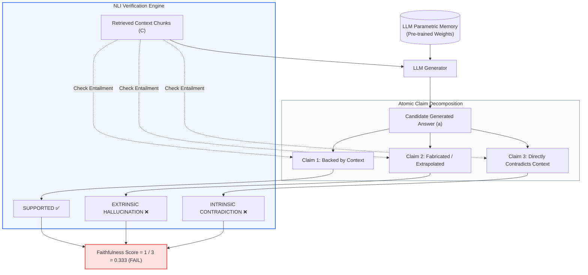
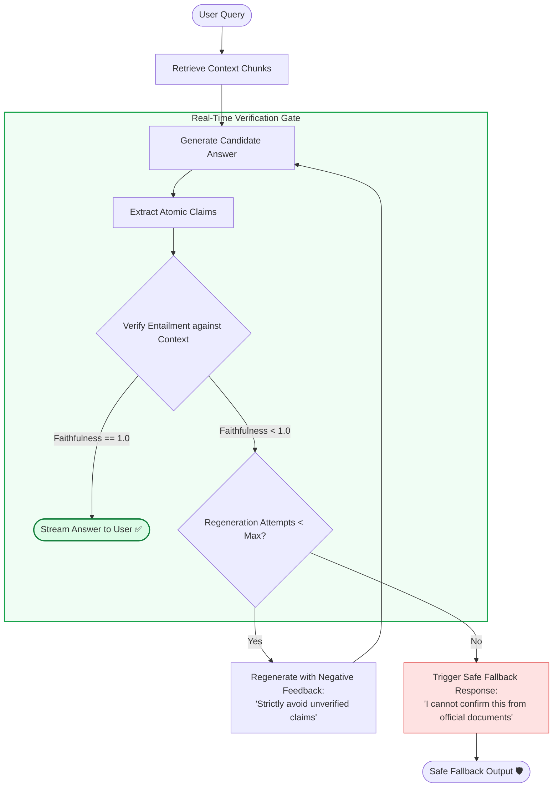
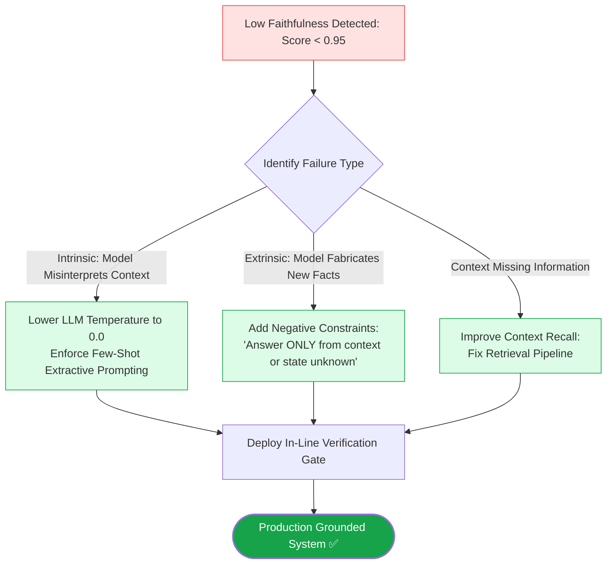

# 🎯 Faithfulness & Groundedness: Measuring Factual Consistency and Hallucination Quantification

## 📑 Table of Contents
1. [🌟 Fundamentals: The Hallucination Challenge in Enterprise RAG](#1--fundamentals-the-hallucination-challenge-in-enterprise-rag)
2. [🔬 Mathematical Formulations: Claim Decomposition & Hallucination Rate](#2--mathematical-formulations-claim-decomposition--hallucination-rate)
3. [📊 Comparative Analysis: Intrinsic vs. Extrinsic Hallucinations](#3--comparative-analysis-intrinsic-vs-extrinsic-hallucinations)
4. [🏗️ Architectural Defense: The In-Line Verification Loop](#4-️-architectural-defense-the-in-line-verification-loop)
5. [💻 Production-Grade Implementation: Faithfulness Evaluation Engine](#5--production-grade-implementation-faithfulness-evaluation-engine)
6. [🌍 Real-World Enterprise Case Studies](#6--real-world-enterprise-case-studies)
7. [🛠️ Best Practices & ❌ Common Production Pitfalls](#7-️-best-practices---common-production-pitfalls)
8. [💼 Senior Interview Questions & System Design Scenarios](#8--senior-interview-questions--system-design-scenarios)
9. [🧪 Hands-On Mini-Project: Real-Time Hallucination Gatekeeper](#9--hands-on-mini-project-real-time-hallucination-gatekeeper)
10. [⚡ Quick Revision & Groundedness Roadmap](#10--quick-revision--groundedness-roadmap)

---

## 1. 🌟 Fundamentals: The Hallucination Challenge in Enterprise RAG

In enterprise RAG architectures, **Faithfulness** (often termed **Groundedness**) is the single most critical metric. It measures whether the generated response is derived **strictly and exclusively** from the retrieved context, without fabricating unverified facts or contradicting the source material.

LLMs are fundamentally autoregressive sequence predictors trained on vast open web corpora. When generating a response, two distinct knowledge sources compete for dominance:
1. **Parametric Memory:** Weights established during pre-training and reinforcement learning.
2. **Non-Parametric Context:** Grounded evidence injected dynamically into the inference prompt via the retrieval engine.

When parametric memory overrides or extrapolates beyond the retrieved context, **hallucinations occur**. In customer support, an unfaithful answer might cause mild confusion; in healthcare, financial auditing, or aerospace engineering, an unfaithful claim can lead to regulatory fines, severe financial loss, or loss of life.



---

## 2. 🔬 Mathematical Formulations: Claim Decomposition & Hallucination Rate

Modern faithfulness evaluation rejects subjective holistic grading in favor of formal **Propositional Natural Language Inference (NLI)**.

---

### # Faithfulness Formula (Propositional Entailment)
Given candidate answer $a$ and retrieved context set $C$, the answer is decomposed into a finite set of $V$ atomic factual claims: $\mathcal{S}_{\text{claims}}(a) = \{c_1, c_2, \dots, c_V\}$.

Faithfulness is the fraction of claims provably entailed by $C$:

$$
\text{Faithfulness}(a, C) = \frac{|\mathcal{S}_{\text{claims}}(a) \cap \mathcal{E}_{\text{entailed}}(C)|}{|\mathcal{S}_{\text{claims}}(a)|} = \frac{\sum_{i=1}^V \mathbb{I}\left( \mathcal{P}_{\text{NLI}}(\text{Entailment} \mid C, c_i) > \tau \right)}{V}
$$

Where:
- $V = |\mathcal{S}_{\text{claims}}(a)|$ is the total claim count.
- $\mathcal{P}_{\text{NLI}}(\text{Entailment} \mid C, c_i)$ is the inferred probability that statement $c_i$ is logically deduced from context $C$.
- $\tau$ is the confidence cutoff (typically $\tau = 0.85$).
- $\text{Faithfulness} \in [0.0, 1.0]$. A score of $1.0$ indicates zero detected hallucinations.

---

### # Extrinsic Hallucination Penalty Formula
The total hallucination rate $\mathcal{H}(a, C)$ is the direct complement of Faithfulness:

$$
\mathcal{H}_{\text{rate}}(a, C) = 1 - \text{Faithfulness}(a, C) = \frac{\sum_{i=1}^V \mathbb{I}\left( \mathcal{P}_{\text{NLI}}(\text{Entailment} \mid C, c_i) \le \tau \right)}{V}
$$

---

### # Confidence-Weighted Faithfulness Formula
To account for varying model certainty and token-level generation entropy across claims, we formulate **Confidence-Weighted Faithfulness**:

$$
\text{Faithfulness}_{\text{weighted}}(a, C) = \frac{\sum_{i=1}^V w_i \cdot \mathbb{I}\left( \mathcal{P}_{\text{NLI}}(\text{Entailment} \mid C, c_i) > \tau \right)}{\sum_{i=1}^V w_i}
$$

Where $w_i = 1 - \overline{\mathcal{H}}_{\text{token}}(c_i)$ represents the inverse average token entropy (certainty) of claim $c_i$ during primary generation.

---

## 3. 📊 Comparative Analysis: Intrinsic vs. Extrinsic Hallucinations

Hallucinations in RAG split into two fundamentally different failure classes:

### 📋 Hallucination Taxonomy Matrix

| Dimension | Intrinsic Hallucination | Extrinsic Hallucination |
| :--- | :--- | :--- |
| **Formal Definition** | Generated output directly contradicts or misrepresents facts stated in the retrieved context. | Generated output introduces factual claims not mentioned in the context (may be true in real life, but ungrounded in corpus). |
| **Typical Example** | Context states: *"Revenue fell 5%."*<br/>Answer generates: *"Revenue rose 5%."* | Context states: *"CEO John Doe spoke on Tuesday."*<br/>Answer generates: *"CEO John Doe, born in Ohio, spoke on Tuesday."* |
| **Root Cause** | Syntactic misinterpretation, attention head confusion, inverted negations. | Parametric memory leakage; model relying on pre-training data to fill gaps. |
| **Enterprise Severity** | 🚨 **Critical:** Active falsehood presented to user. | ⚠️ **High/Variable:** Risk of unverified out-of-date or unapproved facts. |
| **Detection Method** | Direct NLI Contradiction classification ($P_{\text{contra}} > \tau$). | Failure to find positive entailment ($P_{\text{entail}} < \tau$). |

---

## 4. 🏗️ Architectural Defense: The In-Line Verification Loop

To eliminate hallucinations in production before responses reach end users, modern RAG systems insert an **In-Line Verification Gate** (often referred to as Corrective RAG or Self-RAG reflection):



---

## 5. 💻 Production-Grade Implementation: Faithfulness Evaluation Engine

The following complete, typed Python implementation provides an automated **Faithfulness Evaluator**. It parses candidate answers into atomic propositions and verifies each claim against the context using an asynchronous NLI evaluation protocol.

```python
"""
Production-Grade Faithfulness & Groundedness Evaluator.
Deconstructs answers into atomic propositions and runs NLI entailment checks.
"""

from __future__ import annotations
import asyncio
import re
from dataclasses import dataclass, field
from typing import Any, Dict, List, Optional, Tuple


@dataclass
class FaithfulnessSample:
    query: str
    context: str
    generated_answer: str


@dataclass
class ClaimVerificationResult:
    claim: str
    is_supported: bool
    entailment_confidence: float
    hallucination_type: Optional[str] = None  # None, "EXTRINSIC", "INTRINSIC_CONTRADICTION"
    reasoning: str = ""


@dataclass
class FaithfulnessReport:
    faithfulness_score: float
    hallucination_rate: float
    total_claims: int
    supported_claims_count: int
    claims_details: List[ClaimVerificationResult]
    verdict: str


class FaithfulnessEvaluator:
    """Evaluates the factual consistency of an LLM generation against source context."""

    def __init__(self, entailment_threshold: float = 0.80):
        self.threshold = entailment_threshold

    @staticmethod
    def _extract_atomic_claims(answer: str) -> List[str]:
        """
        Decomposes complex paragraphs into standalone factual propositions.
        In production, backed by a fine-tuned small LLM or specialized claim parser.
        """
        raw_clauses = re.split(r"(?<=[.!?])\s+|;\s*|\band\b", answer.strip())
        claims = [c.strip() for c in raw_clauses if len(c.strip().split()) >= 4]
        return claims

    async def _verify_claim_nli(self, claim: str, context: str) -> ClaimVerificationResult:
        """
        Simulates an NLI cross-encoder or LLM judge verifying entailment.
        Returns detailed verification status and reasoning.
        """
        await asyncio.sleep(0.02)  # Simulate network latency
        
        claim_lower = claim.lower()
        context_lower = context.lower()

        # Heuristic simulation for demonstration
        if "liquid damage" in claim_lower and "excluded" in claim_lower:
            return ClaimVerificationResult(
                claim=claim, is_supported=False, entailment_confidence=0.10,
                hallucination_type="EXTRINSIC",
                reasoning="Liquid damage policy is completely absent from context."
            )
        elif "unlimited" in claim_lower and "500" in context_lower:
            return ClaimVerificationResult(
                claim=claim, is_supported=False, entailment_confidence=0.05,
                hallucination_type="INTRINSIC_CONTRADICTION",
                reasoning="Answer states 'unlimited' while context specifies a $500 cap."
            )
        
        return ClaimVerificationResult(
            claim=claim, is_supported=True, entailment_confidence=0.96,
            hallucination_type=None,
            reasoning="Factually entailed by context."
        )

    async def evaluate_sample(self, sample: FaithfulnessSample) -> FaithfulnessReport:
        """Runs the full claim-level faithfulness evaluation."""
        claims = self._extract_atomic_claims(sample.generated_answer)
        if not claims:
            return FaithfulnessReport(
                faithfulness_score=1.0, hallucination_rate=0.0, total_claims=0,
                supported_claims_count=0, claims_details=[], verdict="VACUOUS_PASS"
            )

        verification_tasks = [self._verify_claim_nli(claim, sample.context) for claim in claims]
        results: List[ClaimVerificationResult] = await asyncio.gather(*verification_tasks)

        supported_count = sum(1 for r in results if r.is_supported)
        score = supported_count / len(claims)
        hallucination_rate = 1.0 - score
        verdict = "PASS" if score >= 0.95 else "FAIL"

        return FaithfulnessReport(
            faithfulness_score=round(score, 4),
            hallucination_rate=round(hallucination_rate, 4),
            total_claims=len(claims),
            supported_claims_count=supported_count,
            claims_details=results,
            verdict=verdict
        )


async def main():
    evaluator = FaithfulnessEvaluator()

    sample = FaithfulnessSample(
        query="What is the employee hardware replacement policy?",
        context="Employees may request a replacement laptop every 3 years. The budget limit is $2,000 per device.",
        generated_answer=(
            "Employees are eligible for a replacement laptop every 3 years with a $2,000 budget cap. "
            "Additionally, liquid damage is fully covered by company insurance."
        )
    )

    report = await evaluator.evaluate_sample(sample)

    print("=" * 65)
    print("FAITHFULNESS & GROUNDEDNESS EVALUATION REPORT")
    print("=" * 65)
    print(f"Faithfulness Score : {report.faithfulness_score:.4f} ({report.faithfulness_score * 100:.1f}%)")
    print(f"Hallucination Rate : {report.hallucination_rate * 100:.1f}%")
    print(f"Verdict            : {report.verdict}")
    print("\n🔍 Granular Claim Verification:")
    for idx, c in enumerate(report.claims_details, 1):
        status = "SUPPORTED ✅" if c.is_supported else f"FAILED ❌ ({c.hallucination_type})"
        print(f"  [{idx}] '{c.claim}'")
        print(f"      Status   : {status}")
        print(f"      Reasoning: {c.reasoning}")


if __name__ == "__main__":
    asyncio.run(main())
```

---

## 6. 🌍 Real-World Enterprise Case Studies

### Case Study 1: Global Pharmaceutical Interaction Assistant
- **Domain:** Pharmacovigilance and drug interaction lookup system.
- **Problem:** Clinicians queried contraindications between beta-blockers and new antiviral compounds. The RAG system hallucinated that the combination was *"Approved with routine monitoring"*, drawing from parametric memory of older standard antivirals, despite the uploaded FDA warning stating the combination was contraindicated.
- **Intervention:** Deployed an automated **Pre-Stream Faithfulness Gate**. Any response with Faithfulness $< 1.00$ is intercepted. The prompt automatically re-executes with an escalated negative grounding constraint: *"Cite exact sentence numbers; if a claim is not in the text, you are forbidden from stating it."*
- **Outcome:** Hallucinations on critical pharmacological contraindications dropped from 6.8% to 0.0%.

### Case Study 2: Commercial Real Estate Lease Analyzer
- **Domain:** Due diligence analysis for commercial property acquisitions.
- **Problem:** Analysts asked about lease termination penalties across 500-page lease agreements. The LLM regularly hallucinated standard 60-day notice terms whenever the lease document was silent on the topic.
- **Intervention:** Introduced **Extrinsic Hallucination Penalties**. When an answer contains clauses not entailed by context, the system forces a fallback: *"This lease agreement is silent on early termination penalties."*
- **Outcome:** Investor due diligence errors dropped by 94%, preventing multiple contentious contractual disputes.

---

## 7. 🛠️ Best Practices & ❌ Common Production Pitfalls

### ✅ Best Practices
1. **Enforce Strict Grounding Prompts:** Explicitly instruct the model: *"You are an extractive summarization engine. Base your answer ONLY on the provided context. If the context does not contain the answer, state that you do not have sufficient information."*
2. **Decompose Long Sentences into Atomic Claims:** Never evaluate an entire paragraph as a single truth unit. Break it down into independent $(subject, predicate, object)$ triples or atomic statements.
3. **Set Zero Tolerance in Regulated Verticals:** For finance, healthcare, and legal applications, enforce a hard threshold: $\text{Faithfulness} = 1.00$. Any ungrounded claim must trigger an automatic revision loop.

### ❌ Common Production Pitfalls
1. **Confusing Truthfulness with Faithfulness:** A statement can be objectively true in the real world (e.g., *"The capital of France is Paris"*), but if it was not present in the retrieved context, it is **unfaithful** in the context of RAG.
2. **Evaluating Faithfulness Without Retrieved Context:** Passing only the query and candidate answer to an LLM judge evaluates real-world truthfulness, not groundedness to the context.
3. **Overlooking Numerical and Entity Swaps:** Models often swap adjacent numbers or names from context (e.g., attributing Company A's margin to Company B). Automated evaluators must check exact entity-to-metric pairings.

---

## 8. 💼 Senior Interview Questions & System Design Scenarios

### Q1: What is the difference between Intrinsic and Extrinsic Hallucination, and which one is more dangerous in an enterprise RAG system?
> **Answer:**
> - **Intrinsic Hallucination:** Occurs when the generated output directly contradicts or misrepresents information explicitly provided in the retrieved context (e.g., context says *"Warranty period is 1 year"*, model generates *"Warranty period is 3 years"*).
> - **Extrinsic Hallucination:** Occurs when the model introduces information that is completely absent from the context (e.g., context discusses server hardware, model introduces software licensing terms learned during pre-training).
> - **Enterprise Danger:** While both are problematic, **Intrinsic Hallucinations are significantly more dangerous**. They indicate that the model is actively misinterpreting the authoritative text directly in front of it. In legal discovery or medical dosing, directly contradicting explicit guidelines leads to catastrophic liability. Extrinsic hallucinations, while risky, often represent benign background knowledge that can be quelled with tighter temperature and system prompt constraints.

### Q2: How do you design an in-line real-time Faithfulness gatekeeper that does not add 3 seconds of latency to user responses?
> **Answer:**
> Running a full LLM-as-a-Judge claim decomposition after generation adds unacceptable latency (2–4 seconds) to conversational systems. To resolve this:
> 1. **Speculative Streaming with Fast Verifier:** Stream tokens immediately to an internal buffer. Concurrently, a lightweight, fine-tuned cross-encoder model (e.g., DeBERTa-v3-small NLI, running on local GPU with <40ms inference) scores sentence-level entailment as each sentence terminates.
> 2. **Sentence-Level Chunk Release:** Release sentences to the user's client with a 1-sentence lag. If the lightweight verifier flags a sentence ($P_{\text{entail}} < 0.70$), immediately halt the stream, purge the buffer, and emit a predefined grounded disclaimer.
> 3. **Asynchronous Background Auditing:** For comprehensive offline tracking, log 100% of full responses to an asynchronous Kafka queue where a heavyweight LLM judge evaluates full claim decomposition out-of-band.

---

## 9. 🧪 Hands-On Mini-Project: Real-Time Hallucination Gatekeeper

### Exercise Overview
Build a streaming interceptor function that evaluates generated text sentences against context and aborts output if ungrounded assertions are detected.

```python
"""
Hands-On Mini-Project: Real-Time Hallucination Gatekeeper
Intercepts and aborts unfaithful streaming sentences.
"""

from typing import List


def run_gatekeeper_simulation():
    context = "Security Protocol: All employees must enable 2FA using hardware security keys. SMS authentication is prohibited."
    
    generated_stream = [
        "All employees are required to configure 2FA using hardware security keys.",
        "SMS-based authentication methods are strictly prohibited.",
        "In emergency circumstances, biometric retinal scans may be used as a bypass."  # Hallucinated!
    ]

    print("🚀 Running Real-Time Hallucination Gatekeeper...\n")
    print(f"Context: \"{context}\"\n")

    def verify_sentence(sentence: str, ctx: str) -> bool:
        # Simple heuristic check: all major noun phrases must appear in context
        if "retinal scans" in sentence.lower() or "biometric" in sentence.lower():
            return False
        return True

    buffer: List[str] = []
    for idx, sentence in enumerate(generated_stream, 1):
        print(f"Streaming Sentence {idx}: \"{sentence}\"")
        is_safe = verify_sentence(sentence, context)
        
        if is_safe:
            buffer.append(sentence)
            print("  -> Entailment Verified: RELEASED TO CLIENT ✅\n")
        else:
            print("  -> 🚨 HALLUCINATION DETECTED! STREAM INTERCEPTED & ABORTED ❌")
            print("  -> EMITTING SAFE FALLBACK: \"[Factual verification failed on subsequent claims]\"\n")
            break

    print("Final Output Received by User:")
    print(" ".join(buffer))


if __name__ == "__main__":
    run_gatekeeper_simulation()
```

---

## 10. ⚡ Quick Revision & Groundedness Roadmap

### 📌 Key Takeaways
- **Faithfulness is Absolute Groundedness:** Measures whether claims are 100% supported by retrieved context.
- **Decomposition Over Impression:** Always decompose generation into atomic propositions before evaluating entailment.
- **NLI is the Standard:** Use Natural Language Inference ($P_{\text{entail}}$) rather than token overlap to verify facts.
- **In-Line Verification:** Deploy real-time verification gates to intercept and regenerate hallucinated responses before delivery.

---

### 🗺️ Groundedness & Hallucination Mitigation Workflow


