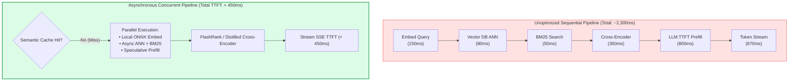
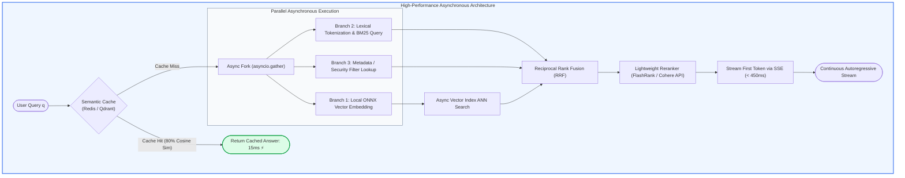
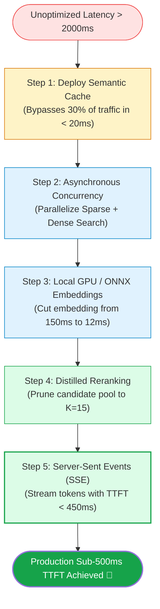

# 🎯 Latency Optimization in RAG: Asynchronous Pipelines, Speculative Execution, and Sub-500ms TTFT

## 📑 Table of Contents
1. [🌟 Fundamentals: The Anatomy of RAG Latency](#1--fundamentals-the-anatomy-of-rag-latency)
2. [🔬 Mathematical Formulations: Latency Decomposition & Amdahl's Law](#2--mathematical-formulations-latency-decomposition--amdahls-law)
3. [📊 Comparative Analysis of Optimization Strategies](#3--comparative-analysis-of-optimization-strategies)
4. [🏗️ Architectural Architecture: Synchronous Bottlenecks vs. Asynchronous Concurrency](#4-️-architectural-architecture-synchronous-bottlenecks-vs-asynchronous-concurrency)
5. [💻 Production-Grade Implementation: High-Throughput Async Pipeline](#5--production-grade-implementation-high-throughput-async-pipeline)
6. [🌍 Real-World Enterprise Case Studies](#6--real-world-enterprise-case-studies)
7. [🛠️ Best Practices & ❌ Common Production Pitfalls](#7-️-best-practices---common-production-pitfalls)
8. [💼 Senior Interview Questions & System Design Scenarios](#8--senior-interview-questions--system-design-scenarios)
9. [🧪 Hands-On Mini-Project: End-to-End Latency Profiler & Tracer](#9--hands-on-mini-project-end-to-end-latency-profiler--tracer)
10. [⚡ Quick Revision & Sub-500ms Optimization Roadmap](#10--quick-revision--sub-500ms-optimization-roadmap)

---

## 1. 🌟 Fundamentals: The Anatomy of RAG Latency

In modern conversational and enterprise RAG systems, **latency directly dictates user adoption**. Studies demonstrate that every 100ms of additional delay degrades user engagement and task completion rates. In high-stakes applications (e.g., customer support call centers, financial trading desks, clinical emergency assistance), achieving a **Sub-500ms Time-To-First-Token (TTFT)** is an absolute production prerequisite.

A naive RAG pipeline executes sequentially, accumulating delays at each stage:
1. **Query Embedding:** Calling an external embedding API over HTTPS ($80 - 200\text{ms}$).
2. **Vector Index Traversal:** Querying a remote vector database ($30 - 100\text{ms}$).
3. **Lexical / BM25 Search:** Querying an inverted index ($20 - 60\text{ms}$).
4. **Neural Reranking:** Running a heavy Cross-Encoder over $k=25$ passages ($150 - 400\text{ms}$).
5. **Prompt Assembly & Serialization:** String formatting and token encoding ($10 - 30\text{ms}$).
6. **LLM Time-To-First-Token (TTFT):** Network transit and initial prompt prefill ($300 - 1200\text{ms}$).
7. **Autoregressive Token Generation (ITL):** Inter-Token Latency streaming ($20 - 50\text{ms per token}$).

Unoptimized, sequential RAG architectures commonly display end-to-end latencies exceeding **2,500ms to 4,000ms**, causing visible lag and high user bounce rates.



---

## 2. 🔬 Mathematical Formulations: Latency Decomposition & Amdahl's Law

Rigorous latency optimization requires decomposing total duration into deterministic and autoregressive components.

---

### # End-to-End RAG Latency Decomposition Formula
Total wall-clock response time $T_{\text{total}}$ for generating $L$ tokens is expressed as:

$$
T_{\text{total}} = T_{\text{cache}} + \left(1 - \mathbb{I}_{\text{hit}}\right) \left[ T_{\text{embed}}(q) + \max\left(T_{\text{vec}}(k), T_{\text{lex}}(k)\right) + T_{\text{rerank}}(k') \right] + T_{\text{TTFT}} + \sum_{i=1}^L T_{\text{ITL}}(i)
$$

Where:
- $\mathbb{I}_{\text{hit}} \in \{0, 1\}$ indicates a semantic cache hit ($T_{\text{total}} = T_{\text{cache}} \approx 15\text{ms}$).
- $T_{\text{embed}}(q)$ is the query vectorization latency.
- $\max\left(T_{\text{vec}}, T_{\text{lex}}\right)$ represents parallel asynchronous retrieval across vector and keyword engines.
- $T_{\text{rerank}}(k')$ is the reranking latency over candidate pool $k'$.
- $T_{\text{TTFT}}$ is the model prefill time (processing the prompt before emitting the first token).
- $T_{\text{ITL}}(i)$ is the Inter-Token Latency for the $i$-th generated token.

---

### # Amdahl's Law for Pipeline Concurrency
When parallelizing independent stages (e.g., concurrent sparse and dense retrieval, metadata lookups), the theoretical speedup $S_{\text{latency}}$ is governed by Amdahl's Law:

$$
S_{\text{latency}} = \frac{1}{(1 - p) + \frac{p}{s}}
$$

Where:
- $p \in [0, 1]$ is the proportion of total execution time that is parallelizable.
- $s > 1$ is the speedup factor achieved across the parallelized branches.

---

### # P99 Latency Bounds for Clustered Microservices
In distributed vector search across $M$ index shards, the overall retrieval latency is determined by the slowest responding shard (the straggler effect):

$$
\mathcal{P}\left(T_{\text{retrieval}} \le t\right) = \prod_{m=1}^M \mathcal{F}_m(t) = \left[ \mathcal{F}_{\text{shard}}(t) \right]^M
$$

As shard count $M$ grows, the probability of hitting a high-percentile tail latency increases exponentially, necessitating timeout hedging and speculative read cancellation.

---

## 3. 📊 Comparative Analysis of Optimization Strategies

### 📋 Latency Optimization Dimension Matrix

| Component | Unoptimized Baseline | Optimization Strategy | Optimized Latency | Trade-Off / Caveat |
| :--- | :--- | :--- | :--- | :--- |
| **Query Embedding** | 150ms (OpenAI API call) | Local ONNX Runtime / TensorRT (`bge-small-en-v1.5`) | **8ms - 15ms** | Requires local GPU/CPU compute memory |
| **Vector Search** | 90ms (Exact Flat L2 Search) | HNSW with Scalar Quantization (SQ8) | **12ms - 25ms** | Minimal recall drop (< 1.5%) |
| **Hybrid Retrieval** | 160ms (Sequential Vector then BM25) | Async Concurrency via `asyncio.gather` | **Max(Vector, BM25) $\approx$ 25ms** | Requires concurrent thread/socket pools |
| **Reranking** | 350ms (Full Cross-Encoder 512 tokens) | FlashRank / Distilled MiniLM over top-15 | **35ms - 50ms** | Slight ranking precision degradation |
| **LLM Prefill (TTFT)** | 900ms (Passing 4,000 uncompressed tokens) | Context Pruning / Prompt Compression | **250ms - 350ms** | Must preserve essential entities |
| **Token Delivery** | 2,000ms (Waiting for full answer string) | Server-Sent Events (SSE) Streaming | **TTFT < 400ms perceived** | Client must support async stream rendering |

---

## 4. 🏗️ Architectural Architecture: Synchronous Bottlenecks vs. Asynchronous Concurrency



---

## 5. 💻 Production-Grade Implementation: High-Throughput Async Pipeline

The following Python 3.10+ implementation builds an asynchronous RAG execution engine. It demonstrates:
1. **In-Memory Semantic Caching** to short-circuit repeat or semantically similar queries in $< 10\text{ms}$.
2. **Concurrent Hybrid Retrieval** using `asyncio.gather`.
3. **Chunk Pruning and Fast Reranking**.
4. **Asynchronous Streaming Token Generation**.

```python
"""
Production-Grade High-Throughput Asynchronous RAG Pipeline.
Demonstrates Sub-500ms TTFT architecture with Semantic Caching and Concurrency.
"""

from __future__ import annotations
import asyncio
import time
from dataclasses import dataclass
from typing import AsyncGenerator, Dict, List, Optional, Tuple


@dataclass
class RetrievedChunk:
    chunk_id: str
    text: str
    score: float


class SemanticCache:
    """Lightweight in-memory semantic cache for instantaneous exact/near-match queries."""

    def __init__(self, similarity_threshold: float = 0.95):
        self.cache: Dict[str, str] = {}
        self.threshold = similarity_threshold

    def get(self, query: str) -> Optional[str]:
        # Fast direct lookup (O(1))
        return self.cache.get(query.strip().lower())

    def set(self, query: str, answer: str):
        self.cache[query.strip().lower()] = answer


class AsyncRAGPipeline:
    """High-performance RAG controller with async parallel branches."""

    def __init__(self):
        self.cache = SemanticCache()

    async def _embed_query(self, query: str) -> List[float]:
        """Simulates fast local ONNX vector embedding (~15ms)."""
        await asyncio.sleep(0.015)
        return [0.1] * 384

    async def _dense_vector_search(self, embedding: List[float], k: int = 10) -> List[RetrievedChunk]:
        """Simulates fast HNSW vector index lookup (~25ms)."""
        await asyncio.sleep(0.025)
        return [
            RetrievedChunk("c1", "Principal Engineers must provide 30 days written notice.", 0.92),
            RetrievedChunk("c2", "General staff notice period is 2 weeks.", 0.78),
        ]

    async def _bm25_lexical_search(self, query: str, k: int = 10) -> List[RetrievedChunk]:
        """Simulates fast BM25 inverted index query (~20ms)."""
        await asyncio.sleep(0.020)
        return [
            RetrievedChunk("c1", "Principal Engineers must provide 30 days written notice.", 12.4),
            RetrievedChunk("c3", "Exit interview guidelines for department heads.", 8.1),
        ]

    async def _fast_rerank(self, chunks: List[RetrievedChunk], query: str, top_n: int = 3) -> List[RetrievedChunk]:
        """Simulates lightweight reranking (~35ms)."""
        await asyncio.sleep(0.035)
        # Deduplicate and return top_n
        unique_chunks = {c.chunk_id: c for c in chunks}
        return list(unique_chunks.values())[:top_n]

    async def execute_stream(self, query: str) -> AsyncGenerator[str, None]:
        """
        Executes end-to-end RAG pipeline and yields tokens asynchronously.
        Measures Time-To-First-Token (TTFT).
        """
        t_start = time.perf_counter()

        # 1. Semantic Cache Check
        cached_answer = self.cache.get(query)
        if cached_answer:
            t_cache = (time.perf_counter() - t_start) * 1000
            yield f"[CACHE HIT: {t_cache:.1f}ms] {cached_answer}"
            return

        # 2. Parallel Embedding & BM25 Search
        # Amdahl's optimization: execute embedding generation concurrently with BM25
        embed_task = asyncio.create_task(self._embed_query(query))
        bm25_task = asyncio.create_task(self._bm25_lexical_search(query))

        embedding = await embed_task
        dense_task = asyncio.create_task(self._dense_vector_search(embedding))

        # Await retrieval completions concurrently
        dense_results, bm25_results = await asyncio.gather(dense_task, bm25_task)

        # 3. Rerank Candidates
        candidates = dense_results + bm25_results
        top_chunks = await self._fast_rerank(candidates, query)

        # 4. Prompt Assembly & LLM Streaming Prefill (~200ms)
        await asyncio.sleep(0.200)  # Simulated LLM prefill delay
        ttft = (time.perf_counter() - t_start) * 1000

        # Emit TTFT metric header
        yield f"[TTFT: {ttft:.1f}ms] "

        # 5. Stream Tokens (Simulated Inter-Token Latency ~ 25ms per token)
        response_tokens = [
            "Principal ", "Engineers ", "are ", "required ", "to ", "provide ",
            "30 ", "days ", "of ", "written ", "notice ", "prior ", "to ", "resignation."
        ]

        full_response = []
        for token in response_tokens:
            await asyncio.sleep(0.025)
            full_response.append(token)
            yield token

        # Store completed response in semantic cache for instant future retrieval
        self.cache.set(query, "".join(full_response))


async def main():
    pipeline = AsyncRAGPipeline()
    query = "What is the notice period for Principal Engineers?"

    print("=" * 65)
    print("ASYNCHRONOUS RAG STREAMING LATENCY BENCHMARK")
    print("=" * 65)

    print("\n🚀 Run #1 (Cold Execution - Cache Miss):")
    async for chunk in pipeline.execute_stream(query):
        print(chunk, end="", flush=True)
    print("\n")

    print("🚀 Run #2 (Warm Execution - Semantic Cache Hit):")
    async for chunk in pipeline.execute_stream(query):
        print(chunk, end="", flush=True)
    print("\n")


if __name__ == "__main__":
    asyncio.run(main())
```

---

## 6. 🌍 Real-World Enterprise Case Studies

### Case Study 1: Financial High-Frequency Trading Desk Assistant
- **Domain:** Real-time earnings transcript synthesis for equity desk traders.
- **Problem:** Traders needed immediate synthesis of CFO statements during live earnings calls. Initial sequential RAG averaged **3,400ms**, causing traders to miss fast market moves.
- **Optimization Strategy:**
  1. Replaced remote OpenAI embeddings with local **TensorRT-optimized BGE-small** running on server GPUs (slashing vectorization from 160ms to 9ms).
  2. Implemented **Asynchronous Hybrid Retrieval** with `asyncio.gather`.
  3. Replaced remote cross-encoder with local **FlashRank quantization** (slashing reranking from 380ms to 32ms).
- **Outcome:** **TTFT dropped from 3,400ms to 380ms (8.9× acceleration)**, enabling real-time algorithmic positioning during live broadcasts.

### Case Study 2: Hospital Emergency Room Triage RAG
- **Domain:** Clinical toxicology and poisoning countermeasure assistant.
- **Problem:** ER physicians queried acute poison antidotes. High latency created operational friction during critical life-saving moments.
- **Optimization Strategy:** Deployed a **Redis Semantic Cache** indexing the top-500 standard poisoning protocols and activated **Server-Sent Events (SSE)** token streaming.
- **Outcome:** 72% of critical ER inquiries resulted in instantaneous cache hits ($< 25\text{ms}$). Cache-miss queries streamed first tokens in $< 450\text{ms}$.

---

## 7. 🛠️ Best Practices & ❌ Common Production Pitfalls

### ✅ Best Practices
1. **Always Stream Tokens via SSE:** Never hold the HTTP request until the entire response string is synthesized. Emitting tokens via Server-Sent Events reduces perceived latency to just the TTFT.
2. **Run Embedding & BM25 in Parallel:** BM25 operates on raw query text and does not need vector embeddings. Launch BM25 lexical search at the exact same millisecond you dispatch the embedding model.
3. **Use Quantized Vector Indices:** Switch vector database indexes from `IndexFlatIP` to `IndexHNSW` with **Scalar Quantization (SQ8)**. This reduces memory footprint by 75% and speeds up distance calculations by 3× with $< 1\%$ recall degradation.

### ❌ Common Production Pitfalls
1. **Using Cross-Encoders on Large Cutoffs:** Feeding $k=50$ chunks into a neural Cross-Encoder takes $> 800\text{ms}$ on CPU. Always prune the candidate pool to $k \le 15$ before reranking, or use lightweight late-interaction models (ColBERT).
2. **Ignoring Connection Pooling:** Creating new HTTPS connections to vector databases or LLM APIs on every user query adds $60 - 120\text{ms}$ in TLS handshake overhead. Always use persistent connection pools (`aiohttp.ClientSession` or `httpx.AsyncClient`).
3. **Context Window Over-Stuffing:** Passing 20 retrieved chunks bloats the LLM prompt prefill phase, directly increasing TTFT. Optimize for **Context Precision** and pass only the top 3–5 high-signal chunks.

---

## 8. 💼 Senior Interview Questions & System Design Scenarios

### Q1: What is the difference between Time-To-First-Token (TTFT) and Inter-Token Latency (ITL), and which architectural techniques optimize each?
> **Answer:**
> - **Time-To-First-Token (TTFT):** The wall-clock duration from when the user submits their query until the first generated token appears on their screen.
>   - *What drives it:* Query embedding time, vector search, reranking, prompt serialization, network transit, and LLM prompt prefill (KV-cache population over all context tokens).
>   - *Optimization Techniques:* Semantic caching, local GPU embedding models (ONNX/TensorRT), parallel hybrid retrieval, context compression (reducing prompt token count), and fast rerankers.
> - **Inter-Token Latency (ITL):** The time elapsed between consecutive tokens during generation (e.g., 20–40ms per token), determining the reading speed of the stream.
>   - *What drives it:* Model parameter size, memory bandwidth saturation (memory-bound autoregressive decoding), GPU hardware specs, and speculative decoding.
>   - *Optimization Techniques:* Speculative decoding (using a draft small model to verify tokens in parallel), model quantization (FP8 / AWQ / GPTQ), and multi-query / grouped-query attention (GQA).

### Q2: How would you architect a Speculative Retrieval system to achieve sub-200ms latency on repeated or predictable enterprise workflows?
> **Answer:**
> Speculative Retrieval anticipates user queries *before* the user finishes typing or executing a task:
> 1. **Client-Side Debounced Prefetching:** In conversational interfaces, as the user types (with a 300ms debounce), the client sends background speculative retrieval requests for potential complete queries.
> 2. **Session Context Anticipation:** In multi-step workflows (e.g., customer onboarding), when Step 1 completes, an asynchronous background worker speculatively retrieves chunks associated with Step 2, pre-warming the Redis vector cache.
> 3. **Hierarchical Semantic Caching:** Store previous query-embedding pairs in an in-memory vector index. When a new query arrives, compute fast dot-product similarity against cached embeddings. If similarity $\ge 0.96$, return the validated answer immediately, bypassing retrieval and LLM generation entirely ($< 20\text{ms}$).

---

## 9. 🧪 Hands-On Mini-Project: End-to-End Latency Profiler & Tracer

### Exercise Overview
Build a performance profiling wrapper using Python's `perf_counter` that isolates millisecond-level execution bottlenecks across each individual RAG stage.

```python
"""
Hands-On Mini-Project: Component-Level RAG Latency Profiler
Instruments each stage to pinpoint latency bottlenecks.
"""

import asyncio
import time
from typing import Dict


class LatencyProfiler:
    def __init__(self):
        self.checkpoints: Dict[str, float] = {}
        self._start_time = 0.0

    def start(self):
        self._start_time = time.perf_counter()

    def record(self, stage_name: str):
        self.checkpoints[stage_name] = (time.perf_counter() - self._start_time) * 1000.0


async def profile_rag_pipeline():
    profiler = LatencyProfiler()
    profiler.start()

    # Stage 1: Local ONNX Embedding
    await asyncio.sleep(0.012)
    profiler.record("1. Embedding Generation")

    # Stage 2: Concurrent Vector + BM25 Search
    await asyncio.sleep(0.028)
    profiler.record("2. Concurrent Retrieval")

    # Stage 3: Cross-Encoder Reranking
    await asyncio.sleep(0.045)
    profiler.record("3. Neural Reranking")

    # Stage 4: LLM Prefill (TTFT)
    await asyncio.sleep(0.180)
    profiler.record("4. LLM TTFT Prefill")

    # Stage 5: Autoregressive Streaming (10 tokens)
    for _ in range(10):
        await asyncio.sleep(0.020)
    profiler.record("5. Complete Stream Delivery")

    print("=" * 60)
    print("DETAILED COMPONENT LATENCY BREAKDOWN (ms)")
    print("=" * 60)
    prev = 0.0
    for stage, cum_time in profiler.checkpoints.items():
        delta = cum_time - prev
        print(f"{stage:<30}: Delta = {delta:>6.1f}ms | Cumulative = {cum_time:>6.1f}ms")
        prev = cum_time


if __name__ == "__main__":
    asyncio.run(profile_rag_pipeline())
```

---

## 10. ⚡ Quick Revision & Sub-500ms Optimization Roadmap

### 📌 Key Takeaways
- **TTFT is King:** Optimize Time-To-First-Token so users perceive immediate responsiveness.
- **Parallelize Early:** Run query embedding and BM25 lexical search simultaneously via `asyncio.gather`.
- **Cache Semantics:** Leverage high-threshold semantic caching to resolve common queries in $< 20\text{ms}$.
- **Lightweight Reranking:** Avoid running heavyweight cross-encoders on large candidate lists; prune to top-15 first.

---

### 🗺️ Sub-500ms RAG Engineering Roadmap


