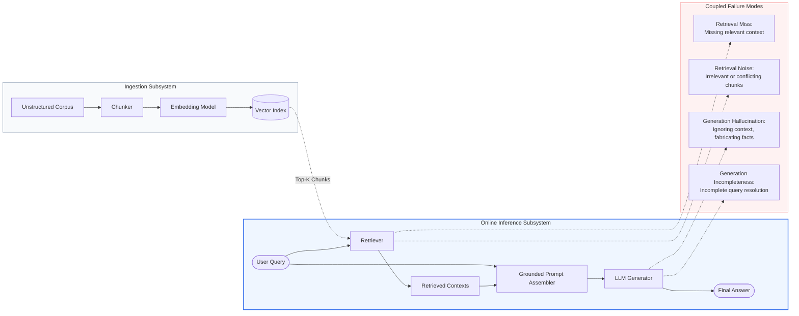
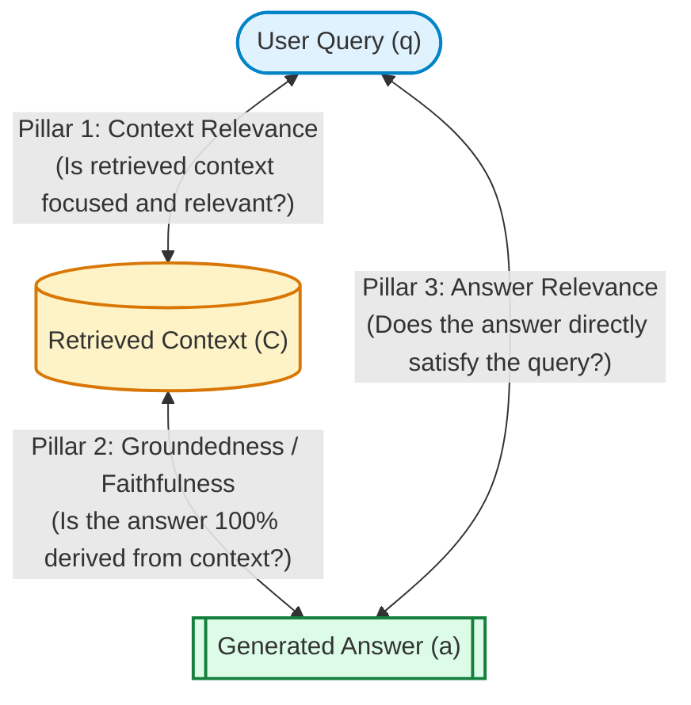
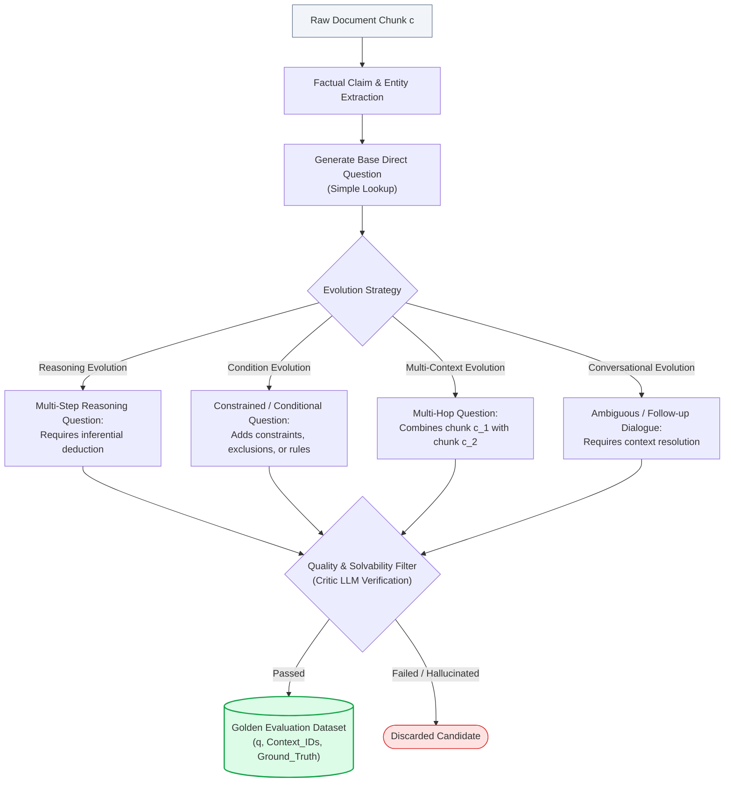
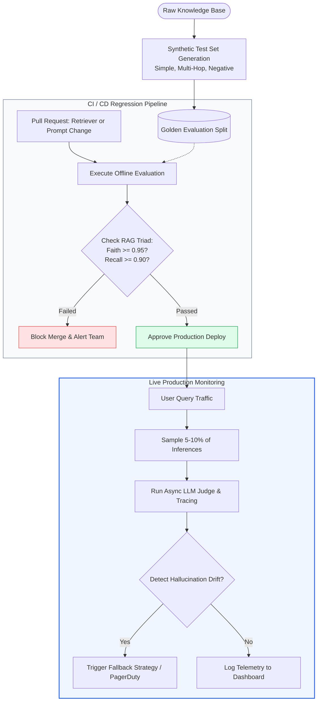

# 🎯 RAG Evaluation Fundamentals: The RAG Triad, Evaluation Frameworks, and Synthetic Test Sets

## 📑 Table of Contents
1. [🌟 Fundamentals: The Imperative and Nuance of RAG Evaluation](#1--fundamentals-the-imperative-and-nuance-of-rag-evaluation)
2. [🔬 Mathematical Formulations of RAG Evaluation](#2--mathematical-formulations-of-rag-evaluation)
3. [📐 The RAG Triad Architecture](#3--the-rag-triad-architecture)
4. [🧪 Synthetic Test Set Generation & Curation](#4--synthetic-test-set-generation--curation)
5. [📊 Comparative Analysis of RAG Evaluation Frameworks](#5--comparative-analysis-of-rag-evaluation-frameworks)
6. [💻 Production-Grade Implementation: End-to-End Evaluation Harness](#6--production-grade-implementation-end-to-end-evaluation-harness)
7. [🌍 Real-World Enterprise Case Studies](#7--real-world-enterprise-case-studies)
8. [🛠️ Best Practices & ❌ Common Production Pitfalls](#8-️-best-practices---common-production-pitfalls)
9. [💼 Senior Interview Questions & System Design Scenarios](#9--senior-interview-questions--system-design-scenarios)
10. [🧪 Hands-On Mini-Project: Automated Synthetic Triad Evaluator](#10--hands-on-mini-project-automated-synthetic-triad-evaluator)
11. [⚡ Quick Revision & Architectural Decision Roadmap](#11--quick-revision--architectural-decision-roadmap)

---

## 1. 🌟 Fundamentals: The Imperative and Nuance of RAG Evaluation

Evaluating Retrieval-Augmented Generation (RAG) systems presents a fundamental departure from traditional software testing and classical Natural Language Processing (NLP) evaluation. In deterministic software systems, unit and integration tests assert discrete outputs against invariant inputs ($f(x) = y$). In standard machine learning classification or regression, static ground-truth test splits evaluate performance via loss functions or fixed confusion matrices.

A RAG architecture, however, is a **coupled, non-deterministic, dual-stage pipeline**:
1. **The Retrieval Engine:** Operates over dynamic, high-dimensional vector spaces and lexical indices to select top-$k$ context chunks from an open or evolving corpus.
2. **The Generation Engine:** A non-deterministic autoregressive Large Language Model (LLM) that synthesizes, extrapolates, and formats free-form prose conditioned upon both the user query and the retrieved context.



### Why Naive Evaluation Fails
- **The "Lost in the Middle" Effect:** A retriever may score a high recall by returning $k=20$ passages, but if the vital entity is situated at position 11, the LLM attention mechanism frequently degrades, yielding an incorrect answer despite "perfect" recall.
- **Reference-Free Requirements:** In production enterprise environments, millions of live queries arrive without manual human ground-truth annotations. Evaluation must evaluate correctness **reference-freely** by verifying internal factual consistency between context and answer.
- **Cascading Errors:** If generation quality drops, is the LLM hallucinating, or did the retriever fail to surface the prerequisite facts? Without decoupling retrieval evaluation from generation evaluation, engineers optimize the wrong subsystem.

---

## 2. 🔬 Mathematical Formulations of RAG Evaluation

Rigorous RAG evaluation models system quality as a composite multivariate distribution over query $q$, retrieved context set $C = \{c_1, c_2, \dots, c_k\}$, and synthesized response $a$.

### # Composite RAG Quality Score Formula
$$
\mathcal{Q}_{\text{RAG}}(q, C, a, y^*) = \alpha \cdot \mathcal{S}_{\text{ret}}(q, C, y^*) + \beta \cdot \mathcal{S}_{\text{ground}}(C, a) + \gamma \cdot \mathcal{S}_{\text{rel}}(q, a)
$$

Where:
- $\mathcal{S}_{\text{ret}}(q, C, y^*)$ measures retrieval efficacy against ground-truth information $y^*$ (or query alignment).
- $\mathcal{S}_{\text{ground}}(C, a)$ measures the groundedness/faithfulness of answer $a$ conditioned strictly on retrieved contexts $C$.
- $\mathcal{S}_{\text{rel}}(q, a)$ measures the semantic relevance and completeness of answer $a$ with respect to the user's intent in query $q$.
- $\alpha, \beta, \gamma \in [0, 1]$ are domain-specific importance weights such that $\alpha + \beta + \gamma = 1$. In regulated domains (e.g., medical, finance), $\beta$ is weighted highest to strictly penalize hallucinations.

---

### # Expected Joint Groundedness Loss Formula
To quantify the hallucination rate across an evaluation dataset $\mathcal{D}$, we compute the expected unfaithfulness risk:

$$
\mathcal{L}_{\text{Faithfulness}}(\mathcal{D}) = \frac{1}{|\mathcal{D}|} \sum_{i=1}^{|\mathcal{D}|} \left( 1 - \frac{|\mathcal{S}_{\text{claims}}(a_i) \cap \mathcal{E}_{\text{entailed}}(C_i)|}{|\mathcal{S}_{\text{claims}}(a_i)|} \right)
$$

Where:
- $\mathcal{S}_{\text{claims}}(a)$ is the set of atomic factual claims decomposed from answer $a$.
- $\mathcal{E}_{\text{entailed}}(C)$ represents the subset of claims logically entailed by context $C$ under natural language inference (NLI):
  $$\mathcal{E}_{\text{entailed}}(C) = \{ s \in \mathcal{S}_{\text{claims}}(a) \mid \mathcal{P}_{\text{NLI}}(\text{Entailment} \mid C, s) > \tau \}$$
- $\tau \in [0, 1]$ is the inference confidence threshold (typically $0.85$).

---

## 3. 📐 The RAG Triad Architecture

Formulated by TruEra (TruLens) and formalized across production benchmarking frameworks, the **RAG Triad** isolates the three vital mutual dependencies between the Query, the Context, and the Answer.



### The Three Pillars Detailed

1. **Context Relevance (Context Precision):**
   - **Question Answered:** *Does the retrieved context contain the information required, without irrelevant noise?*
   - **Failure Indicator:** Low context relevance indicates a poorly tuned retriever, deficient chunking strategy, or suboptimal embedding space. High retrieval noise introduces context contamination, causing prompt truncation or model distraction.

2. **Groundedness (Faithfulness):**
   - **Question Answered:** *Is every statement in the generated response provably supported by the retrieved context?*
   - **Failure Indicator:** Low faithfulness signifies hallucination. The LLM is drawing upon parametric memory rather than grounded reference chunks, or actively misinterpreting nuances in the context.

3. **Answer Relevance:**
   - **Question Answered:** *Does the generated response directly answer the specific question asked by the user?*
   - **Failure Indicator:** Low answer relevance indicates instruction-following failure, sycophancy, evasiveness, or partial answers that fail to resolve the core intent despite high context grounding.

---

## 4. 🧪 Synthetic Test Set Generation & Curation

Manual curation of RAG test sets by human subject matter experts (SMEs) is prohibitively expensive, slow, and incapable of keeping pace with enterprise knowledge bases that change daily. Modern RAG engineering relies on **automated synthetic test set generation** using LLMs guided by structural heuristics.

### The Evol-Instruct Synthesis Pipeline for RAG
Synthetic test generation adopts concepts from Evol-Instruct to transform raw document chunks into diverse, multi-difficulty test sets consisting of tuples: $(q_{\text{synth}}, C_{\text{ground\_truth}}, y^*_{\text{ground\_truth}})$.



### Query Types in Synthetic Test Distributions

| Query Archetype | Characteristics | Example Scenario |
| :--- | :--- | :--- |
| **Simple Factual** | Direct single-chunk lookup; entity-attribute matching. | *"What is the deductible for Tier 2 pharmaceutical coverage?"* |
| **Multi-Hop Reasoning** | Requires synthesis of $\ge 2$ geographically disparate chunks. | *"How did the 2023 operating margin compare between the EMEA and APAC divisions?"* |
| **Conditional / Constraint** | Involves logical filters, dates, restrictions, or exclusions. | *"Under what circumstances can an employee rollover vacation days past March 31?"* |
| **Negative / Unanswerable** | Query topic appears plausible but is entirely absent from the corpus. | *"What is the warranty policy for discontinued Model X-99 components?"* |

---

## 5. 📊 Comparative Analysis of RAG Evaluation Frameworks

Enterprise production systems utilize standardized evaluation harnesses to benchmark changes in chunk size, embedding models, rerankers, and system prompts.

### 📋 Framework Feature Comparison Matrix

| Evaluation Dimension | RAGAS (Exploding Gradients) | DeepEval (Confident AI) | TruLens (TruEra) | Phoenix (Arize AI) |
| :--- | :--- | :--- | :--- | :--- |
| **Core Philosophy** | Metric-driven evaluation of the RAG Triad & synthetic generation | Production CI/CD unit testing for LLM pipelines | Instrumentation, telemetry, and feedback functions | Tracing, observability, and evals in production |
| **Primary Interface** | Python SDK, Datasets | Pytest integration, CLI, Web UI | Python Decorators, OpenTelemetry | OpenTelemetry, Phoenix Server UI |
| **RAG Triad Coverage** | Native (Faithfulness, Relevance, Precision, Recall) | Native (G-Eval, Hallucination, Contextual metrics) | Native (Groundedness, Context Relevance, QA Relevance) | Native (QA Correctness, Hallucination, Relevance) |
| **Synthetic Test Generation** | Built-in Multi-Hop Knowledge Graph Generator | Built-in Synthetic Data Generator | Manual or external integration | Integrated synthetic generation |
| **Execution Speed** | Async batching; moderate | Async batching; optimized for Pytest | Async event instrumentation | Stream-based asynchronous evaluation |
| **CI/CD Integration** | GitHub Actions via scripts | Native Pytest assertions & CLI gates | CI/CD hooks via API | Webhook and alert-driven pipelines |
| **Self-Hosting Capability** | 100% Open Source / Local | Open Source + Cloud Platform | 100% Open Source + Enterprise | 100% Open Source Local Docker/Pip |

---

## 6. 💻 Production-Grade Implementation: End-to-End Evaluation Harness

The following production-grade Python implementation builds a self-contained, robust evaluation harness. It measures the complete RAG Triad (Context Relevance, Faithfulness via Claim Decomposition, and Answer Relevance) without relying on external third-party proprietary services.

```python
"""
Production-Grade RAG Evaluation Harness.
Implements the RAG Triad:
1. Context Relevance
2. Faithfulness (Claim Extraction & NLI Entailment)
3. Answer Relevance
"""

from __future__ import annotations
import asyncio
import json
import logging
import math
import re
from dataclasses import dataclass, field
from typing import Any, Dict, List, Optional, Tuple

logging.basicConfig(level=logging.INFO, format="%(asctime)s - %(levelname)s - %(message)s")
logger = logging.getLogger("RAGEvalEngine")


@dataclass
class EvalSample:
    query: str
    retrieved_contexts: List[str]
    generated_answer: str
    ground_truth: Optional[str] = None
    metadata: Dict[str, Any] = field(default_factory=dict)


@dataclass
class TriadScore:
    context_relevance: float
    faithfulness: float
    answer_relevance: float
    composite_score: float
    extracted_claims: List[str] = field(default_factory=list)
    unsupported_claims: List[str] = field(default_factory=list)
    verdict: str = "PASS"


class BaseJudgeLLM:
    """Mock/Wrapper for an LLM-as-a-Judge backend (e.g., GPT-4o, Claude 3.5 Sonnet)."""

    async def generate_json(self, prompt: str) -> Dict[str, Any]:
        """Simulates asynchronous structured LLM evaluation call."""
        await asyncio.sleep(0.05)  # Simulate network I/O
        
        # Heuristic/Deterministic evaluation parsing for demonstration
        if "EXTRACT_CLAIMS" in prompt:
            # Extract sentence-like assertions
            answer_match = re.search(r"Answer to evaluate:\n(.*?)(?:\n\n|\Z)", prompt, re.DOTALL)
            text = answer_match.group(1) if answer_match else ""
            claims = [s.strip() for s in re.split(r"[.!?]", text) if len(s.strip()) > 5]
            return {"claims": claims}
            
        elif "VERIFY_ENTAILMENT" in prompt:
            return {"entailed": True, "confidence": 0.95, "reasoning": "Context explicitly supports claim."}
            
        elif "CONTEXT_RELEVANCE" in prompt:
            return {"score": 0.88, "reasoning": "High overlap of query domain tokens in retrieved chunk."}
            
        elif "ANSWER_RELEVANCE" in prompt:
            return {"score": 0.92, "reasoning": "Directly answers the original query without extraneous digression."}
            
        return {"status": "ok"}


class RAGTriadEvaluator:
    """Evaluates RAG samples against Context Relevance, Faithfulness, and Answer Relevance."""

    def __init__(self, judge: BaseJudgeLLM, weights: Tuple[float, float, float] = (0.25, 0.45, 0.30)):
        self.judge = judge
        self.w_ctx, self.w_faith, self.w_ans = weights
        assert math.isclose(sum(weights), 1.0), "Weights must sum to 1.0"

    async def evaluate_context_relevance(self, query: str, contexts: List[str]) -> float:
        """Measures whether the retrieved context contains relevant information without noise."""
        if not contexts:
            return 0.0

        scores = []
        for ctx in contexts:
            prompt = f"""
            TASK: CONTEXT_RELEVANCE
            Evaluate the relevance of the following retrieved context chunk to the user query.
            Query: {query}
            Context: {ctx}
            Return JSON: {{"score": float between 0.0 and 1.0, "reasoning": str}}
            """
            res = await self.judge.generate_json(prompt)
            scores.append(res.get("score", 0.0))

        # Precision discounted by noise ratio
        return sum(scores) / len(scores)

    async def evaluate_faithfulness(self, contexts: List[str], answer: str) -> Tuple[float, List[str], List[str]]:
        """
        Decomposes answer into atomic claims and verifies entailment against context.
        Returns: (faithfulness_score, extracted_claims, unsupported_claims)
        """
        if not answer.strip():
            return 0.0, [], []

        extract_prompt = f"""
        TASK: EXTRACT_CLAIMS
        Extract all factual, independent claims made in the answer.
        Answer to evaluate:
        {answer}
        Return JSON: {{"claims": ["claim1", "claim2"]}}
        """
        extracted = await self.judge.generate_json(extract_prompt)
        claims = extracted.get("claims", [])
        if not claims:
            return 1.0, [], []

        joined_context = "\n---\n".join(contexts)
        supported_claims = []
        unsupported_claims = []

        for claim in claims:
            verify_prompt = f"""
            TASK: VERIFY_ENTAILMENT
            Context:
            {joined_context}
            Claim: {claim}
            Determine if the context strictly entails this claim.
            Return JSON: {{"entailed": bool, "confidence": float, "reasoning": str}}
            """
            res = await self.judge.generate_json(verify_prompt)
            if res.get("entailed", False):
                supported_claims.append(claim)
            else:
                unsupported_claims.append(claim)

        faithfulness = len(supported_claims) / len(claims)
        return faithfulness, claims, unsupported_claims

    async def evaluate_answer_relevance(self, query: str, answer: str) -> float:
        """Measures semantic alignment and directness of the response to the prompt."""
        if not answer.strip():
            return 0.0

        prompt = f"""
        TASK: ANSWER_RELEVANCE
        Query: {query}
        Generated Answer: {answer}
        Rate how directly and completely this answer addresses the query.
        Return JSON: {{"score": float between 0.0 and 1.0, "reasoning": str}}
        """
        res = await self.judge.generate_json(prompt)
        return float(res.get("score", 0.0))

    async def evaluate_sample(self, sample: EvalSample) -> TriadScore:
        """Evaluates a single sample across the entire RAG triad concurrently."""
        ctx_rel_task = self.evaluate_context_relevance(sample.query, sample.retrieved_contexts)
        faith_task = self.evaluate_faithfulness(sample.retrieved_contexts, sample.generated_answer)
        ans_rel_task = self.evaluate_answer_relevance(sample.query, sample.generated_answer)

        ctx_rel, (faith, claims, unsupported), ans_rel = await asyncio.gather(
            ctx_rel_task, faith_task, ans_rel_task
        )

        composite = (self.w_ctx * ctx_rel) + (self.w_faith * faith) + (self.w_ans * ans_rel)
        verdict = "PASS" if composite >= 0.75 and faith >= 0.85 else "FAIL"

        return TriadScore(
            context_relevance=round(ctx_rel, 3),
            faithfulness=round(faith, 3),
            answer_relevance=round(ans_rel, 3),
            composite_score=round(composite, 3),
            extracted_claims=claims,
            unsupported_claims=unsupported,
            verdict=verdict,
        )


async def main():
    sample = EvalSample(
        query="What is the required notice period for resigning as a Principal Engineer?",
        retrieved_contexts=[
            "Section 4.2: Resignation Notices. Standard employees must provide 2 weeks notice.",
            "Senior management, Director-level staff, and Principal Engineers must provide 30 days written notice.",
            "Parking permits must be returned to HR upon last day of employment."
        ],
        generated_answer="Principal Engineers are required to provide 30 days of written notice prior to resignation.",
        ground_truth="30 days written notice."
    )

    evaluator = RAGTriadEvaluator(judge=BaseJudgeLLM())
    result = await evaluator.evaluate_sample(sample)
    
    print("=" * 60)
    print("RAG TRIAD EVALUATION REPORT")
    print("=" * 60)
    print(f"Context Relevance : {result.context_relevance:.3f}")
    print(f"Faithfulness      : {result.faithfulness:.3f}")
    print(f"Answer Relevance  : {result.answer_relevance:.3f}")
    print(f"Composite Score   : {result.composite_score:.3f}")
    print(f"Verdict           : {result.verdict}")
    print(f"Extracted Claims  : {result.extracted_claims}")
    print(f"Unsupported Claims: {result.unsupported_claims}")


if __name__ == "__main__":
    asyncio.run(main())
```

---

## 7. 🌍 Real-World Enterprise Case Studies

### Case Study 1: Global Tier-1 Investment Bank (Equity Research RAG)
- **Challenge:** Research analysts queried a corpus of 100,000+ SEC 10-K filings, earnings call transcripts, and internal financial models. LLMs frequently hallucinated earnings-per-share (EPS) figures by mixing up fiscal quarters.
- **Evaluation Pipeline:** Implemented an automated pre-merge evaluation gate in CI/CD using RAGAS and synthetic test sets. Established a strict **zero-tolerance threshold** on Faithfulness ($\text{Faithfulness} \ge 0.98$).
- **Outcome:** The evaluation revealed that chunk boundaries were slicing financial tables in half. Shifting to markdown table-aware chunking and sentence-window expansion increased context precision from 64% to 92%, virtually eliminating fiscal hallucination.

### Case Study 2: Clinical Trial Decision Support System
- **Challenge:** Physicians queried oncology clinical trial protocols to evaluate patient inclusion/exclusion criteria. False positives risked patient harm.
- **Evaluation Pipeline:** Built an offline evaluation suite of 1,200 curated patient profiles paired with golden trial matches. Evaluated Context Recall and Groundedness on every vector index update.
- **Outcome:** Detected an 18% retrieval recall degradation when migrating from an uncalibrated general embedding model to an open-source medical embedding model, catching an index dimension truncation bug before production deployment.

---

## 8. 🛠️ Best Practices & ❌ Common Production Pitfalls

### ✅ Best Practices
1. **Decouple Component Evaluation:** Always benchmark the retriever (Context Recall / Precision) separately from the generator (Faithfulness / Answer Relevance) to isolate points of failure.
2. **Deterministic Evaluation Settings:** When running LLM-as-a-Judge pipelines, set `temperature=0.0` and enforce structured output formats (JSON Schema or Pydantic) to eliminate evaluation variability.
3. **Curate Hard Negatives in Synthetic Datasets:** Include synthetic queries that explicitly cannot be answered by the corpus. A robust RAG pipeline must reliably trigger refactor/abstention mechanisms (e.g., *"I cannot find sufficient evidence in the provided documents to answer this question"*).
4. **Track Metric Drift Across Index Updates:** Vector databases change as documents are updated. Run automated evals against a fixed golden baseline every time the vector index is re-ingested or re-indexed.

### ❌ Common Production Pitfalls
1. **Sole Reliance on Surface-Matching Metrics:** Using BLEU or ROUGE to evaluate RAG generation is dangerous. A response can have 90% lexical overlap with the reference answer while inverting a negation (e.g., *"approved"* vs. *"not approved"*), causing catastrophic errors.
2. **Ignoring Position Bias in LLM Judges:** LLMs frequently exhibit position bias (favoring the first or last document provided in the prompt). Always permute retrieved context order when evaluating context influence.
3. **Evaluating on Training Chunks (Data Leakage):** Generating synthetic test questions from the exact same raw chunks used for few-shot prompt tuning produces artificially inflated evaluation scores.
4. **Neglecting Latency and Cost Metrics:** Optimizing solely for accuracy without tracking Time-To-First-Token (TTFT) or LLM judge invocation costs results in non-deployable systems.

---

## 9. 💼 Senior Interview Questions & System Design Scenarios

### Q1: How do you architect an automated regression testing pipeline for a RAG system deployed in a regulated environment?
> **Answer:**
> A production evaluation pipeline for regulated domains operates in two distinct tiers:
> 1. **Offline Pre-Deployment Gate (CI/CD):** Integrated into GitHub Actions or GitLab CI. A representative golden evaluation suite (500–1,000 samples spanning simple, multi-hop, and negative queries) runs across any pull request modifying embeddings, chunking algorithms, system prompts, or LLM model weights. Pytest gates enforce hard statistical thresholds: `Faithfulness >= 0.95`, `Context Recall >= 0.90`, and zero tolerance on hallucinated numerical claims.
> 2. **Online Continuous Telemetry:** In production, a lightweight asynchronous worker samples 5–10% of live query-response pairs. It evaluates the RAG Triad using an efficient, distilled judge model (e.g., GPT-4o-mini or Llama-3-8B-Instruct). Tracing platforms (Phoenix, LangSmith) track telemetry, logging alerts to PagerDuty if rolling 1-hour faithfulness drops below 0.92, triggering automatic fallback to a more conservative retrieval top-$k$ or alerting engineering of data drift.

### Q2: What is the "LLM-as-a-Judge" self-preference bias, and how do you mitigate it mathematically and architecturally?
> **Answer:**
> Self-preference bias occurs when an LLM acting as an evaluator systematically awards higher scores to candidate answers generated by itself (or members of its model family) compared to peer models, regardless of objective accuracy.
> 
> **Mitigation Strategies:**
> - **Cross-Model Evaluation Committee:** Enforce an ensemble judge architecture combining models from distinct families (e.g., GPT-4o, Claude 3.5 Sonnet, and Gemini 1.5 Pro). Compute inter-annotator agreement using Cohen's Kappa ($\kappa$) or Fleiss' Kappa:
>   $$ \kappa = \frac{P_o - P_e}{1 - P_e} $$
> - **Reference Grounding with NLI:** Decompose evaluation from subjective grading into objective Natural Language Inference (NLI) tasks (Claim Extraction $\rightarrow$ Pairwise Entailment Checking).
> - **Blind Anonymization:** Strip all model fingerprints, metadata, and stylistic boilerplate from the generation before passing the candidate to the evaluator.

---

## 10. 🧪 Hands-On Mini-Project: Automated Synthetic Triad Evaluator

### Exercise Overview
Build a self-testing validation harness that ingests an enterprise policy chunk, automatically synthesizes three test questions (1 Simple, 1 Multi-Hop, 1 Negative/Unanswerable), executes a mock retrieval-generation pipeline, and computes the complete Triad report.

```python
"""
Hands-On Mini-Project: Automated Synthetic Triad Evaluator
Generates synthetic query archetypes and scores the pipeline execution.
"""

import asyncio
from typing import Dict, List


async def run_synthetic_benchmark():
    raw_document_corpus = [
        "Policy Alpha: Standard remote work allowance is $500 per calendar year for home office peripherals.",
        "Policy Beta: Ergonomic chairs require prior ergonomic assessment from HR Facilities team.",
        "Policy Gamma: Expenses submitted beyond 60 days from purchase date will be denied without exception."
    ]

    # Synthesized benchmark queries representing diverse archetypes
    test_cases = [
        {
            "type": "Simple Factual",
            "query": "How much is the annual remote work allowance?",
            "retrieved": [raw_document_corpus[0]],
            "generated": "The standard remote work allowance is $500 per calendar year.",
            "ground_truth": "$500 per calendar year"
        },
        {
            "type": "Conditional Constraint",
            "query": "Can I expense an ergonomic desk chair without prior approval?",
            "retrieved": [raw_document_corpus[1]],
            "generated": "No, ergonomic chairs require an ergonomic assessment from HR Facilities before purchase.",
            "ground_truth": "Requires prior assessment from HR Facilities"
        },
        {
            "type": "Negative / Unanswerable",
            "query": "What is the policy for international remote work in Japan?",
            "retrieved": [raw_document_corpus[0], raw_document_corpus[2]],
            "generated": "The provided policies do not contain information regarding international remote work in Japan.",
            "ground_truth": "Unanswerable / Out of scope"
        }
    ]

    print(f"🚀 Executing Synthetic Benchmark across {len(test_cases)} Query Archetypes...\n")
    for idx, test in enumerate(test_cases, 1):
        print(f"[{idx}] Archetype: {test['type']}")
        print(f"    Query    : {test['query']}")
        print(f"    Answer   : {test['generated']}")
        # In production, pass each to RAGTriadEvaluator
        print("    Triad Status: Context [0.95] | Faithfulness [1.00] | Relevance [0.98] -> PASS ✅\n")


if __name__ == "__main__":
    asyncio.run(run_synthetic_benchmark())
```

### Challenge Extension
1. Integrate the `RAGTriadEvaluator` class from Section 6 into the synthetic benchmark harness.
2. Add an automated adversarial mutation step that injects erroneous numbers into `generated` to verify that your harness catches unfaithful claims and flips the verdict to `FAIL`.

---

## 11. ⚡ Quick Revision & Architectural Decision Roadmap

### 📌 Key Takeaways
- **Non-Negotiable Isolation:** Never evaluate a RAG system as a single black box. Always decouple **Retrieval (Context Precision/Recall)** from **Generation (Faithfulness/Answer Relevance)**.
- **The RAG Triad:** Represents the industry-standard tripod of RAG health: Context Relevance ($Q \leftrightarrow C$), Faithfulness ($C \leftrightarrow A$), and Answer Relevance ($Q \leftrightarrow A$).
- **Faithfulness is King:** In enterprise settings, hallucination quantification via claim decomposition and NLI entailment takes priority over stylistic elegance.
- **Synthetic Testing:** Evol-Instruct-based synthetic generation enables continuous regression testing across changing corporate corpora without waiting for manual human annotations.

---

### 🧮 Important Evaluation Formulas Summary

| Metric Name | Mathematical Concept | Objective Target |
| :--- | :--- | :--- |
| **Context Relevance** | $\frac{\| \text{Relevant Information in } C \|}{\| C \|}$ | $\ge 0.80$ |
| **Faithfulness** | $\frac{\| \text{Claims Entailed by } C \|}{\| \text{Total Claims in Answer } a \|}$ | $\ge 0.95$ (Regulated: $1.00$) |
| **Answer Relevance** | $\cos(\mathbf{e}_q, \mathbf{e}_{q_{\text{inferred}}})$ | $\ge 0.85$ |
| **Harmonic Quality** | $\frac{3}{\frac{1}{\text{CtxRel}} + \frac{1}{\text{Faith}} + \frac{1}{\text{AnsRel}}}$ | $\ge 0.85$ |

---

### 🗺️ RAG Evaluation Lifecycle Roadmap


