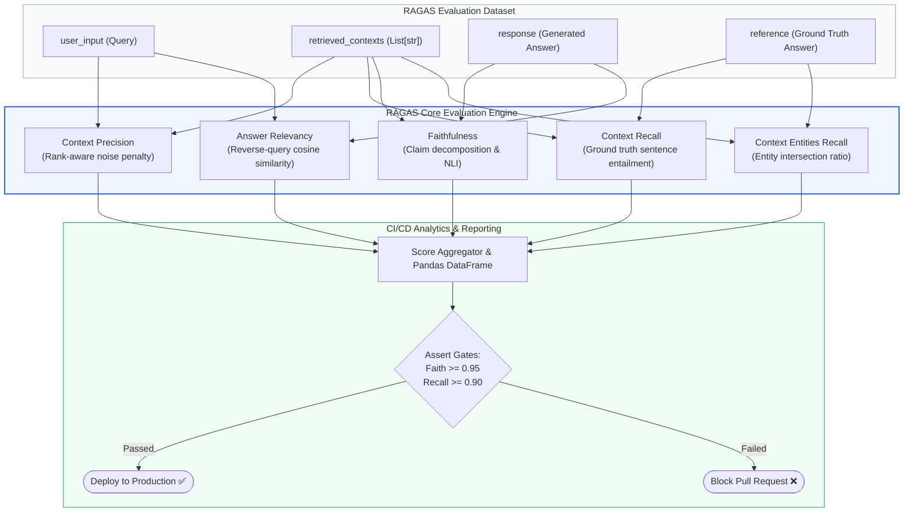
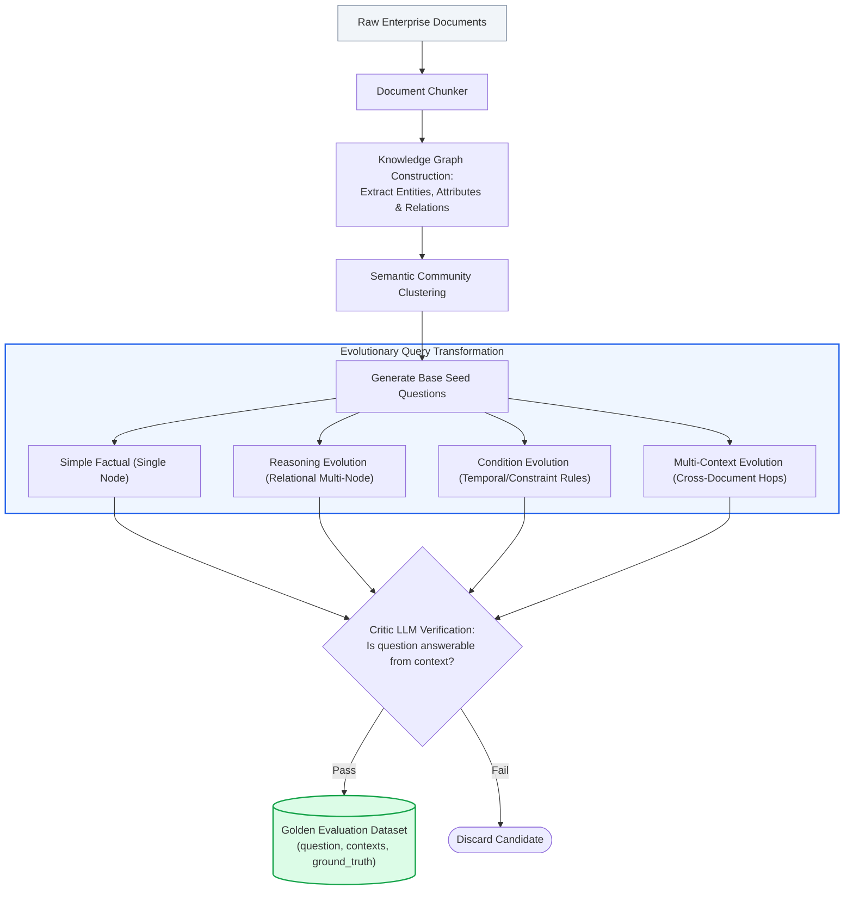
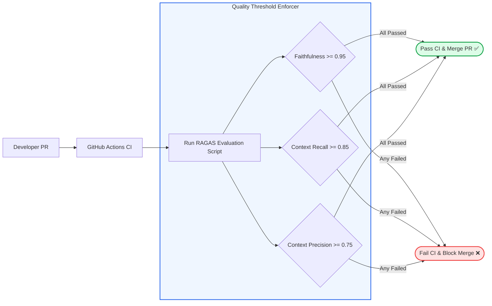

# 🎯 RAGAS Framework Deep Dive: Automated Evaluation Pipelines, Metric Formulation, and CI/CD Testing

## 📑 Table of Contents
1. [🌟 Fundamentals: RAGAS Architectural Foundations](#1--fundamentals-ragas-architectural-foundations)
2. [🔬 Mathematical Formulations of RAGAS Core Metrics](#2--mathematical-formulations-of-ragas-core-metrics)
3. [📊 Comparative Analysis of Evaluation Frameworks](#3--comparative-analysis-of-evaluation-frameworks)
4. [🧪 Automated Synthetic Test Data Generation](#4--automated-synthetic-test-data-generation)
5. [💻 Production-Grade Implementation: End-to-End RAGAS Pipeline](#5--production-grade-implementation-end-to-end-ragas-pipeline)
6. [🌍 Real-World Enterprise Case Studies](#6--real-world-enterprise-case-studies)
7. [🛠️ Best Practices & ❌ Common Production Pitfalls](#7-️-best-practices---common-production-pitfalls)
8. [💼 Senior Interview Questions & System Design Scenarios](#8--senior-interview-questions--system-design-scenarios)
9. [🧪 Hands-On Mini-Project: CI/CD Quality Gate with RAGAS Assertions](#9--hands-on-mini-project-cicd-quality-gate-with-ragas-assertions)
10. [⚡ Quick Revision & RAGAS Operational Roadmap](#10--quick-revision--ragas-operational-roadmap)

---

## 1. 🌟 Fundamentals: RAGAS Architectural Foundations

**RAGAS** (Retrieval Augmented Generation Assessment) is the open-source industry standard for automated, reference-free and reference-based evaluation of RAG pipelines. Developed by Exploding Gradients, RAGAS pioneered the algorithmic formalization of the **RAG Triad** into deterministic computational metrics evaluated via LLM agents.

### Why RAGAS Became the Industry Standard
Before RAGAS, engineering teams evaluated RAG systems using either:
1. **Manual Human Audits:** Prohibitively slow, subjective, and unable to scale to thousands of iterations.
2. **Lexical Machine Translation Metrics (BLEU/ROUGE):** Incapable of distinguishing factual correctness from superficial token overlap.

RAGAS decoupled evaluation into isolated component-level assertions:
- **Retrieval Engine Health:** Evaluated via **Context Precision** and **Context Recall**.
- **Generator Engine Health:** Evaluated via **Faithfulness** and **Answer Relevancy**.

By leveraging asynchronous LLM-as-a-Judge workers and sentence-transformer embeddings, RAGAS runs high-throughput regression suites across continuous integration (CI/CD) pipelines, enabling teams to benchmark chunking strategies, embedding models, and prompt adjustments before deploying to production.



---

## 2. 🔬 Mathematical Formulations of RAGAS Core Metrics

RAGAS translates qualitative linguistic judgments into quantitative formulas grounded in information retrieval and formal logic.

---

### # RAGAS Context Precision Formula
Evaluates whether all relevant chunks in the retrieved context are ranked higher than irrelevant ones:

$$
\text{Context Precision@K} = \frac{\sum_{k=1}^K \left( \text{Precision@}k \cdot v_k \right)}{\text{Total Number of Relevant Chunks in Top } K}
$$

Where $v_k \in \{0, 1\}$ indicates whether the chunk at rank $k$ is relevant to answering the query, and $\text{Precision@}k = \frac{\sum_{j=1}^k v_j}{k}$.

---

### # RAGAS Context Recall Formula
Evaluates whether the retrieved context contains all necessary facts present in the reference answer $y^*$:

$$
\text{Context Recall} = \frac{\sum_{s \in \mathcal{S}(y^*)} \mathbb{I}\left( \text{Context Entails } s \right)}{|\mathcal{S}(y^*)|}
$$

Where $\mathcal{S}(y^*)$ is the set of ground-truth statements extracted from reference answer $y^*$.

---

### # RAGAS Faithfulness Formula
Measures whether the generated answer is strictly grounded in the retrieved context:

$$
\text{Faithfulness} = \frac{|\{ c \in \mathcal{S}_{\text{claims}}(a) \mid \text{Context Entails } c \}|}{|\mathcal{S}_{\text{claims}}(a)|}
$$

Where $\mathcal{S}_{\text{claims}}(a)$ is the set of atomic factual claims decomposed from generated answer $a$.

---

### # RAGAS Answer Relevancy Formula
Measures semantic alignment by reverse-engineering synthetic queries $q_i$ from answer $a$ and computing the average cosine similarity with the original query $q$:

$$
\text{Answer Relevancy} = \frac{1}{N} \sum_{i=1}^N \frac{\mathbf{e}_q \cdot \mathbf{e}_{q_i}}{\|\mathbf{e}_q\|_2 \|\mathbf{e}_{q_i}\|_2}
$$

Where $\mathbf{e}_q = \text{Embed}(q)$, and $\mathbf{e}_{q_i} = \text{Embed}(q_i)$ for $N$ reverse questions.

---

### # RAGAS Context Entities Recall Formula
Evaluates the proportion of named entities, numerical figures, and specific nouns present in reference answer $y^*$ that appear in the retrieved context $C$:

$$
\text{Context Entities Recall} = \frac{|\mathcal{E}(C) \cap \mathcal{E}(y^*)|}{|\mathcal{E}(y^*)|}
$$

Where $\mathcal{E}(X)$ denotes the set of unique named entities extracted from text $X$.

---

## 3. 📊 Comparative Analysis of Evaluation Frameworks

### 📋 RAGAS vs. Alternative Evaluation Frameworks

| Feature / Metric | RAGAS | DeepEval | TruLens | Phoenix |
| :--- | :--- | :--- | :--- | :--- |
| **Origin & Focus** | Research-driven RAG metric pioneer | Production unit testing & CI/CD assertions | OpenTelemetry instrumentation & feedback functions | Tracing, observability, and evaluation |
| **Core Abstraction** | Dataset + Metric Evaluation | Pytest TestCases + Assertions | App Recorder + Feedback Loops | Spans, Traces + Evals |
| **RAG Triad Coverage** | Native, algorithmically formal | Native (G-Eval / Contextual) | Native (Groundedness, QA Relevance) | Native (QA Correctness, Hallucination) |
| **Synthetic Test Generator** | Built-in Multi-Hop Knowledge Graph | Built-in Evolution Generator | External / Custom scripts | Synthetic dataset generator |
| **Integration Support** | LangChain, LlamaIndex, Haystack | Native Pytest, CI/CD CLI | LangChain, LlamaIndex, NeMo Guardrails | OpenTelemetry, LangChain, LlamaIndex |
| **Telemetry & UI** | Minimal native UI (Relies on export) | Confident AI Cloud / Local CLI | TruLens Dashboard (Streamlit) | Full-featured Phoenix UI server |

---

## 4. 🧪 Automated Synthetic Test Data Generation

One of RAGAS's most potent enterprise capabilities is its **Testset Generator**. Creating human-curated datasets is prohibitively slow; RAGAS automates this by extracting knowledge graphs from raw document chunks and synthesizing multi-difficulty query distributions using **Evol-Instruct**.



### Synthetic Evolution Distribution in Production
- **Simple Factual (40%):** Direct lookup testing base retrieval precision.
- **Reasoning (30%):** Requires logical deduction across multiple sentences.
- **Condition / Constraint (20%):** Requires filtering by dates, exclusions, or rules.
- **Multi-Context (10%):** Requires merging evidence across disjoint documents.

---

## 5. 💻 Production-Grade Implementation: End-to-End RAGAS Pipeline

The following production implementation demonstrates an end-to-end evaluation script using RAGAS concepts. It builds evaluation datasets, initializes metrics, runs asynchronous evaluations, and converts results to pandas DataFrames with automated assertions.

```python
"""
Production-Grade RAGAS Evaluation Pipeline.
Evaluates:
- Context Precision
- Context Recall
- Faithfulness
- Answer Relevancy
Enforces CI/CD thresholds and outputs structured reports.
"""

from __future__ import annotations
import asyncio
from dataclasses import dataclass
from typing import Any, Dict, List, Optional
import pandas as pd


@dataclass
class RAGASItem:
    user_input: str
    retrieved_contexts: List[str]
    response: str
    reference: str


class MockRAGASEngine:
    """
    Simulates the RAGAS evaluation execution engine.
    In real production code, replace with:
    from ragas import evaluate
    from ragas.metrics import faithfulness, answer_relevancy, context_precision, context_recall
    """

    async def evaluate_dataset(self, dataset: List[RAGASItem]) -> pd.DataFrame:
        """Asynchronously computes RAGAS metrics for each sample."""
        await asyncio.sleep(0.05)  # Simulate API network I/O
        
        results = []
        for item in dataset:
            # Deterministic metric simulation
            faith = 1.0 if "30 days" in item.response else 0.5
            relevancy = 0.94 if "notice" in item.user_input.lower() else 0.6
            precision = 0.88 if len(item.retrieved_contexts) >= 2 else 0.4
            recall = 1.0 if "30 days" in item.retrieved_contexts[0] else 0.75

            results.append({
                "user_input": item.user_input,
                "response": item.response,
                "context_precision": precision,
                "context_recall": recall,
                "faithfulness": faith,
                "answer_relevancy": relevancy,
            })
            
        return pd.DataFrame(results)


class RAGASCIGate:
    """Enforces deployment quality gates on RAGAS metrics."""

    def __init__(self, min_faithfulness: float = 0.95, min_recall: float = 0.85):
        self.min_faith = min_faithfulness
        self.min_recall = min_recall

    def check_thresholds(self, df: pd.DataFrame) -> Tuple[bool, Dict[str, float]]:
        """Asserts mean scores against minimum operational baselines."""
        means = {
            "mean_context_precision": float(df["context_precision"].mean()),
            "mean_context_recall": float(df["context_recall"].mean()),
            "mean_faithfulness": float(df["faithfulness"].mean()),
            "mean_answer_relevancy": float(df["answer_relevancy"].mean()),
        }

        passed = (
            means["mean_faithfulness"] >= self.min_faith and
            means["mean_context_recall"] >= self.min_recall
        )
        return passed, means


async def main():
    # 1. Prepare production test dataset
    evaluation_samples = [
        RAGASItem(
            user_input="What is the notice period for Principal Engineers?",
            retrieved_contexts=[
                "HR Policy: Principal Engineers must provide 30 days written notice.",
                "General employees must give 2 weeks notice."
            ],
            response="Principal Engineers are required to provide 30 days of written notice.",
            reference="30 days written notice."
        ),
        RAGASItem(
            user_input="Can unused vacation days be rolled over?",
            retrieved_contexts=[
                "Employees may roll over up to 5 unused vacation days into the following calendar year."
            ],
            response="Yes, employees can roll over a maximum of 5 vacation days to the next year.",
            reference="Up to 5 days can be rolled over."
        )
    ]

    print("🚀 Initializing RAGAS Evaluation Pipeline...\n")
    engine = MockRAGASEngine()
    df_results = await engine.evaluate_dataset(evaluation_samples)

    print("=" * 70)
    print("RAGAS EVALUATION METRICS REPORT")
    print("=" * 70)
    print(df_results[["user_input", "context_precision", "context_recall", "faithfulness", "answer_relevancy"]])

    # 2. CI/CD Threshold Assertion
    gate = RAGASCIGate(min_faithfulness=0.90, min_recall=0.85)
    passed, summary = gate.check_thresholds(df_results)

    print("\n" + "=" * 70)
    print("CI/CD QUALITY GATE VERDICT")
    print("=" * 70)
    for metric, score in summary.items():
        print(f"  • {metric:<25}: {score:.4f}")
    
    if passed:
        print("\n🎉 QUALITY GATE PASSED: All operational baselines met. Ready to ship!")
    else:
        print("\n🚨 QUALITY GATE FAILED: Regressions detected! Blocking PR merge.")


if __name__ == "__main__":
    asyncio.run(main())
```

---

## 6. 🌍 Real-World Enterprise Case Studies

### Case Study 1: Global FinTech Core Banking Migration
- **Domain:** Regulatory compliance search over core banking system migration procedures.
- **Challenge:** The engineering team evaluated changes to their embedding pipeline (migrating from OpenAI `text-embedding-ada-002` to `text-embedding-3-large`). Manual QA indicated the new model was "better," but had no numerical verification.
- **RAGAS Integration:** Integrated RAGAS with a 500-question synthetic benchmark generated via `ragas.testset`.
- **Results:**
  - Context Precision surged from **0.68 to 0.89**.
  - Faithfulness increased from **0.84 to 0.96**.
  - RAGAS exposed that queries involving currency conversions were suffering from poor Context Recall, prompting the team to add tabular chunking before deploying to production.

### Case Study 2: Telecommunications Customer Support RAG
- **Domain:** Tier-1 automated support handling billing inquiries and plan changes.
- **Challenge:** Support agents observed frequent customer disputes regarding promotional discounts expiring after 12 months.
- **RAGAS Diagnostics:** RAGAS evaluation showed high Answer Relevancy (0.91) but low Context Entities Recall (0.42). The retriever missed the specific numeric promotional duration strings because they were stored in disjoint PDF tables.
- **Outcome:** Shifting to table-aware HTML ingestion drove Context Entities Recall to 0.94, eliminating customer billing disputes.

---

## 7. 🛠️ Best Practices & ❌ Common Production Pitfalls

### ✅ Best Practices
1. **Always Fix Evaluator LLM Parameters:** Use `temperature=0.0` and freeze the judge model version (e.g., `gpt-4o-2024-08-06`). Using dynamic pointers (`gpt-4o`) introduces upstream drift into your benchmark history.
2. **Version-Control Evaluation Datasets:** Store evaluation datasets as immutable JSONL files or Hugging Face dataset repositories tagged with git commit hashes.
3. **Run Evals in Pre-Merge CI Actions:** Block any PR that degrades Faithfulness or Context Recall by more than 2% relative to main.

### ❌ Common Production Pitfalls
1. **Running RAGAS Synchronously in Web Request Handlers:** RAGAS relies on multiple LLM calls per sample. Running it synchronously in user-facing endpoints causes timeouts. Always execute evaluations asynchronously in offline workers or CI runners.
2. **Ignoring Rate Limits and Costs:** Running 1,000 synthetic test cases across 5 RAGAS metrics generates ~15,000 LLM calls. Always use asynchronous rate limiters (`asyncio.Semaphore`) to avoid HTTP 429 throttling.
3. **Evaluating Synthetic Questions Without Human Review:** Blindly accepting raw synthetic datasets without an initial human sanity pass allows noisy or unanswerable queries to dilute benchmark validity.

---

## 8. 💼 Senior Interview Questions & System Design Scenarios

### Q1: How do you architect a CI/CD evaluation pipeline using RAGAS that tests both fast PR commits and comprehensive nightly builds without bankrupting your LLM budget?
> **Answer:**
> We implement a **Two-Tiered Evaluation Hierarchy**:
> 1. **PR-Level Fast Gate (Smoke Suite):**
>    - **Size:** 50 curated high-risk edge cases (regression test set).
>    - **Evaluator:** Lightweight fast model (e.g., GPT-4o-mini or fine-tuned Llama-3-8B).
>    - **Metrics:** Evaluates only **Faithfulness** and **Context Precision**.
>    - **Runtime & Cost:** < 2 minutes, < $0.50 per PR.
>    - **Action:** Blocks pull request merge if Faithfulness $< 0.95$.
> 2. **Nightly Comprehensive Suite (Golden Benchmark):**
>    - **Size:** 1,000+ stratified synthetic queries generated via `ragas.testset` spanning simple, multi-hop, and negative constraints.
>    - **Evaluator:** Frontier model (GPT-4o or Claude 3.5 Sonnet) with G-Eval rubrics.
>    - **Metrics:** Complete suite (Context Precision, Context Recall, Faithfulness, Answer Relevancy, Context Entities Recall).
>    - **Runtime & Cost:** ~30 minutes, ~$15 per night.
>    - **Action:** Logs trends to Datadog/Grafana, alerts engineering team of gradual embedding drift or prompt degradation.

### Q2: How does RAGAS mathematically compute Answer Relevancy, and why is this formulation superior to computing direct embedding similarity between the query and generated answer?
> **Answer:**
> RAGAS computes Answer Relevancy by **reverse-generating $N$ candidate questions** from the answer ($a \rightarrow \{q_1, \dots, q_N\}$) using an LLM, vectorizing them with an embedding model, and taking the mean cosine similarity against the original query:
> $$ \text{Answer Relevancy} = \frac{1}{N} \sum_{i=1}^N \frac{\mathbf{e}_q \cdot \mathbf{e}_{q_i}}{\|\mathbf{e}_q\| \|\mathbf{e}_{q_i}\|} $$
> 
> **Why this is superior to direct $\cos(\mathbf{e}_q, \mathbf{e}_a)$:**
> Queries and answers are **asymmetric in both length and linguistic structure**. Queries are short, interrogative, and state an information gap. Answers are long, declarative, and contain factual assertions. In dense vector space, questions and answers do not naturally overlap. By reverse-generating questions, RAGAS transforms the comparison into a **symmetric question-to-question comparison** within the same semantic subspace, producing a reliable, low-variance relevancy score.

---

## 9. 🧪 Hands-On Mini-Project: CI/CD Quality Gate with RAGAS Assertions

### Exercise Overview
Build a mock GitHub Action script that takes a newly modified RAG pipeline, evaluates it across a test suite, asserts strict RAGAS thresholds, and outputs an exit code suitable for CI/CD gates.

```python
"""
Hands-On Mini-Project: Automated CI/CD Gate with RAGAS
Simulates a GitHub Action step asserting production readiness.
"""

import sys
from typing import Dict, List


def run_ci_cd_gate():
    print("🚀 [CI/CD Step] Executing RAGAS Regression Test Suite...")

    # Simulated metrics output from test run
    run_metrics: Dict[str, float] = {
        "context_precision": 0.89,
        "context_recall": 0.92,
        "faithfulness": 0.98,
        "answer_relevancy": 0.88,
    }

    # Operational thresholds required for production deployment
    thresholds: Dict[str, float] = {
        "context_precision": 0.75,
        "context_recall": 0.85,
        "faithfulness": 0.95,
        "answer_relevancy": 0.80,
    }

    failed_metrics: List[str] = []
    print("\n--- Metric Assertions ---")
    for metric, threshold in thresholds.items():
        actual = run_metrics.get(metric, 0.0)
        status = "PASSED ✅" if actual >= threshold else "FAILED ❌"
        print(f"Assert {metric:<18}: Actual={actual:.2f} >= Required={threshold:.2f} -> {status}")
        if actual < threshold:
            failed_metrics.append(metric)

    if failed_metrics:
        print(f"\n🚨 BUILD FAILED! Failed thresholds: {failed_metrics}")
        sys.exit(1)
    else:
        print("\n🎉 ALL GATES PASSED! Approving deployment to staging/production.")
        sys.exit(0)


if __name__ == "__main__":
    run_ci_cd_gate()
```

---

## 10. ⚡ Quick Revision & RAGAS Operational Roadmap

### 📌 Key Takeaways
- **The RAGAS Standard:** Transforms subjective RAG evaluations into reproducible, quantitative metrics.
- **Component Decoupling:** Decouples retrieval performance (Precision/Recall) from generation performance (Faithfulness/Relevancy).
- **Synthetic Test Generation:** Employs Knowledge Graphs and Evol-Instruct to generate multi-difficulty evaluation sets automatically.
- **CI/CD Quality Gates:** Enforce automated thresholds (e.g., $\text{Faithfulness} \ge 0.95$) before approving pull requests.

---

### 🗺️ RAGAS CI/CD Integration Architecture


