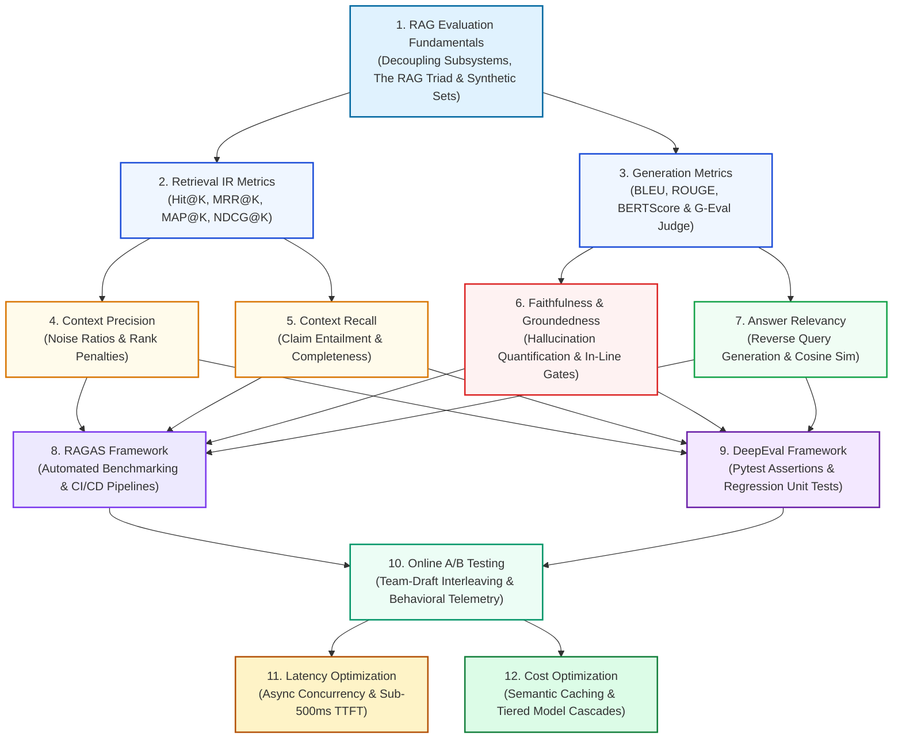

# 🎯 Module 08: RAG Evaluation and Optimization Curriculum Guide

Welcome to **Module 08: RAG Evaluation and Optimization** of the enterprise RAG Engineering curriculum. This module guides you through the rigorous transition from heuristic pipeline design to **scientific, quantitative evaluation, telemetry instrumentation, and aggressive production optimization**. 

You will master the mathematical foundations of the RAG Triad, implement automated regression testing in CI/CD, conduct statistical online experimentation, and optimize system architecture to achieve sub-500ms TTFT with sustainable token economics.

---

## 📑 Module Curriculum & Guide Index

| Topic File | Focus Domain | Architectural Breakthrough & Key Concepts |
| :--- | :--- | :--- |
| [**08.1 RAG Evaluation**](RAG-Evaluation.md) | **Evaluation Fundamentals & Triad** | Decoupling retrieval from generation; the RAG Triad architecture; reference-free evaluation; Evol-Instruct synthetic test generation; framework comparison. |
| [**08.2 Retrieval Metrics**](Retrieval-Metrics.md) | **Ranked Information Retrieval (IR)** | Hit Rate@K, Mean Reciprocal Rank (MRR), Mean Average Precision (MAP@K), and Normalized Discounted Cumulative Gain (NDCG@K) with logarithmic rank discounting. |
| [**08.3 Generation Metrics**](Generation-Metrics.md) | **Surface Form to Cognitive Judges** | Lexical overlap (BLEU/ROUGE), contextual token similarity (BERTScore), G-Eval probabilistic LLM-as-a-Judge, and mitigation of position, verbosity, and self-preference biases. |
| [**08.4 Context Precision**](Context-Precision.md) | **Retrieval Noise & Attention Focus** | Area under precision-recall curve for retrieved chunks, Context Noise Ratio, attention head contamination, and Cross-Encoder reranking optimization. |
| [**08.5 Context Recall**](Context-Recall.md) | **Information Completeness** | Propositional claim decomposition, NLI entailment checking against ground truth, multi-hop evidence coverage, and sentence-window expansion. |
| [**08.6 Faithfulness**](Faithfulness.md) | **Factual Consistency & Groundedness** | Atomic claim deconstruction, intrinsic vs. extrinsic hallucination quantification, confidence-weighted faithfulness, and real-time streaming verification gates. |
| [**08.7 Answer Relevancy**](Answer-Relevancy.md) | **Intent Satisfaction & Conciseness** | Reverse-engineering synthetic questions from candidate answers, embedding cosine similarity, asymmetric information resolution, and verbosity penalties. |
| [**08.8 RAGAS**](RAGAS.md) | **Automated Pipeline Assessment** | Exploding Gradients RAGAS architecture, automated dataset generation via Knowledge Graph extraction, async evaluation execution, and GitHub Actions CI gates. |
| [**08.9 DeepEval**](DeepEval.md) | **Production Unit Testing for LLMs** | Confident AI DeepEval paradigm; `LLMTestCase` abstractions; `assert_test` Pytest gates; GEval custom metrics; regression tracking dashboards. |
| [**08.10 A/B Testing**](A-B-Testing.md) | **Online Experimentation & Telemetry** | Team-Draft Interleaving (TDI), two-proportion Z-tests, minimum detectable effect (MDE) power analysis, implicit behavioral telemetry, and real-time circuit breakers. |
| [**08.11 Latency Optimization**](Latency-Optimization.md) | **Sub-500ms TTFT Engineering** | Asynchronous pipelines (`asyncio.gather`), local ONNX/TensorRT embeddings, HNSW scalar quantization, lightweight rerankers, and Server-Sent Events (SSE) streaming. |
| [**08.12 Cost Optimization**](Cost-Optimization.md) | **Token Economics & Compaction** | Total Cost of Ownership (TCO) modeling, semantic caching (Redis/Qdrant), extractive context pruning, and tiered model cascading (SLM + Frontier LLM). |

---

## 🗺️ Module Learning Roadmap



---

## ⚖️ Comprehensive Evaluation Metric & Architectural Matrix

| Metric / Dimension | Target Axis | Inputs Evaluated | Target Threshold | Detection Capability | Downstream Production Impact |
| :--- | :--- | :--- | :---: | :--- | :--- |
| **Hit Rate@K** | Retrieval | Query, Chunks | $\ge 0.95$ | Complete retrieval blind spots | Sanity check; ensures retrieval baseline |
| **MRR@K** | Retrieval | Query, Chunks | $\ge 0.85$ | Rank delay for primary hit | Minimizes LLM attention decay |
| **MAP@K** | Retrieval | Query, Chunks | $\ge 0.80$ | Multi-document precision drop | Essential for legal & regulatory search |
| **NDCG@K** | Retrieval | Query, Chunks | $\ge 0.85$ | Suboptimal graded document ranking | Best overall predictor of synthesis quality |
| **Context Precision** | Retrieval Quality | Query, Chunks | $\ge 0.80$ | Attention-diluting context noise | Slashes token costs, reduces distraction |
| **Context Recall** | Retrieval Quality | Chunks, Ground Truth | $\ge 0.90$ | Incomplete evidence hops | Prevents unanswerable queries |
| **Faithfulness** | Generation Quality | Chunks, Answer | $\ge 0.98$ | Extrinsic & Intrinsic hallucinations | Non-negotiable in regulated enterprise RAG |
| **Answer Relevancy** | Generation Quality | Query, Answer | $\ge 0.85$ | Evasiveness, padding, and digression | Ensures prompt intent satisfaction |
| **TTFT (Latency)** | System SLA | End-to-End Pipeline | $< 500\text{ms}$ | Network, prefill, and serial bottlenecks | Directly drives user retention and adoption |
| **Cost Per Query** | Economics | Tokens & Cache | $< \$0.002$ | Prompt stuffing & over-reliance on frontier LLMs | Prevents enterprise budget exhaustion |

---

## 🧮 Mathematical Formulations: Master Formula Cheatsheet

### # Composite RAG Quality Score Formula
$$
\mathcal{Q}_{\text{RAG}} = \alpha \cdot \mathcal{S}_{\text{ret}}(q, C) + \beta \cdot \mathcal{S}_{\text{ground}}(C, a) + \gamma \cdot \mathcal{S}_{\text{rel}}(q, a)
$$

---

### # Normalized Discounted Cumulative Gain (NDCG@K)
$$
\text{DCG@K} = \sum_{i=1}^k \frac{2^{\text{rel}(i)} - 1}{\log_2(i + 1)}, \quad \text{NDCG@K} = \frac{\text{DCG@K}}{\text{IDCG@K}}
$$

---

### # RAGAS Faithfulness (Claim-Entailment Ratio)
$$
\text{Faithfulness} = \frac{|\mathcal{S}_{\text{claims}}(a) \cap \mathcal{E}_{\text{entailed}}(C)|}{|\mathcal{S}_{\text{claims}}(a)|}
$$

---

### # Reverse-Query Answer Relevancy
$$
\text{Answer Relevancy} = \frac{1}{N} \sum_{i=1}^N \frac{\mathbf{e}_q \cdot \mathbf{e}_{q_i}}{\|\mathbf{e}_q\| \|\mathbf{e}_{q_i}\|}
$$

---

### # End-to-End Pipeline Latency
$$
T_{\text{total}} = T_{\text{cache}} + (1 - \mathbb{I}_{\text{hit}}) \left[ T_{\text{embed}} + \max(T_{\text{vec}}, T_{\text{lex}}) + T_{\text{rerank}} \right] + T_{\text{TTFT}} + \sum_{i=1}^L T_{\text{ITL}}(i)
$$

---

### # Total Cost of Ownership (TCO) Under Semantic Caching
$$
\mathbb{E}[\mathcal{C}_{\text{query}}] = \eta_{\text{cache}} \cdot C_{\text{cache}} + (1 - \eta_{\text{cache}}) \left[ C_{\text{embed}} + C_{\text{vec}} + \frac{T_{\text{in}} P_{\text{in}} + T_{\text{out}} P_{\text{out}}}{10^6} \right]
$$

---

## 🎯 Master Learning Objectives

By completing Module 08, you will master the following staff-level competencies:
1. **Decoupled Architecture Auditing:** Independently measure and isolate failures in the retrieval engine versus the generation model.
2. **Classical & Modern IR Evaluation:** Implement Hit@K, MRR, MAP, and NDCG from scratch with continuous and graded relevance.
3. **Cognitive Judge Calibration:** Deploy calibrated LLM-as-a-Judge systems (G-Eval) that mitigate position, verbosity, and self-preference biases.
4. **Context Noise Reduction:** Measure Context Precision and deploy Cross-Encoder reranking to eliminate prompt attention contamination.
5. **Information Completeness Verification:** Quantify Context Recall using claim decomposition and natural language inference.
6. **Zero-Tolerance Hallucination Control:** Construct real-time Faithfulness verification gates that intercept unfaithful claims before token release.
7. **Production CI/CD Automation:** Implement automated quality gates in GitHub Actions using RAGAS and DeepEval with Pytest assertions.
8. **Statistically Rigorous Online Testing:** Conduct Team-Draft Interleaving experiments and calculate two-proportion Z-tests on live telemetry.
9. **Sub-500ms TTFT Engineering:** Optimize pipeline latency using asynchronous parallel branches, local ONNX embeddings, scalar quantization, and SSE streaming.
10. **Sustainable Token Economics:** Cut production LLM bills by 70–85% through semantic caching, extractive context pruning, and tiered model cascades.

---

## 🏗️ Production Evaluation & Optimization Architecture Blueprint

```mermaid
flowchart TD
    subgraph OfflineEngineering ["1. Offline CI/CD Quality Gate (Pre-Deploy)"]
        PR[Pull Request Code Change] --> Synthesize[Synthesize 500-Q Test Set via Evol-Instruct]
        Synthesize --> PytestDeepEval["Pytest + DeepEval / RAGAS Runner:<br/>• Assert Faithfulness >= 0.95<br/>• Assert Context Recall >= 0.90<br/>• Assert NDCG@5 >= 0.85"]
        PytestDeepEval -->|"Fail"| Halt[Halt Build & Alert Engineers ❌]
        PytestDeepEval -->|"Pass"| DeployGate[Approve Merge & Deploy ✅]
    end

    subgraph RuntimeEngine ["2. Optimized Production Serving Runtime"]
        UserQ([User Live Query]) --> SC{"Semantic Cache Hit?<br/>(Redis Vector Sim >= 0.96)"}
        SC -->|"Yes"| InstantAns([Instant Cached Answer: 15ms | $0.00 ⚡])
        
        SC -->|"No"| Fork["Async Parallel Retrieval (asyncio.gather)"]
        Fork --> Dense[Dense Vector Search SQ8]
        Fork --> Sparse[Lexical BM25 Search]
        
        Dense & Sparse --> Fuse[Reciprocal Rank Fusion + FlashRank]
        Fuse --> Prune[Extractive Context Pruning]
        Prune --> Router{"Query Complexity Classifier"}
        
        Router -->|"Simple"| Tier1[Tier 1 Mini Model: GPT-4o-mini]
        Router -->|"Complex"| Tier2[Tier 2 Frontier Model: Claude 3.5]
        
        Tier1 & Tier2 --> Gatekeeper{"In-Line Faithfulness Check"}
        Gatekeeper -->|"Verified"| StreamOut([Stream Tokens via SSE: TTFT < 450ms 🚀])
        Gatekeeper -->|"Unfaithful"| FallbackOut([Safe Fallback Response 🛡️])
    end

    subgraph OnlineTelemetry ["3. Continuous Telemetry & Experimentation"]
        StreamOut --> TelemetryBuffer[Async Kafka Telemetry Queue]
        TelemetryBuffer --> Analytics[ClickHouse Experimentation Lake]
        Analytics --> OnlineTests["Real-Time Interleaved Ranking Analysis<br/>Two-Proportion Z-Test<br/>Automated Circuit Breakers"]
    end

    style OfflineEngineering fill:#f8fafc,stroke:#64748b
    style RuntimeEngine fill:#eff6ff,stroke:#2563eb,stroke-width:2px
    style OnlineTelemetry fill:#f0fdf4,stroke:#16a34a,stroke-width:2px
    style InstantAns fill:#dcfce7,stroke:#16a34a,stroke-width:2px
    style StreamOut fill:#dcfce7,stroke:#16a34a,stroke-width:2px
```
