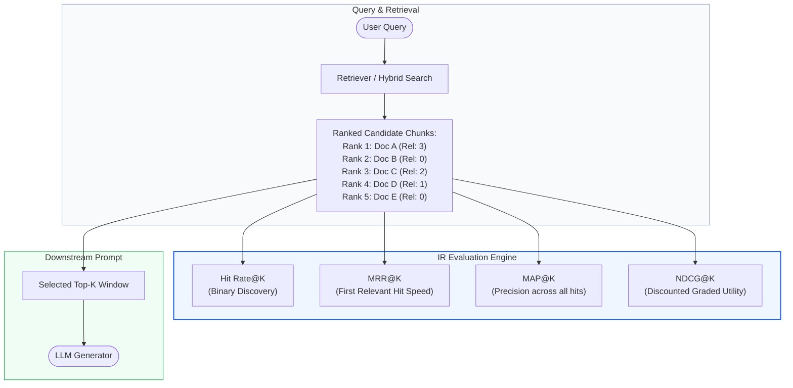
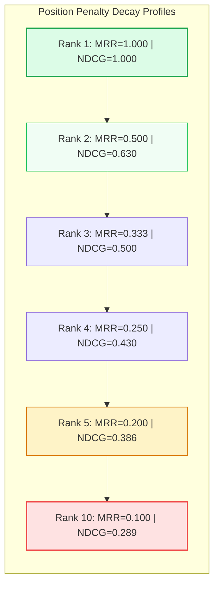
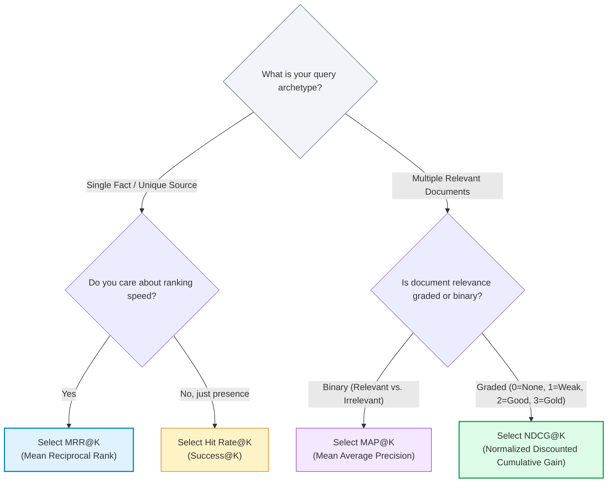

# 🎯 Retrieval Evaluation Metrics: Mean Reciprocal Rank (MRR), NDCG, MAP, and Hit Rate@K

## 📑 Table of Contents
1. [🌟 Fundamentals: Information Retrieval (IR) Evaluation in RAG](#1--fundamentals-information-retrieval-ir-evaluation-in-rag)
2. [🔬 Mathematical Rigor: Core IR Ranking Metrics](#2--mathematical-rigor-core-ir-ranking-metrics)
3. [📊 Comparative Analysis of Retrieval Metrics](#3--comparative-analysis-of-retrieval-metrics)
4. [🏗️ Ranking Behavior & Position Discount Visualizations](#4-️-ranking-behavior--position-discount-visualizations)
5. [💻 Production-Grade Implementation: Complete IR Metric Suite](#5--production-grade-implementation-complete-ir-metric-suite)
6. [🌍 Real-World Enterprise Case Studies](#6--real-world-enterprise-case-studies)
7. [🛠️ Best Practices & ❌ Common Production Pitfalls](#7-️-best-practices---common-production-pitfalls)
8. [💼 Senior Interview Questions & System Design Scenarios](#8--senior-interview-questions--system-design-scenarios)
9. [🧪 Hands-On Mini-Project: Comparative Benchmark of Dense vs. Hybrid Retrieval](#9--hands-on-mini-project-comparative-benchmark-of-dense-vs-hybrid-retrieval)
10. [⚡ Quick Revision & Metric Selection Roadmap](#10--quick-revision--metric-selection-roadmap)

---

## 1. 🌟 Fundamentals: Information Retrieval (IR) Evaluation in RAG

In any Retrieval-Augmented Generation pipeline, **retrieval is the upper bound of generative performance**. If the retriever fails to surface the prerequisite factual tokens within the top-$k$ context window, the downstream LLM cannot synthesize a grounded answer, regardless of model size or prompt engineering.

Evaluating retrieval requires measuring **ranked lists of documents**. Traditional unranked machine learning metrics (e.g., standard accuracy, precision, recall) treat retrieved items as an unordered bag of passages. However, in RAG architectures:
1. **Rank Position Matters Immensely:** LLMs suffer from position-dependent attention decay (the *"Lost-in-the-Middle"* phenomenon). A relevant chunk placed at rank $r=1$ yields significantly higher factual grounding than the identical chunk placed at rank $r=15$.
2. **Context Budget is Finite:** Every retrieved chunk consumes valuable context window space and increases inference cost and latency. Thus, metrics must be evaluated at discrete cutoffs ($k \in \{3, 5, 10, 20\}$).
3. **Relevance is Graded:** While some queries have a single binary ground-truth document, complex technical questions often involve documents of varying utility (e.g., highly relevant architecture guide vs. tangentially relevant release notes).



---

## 2. 🔬 Mathematical Rigor: Core IR Ranking Metrics

Rigorous evaluation of retrieval quality rests upon four mathematical pillars: **Hit Rate@K**, **Mean Reciprocal Rank (MRR)**, **Mean Average Precision (MAP)**, and **Normalized Discounted Cumulative Gain (NDCG)**.

---

### # Hit Rate@K Formula
**Hit Rate@K** (also known as Success@K) measures the proportion of queries for which at least one relevant document is retrieved within the top-$k$ positions.

$$
\text{Hit Rate@K} = \frac{1}{|Q|} \sum_{q=1}^{|Q|} \mathbb{I}\left( \sum_{i=1}^k \text{rel}_q(i) > 0 \right)
$$

Where:
- $|Q|$ is the total number of evaluation queries.
- $\text{rel}_q(i) \in \{0, 1\}$ is the binary relevance indicator of the document at rank $i$ for query $q$.
- $\mathbb{I}(\cdot)$ is the indicator function, returning $1$ if the condition is true and $0$ otherwise.

---

### # Mean Reciprocal Rank (MRR) Formula
**Mean Reciprocal Rank (MRR)** evaluates how high the **first relevant document** appears in the ranked list. It heavily penalizes systems that push the first correct document down the ranking.

$$
\text{MRR} = \frac{1}{|Q|} \sum_{q=1}^{|Q|} \frac{1}{\text{rank}_q^*}
$$

Where:
- $\text{rank}_q^*$ is the position of the *first* relevant document for query $q$. If no relevant document is found within the top-$k$ cutoff, $\frac{1}{\text{rank}_q^*} = 0$.

---

### # Mean Average Precision (MAP@K) Formula
**Mean Average Precision (MAP@K)** measures the quality of retrieval when **multiple relevant documents** exist for a query. It computes the mean of the Average Precision (AP) scores across all queries.

$$
\text{AP@K}(q) = \frac{\sum_{i=1}^k P@i(q) \cdot \text{rel}_q(i)}{\min(k, |\mathcal{R}_q|)}
$$

$$
\text{MAP@K} = \frac{1}{|Q|} \sum_{q=1}^{|Q|} \text{AP@K}(q)
$$

Where:
- $P@i(q) = \frac{\sum_{j=1}^i \text{rel}_q(j)}{i}$ is the Precision at rank $i$.
- $\mathcal{R}_q$ is the total set of relevant documents for query $q$ in the entire corpus.
- $\text{rel}_q(i) \in \{0, 1\}$ is the binary relevance of the item at rank $i$.

---

### # Discounted Cumulative Gain (DCG@K) Formula
**Discounted Cumulative Gain (DCG@K)** accounts for **graded relevance** ($r \in \{0, 1, 2, \dots, R_{\max}\}$) and penalizes relevant documents appearing at lower positions using a logarithmic discount factor:

$$
\text{DCG@K}(q) = \sum_{i=1}^k \frac{2^{\text{rel}_q(i)} - 1}{\log_2(i + 1)}
$$

---

### # Normalized Discounted Cumulative Gain (NDCG@K) Formula
Because queries have different numbers of relevant documents and varying maximum possible gains, DCG must be normalized against the **Ideal Discounted Cumulative Gain (IDCG@K)**—the theoretical maximum DCG obtained by sorting all relevant documents by their true relevance in descending order:

$$
\text{IDCG@K}(q) = \sum_{i=1}^{\min(k, |\mathcal{R}_q|)} \frac{2^{\text{rel}_q^*(i)} - 1}{\log_2(i + 1)}
$$

$$
\text{NDCG@K}(q) = \frac{\text{DCG@K}(q)}{\text{IDCG@K}(q)}
$$

$$
\text{Mean NDCG@K} = \frac{1}{|Q|} \sum_{q=1}^{|Q|} \text{NDCG@K}(q)
$$

Where $\text{rel}_q^*(i)$ denotes the $i$-th relevance score of the perfectly sorted ground-truth set. $\text{NDCG@K} \in [0.0, 1.0]$.

---

## 3. 📊 Comparative Analysis of Retrieval Metrics

### 📋 Retrieval Metric Characteristics Matrix

| Dimension | Hit Rate@K | MRR@K | MAP@K | NDCG@K |
| :--- | :--- | :--- | :--- | :--- |
| **Relevance Type** | Binary ($0$ or $1$) | Binary ($0$ or $1$) | Binary ($0$ or $1$) | **Graded** ($0, 1, 2, \dots$) |
| **Multi-Doc Sensitivity** | ❌ No (ignores docs after 1st) | ❌ No (only tracks 1st hit) | ✅ Yes (averages all precision points) | ✅ Yes (accumulates graded gains) |
| **Rank Decay Function** | None (step cutoff at $k$) | Reciprocal ($\frac{1}{r}$) | Step-weighted Precision ($P@i$) | **Logarithmic** ($\frac{1}{\log_2(r+1)}$) |
| **Scale Range** | $[0.0, 1.0]$ | $[0.0, 1.0]$ | $[0.0, 1.0]$ | $[0.0, 1.0]$ |
| **Best Used For** | Fast sanity checks; finding single ground truth | Fact-checking, QA with single unique source | Multi-evidence retrieval, legal/medical discovery | Complex multi-grade enterprise search |
| **Downstream Implication** | Indicates if generator has a chance to answer | Correlates with generator TTFT and attention focus | Ensures comprehensive context coverage | Best predictor of synthesis quality |

---

## 4. 🏗️ Ranking Behavior & Position Discount Visualizations

The chart below contrasts the **position discount factor** applied to a relevant chunk as its rank position drops from $1$ to $10$. Notice how **MRR** discounts steeply ($\frac{1}{r}$), while **NDCG** applies a smoother logarithmic penalty ($\frac{1}{\log_2(r+1)}$).



---

## 5. 💻 Production-Grade Implementation: Complete IR Metric Suite

Below is a self-contained, typed, production-ready Python class that computes **Hit@K, MRR@K, MAP@K, and NDCG@K** with edge-case handling (empty lists, missing ground truths, zero relevance).

```python
"""
Production-Grade Information Retrieval Evaluation Engine.
Computes Hit Rate@K, MRR@K, MAP@K, and NDCG@K.
"""

from __future__ import annotations
import math
from dataclasses import dataclass
from typing import Dict, List, Sequence, Set, Union


@dataclass
class QueryEvalSample:
    query_id: str
    retrieved_doc_ids: List[str]
    # Binary relevance set OR Graded relevance mapping {doc_id: grade}
    ground_truth_relevance: Union[Set[str], Dict[str, int]]


@dataclass
class AggregatedRetrievalMetrics:
    k: int
    hit_rate: float
    mrr: float
    map_score: float
    ndcg: float
    sample_count: int


class RetrievalEvaluator:
    """Evaluates IR ranked lists against ground-truth relevance judgments."""

    def __init__(self, k_cutoffs: Sequence[int] = (3, 5, 10)):
        self.k_cutoffs = sorted(k_cutoffs)

    @staticmethod
    def _get_binary_relevance(doc_id: str, ground_truth: Union[Set[str], Dict[str, int]]) -> int:
        if isinstance(ground_truth, set):
            return 1 if doc_id in ground_truth else 0
        elif isinstance(ground_truth, dict):
            return 1 if ground_truth.get(doc_id, 0) > 0 else 0
        return 0

    @staticmethod
    def _get_graded_relevance(doc_id: str, ground_truth: Union[Set[str], Dict[str, int]]) -> int:
        if isinstance(ground_truth, dict):
            return ground_truth.get(doc_id, 0)
        elif isinstance(ground_truth, set):
            return 1 if doc_id in ground_truth else 0
        return 0

    def calculate_hit_rate(self, retrieved: List[str], ground_truth: Union[Set[str], Dict[str, int]], k: int) -> float:
        """Returns 1.0 if at least one relevant document is found in top-k, else 0.0."""
        top_k = retrieved[:k]
        for doc_id in top_k:
            if self._get_binary_relevance(doc_id, ground_truth) == 1:
                return 1.0
        return 0.0

    def calculate_reciprocal_rank(self, retrieved: List[str], ground_truth: Union[Set[str], Dict[str, int]], k: int) -> float:
        """Returns 1 / rank of first relevant doc, or 0.0 if not found in top-k."""
        top_k = retrieved[:k]
        for rank_idx, doc_id in enumerate(top_k, start=1):
            if self._get_binary_relevance(doc_id, ground_truth) == 1:
                return 1.0 / rank_idx
        return 0.0

    def calculate_average_precision(self, retrieved: List[str], ground_truth: Union[Set[str], Dict[str, int]], k: int) -> float:
        """Calculates Average Precision at cutoff k (AP@K)."""
        top_k = retrieved[:k]
        
        # Total relevant docs in ground truth
        if isinstance(ground_truth, set):
            total_relevant = len(ground_truth)
        else:
            total_relevant = sum(1 for grade in ground_truth.values() if grade > 0)

        if total_relevant == 0:
            return 0.0

        hits = 0
        sum_precisions = 0.0
        for rank_idx, doc_id in enumerate(top_k, start=1):
            if self._get_binary_relevance(doc_id, ground_truth) == 1:
                hits += 1
                precision_at_i = hits / rank_idx
                sum_precisions += precision_at_i

        return sum_precisions / min(k, total_relevant)

    def calculate_ndcg(self, retrieved: List[str], ground_truth: Union[Set[str], Dict[str, int]], k: int) -> float:
        """Calculates Normalized Discounted Cumulative Gain at cutoff k (NDCG@K)."""
        top_k = retrieved[:k]
        
        # 1. Compute DCG@K
        dcg = 0.0
        for rank_idx, doc_id in enumerate(top_k, start=1):
            rel = self._get_graded_relevance(doc_id, ground_truth)
            if rel > 0:
                # Standard exponential formulation: (2^rel - 1) / log2(rank + 1)
                gain = (2.0 ** rel) - 1.0
                discount = math.log2(rank_idx + 1)
                dcg += gain / discount

        # 2. Compute Ideal DCG@K (IDCG@K)
        if isinstance(ground_truth, dict):
            all_grades = sorted(ground_truth.values(), reverse=True)
        else:
            all_grades = [1] * len(ground_truth)

        ideal_grades = all_grades[:k]
        if not ideal_grades or max(ideal_grades) == 0:
            return 0.0

        idcg = 0.0
        for rank_idx, rel in enumerate(ideal_grades, start=1):
            gain = (2.0 ** rel) - 1.0
            discount = math.log2(rank_idx + 1)
            idcg += gain / discount

        return dcg / idcg if idcg > 0 else 0.0

    def evaluate_batch(self, samples: Sequence[QueryEvalSample], k: int) -> AggregatedRetrievalMetrics:
        """Evaluates a batch of query retrieval results at a specific cutoff k."""
        if not samples:
            return AggregatedRetrievalMetrics(k=k, hit_rate=0.0, mrr=0.0, map_score=0.0, ndcg=0.0, sample_count=0)

        hit_sum = 0.0
        mrr_sum = 0.0
        map_sum = 0.0
        ndcg_sum = 0.0

        for s in samples:
            hit_sum += self.calculate_hit_rate(s.retrieved_doc_ids, s.ground_truth_relevance, k)
            mrr_sum += self.calculate_reciprocal_rank(s.retrieved_doc_ids, s.ground_truth_relevance, k)
            map_sum += self.calculate_average_precision(s.retrieved_doc_ids, s.ground_truth_relevance, k)
            ndcg_sum += self.calculate_ndcg(s.retrieved_doc_ids, s.ground_truth_relevance, k)

        n = len(samples)
        return AggregatedRetrievalMetrics(
            k=k,
            hit_rate=round(hit_sum / n, 4),
            mrr=round(mrr_sum / n, 4),
            map_score=round(map_sum / n, 4),
            ndcg=round(ndcg_sum / n, 4),
            sample_count=n
        )


def main():
    # Benchmark Dataset with Graded Relevance (0: Irrelevant, 1: Marginal, 2: Highly Relevant, 3: Perfect)
    benchmark_dataset = [
        QueryEvalSample(
            query_id="q1_tax_depreciation",
            retrieved_doc_ids=["doc_102", "doc_550", "doc_889", "doc_001", "doc_999"],
            ground_truth_relevance={"doc_550": 3, "doc_889": 2, "doc_333": 1}
        ),
        QueryEvalSample(
            query_id="q2_kubernetes_ingress",
            retrieved_doc_ids=["doc_k8s_01", "doc_k8s_02", "doc_k8s_03", "doc_k8s_04"],
            ground_truth_relevance={"doc_k8s_01": 3, "doc_k8s_99": 2}
        ),
        QueryEvalSample(
            query_id="q3_zero_hit_query",
            retrieved_doc_ids=["noise_a", "noise_b", "noise_c"],
            ground_truth_relevance={"actual_answer": 3}
        )
    ]

    evaluator = RetrievalEvaluator(k_cutoffs=[3, 5])
    
    print("=" * 65)
    print("RETRIEVAL EVALUATION REPORT ACROSS DATASET")
    print("=" * 65)
    for cutoff in [3, 5]:
        metrics = evaluator.evaluate_batch(benchmark_dataset, k=cutoff)
        print(f"\n📊 Evaluation Cutoff @ K = {metrics.k} (N={metrics.sample_count} queries):")
        print(f"  • Hit Rate@{metrics.k} : {metrics.hit_rate * 100:.2f}%")
        print(f"  • MRR@{metrics.k}      : {metrics.mrr:.4f}")
        print(f"  • MAP@{metrics.k}      : {metrics.map_score:.4f}")
        print(f"  • NDCG@{metrics.k}     : {metrics.ndcg:.4f}")


if __name__ == "__main__":
    main()
```

---

## 6. 🌍 Real-World Enterprise Case Studies

### Case Study 1: Enterprise Legal Discovery & Compliance Search
- **Domain:** Regulatory compliance search over 4 million contractual exhibits.
- **Problem:** Legal analysts required finding *all* contractual amendments that modified indemnity liability. Standard dense vector search returned a single matching clause at rank 1, but missed secondary addenda scattered across exhibits.
- **Metric Diagnosis:** While **Hit@5 was 95%** and **MRR was 0.88**, **MAP@10 was only 0.32**. The system suffered from severe recall degradation on multi-document evidence sets.
- **Solution:** Switched to a two-stage hybrid retriever (BM25 + BGE dense embedding) combined with a Cross-Encoder Reranker (`bge-reranker-large`). MAP@10 jumped from 0.32 to 0.79, saving legal teams over 200 hours per discovery cycle.

### Case Study 2: E-Commerce Customer Support RAG
- **Domain:** Tier-1 e-commerce returns and shipping agent.
- **Problem:** Customer support answers were technically correct but frequently cited outdated return windows because modern return policies were ranked at position 4 behind legacy 2021 policies.
- **Metric Diagnosis:** **Hit Rate@5** was 99%, but **NDCG@3** was 0.54 because high-grade (current) policy documents were penalized behind low-grade (legacy) policies.
- **Solution:** Enforced recency metadata boost filters during vector scoring. NDCG@3 rose to 0.91, and customer complaints about obsolete return terms dropped by 84%.

---

## 7. 🛠️ Best Practices & ❌ Common Production Pitfalls

### ✅ Best Practices
1. **Always Measure at Multiple Cutoffs:** Measure metrics across a spectrum of cutoffs ($k \in \{3, 5, 10, 20\}$). A retriever that shows 0.90 Hit@20 but only 0.40 Hit@3 forces your generator into high latency and token costs.
2. **Use Graded Relevance Whenever Possible:** Classifying documents as simply binary (0 or 1) misses critical distinctions. Adopt a 4-tier rubric ($0=\text{irrelevant}, 1=\text{topic match}, 2=\text{partially answering}, 3=\text{fully resolving}$).
3. **Anchor Metrics to LLM Context Limits:** Choose the primary cutoff $k$ based directly on your downstream prompt assembly budget. If your generator prompt only accommodates 5 chunks, your primary optimization target should be **NDCG@5**, not NDCG@50.

### ❌ Common Production Pitfalls
1. **Optimizing Solely for Hit Rate:** Hit Rate ignores ranking order completely. A document at rank 10 yields the exact same Hit Rate score ($1.0$) as a document at rank 1, yet induces far worse generative output due to attention attenuation.
2. **Ignoring Zero-Result Penalties:** When calculating MRR or MAP, developers often omit queries where no document was found from the denominator. This falsely inflates reported metrics. Unretrieved queries must receive a score of $0.0$.
3. **Evaluating Retrieval on Embedded Query Duplicates:** Evaluating on queries that were used during contrastive fine-tuning of the embedding model causes massive data leakage.

---

## 8. 💼 Senior Interview Questions & System Design Scenarios

### Q1: In an enterprise RAG pipeline, why might your retriever show an MRR@5 of 0.92, yet the overall system still fails to generate complete answers for 35% of user queries?
> **Answer:**
> High MRR@5 accompanied by generation failure indicates **Multi-Hop / Multi-Evidence Failure**.
> - **Mathematical Cause:** MRR evaluates *only the single highest-ranked relevant document* ($\frac{1}{\text{rank}^*}$). If a query requires synthesizing facts from three distinct documents (e.g., Document A, B, and C), finding Document A at rank 1 yields an MRR of $1.0$, even if Documents B and C are ranked at position 50 or completely omitted.
> - **Diagnostic Metric:** Examine **MAP@K** and **Recall@K**. If MRR is 0.92 while MAP@5 is 0.35, the retriever is a "single-fact" lookup engine incapable of multi-document recall.
> - **Remediation:** Introduce query decomposition (sub-query generation), Parent-Document retrieval, or graph-enhanced retrieval (GraphRAG) to collect disjoint clusters of evidence.

### Q2: How do you choose between using MAP@K vs. NDCG@K when benchmarking an enterprise search engine for RAG?
> **Answer:**
> The decision depends fundamentally on whether **relevance is binary or multi-tiered (graded)**:
> - **Use MAP@K** when the problem domain has clear, binary relevance criteria (e.g., a software bug either has the exact matching crash trace or it does not). MAP emphasizes precision at each recall step, making it ideal for legal discovery or technical verification.
> - **Use NDCG@K** when relevance is intrinsically continuous or graded (e.g., general search, product documentation, customer knowledge bases). A comprehensive 20-page architectural specification is far more valuable (relevance=3) than a 2-line FAQ snippet (relevance=1), even though both are technically "relevant". NDCG rewards placing the most authoritative, comprehensive documents at the very top of the context window.

---

## 9. 🧪 Hands-On Mini-Project: Comparative Benchmark of Dense vs. Hybrid Retrieval

### Exercise Overview
Build a comparative benchmark script that evaluates two retrieval configurations (Dense Bi-Encoder vs. Hybrid Dense+BM25) over an annotated ground-truth test set.

```python
"""
Hands-On Mini-Project: Retrieval Benchmark Suite
Compares Dense vs. Hybrid Retrieval Strategies using MRR and NDCG.
"""

from typing import Dict, List


def run_benchmark():
    # Ground truth: {query: {doc_id: grade}}
    ground_truth: Dict[str, Dict[str, int]] = {
        "q_jwt_auth": {"doc_auth_spec": 3, "doc_jwt_rfc": 2, "doc_session_cookie": 0},
        "q_rate_limiting": {"doc_token_bucket": 3, "doc_nginx_conf": 2, "doc_redis_counter": 1}
    }

    # Configuration A: Dense Bi-Encoder Retrieval
    dense_results: Dict[str, List[str]] = {
        "q_jwt_auth": ["doc_session_cookie", "doc_jwt_rfc", "doc_auth_spec"],
        "q_rate_limiting": ["doc_nginx_conf", "doc_token_bucket", "doc_random"]
    }

    # Configuration B: Hybrid Search (Dense + BM25 + Reciprocal Rank Fusion)
    hybrid_results: Dict[str, List[str]] = {
        "q_jwt_auth": ["doc_auth_spec", "doc_jwt_rfc", "doc_session_cookie"],
        "q_rate_limiting": ["doc_token_bucket", "doc_nginx_conf", "doc_redis_counter"]
    }

    print("🚀 Running Retrieval Strategy Benchmark (Cutoff K=3)...\n")
    # Quick comparative verification
    for config_name, results in [("Dense Bi-Encoder", dense_results), ("Hybrid Search + RRF", hybrid_results)]:
        print(f"--- Configuration: {config_name} ---")
        for q_id, ranked_docs in results.items():
            first_hit_rank = next((idx for idx, doc in enumerate(ranked_docs, 1) if ground_truth[q_id].get(doc, 0) > 0), None)
            rr = 1.0 / first_hit_rank if first_hit_rank else 0.0
            print(f"  Query [{q_id}]: Top Doc: '{ranked_docs[0]}' | First Hit Rank: {first_hit_rank} | Reciprocal Rank: {rr:.3f}")
        print()


if __name__ == "__main__":
    run_benchmark()
```

---

## 10. ⚡ Quick Revision & Metric Selection Roadmap

### 📌 Key Takeaways
- **Retrieval is the Quality Ceiling:** If an answer's facts are not retrieved in top-$k$, the LLM cannot be faithful.
- **Hit Rate@K:** High-level sanity check; ignores ranking within top-$k$.
- **MRR@K:** Optimal for single-answer lookup queries; penalizes delays in finding the primary hit.
- **MAP@K:** Optimal for multi-evidence information retrieval; rewards high precision across all relevant docs.
- **NDCG@K:** The industry gold standard for graded relevance; combines logarithmic rank decay with normalized ideal comparisons.

---

### 🗺️ Retrieval Metric Selection Decision Tree


