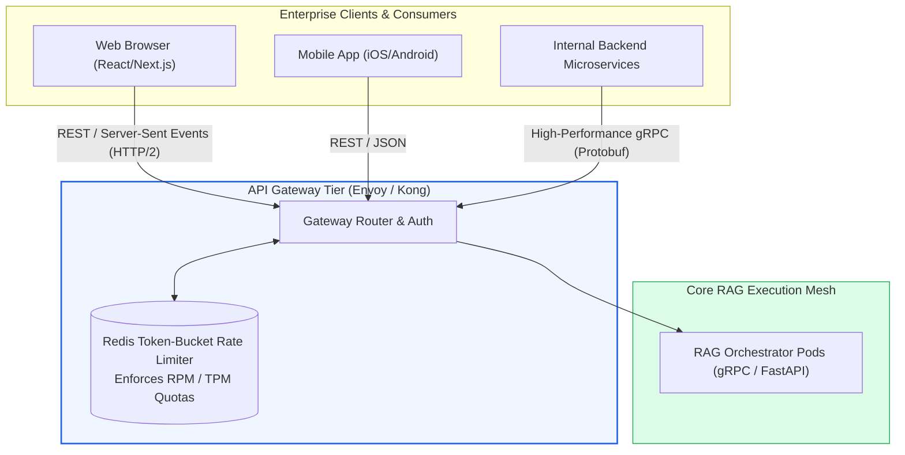
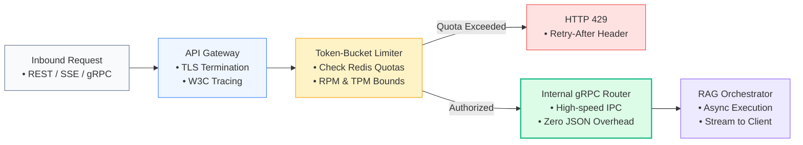

# 🌐 Enterprise API Design for RAG: REST, gRPC, Schema Versioning, and Rate-Limiting

## 📑 Table of Contents
1. [🌟 Fundamentals: Contract-First API Engineering for Generative AI](#1--fundamentals-contract-first-api-engineering-for-generative-ai)
2. [🔬 Mathematical Formulations: Rate-Limiting Algorithms & Serialization Efficiency](#2--mathematical-formulations-rate-limiting-algorithms--serialization-efficiency)
3. [📊 Protocol & Transport Matrix: REST vs. gRPC vs. GraphQL](#3--protocol--transport-matrix-rest-vs-grpc-vs-graphql)
4. [🏗️ Architectural Architecture: Protocol Buffers, Ingress Routing & Versioning](#4-️-architectural-architecture-protocol-buffers-ingress-routing--versioning)
5. [💻 Production-Grade Implementation: Dual REST/gRPC Schema & Rate-Limiter Gateway](#5--production-grade-implementation-dual-restgrpc-schema--rate-limiter-gateway)
6. [🌍 Real-World Enterprise Case Studies](#6--real-world-enterprise-case-studies)
7. [🛠️ Best Practices & ❌ Common Production Anti-Patterns](#7-️-best-practices---common-production-anti-patterns)
8. [💼 Senior System Design & Architecture Interview Questions](#8--senior-system-design--architecture-interview-questions)
9. [🧪 Hands-On Mini-Project: Distributed Token-Bucket Rate Limiter Test Harness](#9--hands-on-mini-project-distributed-token-bucket-rate-limiter-test-harness)
10. [⚡ Quick Revision & API Architecture Blueprint](#10--quick-revision--api-architecture-blueprint)

---

## 1. 🌟 Fundamentals: Contract-First API Engineering for Generative AI

When exposing Retrieval-Augmented Generation (RAG) services to enterprise clients, frontends, or external partner integrations, API design becomes the contract that dictates system reliability, backwards compatibility, and security.

### The Challenge of GenAI API Design
Unlike traditional CRUD APIs where requests and responses map to rigid database columns, RAG APIs deal with:
- **Streaming Payloads:** Delivering tokens incrementally rather than returning a monolithic JSON block after several seconds.
- **Rich Structured Metadata:** Returning source chunk identifiers, bounding-box coordinates, confidence scores, and token usage accounting alongside natural language answers.
- **Asymmetric Latency:** While a database lookup takes $5\text{ms}$, LLM synthesis takes $500 - 3,000\text{ms}$. APIs must support asynchronous polling, webhooks, or streaming to prevent gateway connection dropouts.
- **Upstream Rate Exhaustion:** External LLM providers impose strict Requests-Per-Minute (RPM) and Tokens-Per-Minute (TPM) limits. An enterprise RAG API must throttle inbound client demand gracefully to prevent catastrophic upstream 429 cascading failures.



---

## 2. 🔬 Mathematical Formulations: Rate-Limiting Algorithms & Serialization Efficiency

Quantitative rate control protects backend resources while maximizing utilization.

---

### # Token Bucket Ingress Rate Limiter Formula
The Token Bucket algorithm allows traffic bursts up to a maximum bucket capacity $B_{\text{max}}$ while sustaining a constant replenishment rate $r$ tokens/second:

$$
B(t) = \min\left( B_{\text{max}}, \; B(t_{\text{last}}) + r \cdot (t - t_{\text{last}}) \right)
$$

For an incoming request requiring $k$ tokens (e.g., $k=1$ for basic query, or $k = N_{\text{prompt\_tokens}}$ for token-aware throttling):

$$
\text{Admitted} = \begin{cases}
\text{True}, & \text{if } B(t) \ge k \implies B_{\text{new}}(t) = B(t) - k \\
\text{False (HTTP 429)}, & \text{if } B(t) < k
\end{cases}
$$

---

### # Binary Serialization Wire Compression Efficiency
When comparing Protocol Buffers (gRPC) to standard JSON serialization over the wire:

$$
\eta_{\text{wire}} = 1 - \frac{S_{\text{Protobuf}}}{S_{\text{JSON}}}
$$

Where:
- $S_{\text{Protobuf}}$ is the binary message size in bytes.
- $S_{\text{JSON}}$ is the serialized UTF-8 string payload size.

In RAG pipelines returning large context arrays (e.g., 20 retrieved chunks containing embeddings and metadata), Protobuf achieves $\eta_{\text{wire}} \approx 0.40 - 0.65$ (**40% to 65% reduction in network payload bytes**), substantially lowering internal network serialization overhead.

---

## 3. 📊 Protocol & Transport Matrix: REST vs. gRPC vs. GraphQL

| Architectural Dimension | REST (JSON over HTTP/1.1 / HTTP/2) | gRPC (Protobuf over HTTP/2) | GraphQL |
| :--- | :--- | :--- | :--- |
| **Payload Format** | Human-readable JSON | Compact binary Protocol Buffers | JSON |
| **Streaming Support** | Unidirectional via Server-Sent Events (SSE) | **Full Bidirectional Streaming** | Subscriptions via WebSockets |
| **Client Code Generation** | OpenAPI / Swagger tooling (semi-manual) | **Native compiler (`protoc`) across 12+ languages** | Client schema compilation (Apollo/Relay) |
| **Network Efficiency** | Moderate (Text parsing overhead, string keys) | **High** (Binary encoding, multiplexed connections) | Moderate (Payload overhead from query AST) |
| **Browser Compatibility** | Universal (Standard `fetch()`) | Requires `grpc-web` proxy | Universal |
| **Primary Domain in RAG** | **Public APIs, Web Frontends, Mobile Apps** | **Internal Microservice-to-Microservice IPC** | Complex graph retrieval & document relationships |

---

## 4. 🏗️ Architectural Architecture: Protocol Buffers, Ingress Routing & Versioning

### Schema Versioning Strategy: URL Path vs. Header-Based
In enterprise APIs, backwards compatibility must be strictly preserved:
- **URL Path Versioning (`/api/v1/query`, `/api/v2/query`):** Recommended for public external interfaces. Explicit, transparent, and effortlessly routed by CDN and Ingress controllers.
- **Protobuf Field Deprecation (gRPC):** Fields are never removed or renumbered; obsolete fields are tagged `reserved` or `[deprecated = true]`, allowing older clients to communicate seamlessly with upgraded microservices.

```protobuf
syntax = "proto3";

package enterprise.rag.v1;

// Service definition for internal RAG microservices
service RAGService {
  // Synchronous batch query execution
  rpc Query(QueryRequest) returns (QueryResponse);

  // Real-time server-side token streaming
  rpc StreamQuery(QueryRequest) returns (stream StreamChunk);
}

message QueryRequest {
  string query = 1;
  int32 top_k = 2;
  float temperature = 3;
  string tenant_id = 4;
}

message Citation {
  string source_id = 1;
  string document_name = 2;
  float relevance_score = 3;
  string text_snippet = 4;
}

message QueryResponse {
  string query = 1;
  string answer = 2;
  repeated Citation citations = 3;
  double latency_ms = 4;
}

message StreamChunk {
  oneof chunk_payload {
    string token_delta = 1;
    Citation citation = 2;
    string error_message = 3;
  }
}
```

---

## 5. 💻 Production-Grade Implementation: Dual REST/gRPC Schema & Rate-Limiter Gateway

The Python 3.10+ script below implements a production-grade **Token-Bucket Rate Limiter** supporting multi-tenant client throttling, custom RPM quotas, and automated header injection (`X-RateLimit-Remaining`, `Retry-After`).

```python
"""
Production RAG API Rate Limiting Gateway
Implements stateful token-bucket throttling per tenant/API key
with strict HTTP 429 semantics and standard header emissions.
"""

from __future__ import annotations
import logging
import time
from dataclasses import dataclass
from typing import Dict, Optional, Tuple

logging.basicConfig(level=logging.INFO, format="%(asctime)s [%(levelname)s] %(name)s: %(message)s")
logger = logging.getLogger("APIGateway")


@dataclass
class RateLimitQuota:
    rate_per_sec: float  # Replenishment rate (tokens per second)
    burst_capacity: float  # Maximum bucket capacity


class TokenBucket:
    """Thread-safe Token Bucket state tracker for a single client."""
    def __init__(self, quota: RateLimitQuota) -> None:
        self.capacity = quota.burst_capacity
        self.fill_rate = quota.rate_per_sec
        self.tokens = quota.burst_capacity
        self.last_update = time.monotonic()

    def consume(self, cost: float = 1.0) -> Tuple[bool, float, float]:
        """
        Attempts to consume `cost` tokens.
        Returns: (Is_Allowed, Remaining_Tokens, Retry_After_Seconds)
        """
        now = time.monotonic()
        elapsed = now - self.last_update
        self.last_update = now

        # Replenish tokens based on elapsed duration
        self.tokens = min(self.capacity, self.tokens + (elapsed * self.fill_rate))

        if self.tokens >= cost:
            self.tokens -= cost
            return True, self.tokens, 0.0
        else:
            # Calculate wait duration until enough tokens are replenished
            missing_tokens = cost - self.tokens
            retry_after = missing_tokens / self.fill_rate
            return False, self.tokens, retry_after


class MultiTenantRateLimiter:
    """Manages rate-limiting buckets across distinct enterprise tenants."""
    def __init__(self, default_quota: RateLimitQuota) -> None:
        self.default_quota = default_quota
        self.tenant_quotas: Dict[str, RateLimitQuota] = {}
        self.buckets: Dict[str, TokenBucket] = {}

    def configure_tenant(self, tenant_id: str, quota: RateLimitQuota) -> None:
        self.tenant_quotas[tenant_id] = quota

    def evaluate_request(self, tenant_id: str, cost: float = 1.0) -> Dict[str, Any]:
        """Evaluates an inbound API call against the tenant's rate limit."""
        if tenant_id not in self.buckets:
            quota = self.tenant_quotas.get(tenant_id, self.default_quota)
            self.buckets[tenant_id] = TokenBucket(quota)

        bucket = self.buckets[tenant_id]
        allowed, remaining, retry_after = bucket.consume(cost)

        headers = {
            "X-RateLimit-Limit": str(int(bucket.capacity)),
            "X-RateLimit-Remaining": str(max(0, int(remaining))),
        }

        if not allowed:
            headers["Retry-After"] = str(round(retry_after, 2))
            logger.warning(f"Tenant '{tenant_id}' EXCEEDED rate limit! Retry-After: {headers['Retry-After']}s")
            return {
                "status_code": 429,
                "error": "Too Many Requests: Rate limit quota exceeded.",
                "headers": headers
            }

        return {
            "status_code": 200,
            "message": "Request authorized.",
            "headers": headers
        }


# --- Demonstration Verification ---
if __name__ == "__main__":
    print("--- 🌐 Testing Enterprise API Rate Limiting Gateway ---")
    
    # Standard tier: 2 requests/sec, burst of 4
    default_tier = RateLimitQuota(rate_per_sec=2.0, burst_capacity=4.0)
    limiter = MultiTenantRateLimiter(default_tier)

    # Enterprise tier: 10 requests/sec, burst of 20
    limiter.configure_tenant("tenant_enterprise_gold", RateLimitQuota(rate_per_sec=10.0, burst_capacity=20.0))

    tenant = "tenant_standard_user"

    print("\nSimulating rapid burst of 6 consecutive requests from standard tenant...")
    for i in range(1, 7):
        decision = limiter.evaluate_request(tenant, cost=1.0)
        status = decision["status_code"]
        rem = decision["headers"]["X-RateLimit-Remaining"]
        
        if status == 200:
            print(f"Req #{i}: ✅ 200 OK | Remaining Capacity: {rem}")
        else:
            print(f"Req #{i}: ❌ 429 Too Many Requests | Retry-After: {decision['headers']['Retry-After']}s")
        time.sleep(0.05)

    print("\nPausing 1.5 seconds for token replenishment...")
    time.sleep(1.5)

    post_pause_decision = limiter.evaluate_request(tenant, cost=1.0)
    print(f"Req #7: {'✅ 200 OK' if post_pause_decision['status_code'] == 200 else '❌ 429'}")
```

---

## 6. 🌍 Real-World Enterprise Case Studies

### Case Study 1: Global B2B Financial Intelligence API
- **Context:** Delivering financial SEC document search to 250 institutional trading desks via external API integrations.
- **Problem:** Customers built automated scrapers that fired bursts of 500 parallel queries during quarterly earnings calls, causing upstream OpenAI API quota collapse and disrupting other customers.
- **API Architecture Solution:**
  1. Replaced ad-hoc HTTP endpoints with an **Envoy API Gateway running Lua Token-Bucket Rate Limiters** backed by Redis.
  2. Implemented **Token-Aware Rate Limiting**: Clients were billed not only per HTTP request, but throttled dynamically based on estimated context tokens (`cost = prompt_tokens + top_k * 500`).
  3. Provided standard RFC-compliant headers (`X-RateLimit-Limit`, `X-RateLimit-Remaining`, `Retry-After`).
- **Outcome:** Eliminated 100% of upstream 429 quota exhaustion incidents, providing predictable SLAs across all customer tiers.

---

### Case Study 2: Internal Microservice Fabric at a Telecommunications Giant
- **Context:** 80 internal microservices querying a unified corporate customer policy RAG engine.
- **Problem:** High JSON serialization latency and REST HTTP connection negotiation overhead accounted for 35% of total pipeline latency.
- **API Architecture Solution:**
  1. Implemented **Internal gRPC with Protocol Buffers** over persistent HTTP/2 TCP connections.
  2. Autogenerated client SDKs across Python, Java, and Go using `protoc`.
  3. Used bidirectional gRPC streaming for real-time speech-to-text customer support agents.
- **Outcome:** Reduced internal network payload size by **54%**, slashed inter-service serialization latency from $28\text{ms}$ to $4\text{ms}$, and simplified client code maintenance.

---

## 7. 🛠️ Best Practices & ❌ Common Production Anti-Patterns

### 🏆 Enterprise Best Practices
1. **Always Return RFC-Standard Rate Limit Headers:** Emit `X-RateLimit-Limit`, `X-RateLimit-Remaining`, and `Retry-After` on all 429 responses so client SDKs can implement precise automated backoff.
2. **Use Protobuf / gRPC for Service-to-Service IPC:** Use gRPC internally between ingestion workers, vector proxies, and orchestrators; expose REST/SSE at the edge for browser and mobile clients.
3. **Idempotency Keys on Document Ingestion:** When accepting document upload requests (`POST /api/v1/documents`), mandate an `Idempotency-Key` header (e.g., UUIDv4) to prevent duplicate vector indexing on network retries.
4. **Explicit Schema Deprecation Windows:** When releasing API v2, maintain API v1 for at least 180 days with telemetry tracking deprecated endpoint usage.

### ❌ Common Production Anti-Patterns
1. **Unbounded Response Arrays:** Returning all matching chunks without pagination or `top_k` validation, allowing clients to request `top_k=5000` and crash the server with an OOM error.
2. **Synchronous Polling for Heavy Ingestion:** Forcing clients to hold an open HTTP connection for 10 minutes while a 500-page PDF is parsed and vectorized; instead, return HTTP 202 Accepted with a job status URL.
3. **Breaking Schema Changes:** Modifying or deleting fields in production JSON schemas without version increments, breaking legacy mobile applications.

---

## 8. 💼 Senior System Design & Architecture Interview Questions

### Q1: How do you design an enterprise RAG API that supports both low-latency token streaming for browser users and high-throughput batch extraction for backend services?
**Answer:**
1. **Edge Protocol Separation:**
   - **Interactive Web Clients:** Route to `/api/v1/query/stream` using **Server-Sent Events (SSE)** over HTTP/2. Yield tokens with low latency as they are emitted by the LLM.
   - **Internal Backend Systems:** Route to an internal **gRPC endpoint** (`rpc Query(QueryRequest) returns (QueryResponse)`) or an asynchronous batch REST endpoint (`POST /api/v1/batch-query`).
2. **Asynchronous Task Architecture for Batching:**
   - For batch jobs (e.g., analyzing 10,000 documents), the client submits the job and immediately receives `HTTP 202 Accepted` with a `job_id`.
   - The workload is placed into a message queue (e.g., Celery / AWS SQS).
   - Ingestion worker pods process the queue in parallel, writing results to an object store (S3) and emitting a completion webhook to the client.
3. **Shared Core Domain Layer:** Both the SSE streaming gateway and the batch worker pool import the same modular query-engine library, ensuring identical retrieval and synthesis logic.

---

### Q2: What is the difference between Token Bucket and Leaky Bucket rate-limiting algorithms, and which is better suited for GenAI APIs?
**Answer:**
- **Leaky Bucket:**
  - Requests enter a queue and are processed at a strictly constant, smoothed rate (like water dripping from a hole in a bucket). Excess requests overflow and are rejected.
  - *Disadvantage for GenAI:* Prevents natural user bursts (e.g., a user rapidly asking 3 clarifying follow-up questions).
- **Token Bucket:**
  - Tokens accumulate in a bucket up to capacity $B_{\text{max}}$ at replenishment rate $r$. A request consumes tokens immediately if available.
  - *Advantage for GenAI:* Accommodates sudden conversational bursts seamlessly while enforcing an average rate limit over time.
- **Verdict:** **Token Bucket** is superior for conversational RAG applications because it accommodates human conversational bursts while still protecting downstream LLM quotas.

---

## 9. 🧪 Hands-On Mini-Project: Distributed Token-Bucket Rate Limiter Test Harness

### Objective
Write a stress-testing client that fires concurrent requests against the rate limiter, verifying that burst traffic is admitted while sustained overflow is rejected with accurate `Retry-After` headers.

```python
"""
Hands-On Mini-Project: Rate Limiter Concurrency & Burst Stress Test
Simulates multiple concurrent client threads testing token bucket replenishment.
"""

import time
from typing import List


def run_rate_limiter_stress_test() -> None:
    print("\n⚙️ --- RUNNING CONCURRENT RATE LIMITER STRESS TEST ---")
    
    # Configure bucket: 3 req/sec replenishment, burst capacity of 5
    quota = RateLimitQuota(rate_per_sec=3.0, burst_capacity=5.0)
    limiter = MultiTenantRateLimiter(quota)
    client_id = "test_enterprise_client"

    results: List[Tuple[int, int, str]] = []

    print("Phase 1: Submitting 8 rapid requests (Burst Capacity = 5)...")
    for req_id in range(1, 9):
        decision = limiter.evaluate_request(client_id, cost=1.0)
        status = decision["status_code"]
        retry_val = decision["headers"].get("Retry-After", "0.0")
        results.append((req_id, status, retry_val))
        print(f"  Request #{req_id}: Status {status} | Retry-After: {retry_val}s")

    admitted_burst = sum(1 for _, s, _ in results if s == 200)
    rejected_burst = sum(1 for _, s, _ in results if s == 429)

    print(f"\nBurst Test Result: Admitted = {admitted_burst} (Expected 5) | Rejected = {rejected_burst} (Expected 3)")
    assert admitted_burst == 5, "Bucket burst capacity calculation mismatch!"

    print("\nPhase 2: Waiting 1.0 second for token replenishment (3 tokens/sec)...")
    time.sleep(1.0)

    post_wait_decision = limiter.evaluate_request(client_id, cost=1.0)
    print(f"  Post-Wait Request: Status {post_wait_decision['status_code']} (Expected 200)")
    assert post_wait_decision["status_code"] == 200, "Tokens failed to replenish correctly!"

    print("\n✅ Rate Limiter Stress Test PASSED: Precise Token Bucket Semantics Verified.")


if __name__ == "__main__":
    run_rate_limiter_stress_test()
```

---

## 10. ⚡ Quick Revision & API Architecture Blueprint

### 📌 Core Takeaways
- **Contract-First Design:** Standardize data schemas using OpenAPI (REST) or Protocol Buffers (gRPC) before writing application logic.
- **gRPC for Internal, REST/SSE for External:** Leverage binary Protobuf for microservice IPC; use Server-Sent Events over HTTP/2 for user-facing streaming.
- **Enforce Token-Bucket Rate Limiting:** Protect upstream LLM budgets and prevent noisy-neighbor outages by throttling requests per tenant.
- **Asymmetric Operations Require Webhooks:** Never hold an HTTP socket open for multi-minute document ingestion; return HTTP 202 Accepted and notify clients asynchronously.

### 📐 Key Formulas Reference Table

| Formula Name | Formulation | Operational Purpose |
| :--- | :--- | :--- |
| **Token Bucket Replenishment** | $$B(t) = \min(B_{\text{max}}, B(t_{\text{prev}}) + r \Delta t)$$ | Enforcing burstable rate limits on incoming API calls. |
| **Protobuf Compression Ratio** | $$\eta_{\text{wire}} = 1 - \frac{S_{\text{Protobuf}}}{S_{\text{JSON}}}$$ | Quantifying wire serialization savings over traditional JSON. |

### 🗺️ Enterprise RAG API Ingress Architecture Roadmap


