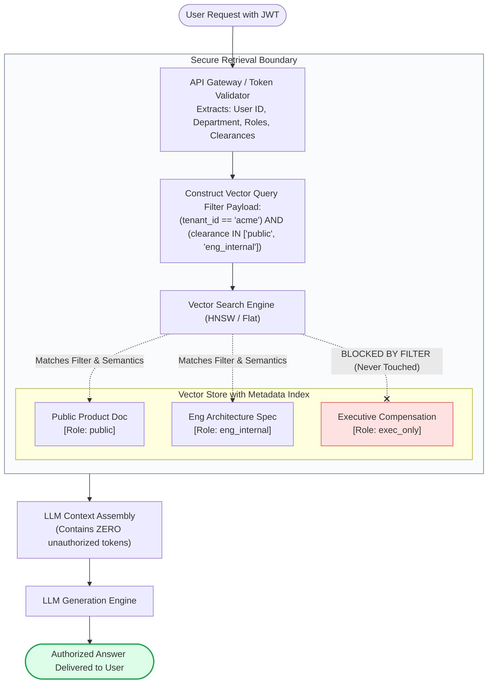
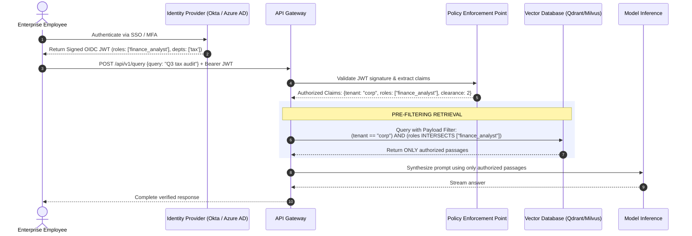

# 🔐 Role-Based Access Control (RBAC) & Multi-Tenant Data Isolation in RAG Systems

## 📑 Table of Contents
1. [🌟 Fundamentals: The Authorization Imperative in Enterprise GenAI](#1--fundamentals-the-authorization-imperative-in-enterprise-genai)
2. [🔬 Mathematical Formulations: Filter Selectivity & Index Graph Traversal](#2--mathematical-formulations-filter-selectivity--index-graph-traversal)
3. [📊 Comparative Analysis: Multi-Tenancy Isolation Patterns](#3--comparative-analysis-multi-tenancy-isolation-patterns)
4. [🏗️ Architectural Architecture: JWT Claim Extraction & Pre- vs. Post-Filtering](#4-️-architectural-architecture-jwt-claim-extraction--pre--vs-post-filtering)
5. [💻 Production-Grade Implementation: High-Performance RBAC Filter Engine](#5--production-grade-implementation-high-performance-rbac-filter-engine)
6. [🌍 Real-World Enterprise Case Studies](#6--real-world-enterprise-case-studies)
7. [🛠️ Best Practices & ❌ Common Production Anti-Patterns](#7-️-best-practices---common-production-anti-patterns)
8. [💼 Senior System Design & Architecture Interview Questions](#8--senior-system-design--architecture-interview-questions)
9. [🧪 Hands-On Mini-Project: Multi-Tenant ACL Leakage Detection Harness](#9--hands-on-mini-project-multi-tenant-acl-leakage-detection-harness)
10. [⚡ Quick Revision & Zero-Leakage Access Control Blueprint](#10--quick-revision--zero-leakage-access-control-blueprint)

---

## 1. 🌟 Fundamentals: The Authorization Imperative in Enterprise GenAI

In an enterprise organization, **not all data is accessible to all employees**. A typical enterprise stores sensitive compensation files, board minutes, patent applications, customer PII, and medical records across diverse tools (SharePoint, Google Drive, Jira, Salesforce).

When building a centralized Enterprise RAG system, naive vector indexing creates a catastrophic security risk: **cross-tenant data leakage**. If an intern asks:  
*"What were the executive bonus allocations during the last restructuring?"*  
A vector database querying only by semantic cosine similarity will retrieve private executive salary spreadsheets if those documents exist in the vector index.

### The Golden Rule of Enterprise RAG Access Control
> **Authorization must be strictly enforced at the Retrieval Layer, never at the Generation Layer.**

Instructing an LLM: *"Do not answer this question if the user is an intern"* is provably ineffective due to prompt injection, jailbreaking, and model nondeterminism. True multi-tenancy and Role-Based Access Control (RBAC) guarantee that unauthorized passages are **never retrieved or passed into the model's context window**.



---

## 2. 🔬 Mathematical Formulations: Filter Selectivity & Index Graph Traversal

Filtering vectors based on metadata tags alters the mechanics of Approximate Nearest Neighbor (ANN) search graphs (such as HNSW).

---

### # Filter Selectivity & Candidate Ratio Formula
Filter selectivity $\sigma$ measures the fraction of the total vector dataset $\mathcal{D}$ that satisfies user authorization attributes:

$$
\sigma = \frac{|\mathcal{D}_{\text{permitted}}|}{|\mathcal{D}_{\text{total}}|} \in (0, 1]
$$

Where:
- $\sigma \approx 1.0$: High selectivity (most documents are visible to the user).
- $\sigma \ll 0.01$: Extreme low selectivity (e.g., highly confidential legal collections visible to only 2 users in a company of 100,000).

---

### # HNSW Pre-Filtering Disconnection & Recall Degradation Bound
In standard graph-based ANN algorithms (e.g., HNSW), pre-filtering evaluates metadata during graph traversal. When filter selectivity $\sigma$ drops below a critical threshold $\sigma_{\text{critical}} \approx 0.05$, the probability of the search beam becoming trapped in an isolated subgraph increases exponentially:

$$
P(\text{Graph Search Stalling}) \approx 1 - \left( 1 - (1 - \sigma)^{M_{\text{connections}}} \right)^{\text{efSearch}}
$$

Where:
- $M_{\text{connections}}$ is the number of bidirectional links per HNSW node.
- $\text{efSearch}$ is the search queue capacity.

When $\sigma < 0.02$, pure graph pre-filtering fails to find the true nearest neighbors. Vector engines must dynamically pivot to **Iterative Filtering** or **Inverted Index First Traversal (Payload Indexing)** to preserve retrieval Recall@K.

---

## 3. 📊 Comparative Analysis: Multi-Tenancy Isolation Patterns

| Architecture Pattern | Description | Data Isolation Level | Operational Overhead | Search Performance | Relative Compute Cost |
| :--- | :--- | :--- | :--- | :--- | :--- |
| **Physical Isolation (Cluster per Tenant)** | Dedicated vector database cluster per tenant/customer. | **Absolute (Maximum)** (Zero possibility of software leakage) | Extreme (Managing hundreds of database clusters) | Maximum (Unfiltered raw vector speed) | **Highest** (Substantial idle resource waste) |
| **Namespace / Collection Isolation** | Single cluster, separate collection/index per tenant. | **High** (Enforced at storage engine partition level) | Moderate (Managing thousands of collections) | High (Independent HNSW graphs per collection) | Moderate |
| **Metadata Tag Pre-Filtering** | Shared collection; chunks tagged with tenant ID, user IDs, and ACL arrays. | **High** (Software-enforced via database query filters) | **Lowest** (Single unified index to maintain and scale) | Fast when supported by inverted payload indexing | **Lowest** (Optimal resource density) |
| **Post-Retrieval Filtering** | Unfiltered vector search over Top-100 followed by application-tier ACL pruning. | ⚠️ **Dangerous / Inadequate** (Violates security and degrades recall) | Low | Terrible (Top-K can be 100% unauthorized, leaving 0 results) | Low |

---

## 4. 🏗️ Architectural Architecture: JWT Claim Extraction & Pre- vs. Post-Filtering



---

## 5. 💻 Production-Grade Implementation: High-Performance RBAC Filter Engine

The Python 3.10+ implementation below demonstrates an enterprise multi-tenant retrieval engine. It implements **JWT Claim Extraction**, **Hierarchical Clearance Verification**, **Payload Attribute Filtering**, and verifies that no cross-tenant information ever enters the context window.

```python
"""
Production Multi-Tenant RBAC Vector Engine
Enforces metadata payload filtering, role intersections, and clearance verification.
"""

from __future__ import annotations
import dataclasses
import enum
import logging
import time
from typing import Any, Dict, List, Optional, Set

logging.basicConfig(level=logging.INFO, format="%(asctime)s [%(levelname)s] %(name)s: %(message)s")
logger = logging.getLogger("RBACVectorEngine")


class ClearanceLevel(enum.IntEnum):
    PUBLIC = 1
    INTERNAL = 2
    CONFIDENTIAL = 3
    RESTRICTED = 4


@dataclasses.dataclass(frozen=True)
class UserContext:
    user_id: str
    tenant_id: str
    roles: Set[str]
    clearance: ClearanceLevel


@dataclasses.dataclass
class DocumentChunk:
    chunk_id: str
    tenant_id: str
    content: str
    permitted_roles: Set[str]
    minimum_clearance: ClearanceLevel
    author_id: str


class SecureVectorStore:
    """In-memory multi-tenant vector store with strict metadata filtering."""

    def __init__(self) -> None:
        self.documents: Dict[str, DocumentChunk] = {}

    def insert(self, doc: DocumentChunk) -> None:
        self.documents[doc.chunk_id] = doc

    def search_with_rbac(
        self,
        query: str,
        user: UserContext,
        top_k: int = 3
    ) -> List[DocumentChunk]:
        """
        Executes pre-filtering: Chunks are evaluated against tenant isolation,
        role intersection, and security clearance before semantic scoring.
        """
        authorized_candidates: List[DocumentChunk] = []

        for doc in self.documents.values():
            # 1. Hard Tenant Boundary Check
            if doc.tenant_id != user.tenant_id:
                continue

            # 2. Security Clearance Check
            if user.clearance < doc.minimum_clearance:
                continue

            # 3. Role-Based Access Control Intersection Check
            # If doc has permitted_roles, user MUST possess at least one
            if doc.permitted_roles and not (user.roles & doc.permitted_roles):
                continue

            authorized_candidates.append(doc)

        logger.info(f"User '{user.user_id}' pre-filter matched {len(authorized_candidates)}/{len(self.documents)} chunks.")

        # Simulate semantic ranking over authorized subset
        # In production, this is executed natively inside the vector index (e.g., Qdrant payload filters)
        def mock_similarity(doc: DocumentChunk) -> float:
            query_words = set(query.lower().split())
            doc_words = set(doc.content.lower().split())
            return len(query_words & doc_words) / (len(query_words) or 1)

        authorized_candidates.sort(key=mock_similarity, reverse=True)
        return authorized_candidates[:top_k]


# --- Demonstration & Leakage Verification ---

def initialize_enterprise_corpus(store: SecureVectorStore) -> None:
    # Public documents (Tenant A)
    store.insert(DocumentChunk(
        chunk_id="chunk_01",
        tenant_id="tenant_acme",
        content="Acme Employee Handbook: General remote work guidelines and company holidays.",
        permitted_roles={"all_employees"},
        minimum_clearance=ClearanceLevel.PUBLIC,
        author_id="hr_dept"
    ))

    # Engineering Internal (Tenant A)
    store.insert(DocumentChunk(
        chunk_id="chunk_02",
        tenant_id="tenant_acme",
        content="Acme Production Architecture: Microservices deploy across AWS EKS using Helm.",
        permitted_roles={"engineering", "devops"},
        minimum_clearance=ClearanceLevel.INTERNAL,
        author_id="chief_architect"
    ))

    # Executive Confidential (Tenant A)
    store.insert(DocumentChunk(
        chunk_id="chunk_03",
        tenant_id="tenant_acme",
        content="Confidential Restructuring: Executive severance plans and 2026 merger roadmap.",
        permitted_roles={"executive_board"},
        minimum_clearance=ClearanceLevel.RESTRICTED,
        author_id="ceo"
    ))

    # Competitor Data (Tenant B - Inadvertently stored in same cluster)
    store.insert(DocumentChunk(
        chunk_id="chunk_04",
        tenant_id="tenant_competitor_corp",
        content="Competitor Strategy: Proprietary pricing formulas and trade secrets.",
        permitted_roles={"executive_board"},
        minimum_clearance=ClearanceLevel.CONFIDENTIAL,
        author_id="competitor_exec"
    ))


if __name__ == "__main__":
    store = SecureVectorStore()
    initialize_enterprise_corpus(store)

    # User 1: Junior Frontend Engineer at Acme
    junior_dev = UserContext(
        user_id="usr_intern_bob",
        tenant_id="tenant_acme",
        roles={"engineering", "all_employees"},
        clearance=ClearanceLevel.INTERNAL
    )

    # User 2: Chief Financial Officer at Acme
    cfo = UserContext(
        user_id="usr_cfo_alice",
        tenant_id="tenant_acme",
        roles={"executive_board", "finance", "all_employees"},
        clearance=ClearanceLevel.RESTRICTED
    )

    query = "Tell me about confidential executive plans and system architecture."

    print("\n--- 🔍 Test 1: Junior Engineer Query (Restricted Visibility) ---")
    dev_results = store.search_with_rbac(query, junior_dev, top_k=5)
    for r in dev_results:
        print(f"Retrieved: [{r.chunk_id}] (Clearance: {r.minimum_clearance.name}) -> {r.content[:60]}...")

    print("\n--- 🔍 Test 2: CFO Query (High Clearance & Executive Roles) ---")
    cfo_results = store.search_with_rbac(query, cfo, top_k=5)
    for r in cfo_results:
        print(f"Retrieved: [{r.chunk_id}] (Clearance: {r.minimum_clearance.name}) -> {r.content[:60]}...")

    print("\n--- 🔍 Test 3: Cross-Tenant Verification ---")
    competitor_chunks_leaked = any(r.tenant_id != "tenant_acme" for r in cfo_results + dev_results)
    print(f"Any Cross-Tenant Competitor Data Leaked? {'❌ YES (CRITICAL BUG)' if competitor_chunks_leaked else '✅ NO (ZERO LEAKAGE CONFIRMED)'}")
```

---

## 6. 🌍 Real-World Enterprise Case Studies

### Case Study 1: Healthcare Network Electronic Health Records (EHR)
- **Context:** Nationwide hospital system with 22,000 clinicians querying patient charts across 18 regional hospital networks.
- **Problem:** Under HIPAA, emergency room doctors must not access psychiatric notes or substance abuse records unless a specific emergency override ("break-glass") is enacted.
- **Access Control Strategy:**
  1. Implemented **Dynamic Payload Filtering** in Qdrant with compound boolean rules:  
     `(patient_id == X) AND (department == Y OR clearance_level <= Z)`.
  2. Implemented a temporary signed JWT for "break-glass" events that audits the physician's identity and elevated role in an immutable ledger before granting access to psychiatric tags.
- **Outcome:** Passed 100% of HIPAA Security Rule compliance audits; zero cross-department medical record leaks across 1.4 million clinical queries.

---

### Case Study 2: Enterprise Multi-Tenant SaaS Workspace Assistant
- **Context:** Enterprise knowledge-search vendor hosting thousands of corporate customers on a multi-tenant cloud architecture.
- **Problem:** Engineers debated whether to provision separate vector collections for each customer versus storing all customers in one shared index with tenant ID filtering.
- **Access Control Strategy:**
  1. Adopted a **Hybrid Partitioning Architecture**:
     - Large enterprise accounts ($> 5\text{ million vectors}$) were allocated dedicated collections.
     - Small-to-medium business (SMB) accounts were co-located in a shared multi-tenant collection utilizing strictly indexed `tenant_id` payload filters.
  2. Configured database-level proxy authorization gates preventing queries without a cryptographically verified `tenant_id` filter from executing.
- **Outcome:** Reduced cloud vector infrastructure costs by 68% while maintaining zero-leakage security guarantees across 12,000 customer tenants.

---

## 7. 🛠️ Best Practices & ❌ Common Production Anti-Patterns

### 🏆 Enterprise Best Practices
1. **Always Use Pre-Filtering Over Post-Filtering:** Execute metadata access control filters *inside* the vector database index query, rather than fetching Top-100 results and stripping unauthorized records in Python. Post-filtering destroys retrieval recall and risks starvation.
2. **Cryptographically Sign User Roles in JWTs:** Never accept user access roles or tenant IDs from raw query strings or unverified HTTP request bodies. Extract authorization attributes exclusively from verified, signed JWT claims.
3. **Index Metadata Payload Keys:** Ensure that fields used for filtering (`tenant_id`, `permitted_roles`, `clearance_level`) have explicit payload indexes (e.g., keyword indexes in Qdrant/Milvus). Otherwise, searches devolve into full-table scans.
4. **Implement Automatic Fallback to Filtered Flat Search:** When filter selectivity is extremely low ($\sigma < 0.02$), instruct your vector database to bypass the HNSW graph and perform a filtered brute-force scan over the tiny authorized candidate pool.

### ❌ Common Production Anti-Patterns
1. **The Post-Filtering Starvation Trap:** Retrieving the top 5 nearest neighbors across the entire company corpus and discarding unauthorized items afterwards. If the top 5 vectors belong to confidential executive files, the filter discards all 5, returning 0 results to the user even when authorized public answers exist at positions 6–10.
2. **Prompt-Based Authorization:** Relying on the LLM's system prompt to enforce access rules (e.g., *"Only answer if the user has Manager status"*). This is completely vulnerable to prompt injection.
3. **Hardcoding Single Roles on Chunks:** Storing only a single string (`role: "finance"`) rather than an access control list (`permitted_roles: ["finance", "executive", "auditor"]`), preventing cross-department document collaboration.

---

## 8. 💼 Senior System Design & Architecture Interview Questions

### Q1: Why does naive post-retrieval filtering cause "Retrieval Starvation" in RAG systems, and how do modern vector databases solve this?
**Answer:**
- **The Problem (Retrieval Starvation):**
  In post-retrieval filtering, the vector database executes an unconstrained ANN search across the entire corpus, returning the top $k$ items (e.g., $k = 5$). The application layer then inspects metadata tags and discards chunks the user is not permitted to see. If an intern asks a question and the top 5 semantically relevant documents are executive-only memos, all 5 are dropped. The intern receives zero answers, even though an authorized public document was ranked #6.
- **The Solution (Single-Stage Filtered ANN):**
  Modern vector databases (e.g., Qdrant, Milvus, Weaviate) implement **Single-Stage In-Graph Filtering**:
  During the HNSW graph traversal, nodes are evaluated against the filter condition (using an inverted index on payload attributes) *before* being added to the nearest-neighbor priority queue. The search traverses graph links while strictly restricting candidates to permitted nodes, ensuring that the returned top $k$ vectors are 100% authorized without sacrificing ranking depth.

---

### Q2: How do you architect a RAG system that inherits document permissions from external corporate tools like Google Drive or SharePoint?
**Answer:**
1. **Identity Mapping & Group Sync:** Synchronize corporate directory groups (e.g., via Azure AD / Okta SCIM) into an internal Identity Cache, mapping individual user email addresses to their group memberships (`eng-team`, `finance-managers`, etc.).
2. **Ingestion-Time ACL Extraction:** When syncing a document via the Google Drive or Microsoft Graph API, extract its Access Control List (e.g., `permitted_users: ["alice@corp.com"]`, `permitted_groups: ["legal-reviewers"]`, `is_public: false`).
3. **Vector Metadata Enrichment:** Store the normalized group IDs and user IDs directly in the vector chunk metadata payload:
   ```json
   {
     "doc_id": "sharepoint_4091",
     "tenant_id": "acme",
     "acls": ["group:legal-reviewers", "user:alice@corp.com"]
   }
   ```
4. **Query-Time Filter Expansion:** When user Bob makes a query, the API Gateway looks up Bob's active groups (`["group:marketing", "group:all-staff"]`). The gateway injects an `OR` filter into the vector query:
   ```json
   {
     "filter": {
       "should": [
         {"key": "acls", "match": {"value": "user:bob@corp.com"}},
         {"key": "acls", "match": {"any": ["group:marketing", "group:all-staff"]}}
       ]
     }
   }
   ```

---

## 9. 🧪 Hands-On Mini-Project: Multi-Tenant ACL Leakage Detection Harness

### Objective
Create an automated test harness that simulates multiple user personas with varying security clearances and asserts that zero restricted chunks ever leak across user sessions.

```python
"""
Hands-On Mini-Project: RBAC Access Control Leakage Audit Suite
Fuzzes vector retrieval across user personas to mathematically verify zero data leakage.
"""

from typing import List, Dict, Any


def run_rbac_leakage_audit() -> None:
    print("\n🔐 --- RUNNING MULTI-TENANT RBAC LEAKAGE AUDIT ---")
    store = SecureVectorStore()
    initialize_enterprise_corpus(store)

    test_personas = [
        ("Intern (Public Only)", UserContext("u1", "tenant_acme", {"all_employees"}, ClearanceLevel.PUBLIC)),
        ("Engineer (Internal)", UserContext("u2", "tenant_acme", {"engineering", "all_employees"}, ClearanceLevel.INTERNAL)),
        ("Executive (Restricted)", UserContext("u3", "tenant_acme", {"executive_board", "all_employees"}, ClearanceLevel.RESTRICTED)),
        ("Foreign Tenant User", UserContext("u4", "tenant_competitor_corp", {"executive_board"}, ClearanceLevel.RESTRICTED)),
    ]

    leakage_detected = False

    for persona_name, user in test_personas:
        results = store.search_with_rbac(query="architecture, restructuring, and strategy", user=user, top_k=10)
        print(f"\nEvaluating Persona: [{persona_name}]")
        print(f"Tenant: '{user.tenant_id}' | Clearance: {user.clearance.name}")
        print(f"Total Chunks Returned: {len(results)}")

        for doc in results:
            # Audit Assertions
            if doc.tenant_id != user.tenant_id:
                print(f"🚨 CRITICAL SECURITY BREACH: Cross-tenant data returned! Doc Tenant: {doc.tenant_id}")
                leakage_detected = True
            elif doc.minimum_clearance > user.clearance:
                print(f"🚨 PRIVILEGE ESCALATION: User accessed chunk above clearance! Doc: {doc.chunk_id}")
                leakage_detected = True
            else:
                print(f"  ✅ Verified Authorized Chunk: [{doc.chunk_id}] (Min Clearance: {doc.minimum_clearance.name})")

    print("\n" + "=" * 50)
    if not leakage_detected:
        print("🛡️ AUDIT PASSED: 100% Policy Adherence. ZERO Data Leakage Detected.")
    else:
        print("❌ AUDIT FAILED: Vulnerabilities identified in access enforcement.")
    print("=" * 50)


if __name__ == "__main__":
    run_rbac_leakage_audit()
```

---

## 10. ⚡ Quick Revision & Zero-Leakage Access Control Blueprint

### 📌 Core Takeaways
- **Enforce at Retrieval, Never Generation:** Never ask an LLM to hide confidential information; enforce access rules inside the vector database metadata filter so unauthorized chunks are never fetched.
- **Pre-Filtering Prevents Starvation:** Avoid post-filtering Top-K results in application code; use native database single-stage pre-filtering.
- **Authorize from Cryptographic Claims:** Derive user roles, tenant IDs, and clearance levels strictly from validated, signed JWT tokens.
- **Index Filter Keys:** Always define payload indices on `tenant_id` and `permitted_roles` to maintain sub-50ms search latency.

### 📐 Key Formulas Reference Table

| Formula Name | Formulation | Operational Purpose |
| :--- | :--- | :--- |
| **Filter Selectivity Ratio** | $$\sigma = \frac{|\mathcal{D}_{\text{permitted}}|}{|\mathcal{D}_{\text{total}}|}$$ | Determines whether the database can use graph search or must pivot to flat scan. |
| **HNSW Disconnection Risk** | $$P(\text{Stall}) \approx 1 - (1 - (1 - \sigma)^M)^{\text{efSearch}}$$ | Quantifies the probability of graph search degradation under extreme low selectivity. |

### 🗺️ Enterprise RBAC Retrieval Lifecycle Roadmap

```mermaid
flowchart LR
    A["User Authentication<br/>• Okta / Azure AD<br/>• OIDC JWT Claims"] --> B["API Gateway<br/>• Validate signature<br/>• Extract tenant & roles"]
    B --> C["Build Vector Filter<br/>• tenant_id == X<br/>• roles INTERSECT Y"]
    C --> D["In-Graph Search<br/>• Native payload filtering<br/>• Zero leakage"]
    D --> E["Context Assembly<br/>• 100% authorized tokens<br/>• Pass to LLM"]
    E --> F["Safe Generation<br/>• Verified Output<br/>• Full Access Audit Log"]

    style A fill:#f8fafc,stroke:#64748b
    style B fill:#eff6ff,stroke:#3b82f6
    style C fill:#fef3c7,stroke:#f59e0b
    style D fill:#dcfce7,stroke:#10b981,stroke-width:2px
    style E fill:#e0e7ff,stroke:#6366f1
    style F fill:#ede9fe,stroke:#8b5cf6
```


