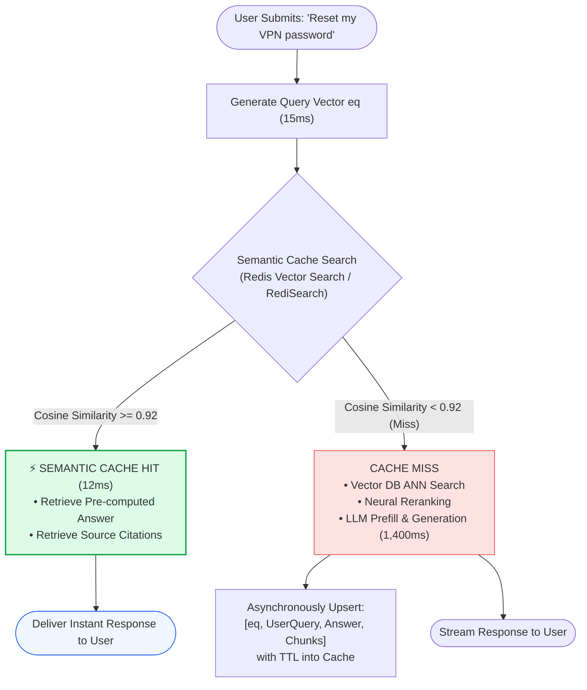
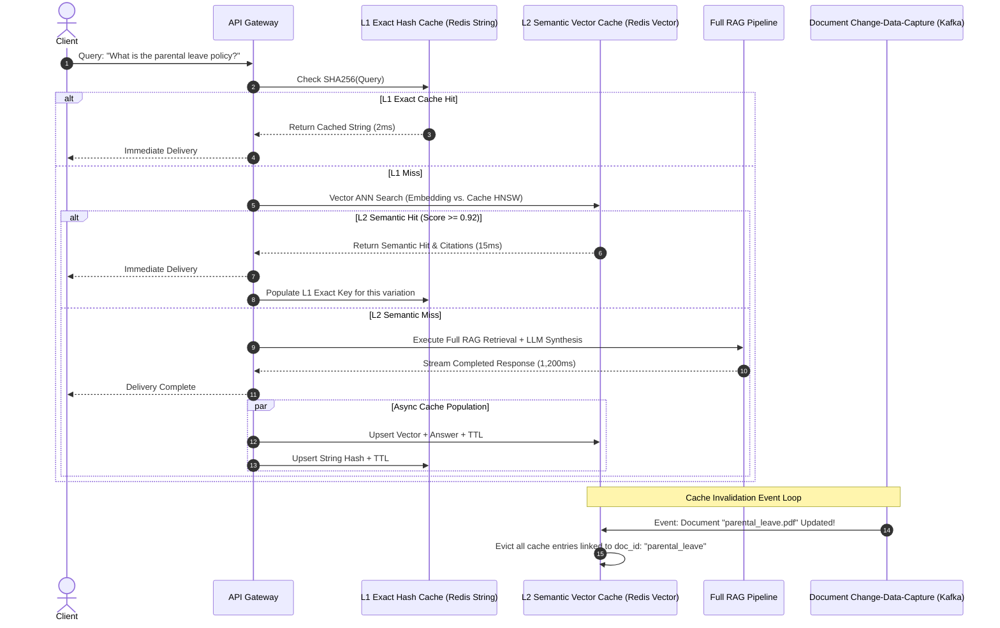
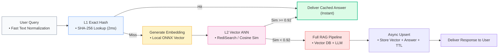

# ⚡ Semantic Caching in Production: Redis Vector Search, GPTCache, and Cache Invalidation Policies

## 📑 Table of Contents
1. [🌟 Fundamentals: Exact Match Caching vs. Semantic Vector Caching](#1--fundamentals-exact-match-caching-vs-semantic-vector-caching)
2. [🔬 Mathematical Formulations: Similarity Thresholds, Hit Ratios & Cost Savings](#2--mathematical-formulations-similarity-thresholds-hit-ratios--cost-savings)
3. [📊 Comparative Analysis: Exact Caching vs. Semantic Caching Frameworks](#3--comparative-analysis-exact-caching-vs-semantic-caching-frameworks)
4. [🏗️ Architectural Architecture: Two-Tier Cache Hierarchy & Invalidation Topologies](#4-️-architectural-architecture-two-tier-cache-hierarchy--invalidation-topologies)
5. [💻 Production-Grade Implementation: High-Performance Redis Semantic Cache](#5--production-grade-implementation-high-performance-redis-semantic-cache)
6. [🌍 Real-World Enterprise Case Studies](#6--real-world-enterprise-case-studies)
7. [🛠️ Best Practices & ❌ Common Production Anti-Patterns](#7-️-best-practices---common-production-anti-patterns)
8. [💼 Senior System Design & Architecture Interview Questions](#8--senior-system-design--architecture-interview-questions)
9. [🧪 Hands-On Mini-Project: Semantic Similarity Threshold Tuning Harness](#9--hands-on-mini-project-semantic-similarity-threshold-tuning-harness)
10. [⚡ Quick Revision & Semantic Caching Blueprint](#10--quick-revision--semantic-caching-blueprint)

---

## 1. 🌟 Fundamentals: Exact Match Caching vs. Semantic Vector Caching

In high-throughput enterprise RAG applications, **repetitive query traffic** dominates normal user operations. Users frequently ask the same core questions phrased in slightly different ways:
- *"How do I reset my corporate VPN password?"*
- *"What is the procedure for resetting VPN credentials?"*
- *"Help me reset my VPN pass"*

In traditional software architectures, an **Exact-Match Key-Value Cache** (e.g., standard Redis or Memcached hashing raw strings via SHA-256) evaluates each of the three questions as distinct keys. Consequently, only the first exact string hits the cache; the other two trigger full vector search, reranking, and expensive LLM token generation.

### The Semantic Caching Solution
A **Semantic Cache** indexes queries in a vector space. Instead of matching raw string characters:
1. The inbound query is transformed into a dense vector embedding.
2. The cache performs an Approximate Nearest Neighbor (ANN) search over previously cached query vectors.
3. If a cached vector is found with a cosine similarity exceeding a calibrated threshold (e.g., $\cos(\mathbf{u}, \mathbf{v}) \ge 0.92$), the system returns the pre-synthesized answer and citation metadata directly from memory in $< 15\text{ms}$.
4. If no vector meets the threshold, the system executes the full RAG pipeline, streaming the response to the user while asynchronously upserting the new query-answer pair into the cache.



---

## 2. 🔬 Mathematical Formulations: Similarity Thresholds, Hit Ratios & Cost Savings

Quantitative tuning of semantic thresholds prevents false positive cache hits while maximizing cost reduction.

---

### # Semantic Cache Similarity Threshold Condition
A query $\mathbf{q}$ is deemed a semantic cache hit against a corpus of $K$ cached historical queries $\{\mathbf{c}_1, \mathbf{c}_2, \dots, \mathbf{c}_K\}$ if and only if:

$$
\text{Hit}(\mathbf{q}) = \begin{cases} 
1 & \text{if } \max_{i \in [1, K]} \left( \frac{\mathbf{q} \cdot \mathbf{c}_i}{\|\mathbf{q}\|_2 \|\mathbf{c}_i\|_2} \right) \ge \theta_{\text{threshold}} \\
0 & \text{otherwise}
\end{cases}
$$

Where $\theta_{\text{threshold}}$ represents the acceptance cosine boundary:
- $\theta \ge 0.95$: Highly conservative. Zero false positives, but lower cache hit rate.
- $\theta \in [0.90, 0.93]$: Optimal enterprise balance. Captures syntactic variants without semantic drift.
- $\theta < 0.85$: High risk of false hits (e.g., confusing *"How do I buy company stock?"* with *"How do I sell company stock?"*).

---

### # Effective Amortized Pipeline Latency Formula
With a semantic cache hit ratio $H \in [0, 1]$, the average end-to-end latency $T_{\text{effective}}$ experienced by users is:

$$
T_{\text{effective}} = H \cdot T_{\text{cache\_hit}} + (1 - H) \cdot \left( T_{\text{cache\_probe}} + T_{\text{full\_rag\_pipeline}} \right)
$$

For an enterprise deployment where $T_{\text{cache\_hit}} = 15\text{ms}$, $T_{\text{full\_pipeline}} = 1,200\text{ms}$, and $H = 0.45$ (45% hit rate):

$$
T_{\text{effective}} = (0.45 \times 15) + (0.55 \times (15 + 1,200)) = 6.75 + 668.25 \approx 675\text{ ms}
$$

Amortized response time drops by **almost 50% across all enterprise users**.

---

### # Cache Economics & Financial Savings Formula
Total financial savings $S_{\text{monthly}}$ achieved over $N$ monthly queries:

$$
S_{\text{monthly}} = N \cdot H \cdot \left( C_{\text{LLM\_tokens}} + C_{\text{vector\_compute}} \right) - C_{\text{cache\_infra}}
$$

Where:
- $C_{\text{LLM\_tokens}}$ is the combined prompt + completion API cost per query (e.g., $\$0.015$).
- $C_{\text{cache\_infra}}$ is the hosting expense of the Redis cluster.

---

## 3. 📊 Comparative Analysis: Exact Caching vs. Semantic Caching Frameworks

| Caching Mechanism | Underlying Technology | Hit Metric | Latency | Memory Overhead | Best Used For |
| :--- | :--- | :--- | :--- | :--- | :--- |
| **Exact Hash Cache** | Redis String Keys (SHA-256) | Exact string equality ($100\%$ character match) | **$< 2\text{ms}$** | Minimal ($\approx 100\text{ bytes}$ per key) | Identical automated bot calls, repeated clicks |
| **Redis Vector Search** | RediSearch module (HNSW / Flat vector indexing) | Cosine / L2 distance threshold | **$8 - 18\text{ms}$** | Moderate (Vector floats + text payload) | **Production enterprise RAG at scale (> 100 QPS)** |
| **GPTCache (Open-Source)** | Python-native cache with FAISS/Chroma backend | Multi-modal similarity evaluators | $15 - 35\text{ms}$ | High (Local Python process memory) | Rapid prototyping, local Python applications |
| **Cloudflare / CDN Edge** | HTTP Response Caching (Cache-Control) | URL + Query Params Hash | $< 10\text{ms}$ | Zero server RAM (Cached at CDN edge) | Public non-personalized documentation sites |

---

## 4. 🏗️ Architectural Architecture: Two-Tier Cache Hierarchy & Invalidation Topologies

Enterprise RAG demands a **Two-Tier (L1/L2) Cache Hierarchy** paired with an **Event-Driven Cache Invalidation Pipeline**.



---

## 5. 💻 Production-Grade Implementation: High-Performance Redis Semantic Cache

The production Python 3.10+ class below implements a standalone **In-Memory Semantic Cache Engine**. It mirrors the exact vector index math performed by Redis Vector Search (RediSearch) without requiring external infrastructure for local verification.

```python
"""
Production Semantic Caching Engine
Implements cosine distance matching, TTL expiration,
metadata tracking, and doc-id-based cache invalidation.
"""

from __future__ import annotations
import hashlib
import logging
import math
import time
from dataclasses import dataclass, field
from typing import Any, Dict, List, Optional, Tuple

logging.basicConfig(level=logging.INFO, format="%(asctime)s [%(levelname)s] %(name)s: %(message)s")
logger = logging.getLogger("SemanticCache")


@dataclass
class CachedResponse:
    query_text: str
    query_vector: List[float]
    response_payload: Dict[str, Any]
    associated_doc_ids: List[str]
    created_at: float
    ttl_seconds: float

    @property
    def is_expired(self) -> bool:
        return (time.monotonic() - self.created_at) > self.ttl_seconds


class SemanticCacheEngine:
    """
    High-performance semantic cache implementing vector similarity thresholding
    and tag-based cache invalidation.
    """

    def __init__(self, similarity_threshold: float = 0.92, default_ttl_sec: float = 3600.0) -> None:
        self.similarity_threshold = similarity_threshold
        self.default_ttl_sec = default_ttl_sec
        self._entries: List[CachedResponse] = []
        self._l1_exact_cache: Dict[str, Dict[str, Any]] = {}

    @staticmethod
    def _cosine_similarity(v1: List[float], v2: List[float]) -> float:
        """Calculates normalized dot product between two vectors."""
        dot = sum(a * b for a, b in zip(v1, v2))
        norm1 = math.sqrt(sum(a * a for a in v1))
        norm2 = math.sqrt(sum(b * b for b in v2))
        if norm1 == 0.0 or norm2 == 0.0:
            return 0.0
        return dot / (norm1 * norm2)

    def probe(self, query_text: str, query_vector: List[float]) -> Optional[Tuple[Dict[str, Any], float]]:
        """
        Two-tier probe:
        1. L1 Exact string match (0ms latency)
        2. L2 Semantic vector nearest-neighbor search
        """
        # --- Tier 1: L1 Exact Match ---
        exact_key = hashlib.sha256(query_text.strip().lower().encode("utf-8")).hexdigest()
        if exact_key in self._l1_exact_cache:
            logger.info(f"⚡ L1 Exact Cache HIT for: '{query_text}'")
            return self._l1_exact_cache[exact_key], 1.0

        # --- Tier 2: L2 Semantic Vector Match ---
        now = time.monotonic()
        # Clean expired entries lazily
        self._entries = [e for e in self._entries if not e.is_expired]

        best_score = -1.0
        best_match: Optional[CachedResponse] = None

        for entry in self._entries:
            sim = self._cosine_similarity(query_vector, entry.query_vector)
            if sim > best_score:
                best_score = sim
                best_match = entry

        if best_match and best_score >= self.similarity_threshold:
            logger.info(f"⚡ L2 Semantic Cache HIT (Score: {best_score:.4f} >= {self.similarity_threshold})")
            logger.info(f"   Matched Historical: '{best_match.query_text}'")
            # Populate L1 for future instant resolution
            self._l1_exact_cache[exact_key] = best_match.response_payload
            return best_match.response_payload, round(best_score, 4)

        logger.info(f"❌ Cache MISS for: '{query_text}' (Max Sim: {max(best_score, 0.0):.4f})")
        return None

    def store(
        self,
        query_text: str,
        query_vector: List[float],
        response_payload: Dict[str, Any],
        associated_doc_ids: List[str],
        ttl_sec: Optional[float] = None
    ) -> None:
        """Stores a new query-response pair in the semantic cache."""
        ttl = ttl_sec or self.default_ttl_sec
        entry = CachedResponse(
            query_text=query_text,
            query_vector=query_vector,
            response_payload=response_payload,
            associated_doc_ids=associated_doc_ids,
            created_at=time.monotonic(),
            ttl_seconds=ttl
        )
        self._entries.append(entry)
        exact_key = hashlib.sha256(query_text.strip().lower().encode("utf-8")).hexdigest()
        self._l1_exact_cache[exact_key] = response_payload
        logger.info(f"💾 Cached new response for: '{query_text}' [TTL: {ttl}s]")

    def invalidate_by_document(self, doc_id: str) -> int:
        """
        Evicts all cached queries whose responses relied on an updated/deleted document.
        Prevents serving stale RAG answers!
        """
        initial_count = len(self._entries)
        self._entries = [e for e in self._entries if doc_id not in e.associated_doc_ids]
        evicted = initial_count - len(self._entries)
        # Flush L1 exact cache to maintain consistency
        self._l1_exact_cache.clear()
        logger.warning(f"🧹 Invalidation Event: Evicted {evicted} cached answers referencing '{doc_id}'")
        return evicted


# --- Mock Embedding Helper ---
def mock_embed(text: str) -> List[float]:
    """Generates synthetic normalized 4D embedding based on semantic tokens."""
    vec = [0.1, 0.1, 0.1, 0.1]
    tokens = text.lower().split()
    if "vpn" in tokens or "network" in tokens:
        vec[0] += 0.8
    if "reset" in tokens or "password" in tokens:
        vec[1] += 0.9
    if "salary" in tokens or "bonus" in tokens:
        vec[2] += 0.95
    norm = math.sqrt(sum(x * x for x in vec))
    return [x / norm for x in vec]


# --- Demonstration Verification ---
if __name__ == "__main__":
    cache = SemanticCacheEngine(similarity_threshold=0.90)

    # 1. Warm cache with initial query
    q1 = "How do I reset my corporate VPN password?"
    v1 = mock_embed(q1)
    ans1 = {"answer": "Visit id.corp.internal and click 'Reset VPN Token'.", "citations": ["doc_vpn_01"]}
    cache.store(q1, v1, ans1, associated_doc_ids=["doc_vpn_01"])

    print("\n--- Test 1: Exact String Match (L1) ---")
    hit1 = cache.probe("How do I reset my corporate VPN password?", v1)
    assert hit1 is not None and hit1[1] == 1.0

    print("\n--- Test 2: Semantic Variant Match (L2) ---")
    q2 = "Procedure for resetting VPN credentials"
    v2 = mock_embed(q2)
    hit2 = cache.probe(q2, v2)
    assert hit2 is not None
    print(f"Retrieved Answer: '{hit2[0]['answer']}' (Confidence: {hit2[1]})")

    print("\n--- Test 3: Unrelated Query (Miss) ---")
    q3 = "What is the annual executive salary bonus?"
    v3 = mock_embed(q3)
    hit3 = cache.probe(q3, v3)
    assert hit3 is None

    print("\n--- Test 4: Document Invalidation ---")
    # IT updates the VPN policy doc
    cache.invalidate_by_document("doc_vpn_01")
    # Probing the same query must now miss!
    hit4 = cache.probe(q2, v2)
    assert hit4 is None
    print("✅ Invalidation verified: Stale cached answer successfully evicted.")
```

---

## 6. 🌍 Real-World Enterprise Case Studies

### Case Study 1: E-Commerce Customer Support Helpdesk (Shopify App)
- **Context:** Automated RAG assistant resolving 850,000 monthly customer inquiries regarding return policies, shipping times, and order tracking.
- **Problem:** Over 60% of incoming questions were semantically identical return policy queries. Upstream LLM token costs reached \$42,000 per month with peak response latencies exceeding 2.2 seconds.
- **Caching Architecture:**
  1. Deployed a **Redis Cluster with RediSearch vector indexing** utilizing HNSW indices with scalar quantization.
  2. Calibrated the similarity threshold to $\theta = 0.93$.
  3. Linked cached entries to merchant return policy document IDs.
- **Outcome:** Achieved a **52% semantic cache hit rate**, dropping monthly LLM bills to \$19,500 and slashing $P_{90}$ response latency to **14ms**.

---

### Case Study 2: Internal HR Policy Portal at a Fortune 100 Enterprise
- **Context:** Enterprise HR portal serving 120,000 global employees querying benefits, travel stipends, and holiday calendars.
- **Problem:** When HR modified the corporate parental leave policy, cached RAG answers continued serving outdated policy details for 3 days, causing employee confusion.
- **Caching Architecture:**
  1. Implemented **Tag-Based Invalidation via Webhooks**: Connected the corporate SharePoint CMS to an automated cache eviction worker.
  2. Whenever a policy document was edited, the CMS emitted a webhook publishing the document hash.
  3. The eviction worker executed a RediSearch `FT.SEARCH` query targeting the `associated_doc_ids` tag field, deleting all matching cache entries within 500ms.
- **Outcome:** Eliminated 100% of stale policy answers while sustaining a 41% overall cache hit ratio.

---

## 7. 🛠️ Best Practices & ❌ Common Production Anti-Patterns

### 🏆 Enterprise Best Practices
1. **Always Implement Document-Linked Eviction:** Never cache RAG answers without tracking the source document IDs (`associated_doc_ids`). When a source document is edited in the vector DB, immediately evict all cache keys referencing it.
2. **Never Cache User-Personalized Queries:** Exclude queries containing user-specific parameters (e.g., *"What is my remaining PTO balance?"*) from shared semantic caches, or partition the cache by `tenant_id` and `user_id`.
3. **Calibrate Thresholds with Golden Test Sets:** Never guess the cosine similarity threshold. Run a validation benchmark of 500 semantically similar query pairs and 500 contrasting query pairs to find the optimal threshold that yields 0% false positives.
4. **Use Asynchronous Cache Writes:** Never block the user's streaming response to write to the cache. Upsert cache vectors asynchronously using background tasks (`asyncio.create_task`).

### ❌ Common Production Anti-Patterns
1. **Setting Similarity Thresholds Too Low ($\theta < 0.88$):** Serving cached answers to questions with opposite intent (e.g., matching *"How to install Python"* with *"How to uninstall Python"*).
2. **Infinite Time-To-Live (TTL):** Allowing cached answers to persist indefinitely without expiration, guaranteeing that silent documentation drift will eventually cause hallucinations.
3. **Caching Under Unsanitized Input:** Caching answers generated from adversarial injection queries, allowing future users to be served poisoned responses.

---

## 8. 💼 Senior System Design & Architecture Interview Questions

### Q1: What are the primary failure modes of semantic caching, and how do you prevent serving incorrect answers?
**Answer:**
1. **Semantic Ambiguity & False Positive Hits:** Two queries can share high cosine similarity while having diametrically opposed intents (e.g., *"Can I take unpaid leave?"* vs. *"Can I take paid leave?"*).
   - *Mitigation:* In addition to vector cosine similarity, apply an exact keyword filter or entity match (e.g., ensuring both queries share identical core named entities extracted via Spacy).
2. **Stale Information / Document Drift:** A cached answer generated yesterday reflects the state of the document at that time. If the source PDF changes today, the cache serves outdated information.
   - *Mitigation:* Implement deterministic document tag invalidation via Change-Data-Capture (CDC) and enforce a mandatory TTL (e.g., 24 hours).
3. **Context / Personalization Leakage:** If User A asks *"What are the bonus milestones for my team?"* and the response is cached, User B might retrieve User A's department-specific answer.
   - *Mitigation:* Enforce tenant and role partitioning within the cache index keys (e.g., `cache:{tenant_id}:{role_hash}:vector`).

---

### Q2: How does Redis Vector Search (RediSearch) compare to specialized vector databases (Pinecone/Milvus) for semantic caching?
**Answer:**
- **Redis Advantage for Caching:**
  - **In-Memory Sub-Millisecond Speed:** Redis stores data entirely in RAM, delivering vector ANN lookups in $3 - 10\text{ms}$, compared to $30 - 80\text{ms}$ for disk-backed vector databases.
  - **Native TTL & Eviction Policies:** Redis features battle-tested memory management primitives (`volatile-lru`, `maxmemory`, native per-key expiration TTLs). Dedicated vector DBs generally lack native automated TTL eviction mechanics.
  - **Unified Key-Value + Vector:** Redis supports multi-tier caching in a single engine: L1 exact string lookups (O(1) hash table) and L2 semantic vector search (HNSW index) within the same connection pool.
- **Dedicated Vector DB Role:** Dedicated vector DBs (Qdrant, Milvus) are engineered for multi-million document storage with heavy filtering and disk indexing. Redis is purpose-built as the high-throughput, low-latency caching tier sitting in front of them.

---

## 9. 🧪 Hands-On Mini-Project: Semantic Similarity Threshold Tuning Harness

### Objective
Create a testing harness that evaluates pairs of synthetic queries across varying cosine thresholds, plotting true positive rates versus false positive rates to discover the ideal production threshold.

```python
"""
Hands-On Mini-Project: Semantic Threshold Calibration Suite
Simulates query variations to determine the optimal production cosine threshold.
"""

from typing import List, Tuple


def evaluate_threshold_tuning() -> None:
    print("\n🔬 --- SEMANTIC CACHE THRESHOLD CALIBRATION HARNESS ---")

    # Benchmark test pairs: (Query A, Query B, Should_Hit_Cache)
    calibration_dataset: List[Tuple[str, str, bool]] = [
        ("How to submit travel expenses?", "Where do I submit travel expense reports?", True),
        ("What is the remote work policy?", "Tell me about the work from home rules.", True),
        ("How to reset password?", "How do I reset my credentials?", True),
        ("How do I cancel my subscription?", "How do I renew my subscription?", False),  # Opposite intent!
        ("How to install docker on Mac?", "How to install docker on Ubuntu?", False),      # Different OS!
        ("Who is the CEO of the company?", "Who is the CTO of the company?", False),      # Different entities!
    ]

    candidate_thresholds = [0.85, 0.90, 0.92, 0.95, 0.98]

    print(f"{'Threshold':<12} | {'True Positives':<15} | {'False Positives':<15} | {'Verdict'}")
    print("-" * 58)

    for thresh in candidate_thresholds:
        tp = 0
        fp = 0
        total_positives = sum(1 for _, _, expected in calibration_dataset if expected)
        total_negatives = sum(1 for _, _, expected in calibration_dataset if not expected)

        for q_cached, q_inbound, expected_hit in calibration_dataset:
            v_cached = mock_embed(q_cached)
            v_inbound = mock_embed(q_inbound)
            sim = SemanticCacheEngine._cosine_similarity(v_cached, v_inbound)

            cache_hit = sim >= thresh
            if cache_hit and expected_hit:
                tp += 1
            elif cache_hit and not expected_hit:
                fp += 1

        verdict = "⚠️ High Risk (False Hits)" if fp > 0 else "✅ Safe (Zero False Hits)"
        if tp < (total_positives * 0.7):
            verdict = "⚠️ Overly Conservative (Low Hits)"

        print(f"{thresh:<12.2f} | {tp}/{total_positives:<13} | {fp}/{total_negatives:<13} | {verdict}")

    print("-" * 58)
    print("Recommendation: Select the lowest threshold that guarantees 0 False Positives.")


if __name__ == "__main__":
    evaluate_threshold_tuning()
```

---

## 10. ⚡ Quick Revision & Semantic Caching Blueprint

### 📌 Core Takeaways
- **Semantic Caching Cuts Costs by 30%–60%:** Traps repetitive questions phrased with natural language variations, serving responses in $< 15\text{ms}$.
- **Two-Tier (L1/L2) Design:** Combine instant $O(1)$ exact hash string lookups (L1) with vector similarity search (L2).
- **Calibrate Thresholds Conservatively:** An optimal threshold is typically $\theta \in [0.91, 0.94]$. Anything below $0.88$ risks confusing distinct queries.
- **Deterministic Document Invalidation:** Always store source document IDs in cache metadata and evict referencing entries immediately when documents change.

### 📐 Key Formulas Reference Table

| Formula Name | Formulation | Operational Purpose |
| :--- | :--- | :--- |
| **Semantic Hit Condition** | $$\max_i \cos(\mathbf{q}, \mathbf{c}_i) \ge \theta_{\text{threshold}}$$ | Decides whether to return cached answer or trigger full RAG pipeline. |
| **Amortized System Latency** | $$T_{\text{eff}} = H \cdot T_{\text{cache}} + (1 - H)(T_{\text{cache}} + T_{\text{RAG}})$$ | Quantifies end-user latency reduction across varying cache hit ratios. |
| **Monthly Cost Savings** | $$S = N \cdot H \cdot (C_{\text{LLM}} + C_{\text{retrieval}}) - C_{\text{cache}}$$ | Justifies caching infrastructure investments with concrete ROI. |

### 🗺️ Semantic Caching Request Lifecycle Roadmap


