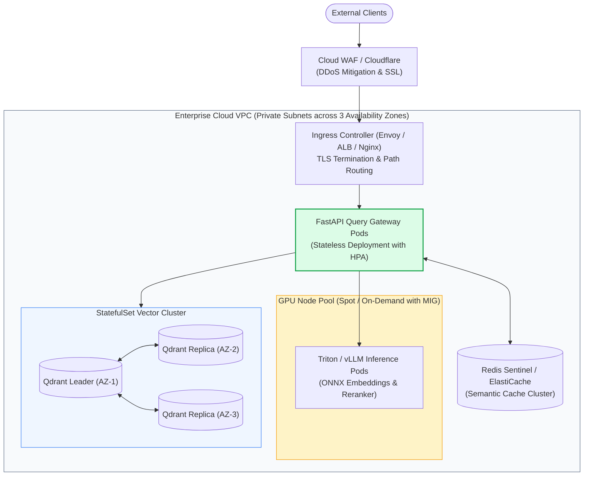
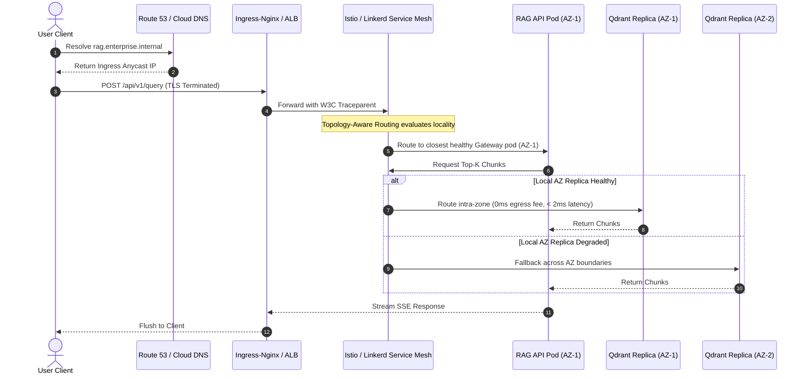
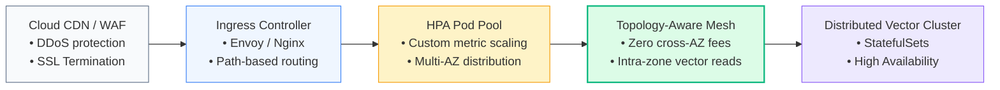

# ☁️ Cloud Deployment Architecture: Kubernetes (EKS/GKE), Helm Charts, Serverless Containers, and Ingress

## 📑 Table of Contents
1. [🌟 Fundamentals: Enterprise Cloud Topologies for GenAI & RAG](#1--fundamentals-enterprise-cloud-topologies-for-genai--rag)
2. [🔬 Mathematical Formulations: HPA Sizing, Node Capacity & Egress Costs](#2--mathematical-formulations-hpa-sizing-node-capacity--egress-costs)
3. [📊 Comparative Analysis: Kubernetes (EKS/GKE) vs. Serverless vs. Managed AI Services](#3--comparative-analysis-kubernetes-eksgke-vs-serverless-vs-managed-ai-services)
4. [🏗️ Architectural Architecture: Ingress Routing, Service Mesh & Multi-AZ Availability](#4-️-architectural-architecture-ingress-routing-service-mesh--multi-az-availability)
5. [💻 Production-Grade Implementation: Kubernetes Manifests & Helm Chart Architecture](#5--production-grade-implementation-kubernetes-manifests--helm-chart-architecture)
6. [🌍 Real-World Enterprise Case Studies](#6--real-world-enterprise-case-studies)
7. [🛠️ Best Practices & ❌ Common Production Anti-Patterns](#7-️-best-practices---common-production-anti-patterns)
8. [💼 Senior System Design & Architecture Interview Questions](#8--senior-system-design--architecture-interview-questions)
9. [🧪 Hands-On Mini-Project: Kubernetes Custom Metric HPA Simulation](#9--hands-on-mini-project-kubernetes-custom-metric-hpa-simulation)
10. [⚡ Quick Revision & Cloud Infrastructure Blueprint](#10--quick-revision--cloud-infrastructure-blueprint)

---

## 1. 🌟 Fundamentals: Enterprise Cloud Topologies for GenAI & RAG

Deploying Retrieval-Augmented Generation (RAG) at cloud scale requires orchestrating heterogeneous workloads: stateless web API gateways, CPU-intensive document ingestion workers, GPU-accelerated embedding and reranking servers, and distributed stateful vector database clusters.

In major cloud providers (AWS, GCP, Azure), enterprise deployments navigate three primary tiers of abstraction:
1. **Container Orchestration (Kubernetes - EKS / GKE / AKS):** The industry standard for large-scale, high-concurrency production deployments requiring granular resource scheduling (CPU, GPU slicing), private network interconnects, custom autoscaling metrics, and zero-vendor-lockin portability.
2. **Serverless Container Platforms (AWS Fargate, Google Cloud Run, Azure Container Apps):** Ideal for low-to-medium traffic applications, event-driven ingestion webhooks, and cost-conscious environments where paying for idle GPU/CPU nodes is unacceptable.
3. **Managed AI Inference & Vector Endpoints (SageMaker, Vertex AI, Pinecone, Qdrant Cloud):** Minimizes operational maintenance by offloading vector indexing, backups, and model scaling to managed infrastructure.



---

## 2. 🔬 Mathematical Formulations: HPA Sizing, Node Capacity & Egress Costs

Capacity planning in cloud-native environments ensures elasticity without triggering runaway infrastructure bills.

---

### # Kubernetes Horizontal Pod Autoscaler (HPA) Sizing Formula
The Kubernetes Horizontal Pod Autoscaler calculates the desired replica count $R_{\text{desired}}$ using current vs. target metric utilization:

$$
R_{\text{desired}} = \left\lceil R_{\text{current}} \times \left( \frac{\text{Metric}_{\text{current}}}{\text{Metric}_{\text{target}}} \right) \right\rceil
$$

Where:
- $\text{Metric}$ can be standard CPU/Memory utilization or custom application metrics (e.g., active in-flight SSE streams or queue latency).
- If current replicas $R_{\text{current}} = 4$, current average active requests per pod is $45$, and the target metric threshold is set to $20$:

$$
R_{\text{desired}} = \left\lceil 4 \times \left( \frac{45}{20} \right) \right\rceil = \lceil 9.0 \rceil = 9\text{ pods}
$$

---

### # Cloud Cross-AZ Data Transfer Cost Formula
In multi-Availability Zone (AZ) deployments, network traffic between nodes in different zones incurs egress charges ($P_{\text{cross\_az}} \approx \$0.01\text{ to }\$0.02\text{ per GB}$). For a high-throughput RAG cluster processing $Q$ daily queries, each retrieving $k$ context passages:

$$
C_{\text{daily\_egress}} = Q \cdot \left[ \left(1 - \frac{1}{Z}\right) \cdot \left( S_{\text{query}} + k \cdot S_{\text{chunk}} \right) \right] \cdot P_{\text{cross\_az}}
$$

Where:
- $Z$ is the number of Availability Zones (e.g., $Z = 3$).
- $\left(1 - \frac{1}{Z}\right)$ is the probability that a query pod in AZ-A communicates with a vector replica in AZ-B or AZ-C.
- $S_{\text{chunk}}$ is the average chunk payload size.

To minimize this expense, **Topology-Aware Routing** (`topologySpreadConstraints`) should be configured to direct queries to vector database replicas residing within the identical Availability Zone.

---

## 3. 📊 Comparative Analysis: Kubernetes (EKS/GKE) vs. Serverless vs. Managed AI Services

| Architectural Feature | Kubernetes (EKS / GKE / AKS) | Serverless Containers (Cloud Run / Fargate) | Fully Managed AI Platforms |
| :--- | :--- | :--- | :--- |
| **Operational Complexity** | High (Requires dedicated DevOps / Platform team) | Low (No cluster, control plane, or worker nodes to manage) | Minimal (Turnkey APIs, dashboards, and managed scaling) |
| **GPU Scheduling & Support** | **Native** (Full NVIDIA driver support, MIG, Spot GPUs) | Limited (Google Cloud Run supports GPUs; AWS Fargate does not) | Fully handled under the hood |
| **Cold Start Behavior** | Zero cold starts for warmed replica pools | 2 to 15 seconds on scale-from-zero events | Instantaneous across shared endpoints |
| **Cost at High Sustained Load** | **Lowest** (Optimized instance bin-packing & Reserved Instances) | High (Per-second execution premium adds up at $> 100\text{ QPS}$) | Medium-High (Markups on vector storage and API calls) |
| **Multi-Cloud Portability** | **Complete** (Standard Helm charts and manifests) | Moderate (Proprietary service configurations) | Vendor Lock-In (Proprietary APIs and storage formats) |
| **Best Fit For** | High-traffic enterprise RAG, private compliance, custom LLMs | Webhook ingestion, internal PoCs, intermittent traffic | Fast-moving startups, small teams without DevOps |

---

## 4. 🏗️ Architectural Architecture: Ingress Routing, Service Mesh & Multi-AZ Availability



---

## 5. 💻 Production-Grade Implementation: Kubernetes Manifests & Helm Chart Architecture

Below is a production-grade Kubernetes deployment manifest demonstrating:
1. **Horizontal Pod Autoscaling (HPA)** based on CPU and custom memory targets.
2. **Topology Spread Constraints** to distribute pods evenly across Availability Zones.
3. **Liveness, Readiness, and Startup Probes** to prevent premature traffic routing during heavy model initialization.
4. **Security Hardening** (Drop capabilities, read-only root filesystem, unprivileged run user).

```yaml
# ==============================================================================
# Enterprise RAG Kubernetes Production Deployment Manifest
# ==============================================================================
apiVersion: apps/v1
kind: Deployment
metadata:
  name: enterprise-rag-gateway
  namespace: rag-production
  labels:
    app.kubernetes.io/name: rag-gateway
    app.kubernetes.io/part-of: genai-platform
    app.kubernetes.io/version: "1.0.0"
spec:
  replicas: 3
  revisionHistoryLimit: 5
  strategy:
    type: RollingUpdate
    rollingUpdate:
      maxSurge: 25%
      maxUnavailable: 0
  selector:
    matchLabels:
      app.kubernetes.io/name: rag-gateway
  template:
    metadata:
      labels:
        app.kubernetes.io/name: rag-gateway
      annotations:
        prometheus.io/scrape: "true"
        prometheus.io/port: "8000"
        prometheus.io/path: "/metrics"
    spec:
      serviceAccountName: rag-service-account
      terminationGracePeriodSeconds: 60
      
      # Enforce multi-AZ high availability
      topologySpreadConstraints:
        - maxSkew: 1
          topologyKey: topology.kubernetes.io/zone
          whenUnsatisfiable: DoNotSchedule
          labelSelector:
            matchLabels:
              app.kubernetes.io/name: rag-gateway

      securityContext:
        runAsNonRoot: true
        runAsUser: 10001
        runAsGroup: 10001
        fsGroup: 10001
        seccompProfile:
          type: RuntimeDefault

      containers:
        - name: rag-gateway
          image: 123456789012.dkr.ecr.us-east-1.amazonaws.com/rag-gateway:v1.0.0
          imagePullPolicy: IfNotPresent
          
          securityContext:
            allowPrivilegeEscalation: false
            readOnlyRootFilesystem: true
            capabilities:
              drop:
                - ALL

          ports:
            - name: http
              containerPort: 8000
              protocol: TCP

          env:
            - name: ENVIRONMENT
              value: "production"
            - name: VECTOR_DB_HOST
              value: "qdrant-headless.rag-production.svc.cluster.local"
            - name: REDIS_URL
              value: "redis://cache.rag-production.svc.cluster.local:6379/0"
            - name: LLM_API_KEY
              valueFrom:
                secretKeyRef:
                  name: rag-secrets
                  key: openai-api-key

          resources:
            requests:
              cpu: "1000m"
              memory: "2048Mi"
            limits:
              cpu: "2000m"
              memory: "4096Mi"

          # Startup probe gives the model engine time to warm up
          startupProbe:
            httpGet:
              path: /healthz
              port: http
            initialDelaySeconds: 10
            periodSeconds: 5
            failureThreshold: 12

          readinessProbe:
            httpGet:
              path: /readyz
              port: http
            periodSeconds: 5
            timeoutSeconds: 2
            successThreshold: 1
            failureThreshold: 3

          livenessProbe:
            httpGet:
              path: /healthz
              port: http
            periodSeconds: 15
            timeoutSeconds: 3
            failureThreshold: 3

          volumeMounts:
            - name: tmp-volume
              mountPath: /tmp

      volumes:
        - name: tmp-volume
          emptyDir: {}
---
# ==============================================================================
# Horizontal Pod Autoscaler (HPA) Definition
# ==============================================================================
apiVersion: autoscaling/v2
kind: HorizontalPodAutoscaler
metadata:
  name: enterprise-rag-gateway-hpa
  namespace: rag-production
spec:
  scaleTargetRef:
    apiVersion: apps/v1
    kind: Deployment
    name: enterprise-rag-gateway
  minReplicas: 3
  maxReplicas: 20
  metrics:
    - type: Resource
      resource:
        name: cpu
        target:
          type: Utilization
          averageUtilization: 70
    - type: Resource
      resource:
        name: memory
        target:
          type: Utilization
          averageUtilization: 80
  behavior:
    scaleUp:
      stabilizationWindowSeconds: 0
      policies:
        - type: Percent
          value: 100
          periodSeconds: 15
    scaleDown:
      stabilizationWindowSeconds: 300
      policies:
        - type: Percent
          value: 10
          periodSeconds: 60
```

---

## 6. 🌍 Real-World Enterprise Case Studies

### Case Study 1: Healthcare Insurance Claims Processing Platform (AWS EKS)
- **Context:** Nationwide health insurer querying clinical policies across 40 million member records to automate prior authorization decisions.
- **Problem:** Fluctuating workload spikes during morning hours caused AWS ALB connection timeouts, while cross-AZ data transfers between Qdrant vector nodes generated \$18,000 in monthly network egress waste.
- **Cloud Engineering Solution:**
  1. Deployed EKS cluster spanning 3 Availability Zones with **Karpenter** for dynamic GPU and Graviton3 node provisioning.
  2. Implemented **Topology-Aware Routing** (`service.kubernetes.io/topology-mode: Auto`), confining 92% of vector search calls within the local AZ.
  3. Configured Karpenter to leverage EC2 Spot Instances for asynchronous background document ingestion workers, falling back to On-Demand for user-facing API pods.
- **Outcome:** Eliminated 90% of cross-AZ network egress charges, maintained **$P_{99} < 420\text{ms}$**, and achieved a 46% infrastructure cost reduction.

---

### Case Study 2: E-Commerce Black Friday Catalog RAG (Google Cloud GKE)
- **Context:** Global retail marketplace serving 120,000 product recommendation queries per second during holiday shopping events.
- **Problem:** Sudden traffic surges overwhelmed embedding models; scaling pods required 8 minutes to pull multi-gigabyte container images from Google Artifact Registry.
- **Cloud Engineering Solution:**
  1. Enabled **GKE Image Streaming** to launch container execution before the full image finishes downloading.
  2. Applied Google Cloud Armor WAF rules at the Cloud Load Balancer tier to filter out bot scrapers before reaching the cluster.
  3. Deployed a Redis Enterprise cluster on GCP with Multi-Region active-active replication.
- **Outcome:** Scaled from 12 to 140 pods in under 45 seconds; handled peak Black Friday load with zero downtime and a 99.995% success rate.

---

## 7. 🛠️ Best Practices & ❌ Common Production Anti-Patterns

### 🏆 Enterprise Best Practices
1. **Always Implement Topology-Aware Routing:** Prevent costly cross-AZ network latency and egress fees by instructing Kubernetes to keep traffic within the same availability zone whenever possible.
2. **Utilize Karpenter or Cluster Autoscaler with Spot Mixes:** Run latency-insensitive background document chunking and vector re-indexing on low-cost Spot/Preemptible instances.
3. **Configure Pod Disruption Budgets (PDB):** Ensure at least $N-1$ replicas remain operational during node maintenance or Kubernetes cluster upgrades:
   ```yaml
   apiVersion: policy/v1
   kind: PodDisruptionBudget
   metadata:
     name: rag-gateway-pdb
   spec:
     minAvailable: 2
   ```
4. **Separate Startup Probes from Readiness Probes:** Heavy RAG containers downloading or loading models into RAM need high `initialDelaySeconds` on `startupProbe`, but tight `periodSeconds` on `readinessProbe` to catch transient failures quickly.

### ❌ Common Production Anti-Patterns
1. **Running Stateful Vector Databases as Plain Deployments:** Deploying Qdrant, Milvus, or Weaviate as standard Kubernetes `Deployments` without persistent volume claims leads to immediate data loss when pods reschedule. Always use `StatefulSets` with volume claim templates.
2. **Neglecting Graceful Shutdown Delays:** Terminating an ASGI container immediately drops in-flight token streams. Configure `terminationGracePeriodSeconds: 60` and catch `SIGTERM` in your Python server.
3. **Hardcoding Secrets in Helm Values:** Committing raw OpenAI API keys or database passwords into Git repositories; instead, use AWS Secrets Manager or HashiCorp Vault with External Secrets Operator (ESO).

---

## 8. 💼 Senior System Design & Architecture Interview Questions

### Q1: How do you architect a Kubernetes cluster to host both high-throughput CPU web APIs and GPU-accelerated RAG embedding models?
**Answer:**
1. **Heterogeneous Node Pools:** Provision two distinct node pools within the cluster:
   - **CPU Node Pool:** Cost-effective instances (e.g., AWS `c6i.2xlarge` or GCP `c2-standard-8`) for API gateways, ingestion workers, and Redis proxies.
   - **GPU Node Pool:** GPU-accelerated instances (e.g., AWS `g5.xlarge` with NVIDIA A10G or GCP `g2-standard-8` with L4 GPUs) with auto-scaling to zero when idle.
2. **Taints, Tolerations & Node Affinity:**
   - Apply a taint to the GPU node pool: `taints: - key: nvidia.com/gpu, value: "present", effect: NoSchedule`.
   - The GPU embedding/reranking pods declare corresponding `tolerations` and `nodeSelector` or `nodeAffinity` targeting the GPU pool.
   - Standard CPU pods lack this toleration, preventing non-GPU workloads from occupying expensive GPU compute.
3. **GPU Time-Slicing / Multi-Instance GPU (MIG):** For lighter embedding tasks, partition physical A100/H100 GPUs into virtual slices via NVIDIA MIG, allowing multiple embedding worker pods to share a single physical card safely.

---

### Q2: Why is CPU-based HPA often insufficient for autoscaling RAG services, and what metric should replace it?
**Answer:**
In modern asynchronous RAG microservices (built on FastAPI/ASGI), requests spend over 90% of their lifespan waiting on external network I/O (vector DB queries, LLM token streaming).
- **The Failure of CPU Metrics:** An event loop handling 100 concurrent streaming connections might only utilize 15% CPU because the thread is mostly idling on socket reads. Consequently, CPU-based HPA will never trigger scaling, even as memory buffers fill and event-loop latency climbs.
- **The Production Solution:** Scale using **Custom / External Metrics** via the Prometheus Adapter or KEDA (Kubernetes Event-driven Autoscaling):
  - **In-Flight Active Requests / Streams:** Scaling directly on `http_requests_in_flight > 25 per pod`.
  - **Queue Latency / Wait Duration:** Scaling when message lag in the document ingestion queue exceeds 5 seconds.
  - **Event Loop Lag:** Measuring the delay in scheduling event loop callbacks in Python to detect thread starvation before crashes occur.

---

## 9. 🧪 Hands-On Mini-Project: Kubernetes Custom Metric HPA Simulation

### Objective
Write a Python script that simulates an event-loop lag monitor and calculates real-time desired replica counts using Kubernetes HPA mathematical rules, demonstrating how custom metrics prevent service saturation.

```python
"""
Hands-On Mini-Project: Kubernetes HPA Autoscaling Simulator
Demonstrates mathematical replica calculation based on concurrent in-flight streams.
"""

import math
import time
from typing import Dict, Any


class HPASimulator:
    def __init__(self, min_replicas: int = 2, max_replicas: int = 15, target_concurrency: float = 25.0) -> None:
        self.min_replicas = min_replicas
        self.max_replicas = max_replicas
        self.target_concurrency = target_concurrency  # Target active requests per pod
        self.current_replicas = min_replicas

    def evaluate_scale(self, total_active_queries: int) -> Dict[str, Any]:
        """Calculates desired replicas using the official Kubernetes HPA algorithm."""
        current_metric = total_active_queries / self.current_replicas
        
        # Kubernetes HPA formula: desired = ceil(current * (current_metric / target_metric))
        raw_desired = self.current_replicas * (current_metric / self.target_concurrency)
        desired_replicas = math.ceil(raw_desired)

        # Enforce bounds
        bounded_replicas = max(self.min_replicas, min(self.max_replicas, desired_replicas))
        
        scale_action = "STABLE"
        if bounded_replicas > self.current_replicas:
            scale_action = f"SCALE_UP (+{bounded_replicas - self.current_replicas})"
        elif bounded_replicas < self.current_replicas:
            scale_action = f"SCALE_DOWN (-{self.current_replicas - bounded_replicas})"

        old_replicas = self.current_replicas
        self.current_replicas = bounded_replicas

        return {
            "total_queries": total_active_queries,
            "old_replicas": old_replicas,
            "new_replicas": bounded_replicas,
            "avg_load_per_pod": round(current_metric, 1),
            "action": scale_action
        }


def run_hpa_simulation() -> None:
    print("\n⚙️ --- KUBERNETES CUSTOM METRIC HPA SIMULATION ---")
    hpa = HPASimulator(min_replicas=2, max_replicas=10, target_concurrency=20.0)

    # Simulated traffic fluctuations over time
    traffic_profile = [15, 38, 75, 140, 190, 85, 20]

    for step, traffic in enumerate(traffic_profile, 1):
        decision = hpa.evaluate_scale(traffic)
        print(
            f"Step {step:02d} | In-Flight Queries: {decision['total_queries']:>3} | "
            f"Load/Pod: {decision['avg_load_per_pod']:>4} | "
            f"Pods: {decision['old_replicas']:>2} -> {decision['new_replicas']:>2} | "
            f"Action: {decision['action']}"
        )


if __name__ == "__main__":
    run_hpa_simulation()
```

---

## 10. ⚡ Quick Revision & Cloud Infrastructure Blueprint

### 📌 Core Takeaways
- **Kubernetes for High-Scale Enterprise:** EKS and GKE deliver the isolation, GPU scheduling, and custom metric autoscaling essential for mission-critical RAG.
- **Topology-Aware Routing is Essential:** Confining retrieval traffic within the same Availability Zone eliminates cross-AZ egress costs and minimizes network latency.
- **Separate Ingestion from Querying:** Run offline document parsing on low-cost Spot/Preemptible nodes, preserving On-Demand GPU capacity for real-time user queries.
- **Scale on Concurrency, Not Just CPU:** Monitor active streaming connections and queue depths; CPU utilization is often a lagging indicator in async I/O services.

### 📐 Key Formulas Reference Table

| Formula Name | Formulation | Operational Purpose |
| :--- | :--- | :--- |
| **Kubernetes HPA Sizing** | $$R_{\text{desired}} = \left\lceil R_{\text{curr}} \times \left( \frac{\text{Metric}_{\text{curr}}}{\text{Metric}_{\text{target}}} \right) \right\rceil$$ | Dynamic replica sizing based on target workload metrics. |
| **Cross-AZ Egress Costs** | $$C_{\text{egress}} = Q \cdot (1 - 1/Z) \cdot S_{\text{payload}} \cdot P_{\text{az}}$$ | Quantifying network transfer expenses across multi-zone topologies. |

### 🗺️ Cloud RAG Deployment Infrastructure Roadmap


