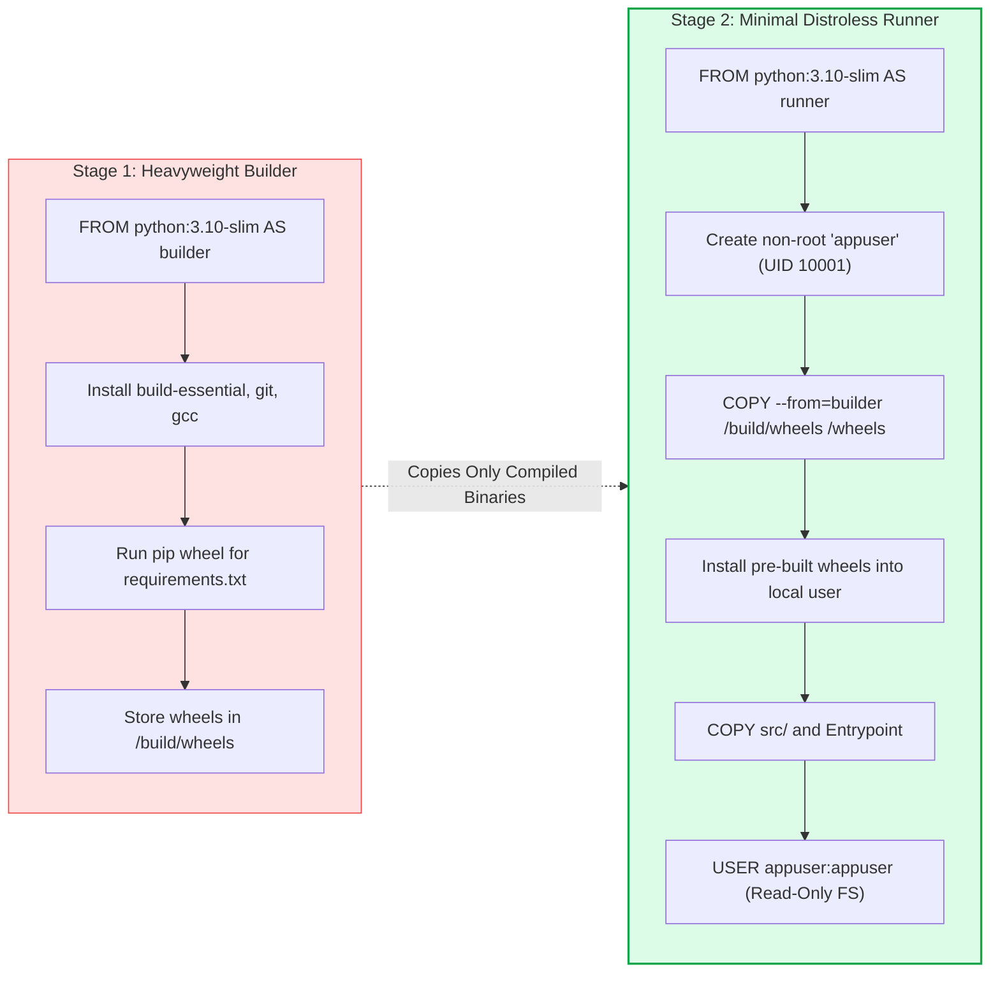
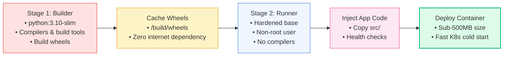

# 🐳 Containerizing RAG Applications: Multi-Stage Docker Builds, GPU Acceleration, and Minimal Images

## 📑 Table of Contents
1. [🌟 Fundamentals: The Containerization Challenge for GenAI & RAG](#1--fundamentals-the-containerization-challenge-for-genai--rag)
2. [🔬 Mathematical Formulations: Image Pull Latency & Layer Efficiency](#2--mathematical-formulations-image-pull-latency--layer-efficiency)
3. [📊 Comparative Analysis: Base Images, Runtimes & Acceleration Stacks](#3--comparative-analysis-base-images-runtimes--acceleration-stacks)
4. [🏗️ Multi-Stage Build Architecture: Builder vs. Production Runner Pattern](#4-️-multi-stage-build-architecture-builder-vs-production-runner-pattern)
5. [💻 Production-Grade Implementation: Multi-Stage Dockerfile & Docker Compose](#5--production-grade-implementation-multi-stage-dockerfile--docker-compose)
6. [🌍 Real-World Enterprise Case Studies](#6--real-world-enterprise-case-studies)
7. [🛠️ Best Practices & ❌ Common Production Anti-Patterns](#7-️-best-practices---common-production-anti-patterns)
8. [💼 Senior System Design & Architecture Interview Questions](#8--senior-system-design--architecture-interview-questions)
9. [🧪 Hands-On Mini-Project: Image Layer & Dependency Size Profiler](#9--hands-on-mini-project-image-layer--dependency-size-profiler)
10. [⚡ Quick Revision & Containerization Blueprint](#10--quick-revision--containerization-blueprint)

---

## 1. 🌟 Fundamentals: The Containerization Challenge for GenAI & RAG

Containerizing enterprise RAG applications introduces unique operational complexities unseen in conventional web services. A production RAG system bundles heterogeneous dependencies: heavy linear algebra libraries (`PyTorch`, `ONNX Runtime`), neural model weights, CUDA hardware drivers, C++ native vector extensions (`FAISS`, `HNSWLib`), and native document parsers (`Poppler`, `Tesseract`, `libmagic`).

### The Production Dilemma: Image Bloat vs. Execution Speed
- **The "Fat Image" Trap:** A naive `Dockerfile` based on `nvidia/cuda:devel` that runs `pip install torch` frequently balloons to **12GB–18GB**. Massive images cause extreme cold-start delays in Kubernetes (taking 5 to 12 minutes to pull layers over the network), burn expensive container registry bandwidth, and dramatically increase the Common Vulnerabilities and Exposures (CVE) attack surface.
- **The Solution:** Employing **Multi-Stage Builds**, headless slim runtimes, pre-compiled wheels, and separated model artifact mounting transforms monolithic container bloat into lean, secure, sub-500MB microservices that boot in seconds.

```mermaid
flowchart TD
    subgraph NaiveBuild ["Naive Docker Build (14.2 GB Bloat)"]
        Base1["nvidia/cuda:devel-ubuntu"] --> Compilers["gcc, g++, cmake, git, build-essential (3.2 GB)"]
        Compilers --> PyTorchFull["Full PyTorch + CUDA Toolkits (5.8 GB)"]
        PyTorchFull --> DevHeaders["Header files & pip cache (2.5 GB)"]
        DevHeaders --> AppMonolith["App Code & Local Model Weights (2.7 GB)"]
        style NaiveBuild fill:#fee2e2,stroke:#ef4444
    end

    subgraph MultiStageBuild ["Production Multi-Stage Build (420 MB Lean Runner)"]
        direction TB
        subgraph Stage1 ["Stage 1: Build & Wheel Compilation"]
            Builder["python:3.10-slim-bullseye (Builder)"] --> BuildWheels["Compile C/C++ Extensions & Wheel Cache"]
        end
        
        subgraph Stage2 ["Stage 2: Production Distroless / Slim Runner"]
            Runner["python:3.10-slim (Distroless / Non-Root)"] --> CopyWheels["COPY --from=builder /wheels /wheels"]
            CopyWheels --> NoPipCache["pip install --no-cache-dir /wheels/*"]
            NoPipCache --> LeanApp["COPY App Code (Chowned to appuser)"]
        end
        style Stage2 fill:#dcfce7,stroke:#16a34a,stroke-width:2px
    end
```



---

## 2. 🔬 Mathematical Formulations: Image Pull Latency & Layer Efficiency

Container sizing directly influences autoscaling responsiveness (Horizontal Pod Autoscaler) during sudden traffic spikes.

---

### # Container Cold Start Image Pull Latency Formula
Total pull time $T_{\text{pull}}$ across $L$ layers during a cold-start pod scheduling event:

$$
T_{\text{pull}} = T_{\text{handshake}} + \sum_{l=1}^{L} \left( \frac{S_l \cdot (1 - \mathbb{I}_{\text{cached}}(l))}{B_{\text{network}}} \right) + \sum_{l=1}^{L} T_{\text{extract}}(S_l)
$$

Where:
- $S_l$ is the size (in megabytes) of layer $l$.
- $\mathbb{I}_{\text{cached}}(l) \in \{0, 1\}$ indicates whether layer $l$ is already cached on the target worker node.
- $B_{\text{network}}$ is the effective network download bandwidth to the node.
- $T_{\text{extract}}(S_l)$ is decompression and extraction time on the host root filesystem (I/O bound).

Reducing an image from $12\text{ GB}$ to $600\text{ MB}$ cuts pull duration from $\approx 240\text{ seconds}$ to $< 12\text{ seconds}$, enabling immediate pod readiness.

---

### # Image Layer Efficiency & Bloat Ratio Formula
The runtime storage efficiency $\eta_{\text{image}}$ evaluates how much of the container contributes directly to execution versus discarded build tooling:

$$
\eta_{\text{image}} = \frac{S_{\text{runtime\_binaries}} + S_{\text{app\_code}}}{S_{\text{total\_image}}} = \frac{\sum S_{\text{active}}}{S_{\text{base}} + S_{\text{build\_tools}} + S_{\text{cache}} + S_{\text{active}}}
$$

In a high-quality multi-stage build, $\eta_{\text{image}} \ge 0.85$ (over 85% of bytes are actively executed at runtime), whereas naive builds commonly score $\eta_{\text{image}} \le 0.15$.

---

## 3. 📊 Comparative Analysis: Base Images, Runtimes & Acceleration Stacks

| Base Image / Stack | Uncompressed Size | Hardware Target | Best Use Case in RAG | Security / CVE Risk |
| :--- | :--- | :--- | :--- | :--- |
| **`python:3.10-slim`** | $\approx 125\text{ MB}$ | CPU / Cloud instances | **RAG Orchestrators, FastAPI Gateways, Vector Client Services** | Low (Minimal packages, no compilers) |
| **`nvidia/cuda:12.2.0-base-ubuntu22.04`** | $\approx 240\text{ MB}$ | NVIDIA GPU (Host Driver Mounted) | **vLLM Inference, TensorRT-LLM, High-Throughput Embeddings** | Low-Medium (Requires careful user non-root config) |
| **`nvidia/cuda:12.2.0-devel-ubuntu22.04`** | $\approx 4.8\text{ GB}$ | Development / Build stage | **Builder Stage Only** (Compiling custom CUDA C++ kernels) | High (Contains full dev toolchains, compilers, git) |
| **`alpine:3.19` (with Python)** | $\approx 55\text{ MB}$ | Lightweight CPU | ⚠️ **Not Recommended for RAG** (musl libc incompatibilities with PyTorch/NumPy) | Very Low (Very minimal footprint) |
| **Google Distroless Python** | $\approx 60\text{ MB}$ | Hardened Production | Hardened corporate RAG microservices (No shell, no package manager) | Minimal (Near zero attack surface) |

---

## 4. 🏗️ Multi-Stage Build Architecture: Builder vs. Production Runner Pattern



---

## 5. 💻 Production-Grade Implementation: Multi-Stage Dockerfile & Docker Compose

### 📄 Production `Dockerfile` for High-Performance FastAPI RAG
This multi-stage `Dockerfile` compiles binary packages in the builder stage, discards build tools, runs as a non-privileged user, and leverages Docker layer caching.

```dockerfile
# ==============================================================================
# STAGE 1: Dependency Builder & Wheel Compiler
# ==============================================================================
FROM python:3.10-slim AS builder

WORKDIR /build

# Install native OS build dependencies needed for C++ extensions
RUN apt-get update && apt-get install -y --no-install-recommends \
    build-essential \
    gcc \
    libpq-dev \
    curl \
    && rm -rf /var/lib/apt/lists/*

# Upgrade pip and install wheel tooling
RUN pip install --no-cache-dir --upgrade pip setuptools wheel

# Leverage Docker cache by copying ONLY dependencies first
COPY requirements.txt .

# Compile wheels to a isolated directory
RUN pip wheel --no-cache-dir --wheel-dir=/build/wheels -r requirements.txt


# ==============================================================================
# STAGE 2: Hardened, Minimal Production Runner
# ==============================================================================
FROM python:3.10-slim AS runner

# Metadata standards (OCI image specifications)
LABEL org.opencontainers.image.title="Enterprise RAG Query Service" \
      org.opencontainers.image.description="FastAPI Microservice for Vector Retrieval and Synthesis" \
      org.opencontainers.image.version="1.0.0"

WORKDIR /app

# Install minimal runtime shared libraries (libpq for postgres, curl for healthchecks)
RUN apt-get update && apt-get install -y --no-install-recommends \
    libpq5 \
    curl \
    && rm -rf /var/lib/apt/lists/*

# Create unprivileged service user and group (UID 10001)
RUN groupadd -g 10001 appgroup && \
    useradd -u 10001 -g appgroup -s /bin/bash -m appuser

# Copy pre-compiled wheels from builder stage
COPY --from=builder /build/wheels /wheels

# Install wheels without touching PyPI or keeping build cache
RUN pip install --no-cache-dir --no-index --find-links=/wheels /wheels/* \
    && rm -rf /wheels

# Copy application source code
COPY --chown=appuser:appgroup ./src /app/src

# Switch to unprivileged runtime user
USER appuser:appgroup

# Environment variables
ENV PYTHONUNBUFFERED=1 \
    PYTHONDONTWRITEBYTECODE=1 \
    PORT=8000 \
    APP_ENV=production

# Health check instruction for container orchestrators
HEALTHCHECK --interval=30s --timeout=5s --start-period=10s --retries=3 \
    CMD curl -f http://localhost:8000/healthz || exit 1

EXPOSE 8000

# Run FastAPI with Uvicorn ASGI server
ENTRYPOINT ["uvicorn", "src.main:app", "--host", "0.0.0.0", "--port", "8000", "--workers", "2", "--no-access-log"]
```

---

### 📄 Production `docker-compose.yml` for Local RAG Stack
Coordinates the API service, Qdrant vector database, and Redis semantic cache with resource quotas and health checks.

```yaml
version: "3.9"

services:
  rag-api:
    build:
      context: .
      dockerfile: Dockerfile
      target: runner
    container_name: enterprise-rag-api
    restart: unless-stopped
    ports:
      - "8000:8000"
    environment:
      - QDRANT_HOST=vector-db
      - QDRANT_PORT=6333
      - REDIS_URL=redis://cache:6379/0
      - OPENAI_API_KEY=${OPENAI_API_KEY}
    depends_on:
      vector-db:
        condition: service_healthy
      cache:
        condition: service_healthy
    deploy:
      resources:
        limits:
          cpus: "2.0"
          memory: 2048M
        reservations:
          cpus: "0.5"
          memory: 512M
    networks:
      - rag-internal-net

  vector-db:
    image: qdrant/qdrant:v1.8.0
    container_name: enterprise-rag-qdrant
    restart: unless-stopped
    ports:
      - "6333:6333"
    volumes:
      - qdrant_storage:/qdrant/storage
    healthcheck:
      test: ["CMD", "curl", "-f", "http://localhost:6333/readyz"]
      interval: 10s
      timeout: 5s
      retries: 5
    deploy:
      resources:
        limits:
          cpus: "2.0"
          memory: 4096M
    networks:
      - rag-internal-net

  cache:
    image: redis:7.2-alpine
    container_name: enterprise-rag-cache
    restart: unless-stopped
    ports:
      - "6379:6379"
    command: ["redis-server", "--appendonly", "yes", "--maxmemory", "512mb", "--maxmemory-policy", "volatile-lru"]
    healthcheck:
      test: ["CMD", "redis-cli", "ping"]
      interval: 10s
      timeout: 3s
      retries: 3
    networks:
      - rag-internal-net

volumes:
  qdrant_storage:
    driver: local

networks:
  rag-internal-net:
    driver: bridge
```

---

## 6. 🌍 Real-World Enterprise Case Studies

### Case Study 1: Global Asset Management Firm
- **Context:** Deploying self-hosted embedding inference (`bge-large-en-v1.5`) across an on-premises Kubernetes cluster equipped with NVIDIA A10G GPUs.
- **Problem:** Initial single-stage images exceeded **15.4 GB**, taking up to 14 minutes to download across network segments, causing pod restarts to breach deployment timeout limits.
- **Containerization Strategy:**
  1. Utilized NVIDIA Container Toolkit with `nvidia/cuda:12.2.0-base-ubuntu22.04` runtime images.
  2. Extracted embedding models out of the Docker image into an Amazon S3 / Ceph bucket, mounting weights dynamically via persistent volumes (`PVCs`) or local SSD cache.
  3. Pre-compiled Triton Inference Server configs with ONNX Runtime TensorRT backend.
- **Outcome:** Base image dropped from **15.4 GB to 480 MB**. Pod initialization time dropped from **14 minutes to 8 seconds**.

---

### Case Study 2: Edge Defense Document Reader
- **Context:** Ruggedized field servers operating in disconnected environments (tactical air-gapped networks).
- **Problem:** Vulnerability scanners (Trivy, Prisma Cloud) blocked deployment due to 380+ high/critical CVEs found in default Ubuntu/Debian development packages.
- **Containerization Strategy:**
  1. Built a hardened **Distroless** container running a pre-compiled Python binary with zero shell utilities (`sh`, `bash`, `apt`, `yum` removed).
  2. Applied read-only root filesystems (`read_only: true` in Compose/K8s) with temporary scratch directories mounted as `tmpfs`.
- **Outcome:** CVE count dropped to **0 High / 0 Critical**, passing DOD Container Hardening Compliance standards.

---

## 7. 🛠️ Best Practices & ❌ Common Production Anti-Patterns

### 🏆 Enterprise Best Practices
1. **Never Bake Model Weights Directly into Images:** Storing multi-gigabyte `.bin` or `.safetensors` files inside Docker layers destroys versioning, prevents base image caching, and explodes CI/CD registry costs. Mount models via Persistent Volume Claims (PVC), CSI drivers, or download on startup to shared storage.
2. **Always Run as Non-Root User:** Specify an unprivileged user (e.g., `USER appuser`) to block container breakout attacks.
3. **Pin Dependency Versions Explicitly:** In `requirements.txt`, pin exact hash digests or versions (`fastapi==0.110.0`) to avoid nondeterministic runtime breakage.
4. **Leverage `.dockerignore` Aggressively:** Exclude `.git`, `__pycache__`, `.env`, tests, and local virtual environments (`.venv`) to keep the build context small.

### ❌ Common Production Anti-Patterns
1. **Running `apt-get install` Without Cleaning Up:** Forgetting `rm -rf /var/lib/apt/lists/*` leaves hundreds of megabytes of package indices trapped inside layer history.
2. **Using Alpine for PyTorch/CUDA Workloads:** Python wheels for heavy scientific packages rely on GNU `glibc`. Alpine utilizes `musl libc`, forcing slow, error-prone C++ source builds that frequently fail.
3. **Invoking Docker in Docker (DinD) for Ingestion:** Spawning ad-hoc Docker containers inside web worker pods creates massive security vulnerabilities and storage leaks.

---

## 8. 💼 Senior System Design & Architecture Interview Questions

### Q1: How do you enable GPU acceleration inside a Docker container for a local RAG embedding or LLM service?
**Answer:**
1. **Host-Level Prerequisites:** Install the appropriate NVIDIA proprietary GPU drivers on the host Linux OS.
2. **NVIDIA Container Toolkit:** Install `nvidia-container-toolkit` on the host, which configures Docker daemon (`/etc/docker/daemon.json`) with the `nvidia` container runtime.
3. **Image Architecture:** The Docker image itself does **not** need the full CUDA driver (which is mounted from the host kernel). It only needs the runtime libraries (e.g., `nvidia/cuda:12.2-base` or CUDA runtime wheels).
4. **Execution Flag:** Pass the `--gpus all` flag in Docker CLI:
   ```bash
   docker run --gpus all --rm -p 8000:8000 my-gpu-rag-service:latest
   ```
   Or in Docker Compose:
   ```yaml
   deploy:
     resources:
       reservations:
         devices:
           - driver: nvidia
             count: all
             capabilities: [gpu]
   ```

---

### Q2: Why is placing `COPY . .` before `RUN pip install -r requirements.txt` an anti-pattern in Dockerfiles?
**Answer:**
Docker caches layers sequentially. If `COPY . .` is placed first:
- Any trivial modification to any source file (e.g., changing a single comment in `main.py`) invalidates the cache for that layer and all subsequent layers.
- Docker is forced to re-execute `pip install`, redownloading and reinstalling hundreds of megabytes of Python packages, causing CI/CD build times to surge from seconds to minutes.
- **Correct Pattern:** Copy `requirements.txt` individually, execute `pip install`, and **only then** copy the rapidly changing application source code (`COPY ./src ./src`).

---

## 9. 🧪 Hands-On Mini-Project: Image Layer & Dependency Size Profiler

### Objective
Write a Python script that inspects a local or remote container image or project directory to identify the largest disk-consuming dependencies before packaging into a Docker image.

```python
"""
Hands-On Mini-Project: Dependency Footprint Profiler
Analyzes installed Python dependencies and reports disk allocation
to guide minimal Docker image layer optimization.
"""

from __future__ import annotations
import importlib.metadata
import os
from typing import Dict, List, Tuple


def get_package_disk_usage() -> List[Tuple[str, float]]:
    """Inspects installed site-packages to determine individual disk consumption."""
    package_sizes: Dict[str, int] = {}

    for dist in importlib.metadata.distributions():
        name = dist.metadata["Name"]
        total_size = 0
        if dist.files:
            for file in dist.files:
                try:
                    # Resolve real filesystem path
                    file_path = dist.locate_file(file)
                    if os.path.isfile(file_path):
                        total_size += os.path.getsize(file_path)
                except Exception:
                    continue
        
        # Convert to Megabytes
        package_sizes[name] = total_size

    # Sort descending by size
    sorted_packages = sorted(
        [(k, round(v / (1024 * 1024), 2)) for k, v in package_sizes.items()],
        key=lambda x: x[1],
        reverse=True
    )
    return sorted_packages


def print_optimization_report(top_n: int = 10) -> None:
    print("\n📦 --- DEPENDENCY FOOTPRINT ANALYSIS FOR DOCKER OPTIMIZATION ---")
    packages = get_package_disk_usage()
    
    total_mb = sum(size for _, size in packages)
    print(f"Total Detected Packages: {len(packages)}")
    print(f"Aggregated Dependencies Size: {total_mb:.2f} MB\n")
    print(f"{'Package Name':<30} | {'Disk Size (MB)':<15} | {'% of Total':<10}")
    print("-" * 62)

    for name, size_mb in packages[:top_n]:
        pct = (size_mb / total_mb * 100) if total_mb > 0 else 0
        print(f"{name:<30} | {size_mb:>10.2f} MB    | {pct:>7.1f}%")

    print("-" * 62)
    print("💡 Docker Tip: Ensure top dependencies (e.g., PyTorch, Transformers)")
    print("are compiled into dedicated cached wheels in Stage 1 of your multi-stage build.")


if __name__ == "__main__":
    print_optimization_report()
```

---

## 10. ⚡ Quick Revision & Containerization Blueprint

### 📌 Core Takeaways
- **Multi-Stage Builds are Essential:** Separate the heavyweight build toolchain (`gcc`, headers, wheels) from the production runtime image to minimize attack surfaces and download sizes.
- **Externalize Model Weights:** Never bake 5GB+ weights into Docker layers; mount them via persistent volumes or pull dynamically to shared storage.
- **Run as Non-Root:** Hardened enterprise containers must drop `root` privileges and execute as a dedicated unprivileged user (`UID 10001`).
- **Leverage Docker Layer Caching:** Copy dependency manifests (`requirements.txt`) and install packages before copying active application code.

### 📐 Key Formulas Reference Table

| Formula Name | Formulation | Operational Purpose |
| :--- | :--- | :--- |
| **Cold Start Pull Latency** | $$T_{\text{pull}} = T_{\text{handshake}} + \sum \frac{S_l (1 - \mathbb{I}_{\text{cache}})}{B_{\text{net}}} + \sum T_{\text{extract}}$$ | Sizing images to meet Kubernetes Horizontal Pod Autoscaler targets. |
| **Layer Storage Efficiency** | $$\eta_{\text{image}} = \frac{\sum S_{\text{active}}}{S_{\text{total\_image}}}$$ | Measuring the ratio of active application binaries to discarded build bloat. |

### 🗺️ Multi-Stage Docker Pipeline Roadmap


