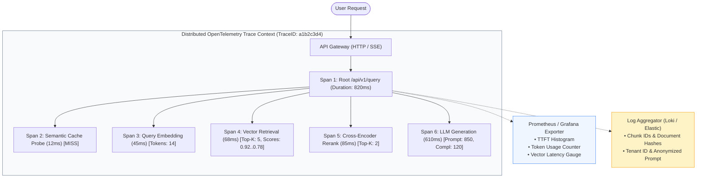
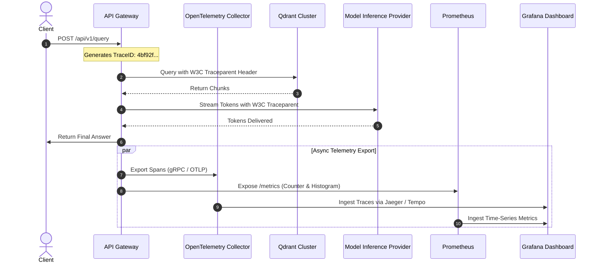
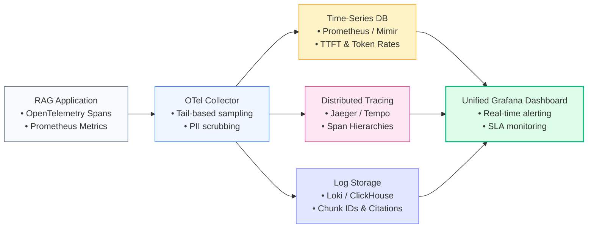

# 📊 Observability & Distributed Tracing for RAG: OpenTelemetry, Prometheus, Grafana, and Log Aggregation

## 📑 Table of Contents
1. [🌟 Fundamentals: The Three Pillars of GenAI Observability](#1--fundamentals-the-three-pillars-of-genai-observability)
2. [🔬 Mathematical Formulations: Sampling Rates, Ingestion Volume & Percentiles](#2--mathematical-formulations-sampling-rates-ingestion-volume--percentiles)
3. [📊 Tooling Comparison Matrix: General APM vs. Specialized GenAI Observability](#3--tooling-comparison-matrix-general-apm-vs-specialized-genai-observability)
4. [🏗️ Distributed Tracing Architecture: W3C Trace Context & Span Hierarchies](#4-️-distributed-tracing-architecture-w3c-trace-context--span-hierarchies)
5. [💻 Production-Grade Implementation: OpenTelemetry Instrumentation & Prometheus Metrics](#5--production-grade-implementation-opentelemetry-instrumentation--prometheus-metrics)
6. [🌍 Real-World Enterprise Case Studies](#6--real-world-enterprise-case-studies)
7. [🛠️ Best Practices & ❌ Common Production Anti-Patterns](#7-️-best-practices---common-production-anti-patterns)
8. [💼 Senior System Design & Architecture Interview Questions](#8--senior-system-design--architecture-interview-questions)
9. [🧪 Hands-On Mini-Project: Custom RAG Telemetry Collector & Span Exporter](#9--hands-on-mini-project-custom-rag-telemetry-collector--span-exporter)
10. [⚡ Quick Revision & Observability Blueprint](#10--quick-revision--observability-blueprint)

---

## 1. 🌟 Fundamentals: The Three Pillars of GenAI Observability

Traditional Application Performance Monitoring (APM) tracks standard HTTP request rates, error codes (4xx/5xx), and database query latencies. However, in enterprise Retrieval-Augmented Generation (RAG) systems, **traditional metrics fail to reveal the primary failure modes**:
- An API endpoint might return HTTP 200 in 400ms, yet deliver a completely hallucinated response because the retriever pulled irrelevant passages.
- A vector database query might succeed, but silent drift in embedding dimensions could degrade Recall@K from 92% to 41%.
- Prompt token explosion can silently burn thousands of dollars an hour while API latencies appear nominal.

True **GenAI Observability** fuses traditional infrastructure telemetry with semantic-level inspection across three foundational pillars:
1. **Metrics (Time-Series Telemetry):** Aggregated numerical data (counters, histograms, gauges) tracking Time-To-First-Token (TTFT), Inter-Token Latency (ITL), token consumption rates (prompt tokens vs. completion tokens), and cache hit ratios.
2. **Distributed Tracing (Context Propagation):** Visualizing the complete execution tree of a single user prompt as it traverses API gateways, vector databases, rerankers, and remote LLM providers using W3C TraceContext standards.
3. **Structured Logging (Semantic Auditing):** High-cardinality JSON logs capturing prompt templates, retrieved chunk IDs, similarity distances, tenant identifiers, and human feedback ratings for auditability and compliance.



---

## 2. 🔬 Mathematical Formulations: Sampling Rates, Ingestion Volume & Percentiles

High-throughput systems cannot store 100% of raw traces without incurring unsustainable telemetry storage costs.

---

### # Observability Ingestion Volume & Cost Formula
Daily telemetry data volume $V_{\text{traces}}$ under tail-based adaptive sampling:

$$
V_{\text{traces}} = Q \cdot S_{\text{span}} \cdot N_{\text{spans}} \cdot \left[ r_{\text{head}} + (1 - r_{\text{head}}) \cdot \mathbb{I}_{\text{anomaly}} \right]
$$

Where:
- $Q$ is daily query volume (e.g., $1,000,000\text{ queries/day}$).
- $S_{\text{span}}$ is average serialized size of a span (typically $1.5\text{ KB}$ with metadata).
- $N_{\text{spans}}$ is average spans per trace (e.g., $6\text{ spans}$).
- $r_{\text{head}} \in [0.01, 0.05]$ is base head-sampling rate for normal, fast requests ($1\% - 5\%$).
- $\mathbb{I}_{\text{anomaly}} \in \{0, 1\}$ indicates whether the trace experienced an error, high latency ($> P_{95}$), or low retrieval similarity score ($< 0.70$).

By configuring **Tail-Based Sampling** in the OpenTelemetry Collector, 100% of errors and slow queries are retained, while boring fast queries are sampled at 2%, reducing telemetry storage bills by **up to 85%**.

---

### # T-Digest Percentile Latency Approximation
Prometheus and OpenTelemetry compute high percentiles ($P_{90}, P_{99}$) over streaming latency distributions using the $t$-digest algorithm, clustering observations into centroids:

$$
P_{99} = F^{-1}(0.99) \approx x_k + \frac{0.99 - C_k}{C_{k+1} - C_k} \cdot (x_{k+1} - x_k)
$$

Where $x_k$ and $C_k$ represent the mean and cumulative weight of the $k$-th centroid bounding the 99th percentile.

---

## 3. 📊 Tooling Comparison Matrix: General APM vs. Specialized GenAI Observability

| Observability Platform | Primary Focus | Tracing Standard | LLM-Specific Metrics (TTFT, Tokens, RAG Triad) | Self-Hosted / On-Premise Support | Cost Structure |
| :--- | :--- | :--- | :--- | :--- | :--- |
| **OpenTelemetry + Prometheus + Grafana** | Cloud-native infrastructure & microservice tracing | **W3C / OTel Standard** | Native via OpenInference semantic conventions | **100% Open Source / Fully On-Prem** | Infrastructure compute only |
| **LangSmith (LangChain)** | End-to-end LLM application debugging & evaluation | Proprietary + OTel bridge | Built-in (Prompt playground, feedback, evals) | Cloud-first (Enterprise on-prem available) | Tiered per-trace seat pricing |
| **Arize Phoenix** | Open-source AI observability & evaluation | OpenInference (OTel native) | Deep retrieval evaluation, drift detection, clustering | **Open Source / Self-Hosted** or Cloud | Free OSS / Cloud enterprise |
| **Datadog LLM Observability** | Unified enterprise APM & cloud monitoring | Datadog Trace API / OTel | Integrated (Cost tracking, latency, guardrails) | Cloud SaaS only | Per-host + Per-span ingest fee |

---

## 4. 🏗️ Distributed Tracing Architecture: W3C Trace Context & Span Hierarchies

Distributed tracing relies on standardized HTTP headers to propagate correlation identifiers across network boundaries:
- `traceparent`: `00-4bf92f3577b34da6a3ce929d0e0e4736-00f067aa0ba902b7-01`
  - `00`: Version
  - `4bf92f3577b34da6...`: Trace ID (shared across all microservices for that query)
  - `00f067aa0ba902b7`: Parent Span ID
  - `01`: Trace Flags (`01` = Sampled)



---

## 5. 💻 Production-Grade Implementation: OpenTelemetry Instrumentation & Prometheus Metrics

The Python 3.10+ implementation below demonstrates end-to-end telemetry instrumentation using standard **OpenTelemetry** and **Prometheus Client** libraries. It records spans for query embedding, vector search, and token generation while exporting metrics for TTFT and token consumption.

```python
"""
Production RAG Observability Engine
Implements OpenTelemetry Distributed Tracing, Custom Prometheus Metrics,
and Structured Semantic Logging.
"""

from __future__ import annotations
import logging
import time
from typing import Any, Dict, List

# Prometheus Metrics Instrumentation
from prometheus_client import Counter, Histogram, generate_latest, REGISTRY

# OpenTelemetry Tracing Instrumentation
from opentelemetry import trace
from opentelemetry.sdk.trace import TracerProvider
from opentelemetry.sdk.trace.export import BatchSpanProcessor, ConsoleSpanExporter
from opentelemetry.sdk.resources import Resource
from opentelemetry.trace.status import Status, StatusCode

logging.basicConfig(level=logging.INFO, format='{"timestamp": "%(asctime)s", "level": "%(levelname)s", "logger": "%(name)s", "message": "%(message)s"}')
logger = logging.getLogger("RAGTelemetry")


# --- Initialize OpenTelemetry Provider ---

resource = Resource.create({"service.name": "enterprise-rag-query-service", "service.version": "1.0.0", "deployment.environment": "production"})
provider = TracerProvider(resource=resource)
# In production, swap ConsoleSpanExporter with OTLPSpanExporter(endpoint="otel-collector:4317")
processor = BatchSpanProcessor(ConsoleSpanExporter())
provider.add_span_processor(processor)
trace.set_tracer_provider(provider)
tracer = trace.get_tracer("rag.core.tracer")


# --- Define Prometheus Metrics ---

RAG_REQUESTS_TOTAL = Counter(
    "rag_requests_total",
    "Total RAG queries processed by status and tenant",
    ["status", "tenant_id"]
)

RAG_TOKEN_USAGE_TOTAL = Counter(
    "rag_token_usage_total",
    "Total tokens consumed across RAG operations",
    ["token_type", "model"]  # token_type: prompt | completion
)

RAG_TTFT_SECONDS = Histogram(
    "rag_time_to_first_token_seconds",
    "Time to First Token (TTFT) latency distribution",
    buckets=[0.05, 0.1, 0.2, 0.4, 0.8, 1.5, 3.0, 5.0]
)

RAG_VECTOR_SEARCH_SECONDS = Histogram(
    "rag_vector_search_latency_seconds",
    "Vector retrieval execution latency",
    buckets=[0.01, 0.025, 0.05, 0.1, 0.25, 0.5, 1.0]
)


# --- Instrumented Pipeline Operations ---

class InstrumentedRAGService:
    def __init__(self, tenant_id: str = "tenant-enterprise-a") -> None:
        self.tenant_id = tenant_id

    def embed_query(self, query: str) -> List[float]:
        with tracer.start_as_current_span("rag.embedding") as span:
            span.set_attribute("rag.query.text", query)
            span.set_attribute("rag.embedding.model", "text-embedding-3-small")
            
            # Simulate embedding calculation
            time.sleep(0.035)  # 35ms latency
            token_count = len(query.split())
            RAG_TOKEN_USAGE_TOTAL.labels(token_type="prompt", model="text-embedding-3-small").inc(token_count)
            span.set_attribute("rag.token_count", token_count)
            
            return [0.12, -0.45, 0.88, 0.05]

    def vector_search(self, embedding: List[float], top_k: int = 3) -> List[Dict[str, Any]]:
        with tracer.start_as_current_span("rag.vector_retrieval") as span:
            span.set_attribute("rag.top_k", top_k)
            span.set_attribute("rag.vector_db", "Qdrant")
            
            t0 = time.monotonic()
            time.sleep(0.045)  # 45ms vector search
            duration = time.monotonic() - t0
            
            RAG_VECTOR_SEARCH_SECONDS.observe(duration)
            
            retrieved_chunks = [
                {"chunk_id": f"chunk_00{i}", "score": round(0.95 - (i * 0.08), 2), "source": "sec_filings_2025.pdf"}
                for i in range(top_k)
            ]
            
            span.set_attribute("rag.retrieved_count", len(retrieved_chunks))
            span.set_attribute("rag.top_score", retrieved_chunks[0]["score"])
            return retrieved_chunks

    def generate_streaming_synthesis(self, query: str, context: List[Dict[str, Any]]) -> str:
        with tracer.start_as_current_span("rag.llm_generation") as span:
            span.set_attribute("rag.llm.model", "gpt-4o")
            span.set_attribute("rag.llm.temperature", 0.0)
            
            # Simulate TTFT
            t0 = time.monotonic()
            time.sleep(0.180)  # 180ms TTFT
            ttft = time.monotonic() - t0
            RAG_TTFT_SECONDS.observe(ttft)
            span.set_attribute("rag.ttft_seconds", ttft)

            # Simulate Token Streaming
            tokens = ["Production", "RAG", "systems", "require", "rigorous", "distributed", "tracing."]
            for t in tokens:
                time.sleep(0.015)  # 15ms ITL
            
            prompt_tokens = 250
            completion_tokens = len(tokens)
            RAG_TOKEN_USAGE_TOTAL.labels(token_type="prompt", model="gpt-4o").inc(prompt_tokens)
            RAG_TOKEN_USAGE_TOTAL.labels(token_type="completion", model="gpt-4o").inc(completion_tokens)

            span.set_attribute("llm.usage.prompt_tokens", prompt_tokens)
            span.set_attribute("llm.usage.completion_tokens", completion_tokens)
            return " ".join(tokens)

    def execute_rag_pipeline(self, user_query: str) -> Dict[str, Any]:
        """Root execution span wrapping the entire RAG pipeline."""
        with tracer.start_as_current_span("rag.pipeline_root") as root_span:
            root_span.set_attribute("tenant.id", self.tenant_id)
            root_span.set_attribute("user.query", user_query)
            
            try:
                emb = self.embed_query(user_query)
                chunks = self.vector_search(emb, top_k=3)
                answer = self.generate_streaming_synthesis(user_query, chunks)

                RAG_REQUESTS_TOTAL.labels(status="success", tenant_id=self.tenant_id).inc()
                root_span.set_status(Status(StatusCode.OK))
                
                return {
                    "query": user_query,
                    "answer": answer,
                    "citations": chunks,
                    "trace_id": format(root_span.get_span_context().trace_id, "032x")
                }
            except Exception as e:
                RAG_REQUESTS_TOTAL.labels(status="error", tenant_id=self.tenant_id).inc()
                root_span.set_status(Status(StatusCode.ERROR, description=str(e)))
                root_span.record_exception(e)
                raise e


# --- Verification Execution ---
if __name__ == "__main__":
    service = InstrumentedRAGService(tenant_id="enterprise-corp")
    result = service.execute_rag_pipeline("What are our Q4 regulatory compliance obligations?")
    print("\n✅ Execution Finished. Generated Answer:")
    print(f"Answer: {result['answer']}")
    print(f"Trace ID: {result['trace_id']}")

    print("\n📊 Prometheus Metrics Dump Preview:")
    print(generate_latest().decode("utf-8")[:600])
```

---

## 6. 🌍 Real-World Enterprise Case Studies

### Case Study 1: Global Fintech Regulatory Compliance Auditing
- **Context:** Automated RAG assistant verifying commercial loan covenants across millions of credit agreements.
- **Problem:** When an auditor contested an AI-generated loan approval reasoning, engineering had no trace linkage between the prompt, the specific document version retrieved, and the model temperature used.
- **Observability Strategy:**
  1. Implemented **W3C Distributed Tracing** across all microservices using OpenTelemetry.
  2. Injected immutable chunk hash IDs and SHA-256 document content digests into every OpenTelemetry span attribute.
  3. Configured an immutable ClickHouse sink for OpenTelemetry trace archives retained for 7 years to satisfy regulatory audits.
- **Outcome:** Reduced audit reconciliation time from 3 weeks to 4 minutes, establishing complete cryptographic lineage from user query to raw legal PDF source chunk.

---

### Case Study 2: High-Volume SaaS Customer Support Assistant
- **Context:** Multilingual customer support bot handling 3.5 million monthly ticket resolutions.
- **Problem:** Monthly OpenAI billing surged unexpectedly by \$84,000 without a proportional increase in ticket resolution volume.
- **Observability Strategy:**
  1. Deployed Prometheus metrics tracking `token_usage_total` segmented by `prompt_type` and `tenant_id`.
  2. Configured Grafana alerts triggering when $P_{95}$ prompt token size exceeded 3,500 tokens.
  3. Identified a regression in the contextual compression module that was appending repetitive full-page chat histories on each turn.
- **Outcome:** Pinpointed the bug within 2 hours of dashboard deployment, saving \$75,000 per month in unnecessary token expenditure.

---

## 7. 🛠️ Best Practices & ❌ Common Production Anti-Patterns

### 🏆 Enterprise Best Practices
1. **Adopt OpenInference Semantic Conventions:** Standardize span attributes (`rag.query.text`, `llm.usage.prompt_tokens`, `retrieval.documents`) using OpenInference specifications to ensure interoperability between Arize Phoenix, LangSmith, and standard Jaeger backends.
2. **Implement Tail-Based Sampling:** Keep 100% of traces that result in HTTP 5xx errors, timeouts, or low relevance scores ($< 0.70$), while sampling nominal sub-second queries at 1%–3% to control storage costs.
3. **Redact Sensitive PII Before Span Export:** Strip Social Security Numbers, API keys, passwords, and Protected Health Information (PHI) before spans leave the application process using regex masking interceptors.
4. **Correlate Logs with Trace IDs:** Include `trace_id` and `span_id` in all structured JSON application logs so engineers can jump from a Kibana log entry directly into a Grafana Tempo trace graph.

### ❌ Common Production Anti-Patterns
1. **Logging Full Document Payloads in High-Throughput Paths:** Serializing 50KB of raw text inside every span attribute on a 500 QPS system quickly overwhelms network interfaces and crashes the OpenTelemetry collector.
2. **Using High-Cardinality Labels in Prometheus:** Adding `user_id`, `query_text`, or `session_token` as labels in Prometheus causes an explosive cardinality surge that crashes the Prometheus server. Use high-cardinality metadata in **Traces and Logs**, keeping Prometheus metrics low-cardinality (e.g., `status`, `tenant_tier`, `model_name`).
3. **Synchronous Telemetry Exporting:** Exporting spans or metrics synchronously on the user request thread introduces artificial latency spikes whenever the observability collector is congested. Always use `BatchSpanProcessor`.

---

## 8. 💼 Senior System Design & Architecture Interview Questions

### Q1: How do you design an observability pipeline for a high-throughput RAG platform that captures 100% of anomalies without overwhelming telemetry storage budgets?
**Answer:**
1. **Two-Tier Architecture:** Deploy an **OpenTelemetry Collector Cluster** configured with a **Tail-Based Sampling Processor**.
2. **Head Sampling at Gateway:** Allow the API Gateway to mark all traces with a sample flag (`sampled=true`) so downstream microservices generate spans without dropping context prematurely.
3. **Memory Buffering at Collector:** The OpenTelemetry Collector maintains an in-memory ring buffer (e.g., storing the last 30 seconds of traces).
4. **Tail-Based Decision Rules:**
   - **Rule 1 (Errors):** If any span in the trace tree contains `status.code == ERROR` or HTTP $\ge 400$, retain the entire trace (100% sampling).
   - **Rule 2 (Latency Outliers):** If total trace duration exceeds the $P_{95}$ latency threshold (e.g., $> 1,200\text{ms}$), retain the trace.
   - **Rule 3 (Retrieval Failure):** If span attribute `rag.top_score < 0.65`, retain the trace for retrieval fine-tuning.
   - **Rule 4 (Nominal Traffic):** Apply a random probabilistic sampler of $1\%$ to remaining healthy traces.
5. **Outcome:** Retains 100% of critical diagnostic data while eliminating 98% of redundant telemetry volume.

---

### Q2: What is the difference between Time-To-First-Token (TTFT) and Inter-Token Latency (ITL), and which layer of the RAG architecture is responsible for optimizing each?
**Answer:**
- **Time-To-First-Token (TTFT):**
  - **Definition:** The elapsed duration from when the client submits the prompt until the first streamed token arrives.
  - **Governed By:** Query embedding generation, vector database search latency, network transit time, reranker inference, and the LLM's **prompt prefill phase** (processing the input context through the attention matrix).
  - **Optimization Responsibility:** Optimizing vector index search (HNSW parameters), context pruning, dynamic reranking, and local ONNX embedding execution.
- **Inter-Token Latency (ITL):**
  - **Definition:** The time interval between consecutive tokens emitted during the autoregressive streaming phase.
  - **Governed By:** LLM memory bandwidth, KV cache access speed, model parameter scale, and speculative decoding.
  - **Optimization Responsibility:** Model inference serving infrastructure (e.g., vLLM, TensorRT-LLM, PagedAttention, and GPU hardware selection).

---

## 9. 🧪 Hands-On Mini-Project: Custom RAG Telemetry Collector & Span Exporter

### Objective
Create an in-memory telemetry analyzer that ingests simulated execution traces, calculates real-time TTFT percentiles ($P_{50}, P_{90}, P_{99}$), and identifies high-latency bottlenecks.

```python
"""
Hands-On Mini-Project: RAG Telemetry Analyzer & Percentile Profiler
Calculates real-time P50, P90, and P99 metrics across distributed RAG spans.
"""

from __future__ import annotations
import math
import random
from dataclasses import dataclass
from typing import List


@dataclass
class RAGTraceRecord:
    trace_id: str
    embedding_ms: float
    retrieval_ms: float
    ttft_ms: float
    total_duration_ms: float
    status: str


def generate_synthetic_telemetry(sample_size: int = 100) -> List[RAGTraceRecord]:
    """Generates synthetic RAG execution traces with realistic tail latency."""
    traces = []
    for i in range(sample_size):
        # Base latencies
        emb = random.gauss(30, 5)
        ret = random.gauss(50, 10)
        ttft = random.gauss(200, 30)

        # Inject 5% tail latency spikes
        if random.random() < 0.05:
            ret += random.uniform(150, 400)
            ttft += random.uniform(500, 1200)

        total = emb + ret + ttft + random.uniform(50, 150)
        status = "ERROR" if random.random() < 0.03 else "OK"

        traces.append(RAGTraceRecord(
            trace_id=f"trace_{i:04d}",
            embedding_ms=round(emb, 2),
            retrieval_ms=round(ret, 2),
            ttft_ms=round(ttft, 2),
            total_duration_ms=round(total, 2),
            status=status
        ))
    return traces


def calculate_percentile(data: List[float], percentile: float) -> float:
    """Calculates percentile using linear interpolation."""
    sorted_data = sorted(data)
    k = (len(sorted_data) - 1) * percentile
    f = math.floor(k)
    c = math.ceil(k)
    if f == c:
        return sorted_data[int(k)]
    return sorted_data[f] * (c - k) + sorted_data[c] * (k - f)


def analyze_telemetry(traces: List[RAGTraceRecord]) -> None:
    print("\n📈 --- RAG SYSTEM OBSERVABILITY TELEMETRY REPORT ---")
    total_count = len(traces)
    error_count = sum(1 for t in traces if t.status == "ERROR")
    
    ttft_values = [t.ttft_ms for t in traces]
    retrieval_values = [t.retrieval_ms for t in traces]
    total_values = [t.total_duration_ms for t in traces]

    print(f"Total Processed Traces:  {total_count}")
    print(f"Error Rate:              {error_count / total_count * 100:.1f}%\n")
    
    print(f"{'Metric':<25} | {'P50 (ms)':<10} | {'P90 (ms)':<10} | {'P99 (ms)':<10}")
    print("-" * 62)
    
    for name, dataset in [
        ("Retrieval Latency", retrieval_values),
        ("Time-To-First-Token", ttft_values),
        ("Total Pipeline Latency", total_values)
    ]:
        p50 = calculate_percentile(dataset, 0.50)
        p90 = calculate_percentile(dataset, 0.90)
        p99 = calculate_percentile(dataset, 0.99)
        print(f"{name:<25} | {p50:>8.2f}   | {p90:>8.2f}   | {p99:>8.2f}")
    
    print("-" * 62)


if __name__ == "__main__":
    synthetic_data = generate_synthetic_telemetry(200)
    analyze_telemetry(synthetic_data)
```

---

## 10. ⚡ Quick Revision & Observability Blueprint

### 📌 Core Takeaways
- **GenAI Requires Semantic Observability:** HTTP 200 is meaningless if the answer is a hallucination; monitor retrieval scores, token counts, and citations alongside infrastructure metrics.
- **W3C Standards Prevent Vendor Lock-In:** Instrument using OpenTelemetry standards and OpenInference semantic attributes to retain freedom across backend telemetry vendors.
- **Tail-Based Sampling Controls Costs:** Retain 100% of errors and high-latency traces while sampling nominal requests at 1%–5%.
- **Never Add High-Cardinality Labels to Prometheus:** Keep user IDs, query strings, and session keys in distributed traces and logs, reserving Prometheus for low-cardinality dimensional metrics.

### 📐 Key Formulas Reference Table

| Formula Name | Formulation | Operational Purpose |
| :--- | :--- | :--- |
| **Tail-Based Telemetry Ingestion** | $$V_{\text{traces}} = Q \cdot S_{\text{span}} \cdot N \cdot [r_{\text{head}} + (1 - r_{\text{head}}) \mathbb{I}_{\text{anomaly}}]$$ | Calculating trace storage volume and infrastructure costs. |
| **Streaming Percentile Latency** | $$P_{99} \approx x_k + \frac{0.99 - C_k}{C_{k+1} - C_k} (x_{k+1} - x_k)$$ | Tracking $P_{99}$ latency bounds across non-normal response distributions. |

### 🗺️ RAG Observability Pipeline Roadmap


