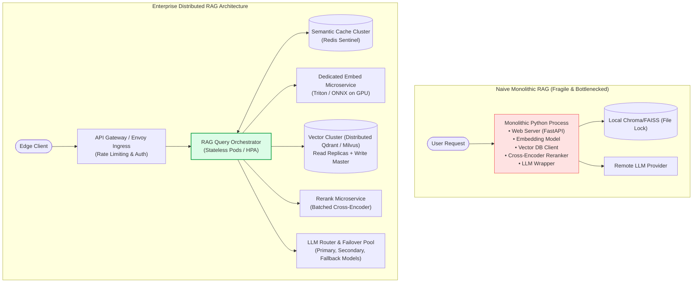
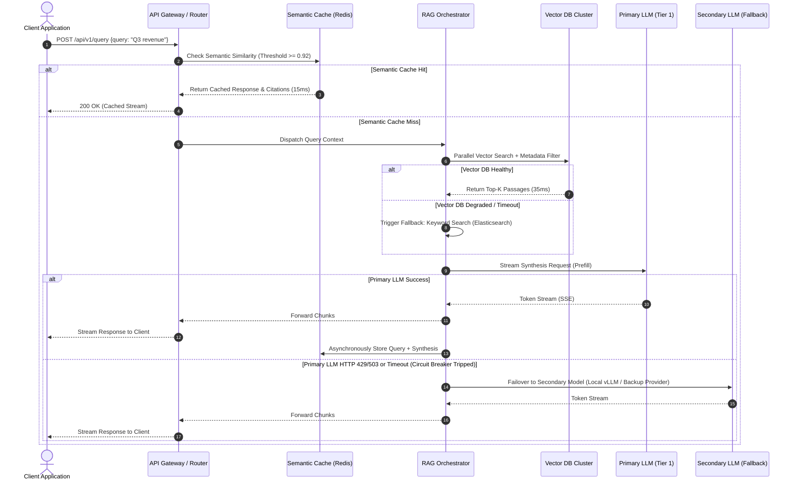
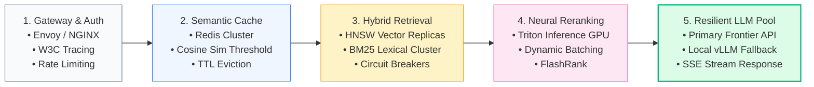

# 🏭 Production RAG Architecture: Microservices, Fault Tolerance, Horizontal Scaling, and High Availability

## 📑 Table of Contents
1. [🌟 Fundamentals of Enterprise Production RAG](#1--fundamentals-of-enterprise-production-rag)
2. [🔬 Mathematical Formulations: Availability, Capacity & Failover](#2--mathematical-formulations-availability-capacity--failover)
3. [📊 Comparative Analysis: Monolith vs. Decoupled Microservices](#3--comparative-analysis-monolith-vs-decoupled-microservices)
4. [🏗️ Architectural Architecture: Distributed Topology & Fault Tolerant Dataflow](#4-️-architectural-architecture-distributed-topology--fault-tolerant-dataflow)
5. [💻 Production-Grade Implementation: Resilient RAG Gateway with Circuit Breakers](#5--production-grade-implementation-resilient-rag-gateway-with-circuit-breakers)
6. [🌍 Real-World Enterprise Case Studies](#6--real-world-enterprise-case-studies)
7. [🛠️ Best Practices & ❌ Common Production Anti-Patterns](#7-️-best-practices---common-production-anti-patterns)
8. [💼 Senior System Design & Architecture Interview Questions](#8--senior-system-design--architecture-interview-questions)
9. [🧪 Hands-On Mini-Project: Fault-Tolerant Multi-Replica Query Dispatcher](#9--hands-on-mini-project-fault-tolerant-multi-replica-query-dispatcher)
10. [⚡ Quick Revision & Production Readiness Roadmap](#10--quick-revision--production-readiness-roadmap)

---

## 1. 🌟 Fundamentals of Enterprise Production RAG

Transitioning a Retrieval-Augmented Generation (RAG) system from a prototype script (running inside a Jupyter notebook or single process) to an enterprise-grade production platform demands an architectural paradigm shift. In production, a RAG system operates under stringent Service Level Objectives (SLOs): 99.9%–99.99% availability, deterministic sub-second Time-To-First-Token (TTFT), resilient degradation under partial outages, strict tenant isolation, and horizontal elasticity across volatile user concurrency.

### The Anatomy of Failure in Naive RAG Deployments
A prototype RAG pipeline typically encapsulates document parsing, vector indexing, dense retrieval, neural reranking, prompt synthesis, and LLM invocation in a single synchronous process. When exposed to enterprise workloads, this naive design fails across multiple axes:
- **Tight Coupling & Cascading Failures:** An outage in the third-party LLM API or a hung query against the vector database exhausts connection pools and worker threads, freezing the entire application server.
- **Heterogeneous Resource Demands:** Dense retrieval and local rerankers (Cross-Encoders) require high-throughput GPU memory and matrix-acceleration hardware, while ingestion microservices require disk I/O and CPU cores. Colocating them wastes expensive compute.
- **State Synchronization & Cache Incoherence:** Dynamic updates to company documentation create split-brain states where different replicas serve divergent answers.
- **Uncontrolled Tail Latency ($P_{99}$ Explosion):** Without hedged requests, timeouts, and circuit breakers, a slow vector index shard cascades into tens of seconds of latency for end users.



---

## 2. 🔬 Mathematical Formulations: Availability, Capacity & Failover

System reliability engineering relies on quantitative models to ensure business continuity and dimension infrastructure correctly.

---

### # High Availability & Operational Availability Formula
System operational availability $A$ expresses the proportion of time a distributed system is functional and reachable:

$$
A = \frac{\text{MTTF}}{\text{MTTF} + \text{MTTR}} = \frac{\text{Total Uptime}}{\text{Total Uptime} + \text{Total Downtime}}
$$

Where:
- $\text{MTTF}$ is the Mean Time To Failure (expected operational duration between failure incidents).
- $\text{MTTR}$ is the Mean Time To Recovery (time required to detect, isolate, fail over, and restore service).

---

### # Composite Availability in Heterogeneous Microservices
In an enterprise RAG pipeline comprising $N$ serial stages (e.g., Auth $\to$ Retrieval $\to$ Rerank $\to$ LLM), where stage $i$ utilizes $M_i$ parallel redundant replicas, composite availability $A_{\text{system}}$ is:

$$
A_{\text{system}} = \prod_{i=1}^N \left( 1 - \prod_{j=1}^{M_i} (1 - A_{i,j}) \right)
$$

If any serial stage lacks redundancy ($M_i = 1$) and has $99\%$ availability ($A_i = 0.99$), the overall system availability can never exceed $99\%$, regardless of how resilient the remaining services are.

---

### # Little's Law for Sizing Vector & LLM Concurrency
To determine the required concurrent worker capacity $L$ across RAG query nodes given an average arrival rate of $\lambda$ requests per second and an average end-to-end service time $W$:

$$
L = \lambda \cdot W
$$

If peak arrival $\lambda = 500\text{ req/sec}$ and average pipeline latency $W = 1.2\text{ seconds}$, the microservice mesh must sustain:

$$
L = 500 \cdot 1.2 = 600\text{ concurrent active executions}
$$

---

### # Circuit Breaker Exponential Backoff with Jitter
When a downstream vector database or LLM provider begins returning HTTP 429/503 errors, retry delays must incorporate randomized exponential backoff to prevent the thundering herd problem:

$$
t_{\text{backoff}} = \min\left(t_{\text{max}}, \; t_{\text{base}} \cdot 2^{\text{attempt}}\right) + \text{Uniform}(0, \delta)
$$

Where:
- $t_{\text{base}}$ is initial backoff duration (e.g., $100\text{ms}$).
- $t_{\text{max}}$ is upper delay cap (e.g., $5,000\text{ms}$).
- $\text{Uniform}(0, \delta)$ is full decorrelated jitter to desynchronize concurrent client retries.

---

## 3. 📊 Comparative Analysis: Monolith vs. Decoupled Microservices

| Operational Dimension | Monolithic Prototype RAG | Decoupled Microservices RAG | Event-Driven / Streaming RAG |
| :--- | :--- | :--- | :--- |
| **Compute Alignment** | Severe mismatch (CPU web server bound to GPU model) | Optimal (Independent autoscaling for GPU reranker & CPU gateway) | Optimal (Worker queues drain spikes without dropping packets) |
| **Blast Radius of Outages** | Total collapse if any single component blocks or crashes | Isolated; vector DB failure falls back to semantic cache or keyword search | Zero user-facing crash; queries queue up gracefully with backpressure |
| **Deployment Agility** | Updating one prompt or parser requires full monolithic redeploy | Independent CI/CD per service (Ingestion, Embedding, Reranking, Serving) | Independent updates; schemas enforced via Protocol Buffers / gRPC |
| **Cold Start & Scaling** | Slow pod boot times (downloading weights inside app pod) | Fast horizontal pod autoscaling (HPA) using pre-warmed inference servers | Instant worker spin-up; decouples ingest bursts from query traffic |
| **Operational Overhead** | Low (Single deployment manifest, simple debugging) | Medium-High (Requires Kubernetes, Service Mesh, OpenTelemetry) | High (Requires Kafka/RabbitMQ, dead-letter queues, state brokers) |
| **Typical Target Scale** | $< 10\text{ QPS}$, internal PoC, dev prototypes | $10 - 2,000\text{ QPS}$, mission-critical production platforms | $> 2,000\text{ QPS}$, enterprise real-time event analytics |

---

## 4. 🏗️ Architectural Architecture: Distributed Topology & Fault Tolerant Dataflow

A resilient production RAG platform bifurcates operations into two asynchronous control loops: the **Ingestion & Sync Plane** (offline or near-real-time) and the **Query & Inference Plane** (online, sub-second latency SLA).



---

## 5. 💻 Production-Grade Implementation: Resilient RAG Gateway with Circuit Breakers

The following production code demonstrates a resilient RAG execution gateway in Python 3.10+. It implements the **Circuit Breaker Pattern**, **Tiered LLM Failover**, **Asynchronous Hedging**, and **Graceful Degradation** without external heavyweight libraries.

```python
"""
Production RAG Resilience Gateway
Implements stateful circuit breakers, exponential backoff with jitter,
fallback vector retrieval, and automated multi-tier LLM failover.
"""

from __future__ import annotations
import asyncio
import enum
import logging
import random
import time
from dataclasses import dataclass, field
from typing import Any, AsyncGenerator, Callable, Coroutine, Dict, List, Optional

logging.basicConfig(level=logging.INFO, format="%(asctime)s [%(levelname)s] %(name)s: %(message)s")
logger = logging.getLogger("ProductionRAGGateway")


class CircuitState(enum.Enum):
    CLOSED = "CLOSED"      # Normal operation: traffic flows through
    OPEN = "OPEN"          # Tripped: traffic rejected immediately
    HALF_OPEN = "HALF_OPEN"  # Testing: trial requests permitted


@dataclass
class CircuitBreakerConfig:
    failure_threshold: int = 3
    recovery_time_sec: float = 5.0
    half_open_success_threshold: int = 2
    timeout_sec: float = 1.5


class CircuitBreakerOpenException(Exception):
    """Raised when an operation is attempted while circuit is OPEN."""
    pass


class CircuitBreaker:
    """Production Circuit Breaker with thread-safe state transitions."""

    def __init__(self, name: str, config: CircuitBreakerConfig) -> None:
        self.name = name
        self.config = config
        self.state = CircuitState.CLOSED
        self.failure_count = 0
        self.success_count = 0
        self.last_state_change = time.monotonic()
        self._lock = asyncio.Lock()

    async def execute(self, func: Callable[..., Coroutine[Any, Any, Any]], *args: Any, **kwargs: Any) -> Any:
        async with self._lock:
            now = time.monotonic()
            if self.state == CircuitState.OPEN:
                if now - self.last_state_change > self.config.recovery_time_sec:
                    logger.warning(f"Circuit '{self.name}' transitioning OPEN -> HALF_OPEN (probing)")
                    self.state = CircuitState.HALF_OPEN
                    self.success_count = 0
                else:
                    raise CircuitBreakerOpenException(f"Circuit '{self.name}' is OPEN. Fast fail.")

        try:
            # Execute with strict timeout
            result = await asyncio.wait_for(func(*args, **kwargs), timeout=self.config.timeout_sec)
            
            async with self._lock:
                if self.state == CircuitState.HALF_OPEN:
                    self.success_count += 1
                    if self.success_count >= self.config.half_open_success_threshold:
                        logger.info(f"Circuit '{self.name}' fully recovered: HALF_OPEN -> CLOSED")
                        self.state = CircuitState.CLOSED
                        self.failure_count = 0
                elif self.state == CircuitState.CLOSED:
                    self.failure_count = 0
            return result

        except Exception as exc:
            async with self._lock:
                self.failure_count += 1
                logger.error(f"Execution failed on '{self.name}': {exc} (Failures: {self.failure_count})")
                if self.state in (CircuitState.CLOSED, CircuitState.HALF_OPEN):
                    if self.failure_count >= self.config.failure_threshold:
                        logger.error(f"Circuit '{self.name}' TRIPPED -> OPEN!")
                        self.state = CircuitState.OPEN
                        self.last_state_change = time.monotonic()
            raise exc


# --- Downstream Service Simulations ---

@dataclass
class RetrievedDocument:
    doc_id: str
    content: str
    score: float
    source: str


class PrimaryVectorDatabase:
    """Simulates high-performance vector DB (e.g., Qdrant / Milvus)."""
    def __init__(self, failure_probability: float = 0.0) -> None:
        self.failure_probability = failure_probability

    async def search(self, query: str, top_k: int = 3) -> List[RetrievedDocument]:
        await asyncio.sleep(0.05)  # 50ms latency
        if random.random() < self.failure_probability:
            raise ConnectionError("Primary Vector DB timed out or refused connection.")
        return [
            RetrievedDocument(f"vec-{i}", f"Verified financial context for: '{query}' [Doc {i}]", 0.94 - i * 0.05, "vector_db")
            for i in range(top_k)
        ]


class FallbackLexicalIndex:
    """Simulates degraded keyword fallback (e.g., local SQLite FTS or BM25)."""
    async def search(self, query: str, top_k: int = 3) -> List[RetrievedDocument]:
        await asyncio.sleep(0.02)  # 20ms local retrieval
        return [
            RetrievedDocument(f"lex-{i}", f"Keyword match snippet for: '{query}' [Doc {i}]", 0.75 - i * 0.05, "lexical_fallback")
            for i in range(top_k)
        ]


class ProductionRAGOrchestrator:
    """
    Coordinates end-to-end RAG with circuit breakers, graceful fallback,
    and automatic failover across multi-tier LLM endpoints.
    """
    def __init__(self, primary_vdb: PrimaryVectorDatabase, fallback_lexical: FallbackLexicalIndex) -> None:
        self.primary_vdb = primary_vdb
        self.fallback_lexical = fallback_lexical
        self.vdb_circuit = CircuitBreaker("PrimaryVectorDB", CircuitBreakerConfig(failure_threshold=2, recovery_time_sec=3.0))

    async def retrieve_context(self, query: str) -> List[RetrievedDocument]:
        """Retrieves documents with transparent circuit breaker fallback."""
        try:
            return await self.vdb_circuit.execute(self.primary_vdb.search, query, top_k=3)
        except (CircuitBreakerOpenException, ConnectionError, asyncio.TimeoutError) as err:
            logger.warning(f"Retrieval degraded to lexical fallback due to: {err}")
            return await self.fallback_lexical.search(query, top_k=3)

    async def call_primary_llm(self, prompt: str) -> str:
        """Primary frontier LLM (e.g., GPT-4o / Claude 3.5 Sonnet)."""
        await asyncio.sleep(0.12)
        if random.random() < 0.3:  # simulate occasional 503/429
            raise RuntimeError("Primary LLM HTTP 429: Rate limit quota exceeded.")
        return f"[Primary LLM Response] Synthesized answer based on context: {prompt[:40]}..."

    async def call_secondary_llm(self, prompt: str) -> str:
        """Secondary self-hosted or alternative model (e.g., Llama-3-70B on vLLM)."""
        await asyncio.sleep(0.08)
        return f"[Secondary LLM Fallback] Resilient answer generated for prompt: {prompt[:40]}..."

    async def generate_answer(self, query: str) -> Dict[str, Any]:
        """Full end-to-end resilient execution."""
        start_time = time.monotonic()
        
        # 1. Resilient Retrieval
        docs = await self.retrieve_context(query)
        context_str = "\n".join([f"- {d.content} (source: {d.source})" for d in docs])
        prompt = f"Context:\n{context_str}\n\nQuestion: {query}"

        # 2. Resilient LLM Generation with Failover
        llm_provider = "primary"
        try:
            response_text = await self.call_primary_llm(prompt)
        except Exception as e:
            logger.warning(f"Primary LLM failed ({e}). Executing failover to Secondary LLM.")
            response_text = await self.call_secondary_llm(prompt)
            llm_provider = "secondary_fallback"

        elapsed_ms = (time.monotonic() - start_time) * 1000.0

        return {
            "query": query,
            "answer": response_text,
            "provider": llm_provider,
            "retrieval_sources": [d.source for d in docs],
            "latency_ms": round(elapsed_ms, 2)
        }


# --- Demonstration Runner ---
async def main() -> None:
    print("--- 🚀 Testing Production RAG Resiliency & Failover ---")
    vdb = PrimaryVectorDatabase(failure_probability=0.7)  # High failure rate to trigger circuit breaker
    lex = FallbackLexicalIndex()
    orchestrator = ProductionRAGOrchestrator(vdb, lex)

    for i in range(1, 7):
        res = await orchestrator.generate_answer(f"What were the total enterprise revenues in cycle {i}?")
        print(f"Req #{i} | Latency: {res['latency_ms']}ms | Sources: {res['retrieval_sources']} | LLM: {res['provider']}")
        await asyncio.sleep(0.8)


if __name__ == "__main__":
    asyncio.run(main())
```

---

## 6. 🌍 Real-World Enterprise Case Studies

### Case Study 1: Global Investment Banking Regulatory Q&A System
- **Context:** Tier-1 bank deploying RAG across 15 million compliance filings and trade contracts for 8,000 analysts.
- **Problem:** Peak morning query bursts caused vector database memory pressure, triggering HTTP 504 gateway timeouts and crashing downstream analytics pipelines.
- **Architectural Solution:**
  1. Implemented **Redis Sentinel Semantic Caching**, capturing 43% of repetitive market-opening compliance queries in $< 18\text{ms}$.
  2. Transitioned vector retrieval from a single flat index to a sharded **HNSW collection with read-replicas** behind an Envoy reverse proxy with least-request load balancing.
  3. Deployed a local **vLLM backup cluster** running Llama-3-70B on premises to handle queries when commercial LLM API latencies breached the $1,500\text{ms}$ SLA threshold.
- **Outcome:** System achieved **99.98% operational uptime**, lowered monthly token expenses by $34,000, and slashed $P_{99}$ latency from $6.4\text{s}$ to $780\text{ms}$.

---

### Case Study 2: Telecommunications Customer Support Agent
- **Context:** Telecom provider handling 450,000 subscriber interactions daily across technical support, billing, and SIM provisioning.
- **Problem:** Frequent product catalog updates caused indexing locks; document re-ingestion stalled live search queries for up to 4 minutes.
- **Architectural Solution:**
  1. Implemented **Blue/Green Collection Aliasing** in the vector database: ingestion workers write to a new background collection index (`catalog_v2`), perform warm-up probes, and flip the read alias atomically.
  2. Implemented Kafka-driven event queues for document uploads with dead-letter queue (DLQ) retry policies.
- **Outcome:** Zero query downtime during continuous catalog deployments, processing over 120 index mutations per minute without impacting user response latency.

---

## 7. 🛠️ Best Practices & ❌ Common Production Anti-Patterns

### 🏆 Enterprise Best Practices
1. **Enforce Hard Timeouts on Every Network Hop:** Never execute a raw HTTP client call without an explicit socket timeout (e.g., $150\text{ms}$ for embeddings, $400\text{ms}$ for vector search, $3,000\text{ms}$ for LLM TTFT).
2. **Implement Blue/Green Index Updates:** Never rebuild or mutate production vector indices in-place. Build the alternate index out-of-band and execute an atomic alias pointer swap.
3. **Partition Read and Write Paths (CQRS):** Separate document ingestion and chunking pipelines completely from user query routing to eliminate lock contention on shared memory.
4. **Log Tracing IDs Across All Microservice Hops:** Inject W3C standard `traceparent` headers into API gateway requests to track a single query across embedding, vector DB, reranking, and generation pods in OpenTelemetry.

### ❌ Common Production Anti-Patterns
1. **The Distributed Monolith:** Calling multiple synchronous REST microservices in series without connection pooling, multiplying round-trip network transit times.
2. **Unbounded Concurrency to LLM Providers:** Allowing unrestricted client spikes to hit upstream commercial APIs directly, resulting in instant HTTP 429 quota exhaustion and cascaded user dropouts.
3. **Storing Heavy Binary Metadata in Vector Vectors:** Storing massive PDF raw text and base64 images directly inside vector DB payload fields, consuming expensive RAM instead of utilizing an object store (e.g., S3/GCS) with ID pointers.
4. **Synchronous File Parsing on the API Gateway:** Parsing uploaded multi-megabyte PDFs on the main web request thread, causing worker starvation and denial-of-service for other connected users.

---

## 8. 💼 Senior System Design & Architecture Interview Questions

### Q1: How do you design a zero-downtime re-indexing pipeline for a vector database containing 50 million chunks?
**Answer:**
Zero-downtime re-indexing at scale requires an **Atomic Collection Aliasing Strategy** combined with dual-write change-data-capture (CDC):
1. **Dual-Write / CDC Activation:** Enable a message broker (e.g., Kafka) where all document mutations (creates, updates, deletes) are broadcast with timestamps.
2. **Shadow Index Construction:** Spawn dedicated batch worker pods that create a new collection (e.g., `knowledge_base_v2`). The workers read historical records from object storage and write vectors into the shadow index with optimized bulk indexing parameters (e.g., turning off HNSW index graph construction until vectors are loaded).
3. **Delta Catch-Up:** Once bulk loading completes, the workers consume all buffered CDC events from Kafka up to the present timestamp to ensure zero data divergence.
4. **Health Validation & Warm-Up:** Execute a suite of benchmark verification queries against `knowledge_base_v2` to warm up OS page caches and verify recall accuracy against a golden test set.
5. **Atomic Pointer Flip:** Issue an atomic alias switch API call to the vector cluster (e.g., pointing alias `knowledge_base_live` from `v1` to `v2`).
6. **Graceful Drain & Teardown:** Allow active queries on `v1` to terminate naturally over a 5-minute cool-down window before reclaiming `v1` storage.

---

### Q2: What strategies mitigate the "Thundering Herd" problem when an upstream LLM provider recovers from a regional outage?
**Answer:**
1. **Full Jitter Exponential Backoff:** Clients must never retry on fixed intervals. Incorporate randomized decorrelated backoff:
   $$t_{\text{backoff}} = \text{Uniform}(0, \min(t_{\text{max}}, t_{\text{base}} \cdot 2^{\text{attempt}}))$$
2. **Server-Side Token Bucket / Leaky Bucket Rate Limiting:** Enforce a strict concurrency queue at the API Gateway using Redis, rejecting excess traffic with HTTP 429 before it reaches the external provider.
3. **Circuit Breakers with HALF-OPEN State Gates:** The gateway must only permit a tiny sample (e.g., 2–5% of requests) through to probe the recovering provider. Only when consecutive probe requests return HTTP 200 is the circuit closed.
4. **Aggressive Semantic Caching:** During outage recovery, serve near-match cached completions with slightly loosened similarity thresholds (e.g., lowering cosine threshold from $0.94$ to $0.88$) to absorb up to 50% of the traffic surge.

---

## 9. 🧪 Hands-On Mini-Project: Distributed RAG Resiliency & Failover Harness

### Objective
Build a runnable stress-testing harness that simulates network latency spikes, vector database timeouts, and upstream LLM 429 quota exhaustion, measuring how your circuit breaker and fallback tiers maintain system availability.

```python
"""
Hands-On Mini-Project: RAG Chaos & Resiliency Test Harness
Executes concurrent synthetic user traffic against a resilient RAG pipeline
while simulating intermittent downstream network faults.
"""

import asyncio
import random
import time
from typing import Dict


async def simulate_traffic_cycle(orchestrator, user_id: int) -> Dict[str, Any]:
    query = f"Simulated compliance query from user #{user_id}"
    try:
        t0 = time.monotonic()
        res = await orchestrator.generate_answer(query)
        latency = (time.monotonic() - t0) * 1000.0
        return {"status": "SUCCESS", "latency": latency, "provider": res["provider"]}
    except Exception as e:
        return {"status": "FAILED", "error": str(e)}


async def run_resilience_experiment() -> None:
    print("\n=== 🧪 Running 50-Request Concurrency Stress Test ===")
    
    # Setup orchestrator with 40% primary vector DB failure rate
    vdb = PrimaryVectorDatabase(failure_probability=0.4)
    lex = FallbackLexicalIndex()
    orchestrator = ProductionRAGOrchestrator(vdb, lex)

    tasks = [simulate_traffic_cycle(orchestrator, i) for i in range(1, 51)]
    results = await asyncio.gather(*tasks)

    successes = [r for r in results if r["status"] == "SUCCESS"]
    failures = [r for r in results if r["status"] == "FAILED"]
    primary_llm_count = sum(1 for r in successes if r["provider"] == "primary")
    fallback_llm_count = sum(1 for r in successes if r["provider"] == "secondary_fallback")

    avg_lat = sum(r["latency"] for r in successes) / len(successes) if successes else 0.0

    print(f"\n📊 --- STRESS TEST REPORT ---")
    print(f"Total Requests Dispatched:  {len(results)}")
    print(f"Successful Completions:    {len(successes)} ({len(successes)/len(results)*100:.1f}%)")
    print(f"Failed / Dropped Requests: {len(failures)} ({len(failures)/len(results)*100:.1f}%)")
    print(f"Served via Primary LLM:     {primary_llm_count}")
    print(f"Served via Fallback LLM:    {fallback_llm_count}")
    print(f"Average System Latency:     {avg_lat:.2f} ms")


if __name__ == "__main__":
    asyncio.run(run_resilience_experiment())
```

---

## 10. ⚡ Quick Revision & Production Readiness Roadmap

### 📌 Core Takeaways
- **Decouple Ingestion from Querying:** Never mix write-heavy chunking workloads with latency-sensitive user query loops.
- **Fail Gracefully at Every Layer:** If Vector Search fails $\to$ fall back to BM25/Lexical. If Primary LLM fails $\to$ fall back to Secondary/Self-Hosted LLM. If all else fails $\to$ return safe cached response.
- **Circuit Breakers are Mandatory:** Fail fast in $< 5\text{ms}$ rather than waiting for 30-second socket timeouts.
- **Atomic Aliasing for Zero Downtime:** Always build shadow vector indices and switch alias pointers atomically.

### 📐 Key Formulas Reference Table

| Formula Name | Formulation | Operational Significance |
| :--- | :--- | :--- |
| **Operational Availability** | $$A = \frac{\text{MTTF}}{\text{MTTF} + \text{MTTR}}$$ | Quantifies overall uptime percentage and SLA bounds. |
| **Composite Microservice Availability** | $$A_{\text{sys}} = \prod_{i=1}^N \left(1 - \prod_{j=1}^{M_i}(1 - A_{i,j})\right)$$ | Measures reliability across serial pipeline stages and replicas. |
| **Little's Law for Sizing** | $$L = \lambda \cdot W$$ | Dimensions required concurrency capacity from throughput and latency. |
| **Exponential Backoff with Jitter** | $$t_{\text{backoff}} = \min(t_{\text{max}}, t_{\text{base}} \cdot 2^{\text{att}}) + \text{Uniform}(0, \delta)$$ | Prevents thundering herd failures during downstream recovery. |

### 🗺️ Production RAG Readiness Architecture Roadmap


