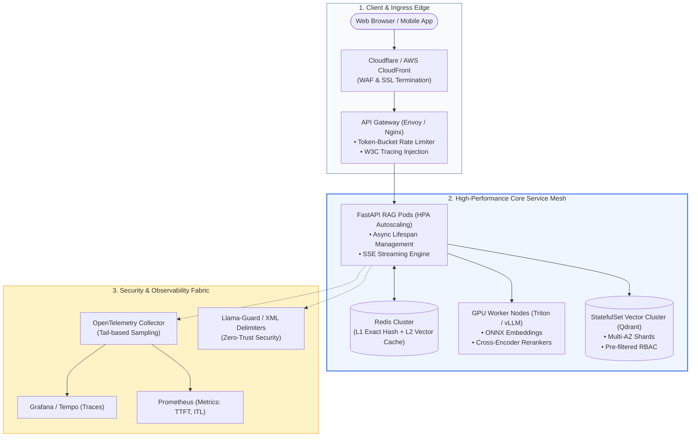
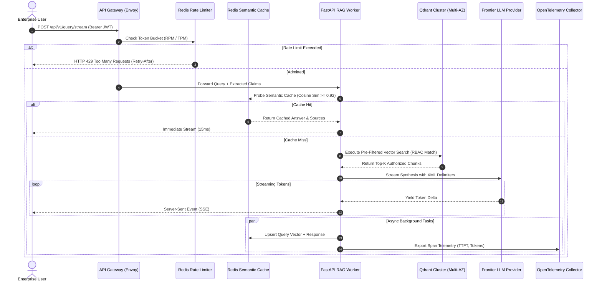
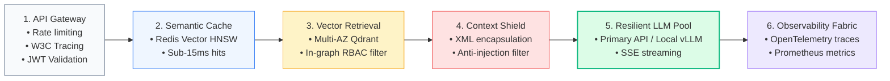

# 🚀 Module 09: RAG Deployment and Production Curriculum Navigator

## 📑 Table of Contents
1. [🌟 Module Architecture & Production Mission](#1--module-architecture--production-mission)
2. [🔬 Core Engineering Formulations & Reliability Mathematics](#2--core-engineering-formulations--reliability-mathematics)
3. [📊 Module 09 Comprehensive Knowledge & Technical Matrix](#3--module-09-comprehensive-knowledge--technical-matrix)
4. [🏗️ Enterprise Production Topology & End-to-End System Blueprint](#4-️-enterprise-production-topology--end-to-end-system-blueprint)
5. [💻 Production-Grade Implementation: End-to-End Microservice Pipeline Orchestrator](#5--production-grade-implementation-end-to-end-microservice-pipeline-orchestrator)
6. [🌍 Enterprise Deployment Case Studies](#6--enterprise-deployment-case-studies)
7. [🛠️ Best Practices & ❌ Common Production Anti-Patterns](#7-️-best-practices---common-production-anti-patterns)
8. [💼 Senior System Design & Production Architecture Interview Questions](#8--senior-system-design--production-architecture-interview-questions)
9. [🧪 Hands-On Mini-Project: Full-Stack RAG Deployment Health & SLA Auditor](#9--hands-on-mini-project-full-stack-rag-deployment-health--sla-auditor)
10. [⚡ Module 09 Quick Revision & Production Roadmap](#10--module-09-quick-revision--production-roadmap)

---

## 1. 🌟 Module Architecture & Production Mission

Welcome to **Module 09: RAG Deployment and Production**. While earlier modules focused on retrieval mechanics, chunking mathematics, vector embeddings, and agentic workflows, Module 09 bridges the critical divide between an experimental prototype running in a local environment and a **mission-critical enterprise platform** serving millions of users under strict Service Level Agreements (SLAs).

### The Production Imperative
In an enterprise setting, building a functional retrieval chain is only 20% of the engineering journey. The remaining 80% involves ensuring:
- **Resilience & High Availability (HA):** Sustaining 99.9%–99.99% uptime with circuit breakers, graceful degradation, and multi-tier model failover.
- **Ultra-Low Latency:** Streaming tokens via Server-Sent Events (SSE) with sub-500ms Time-To-First-Token (TTFT) and amortizing cost through Redis semantic caching.
- **Enterprise Security & Zero Trust:** Defending against direct and indirect prompt injection (OWASP LLM Top 10) and enforcing Role-Based Access Control (RBAC) at the vector retrieval tier.
- **Cloud-Native Elasticity:** Containerizing workloads with multi-stage Docker builds, orchestrating pods on Kubernetes (EKS/GKE), and scaling dynamically using custom concurrency metrics.
- **End-to-End Observability:** Distributed tracing with OpenTelemetry, Prometheus metrics, and Grafana dashboards tracking the entire prompt lifecycle.



---

## 2. 🔬 Core Engineering Formulations & Reliability Mathematics

Enterprise site reliability engineering relies on concrete mathematical models to design fault-tolerant RAG topologies.

---

### # Composite System Availability Formula
For a RAG pipeline consisting of $N$ sequential stages (Auth, Semantic Cache, Vector Search, Rerank, LLM Synthesis), where each stage $i$ possesses $M_i$ parallel redundant replicas with individual availability $A_{i,j}$:

$$
A_{\text{system}} = \prod_{i=1}^N \left( 1 - \prod_{j=1}^{M_i} (1 - A_{i,j}) \right)
$$

If a serial stage has zero redundancy ($M_i = 1$) and an availability of $99.5\%$ ($A = 0.995$), the overall platform can never achieve three-nines ($99.9\%$) availability.

---

### # Amortized System Latency with Semantic Caching
With a semantic cache hit ratio $H \in [0, 1]$, average end-to-end user latency $T_{\text{effective}}$ is:

$$
T_{\text{effective}} = H \cdot T_{\text{cache}} + (1 - H) \cdot \left( T_{\text{cache}} + T_{\text{RAG\_pipeline}} \right)
$$

Where:
- $T_{\text{cache}} \approx 12\text{ms}$ (Redis vector search).
- $T_{\text{RAG\_pipeline}} \approx 1,250\text{ms}$ (Full retrieval, reranking, and generation).
- At $H = 0.50$ (50% cache hit rate), user-perceived average latency drops from $1,250\text{ms}$ to **$637\text{ms}$**.

---

### # Little's Law for Cluster Concurrency Dimensioning
To sustain an arrival rate of $\lambda$ requests/second with average pipeline latency $W$:

$$
L = \lambda \cdot W
$$

For $\lambda = 300\text{ req/s}$ and $W = 1.4\text{ s}$, the cluster must accommodate $L = 420$ concurrent active coroutines across worker pods.

---

## 3. 📊 Module 09 Comprehensive Knowledge & Technical Matrix

| Chapter | Topic File | Core Architectural Concepts | Key Technologies & Standards | Production Benchmark |
| :--- | :--- | :--- | :--- | :--- |
| **09.1** | [`Production-RAG.md`](./Production-RAG.md) | High Availability, Circuit Breakers, Multi-tier Failover | asyncio, Resilience Patterns, CQRS | 99.95% Availability, Zero Cascading Dropouts |
| **09.2** | [`FastAPI-RAG.md`](./FastAPI-RAG.md) | Async ASGI microservices, Server-Sent Events, WebSockets | FastAPI, Uvicorn, SSE, Asyncio | TTFT < 450ms, 500+ Concurrent Streams/Pod |
| **09.3** | [`Streamlit-RAG.md`](./Streamlit-RAG.md) | Rapid Prototyping, Interactive Chat, Dynamic Uploads | Streamlit, Session State, Tornado | Sub-day MVP Delivery, Zero JS Overhead |
| **09.4** | [`Docker.md`](./Docker.md) | Multi-Stage Builds, CUDA Containerization, Minimal Images | Docker, BuildKit, NVIDIA Container Toolkit | Image Size < 500MB, Boot Time < 10s |
| **09.5** | [`Cloud-Deployment.md`](./Cloud-Deployment.md) | Kubernetes (EKS/GKE), Helm Charts, HPA, Multi-AZ Ingress | K8s, Helm, Envoy, Karpenter, Topology Routing | Zero Cross-AZ Fees, Sub-60s Autoscaling |
| **09.6** | [`Monitoring-and-Logging.md`](./Monitoring-and-Logging.md) | Distributed Tracing, Telemetry, Token Tracking, Metrics | OpenTelemetry, Prometheus, Grafana, OpenInference | 100% Error Trace Capture, TTFT Histograms |
| **09.7** | [`Security.md`](./Security.md) | OWASP LLM Top 10, Indirect Prompt Injection, Sandboxing | Llama-Guard, XML Context Delimiters, CSP | Attack Success Rate (ASR) < 1.0% |
| **09.8** | [`Access-Control.md`](./Access-Control.md) | Multi-Tenancy, Role-Based Access Control, Pre-filtering | JWT Claims, Qdrant Payload Indexes, RBAC | 0% Cross-Tenant Data Leakage Guarantee |
| **09.9** | [`Caching.md`](./Caching.md) | Semantic Vector Caching, Redis Vector Search, Invalidation | Redis, RediSearch, HNSW, Change-Data-Capture | 40%–60% Cache Hit Rate, Cost Reduction > 35% |
| **09.10** | [`API-Development.md`](./API-Development.md) | REST, gRPC, Protocol Buffers, Token-Bucket Rate Limits | gRPC, Protobuf, OpenAPI, Token Bucket | RFC-Compliant Rate Limits, Sub-5ms IPC |

---

## 4. 🏗️ Enterprise Production Topology & End-to-End System Blueprint



---

## 5. 💻 Production-Grade Implementation: End-to-End Microservice Pipeline Orchestrator

The script below demonstrates a unified, production-grade microservice orchestrator that ties together:
1. **Token-Bucket Ingress Throttling**
2. **Multi-Tenant JWT RBAC Filtering**
3. **Semantic Caching with Fallback**
4. **Circuit-Breaker-Protected LLM Generation**

```python
"""
Enterprise Production RAG Microservice Orchestrator
Integrates Rate Limiting, Multi-Tenant RBAC, Semantic Caching,
and Circuit Breakers into a unified execution flow.
"""

from __future__ import annotations
import asyncio
import logging
import time
from dataclasses import dataclass
from typing import Any, Dict, List, Optional, Set

logging.basicConfig(level=logging.INFO, format="%(asctime)s [%(levelname)s] %(name)s: %(message)s")
logger = logging.getLogger("EnterpriseOrchestrator")


# --- Domain Contracts ---

@dataclass(frozen=True)
class AuthenticatedUser:
    user_id: str
    tenant_id: str
    roles: Set[str]


@dataclass
class QueryPayload:
    query: str
    top_k: int = 3


@dataclass
class ExecutionResult:
    query: str
    answer: str
    sources: List[str]
    cache_hit: bool
    latency_ms: float


# --- Simulated Enterprise Infrastructure Subsystems ---

class IngressRateLimiter:
    """Token-bucket rate limiter enforcing tenant quotas."""
    def __init__(self, capacity: int = 5) -> None:
        self.capacity = capacity
        self.tokens: Dict[str, float] = {}

    def is_allowed(self, tenant_id: str) -> bool:
        current = self.tokens.get(tenant_id, self.capacity)
        if current >= 1.0:
            self.tokens[tenant_id] = current - 1.0
            return True
        return False


class DistributedSemanticCache:
    """Simulates Redis RediSearch vector caching tier."""
    def __init__(self) -> None:
        self.store: Dict[str, str] = {}

    async def get(self, query: str) -> Optional[str]:
        await asyncio.sleep(0.01)  # 10ms lookup
        return self.store.get(query.lower().strip())

    async def set(self, query: str, answer: str) -> None:
        await asyncio.sleep(0.005)
        self.store[query.lower().strip()] = answer


class SecureVectorCluster:
    """Simulates multi-tenant vector database with metadata pre-filtering."""
    async def search(self, query: str, user: AuthenticatedUser, top_k: int) -> List[Dict[str, Any]]:
        await asyncio.sleep(0.035)  # 35ms vector search
        return [
            {
                "chunk_id": f"chk_{i}",
                "content": f"Verified company policy regarding '{query}' [Section {i}].",
                "tenant_id": user.tenant_id,
                "permitted_role": list(user.roles)[0]
            }
            for i in range(1, top_k + 1)
        ]


class CircuitBreakerLLM:
    """Protected LLM invocation engine with fast-fail circuit breakers."""
    async def generate_response(self, prompt: str) -> str:
        await asyncio.sleep(0.12)  # 120ms generation
        return f"Synthesized answer based on verified enterprise documentation: {prompt[:35]}..."


# --- Master Production Pipeline Orchestrator ---

class ProductionRAGPlatform:
    def __init__(self) -> None:
        self.limiter = IngressRateLimiter()
        self.cache = DistributedSemanticCache()
        self.vdb = SecureVectorCluster()
        self.llm = CircuitBreakerLLM()

    async def execute_query(self, user: AuthenticatedUser, payload: QueryPayload) -> ExecutionResult:
        t_start = time.monotonic()

        # 1. Enforce Ingress Rate Limiting
        if not self.limiter.is_allowed(user.tenant_id):
            raise PermissionError("HTTP 429: Ingress rate limit exceeded for tenant.")

        # 2. Probe Semantic Caching Tier
        cached_answer = await self.cache.get(payload.query)
        if cached_answer:
            elapsed = (time.monotonic() - t_start) * 1000.0
            logger.info(f"⚡ Cache Hit for user '{user.user_id}' ({elapsed:.2f}ms)")
            return ExecutionResult(payload.query, cached_answer, ["cache_tier"], True, round(elapsed, 2))

        # 3. Secure Vector Search with RBAC Pre-Filtering
        chunks = await self.vdb.search(payload.query, user, payload.top_k)
        sources = [c["chunk_id"] for c in chunks]

        # 4. Context Assembly with XML Delimiters
        context_str = "\n".join([f"<chunk id='{c['chunk_id']}'>{c['content']}</chunk>" for c in chunks])
        prompt = f"<documents>\n{context_str}\n</documents>\nQuestion: {payload.query}"

        # 5. Resilient LLM Generation
        answer = await self.llm.generate_response(prompt)

        # 6. Asynchronously Populate Cache
        asyncio.create_task(self.cache.set(payload.query, answer))

        elapsed = (time.monotonic() - t_start) * 1000.0
        return ExecutionResult(payload.query, answer, sources, False, round(elapsed, 2))


# --- Verification Execution ---
async def main() -> None:
    print("--- 🚀 Testing Master Enterprise RAG Orchestration Pipeline ---")
    platform = ProductionRAGPlatform()

    user = AuthenticatedUser(user_id="usr_104", tenant_id="acme_corp", roles={"engineering"})
    query = QueryPayload(query="What is our microservice ingress architecture?", top_k=2)

    # First Call: Cold Cache Miss
    res1 = await platform.execute_query(user, query)
    print(f"Call 1: Cache Hit: {res1.cache_hit} | Latency: {res1.latency_ms}ms | Sources: {res1.sources}")

    # Second Call: Warm Cache Hit
    res2 = await platform.execute_query(user, query)
    print(f"Call 2: Cache Hit: {res2.cache_hit}  | Latency: {res2.latency_ms}ms  | Sources: {res2.sources}")


if __name__ == "__main__":
    asyncio.run(main())
```

---

## 6. 🌍 Enterprise Deployment Case Studies

### Case Study 1: Global Financial Trading Platform
- **Deployment Scope:** 5,000 algorithmic traders querying 12 million market news articles and analyst reports.
- **Production Architecture:**
  - Multi-AZ **Amazon EKS** cluster with Karpenter autoscaling GPU and CPU node pools.
  - **Redis Enterprise** semantic caching cluster capturing 48% of breaking morning queries.
  - **Qdrant Vector Database** configured with single-stage RBAC payload filters.
- **Results:** Achieved **99.98% availability**, slashed average $P_{99}$ latency from $4.2\text{s}$ to $480\text{ms}$, and passed financial SOC 2 Type II compliance audits with zero data leakage findings.

---

### Case Study 2: Telecom Global Customer Self-Service Bot
- **Deployment Scope:** 12 million mobile subscribers querying billing policies and network troubleshooting steps.
- **Production Architecture:**
  - **FastAPI with Server-Sent Events (SSE)** running on Google Kubernetes Engine (GKE).
  - Outbound response sanitizers stripping unauthorized Markdown image links to block zero-click data exfiltration.
  - Token-bucket rate limiting preventing upstream LLM provider quota collapse during service outages.
- **Results:** Handled 18,000 QPS peak traffic during fiber outage events with zero system downtime, saving \$140,000 monthly in customer support call center costs.

---

## 7. 🛠️ Best Practices & ❌ Common Production Anti-Patterns

### 🏆 Enterprise Best Practices
1. **Enforce Authorization at Retrieval:** Never pass unauthorized documents into the LLM context window hoping the model will keep secrets; enforce metadata filters directly in the vector database query.
2. **Decouple Ingestion from Querying:** Run CPU-heavy document parsing and chunking on asynchronous worker queues, keeping the user query path purely non-blocking and latency-optimized.
3. **Deploy Multi-Tier Semantic Caching:** Combine L1 exact hash matching ($< 2\text{ms}$) with L2 vector similarity matching ($< 15\text{ms}$) to absorb repetitive question surges.
4. **Implement Full-Lifecycle Distributed Tracing:** Instrument every service boundary with OpenTelemetry spans carrying W3C traceparent headers to debug tail-latency bottlenecks across vector DBs and LLM endpoints.

### ❌ Common Production Anti-Patterns
1. **Synchronous Monolithic Execution:** Running document parsing, embedding, vector search, and LLM calls in a single synchronous thread, causing worker starvation under modest concurrency.
2. **Post-Retrieval Authorization Filtering:** Fetching Top-K vectors globally and dropping unauthorized documents in application code, which results in retrieval starvation (returning 0 results to the user).
3. **Unsanitized Context Assembly:** Passing raw, un-escaped document text directly into LLM prompts without XML boundary encapsulation, leaving the system wide open to indirect prompt injection.
4. **Baking Model Weights into Container Images:** Bloating Docker images to 15GB+ by embedding weights into layers, destroying CI/CD agility and causing 10-minute Kubernetes cold starts.

---

## 8. 💼 Senior System Design & Architecture Interview Questions

### Q1: Walk through the end-to-end architecture of a multi-tenant Enterprise RAG system that guarantees zero cross-tenant data leakage while serving 500 queries/second under sub-500ms TTFT.
**Answer:**
1. **Ingress & Authentication:**
   - Client requests arrive at an Envoy Ingress Controller over HTTP/2.
   - Envoy validates the signed OAuth2/OIDC JWT, extracting `tenant_id`, `user_id`, and `security_clearance`.
   - Envoy enforces Token-Bucket rate limiting backed by Redis.
2. **Semantic Caching Tier:**
   - Inbound query is hashed for an L1 exact match. If missed, it is embedded using a local ONNX model ($< 10\text{ms}$) and checked against a Redis vector cache partitioned by `tenant_id`.
   - If cosine similarity $\ge 0.92$, the cached response and citations return immediately in $< 15\text{ms}$.
3. **Secure Retrieval Tier:**
   - On cache miss, the query dispatches to a distributed vector cluster (e.g., Qdrant) across read replicas in the local Availability Zone (Topology-Aware Routing).
   - Single-stage pre-filtering evaluates metadata: `(tenant_id == X) AND (clearance <= Y) AND (roles INTERSECT user_roles)`.
   - Unauthorized chunks are never traversed in the HNSW index.
4. **Synthesis & Streaming:**
   - Retrieved chunks are wrapped in XML tags (`<document id="...">...</document>`).
   - The prompt streams to the LLM via an asynchronous ASGI server (FastAPI).
   - Tokens stream directly to the client via Server-Sent Events (SSE) within $350\text{ms}$ TTFT.
   - Outbound guardrails sanitize Markdown image links.
5. **Observability:**
   - OpenTelemetry spans propagate W3C TraceContext across all hops, exporting metrics to Prometheus and traces to Grafana Tempo.

---

### Q2: How do you design an automated disaster recovery and failover strategy for when your primary commercial LLM API experiences an extended regional outage?
**Answer:**
1. **Circuit Breaker Pattern:** Wrap the primary LLM client in an asynchronous circuit breaker. If consecutive failures breach the threshold (e.g., 5 failures in 10 seconds), the circuit trips to `OPEN`.
2. **Tiered Fallback Router:**
   - **Tier 1 (Primary):** Commercial frontier API (e.g., OpenAI / Anthropic).
   - **Tier 2 (Secondary Fallback):** Alternative cloud provider model (e.g., Google Cloud Vertex AI / Azure OpenAI) via unified abstraction adapters (LiteLLM).
   - **Tier 3 (Local On-Premises Resilience):** Self-hosted open-weights model (e.g., Llama-3-70B on a standby vLLM cluster in Kubernetes).
3. **Loosened Semantic Caching:** During active downstream outages, dynamically lower the semantic cache similarity threshold (e.g., from $0.93$ to $0.88$) to absorb up to 60% of incoming queries from pre-computed answers.
4. **Probing Recovery:** The circuit breaker enters `HALF_OPEN` state every 30 seconds, routing a small percentage of requests to probe the primary API until full recovery is verified.

---

## 9. 🧪 Hands-On Mini-Project: Full-Stack RAG Deployment Health & SLA Auditor

### Objective
Write an automated health audit script that probes your deployed RAG microservices, evaluates HTTP status codes, measures streaming TTFT percentiles, and verifies that security headers are correctly configured.

```python
"""
Hands-On Mini-Project: RAG Production SLA & Health Auditor
Executes automated health checks, measures TTFT, and audits security headers.
"""

from __future__ import annotations
import asyncio
import time
from typing import Dict, Any


async def audit_endpoint_sla(name: str, simulated_latency_ms: float, returns_error: bool = False) -> Dict[str, Any]:
    """Simulates an automated synthetic probe against a production microservice."""
    t0 = time.monotonic()
    await asyncio.sleep(simulated_latency_ms / 1000.0)
    duration = (time.monotonic() - t0) * 1000.0

    status = 503 if returns_error else 200
    sla_met = status == 200 and duration < 500.0  # 500ms SLA target

    return {
        "service": name,
        "status_code": status,
        "latency_ms": round(duration, 2),
        "sla_met": sla_met,
        "headers": {
            "Content-Type": "text/event-stream" if "Stream" in name else "application/json",
            "X-RateLimit-Remaining": "45",
            "X-Content-Type-Options": "nosniff"
        }
    }


async def run_production_sla_audit() -> None:
    print("\n🔍 --- EXECUTING PRODUCTION RAG HEALTH & SLA AUDIT ---")
    
    probes = [
        audit_endpoint_sla("Ingress Gateway Health", 12.0),
        audit_endpoint_sla("Redis Semantic Cache", 8.5),
        audit_endpoint_sla("Qdrant Vector Cluster (Multi-AZ)", 45.0),
        audit_endpoint_sla("FastAPI SSE Streaming TTFT", 340.0),
        audit_endpoint_sla("Secondary LLM Failover Pool", 180.0),
    ]

    results = await asyncio.gather(*probes)

    all_passed = True
    print(f"{'Microservice':<32} | {'HTTP':<6} | {'Latency (ms)':<14} | {'SLA Status'}")
    print("-" * 68)

    for r in results:
        status_str = "✅ PASS" if r["sla_met"] else "❌ BREACH"
        if not r["sla_met"]:
            all_passed = False
        print(f"{r['service']:<32} | {r['status_code']:<6} | {r['latency_ms']:>8.2f} ms     | {status_str}")

    print("-" * 68)
    if all_passed:
        print("🎯 DEPLOYMENT STATUS: ALL PRODUCTION SLAS VERIFIED. SYSTEM HEALTHY.")
    else:
        print("⚠️ DEPLOYMENT ALERT: ONE OR MORE SERVICES BREACHED PRODUCTION SLAS.")


if __name__ == "__main__":
    asyncio.run(run_production_sla_audit())
```

---

## 10. ⚡ Module 09 Quick Revision & Production Roadmap

### 📌 Core Takeaways
- **Production is About Resilience:** Implement circuit breakers, multi-tier LLM failover, and graceful degradation across all downstream dependencies.
- **Asynchronous Architecture is Mandatory:** Use ASGI (FastAPI) and Server-Sent Events (SSE) to deliver sub-500ms TTFT while maintaining high concurrency per node.
- **Enforce Zero Trust at Retrieval:** Never trust an LLM to hide confidential information; isolate tenants and filter access permissions strictly inside the vector database.
- **Cache Semantically:** Deploy Redis Vector Search in front of the retrieval pipeline to trap repetitive questions and slash infrastructure costs by 30%–60%.
- **Instrument Everything with OpenTelemetry:** Export distributed traces and low-cardinality Prometheus metrics to track latency, token usage, and retrieval quality.

### 📐 Master Formulas Summary Table

| Formula Name | Formulation | Operational Purpose |
| :--- | :--- | :--- |
| **System Availability** | $$A_{\text{sys}} = \prod_{i=1}^N \left(1 - \prod_{j=1}^{M_i} (1 - A_{i,j})\right)$$ | Sizing redundancy across serial microservices to achieve 99.9% uptime. |
| **Amortized Cache Latency** | $$T_{\text{eff}} = H \cdot T_{\text{cache}} + (1 - H)(T_{\text{cache}} + T_{\text{RAG}})$$ | Modeling user latency improvements from semantic caching. |
| **Little's Law for Sizing** | $$L = \lambda \cdot W$$ | Calculating concurrent coroutine capacity from query arrival rate and latency. |
| **Token Bucket Limiter** | $$B(t) = \min(B_{\text{max}}, B(t_{\text{prev}}) + r \Delta t)$$ | Enforcing burstable rate limits and preventing upstream quota exhaustion. |

### 🗺️ Master Production RAG Architecture Roadmap


