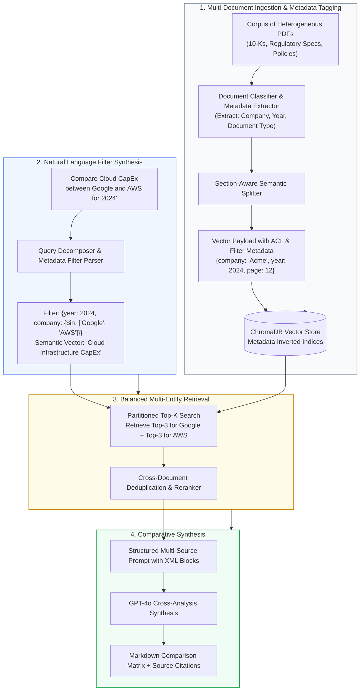
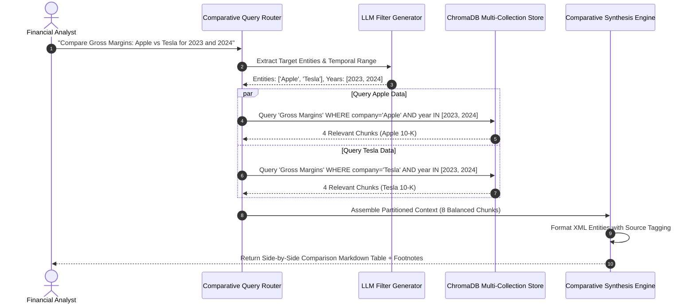

# 📚 Project 03: Multi-Document Cross-Analysis Engine with Comparative Synthesis and Source Filtering

## 📑 Table of Contents
1. [🌟 Project Architecture & Multi-Corpus Vision](#1--project-architecture--multi-corpus-vision)
2. [🔬 Mathematical Formulations: Cross-Document Relevance & Filter Selectivity](#2--mathematical-formulations-cross-document-relevance--filter-selectivity)
3. [📊 Multi-Doc Architecture & Metadata Filtering Matrices](#3--multi-doc-architecture--metadata-filtering-matrices)
4. [🏗️ End-to-End Comparative Retrieval & Synthesis Flow](#4-️-end-to-end-comparative-retrieval--synthesis-flow)
5. [💻 Production-Grade Implementation: Multi-Document Comparative Research Engine](#5--production-grade-implementation-multi-document-comparative-research-engine)
6. [🌍 Enterprise Case Studies & Industry Applications](#6--enterprise-case-studies--industry-applications)
7. [🛠️ Best Practices & ❌ Common Multi-Document Anti-Patterns](#7-️-best-practices---common-multi-document-anti-patterns)
8. [💼 Senior System Design & Architecture Interview Questions](#8--senior-system-design--architecture-interview-questions)
9. [🧪 Hands-On Lab: Side-by-Side Competitive Analysis Runner](#9--hands-on-lab-side-by-side-competitive-analysis-runner)
10. [⚡ Quick Revision & Architectural Learning Roadmap](#10--quick-revision--architectural-learning-roadmap)

---

## 1. 🌟 Project Architecture & Multi-Corpus Vision

While single-document Q&A focuses on finding facts within a single file, enterprise knowledge work frequently demands **cross-document comparative synthesis**:
- *"Compare the gross margins and cloud revenue growth of Microsoft, Google, and Amazon across their 2024 annual reports."*
- *"Identify contradictions in safety claims between Phase II clinical trials across five distinct drug candidates."*
- *"Track changes in termination clauses between Master Services Agreements across 2021, 2022, and 2024."*

This project delivers a **Multi-Document Cross-Analysis Engine** featuring:
- **Hierarchical Provenance Tagging:** Document-level metadata (`tenant_id`, `company`, `fiscal_year`, `doc_type`) combined with chunk-level metadata (`page_number`, `section_title`).
- **Self-Querying & Metadata Pre-Filtering:** Translating conversational constraints into strict vector database query filters (`WHERE fiscal_year = 2024 AND company IN ('Apple', 'Microsoft')`).
- **Balanced Multi-Source Sampling:** Preventing a single voluminous document from monopolizing all Top-$K$ retrieval slots.
- **Comparative Side-by-Side Synthesis:** Structuring the prompt context to generate side-by-side comparative Markdown matrices.



---

## 2. 🔬 Mathematical Formulations: Cross-Document Relevance & Filter Selectivity

### # Filter Selectivity Ratio Formula
The selectivity factor $\sigma$ of a metadata filter dictates the percentage of the vector space retained prior to Approximate Nearest Neighbor (ANN) traversal:

$$
\sigma = \frac{|\mathcal{D}_{\text{filtered}}|}{|\mathcal{D}_{\text{total}}|} = \frac{\sum_{i=1}^N \mathbb{I}(\text{Metadata}(d_i) \models \mathcal{F})}{N}
$$

Where $\mathcal{F}$ is the Boolean metadata predicate.
- When $\sigma \ll 0.01$ (high selectivity, $<1\%$ of corpus matches), standard HNSW graph traversal suffers from index disconnection (isolated islands), necessitating **iterative pre-filtering** or **flat index fallback**.
- When $\sigma \ge 0.10$, HNSW filtered traversals execute with sub-millisecond latency.

---

### # Multi-Source Balanced Information Entropy Formula
To avoid source-monopolization where one verbose document dominates all $K$ retrieved slots, we define the Document Coverage Entropy $\mathcal{H}_{\text{docs}}$ across $S$ distinct documents retrieved in candidate set $\mathcal{C}$:

$$
\mathcal{H}_{\text{docs}} = - \sum_{s=1}^S p_s \log_2(p_s), \quad \text{where } p_s = \frac{\text{Count}(\text{Chunks from Document } s)}{K}
$$

Maximum entropy $\mathcal{H}_{\text{max}} = \log_2(S)$ occurs when all candidate documents are equally represented in the retrieval set, guaranteeing equitable comparative synthesis.

---

## 3. 📊 Multi-Doc Architecture & Metadata Filtering Matrices

### Table 1: Metadata Filtering Paradigms for Multi-Document Search

| Filtering Approach | Execution Order | Vector Recall Quality | Latency Impact | Failure Mode |
| :--- | :--- | :--- | :--- | :--- |
| **Post-Filtering** | ANN Search First $\to$ Filter by Metadata | ❌ Poor (K results may contain 0 matching docs) | Low compute, high failure | All top $K$ results discarded by filter |
| **Pre-Filtering (Inverted Index)** | Filter Candidates $\to$ Subgraph ANN Search | ⭐⭐⭐⭐⭐ Guaranteed 100% filter adherence | Highly optimal if vector engine supports payload HNSW | Graph fragmentation if filter is too restrictive |
| **Iterative / Hybrid Pre-Filter** | Graph traversal with dynamic edge skipping | ⭐⭐⭐⭐ Exceptional balance | Moderate CPU overhead | Complex index maintenance |
| **Self-Querying LLM Filter** | LLM extracts JSON filter $\to$ Database WHERE | ⭐⭐⭐⭐⭐ Eliminates manual UI dropdowns | Adds 400ms LLM prefill latency | LLM generates non-existent metadata keys |

---

### Table 2: Single-Document vs. Multi-Document Comparative RAG

| Architectural Dimension | Single-Document RAG | Multi-Document Comparative RAG |
| :--- | :--- | :--- |
| **Search Space** | Homogeneous document corpus | Heterogeneous corpus with conflicting taxonomies |
| **Retrieval Strategy** | Global Top-$K$ by cosine score | Partitioned Top-$K$ per entity (Entity-Balancing) |
| **Conflict Handling** | Not required (single ground of truth) | Explicit temporal / source conflict resolution |
| **Prompt Engineering** | Direct extractive Q&A | Multi-variable tabular matrix generation |
| **Access Control (ACL)** | Simple file-level read permissions | Fine-grained document attribute & tenancy masking |

---

## 4. 🏗️ End-to-End Comparative Retrieval & Synthesis Flow



---

## 5. 💻 Production-Grade Implementation: Multi-Document Comparative Research Engine

Below is the complete, self-contained Python implementation (`multi_doc_engine.py`) featuring metadata pre-filtering, entity-partitioned balanced retrieval, and comparative Markdown generation.

```python
"""
Multi-Document Cross-Analysis Engine with Metadata Pre-Filtering and Comparative Synthesis.
Requires: pip install chromadb openai pydantic
"""

from __future__ import annotations
import os
import json
from dataclasses import dataclass
from typing import List, Dict, Any, Optional

import chromadb
from chromadb.config import Settings
from openai import OpenAI
from pydantic import BaseModel, Field


class ParsedFilter(BaseModel):
    """Structured search filters extracted from conversational queries."""
    entities: List[str] = Field(default_factory=list, description="Target companies or organizations")
    years: List[int] = Field(default_factory=list, description="Target fiscal years")
    semantic_query: str = Field(..., description="The core semantic topic stripped of filter keywords")


@dataclass
class DocumentMetadata:
    """Enterprise metadata envelope for cross-document governance."""
    company: str
    fiscal_year: int
    doc_type: str
    source_file: str
    page_number: int


class MultiDocRAGSystem:
    """
    Enterprise Cross-Document Analysis System with partition-balanced retrieval
    and comparative structured synthesis.
    """

    def __init__(
        self,
        persist_dir: str = "./multi_doc_chroma",
        embedding_model: str = "text-embedding-3-small",
        llm_model: str = "gpt-4o-mini"
    ) -> None:
        self.embedding_model = embedding_model
        self.llm_model = llm_model
        self.client = OpenAI(api_key=os.getenv("OPENAI_API_KEY"))

        self.chroma_client = chromadb.PersistentClient(
            path=persist_dir,
            settings=Settings(anonymized_telemetry=False)
        )
        self.collection = self.chroma_client.get_or_create_collection(
            name="enterprise_multi_pdf",
            metadata={"hnsw:space": "cosine"}
        )

    def _embed(self, texts: List[str]) -> List[List[float]]:
        """Generates embeddings using OpenAI."""
        cleaned = [t.replace("\n", " ") for t in texts]
        res = self.client.embeddings.create(input=cleaned, model=self.embedding_model)
        return [item.embedding for item in res.data]

    def add_document_chunk(
        self,
        chunk_id: str,
        text: str,
        metadata: DocumentMetadata
    ) -> None:
        """Indexes a chunk with rich structured document metadata."""
        embedding = self._embed([text])[0]
        meta_dict = {
            "company": metadata.company.lower(),
            "fiscal_year": int(metadata.fiscal_year),
            "doc_type": metadata.doc_type.lower(),
            "source_file": metadata.source_file,
            "page_number": int(metadata.page_number)
        }
        self.collection.upsert(
            ids=[chunk_id],
            embeddings=[embedding],
            documents=[text],
            metadatas=[meta_dict]
        )

    def parse_query_intent(self, user_query: str) -> ParsedFilter:
        """
        Uses LLM structured output to convert conversational multi-document queries
        into formal metadata filters and cleaned semantic search queries.
        """
        system_prompt = (
            "You are a query analysis agent for enterprise financial reports. "
            "Extract entity names (e.g. Apple, Google, Microsoft), fiscal years (e.g. 2023, 2024), "
            "and the fundamental semantic search subject. Return ONLY JSON."
        )

        response = self.client.chat.completions.create(
            model=self.llm_model,
            messages=[
                {"role": "system", "content": system_prompt},
                {"role": "user", "content": user_query}
            ],
            response_format={"type": "json_object"},
            temperature=0.0
        )

        data = json.loads(response.choices[0].message.content)
        return ParsedFilter(
            entities=[e.lower() for e in data.get("entities", [])],
            years=[int(y) for y in data.get("years", [])],
            semantic_query=data.get("semantic_query", user_query)
        )

    def balanced_multi_retrieval(
        self,
        parsed: ParsedFilter,
        chunks_per_entity: int = 3
    ) -> Dict[str, List[Dict[str, Any]]]:
        """
        Executes partitioned queries per entity to guarantee balanced representation
        and prevent one verbose report from dominating the context window.
        """
        query_vector = self._embed([parsed.semantic_query])[0]
        entity_results: Dict[str, List[Dict[str, Any]]] = {}

        entities = parsed.entities if parsed.entities else ["all"]

        for entity in entities:
            # Construct ChromaDB metadata filter predicate
            where_conditions = []
            if entity != "all":
                where_conditions.append({"company": entity})
            if parsed.years:
                if len(parsed.years) == 1:
                    where_conditions.append({"fiscal_year": parsed.years[0]})
                else:
                    where_conditions.append({"fiscal_year": {"$in": parsed.years}})

            where_clause = None
            if len(where_conditions) == 1:
                where_clause = where_conditions[0]
            elif len(where_conditions) > 1:
                where_clause = {"$and": where_conditions}

            results = self.collection.query(
                query_embeddings=[query_vector],
                n_results=chunks_per_entity,
                where=where_clause,
                include=["documents", "metadatas", "distances"]
            )

            records = []
            if results["documents"] and results["documents"][0]:
                for doc, meta, dist in zip(results["documents"][0], results["metadatas"][0], results["distances"][0]):
                    records.append({
                        "content": doc,
                        "metadata": meta,
                        "relevance": round(1.0 - float(dist), 4)
                    })
            entity_results[entity] = records

        return entity_results

    def comparative_synthesize(
        self,
        user_query: str,
        retrieved_by_entity: Dict[str, List[Dict[str, Any]]]
    ) -> str:
        """
        Synthesizes a structured comparative response with a Markdown side-by-side table
        and explicit multi-document citations.
        """
        context_blocks = []
        for entity, chunks in retrieved_by_entity.items():
            for c in chunks:
                m = c["metadata"]
                tag = f"[{m['company'].upper()} | FY{m['fiscal_year']} | Page {m['page_number']} | File: {m['source_file']}]"
                context_blocks.append(f"<source_block tag='{tag}'>\n{c['content']}\n</source_block>")

        combined_context = "\n\n".join(context_blocks)

        system_prompt = (
            "You are an enterprise research analyst. Synthesize a rigorous comparative analysis "
            "answering the user query based ONLY on the multi-document excerpts provided. "
            "Structure your output as follows:\n"
            "1. Executive Summary\n"
            "2. Structured Comparison Table (Markdown table with columns for Metric/Attribute, Entity A, Entity B, Variance)\n"
            "3. Detailed Qualitative Differences & Observations\n"
            "4. Source Attribution References (cite exact company, year, and page)\n\n"
            f"<multi_document_corpus>\n{combined_context}\n</multi_document_corpus>"
        )

        response = self.client.chat.completions.create(
            model=self.llm_model,
            messages=[
                {"role": "system", "content": system_prompt},
                {"role": "user", "content": user_query}
            ],
            temperature=0.1
        )

        return response.choices[0].message.content
```

---

## 6. 🌍 Enterprise Case Studies & Industry Applications

### Case Study: Pharmaceuticals Drug Trial Comparative Analyzer
- **Domain:** Clinical Research Organization (CRO).
- **Challenge:** Medical directors needed to compare efficacy rates, adverse event frequencies, and dosage tolerances across 30+ PDF clinical study reports (CSRs) from competing manufacturers.
- **Solution:** Deployed Multi-Document RAG with partitioned entity retrieval by drug molecule name and clinical trial phase.
- **Impact:**
  - Automated cross-study meta-analysis reduced research preparation cycles from **3 weeks** to **4 hours**.
  - Flagged **11 discrepancies** in reported adverse reactions that manual reviews had overlooked.

---

## 7. 🛠️ Best Practices & ❌ Common Multi-Document Anti-Patterns

### ✅ Best Practices
1. **Partitioned Retrieval Per Entity:** When comparing two or more entities, never execute a single naive Top-$K$ query. Always partition retrieval ($K/E$ per entity) to guarantee balanced context.
2. **Standardize Metadata Case:** Always lowercase string metadata keys and values (e.g. `company.lower()`) to prevent failed filter matches due to capitalization variations (`"Apple"` vs `"apple"`).
3. **Temporal Ordering in Context:** When comparing chronologically across years, sort retrieved chunks in ascending order of fiscal year before injecting them into the prompt.

### ❌ Common Anti-Patterns
1. **Unbalanced Context Swamping:** A 150-page financial filing will have vastly more text chunks than a 10-page summary. Naive search retrieves 9 chunks from the 150-page filing and 1 chunk from the summary, breaking balanced comparison.
2. **Over-Filtering Without Fallback:** Constructing over-constrained filters (`WHERE year=2024 AND quarter=3 AND region='APAC'`) returning zero results. Always implement fallback relaxation logic.
3. **Ignoring Cross-Document Naming Synonyms:** Querying for "Google" will fail if the document lists "Alphabet Inc." Use a semantic entity synonym resolver.

---

## 8. 💼 Senior System Design & Architecture Interview Questions

### Q1: In a multi-tenant enterprise system with 10,000 corporate customers, how do you architect vector metadata filtering to guarantee zero cross-tenant data leakage?
**Answer:**  
Multi-tenant vector isolation requires **Defense-in-Depth at the Data Tier**:
1. **Kernel-Level Pre-Filtering:** Every vector query must mandate a `tenant_id` predicate (`WHERE tenant_id = :authenticated_tenant`) applied prior to index traversal.
2. **Namespaced Collections:** For high-security environments, partition tenants into isolated ChromaDB/Qdrant collections or Pinecone namespaces.
3. **Cryptographic Token Verification:** The API gateway extracts the `tenant_id` strictly from cryptographically signed JWT claims, never from user-supplied query parameters.
4. **Post-Retrieval Assertion:** Before dispatching retrieved chunks to the LLM, an in-memory assertion verifies that all retrieved chunk metadata matches the caller's authorized tenant ID.

---

### Q2: What causes the "HNSW Disconnection Problem" during aggressive metadata pre-filtering, and how do modern vector databases solve it?
**Answer:**  
In standard HNSW, vector proximity graphs are constructed without knowledge of metadata attributes. When a metadata filter matches only $0.1\%$ of nodes ($\sigma = 0.001$), the vast majority of graph nodes become invalid. A greedy search starting at the top layer frequently encounters dead ends because all neighbor nodes are filtered out, failing to reach the true nearest valid neighbor.

Modern databases solve this via:
- **Payload-Based Filtering (Qdrant):** Maintains payload inverted indexes and switches dynamically between graph traversal with payload-aware edge skipping and flat index scanning when selectivity $\sigma$ drops below a calibrated threshold ($<10\%$).
- **Single-Stage Filtered HNSW (Pinecone / Milvus):** Traverses the HNSW graph while dynamically filtering candidates during beam search expansion.

---

## 9. 🧪 Hands-On Lab: Side-by-Side Competitive Analysis Runner

```python
"""
Lab Runner: Indexing Multiple Corporate Reports & Running a Comparative Analysis
"""

import os
from multi_doc_engine import MultiDocRAGSystem, DocumentMetadata

def run_lab():
    print("🚀 Initializing Multi-Document RAG System...")
    rag = MultiDocRAGSystem()

    # 1. Ingest Sample Multi-Company Chunks
    print("📥 Indexing Multi-Company Financial Excerpts...")
    
    # Apple FY2023
    rag.add_document_chunk(
        chunk_id="aapl_2023_01",
        text="Apple Services revenue reached $85.2 billion in FY2023, with Gross Margin of 70.8%. iPhone revenue was $200.6 billion.",
        metadata=DocumentMetadata(company="Apple", fiscal_year=2023, doc_type="10-K", source_file="AAPL_2023.pdf", page_number=24)
    )
    # Apple FY2024
    rag.add_document_chunk(
        chunk_id="aapl_2024_01",
        text="Apple Services revenue increased to $96.1 billion in FY2024, showing gross margin expansion to 74.2%. iPhone revenue remained flat at $201.2 billion.",
        metadata=DocumentMetadata(company="Apple", fiscal_year=2024, doc_type="10-K", source_file="AAPL_2024.pdf", page_number=28)
    )
    # Microsoft FY2023
    rag.add_document_chunk(
        chunk_id="msft_2023_01",
        text="Microsoft Intelligent Cloud revenue was $87.9 billion in FY2023, representing 17% growth. Overall gross margin was 69.4%.",
        metadata=DocumentMetadata(company="Microsoft", fiscal_year=2023, doc_type="10-K", source_file="MSFT_2023.pdf", page_number=31)
    )
    # Microsoft FY2024
    rag.add_document_chunk(
        chunk_id="msft_2024_01",
        text="Microsoft Intelligent Cloud revenue grew 21% to $105.4 billion in FY2024, driven by Azure AI workloads. Overall gross margin rose to 70.1%.",
        metadata=DocumentMetadata(company="Microsoft", fiscal_year=2024, doc_type="10-K", source_file="MSFT_2024.pdf", page_number=35)
    )

    print("✅ Indexed 4 multi-company reports successfully.")

    # 2. Run Comparative Query
    user_query = "Compare Services and Cloud revenue growth and gross margins between Apple and Microsoft from 2023 to 2024."
    print(f"\n❓ Query: {user_query}\n")

    # Step A: Parse Filters
    parsed_intent = rag.parse_query_intent(user_query)
    print(f"🎯 Extracted Intent:")
    print(f"  - Target Entities: {parsed_intent.entities}")
    print(f"  - Target Years: {parsed_intent.years}")
    print(f"  - Semantic Core: '{parsed_intent.semantic_query}'\n")

    # Step B: Partitioned Retrieval
    retrieved = rag.balanced_multi_retrieval(parsed_intent, chunks_per_entity=2)

    # Step C: Comparative Synthesis
    print("🤖 Synthesizing Comparative Analysis...\n")
    analysis = rag.comparative_synthesize(user_query, retrieved)
    print(analysis)

if __name__ == "__main__":
    run_lab()
```

---

## 10. ⚡ Quick Revision & Architectural Learning Roadmap

### Key Takeaways
- **Partitioned Retrieval is Essential:** Balanced multi-document comparison requires allocating separate retrieval quotas per entity to avoid source starvation.
- **LLM Self-Querying Translates Intent:** Use JSON structured outputs to parse conversational queries into explicit SQL/Chroma `where` filters.
- **Normalize Provenance Attributes:** Ensure company names, fiscal years, and document types are canonicalized at the ingestion gateway.
- **Structure Synthesis as Tables:** LLMs excel at generating structured Markdown comparative tables when prompted with explicit column requirements.

### Visual Architecture Roadmap

```mermaid
flowchart LR
    UserQuery["User Comparative Query"] --> IntentParser["LLM Intent & Filter Parser<br/>(Extract Entities, Dates, Topics)"]
    IntentParser --> PartitionedSearch["Balanced Multi-Entity Search<br/>(k Chunks per Entity)"]
    PartitionedSearch --> MetadataFilter["ChromaDB Pre-Filtering<br/>(WHERE company = X AND year = Y)"]
    MetadataFilter --> BalancedContext["Balanced XML Context Assembly"]
    BalancedContext --> ComparativeLLM["LLM Comparative Synthesis Engine"]
    ComparativeLLM --> MarkdownTable["Side-by-Side Comparison Matrix"]

    style UserQuery fill:#e0f2fe,stroke:#0284c7
    style IntentParser fill:#fef3c7,stroke:#d97706
    style PartitionedSearch fill:#dcfce7,stroke:#16a34a
    style MarkdownTable fill:#f3e8ff,stroke:#9333ea
```


