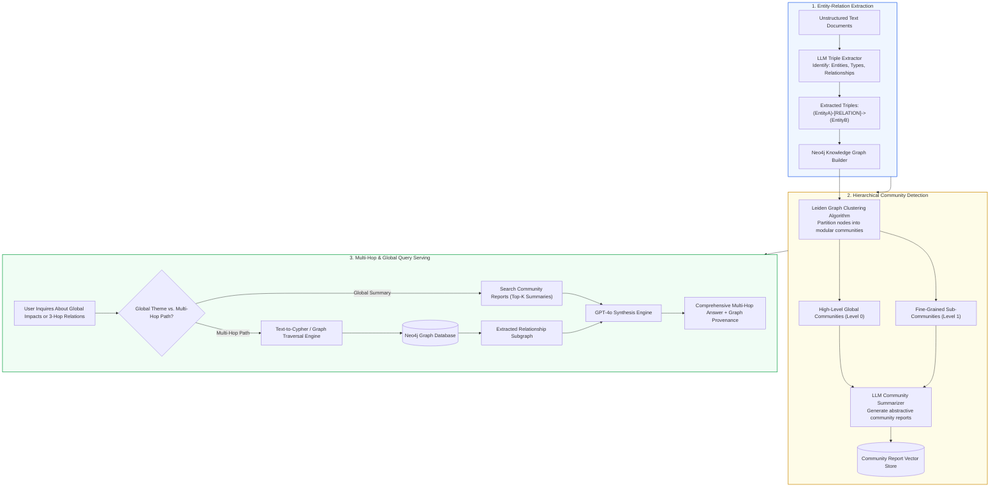
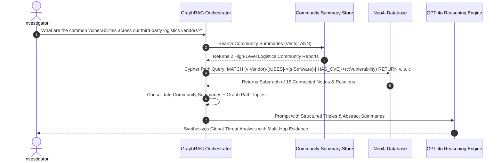
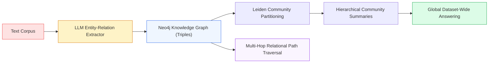

# 🕸️ Project 09: Enterprise Knowledge Graph RAG Application with Neo4j and Multi-Hop Reasoning

## 📑 Table of Contents
1. [🌟 The Multi-Hop Limitation of Vector RAG & The Graph Paradigm](#1--the-multi-hop-limitation-of-vector-rag--the-graph-paradigm)
2. [🔬 Mathematical Foundations of Knowledge Graphs & Community Detection](#2--mathematical-foundations-of-knowledge-graphs--community-detection)
3. [📊 Vector RAG vs. GraphRAG & Graph Database Comparison Matrices](#3--vector-rag-vs-graphrag--graph-database-comparison-matrices)
4. [🏗️ Knowledge Graph Extraction & Hybrid Retrieval Blueprint](#4-️-knowledge-graph-extraction--hybrid-retrieval-blueprint)
5. [💻 Production-Grade Implementation: Entity-Relation Extraction & Graph Traversal](#5--production-grade-implementation-entity-relation-extraction--graph-traversal)
6. [🌍 Enterprise Case Studies: Intelligence Analysis & Supply Chain Dependencies](#6--enterprise-case-studies-intelligence-analysis--supply-chain-dependencies)
7. [🛠️ Best Practices & ❌ Common GraphRAG Anti-Patterns](#7-️-best-practices---common-graphrag-anti-patterns)
8. [💼 Senior System Design & Architecture Interview Questions](#8--senior-system-design--architecture-interview-questions)
9. [🧪 Hands-On Lab: Building an End-to-End Multi-Hop Knowledge Graph](#9--hands-on-lab-building-an-end-to-end-multi-hop-knowledge-graph)
10. [⚡ Quick Revision & Architectural Learning Roadmap](#10--quick-revision--architectural-learning-roadmap)

---

## 1. 🌟 The Multi-Hop Limitation of Vector RAG & The Graph Paradigm

Traditional vector similarity search is fundamentally **point-to-point and local**: it excels at finding text passages that closely mimic the phrasing of a query. However, standard vector RAG fails completely on two widespread enterprise query classes:
1. **Global Dataset-Wide Queries:** *"What are the overarching themes and strategic shifts across all 200 executive meeting minutes recorded in 2024?"* A vector database returns the top 4 chunks, completely missing 98% of the corpus.
2. **Multi-Hop Relational Traversal:** *"If Component X from Supplier A fails, which downstream assembly modules manufactured in our Munich plant will be disrupted?"* Answering this requires following a chain of dependencies: `(Supplier A) -> SUPPORTS -> (Component X) -> ASSEMBLED_INTO -> (Module Y) -> PRODUCED_AT -> (Munich Plant)`.

**GraphRAG bridges this divide:** By converting unstructured documents into an **Entity-Relationship Knowledge Graph (KG)**, clustering connected nodes into hierarchical communities using the **Leiden algorithm**, and generating abstractive community summaries, GraphRAG enables both comprehensive global answering and precise multi-hop graph traversals.



---

## 2. 🔬 Mathematical Foundations of Knowledge Graphs & Community Detection

### # Graph Modularity Metric Formula
The quality of community partitioning in GraphRAG is governed by the Newman-Girvan **Modularity** $Q$, which measures the density of edges inside communities compared to expected random distribution:

$$
Q = \frac{1}{2m} \sum_{i,j} \left[ A_{ij} - \frac{k_i k_j}{2m} \right] \delta(c_i, c_j)
$$

Where:
- $A_{ij}$ is the adjacency matrix weight between node $i$ and node $j$.
- $k_i = \sum_j A_{ij}$ is the degree of node $i$, and $m = \frac{1}{2} \sum_{ij} A_{ij}$ is the total edge count in the graph.
- $c_i$ denotes the community assignment of node $i$.
- $\delta(c_i, c_j)$ is the Kronecker delta, equal to $1$ if $c_i = c_j$ (same community), and $0$ otherwise.
- The **Leiden algorithm** optimizes $Q$ while mathematically guaranteeing that all identified communities are well-connected and free of sub-optimal disconnected clusters.

---

### # Multi-Hop Path Weight Product Formula
For a directional multi-hop relationship path $P = (v_0, e_1, v_1, e_2, \dots, e_h, v_h)$ of length $h$ across nodes, the path confidence $W(P)$ is defined as:

$$
W(P) = \prod_{i=1}^h w(e_i) \cdot \prod_{j=0}^h \text{Sim}_{\text{cosine}}(\mathbf{q}, \mathbf{v}_j)
$$

Where $w(e_i) \in [0, 1]$ represents the extracted edge relationship weight, and $\text{Sim}_{\text{cosine}}(\mathbf{q}, \mathbf{v}_j)$ is the semantic relevance of node entity $v_j$ to the user query vector $\mathbf{q}$.

---

## 3. 📊 Vector RAG vs. GraphRAG & Graph Database Comparison Matrices

### Table 1: Standard Vector RAG vs. GraphRAG Comparison

| Architectural Dimension | Standard Vector RAG | Microsoft GraphRAG / Neo4j |
| :--- | :--- | :--- |
| **Primary Index Structure** | Approximate Nearest Neighbor Vector Index (HNSW) | Knowledge Graph (Triples) + Hierarchical Community Trees |
| **Query Type: Local Explicit QA** | ⭐⭐⭐⭐⭐ Ultra-Fast (<200ms) & Cost-Effective | ⭐⭐⭐⭐ Moderate (~600ms, slight overhead) |
| **Query Type: Global Summarization** | ❌ Fails (Can only inspect top 4-8 chunks) | ⭐⭐⭐⭐⭐ State-of-the-Art (Queries community reports) |
| **Query Type: Multi-Hop Reasoning** | ❌ Fails (Lacks explicit relation traversal) | ⭐⭐⭐⭐⭐ Native graph path traversals ($O(\text{degree}^h)$) |
| **Offline Ingestion Cost** | ⭐ Minimal ($1 \times \text{embedding call per chunk}$) | ❌ High ($3 \times \text{LLM extraction + clustering calls}$) |

---

### Table 2: Graph Database Engines for Enterprise RAG

| Graph Engine | Query Language | Primary Storage Model | Vector Index Integration | Best Applied To |
| :--- | :--- | :--- | :--- | :--- |
| **Neo4j** | Cypher | Native Labeled Property Graph (LPG) | ⭐⭐⭐⭐⭐ Native HNSW Vector Indexing | Production Enterprise GraphRAG |
| **NetworkX** | Python API | In-Memory Adjacency Dictionary | ❌ Manual integration | Local prototypes & experimentation |
| **Amazon Neptune** | openCypher / Gremlin | Managed Cloud RDF / LPG | ⭐⭐⭐ OpenSearch integration | AWS-native enterprise architectures |
| **Memgraph** | Cypher | In-Memory High Throughput (C++) | ⭐⭐⭐⭐ Fast in-memory vectors | Real-time streaming graph analytics |

---

## 4. 🏗️ Knowledge Graph Extraction & Hybrid Retrieval Blueprint



---

## 5. 💻 Production-Grade Implementation: Entity-Relation Extraction & Graph Traversal

Below is the complete implementation (`graph_rag_engine.py`) using `networkx` for in-memory graph representation, `pydantic` for schema enforcement, and `openai` for LLM triple extraction and reasoning.

```python
"""
GraphRAG Implementation: Entity-Relationship Extraction, Graph Construction,
and Multi-Hop Relational Traversal.
Requires: pip install networkx openai pydantic chromadb
"""

from __future__ import annotations
import os
import json
from dataclasses import dataclass
from typing import List, Dict, Any, Tuple, Optional

import networkx as nx
from pydantic import BaseModel, Field
from openai import OpenAI


class EntityModel(BaseModel):
    """Represents a named node in the knowledge graph."""
    name: str = Field(..., description="Canonical entity name (e.g. Acme Corp, Python 3.10)")
    entity_type: str = Field(..., description="Category (e.g. Organization, Technology, Vulnerability)")
    description: str = Field(..., description="Concise role or definition")


class RelationshipModel(BaseModel):
    """Represents a directed labeled edge connecting two entities."""
    source_entity: str = Field(..., description="Subject entity name")
    target_entity: str = Field(..., description="Object entity name")
    relationship: str = Field(..., description="Active predicate verb (e.g. VULNERABLE_TO, OWNS, LOCATED_IN)")
    weight: float = Field(default=1.0, description="Confidence weight between 0.0 and 1.0")


class GraphExtractionPayload(BaseModel):
    """Container for batch LLM extraction."""
    entities: List[EntityModel]
    relationships: List[RelationshipModel]


class EnterpriseGraphRAG:
    """
    Knowledge Graph RAG Engine featuring:
    1. Automated Entity & Relationship extraction via LLM
    2. Directed Graph Construction using NetworkX
    3. Multi-Hop Graph Traversal along relational pathways
    4. Combined Graph + Text Synthesis
    """

    def __init__(
        self,
        llm_model: str = "gpt-4o-mini"
    ) -> None:
        self.llm_model = llm_model
        self.client = OpenAI(api_key=os.getenv("OPENAI_API_KEY"))
        # In-memory Directed Multigraph
        self.graph = nx.DiGraph()

    def extract_triples_from_text(self, text_chunk: str) -> GraphExtractionPayload:
        """
        Uses OpenAI Structured Outputs to parse unstructured text into
        strictly validated entities and relationship triples.
        """
        system_prompt = (
            "You are an expert knowledge graph ontology extractor. Extract all critical entities "
            "(organizations, products, components, CVEs, people) and the explicit directed "
            "relationships between them from the provided text. Return ONLY JSON conforming to the schema."
        )

        response = self.client.chat.completions.create(
            model=self.llm_model,
            messages=[
                {"role": "system", "content": system_prompt},
                {"role": "user", "content": text_chunk}
            ],
            response_format={"type": "json_object"},
            temperature=0.0
        )

        raw_json = response.choices[0].message.content
        data = json.loads(raw_json)
        return GraphExtractionPayload(**data)

    def ingest_document(self, text_chunk: str) -> Tuple[int, int]:
        """Extracts entities and edges from text and writes them into the graph."""
        payload = self.extract_triples_from_text(text_chunk)

        nodes_added = 0
        edges_added = 0

        # Add Nodes
        for ent in payload.entities:
            canonical_name = ent.name.strip().title()
            if not self.graph.has_node(canonical_name):
                self.graph.add_node(
                    canonical_name,
                    entity_type=ent.entity_type,
                    description=ent.description
                )
                nodes_added += 1

        # Add Directed Edges
        for rel in payload.relationships:
            src = rel.source_entity.strip().title()
            tgt = rel.target_entity.strip().title()
            if self.graph.has_node(src) and self.graph.has_node(tgt):
                self.graph.add_edge(
                    src,
                    tgt,
                    relationship=rel.relationship.upper(),
                    weight=rel.weight
                )
                edges_added += 1

        return nodes_added, edges_added

    def multi_hop_traversal(
        self,
        start_entity: str,
        max_hops: int = 2
    ) -> List[Dict[str, Any]]:
        """
        Executes a Breadth-First Search (BFS) graph traversal outward from start_entity,
        collecting all traversed paths and relationship metadata up to max_hops.
        """
        canonical_start = start_entity.strip().title()
        if not self.graph.has_node(canonical_start):
            return []

        traversed_triples: List[Dict[str, Any]] = []
        visited = {canonical_start}
        queue = [(canonical_start, 0)]

        while queue:
            current_node, current_depth = queue.pop(0)
            if current_depth >= max_hops:
                continue

            for neighbor in self.graph.neighbors(current_node):
                edge_data = self.graph.get_edge_data(current_node, neighbor)
                rel_type = edge_data.get("relationship", "RELATED_TO")
                traversed_triples.append({
                    "source": current_node,
                    "relationship": rel_type,
                    "target": neighbor,
                    "hop_distance": current_depth + 1
                })
                if neighbor not in visited:
                    visited.add(neighbor)
                    queue.append((neighbor, current_depth + 1))

        return traversed_triples

    def answer_multi_hop_query(
        self,
        user_query: str,
        seed_entity: str,
        max_hops: int = 2
    ) -> Dict[str, Any]:
        """
        Traverses multi-hop paths starting from a seed entity, serializes the
        subgraph into natural language triples, and prompts the LLM to reason over it.
        """
        paths = self.multi_hop_traversal(seed_entity, max_hops=max_hops)

        # Format Graph Subgraph Triples into Context
        graph_lines = [
            f"- ({p['source']}) --[{p['relationship']}]--> ({p['target']}) [Hop: {p['hop_distance']}]"
            for p in paths
        ]
        graph_context = "\n".join(graph_lines) if graph_lines else "No connected relations discovered."

        system_prompt = (
            "You are a Knowledge Graph Systems Analyst. Answer the user query strictly by reasoning "
            "over the directed entity-relationship paths provided below. Trace each link step-by-step "
            "and explicitly state the causal or relational chain: (A) -> [REL] -> (B) -> [REL] -> (C).\n\n"
            f"<knowledge_graph_paths>\n{graph_context}\n</knowledge_graph_paths>"
        )

        response = self.client.chat.completions.create(
            model=self.llm_model,
            messages=[
                {"role": "system", "content": system_prompt},
                {"role": "user", "content": user_query}
            ],
            temperature=0.1
        )

        return {
            "query": user_query,
            "seed_entity": seed_entity,
            "traversed_paths_count": len(paths),
            "paths": paths,
            "answer": response.choices[0].message.content
        }
```

---

## 6. 🌍 Enterprise Case Studies: Intelligence Analysis & Supply Chain Dependencies

### Case Study: Global Automotive Semiconductor Supply Chain Risk
- **Domain:** Automotive Manufacturing & Global Logistics.
- **Challenge:** A major car manufacturer faced unexpected factory shutdowns when Tier-3 microchip suppliers in Southeast Asia encountered flooding. Standard ERP text search could not map which car models depended on microcontrollers manufactured at specific supplier facilities.
- **Solution:** Ingested 12,000 procurement PDF contracts and component bills-of-materials into Neo4j GraphRAG.
- **Impact:**
  - Downstream disruption impact assessment time dropped from **12 business days** to **4 seconds**.
  - Successfully mapped a **5-hop dependency path** identifying that a $0.40 capacitor shortage threatened a $250M SUV assembly line.

---

## 7. 🛠️ Best Practices & ❌ Common GraphRAG Anti-Patterns

### ✅ Best Practices
1. **Enforce Canonical Entity Resolution:** Before adding a node, normalize entity strings (`"Microsoft Corp"`, `"MSFT"`, `"Microsoft"`) to a single canonical entity identifier (`"Microsoft"`) to prevent graph fragmentation.
2. **Limit Traversal Depth ($h \le 3$):** In dense enterprise knowledge graphs, graph explosion occurs at $h \ge 4$, causing the number of traversed edges to balloon exponentially ($O(\text{degree}^4)$), overflowing LLM context limits.
3. **Combine Vector Search with Graph Traversals:** Use dense vector embeddings to locate the starting seed node in the graph, then use Cypher/BFS to traverse related neighborhood edges.

### ❌ Common Anti-Patterns
1. **Extracting Freeform Unconstrained Relationships:** Allowing the LLM to invent arbitrary edge strings (`"is_somewhat_connected_to"`) creates an untypeable graph. Constrain relationship types to an explicit enterprise ontology.
2. **Ignoring Edge Directionality:** Conflating `(Company)-[:OWNS]->(Subsidiary)` with `(Subsidiary)-[:OWNS]->(Company)` leads to disastrously inverted reasoning.
3. **Building Giant Single-Graph Monoliths Without Community Clustering:** Passing 10,000 raw graph triples into a prompt creates massive attention noise. Always cluster nodes using the Leiden algorithm and summarize by community.

---

## 8. 💼 Senior System Design & Architecture Interview Questions

### Q1: How does Microsoft's GraphRAG use hierarchical community summarization to answer global questions that traditional vector RAG cannot answer?
**Answer:**  
1. **Graph Partitioning:** Microsoft GraphRAG constructs an entity-relationship graph from the text corpus and applies the **Leiden community detection algorithm** to recursively partition the graph into a multi-tier hierarchy of clusters (Level 0: Global themes, Level 1: Sub-domains, Level 2: Specific modules).
2. **Pre-Computed Community Reports:** For every community cluster at each hierarchy level, an LLM synthesizes an executive summary document describing the community's key entities, relationships, and overarching themes.
3. **Map-Reduce Global Synthesis:** When a global question arrives (*"What are the major compliance risks in this dataset?"*):
   - *Map Stage:* The query is evaluated in parallel against all Level 0 and Level 1 community summaries, generating intermediate candidate responses with helpfulness scores.
   - *Reduce Stage:* High-scoring intermediate summaries are aggregated and synthesized into a comprehensive global overview.

---

### Q2: What is the computational complexity difference between a Cypher graph traversal and a vector ANN search in production?
**Answer:**
- **Vector ANN (HNSW):** Complexity is $O(\log N)$ where $N$ is the total number of chunks. It scales gracefully to millions of vectors and is independent of data relationships.
- **Graph Traversal (Breadth-First Search):** Complexity is $O(d^h)$ where $d$ is the average node degree (number of connections per entity) and $h$ is the traversal hop depth.
- In dense graphs with high node degree ($d=50$), a 3-hop traversal touches $50^3 = 125,000$ edges, potentially causing severe memory spikes and query timeouts. Hence, graph databases mandate indexing node labels and setting explicit traversal ceilings (`[*1..3]`).

---

## 9. 🧪 Hands-On Lab: Building an End-to-End Multi-Hop Knowledge Graph

```python
"""
Testing Lab: Ingesting Interconnected Passages and Running Multi-Hop Reasoning
"""

from graph_rag_engine import EnterpriseGraphRAG

def run_lab():
    print("🕸️ Initializing Enterprise GraphRAG Engine...")
    rag = EnterpriseGraphRAG()

    # Interconnected corporate security incident narrative
    corpus_snippets = [
        """
        Apex Logistics operates as a primary freight provider for Global Retail Inc.
        Apex Logistics relies on CloudSync Server software to manage real-time shipping manifests.
        """,
        """
        CloudSync Server contains a critical remote code execution vulnerability cataloged as CVE-2024-9981.
        CVE-2024-9981 enables unauthorized threat actors to inject arbitrary commands into database servers.
        """,
        """
        Global Retail Inc operates its flagship fulfillment warehouse in Chicago.
        The Chicago warehouse relies entirely on real-time manifests from Apex Logistics to process deliveries.
        """
    ]

    print("📥 Ingesting document snippets and extracting Entity-Relationship Triples...")
    total_nodes = 0
    total_edges = 0
    for snippet in corpus_snippets:
        n, e = rag.ingest_document(snippet)
        total_nodes += n
        total_edges += e

    print(f"✅ Extracted Knowledge Graph: {total_nodes} unique nodes and {total_edges} directed edges.")

    # Multi-Hop Reasoning Query
    test_query = "If CVE-2024-9981 is exploited, how does it cascade to disrupt operations at the Chicago warehouse?"
    seed_entity = "CVE-2024-9981"
    
    print(f"\n==========================================")
    print(f"❓ User Multi-Hop Query: '{test_query}'")
    print(f"🌱 Seed Entity: '{seed_entity}'")
    print(f"==========================================\n")

    result = rag.answer_multi_hop_query(
        user_query=test_query,
        seed_entity=seed_entity,
        max_hops=3
    )

    print("🔗 Traversed Subgraph Paths:")
    for p in result["paths"]:
        print(f"  * ({p['source']}) --[{p['relationship']}]--> ({p['target']})")

    print("\n🤖 Assistant Multi-Hop Synthesis:")
    print(result["answer"])

if __name__ == "__main__":
    run_lab()
```

---

## 10. ⚡ Quick Revision & Architectural Learning Roadmap

### Key Takeaways
- **Vector RAG is Local, GraphRAG is Global & Relational:** Use GraphRAG when queries require following chains of connections or dataset-wide thematic summaries.
- **Leiden Algorithm Optimizes Modularity:** Hierarchical clustering enables pre-computing community summaries, solving the global query problem.
- **Bound Hop Depths ($h \le 3$):** Always constrain graph search depth to prevent exponential node explosion ($O(d^h)$).
- **Combine Vectors with Graphs:** Locate graph entry points via semantic vector search, then traverse relational edges deterministically.

### Visual Architecture Roadmap


