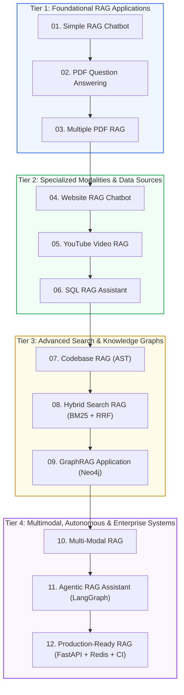

# 💻 Module 10: 12 Real-World Hands-On Projects

A progressive portfolio of 12 production-grade RAG applications, taking you from basic question-answering to multi-agent enterprise microservices.

---

## 🚀 Projects Directory & Status Tracker

> **Status Indicators:**
> - `✅ Done` : Implementation complete, tested, and verified.
> - `🔄 In Progress` : Under active design, development, or implementation.

| # | Project Title | Status | Architecture Highlights | Primary Stack | Link |
| :---: | :--- | :---: | :--- | :--- | :---: |
| **01** | [Simple RAG Chatbot](01-Simple-RAG-Chatbot/README.md) | `✅ Done` | Baseline Q&A chatbot over text documents | LangChain / ChromaDB / Streamlit | [View Project ↗](01-Simple-RAG-Chatbot/README.md) |
| **02** | [PDF Question Answering](02-PDF-Question-Answering/README.md) | `✅ Done` | Table extraction, layout analysis, and citations | PyMuPDF / pdfplumber / FAISS | [View Project ↗](02-PDF-Question-Answering/README.md) |
| **03** | [Multiple PDF RAG](03-Multiple-PDF-RAG/README.md) | `✅ Done` | Cross-document research with metadata filtering | ChromaDB / Metadata ACLs | [View Project ↗](03-Multiple-PDF-RAG/README.md) |
| **04** | [Website RAG Chatbot](04-Website-RAG-Chatbot/README.md) | `✅ Done` | Automated crawler, HTML cleaning, and documentation Q&A | Trafilatura / Playwright / Qdrant | [View Project ↗](04-Website-RAG-Chatbot/README.md) |
| **05** | [YouTube Video RAG](05-Youtube-Video-RAG/README.md) | `✅ Done` | Audio transcripts, timestamp chunking, and video jump links | youtube-transcript-api / ChromaDB | [View Project ↗](05-Youtube-Video-RAG/README.md) |
| **06** | [SQL RAG Assistant](06-SQL-RAG-Assistant/README.md) | `✅ Done` | Natural language to SQL with hybrid schema retrieval | PostgreSQL / SQLAlchemy / LLM | [View Project ↗](06-SQL-RAG-Assistant/README.md) |
| **07** | [Codebase RAG](07-Codebase-RAG/README.md) | `✅ Done` | AST-aware code chunking across functions and classes | Tree-sitter / Qdrant / OpenAI | [View Project ↗](07-Codebase-RAG/README.md) |
| **08** | [Hybrid Search RAG](08-Hybrid-Search-RAG/README.md) | `✅ Done` | Dense embeddings + BM25 with Reciprocal Rank Fusion | Rank-BM25 / ChromaDB / Cross-Encoder | [View Project ↗](08-Hybrid-Search-RAG/README.md) |
| **09** | [GraphRAG Application](09-GraphRAG-Application/README.md) | `✅ Done` | Knowledge graph extraction and community summarization | Neo4j / NetworkX / LangChain | [View Project ↗](09-GraphRAG-Application/README.md) |
| **10** | [Multi-Modal RAG](10-Multi-Modal-RAG/README.md) | `✅ Done` | Extracting text, charts, diagrams, and tables | ColPali / GPT-4o / Unstructured | [View Project ↗](10-Multi-Modal-RAG/README.md) |
| **11** | [Agentic RAG Assistant](11-Agentic-RAG-Assistant/README.md) | `✅ Done` | ReAct reasoning loops, query decomposition, web fallback | LangGraph / Tavily Search | [View Project ↗](11-Agentic-RAG-Assistant/README.md) |
| **12** | [Production-Ready RAG](12-Production-Ready-RAG/README.md) | `✅ Done` | High-throughput async microservice with Redis cache and CI | FastAPI / Docker / Redis / RAGAS | [View Project ↗](12-Production-Ready-RAG/README.md) |

---

## 🗺️ Portfolio Progression Roadmap

---

## 🎯 Portfolio Learning Objectives

1. **Foundational Prototypes (Projects 01-03):** Build core text and PDF RAG workflows with basic vector stores (Chroma, FAISS) and Streamlit UIs.
2. **Dynamic Ingestion (Projects 04-06):** Ingest diverse modalities including live web pages, YouTube video transcripts, and relational SQL schemas.
3. **Advanced Retrieval & Graphs (Projects 07-09):** Implement syntax-aware AST parsing for codebases, dense-sparse hybrid search with Reciprocal Rank Fusion, and Neo4j GraphRAG.
4. **Autonomous & Production Systems (Projects 10-12):** Build vision-language multimodal extractors, self-correcting LangGraph agents, and high-performance containerized microservices with Redis caching and RAGAS CI evaluation.
