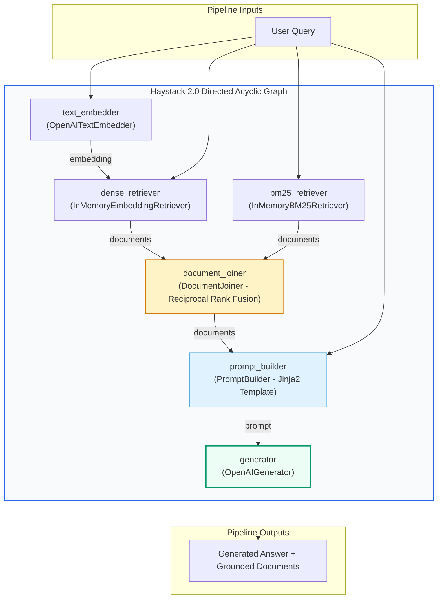

# 🌾 Deepset Haystack 2.0: Component Architecture, Directed Acyclic Graph (DAG) Pipelines, and Production Serving

## 📑 Table of Contents
1. [🌟 Architectural Philosophy: The Haystack 2.0 Paradigm Rewrite](#1--architectural-philosophy-the-haystack-20-paradigm-rewrite)
2. [🔬 Mathematical & Graph Foundations of Pipeline Execution](#2--mathematical--graph-foundations-of-pipeline-execution)
3. [🧱 Component Protocol & `@component` Decorator Contracts](#3--component-protocol--component-decorator-contracts)
4. [🔀 Connecting Sockets, Dataflow Validation, and Multi-Branch Routing](#4--connecting-sockets-dataflow-validation-and-multi-branch-routing)
5. [📄 Document Stores, Embedders, and Document Joiners](#5--document-stores-embedders-and-document-joiners)
6. [📜 Pipeline Serialization & GitOps (YAML / JSON Infrastructure-as-Code)](#6--pipeline-serialization--gitops-yaml--json-infrastructure-as-code)
7. [💻 Production-Grade Implementation: End-to-End Hybrid RAG Pipeline](#7--production-grade-implementation-end-to-end-hybrid-rag-pipeline)
8. [🌍 Enterprise Production Case Studies](#8--enterprise-production-case-studies)
9. [🛠️ Best Practices & ❌ Common Production Anti-Patterns](#9-️-best-practices---common-production-anti-patterns)
10. [💼 Senior System Design & Production Interview Scenarios](#10--senior-system-design--production-interview-scenarios)
11. [🧪 Hands-On Mini-Project: Custom Hallucination Guard Component](#11--hands-on-mini-project-custom-hallucination-guard-component)
12. [⚡ Quick Revision & Haystack 2.0 Reference Matrix](#12--quick-revision--haystack-20-reference-matrix)

---

## 1. 🌟 Architectural Philosophy: The Haystack 2.0 Paradigm Rewrite

**Haystack**, engineered by Berlin-based **deepset**, is one of the most mature enterprise search and NLP frameworks in production. In early 2024, deepset released **Haystack 2.0**, a complete ground-up rewrite of the framework designed to address the challenges of production NLP engineering:
- **Legacy 1.x Limitations:** Tight coupling between nodes, implicit data passing via shared dictionaries, rigid pipeline shapes, and challenging custom component authoring.
- **Haystack 2.0 Breakthrough:** Replaced monolithic abstractions with **loosely-coupled, isolated components** connected via a strictly-typed **Directed Acyclic Graph (DAG)**.

### The Three Tenets of Haystack 2.0:
1. **Isolated Component Purity:** Components are plain Python classes decorated with `@component`. They define explicit input and output types with zero hidden state.
2. **Explicit Socket Connections:** Components connect through typed sockets (`pipeline.connect("source_component.output_name", "target_component.input_name")`). Haystack verifies type compatibility at pipeline assembly time—not during runtime failure.
3. **Declarative Infrastructure-as-Code:** Entire retrieval and generation topologies can be serialized to JSON/YAML, enabling GitOps versioning, CI/CD pipeline validation, and multi-language serving.



---

## 2. 🔬 Mathematical & Graph Foundations of Pipeline Execution

Haystack pipelines are formalized as Directed Acyclic Graphs:

$$\mathcal{G} = (\mathcal{V}, \mathcal{E})$$

Where $\mathcal{V}$ is the set of decorated `@component` instances and $\mathcal{E} \subseteq \mathcal{V} \times \mathcal{V}$ represents directed socket dataflow channels.

### # Kahn’s Algorithm for Topological Scheduling
To evaluate components in non-blocking order without race conditions, Haystack computes a topological sort $\mathcal{L}$ of $\mathcal{G}$:
1. Compute in-degree $\text{deg}^-(v)$ for every component $v \in \mathcal{V}$.
2. Initialize queue $\mathcal{S}$ with all components having $\text{deg}^-(v) = 0$ (pipeline ingress points).
3. While $\mathcal{S}$ is non-empty:
   - Dequeue $u$ and append to ordered execution list $\mathcal{L}$.
   - For each outgoing edge $(u, v) \in \mathcal{E}$, decrement $\text{deg}^-(v)$.
   - If $\text{deg}^-(v) == 0$, enqueue $v \in \mathcal{S}$.
4. If $|\mathcal{L}| \ne |\mathcal{V}|$, graph $\mathcal{G}$ contains a directed cycle, and pipeline construction raises `PipelineValidationError`.

Computational complexity is bounded by:

$$\mathcal{O}(|\mathcal{V}| + |\mathcal{E}|)$$

---

### # Type-Theoretic Socket Compatibility Rule
Haystack enforces covariant socket binding. If component $A$ outputs socket $s_{\text{out}}$ with type $\mathcal{T}_{\text{out}}$ and component $B$ expects input socket $s_{\text{in}}$ with type $\mathcal{T}_{\text{in}}$, the connection is valid if and only if:

$$\mathcal{T}_{\text{out}} \subseteq \mathcal{T}_{\text{in}} \quad \text{or} \quad \mathcal{T}_{\text{out}} \equiv \mathcal{T}_{\text{in}}$$

For example, connecting `List[Document]` to `Sequence[Document]` succeeds, but connecting `str` to `List[str]` triggers an explicit compilation error before execution begins.

---

## 3. 🧱 Component Protocol & `@component` Decorator Contracts

Creating a custom component in Haystack 2.0 requires adhering to a strict, elegant contract:

1. Decorate the class with `@component`.
2. Decorate the `run(...)` method with `@component.output_types(...)` defining the returned keys and their types.
3. The `run(...)` method must return a dictionary where keys match the declared output types.
4. Optionally implement `to_dict()` and `from_dict()` for JSON/YAML serialization.

```python
from typing import List, Dict, Any
from haystack import component
from haystack.dataclasses import Document

@component
class TextLengthFilter:
    """Filters out documents shorter than min_char_length."""

    def __init__(self, min_char_length: int = 50):
        self.min_char_length = min_char_length

    @component.output_types(passed_docs=List[Document], dropped_docs=List[Document])
    def run(self, documents: List[Document]) -> Dict[str, List[Document]]:
        passed = [d for d in documents if len(d.content or "") >= self.min_char_length]
        dropped = [d for d in documents if len(d.content or "") < self.min_char_length]
        return {"passed_docs": passed, "dropped_docs": dropped}
```

---

## 4. 🔀 Connecting Sockets, Dataflow Validation, and Multi-Branch Routing

Pipelines are assembled declaratively by adding components and wiring sockets:

```python
from haystack import Pipeline

pipeline = Pipeline()
pipeline.add_component("filter", TextLengthFilter(min_char_length=100))
pipeline.add_component("prompt_builder", prompt_builder_instance)

# Explicitly wire the 'passed_docs' output socket to the 'documents' input socket
pipeline.connect("filter.passed_docs", "prompt_builder.documents")
```

If you mistakenly connect `"filter.dropped_docs"` (which yields `List[Document]`) to a socket expecting an integer or string, Haystack raises a clear, descriptive `PipelineConnectError` detailing the mismatched types and available sockets.

---

## 5. 📄 Document Stores, Embedders, and Document Joiners

Haystack 2.0 decouples storage from indexing and retrieval:

### 1. Document Stores
- **`InMemoryDocumentStore`:** Blazing-fast in-memory store with exact BM25 and vector search (ideal for testing, unit tests, and ephemeral caching).
- **`QdrantDocumentStore`:** High-throughput production vector database supporting dense, sparse, and payload metadata filtering.
- **`OpenSearchDocumentStore` & `ElasticsearchDocumentStore`:** Enterprise-grade distributed BM25 and hybrid search backends.

### 2. Embedders
- **Document Embedders:** (e.g. `SentenceTransformersDocumentEmbedder`, `OpenAIDocumentEmbedder`) process lists of `Document` objects and enrich their `.embedding` fields.
- **Text Embedders:** (e.g. `SentenceTransformersTextEmbedder`, `OpenAITextEmbedder`) process single user query strings into vector arrays.

### 3. `DocumentJoiner`
Combines multiple document streams (e.g., from a BM25 retriever and a dense vector retriever) using configurable algorithms:
- `concatenate`: Simple union with deduplication.
- `merge`: Combines scores.
- `reciprocal_rank_fusion`: Calculates Reciprocal Rank Fusion (RRF) scores across candidate lists.

---

## 6. 📜 Pipeline Serialization & GitOps (YAML / JSON Infrastructure-as-Code)

One of Haystack 2.0's flagship enterprise capabilities is **100% native pipeline serialization**. Entire complex RAG topologies can be dumped to human-readable YAML:

```yaml
components:
  prompt_builder:
    init_parameters:
      template: |
        Answer using this context:
        
          {{ doc.content }}
        
        Question: {{ question }}
    type: haystack.components.builders.prompt_builder.PromptBuilder
  llm:
    init_parameters:
      model: gpt-4o-mini
    type: haystack.components.generators.openai.OpenAIGenerator

connections:
- receiver: llm.prompt
  sender: prompt_builder.prompt

max_loops_allowed: 100
metadata: {}
```

### GitOps Workflow:
1. Data Science teams define, test, and tune the pipeline in Python.
2. The pipeline is exported via `pipeline.dump(f)`.
3. The YAML file is committed to Git repository under version control.
4. Production microservices load the pipeline via `Pipeline.load(f)` without executing custom code or restarting deployment containers.

---

## 7. 💻 Production-Grade Implementation: End-to-End Hybrid RAG Pipeline

Below is a complete, production-grade Haystack 2.0 implementation demonstrating:
- In-memory indexing of documents.
- Parallel BM25 lexical search and Dense vector search.
- Fusing candidates with `DocumentJoiner` via Reciprocal Rank Fusion.
- Jinja2 prompt templating with `PromptBuilder`.
- Final generation via `OpenAIGenerator`.
- Pipeline YAML serialization and reloading.

```python
"""
Production Haystack 2.0 Hybrid RAG Pipeline with YAML GitOps Serialization
"""

import os
from haystack import Pipeline
from haystack.dataclasses import Document
from haystack.document_stores.in_memory import InMemoryDocumentStore
from haystack.components.retrievers.in_memory import (
    InMemoryBM25Retriever,
    InMemoryEmbeddingRetriever,
)
from haystack.components.embedders import (
    OpenAIDocumentEmbedder,
    OpenAITextEmbedder,
)
from haystack.components.joiners import DocumentJoiner
from haystack.components.builders import PromptBuilder
from haystack.components.generators import OpenAIGenerator


# ---------------------------------------------------------------------------
# 1. Initialize Document Store & Ingest Data
# ---------------------------------------------------------------------------
document_store = InMemoryDocumentStore()

raw_corpus = [
    Document(
        content="Incident Response Runbook: For Severity-1 database outages, notify the on-call Site Reliability Engineer within 5 minutes.",
        meta={"service": "database", "priority": "high"},
    ),
    Document(
        content="Payment Gateway Failover Protocol: If Stripe returns 5xx errors for > 3 consecutive minutes, fail over to Adyen.",
        meta={"service": "billing", "priority": "critical"},
    ),
    Document(
        content="Employee Vacation Policy: Employees receive 20 days of paid time off (PTO) annually, accrued monthly.",
        meta={"service": "hr", "priority": "low"},
    ),
]

# Compute embeddings for documents and save into store
doc_embedder = OpenAIDocumentEmbedder(model="text-embedding-3-small")
docs_with_embeddings = doc_embedder.run(raw_corpus)["documents"]
document_store.write_documents(docs_with_embeddings)


# ---------------------------------------------------------------------------
# 2. Assemble Haystack 2.0 Hybrid Pipeline
# ---------------------------------------------------------------------------
hybrid_rag = Pipeline()

# Add Embedder for incoming queries
hybrid_rag.add_component("text_embedder", OpenAITextEmbedder(model="text-embedding-3-small"))

# Add Retrievers
hybrid_rag.add_component("dense_retriever", InMemoryEmbeddingRetriever(document_store=document_store, top_k=2))
hybrid_rag.add_component("bm25_retriever", InMemoryBM25Retriever(document_store=document_store, top_k=2))

# Add Document Joiner (Reciprocal Rank Fusion)
hybrid_rag.add_component(
    "document_joiner",
    DocumentJoiner(join_mode="reciprocal_rank_fusion", top_k=2),
)

# Add Prompt Builder with Jinja2 Templating
jinja_template = """You are an enterprise incident command assistant.
Answer the question strictly using the provided documents:


---
{{ doc.content }} (Service: {{ doc.meta.service }})


Question: {{ query }}
Answer:"""

hybrid_rag.add_component("prompt_builder", PromptBuilder(template=jinja_template))

# Add LLM Generator
hybrid_rag.add_component("llm", OpenAIGenerator(model="gpt-4o-mini"))


# ---------------------------------------------------------------------------
# 3. Explicitly Connect Component Sockets
# ---------------------------------------------------------------------------
# Query embedding to dense retriever
hybrid_rag.connect("text_embedder.embedding", "dense_retriever.query_embedding")

# Document streams to joiner
hybrid_rag.connect("dense_retriever.documents", "document_joiner.documents")
hybrid_rag.connect("bm25_retriever.documents", "document_joiner.documents")

# Joiner output to prompt builder
hybrid_rag.connect("document_joiner.documents", "prompt_builder.documents")

# Prompt builder output to generator
hybrid_rag.connect("prompt_builder.prompt", "llm.prompt")


# ---------------------------------------------------------------------------
# 4. Pipeline Execution
# ---------------------------------------------------------------------------
def execute_query(user_query: str):
    print(f"\n==========================================")
    print(f"Executing Query: '{user_query}'")
    print(f"==========================================")

    # Note how the query is routed to multiple components expecting it
    results = hybrid_rag.run({
        "text_embedder": {"text": user_query},
        "bm25_retriever": {"query": user_query},
        "prompt_builder": {"query": user_query},
    })

    generated_reply = results["llm"]["replies"][0]
    print("\n[Generated Response]:")
    print(generated_reply)


# ---------------------------------------------------------------------------
# 5. GitOps Pipeline YAML Serialization & Verification
# ---------------------------------------------------------------------------
def demonstrate_serialization():
    yaml_repr = hybrid_rag.dumps()
    print("\n--- Serialized Pipeline YAML (First 20 lines) ---")
    print("\n".join(yaml_repr.splitlines()[:20]))

    # Reload pipeline from YAML representation
    restored_pipeline = Pipeline.loads(yaml_repr)
    print("\nSuccessfully re-instantiated pipeline from serialized YAML definition!")


if __name__ == "__main__":
    execute_query("What is the failover protocol when Stripe fails?")
    demonstrate_serialization()
```

---

## 8. 🌍 Enterprise Production Case Studies

### Case Study 1: Aerospace Manufacturing Defect Diagnostic System
- **Challenge:** Technicians on factory floors required exact mechanical repair instructions across 40 years of service bulletins containing both exact serial part numbers (lexical) and qualitative symptom descriptions (semantic).
- **Haystack 2.0 Solution:**
  - Deployed hybrid OpenSearch BM25 + Qdrant dense vector search.
  - Linked via `DocumentJoiner` using Reciprocal Rank Fusion.
  - Exported entire pipeline to YAML and embedded into a CI/CD automated regression test suite testing 500 gold-standard diagnostic scenarios.
- **Outcomes:** First-time repair fix rate increased by **$31\%$**; pipeline test automation caught 14 breaking retrieval regressions prior to deployment.

### Case Study 2: European Patent Law Analysis Service
- **Challenge:** Rigorous EU GDPR and data sovereignty requirements prevented using hosted cloud orchestrators. The system needed deterministic, type-checked execution pipelines running entirely on on-premise Kubernetes clusters.
- **Haystack 2.0 Solution:** Haystack 2.0 paired with local open-weight embeddings (`bge-large-en-v1.5`) and vLLM serving on private NVIDIA H100s.
- **Outcomes:** Zero external data leakage; sub-800ms P95 query latency across 8 million indexed patent claims.

---

## 9. 🛠️ Best Practices & ❌ Common Production Anti-Patterns

### 🟢 Production Best Practices
1. **Always Use `DocumentJoiner(join_mode="reciprocal_rank_fusion")` for Hybrid RAG:** Simple concatenation causes duplicates or arbitrary order bias. RRF normalizes ranks across disparate scoring distributions.
2. **Take Advantage of Jinja2 Loops in `PromptBuilder`:** Jinja2 lets you iterate cleanly over document metadata: ` Source: {{ doc.meta.source }} - {{ doc.content }} `.
3. **Store Pipelines as Versioned YAML Artifacts:** Treat pipelines as code artifacts. Store `.yaml` pipeline definitions in Git alongside your model weights and test suites.

### 🔴 Common Production Anti-Patterns
- **Anti-Pattern 1: Mutating Document Payloads In-Place:** Never mutate `doc.content` or `doc.meta` inside a custom component without cloning. Components may run in parallel threads, and shared reference mutation causes non-deterministic race conditions.
- **Anti-Pattern 2: Forgetting to Wire Query to All Components:** In Haystack 2.0, the query must be explicitly routed to each component that needs it (`text_embedder`, `bm25_retriever`, `prompt_builder`). Omitting one leaves an input socket unsatisfied.
- **Anti-Pattern 3: Unbounded Top-K in Retrievers:** Setting `top_k=50` on multiple retrievers before a joiner floods the prompt context window and causes LLM attention saturation ("lost in the middle").

---

## 10. 💼 Senior System Design & Production Interview Scenarios

### Q1: Why did deepset discard the pipeline architecture of Haystack 1.x in favor of Haystack 2.0? What specific distributed systems benefits does the 2.0 model provide?
**Answer:**
Haystack 1.x used a procedural, node-based pipeline where data was passed in a loosely-typed shared dictionary. This led to:
1. **Hidden Side Effects:** Nodes could overwrite dictionary keys unexpectedly, making debugging in large teams difficult.
2. **Implicit Typing:** Type mismatches were only discovered at runtime when a deep downstream node crashed.
3. **Serialization Challenges:** Serializing a 1.x pipeline to YAML was fragile because components had complex internal state and arbitrary Python dependencies.

Haystack 2.0 adopted an **explicit DAG dataflow model** with:
- **Strict Socket Contracts:** Sockets declare explicit input and output types via `@component.output_types`.
- **Compile-Time Validation:** Type compatibility and cycle absence (Kahn's topological sort) are validated before any data is processed.
- **Pure Serialization:** Every component can be serialized to and from JSON/YAML primitives, enabling GitOps workflows and multi-language microservice deployments.

---

### Q2: How does Haystack 2.0 manage branching and conditional routing (e.g. routing between FAQ retrieval vs general web search)?
**Answer:**
Haystack 2.0 handles conditional branching via **Router Components** (such as `ConditionalRouter` or custom components with multiple output sockets):
1. A router component defines multiple output sockets (e.g., `web_search_path: str`, `faq_path: str`).
2. Downstream components connect to their respective specific output sockets.
3. When the router executes, it populates *only* the matching socket key and omits the other.
4. Haystack's DAG execution engine skips components whose required input sockets were not activated by upstream components, preventing wasted compute down inactive execution paths.

---

## 11. 🧪 Hands-On Mini-Project: Custom Hallucination Guard Component

Let's build a self-contained custom Haystack 2.0 component that evaluates whether the generated answer contains unsupported claims against the retrieved documents.

```python
"""
Mini-Project: Custom Hallucination Guard Component in Haystack 2.0
"""

from typing import List, Dict
from haystack import component, Pipeline
from haystack.dataclasses import Document
from haystack.components.builders import PromptBuilder
from haystack.components.generators import OpenAIGenerator

@component
class HallucinationGuard:
    """Evaluates whether an answer is grounded in the provided reference documents."""

    @component.output_types(verified_answer=str, is_hallucinated=bool)
    def run(self, answer: str, documents: List[Document]) -> Dict[str, Any]:
        combined_context = " ".join([d.content for d in documents]).lower()
        
        # Simple heuristic check for demonstration (in production, use an LLM or NLI model)
        # Check if key numbers/terms in the answer exist in context
        import re
        numbers = re.findall(r"\b\d+\b", answer)
        hallucinated = False
        
        for num in numbers:
            if num not in combined_context:
                hallucinated = True
                break
                
        if hallucinated:
            verified = f"[FLAGGED - POTENTIAL HALLUCINATION]: {answer}"
        else:
            verified = f"[VERIFIED GROUNDED]: {answer}"

        return {"verified_answer": verified, "is_hallucinated": hallucinated}

# Demonstration
if __name__ == "__main__":
    docs = [Document(content="The server SLA requires 99.9% uptime and 10 days notice for maintenance.")]
    guard = HallucinationGuard()
    
    # Grounded answer
    res1 = guard.run(answer="The uptime requirement is 99.9%.", documents=docs)
    print("Test 1 Result:", res1)
    
    # Hallucinated answer (contains number 50 not in docs)
    res2 = guard.run(answer="The uptime requirement is 50%.", documents=docs)
    print("Test 2 Result:", res2)
```

---

## 12. ⚡ Quick Revision & Haystack 2.0 Reference Matrix

| Feature / Primitive | Syntax / Construct | Core Technical Functionality |
| :--- | :--- | :--- |
| **Component Decorator** | `@component` | Decorates any Python class to become a validated Haystack 2.0 pipeline node. |
| **Output Type Contract**| `@component.output_types(k=Type)` | Declares named output sockets and enforces static type compatibility. |
| **Connecting Sockets** | `pipeline.connect("c1.out", "c2.in")` | Creates a directed edge between specific output and input sockets. |
| **Topological Sort** | Built-in via Kahn's Algorithm | Schedules execution order and catches cycles at pipeline assembly time. |
| **Document Store** | `InMemoryDocumentStore`, `QdrantDocumentStore` | High-performance document storage decoupling index from retrieval logic. |
| **Hybrid Document Join**| `DocumentJoiner(join_mode="reciprocal_rank_fusion")` | Merges multi-retriever candidate lists with Reciprocal Rank Fusion. |
| **Jinja2 Templating** | `PromptBuilder(template=...)` | Renders dynamic prompts with full Jinja2 loops and conditional logic. |
| **GitOps Serialization**| `pipeline.dumps()` / `Pipeline.loads()` | Serializes entire pipelines to YAML/JSON for version control and CI/CD. |
