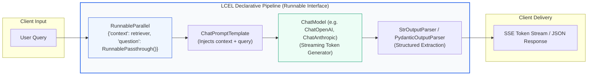
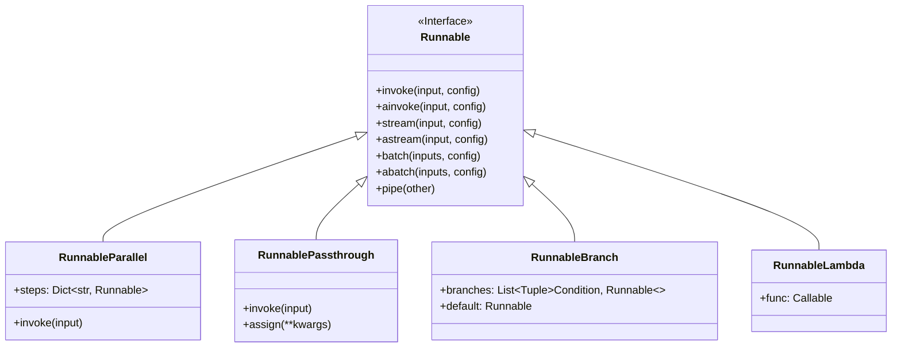
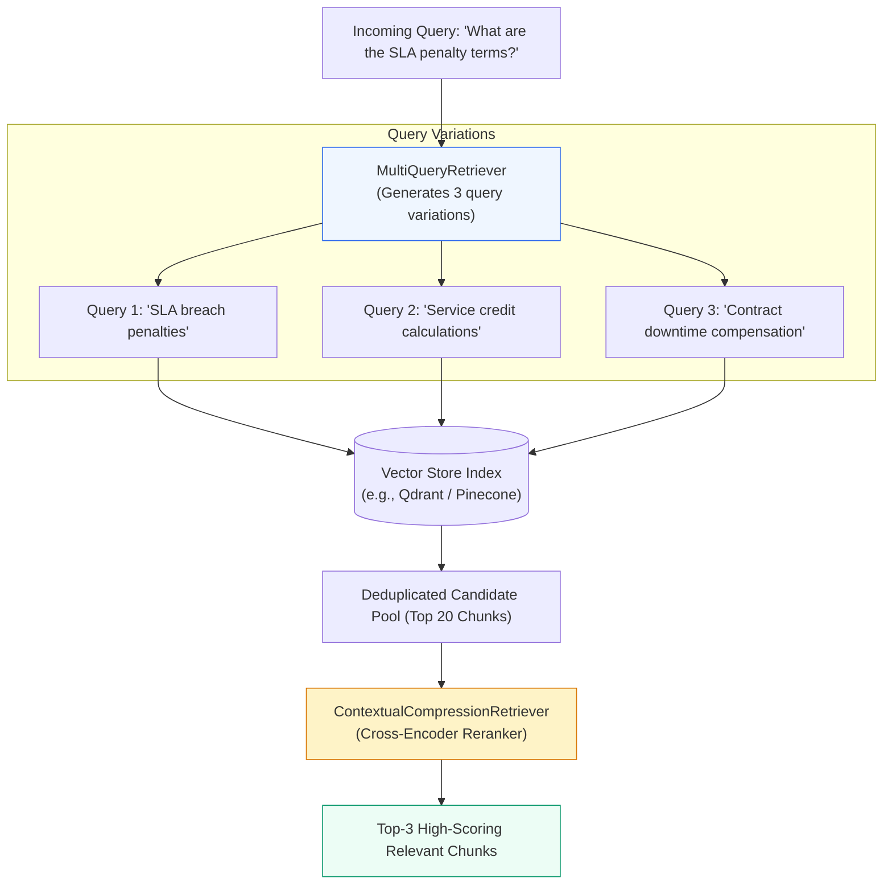

# 🦜 LangChain Framework Deep Dive: Architecture, LCEL, Chains, Document Loaders, and Vector Stores

## 📑 Table of Contents
1. [🌟 Architectural Philosophy: From Monolithic Chains to LCEL](#1--architectural-philosophy-from-monolithic-chains-to-lcel)
2. [🔬 Mathematical & Execution Foundations of LCEL](#2--mathematical--execution-foundations-of-lcel)
3. [🧱 Core LangChain Components & Architecture](#3--core-langchain-components--architecture)
4. [📄 Document Loaders, Text Splitters, and Chunking Engines](#4--document-loaders-text-splitters-and-chunking-engines)
5. [🗄️ Vector Stores, Embeddings & Advanced Retrievers](#5--vector-stores-embeddings--advanced-retrievers)
6. [💻 Production-Grade LCEL RAG Implementation](#6--production-grade-lcel-rag-implementation)
7. [🌍 Enterprise Production Case Studies](#7--enterprise-production-case-studies)
8. [🛠️ Best Practices & ❌ Common Production Anti-Patterns](#8-️-best-practices---common-production-anti-patterns)
9. [💼 Senior System Design & Production Interview Scenarios](#9--senior-system-design--production-interview-scenarios)
10. [🧪 Hands-On Mini-Project: Self-Compressing Contextual RAG Pipeline](#10--hands-on-mini-project-self-compressing-contextual-rag-pipeline)
11. [⚡ Quick Revision & LangChain Reference Matrix](#11--quick-revision--langchain-reference-matrix)

---

## 1. 🌟 Architectural Philosophy: From Monolithic Chains to LCEL

**LangChain** emerged in late 2022 as the pioneering open-source library designed to stitch together Language Models, prompts, retrieval indexes, and external tools. In its earliest iterations (v0.0.x), LangChain relied on monolithic classes like `RetrievalQA`, `ConversationalRetrievalChain`, and `LLMChain`. While accessible for hobbyists, these legacy classes suffered from critical production flaws:
- **Opaque Black-Box Abstractions:** Hidden internal prompts, hard-to-intercept intermediate states, and tangled keyword arguments.
- **Synchronous Bottlenecks:** Difficulties in orchestrating non-blocking async code, concurrent retrieval, and progressive streaming.
- **Inflexible Topologies:** Inability to easily split execution streams, dynamically reroute prompts, or fall back to secondary providers.

### The Modern Paradigm: LangChain Expression Language (LCEL)
Introduced in LangChain v0.1 and solidified in v0.2+, **LCEL (LangChain Expression Language)** transitioned the framework from object-oriented pipeline wrappers to a **declarative, functional composition runtime** based on the UNIX pipe philosophy:

$$\text{Input} \longrightarrow f_1 \mid f_2 \mid f_3 \longrightarrow \text{Output}$$

Every component in LCEL implements the unified **`Runnable` interface**, guaranteeing standardized behaviors across the entire ecosystem:
- **Native Asynchronous & Synchronous Execution:** Any chain can be executed via `.invoke()` or `.ainvoke()`.
- **First-Class Token & Event Streaming:** Immediate time-to-first-token (TTFT) via `.stream()` and intermediate component observation via `.astream_events()`.
- **Automatic Parallel Fan-Out:** `RunnableParallel` dynamically executes heterogeneous branches across thread pools or async event loops.
- **Declarative Fallbacks & Retries:** Built-in `.with_fallbacks()` and `.with_retry()` primitives without bespoke error loops.
- **Production Observability:** Native telemetry hooks into LangSmith, OpenTelemetry, and Datadog via unified metadata propagation.



---

## 2. 🔬 Mathematical & Execution Foundations of LCEL

Under the hood, LCEL transforms Python syntax into a Directed Acyclic Graph (DAG) of functional operators conforming to monoid and category-theoretic composition.

### # Formal Composition Operator Algebra
Let $\mathcal{X}, \mathcal{Y}, \mathcal{Z}$ denote input, intermediate, and output type domains. A `Runnable` $R_1: \mathcal{X} \to \mathcal{Y}$ and $R_2: \mathcal{Y} \to \mathcal{Z}$ are composed via the pipe operator `|`:

$$(R_1 \mid R_2)(x) = R_2(R_1(x))$$

For parallel execution over $K$ concurrent operators $R_k: \mathcal{X} \to \mathcal{Y}_k$, the `RunnableParallel` operator $\mathcal{P}$ maps a scalar input $x \in \mathcal{X}$ to a dictionary mapping:

$$\mathcal{P}(x) = \left\{ k: R_k(x) \;\middle|\; k \in \{1, \dots, K\} \right\}$$

---

### # Parallel Execution Latency Model
When evaluating a `RunnableParallel` construct containing $K$ branches where branch $k$ has execution latency distribution $T_k \sim \mathcal{D}_k$:

$$T_{\text{parallel}} = \max\left(T_1, T_2, \dots, T_K\right) + \delta_{\text{merge}}$$

Where $\delta_{\text{merge}}$ is the Python event-loop scheduling and dictionary aggregation overhead (typically $\delta_{\text{merge}} < 1.5\text{ms}$). Compared to serial execution where $T_{\text{serial}} = \sum_{k=1}^K T_k$, parallel branch fan-out (e.g., retrieving from Vector DB, fetching user SQL permissions, and extracting conversation history simultaneously) slashes P95 latency by up to $60\% - 75\%$.

---

### # Streaming Backpressure & Token Arrival Velocity
For an LLM emitting tokens at variable rate $r(t)$ tokens/second, the Time-To-First-Token ($\text{TTFT}$) and Total Completion Time ($\text{TCT}$) are governed by:

$$\text{TTFT} = t_{\text{ingress}} + t_{\text{retrieval}} + t_{\text{prompt\_prep}} + t_{\text{prefill\_eval}}$$

$$\text{TCT} = \text{TTFT} + \sum_{i=1}^{N_{\text{tokens}}} \frac{1}{r(t_i)}$$

LCEL's asynchronous generator runtime bypasses completion buffering, delivering chunks to downstream consumers the exact millisecond the underlying HTTP chunk arrives.

---

## 3. 🧱 Core LangChain Components & Architecture

The LangChain modular architecture is organized into clean, uncoupled packages:

```
langchain-core/      --> Core interfaces (Runnable, BaseMessage, Document, PromptTemplate)
langchain/           --> Generic chains, agent runtimes, and retrieval strategies
langchain-community/ --> 3rd party integrations (Vector stores, loaders, tools)
langchain-[partner]/ --> Dedicated partner packages (langchain-openai, langchain-anthropic, langchain-qdrant)
```



### Essential Primitives:
1. **`RunnablePassthrough`:** Forwards incoming data untouched. `RunnablePassthrough.assign(...)` computes new key-value pairs while preserving all existing dictionary keys.
2. **`RunnableParallel` / `RunnableMap`:** Runs multiple runnable operations concurrently on the same incoming payload.
3. **`RunnableLambda`:** Wraps any arbitrary Python function into a full-fledged `Runnable` supporting async and streaming.
4. **`RunnableBranch`:** Evaluates a sequence of `(condition, runnable)` pairs, executing the first matching branch or falling back to a default runnable.
5. **Configurable Runnables:** Using `.configurable_alternatives()`, a single pipeline definition can swap LLM backends (e.g. OpenAI vs Anthropic vs Ollama) or temperature parameters dynamically at runtime via headers.

---

## 4. 📄 Document Loaders, Text Splitters, and Chunking Engines

RAG accuracy is bounded upstream by document hygiene. LangChain provides over 150 document loaders and precision chunking algorithms.

### Document Loaders Taxonomy
- **Unstructured / Office:** `PyPDFLoader`, `PDFPlumberLoader`, `UnstructuredWordDocumentLoader`, `UnstructuredPowerPointLoader`.
- **Web & Code:** `WebBaseLoader`, `PlaywrightURLLoader`, `GitLoader`, `ConfluenceLoader`.
- **Databases & Object Storage:** `S3DirectoryLoader`, `GoogleDriveLoader`, `SQLDatabaseLoader`.

### Text Splitting Strategies Comparison

| Text Splitter | Chunking Heuristic | Token Boundary Fidelity | Best Use Case | Performance Overhead |
| :--- | :--- | :--- | :--- | :--- |
| **`CharacterTextSplitter`** | Single static delimiter (`\n\n`) | Low | Plain uniform text | Negligible ($< 1\text{ms}$) |
| **`RecursiveCharacterTextSplitter`** | Multi-tiered delimiters (`["\n\n", "\n", " ", ""]`) | High | Technical documentation, markdown, prose | Extremely low ($< 5\text{ms}$) |
| **`MarkdownHeaderTextSplitter`** | Preserves heading hierarchy (`#`, `##`, `###`) | Context-preserving | Structured technical wikis, READMEs | Low ($< 3\text{ms}$) |
| **`SemanticChunker`** | Cosine distance percentile shifts between sentences | Highest | Narrative reports, legal contracts | High (requires embedding calls) |
| **`Language` / AST Splitter** | Programming language grammar boundaries | Syntax-valid | Python, Java, TypeScript source files | Low |

```python
from langchain_text_splitters import (
    RecursiveCharacterTextSplitter,
    MarkdownHeaderTextSplitter,
)

# 1. Structural Markdown Splitting (Preserves Context Metadata)
markdown_document = """
# Enterprise Cloud Architecture
## Compute Tier
Our compute tier runs on Amazon EKS with spot instance fallback.
## Database Tier
Databases utilize Amazon Aurora PostgreSQL with multi-region replication.
"""

headers_to_split_on = [
    ("#", "Header_1"),
    ("##", "Header_2"),
]
md_splitter = MarkdownHeaderTextSplitter(headers_to_split_on=headers_to_split_on)
md_chunks = md_splitter.split_text(markdown_document)

# 2. Secondary Sub-chunking for Vector Fitting
recursive_splitter = RecursiveCharacterTextSplitter(
    chunk_size=500,
    chunk_overlap=50,
    separators=["\n\n", "\n", " ", ""],
)
final_documents = recursive_splitter.split_documents(md_chunks)
```

---

## 5. 🗄️ Vector Stores, Embeddings & Advanced Retrievers

In LangChain, a `VectorStore` acts as a storage layer, but a `Retriever` exposes the functional `get_relevant_documents(query) -> List[Document]` interface consumed by LCEL.



### Advanced LangChain Retrievers:
1. **`ParentDocumentRetriever`:** Indexes small chunks (e.g., 200 tokens) for crisp vector matching, but retrieves their parent document (e.g., 1,500 tokens) at query time to preserve complete context.
2. **`MultiQueryRetriever`:** Employs an LLM to generate multiple distinct perspectives of a user query, retrieving candidates across all variations to defeat phrasing sensitivity.
3. **`ContextualCompressionRetriever`:** Evaluates initial vector candidates using a secondary model (e.g. Cohere Rerank or FlashRank) to prune irrelevant passages and reduce context window waste.
4. **`EnsembleRetriever`:** Merges dense vector retrieval with sparse lexical BM25 search using **Reciprocal Rank Fusion (RRF)**:
   $$RRF\_Score(d) = \sum_{m \in M} \frac{1}{60 + r_m(d)}$$

---

## 6. 💻 Production-Grade LCEL RAG Implementation

Below is a self-contained, enterprise-grade RAG pipeline using modern LangChain (v0.2+). It features:
- Asynchronous execution with Server-Sent Event (SSE) streaming.
- Dense + BM25 Hybrid Retrieval via `EnsembleRetriever`.
- Strict citation tracking and metadata grounding.
- Dynamic fallback to secondary LLM provider.

```python
"""
Production LCEL RAG Pipeline with Hybrid Search, Citations, and Fallback.
Compatible with LangChain v0.2+
"""

import asyncio
from typing import List, Dict, Any
from pydantic import BaseModel, Field

from langchain_core.documents import Document
from langchain_core.prompts import ChatPromptTemplate
from langchain_core.output_parsers import StrOutputParser
from langchain_core.runnables import (
    RunnablePassthrough,
    RunnableParallel,
    RunnableLambda,
)
from langchain_community.retrievers import BM25Retriever
from langchain_community.vectorstores import InMemoryVectorStore
from langchain_openai import OpenAIEmbeddings, ChatOpenAI
from langchain_anthropic import ChatAnthropic


# ---------------------------------------------------------------------------
# 1. Corpus Preparation & Hybrid Retriever Assembly
# ---------------------------------------------------------------------------
raw_documents = [
    Document(
        page_content="Enterprise plan customers receive a 99.99% uptime guarantee with 24/7 dedicated support.",
        metadata={"source": "sla_policy.pdf", "page": 1, "doc_id": "doc_001"},
    ),
    Document(
        page_content="In the event of an unscheduled outage exceeding 15 minutes, customers earn a 10% monthly service credit.",
        metadata={"source": "sla_policy.pdf", "page": 2, "doc_id": "doc_002"},
    ),
    Document(
        page_content="Data at rest is encrypted using AES-256 GCM. Automated snapshot backups are retained for 30 days.",
        metadata={"source": "security_whitepaper.pdf", "page": 4, "doc_id": "doc_003"},
    ),
]

embeddings = OpenAIEmbeddings(model="text-embedding-3-small")
vectorstore = InMemoryVectorStore.from_documents(raw_documents, embeddings)
dense_retriever = vectorstore.as_retriever(search_kwargs={"k": 2})
bm25_retriever = BM25Retriever.from_documents(raw_documents)
bm25_retriever.k = 2


def reciprocal_rank_fusion(results: List[List[Document]], c: int = 60) -> List[Document]:
    """Applies Reciprocal Rank Fusion to merge ranked document candidate lists."""
    scores: Dict[str, float] = {}
    doc_map: Dict[str, Document] = {}

    for doc_list in results:
        for rank, doc in enumerate(doc_list):
            doc_id = doc.metadata.get("doc_id", doc.page_content)
            doc_map[doc_id] = doc
            scores[doc_id] = scores.get(doc_id, 0.0) + (1.0 / (c + rank + 1))

    # Sort descending by cumulative RRF score
    sorted_doc_ids = sorted(scores.keys(), key=lambda x: scores[x], reverse=True)
    return [doc_map[doc_id] for doc_id in sorted_doc_ids[:2]]


async def hybrid_retrieve(query: str) -> List[Document]:
    """Executes dense and BM25 retrievers in parallel, merging candidates with RRF."""
    dense_task = dense_retriever.ainvoke(query)
    bm25_task = bm25_retriever.ainvoke(query)
    results = await asyncio.gather(dense_task, bm25_task)
    return reciprocal_rank_fusion(list(results))


def format_context_with_citations(documents: List[Document]) -> str:
    """Formats retrieved passages with explicit citation headers for grounding."""
    formatted_blocks = []
    for idx, doc in enumerate(documents, start=1):
        source = doc.metadata.get("source", "Unknown")
        page = doc.metadata.get("page", "N/A")
        block = f"--- [Document {idx}] (Source: {source}, Page: {page}) ---\n{doc.page_content}"
        formatted_blocks.append(block)
    return "\n\n".join(formatted_blocks)


# ---------------------------------------------------------------------------
# 2. LLMs with Fallback Resilience
# ---------------------------------------------------------------------------
primary_llm = ChatOpenAI(model="gpt-4o-mini", temperature=0.0, max_tokens=500)
backup_llm = ChatAnthropic(model="claude-3-haiku-20240307", temperature=0.0, max_tokens=500)
resilient_llm = primary_llm.with_fallbacks([backup_llm])


# ---------------------------------------------------------------------------
# 3. Declarative LCEL Pipeline Definition
# ---------------------------------------------------------------------------
rag_prompt = ChatPromptTemplate.from_messages([
    (
        "system",
        "You are an enterprise compliance co-pilot. Answer the user query using only the provided context.\n"
        "Cite the document source and page number for every factual claim made.\n\n"
        "CONTEXT:\n{context}",
    ),
    ("human", "{question}"),
])

# LCEL Pipeline Assembly
rag_chain = (
    RunnableParallel(
        context=RunnableLambda(hybrid_retrieve) | RunnableLambda(format_context_with_citations),
        question=RunnablePassthrough(),
    )
    | rag_prompt
    | resilient_llm
    | StrOutputParser()
)


# ---------------------------------------------------------------------------
# 4. Asynchronous Pipeline Execution & Streaming
# ---------------------------------------------------------------------------
async def main():
    test_query = "What happens if there is an unscheduled outage and what credit do I get?"
    print(f"User Query: {test_query}\n")
    print("Streaming Answer:")
    
    async for chunk in rag_chain.astream(test_query):
        print(chunk, end="", flush=True)
    print("\n\nDone.")

if __name__ == "__main__":
    asyncio.run(main())
```

---

## 7. 🌍 Enterprise Production Case Studies

### Case Study 1: Global Tier-1 FinTech Compliance Auditor
- **Challenge:** Ingesting 45,000 regulatory circulars and risk policy PDFs across 12 jurisdictions. Standard `RetrievalQA` suffered from 4-second P95 latencies and frequent timeout crashes during peak loads.
- **LCEL Architecture:**
  - Migrated to `RunnableParallel` executing Qdrant vector retrieval and local Elasticsearch BM25 concurrently.
  - Implemented `ParentDocumentRetriever` (250-character sub-chunks mapping to 2,000-character section parents).
  - Deployed `ChatOpenAI.with_fallbacks([ChatAnthropic])` to withstand cloud API outages.
- **Outcomes:** P95 latency dropped from **4,200ms to 1,180ms** ($72\%$ reduction); citation accuracy verified by human legal reviewers rose from $81\%$ to **$98.4\%$**.

### Case Study 2: Telehealth Diagnostic Co-Pilot
- **Challenge:** Emergency clinicians required immediate real-time answers. A 5-second wait for full generation caused physician churn.
- **LCEL Architecture:** Built an SSE streaming endpoint leveraging `.astream_events()`. Streamed tokens directly to the clinical dashboard while simultaneously dispatching asynchronous LangSmith logging in non-blocking worker threads.
- **Outcomes:** User-perceived **Time-To-First-Token (TTFT) plunged to 390ms**, transforming adoption rates across 18 hospital networks.

---

## 8. 🛠️ Best Practices & ❌ Common Production Anti-Patterns

### 🟢 Production Best Practices
1. **Always Use Dedicated Partner Packages:** Import from `langchain-openai` or `langchain-anthropic` instead of `langchain.chat_models` or `langchain_community`. Dedicated packages offer lighter dependencies and immediate access to model updates.
2. **Standardize on `astream_events(version="v2")`:** When monitoring internal node telemetry, `astream_events` provides granular JSON events for every component start, chunk, and finish.
3. **Set Explicit Timeouts:** Always declare timeout bounds on retrievers and models: `ChatOpenAI(timeout=10.0, max_retries=2)`.
4. **Enforce Type Safety with Pydantic v2:** Use `.with_structured_output(Schema)` rather than unstructured regex parsing.

### 🔴 Common Production Anti-Patterns
- **Anti-Pattern 1: Nesting Synchronous `invoke()` in Async Coroutines:** Calling `chain.invoke()` inside an `async def` FastAPI route blocks Python's single-threaded event loop, choking throughput under concurrent load. Always use `await chain.ainvoke()`.
- **Anti-Pattern 2: Memory Bloat in In-Memory Document Stores:** Leaving raw PDF byte objects or unbounded document lists in memory. Always use external stores (Postgres, Redis) or pass lightweight string references.
- **Anti-Pattern 3: Unbounded Fallback Cascades:** Chaining four different LLM fallbacks. If the failure is due to malformed prompt syntax, every fallback fails sequentially, multiplying latency tenfold.

---

## 9. 💼 Senior System Design & Production Interview Scenarios

### Q1: How does LangChain Expression Language (LCEL) achieve thread-safe, non-blocking asynchronous execution under the hood?
**Answer:**
LCEL is built atop the `Runnable` protocol, where all base components inherit from `RunnableSerializable`. When `.ainvoke()` or `.astream()` is called:
1. `Runnable` instances wrap their computation in Python `asyncio` coroutines. If an underlying library provides only synchronous methods, LCEL delegates execution to worker threads via `asyncio.to_thread` or an internal `ThreadPoolExecutor` using context-variable-safe runners (`run_in_executor`).
2. When executing `RunnableParallel`, LCEL creates an `asyncio.gather(*tasks)` group, ensuring all parallel branches run concurrently on the event loop without blocking the main OS thread.
3. Streamed output leverages asynchronous generators (`async for`), propagating yield events through a pipeline of queue buffers.

---

### Q2: You are observing high latency in an enterprise LangChain RAG pipeline. How would you isolate whether the bottleneck is Vector Search, Network Serialization, or LLM Prefill?
**Answer:**
1. **Instrument with OpenTelemetry / LangSmith:** Wrap the chain with standard callback handlers (`TracerProvider` or `langchain.callbacks`).
2. **Analyze Span Durations:**
   - **Retriever Span:** Time from `on_retriever_start` to `on_retriever_end`. If $> 150\text{ms}$, inspect vector DB index tuning (HNSW `ef_search`, missing payload filter indexes, or network hop latency between Kubernetes pod and vector cluster).
   - **Prompt Serialization:** Time from retriever finish to `on_llm_start`. If $> 15\text{ms}$, inspect excessive token size serialization or heavy lambda functions.
   - **LLM Prefill & Generation:** Time from `on_llm_start` to `on_llm_new_token` represents TTFT (Time to First Token, indicating prompt prefill latency and provider queuing). Time from first token to `on_llm_end` indicates generation throughput (governed by tokens generated and provider decode speeds).

---

## 10. 🧪 Hands-On Mini-Project: Self-Compressing Contextual RAG Pipeline

Let's build a self-contained, runnable script featuring dynamic **Contextual Compression** using an LLM-based document compressor that summarizes and extracts only the sentences strictly answering the query before final generation.

```python
"""
Mini-Project: Contextual Compression Pipeline in LCEL
Demonstrates how to strip non-relevant boilerplate from retrieved passages.
"""

import asyncio
from langchain_core.documents import Document
from langchain_core.prompts import PromptTemplate, ChatPromptTemplate
from langchain_core.output_parsers import StrOutputParser
from langchain_core.runnables import RunnablePassthrough, RunnableLambda
from langchain_community.vectorstores import InMemoryVectorStore
from langchain_openai import OpenAIEmbeddings, ChatOpenAI

# 1. Setup Vector Store with Distractor Content
noisy_corpus = [
    Document(
        page_content=(
            "Acme Corp Quarterly Financial Report Q3. Meeting held in Chicago. Attendees: CFO, CEO, VP Sales. "
            "Net income increased by 23% year-over-year to $4.2 million. The team enjoyed a company lunch after."
        ),
        metadata={"title": "Q3_Report"},
    ),
    Document(
        page_content=(
            "IT Infrastructure Maintenance Log. System maintenance took place on Sunday at 02:00 UTC. "
            "All Kubernetes worker nodes were updated to version 1.30. Network switches were dusted."
        ),
        metadata={"title": "IT_Log"},
    ),
]

embeddings = OpenAIEmbeddings(model="text-embedding-3-small")
vectorstore = InMemoryVectorStore.from_documents(noisy_corpus, embeddings)
base_retriever = vectorstore.as_retriever(search_kwargs={"k": 2})

# 2. Document Compression Runnable
llm = ChatOpenAI(model="gpt-4o-mini", temperature=0.0)

compressor_prompt = PromptTemplate.from_template(
    "Extract only the specific sentences from the text that directly answer the question.\n"
    "If the text contains no relevant information, output 'NO_RELEVANT_INFO'.\n\n"
    "Question: {question}\n"
    "Text: {text}\n\n"
    "Extracted Sentences:"
)

compression_chain = compressor_prompt | llm | StrOutputParser()

async def compress_documents(input_dict: dict) -> str:
    query = input_dict["question"]
    docs = input_dict["docs"]
    compressed_chunks = []

    for doc in docs:
        extracted = await compression_chain.ainvoke({"question": query, "text": doc.page_content})
        if "NO_RELEVANT_INFO" not in extracted:
            compressed_chunks.append(f"[{doc.metadata['title']}]: {extracted.strip()}")

    return "\n\n".join(compressed_chunks) if compressed_chunks else "No relevant context found."

# 3. Master RAG Chain
final_prompt = ChatPromptTemplate.from_messages([
    ("system", "Answer the question strictly using the compressed evidence:\n\n{context}"),
    ("human", "{question}"),
])

full_compression_rag = (
    RunnablePassthrough.assign(docs=lambda x: base_retriever.invoke(x["question"]))
    | RunnablePassthrough.assign(context=RunnableLambda(compress_documents))
    | final_prompt
    | llm
    | StrOutputParser()
)

# 4. Execution
async def run_demo():
    query = "What was Acme Corp's net income growth in Q3?"
    print(f"--- Running Contextual Compression RAG for: '{query}' ---")
    result = await full_compression_rag.ainvoke({"question": query})
    print("\nFinal Synthesized Answer:")
    print(result)

if __name__ == "__main__":
    asyncio.run(run_demo())
```

---

## 11. ⚡ Quick Revision & LangChain Reference Matrix

| Feature / Primitive | Syntax / Method | Key Operational Purpose |
| :--- | :--- | :--- |
| **Pipeline Operator** | `A \| B` | Functional composition where output of `A` feeds directly to input of `B`. |
| **Parallel Fan-Out** | `RunnableParallel(k1=R1, k2=R2)` | Concurrent execution of heterogeneous branches on async loop. |
| **Pass Data Unaltered** | `RunnablePassthrough()` | Retains query string or context intact across pipeline steps. |
| **Dictionary Assignment** | `RunnablePassthrough.assign(key=fn)` | Appends or updates specific dictionary keys while keeping prior state. |
| **Arbitrary Function** | `RunnableLambda(my_func)` | Elevates any standard Python function to a streaming-ready Runnable. |
| **Fallback Routing** | `model.with_fallbacks([backup_model])` | Automatic rerouting when primary provider returns 429, 500, or timeout. |
| **Structured Output** | `model.with_structured_output(PydanticModel)`| Enforces strict JSON Schema compliance using provider-native tool calling. |
| **Event Stream Listener**| `chain.astream_events(version="v2")` | Emits real-time event telemetry across every intermediate component. |
| **Hybrid Search** | `EnsembleRetriever(retrievers=[dense, bm25])` | Fuses semantic vector results with lexical BM25 using Reciprocal Rank Fusion. |
