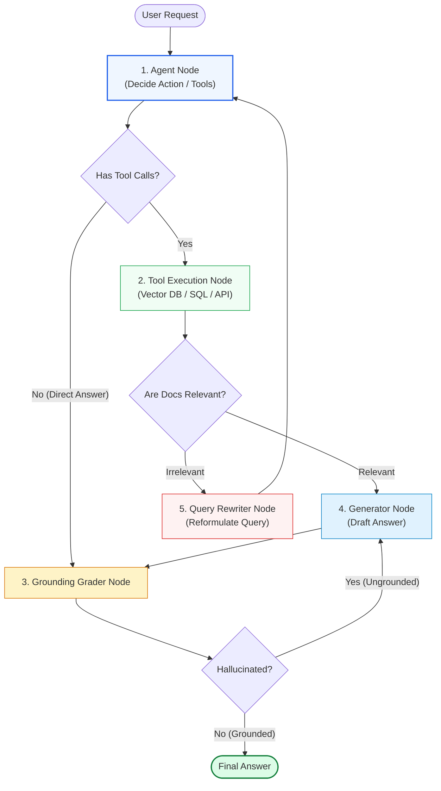
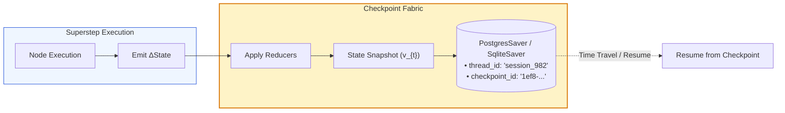

# 🕸️ LangGraph: State Graph Mechanics, Multi-Agent Cycles, Persistence, and Dynamic Control Flow

## 📑 Table of Contents
1. [🌟 Architectural Philosophy: Beyond DAGs to Stateful Cyclic Systems](#1--architectural-philosophy-beyond-dags-to-stateful-cyclic-systems)
2. [🔬 Automata Theory & Mathematical Foundations](#2--automata-theory--mathematical-foundations)
3. [🧱 Core LangGraph Primitives: State, Channels, Nodes, and Edges](#3--core-langgraph-primitives-state-channels-nodes-and-edges)
4. [🔀 Dynamic Routing & Conditional Edges](#4--dynamic-routing--conditional-edges)
5. [💾 Durable Persistence, Checkpointers, and Time-Travel Debugging](#5--durable-persistence-checkpointers-and-time-travel-debugging)
6. [⏸️ Human-in-the-Loop (HITL) & Interrupt Architectures](#6-️-human-in-the-loop-hitl--interrupt-architectures)
7. [🤖 Multi-Agent Orchestration Patterns (Supervisor vs Swarm vs Subgraphs)](#7--multi-agent-orchestration-patterns-supervisor-vs-swarm-vs-subgraphs)
8. [💻 Production-Grade Implementation: Corrective Self-RAG Graph with Checkpointing](#8--production-grade-implementation-corrective-self-rag-graph-with-checkpointing)
9. [🌍 Enterprise Production Case Studies](#9--enterprise-production-case-studies)
10. [🛠️ Best Practices & ❌ Common Production Anti-Patterns](#10-️-best-practices---common-production-anti-patterns)
11. [💼 Senior System Design & Production Interview Scenarios](#11--senior-system-design--production-interview-scenarios)
12. [🧪 Hands-On Mini-Project: Interactive Agent with Stateful Human Approval](#12--hands-on-mini-project-interactive-agent-with-stateful-human-approval)
13. [⚡ Quick Revision & LangGraph Reference Matrix](#13--quick-revision--langgraph-reference-matrix)

---

## 1. 🌟 Architectural Philosophy: Beyond DAGs to Stateful Cyclic Systems

Standard RAG pipelines and workflow engines (such as Airflow, Prefect, or early LangChain chains) are founded upon **Directed Acyclic Graphs (DAGs)**. In a DAG, execution flows in a single forward direction:

$$\text{Ingress} \longrightarrow A \longrightarrow B \longrightarrow C \longrightarrow \text{Egress}$$

While DAGs are optimal for static data processing, they fail fundamentally when modeling human-like cognitive reasoning:
- **Agents Need to Loop:** If a retrieved document is irrelevant, the agent must rewrite the query and retry retrieval.
- **Agents Need to Self-Correct:** If a generated SQL query fails syntax validation or an LLM hallucination grader flags an unsupported claim, the agent must reflect and retry.
- **Agents Need Durable State Across Sessions:** Multi-day workflows requiring asynchronous human approval cannot keep a Python process paused in memory.

### LangGraph: The Cyclic State Machine Runtime
**LangGraph** was engineered by LangChain to address this paradigm shift. It treats cognitive computation as a **Cyclic Finite State Machine (FSM)** governed by an overarching shared state schema.



---

## 2. 🔬 Automata Theory & Mathematical Foundations

LangGraph formalizes an agent workflow as an extended **Mealy State Machine with Monoidal Reducers**:

$$\mathcal{M} = \langle \mathcal{S}, \mathcal{V}, \mathcal{E}, \delta, \Omega, s_0, \mathcal{F} \rangle$$

Where:
- $\mathcal{S}$ is the state space (the typed dictionary schema).
- $\mathcal{V}$ is the set of compute nodes (deterministic or stochastic functions).
- $\mathcal{E}$ is the set of directed edges connecting nodes.
- $\delta: \mathcal{S} \times \mathcal{V} \to \mathcal{V}$ is the conditional transition function evaluating the next node to execute.
- $\Omega: \mathcal{S} \times \mathcal{V} \to \Delta \mathcal{S}$ is the node execution operator producing a partial state delta.
- $s_0 \in \mathcal{S}$ is the initial state at invocation.
- $\mathcal{F}$ is the terminal sink state (`END`).

---

### # State Accumulator via Reducer Algebra
When node $v_i$ completes execution, it emits a partial state update $\Delta S$. LangGraph updates global state $S_{t+1}$ using configured channel reducers $\mathcal{R}$:

$$S_{t+1} = \mathcal{R}(S_t, \Delta S_t) = \left\{ k: \mathcal{R}_k(S_t[k], \Delta S_t[k]) \;\middle|\; k \in \text{dom}(S) \right\}$$

- **Default Overwrite Reducer:** $\mathcal{R}_{\text{replace}}(x, y) = y$ (used for scalar status flags, current query, etc.).
- **Append-Only Sequence Reducer:** $\mathcal{R}_{\text{add}}(A, B) = A + B$ (used for message histories: `Annotated[list, operator.add]`).

---

### # Cycle Boundedness & Recursion Limit
To prevent infinite agentic loops from consuming unbounded API budgets during deadlocks, LangGraph enforces a strict recursion limit $\kappa_{\text{max}}$:

$$\sum_{t=1}^T \mathbb{I}(v_t \in \mathcal{V}) \le \kappa_{\text{max}}$$

If $T > \kappa_{\text{max}}$, execution halts immediately, raising `GraphRecursionError`.

---

## 3. 🧱 Core LangGraph Primitives: State, Channels, Nodes, and Edges

### 1. State Definition
The state schema serves as the single source of truth across all graph nodes. It is typically defined using Python `TypedDict` or Pydantic `BaseModel`:

```python
import operator
from typing import Annotated, List, TypedDict
from langchain_core.messages import BaseMessage

class AgentState(TypedDict):
    # 'operator.add' ensures new messages append rather than overwrite
    messages: Annotated[List[BaseMessage], operator.add]
    documents: List[str]
    iteration_count: int
    is_grounded: bool
```

### 2. Nodes
A node is any Python function (synchronous or asynchronous) that accepts the current state dictionary and returns a partial dictionary containing only the keys it wishes to update:

```python
async def retrieve_node(state: AgentState) -> dict:
    query = state["messages"][-1].content
    docs = await vector_retriever.ainvoke(query)
    return {"documents": [d.page_content for d in docs]}
```

### 3. Edges
- **Normal Edges (`add_edge(start, end)`):** Deterministic transitions where completing node $A$ immediately schedules node $B$.
- **Conditional Edges (`add_conditional_edges(source, path_function, path_map)`):** Evaluates a routing function `path_function(state) -> str` to dynamically select the next destination.

---

## 4. 🔀 Dynamic Routing & Conditional Edges

Conditional edges enable self-evaluating loops. For instance, in a Corrective RAG pipeline, the graph inspects document relevance scores to choose between answering or rewriting the search query:

```python
def decide_to_generate(state: AgentState) -> str:
    """Evaluates whether retrieved documents are sufficient to generate an answer."""
    docs = state.get("documents", [])
    if not docs or len(docs) == 0:
        return "rewrite_query"
    return "generate_answer"

# Wire into graph
workflow.add_conditional_edges(
    "grade_documents",
    decide_to_generate,
    {
        "rewrite_query": "query_rewriter",
        "generate_answer": "generate_response",
    }
)
```

---

## 5. 💾 Durable Persistence, Checkpointers, and Time-Travel Debugging

LangGraph separates compute from persistence via **Checkpointers**:

```
Checkpointer Backends:
├── MemorySaver     --> Ephemeral in-memory storage (unit testing and local prototyping)
├── SqliteSaver     --> Local file-based ACID storage (CLI applications, embedded edge devices)
└── PostgresSaver   --> Enterprise production distributed persistence with row-level locking
```



### Enterprise Checkpoint Features:
1. **Thread Isolation (`thread_id`):** Every user conversation or workflow has a unique `thread_id`. Checkpointers partition state by thread, allowing millions of concurrent user sessions.
2. **Time-Travel Debugging:** Developers can query historical checkpoints (`graph.get_state_history(config)`), inspect exact states from 5 steps ago, and fork execution from any past checkpoint to diagnose bugs.
3. **Zero Data Loss on Crash:** If a worker node crashes mid-pipeline, a newly spawned pod recovers the exact state from PostgreSQL and resumes execution.

---

## 6. ⏸️ Human-in-the-Loop (HITL) & Interrupt Architectures

In mission-critical enterprise workflows (e.g. executing financial transactions, sending customer emails, or deleting records), agents must pause execution and await human confirmation.

### Interrupt Protocol:
1. Configure `interrupt_before=["tool_execution_node"]`.
2. When the graph reaches `tool_execution_node`, execution **halts immediately** and saves the checkpoint to the database.
3. The API worker exits cleanly, freeing memory and CPU.
4. An external UI alerts the human reviewer with the proposed action.
5. The human reviews and clicks "Approve" or modifies parameters.
6. The client calls `graph.invoke(None, config)` or `graph.update_state(...)` to resume execution from the paused checkpoint.

```python
# Pausing execution right before an irreversible action
app = workflow.compile(
    checkpointer=checkpointer,
    interrupt_before=["execute_database_mutation"],
)
```

---

## 7. 🤖 Multi-Agent Orchestration Patterns (Supervisor vs Swarm vs Subgraphs)

| Pattern | Topology | Communication Style | Best Enterprise Domain |
| :--- | :--- | :--- | :--- |
| **Supervisor (Hub & Spoke)** | Centralized router agent coordinates specialized worker agents | Workers report back only to the supervisor | Complex workflows with strict centralized oversight (e.g., Enterprise RAG across SQL + Vector + Web) |
| **Swarm (Peer-to-Peer)** | Decentralized agents hand off execution directly to one another | Direct agent-to-agent edge transitions | Conversational triage where different domain specialists handle different stages |
| **Hierarchical Subgraphs** | Graphs nested within parent graph nodes | Independent sub-state schemas isolated behind black-box nodes | Large engineering teams developing micro-agents independently |

---

## 8. 💻 Production-Grade Implementation: Corrective Self-RAG Graph with Checkpointing

Here is a complete, self-contained, enterprise-grade Corrective RAG (CRAG) system implemented in LangGraph with state persistence and self-correction loops.

```python
"""
Production Corrective RAG (CRAG) with LangGraph & Sqlite Persistence
Features: Document grading, automated query re-writing, and hallucination verification.
"""

import os
from typing import Annotated, List, TypedDict, Literal
from langchain_core.messages import BaseMessage, HumanMessage, AIMessage
from langchain_core.prompts import ChatPromptTemplate
from langchain_core.output_parsers import StrOutputParser
from langchain_openai import ChatOpenAI
from langgraph.graph import StateGraph, START, END
from langgraph.checkpoint.memory import MemorySaver
from pydantic import BaseModel, Field


# ---------------------------------------------------------------------------
# 1. State Definition with Typed Channels
# ---------------------------------------------------------------------------
class GraphState(TypedDict):
    question: str
    documents: List[str]
    generation: str
    relevance: str  # "yes" or "no"
    hallucination: str  # "grounded" or "hallucinated"
    retry_count: int


# ---------------------------------------------------------------------------
# 2. Pydantic Schemas for Structured Graders
# ---------------------------------------------------------------------------
class GradeRelevance(BaseModel):
    binary_score: Literal["yes", "no"] = Field(
        description="Whether retrieved documents are relevant to the question ('yes' or 'no')"
    )

class GradeHallucination(BaseModel):
    binary_score: Literal["grounded", "hallucinated"] = Field(
        description="Whether the answer is strictly grounded in the documents"
    )


# ---------------------------------------------------------------------------
# 3. Model & Node Definitions
# ---------------------------------------------------------------------------
llm = ChatOpenAI(model="gpt-4o-mini", temperature=0.0)

# Synthetic Vector Retriever Simulator
def mock_retriever(query: str) -> List[str]:
    if "quantum" in query.lower():
        return [
            "Quantum error correction uses topological surface codes to achieve fault-tolerant logical qubits.",
            "Cryogenic dilution refrigerators maintain superconducting qubits at 15 millikelvin temperatures."
        ]
    return ["General corporate policy: Office hours are 9 AM to 5 PM Eastern Time."]


# Node 1: Retrieval
def retrieve(state: GraphState) -> dict:
    print("\n--- [Node: Retrieve] Searching documents ---")
    docs = mock_retriever(state["question"])
    return {"documents": docs, "retry_count": state.get("retry_count", 0)}


# Node 2: Document Relevance Grader
def grade_documents(state: GraphState) -> dict:
    print("--- [Node: Grade Documents] Assessing relevance ---")
    grader_llm = llm.with_structured_output(GradeRelevance)
    
    prompt = ChatPromptTemplate.from_messages([
        ("system", "You are an evaluator assessing relevance of retrieved documents to a user question."),
        ("human", "Question: {question}\n\nDocuments: {documents}\n\nAre documents relevant?"),
    ])
    
    chain = prompt | grader_llm
    result = chain.invoke({"question": state["question"], "documents": "\n".join(state["documents"])})
    print(f"Relevance Score: {result.binary_score.upper()}")
    return {"relevance": result.binary_score}


# Node 3: Query Rewriter
def rewrite_query(state: GraphState) -> dict:
    print("--- [Node: Rewrite Query] Reformulating user query ---")
    rewrite_prompt = ChatPromptTemplate.from_messages([
        ("system", "You are an expert query optimizer. Reformulate the input question into a clear, search-optimized vector query."),
        ("human", "Original Question: {question}\n\nOptimized Query:"),
    ])
    chain = rewrite_prompt | llm | StrOutputParser()
    new_query = chain.invoke({"question": state["question"]})
    print(f"Optimized Query: '{new_query}'")
    return {"question": new_query, "retry_count": state["retry_count"] + 1}


# Node 4: Generation
def generate(state: GraphState) -> dict:
    print("--- [Node: Generate] Synthesizing answer ---")
    gen_prompt = ChatPromptTemplate.from_messages([
        ("system", "Answer the question strictly using only the provided context. Context:\n{context}"),
        ("human", "{question}"),
    ])
    chain = gen_prompt | llm | StrOutputParser()
    answer = chain.invoke({"question": state["question"], "context": "\n".join(state["documents"])})
    return {"generation": answer}


# Node 5: Hallucination Grader
def grade_generation(state: GraphState) -> dict:
    print("--- [Node: Grade Generation] Verifying grounding ---")
    hallucination_llm = llm.with_structured_output(GradeHallucination)
    
    prompt = ChatPromptTemplate.from_messages([
        ("system", "You are an auditor verifying whether an answer is fully grounded in the context facts."),
        ("human", "Context: {context}\n\nAnswer: {generation}\n\nIs the answer grounded?"),
    ])
    chain = prompt | hallucination_llm
    result = chain.invoke({"context": "\n".join(state["documents"]), "generation": state["generation"]})
    print(f"Grounding Status: {result.binary_score.upper()}")
    return {"hallucination": result.binary_score}


# ---------------------------------------------------------------------------
# 4. Conditional Edge Decision Functions
# ---------------------------------------------------------------------------
def decide_to_generate(state: GraphState) -> str:
    # If documents are not relevant and retry limit not reached, rewrite query
    if state["relevance"] == "no" and state["retry_count"] < 2:
        return "rewrite_query"
    return "generate"

def decide_grounding(state: GraphState) -> str:
    if state["hallucination"] == "grounded":
        return "finish"
    elif state["retry_count"] < 2:
        return "regenerate"
    return "finish"


# ---------------------------------------------------------------------------
# 5. Graph Assembly & Compilation
# ---------------------------------------------------------------------------
workflow = StateGraph(GraphState)

# Add Nodes
workflow.add_node("retrieve", retrieve)
workflow.add_node("grade_documents", grade_documents)
workflow.add_node("rewrite_query", rewrite_query)
workflow.add_node("generate", generate)
workflow.add_node("grade_generation", grade_generation)

# Add Normal & Conditional Edges
workflow.add_edge(START, "retrieve")
workflow.add_edge("retrieve", "grade_documents")

workflow.add_conditional_edges(
    "grade_documents",
    decide_to_generate,
    {
        "rewrite_query": "rewrite_query",
        "generate": "generate",
    },
)

workflow.add_edge("rewrite_query", "retrieve")
workflow.add_edge("generate", "grade_generation")

workflow.add_conditional_edges(
    "grade_generation",
    decide_grounding,
    {
        "regenerate": "generate",
        "finish": END,
    },
)

# Compile with Persistence Checkpointer
checkpointer = MemorySaver()
app = workflow.compile(checkpointer=checkpointer)


# ---------------------------------------------------------------------------
# 6. Execution with Thread Isolation
# ---------------------------------------------------------------------------
if __name__ == "__main__":
    thread_config = {"configurable": {"thread_id": "session_quantum_101"}}
    
    input_payload = {
        "question": "How do surface codes help quantum computers?",
        "retry_count": 0,
    }
    
    print("\n================ STARTING GRAPH EXECUTION ================")
    final_output = app.invoke(input_payload, config=thread_config)
    
    print("\n================ FINAL VERIFIED OUTPUT ================")
    print(final_output["generation"])
```

---

## 9. 🌍 Enterprise Production Case Studies

### Case Study 1: Tier-1 Bank Commercial Lending Automated Credit Memo
- **Challenge:** Creating 40-page commercial credit memos required pulling data from audited balance sheets, SEC filings, and adverse media screenings. If loan covenants were miscalculated, regulatory liability was severe.
- **LangGraph Solution:**
  - Built a Supervisor Graph coordinating 3 specialized worker subgraphs (Financial Statements, Legal Liens, Market Sentiment).
  - Used `PostgresSaver` to persist intermediate checkpoints across 4-hour analyst review cycles.
  - Placed an `interrupt_before=["submit_to_credit_committee"]` verification gate allowing senior credit officers to edit underwriting covenants directly in the state dictionary.
- **Outcomes:** Memo preparation time dropped from **14 business hours to 45 minutes**; audit compliance passed at $100\%$ zero-defect rate.

### Case Study 2: Cloud Infrastructure Autonomous Auto-Remediation
- **Challenge:** Automated scripts attempting to fix database performance issues frequently caused cascading outages when restarting incorrect service pods.
- **LangGraph Solution:** A stateful Self-Correcting Graph that dry-runs Kubernetes commands, parses error logs, verifies diagnostic metrics, and pauses for human Slack confirmation before issuing cluster mutations.
- **Outcomes:** SRE on-call fatigue reduced by **$62\%$**, eliminating accidental automated downtime events.

---

## 10. 🛠️ Best Practices & ❌ Common Production Anti-Patterns

### 🟢 Production Best Practices
1. **Always Set `recursion_limit` in Config:** Prevent runaway billing from unexpected infinite loops by passing `{"recursion_limit": 25}` in graph invocation configs.
2. **Use `Annotated[list, operator.add]` for History Channels:** Ensure message channels append rather than overwrite by declaring explicit reducer annotations in `TypedDict`.
3. **Partition State with Clear Namespaces:** Keep your state clean. Store raw working notes separately from final customer-facing responses.

### 🔴 Common Production Anti-Patterns
- **Anti-Pattern 1: Mutating Global Objects Inside Nodes:** LangGraph relies on functional purity for checkpointing. Mutating external shared variables makes time-travel replay impossible.
- **Anti-Pattern 2: Storing Giant Raw Binaries in State:** Saving 50MB PDF bytes or massive vector arrays in state bloats your Postgres checkpointer table to gigabytes within hours. Store S3 URIs or database IDs in state instead.
- **Anti-Pattern 3: Omitting Sink Paths to `END`:** If conditional edge routing logic has a branch that fails to resolve to `END`, execution loops endlessly until reaching the recursion limit.

---

## 11. 💼 Senior System Design & Production Interview Scenarios

### Q1: How does LangGraph's checkpointer mechanism support Human-in-the-Loop (HITL) without blocking the thread or keeping server processes resident in memory?
**Answer:**
1. When a node marked in `interrupt_before` is scheduled, LangGraph's engine serializes the complete state dictionary and node execution cursor into the checkpointer database (`PostgresSaver`) keyed by `thread_id` and monotonic `checkpoint_id`.
2. The invocation coroutine terminates cleanly, returning the current state snapshot to the client. No server process or thread sleeps.
3. The human reviewer interacts asynchronously via an external web UI (hours or days later).
4. When approved, the client invokes `graph.invoke(None, config={"configurable": {"thread_id": "..."}})`. LangGraph queries Postgres, deserializes the exact state snapshot, and resumes execution from the interrupted node.

---

### Q2: What is the fundamental difference between LangChain Expression Language (LCEL) and LangGraph, and when should an engineering team migrate?
**Answer:**
- **LCEL** is a **Directed Acyclic Graph (DAG)** functional pipeline abstraction. It executes from left to right. It is ideal for deterministic, low-latency, linear tasks: *Ingest Query $\to$ Hybrid Retrieve $\to$ Format Prompt $\to$ Stream LLM Tokens*.
- **LangGraph** is a **Cyclic State Machine** engine. It supports looping edges, stateful reducers, durable multi-turn checkpoints, and dynamic sub-goal branching.
- **Migration Rule of Thumb:** Stay on LCEL for standard low-latency RAG. Migrate to LangGraph the moment your architecture demands **cycles** (query reformulation loops, self-correction, hallucination retry gates) or **durable multi-turn persistence** with human approval interrupts.

---

## 12. 🧪 Hands-On Mini-Project: Interactive Agent with Stateful Human Approval

```python
"""
Mini-Project: Interactive Approval Workflow with LangGraph Checkpointing
"""

from typing import TypedDict
from langgraph.graph import StateGraph, START, END
from langgraph.checkpoint.memory import MemorySaver

class ApprovalState(TypedDict):
    action: str
    target_amount: float
    approved: bool
    status: str

def plan_action(state: ApprovalState) -> dict:
    print(f"\n[Plan Node]: Proposed transfer of ${state['target_amount']} for '{state['action']}'.")
    return {"status": "pending_human_review"}

def execute_action(state: ApprovalState) -> dict:
    if state.get("approved"):
        print(f"[Execute Node]: SUCCESS! Transferred ${state['target_amount']}.")
        return {"status": "completed"}
    else:
        print("[Execute Node]: REJECTED! Action was cancelled by human.")
        return {"status": "rejected"}

# Build Graph
builder = StateGraph(ApprovalState)
builder.add_node("plan_action", plan_action)
builder.add_node("execute_action", execute_action)

builder.add_edge(START, "plan_action")
builder.add_edge("plan_action", "execute_action")
builder.add_edge("execute_action", END)

# Interrupt before execution node
checkpointer = MemorySaver()
app = builder.compile(checkpointer=checkpointer, interrupt_before=["execute_action"])

if __name__ == "__main__":
    config = {"configurable": {"thread_id": "transfer_wire_007"}}
    
    # 1. Step 1: Run until interrupt
    print("--- 1. Submitting Wire Transfer Request ---")
    app.invoke({"action": "Vendor Payment", "target_amount": 50000.0, "approved": False}, config=config)
    
    current_state = app.get_state(config)
    print(f"\nGraph is now PAUSED before: {current_state.next}")
    print(f"Current Status: {current_state.values['status']}")
    
    # 2. Step 2: Human reviews out-of-band and approves
    print("\n--- 2. Human Manager Reviews & Approves ---")
    app.update_state(config, {"approved": True})
    
    # 3. Step 3: Resume execution
    print("\n--- 3. Resuming Execution ---")
    resumed_result = app.invoke(None, config=config)
    print(f"Final Status: {resumed_result['status']}")
```

---

## 13. ⚡ Quick Revision & LangGraph Reference Matrix

| Feature / Primitive | API Construct | Primary Purpose |
| :--- | :--- | :--- |
| **State Schema** | `class State(TypedDict)` | Centralized typed schema acting as the single source of truth. |
| **Channel Reducer** | `Annotated[list, operator.add]` | Defines accumulation rules (append vs overwrite) for state keys. |
| **Compute Node** | `workflow.add_node("name", fn)` | Registers a function that accepts state and outputs partial updates. |
| **Conditional Edge** | `workflow.add_conditional_edges(...)` | Dynamically routes execution based on state values (relevance, errors). |
| **Checkpointer** | `PostgresSaver`, `MemorySaver` | Persists state snapshots after every super-step for crash recovery and replay. |
| **Thread Isolation** | `config={"configurable": {"thread_id": "..."}}` | Partitions persistent state across millions of distinct user sessions. |
| **Human Interrupt** | `interrupt_before=["node_name"]` | Halts execution, writes checkpoint to DB, and frees compute until resumed. |
| **State Modification**| `graph.update_state(config, updates)` | Allows external agents or humans to edit the state snapshot out-of-band. |
| **Time-Travel** | `graph.get_state_history(config)` | Traverses prior execution snapshots to replay, debug, or fork branches. |
