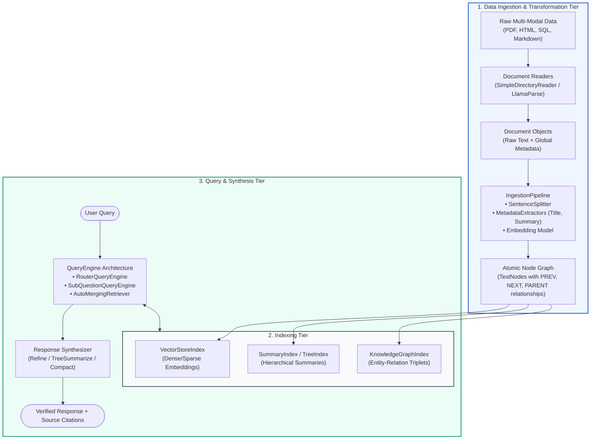
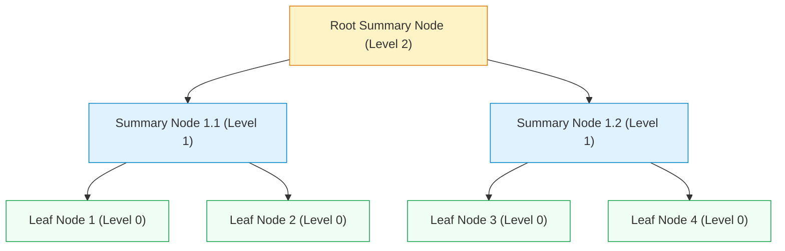
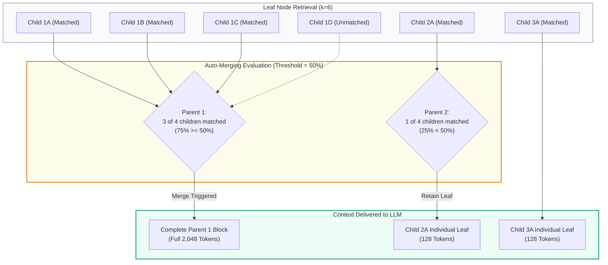

# 🦙 LlamaIndex Deep Dive: Data Framework Architecture, Hierarchical Indexing, and Query Engines

## 📑 Table of Contents
1. [🌟 Architectural Philosophy: The Data Framework for LLMs](#1--architectural-philosophy-the-data-framework-for-llms)
2. [🧱 Core Data Abstractions: Documents, Nodes, and Graph Relationships](#2--core-data-abstractions-documents-nodes-and-graph-relationships)
3. [🔬 Indexing Architectures & Traversal Mathematics](#3--indexing-architectures--traversal-mathematics)
4. [🌳 Advanced Hierarchical Indexing & Auto-Merging Retrievers](#4--advanced-hierarchical-indexing--auto-merging-retrievers)
5. [🔀 Query Engines, Routers, and Multi-Hop Decompositions](#5--query-engines-routers-and-multi-hop-decompositions)
6. [⚡ Modern LlamaIndex Workflows: Event-Driven Orchestration](#6--modern-llamaindex-workflows-event-driven-orchestration)
7. [💻 Production-Grade Implementation: Hierarchical Auto-Merging RAG](#7--production-grade-implementation-hierarchical-auto-merging-rag)
8. [🌍 Enterprise Production Case Studies](#8--enterprise-production-case-studies)
9. [🛠️ Best Practices & ❌ Common Production Anti-Patterns](#9-️-best-practices---common-production-anti-patterns)
10. [💼 Senior System Design & Production Interview Scenarios](#10--senior-system-design--production-interview-scenarios)
11. [🧪 Hands-On Mini-Project: Multi-Document SubQuestion Query Engine](#11--hands-on-mini-project-multi-document-subquestion-query-engine)
12. [⚡ Quick Revision & LlamaIndex Architecture Matrix](#12--quick-revision--llamaindex-architecture-matrix)

---

## 1. 🌟 Architectural Philosophy: The Data Framework for LLMs

While general-purpose orchestrators (like LangChain) focus on connecting language models to arbitrary tools and chains, **LlamaIndex** (founded by Jerry Liu and originally known as GPT Index) was engineered from first principles as a **specialized data framework for LLMs**.

### The Core Thesis: Retrieval is a Data Structure Problem
LlamaIndex views RAG not as a simple string-piping exercise, but as an **indexing and data transformation challenge**:
- How should multi-structured documents (tables, PDFs, text, slides) be decomposed into atomic semantic units?
- How can parent-child relationships and chronological sequences between text fragments be preserved across vector databases?
- How should queries be dynamically routed, transformed, or broken into sub-questions across heterogeneous data silos?



---

## 2. 🧱 Core Data Abstractions: Documents, Nodes, and Graph Relationships

In LlamaIndex, data flows through carefully formalized typed structures:

### 1. `Document`
A container representing an entire data source (e.g., an entire 50-page PDF, an entire web page, or an email). It encapsulates:
- `text`: Raw unchunked content.
- `metadata`: Key-value attributes (`file_name`, `author`, `creation_date`, `department`).
- `excluded_llm_metadata_keys`: Keys hidden from the LLM prompt to save token budget.
- `excluded_embed_metadata_keys`: Keys omitted during vector embedding generation to prevent semantic drift.

### 2. `Node` (`TextNode`, `ImageNode`, `IndexNode`)
The fundamental atomic unit of data in LlamaIndex. When an `IngestionPipeline` processes a `Document`, it slices it into `TextNode` objects. Nodes maintain rich relational links:
- `NodeRelationship.SOURCE`: Points to the original parent `Document`.
- `NodeRelationship.PREVIOUS` & `NodeRelationship.NEXT`: Maintains the local narrative flow along adjacent chunks.
- `NodeRelationship.PARENT` & `NodeRelationship.CHILD`: Enables hierarchical tree representations.

```python
from llama_index.core.schema import TextNode, NodeRelationship, RelatedNodeInfo

# Constructing an explicit Node relationship graph
parent_node = TextNode(text="Full Section: Enterprise Security Standards and SSO Governance.", id_="node_sec_01")

child_node_1 = TextNode(
    text="SAML 2.0 and OIDC integrations must require multi-factor authentication (MFA).",
    id_="node_sec_01_sub1",
    relationships={
        NodeRelationship.PARENT: RelatedNodeInfo(node_id=parent_node.node_id),
        NodeRelationship.SOURCE: RelatedNodeInfo(node_id="doc_handbook_2026"),
    }
)
```

---

## 3. 🔬 Indexing Architectures & Traversal Mathematics

LlamaIndex provides multiple specialized index structures beyond basic flat vector indexes:

```
Index Types:
├── VectorStoreIndex      --> Standard semantic search using cosine/inner product metrics
├── SummaryIndex          --> Sequential or parallel scan over all nodes (ideal for summaries)
├── TreeIndex             --> Bottom-up hierarchical tree aggregation
├── KeywordTableIndex     --> Inverted keyword index for exact lexical matching
└── DocumentSummaryIndex  --> Pre-computes LLM summaries per document for routing
```

### # Tree Index Traversal Complexity & Cost Formulation
In a `TreeIndex`, $N$ leaf nodes are recursively clustered into a tree of degree (branching factor) $b$, resulting in a tree of height $h = \lceil \log_b N \rceil$.

$$\text{Tree Height } h = \left\lceil \frac{\ln N}{\ln b} \right\rceil$$



When querying a `TreeIndex` using top-down retrieval:
1. The LLM or embedding retriever evaluates $b$ children at the root.
2. It greedily selects the most relevant branch and recurses downward.
3. The number of nodes evaluated is bounded by $\mathcal{O}(b \log_b N)$, compared to $\mathcal{O}(N)$ for exhaustive linear scans.

---

## 4. 🌳 Advanced Hierarchical Indexing & Auto-Merging Retrievers

The biggest pitfall in standard flat-chunk RAG is the **Granularity Dilemma**:
- **Small Chunks (e.g. 128 tokens):** Excellent vector similarity matching precision, but lack contextual coherence for answer synthesis.
- **Large Chunks (e.g. 1,024 tokens):** High contextual coherence, but vector embeddings become diffused averages of disparate ideas, degrading retrieval recall.

### The Auto-Merging Retriever Solution
LlamaIndex resolves this with the `HierarchicalNodeParser` paired with the `AutoMergingRetriever`:
1. Documents are parsed into a multi-tiered hierarchy (e.g., Level 0: 2,048 tokens $\to$ Level 1: 512 tokens $\to$ Level 2: 128 tokens).
2. Only the leaf nodes (Level 2) are indexed in the vector store.
3. During retrieval, if more than a threshold percentage $\theta$ (default $\theta = 0.50$) of child nodes belonging to the same parent are retrieved:
   $$\frac{\left| \text{Retrieved Children} \cap \text{Siblings}(P) \right|}{\left| \text{Siblings}(P) \right|} \ge \theta$$
4. The retriever **prunes the individual child nodes and merges them into their complete parent node**, delivering rich, unfragmented context to the LLM.



---

## 5. 🔀 Query Engines, Routers, and Multi-Hop Decompositions

LlamaIndex provides high-level query engines that orchestrate complex multi-step reasoning:

### 1. `RouterQueryEngine`
Dynamically evaluates a query's semantic intent and dispatches it to the most qualified underlying engine:
- Directs *"Summarize all updates in Q3"* $\to$ `SummaryIndex`.
- Directs *"What was our gross margin in Germany?"* $\to$ `VectorStoreIndex`.
- Supported selectors: `LLMSingleSelector`, `LLMMultiSelector`, or `PydanticSingleSelector`.

### 2. `SubQuestionQueryEngine`
Designed for complex, multi-hop comparative queries (e.g., *"Compare the risk factors between Alphabet's 2025 10-K and Microsoft's 2025 10-K"*):
1. An LLM deconstructs the master question into discrete sub-questions targeting specific sub-indices:
   - *Sub-Q 1:* "What are Alphabet's primary risk factors in 2025?" $\to$ Alphabet Index.
   - *Sub-Q 2:* "What are Microsoft's primary risk factors in 2025?" $\to$ Microsoft Index.
2. Sub-questions execute in parallel across respective engines.
3. The responses are gathered and passed to a final synthesizer to generate a comparative analysis.

---

## 6. ⚡ Modern LlamaIndex Workflows: Event-Driven Orchestration

In LlamaIndex v0.10+ and v0.11+, complex multi-step pipelines and agentic loops are defined using **`Workflows`**. Built on an asynchronous event-driven state machine, `Workflows` replace legacy procedural chains with type-safe, inspectable event dispatching.

```python
from llama_index.core.workflow import Workflow, step, Event, StartEvent, StopEvent

class RetrievalEvent(Event):
    documents: list

class RAGWorkflow(Workflow):
    @step
    async def retrieve_step(self, ev: StartEvent) -> RetrievalEvent:
        query = ev.get("query")
        # Perform asynchronous retrieval...
        docs = ["Sample Doc 1", "Sample Doc 2"]
        return RetrievalEvent(documents=docs)

    @step
    async def synthesize_step(self, ev: RetrievalEvent) -> StopEvent:
        docs = ev.documents
        # Synthesize final answer...
        return StopEvent(result=f"Synthesized response from {len(docs)} documents.")
```

---

## 7. 💻 Production-Grade Implementation: Hierarchical Auto-Merging RAG

Here is a complete, production-grade implementation of a Hierarchical Auto-Merging RAG system using LlamaIndex:

```python
"""
Production Hierarchical Auto-Merging RAG Pipeline with LlamaIndex
Implements multi-level chunking, docstore caching, and auto-merging retrieval.
"""

import os
from typing import List
from llama_index.core import Document, VectorStoreIndex, StorageContext, Settings
from llama_index.core.node_parser import HierarchicalNodeParser, get_leaf_nodes
from llama_index.core.storage.docstore import SimpleDocumentStore
from llama_index.core.retrievers import AutoMergingRetriever
from llama_index.core.query_engine import RetrieverQueryEngine
from llama_index.core.postprocessor import SimilarityPostprocessor
from llama_index.llms.openai import OpenAI
from llama_index.embeddings.openai import OpenAIEmbedding

# ---------------------------------------------------------------------------
# 1. Global Runtime Configuration
# ---------------------------------------------------------------------------
Settings.llm = OpenAI(model="gpt-4o-mini", temperature=0.0)
Settings.embed_model = OpenAIEmbedding(model="text-embedding-3-small")

# ---------------------------------------------------------------------------
# 2. Synthetic Enterprise Knowledge Base
# ---------------------------------------------------------------------------
enterprise_corpus = [
    Document(
        text=(
            "Acme Cloud Infrastructure Engineering Handbook.\n"
            "Section 4: Data Resiliency and Multi-Region Failover Architecture.\n"
            "All production relational databases run on AWS Aurora PostgreSQL with multi-AZ clusters. "
            "Automated storage replication occurs asynchronously across the primary (us-east-1) and "
            "secondary (us-west-2) regions with a target Recovery Point Objective (RPO) of < 5 seconds. "
            "In the event of a catastrophic regional failure, DNS routing switches via Route 53 health "
            "checks, yielding a Recovery Time Objective (RTO) of < 2 minutes. "
            "Snapshot backups are encrypted using AWS KMS customer-managed keys (CMK) and retained "
            "for exactly 90 days to comply with SOC2 Type II compliance frameworks."
        ),
        metadata={"source": "engineering_handbook_v4.pdf", "section": "4.1"},
    )
]

# ---------------------------------------------------------------------------
# 3. Hierarchical Parsing Pipeline
# ---------------------------------------------------------------------------
# Define a 3-tier hierarchy: Parent (1024) -> Intermediate (256) -> Leaf (64)
node_parser = HierarchicalNodeParser.from_defaults(
    chunk_sizes=[1024, 256, 64],
    chunk_overlap=16,
)

nodes = node_parser.get_nodes_from_documents(enterprise_corpus)
leaf_nodes = get_leaf_nodes(nodes)

print(f"Total Hierarchical Nodes Created: {len(nodes)}")
print(f"Total Leaf Nodes for Vector Indexing: {len(leaf_nodes)}")

# ---------------------------------------------------------------------------
# 4. Storage Context & Index Construction
# ---------------------------------------------------------------------------
# The docstore must store ALL nodes (parents + children) so parent lookups succeed
docstore = SimpleDocumentStore()
docstore.add_documents(nodes)

storage_context = StorageContext.from_defaults(docstore=docstore)

# Build the vector index exclusively on leaf nodes
index = VectorStoreIndex(
    leaf_nodes,
    storage_context=storage_context,
)

# ---------------------------------------------------------------------------
# 5. AutoMergingRetriever & Query Engine Assembly
# ---------------------------------------------------------------------------
base_retriever = index.as_retriever(similarity_top_k=6)

auto_merging_retriever = AutoMergingRetriever(
    base_retriever,
    storage_context=storage_context,
    simple_ratio_thresh=0.5, # Merge to parent if >= 50% siblings retrieved
    verbose=True,
)

query_engine = RetrieverQueryEngine.from_args(
    retriever=auto_merging_retriever,
    node_postprocessors=[
        SimilarityPostprocessor(similarity_cutoff=0.65)
    ],
    response_mode="compact",
)

# ---------------------------------------------------------------------------
# 6. Pipeline Execution
# ---------------------------------------------------------------------------
def run_query(query_str: str):
    print(f"\n==========================================")
    print(f"User Query: {query_str}")
    print(f"==========================================")
    
    response = query_engine.query(query_str)
    
    print("\n[Synthesized Answer]:")
    print(response.response)
    
    print("\n[Source Nodes Used in Synthesis]:")
    for idx, source_node in enumerate(response.source_nodes, 1):
        print(f"\n--- Node {idx} (Score: {source_node.score:.4f}, Length: {len(source_node.text)} chars) ---")
        print(f"Preview: {source_node.text[:150]}...")

if __name__ == "__main__":
    run_query("What are Acme's target RPO and RTO thresholds during a regional disaster?")
```

---

## 8. 🌍 Enterprise Production Case Studies

### Case Study 1: Global M&A Legal Due Diligence Platform
- **Challenge:** Analyzing 200,000 pages of commercial lease agreements and credit agreements. Flat chunking (500 tokens) consistently lost governing clauses located at the beginning of multi-page legal provisions.
- **LlamaIndex Solution:** Deployed `HierarchicalNodeParser` (2048/512/128) with `AutoMergingRetriever`. When multiple specific rent-escalation clauses triggered in leaf search, LlamaIndex automatically merged them into the complete legal covenant parent block.
- **Outcomes:** Contract clause interpretation hallucinations dropped by **$84\%$**; legal diligence review speed improved by $4.5\times$.

### Case Study 2: Cross-Cloud Infrastructure Operations Assistant
- **Challenge:** An enterprise engineering organization had documentation split across Confluence, Jira, and GitHub Markdown. Single queries like *"Why did the payment worker crash on Tuesday?"* required multi-source correlation.
- **LlamaIndex Solution:** Implemented `SubQuestionQueryEngine` routing across a Jira Index (incident tickets), GitHub Index (commit logs), and Confluence Index (runbooks).
- **Outcomes:** Average Mean Time to Resolution (MTTR) for infrastructure incidents decreased from **64 minutes to 11 minutes**.

---

## 9. 🛠️ Best Practices & ❌ Common Production Anti-Patterns

### 🟢 Production Best Practices
1. **Always Populate StorageContext with the Full Node Hierarchy:** When using `AutoMergingRetriever` or `ParentDocument` strategies, ensure all parent nodes are explicitly registered in the `StorageContext.docstore`. If the parent node is missing, merging fails silently and returns fragmented leaves.
2. **Leverage `SimpleDirectoryReader` File Extractors:** Explicitly pass specialized extractors (e.g. `PDFReader`, `DocxReader`, `MarkdownReader`) rather than relying on default text decoders.
3. **Use `response_mode="compact"` for Cost Efficiency:** `compact` packs multiple retrieved nodes into the prompt context window up to the token limit, minimizing the total number of LLM synthesis calls compared to `refine`.

### 🔴 Common Production Anti-Patterns
- **Anti-Pattern 1: Indexing Parent Nodes in the Vector DB:** Embedding 2048-token parents dilutes vector focus. Always embed only leaf nodes (`get_leaf_nodes(nodes)`), keeping parents in the docstore.
- **Anti-Pattern 2: Overusing `TreeIndex` for High-Volume Corpora:** `TreeIndex` performs bottom-up LLM summarization during construction. Building a `TreeIndex` over 100,000 documents can incur tens of thousands of dollars in LLM API costs. Use `VectorStoreIndex` for large corpora.
- **Anti-Pattern 3: Ignoring Metadata Exclusion:** Including long technical metadata (e.g. file paths, UUIDs, raw hashes) in embeddings causes vector search to drift toward arbitrary hash similarities. Always use `node.excluded_embed_metadata_keys`.

---

## 10. 💼 Senior System Design & Production Interview Scenarios

### Q1: Compare the architectural trade-offs between LlamaIndex's `AutoMergingRetriever` and LangChain's `ParentDocumentRetriever`.
**Answer:**
- **LangChain `ParentDocumentRetriever`:** Maintains a strict, 2-tier mapping (small child chunk $\to$ parent document). When *any* child chunk is retrieved in top-$k$, the entire parent chunk is immediately fetched. This is binary: 1 child hit = 1 full parent returned. This can lead to excessive context expansion if only a single tangential child matched.
- **LlamaIndex `AutoMergingRetriever`:** Supports arbitrary $N$-tier trees (e.g., Grandparent $\to$ Parent $\to$ Child). Crucially, merging is governed by an **activation threshold ratio** ($\theta$): a parent is only substituted if more than $\theta \times |\text{siblings}|$ child nodes are retrieved. If only one isolated child matches, it remains a leaf node, avoiding prompt context bloat.

---

### Q2: How does LlamaIndex's `SubQuestionQueryEngine` handle circular dependencies or multi-hop queries where Sub-Question B requires the answer from Sub-Question A?
**Answer:**
Standard `SubQuestionQueryEngine` operates via **parallel independent decomposition**: it uses an LLM to generate all sub-questions up-front simultaneously. If Sub-Question B depends on the runtime result of Sub-Question A (e.g., *"Who was the CEO of Company X in 2020?"* and then *"What was that CEO's prior company?"*), independent decomposition fails.
To solve sequential dependencies, you must transition to:
1. **LlamaIndex Workflows / AgentRunner:** A dynamic ReAct loop where the agent inspects the intermediate tool observation before generating the next step.
2. **`QueryTransform` Pipelines:** Using `DecomposeQueryTransform` inside a cyclical step loop that feeds prior tool responses into subsequent query transformations.

---

## 11. 🧪 Hands-On Mini-Project: Multi-Document SubQuestion Query Engine

This self-contained script creates two distinct document indexes (Uber vs Lyft financial disclosures) and orchestrates a `SubQuestionQueryEngine` to answer comparative questions.

```python
"""
Mini-Project: Comparative Multi-Document SubQuestion Query Engine
"""

from llama_index.core import Document, VectorStoreIndex, Settings
from llama_index.core.tools import QueryEngineTool, ToolMetadata
from llama_index.core.query_engine import SubQuestionQueryEngine
from llama_index.llms.openai import OpenAI
from llama_index.embeddings.openai import OpenAIEmbedding

Settings.llm = OpenAI(model="gpt-4o-mini", temperature=0.0)
Settings.embed_model = OpenAIEmbedding(model="text-embedding-3-small")

# 1. Synthesize Corporate Financial Data
uber_doc = Document(
    text="Uber Technologies, Inc. reported 2025 revenue of $43.2 billion, representing an 18% YoY growth. "
         "Mobility Gross Bookings were $78.4 billion. Free cash flow reached $4.1 billion.",
    metadata={"company": "Uber", "year": "2025"}
)

lyft_doc = Document(
    text="Lyft, Inc. reported 2025 revenue of $5.6 billion, representing an 11% YoY growth. "
         "Gross Bookings were $16.2 billion. Free cash flow reached $340 million.",
    metadata={"company": "Lyft", "year": "2025"}
)

# 2. Build Independent Vector Indexes
uber_index = VectorStoreIndex.from_documents([uber_doc])
lyft_index = VectorStoreIndex.from_documents([lyft_doc])

# 3. Wrap Indexes as QueryEngineTools
query_engine_tools = [
    QueryEngineTool(
        query_engine=uber_index.as_query_engine(),
        metadata=ToolMetadata(
            name="uber_financials",
            description="Provides 2025 financial metrics, revenue, and cash flow for Uber Technologies.",
        ),
    ),
    QueryEngineTool(
        query_engine=lyft_index.as_query_engine(),
        metadata=ToolMetadata(
            name="lyft_financials",
            description="Provides 2025 financial metrics, revenue, and cash flow for Lyft, Inc.",
        ),
    ),
]

# 4. Instantiate SubQuestionQueryEngine
sub_engine = SubQuestionQueryEngine.from_defaults(
    query_engine_tools=query_engine_tools,
    verbose=True,
)

# 5. Execute Comparative Query
if __name__ == "__main__":
    query = "Compare the revenue growth rate and free cash flow between Uber and Lyft in 2025."
    print(f"\n--- Submitting Master Query: '{query}' ---\n")
    response = sub_engine.query(query)
    print("\n--- Final Comparative Response ---")
    print(response.response)
```

---

## 12. ⚡ Quick Revision & LlamaIndex Architecture Matrix

| Component / Concept | Class Name | Primary Role & Operational Mechanism |
| :--- | :--- | :--- |
| **Document** | `Document` | Top-level unchunked container for text, metadata, and exclusion masks. |
| **Atomic Chunk** | `TextNode` | Granular unit with embedded vectors and relational graph links (`PARENT`, `PREV`, `NEXT`). |
| **Hierarchical Parser** | `HierarchicalNodeParser` | Splits documents into nested chunks (e.g. 1024 $\to$ 256 $\to$ 64 tokens). |
| **Auto-Merging** | `AutoMergingRetriever` | Replaces fragmented child nodes with full parents when sibling threshold is met. |
| **Multi-Hop Router** | `SubQuestionQueryEngine` | Deconstructs compound queries into sub-questions across targeted tools. |
| **Event-Driven Workflow**| `Workflow` / `@step` | Modern v0.11+ async state machine for complex, cycle-capable agentic pipelines. |
| **Ingestion Pipeline** | `IngestionPipeline` | Production pipeline orchestrating transformations, token splitting, and caching. |
| **Response Modes** | `compact`, `refine`, `tree_summarize` | Strategies for packing and synthesizing multi-node contexts into LLM prompts. |
