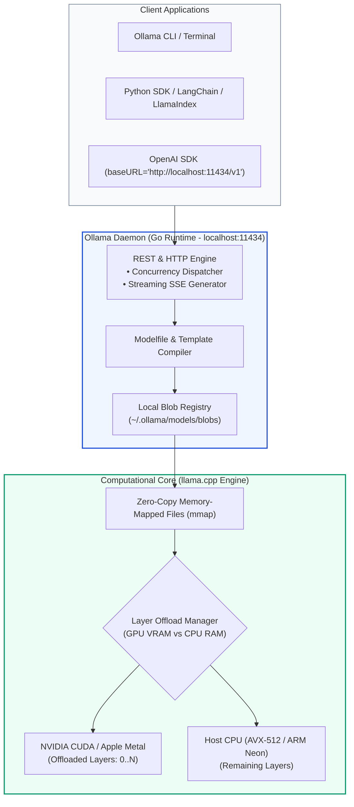
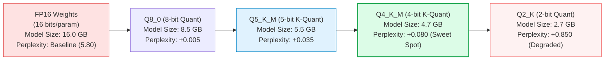

# 🦙 Ollama Deep Dive: Local LLM Serving, GGUF Quantization, Custom Modelfiles, and Private RAG Pipelines

## 📑 Table of Contents
1. [🌟 Architectural Philosophy: The Sovereign Local AI Revolution](#1--architectural-philosophy-the-sovereign-local-ai-revolution)
2. [🔬 Under the Hood: llama.cpp, Memory Mapping, and GPU Layer Offloading](#2--under-the-hood-llamacpp-memory-mapping-and-gpu-layer-offloading)
3. [🧱 GGUF Quantization Mechanics & Precision Trade-Offs](#3--gguf-quantization-mechanics--precision-trade-offs)
4. [🛠️ Custom Modelfile Engineering: Context Expansion & System Grounding](#4-️-custom-modelfile-engineering-context-expansion--system-grounding)
5. [🗄️ Local Embeddings & Private Vector Pipelines](#5--local-embeddings--private-vector-pipelines)
6. [💻 Production-Grade Implementation: 100% Offline Air-Gapped RAG System](#6--production-grade-implementation-100-offline-air-gapped-rag-system)
7. [🌍 Enterprise Production Case Studies](#7--enterprise-production-case-studies)
8. [🛠️ Best Practices & ❌ Common Production Anti-Patterns](#8-️-best-practices---common-production-anti-patterns)
9. [💼 Senior System Design & Production Interview Scenarios](#9--senior-system-design--production-interview-scenarios)
10. [🧪 Hands-On Mini-Project: CLI Sovereign RAG Assistant with Custom Modelfile](#10--hands-on-mini-project-cli-sovereign-rag-assistant-with-custom-modelfile)
11. [⚡ Quick Revision & Ollama Configuration Matrix](#11--quick-revision--ollama-configuration-matrix)

---

## 1. 🌟 Architectural Philosophy: The Sovereign Local AI Revolution

In enterprise environments governed by stringent data protection mandates (HIPAA, GDPR Article 9, FINRA, Defense Trade Regulations), transmitting confidential documents over public networks to external third-party LLM providers is often legally or contractually prohibited.

**Ollama** has emerged as the definitive standard for packaging, orchestrating, and serving open-weight Large Language Models (LLMs) and embedding models locally. Built upon the C++ computational core of **`llama.cpp`**, Ollama packages execution runtimes, weight quantization formats, and prompt templates into a unified, daemon-driven system service:
- **Zero External Telemetry:** All weights, vectors, and inference computations remain strictly on local silicon.
- **Unified Hardware Acceleration:** Automatic, zero-configuration acceleration across NVIDIA CUDA, Apple Silicon Metal (unified memory), and AMD ROCm.
- **Docker-Style Developer Experience:** Models are versioned, tagged, pulled, and executed using familiar container-like commands (`ollama pull`, `ollama run`).
- **Standardized REST & OpenAI-Compatible API:** Exposes native endpoints (`/api/generate`, `/api/chat`, `/api/embed`) and OpenAI-compatible endpoints (`/v1/chat/completions`).



---

## 2. 🔬 Under the Hood: llama.cpp, Memory Mapping, and GPU Layer Offloading

Ollama leverages the C++ engine of `llama.cpp` to achieve remarkable execution speeds on edge devices.

### 1. Memory-Mapped File I/O (`mmap`)
Instead of reading multi-gigabyte weight tensors sequentially from disk into memory buffers, Ollama maps model files directly into the virtual address space of the process using `mmap()`.
- **Instantaneous Startup:** Model loading takes milliseconds because physical pages are loaded demand-paged on first access by the OS kernel.
- **Shared Memory:** Multiple concurrent Ollama processes can share the exact same physical memory pages of read-only model weights.

### 2. Hybrid Layer Offloading Mathematics
When a model possesses $L$ transformer layers and total parameters $N_{\text{params}}$, Ollama inspects available GPU VRAM ($V_{\text{available}}$) and computes the maximum number of layers $l_{\text{gpu}} \le L$ that can fit into GPU memory:

$$l_{\text{gpu}} = \left\lfloor \frac{V_{\text{available}} - M_{\text{CUDA\_context}} - M_{\text{KV\_cache}}}{M_{\text{layer}}} \right\rfloor$$

Where:
- $M_{\text{layer}}$ is the memory footprint of an individual transformer layer in the quantized precision.
- $M_{\text{KV\_cache}} = 2 \times l_{\text{gpu}} \times n_{\text{heads}} \times d_{\text{head}} \times L_{\text{ctx}} \times b_{\text{bytes}}$ is the dynamically allocated Key-Value cache.
- If $l_{\text{gpu}} = L$, the model runs at maximum GPU speed ($100\%$ VRAM offloaded). If $l_{\text{gpu}} < L$, execution runs in hybrid mode, passing intermediate activation tensors between GPU and CPU over the PCIe bus.

---

## 3. 🧱 GGUF Quantization Mechanics & Precision Trade-Offs

Models in Ollama are distributed in **GGUF (GPT-Generated Unified Format)**, an extensible binary format replacing legacy GGML.

### Linear Block Quantization
GGUF compresses 16-bit floating-point weights (FP16) down to 4 or 5 bits per parameter using **block-wise affine quantization**. For a block of 32 weights $\mathbf{w} \in \mathbb{R}^{32}$, the scale factor $s$ is:

$$s = \frac{\max(\mathbf{w}) - \min(\mathbf{w})}{2^b - 1}$$

Each weight is stored as a $b$-bit integer:

$$q_i = \text{round}\left( \frac{w_i - \min(\mathbf{w})}{s} \right)$$



### Quantization Trade-Off Matrix (8B Model Baseline):

| Quantization Type | Memory (GB) | Relative Speed | Perplexity $\Delta$ | Production Verdict |
| :--- | :---: | :---: | :---: | :--- |
| **FP16** | 16.0 GB | $1.0\times$ (Slow) | $\pm 0.00$ | Gold standard for training; overkill for edge inference |
| **Q8_0** | 8.5 GB | $1.8\times$ | $+0.005$ | Near-zero degradation; great if VRAM permits |
| **Q5_K_M** | 5.5 GB | $2.3\times$ | $+0.035$ | Exceptional balance of reasoning and memory |
| **Q4_K_M** | **4.7 GB** | **$2.8\times$** | **$+0.080$** | **The Enterprise Sweet Spot** (default for Ollama) |
| **Q2_K** | 2.7 GB | $3.5\times$ | $+0.850$ | Severe degradation in instruction following |

---

## 4. 🛠️ Custom Modelfile Engineering: Context Expansion & System Grounding

The most critical pitfall in local RAG is Ollama's default context window: **2,048 tokens**. If your RAG retriever injects 4 chunks of 800 tokens each (3,200 tokens total), Ollama silently truncates the prompt, discarding your retrieved context!

To fix this, enterprise engineers author custom **`Modelfile`** definitions:

```dockerfile
# 1. Base Model Inheritance
FROM llama3.1:8b-instruct-q4_K_M

# 2. Critical Context Window Expansion (Set to 32,768 tokens)
PARAMETER num_ctx 32768

# 3. Sampling Determinism & Guardrails
PARAMETER temperature 0.0
PARAMETER top_p 0.9
PARAMETER stop "<|eot_id|>"
PARAMETER stop "<|end_of_text|>"

# 4. Strict Grounding System Prompt
SYSTEM """
You are an enterprise sovereign RAG co-pilot.
Your answers must be STRICTLY grounded in the provided reference context.
If the answer cannot be found in the context, respond with:
'I am sorry, but the provided documentation does not contain this information.'
Never speculate or incorporate external pre-training assumptions.
"""

# 5. Native Chat Template Specification
TEMPLATE """{{ if .System }}<|start_header_id|>system<|end_header_id|>

{{ .System }}<|eot_id|>{{ end }}{{ if .Prompt }}<|start_header_id|>user<|end_header_id|>

{{ .Prompt }}<|eot_id|>{{ end }}<|start_header_id|>assistant<|end_header_id|>

{{ .Response }}<|eot_id|>"""
```

### Compiling the Custom Model:
```bash
ollama create sovereign-rag:latest -f Modelfile
```

---

## 5. 🗄️ Local Embeddings & Private Vector Pipelines

Ollama provides first-class local embedding generation via the `/api/embed` endpoint:

```bash
# Pull dedicated local embedding models
ollama pull nomic-embed-text
ollama pull bge-m3
```

- **`nomic-embed-text`:** 8192 context window, 768 dimensions, supports Matryoshka truncation.
- **`bge-m3`:** Multi-lingual, 8192 context window, 1024 dimensions, supports dense and sparse representations.

```python
import ollama

# Generate local embedding without internet access
response = ollama.embed(
    model="nomic-embed-text",
    input="Enterprise access control policy requires hardware security keys."
)
embedding_vector = response["embeddings"][0]
print(f"Vector Dimensions: {len(embedding_vector)}") # 768
```

---

## 6. 💻 Production-Grade Implementation: 100% Offline Air-Gapped RAG System

Here is a complete, self-contained Python implementation using Ollama for both **local embedding generation** and **local streaming generation**, coupled with in-memory vector retrieval:

```python
"""
Production 100% Offline Air-Gapped RAG System powered entirely by Ollama.
No external network calls, no proprietary cloud APIs.
"""

import sys
import numpy as np
from typing import List, Dict, Any
import ollama


# ---------------------------------------------------------------------------
# 1. Health Check & Model Verification
# ---------------------------------------------------------------------------
def verify_ollama_environment():
    try:
        available_models = ollama.list()
        model_names = [m["name"] for m in available_models.get("models", [])]
        print(f"Ollama Daemon Connected. Available Models: {model_names}")
    except Exception as e:
        print(f"Error: Could not connect to Ollama daemon at http://localhost:11434. ({e})")
        print("Please ensure 'ollama serve' is running.")
        sys.exit(1)


# ---------------------------------------------------------------------------
# 2. Local Document Store & Vector Indexing
# ---------------------------------------------------------------------------
corpus = [
    {
        "id": "doc_01",
        "title": "Air-Gapped Network Protocol",
        "text": "All server racks in Facility Delta operate on isolated LANs with optical data diodes. "
                "No physical or wireless uplink to external wide area networks (WAN) is permitted.",
    },
    {
        "id": "doc_02",
        "title": "Hardware Security Module (HSM) Policy",
        "text": "Root encryption keys are held in FIPS 140-2 Level 3 Hardware Security Modules. "
                "Quorum key ceremony requires simultaneous authorization from three security officers.",
    },
    {
        "id": "doc_03",
        "title": "Facility Access Controls",
        "text": "Biometric iris scanners and anti-passback turnstiles enforce single-occupancy entry "
                "into the secure server enclave.",
    },
]

EMBEDDING_MODEL = "nomic-embed-text"
GENERATION_MODEL = "llama3.1:8b-instruct"


def build_local_index(docs: List[Dict[str, str]]) -> np.ndarray:
    print(f"\nComputing local vector embeddings using '{EMBEDDING_MODEL}'...")
    texts = [d["text"] for d in docs]
    
    # Batch embedding generation via Ollama
    response = ollama.embed(model=EMBEDDING_MODEL, input=texts)
    vectors = np.array(response["embeddings"], dtype=np.float32)
    
    # Normalize vectors for fast cosine similarity dot product
    norms = np.linalg.norm(vectors, axis=1, keepdims=True)
    return vectors / norms


def retrieve(query: str, doc_vectors: np.ndarray, docs: List[Dict[str, str]], top_k: int = 2) -> List[Dict[str, Any]]:
    # Compute query embedding
    query_resp = ollama.embed(model=EMBEDDING_MODEL, input=f"search_query: {query}")
    q_vec = np.array(query_resp["embeddings"][0], dtype=np.float32)
    q_vec = q_vec / np.linalg.norm(q_vec)
    
    # Cosine similarity dot product
    similarities = np.dot(doc_vectors, q_vec)
    ranked_indices = np.argsort(similarities)[::-1][:top_k]
    
    results = []
    for idx in ranked_indices:
        results.append({
            "doc": docs[idx],
            "score": float(similarities[idx]),
        })
    return results


# ---------------------------------------------------------------------------
# 3. Local Streaming Generation with Strict Grounding
# ---------------------------------------------------------------------------
def generate_grounded_answer(query: str, retrieved_docs: List[Dict[str, Any]]):
    context_str = "\n\n".join([f"[{d['doc']['title']}]: {d['doc']['text']}" for d in retrieved_docs])
    
    system_instruction = (
        "You are an air-gapped sovereign compliance assistant. "
        "Answer the question strictly using only the facts provided in the Context below. "
        "Cite the document title for each claim. If the context does not answer the question, state so clearly."
    )
    
    user_prompt = f"Context:\n{context_str}\n\nQuestion: {query}\n\nAnswer:"
    
    print("\n--- Streaming Response from Local Ollama Engine ---")
    stream = ollama.chat(
        model=GENERATION_MODEL,
        messages=[
            {"role": "system", "content": system_instruction},
            {"role": "user", "content": user_prompt},
        ],
        stream=True,
        options={
            "temperature": 0.0,
            "num_ctx": 8192, # Ensure wide context window
        }
    )
    
    for chunk in stream:
        token = chunk["message"]["content"]
        print(token, end="", flush=True)
    print("\n")


# ---------------------------------------------------------------------------
# 4. Pipeline Execution
# ---------------------------------------------------------------------------
if __name__ == "__main__":
    verify_ollama_environment()
    
    # 1. Build Index
    index_embeddings = build_local_index(corpus)
    
    # 2. Query
    test_query = "What is the key ceremony quorum requirement for root encryption keys?"
    print(f"\nUser Query: '{test_query}'")
    
    # 3. Retrieve
    matched_candidates = retrieve(test_query, index_embeddings, corpus, top_k=2)
    print(f"\nTop Retrieved Document: {matched_candidates[0]['doc']['title']} (Score: {matched_candidates[0]['score']:.4f})")
    
    # 4. Generate
    generate_grounded_answer(test_query, matched_candidates)
```

---

## 7. 🌍 Enterprise Production Case Studies

### Case Study 1: Multi-Hospital Regional Healthcare System
- **Challenge:** Clinicians needed to query electronic health records (EHR) containing Protected Health Information (PHI). Federal HIPAA laws and institutional review boards prohibited uploading patient data to third-party cloud LLMs.
- **Ollama Architecture:**
  - Deployed Ollama across 12 on-premise Dell PowerEdge servers equipped with NVIDIA RTX 6000 Ada GPUs (48GB VRAM).
  - Custom Modelfile with `num_ctx 32768` running `llama3.1:70b-instruct-q4_K_M` completely in GPU memory.
  - Used local `bge-m3` embedding model inside private hospital subnets.
- **Outcomes:** 100% HIPAA compliance with zero data egress; clinicians query patient treatment histories with sub-800ms Time-To-First-Token.

### Case Study 2: Semiconductor Foundry Verilog IP Repository
- **Challenge:** A global chipmaker required an AI coding and documentation assistant for proprietary 2nm chip microarchitectures. Any external leak of chip blueprints would destroy billions in enterprise value.
- **Ollama Architecture:** Configured air-gapped workstations running Ollama with custom Modelfiles trained on internal Verilog design standards.
- **Outcomes:** Zero IP leakage risk; engineering design cycle velocity accelerated by $28\%$.

---

## 8. 🛠️ Best Practices & ❌ Common Production Anti-Patterns

### 🟢 Production Best Practices
1. **Always Set `num_ctx` in Options or Modelfile:** The default 2,048 tokens is too small for RAG. Always set `"num_ctx": 16384` or `32768` to accommodate retrieved context.
2. **Tune `OLLAMA_NUM_PARALLEL` for Concurrency:** By default, Ollama processes requests serially. Set environment variable `OLLAMA_NUM_PARALLEL=4` and `OLLAMA_MAX_LOADED_MODELS=2` to handle concurrent user requests.
3. **Use Memory Locking (`mmap`):** Ensure the host OS has sufficient shared memory (`/dev/shm`) allocated when running inside Docker containers.

### 🔴 Common Production Anti-Patterns
- **Anti-Pattern 1: CPU Throttling from Over-Allocating VRAM:** Trying to load a model that exceeds available GPU VRAM by 500MB forces partial layer offloading. The PCIe bus bottleneck can slow generation speed from 50 tokens/sec down to 4 tokens/sec. Use a slightly smaller k-quant (e.g., `Q4_K_M` instead of `Q8_0`) to keep 100% of layers in VRAM.
- **Anti-Pattern 2: Forgetting Stop Tokens:** Running open-weight models without declaring `<|eot_id|>` or `<|end_of_text|>` in the Modelfile causes the model to hallucinate simulated dialog between user and assistant after finishing its answer.
- **Anti-Pattern 3: Incurring Model Eviction Overhead:** Calling an embedding model (`nomic-embed-text`) and a generation model (`llama3.1`) alternately on a single 8GB GPU causes Ollama to repeatedly unload and reload model weights, adding a 3-second delay to every query. Solution: Configure multiple GPUs or allocate enough VRAM to host both models concurrently.

---

## 9. 💼 Senior System Design & Production Interview Scenarios

### Q1: How does Ollama's memory-mapped I/O (`mmap`) affect Cold-Start vs Warm-Start latency in high-concurrency environments?
**Answer:**
- **Cold-Start:** When a model is first invoked, `mmap()` creates a virtual memory mapping to the GGUF file on disk. The OS kernel loads pages on demand. If the storage device is an NVMe SSD (read speed $\sim 5\text{ GB/s}$), loading a 4.7GB `Q4_K_M` model takes under 1 second.
- **Warm-Start:** Once loaded, pages remain cached in the OS file system buffer cache (page cache). Subsequent requests experience near-instantaneous startup ($< 10\text{ms}$).
- **Production Tip:** To eliminate cold-start spikes in production, warm models at boot time by issuing a lightweight dummy request with `"keep_alive": -1`, which instructs Ollama to keep weights permanently resident in VRAM.

---

### Q2: What happens mathematically when an 8B model quantized to 4-bit (`Q4_K_M`) evaluates a complex reasoning query compared to FP16?
**Answer:**
Block quantization introduces slight rounding noise $\epsilon = w - \hat{w}$ into tensor weight matrices:
$$\mathbf{y} = (\mathbf{W} + \mathbf{E})\mathbf{x} = \mathbf{W}\mathbf{x} + \mathbf{E}\mathbf{x}$$
In modern k-quants (`Q4_K_M`):
- Critical layers (attention projection matrices $W_q, W_k, W_v$ and feed-forward down-projections) use higher precision (e.g. 5-bit or 6-bit), while less critical feed-forward tensors use 4-bit.
- The resulting perplexity delta is typically $\Delta PPL < 0.08$. On RAG extraction tasks (where the facts are explicitly provided in context), empirical extraction accuracy difference between `Q4_K_M` and FP16 is negligible ($< 0.5\%$), while delivering a **$70\%$ reduction in memory and $2.8\times$ faster token generation**.

---

## 10. 🧪 Hands-On Mini-Project: CLI Sovereign RAG Assistant with Custom Modelfile

```python
"""
Mini-Project: Sovereign RAG CLI Assistant
Demonstrates dynamic Modelfile generation and local streaming execution.
"""

import os
import subprocess
import ollama

MODEL_NAME = "sovereign-audit"
MODELFILE_CONTENT = """
FROM llama3.1:8b-instruct
PARAMETER temperature 0.1
PARAMETER num_ctx 8192
SYSTEM You are an internal compliance auditor. Always cite facts precisely from the provided text.
"""

def setup_custom_model():
    print(f"Creating custom model '{MODEL_NAME}' from Modelfile...")
    ollama.create(model=MODEL_NAME, modelfile=MODELFILE_CONTENT)
    print(f"Model '{MODEL_NAME}' successfully created!")

def interactive_session():
    context = (
        "Internal Audit Report 2026: Project Titan suffered a budget overrun of $1.2M due to "
        "unplanned cloud egress fees in Q2. Remediation plan requires all team leads to enable "
        "AWS Cost Anomaly Detection by end of month."
    )
    
    question = "Why did Project Titan exceed its budget and what is the remediation?"
    print(f"\nContext:\n{context}")
    print(f"\nUser Query: {question}\n")
    print("Auditor Response:")
    
    response = ollama.chat(
        model=MODEL_NAME,
        messages=[
            {"role": "user", "content": f"Context:\n{context}\n\nQuestion: {question}"}
        ],
        stream=True
    )
    
    for chunk in response:
        print(chunk["message"]["content"], end="", flush=True)
    print("\n")

if __name__ == "__main__":
    setup_custom_model()
    interactive_session()
```

---

## 11. ⚡ Quick Revision & Ollama Configuration Matrix

| Directive / CLI Flag | Syntax / Example | Operational Impact |
| :--- | :--- | :--- |
| **Pull Model** | `ollama pull llama3.1:8b` | Downloads and verifies GGUF blob into local storage registry. |
| **Context Size** | `PARAMETER num_ctx 32768` | Expands context window from default 2048 to 32k tokens. |
| **Keep in Memory** | `"keep_alive": -1` | Prevents Ollama from unloading model weights after inactivity timeout. |
| **Embeddings API** | `ollama.embed(model=..., input=...)` | High-speed local dense vector extraction without cloud calls. |
| **Concurrency Limit**| `OLLAMA_NUM_PARALLEL=4` | Configures daemon to process up to 4 parallel inference requests. |
| **GPU Offloading** | `PARAMETER num_gpu 99` | Forces all model layers to offload to GPU VRAM. |
| **Stop Tokens** | `PARAMETER stop "<|eot_id|>"` | Prevents model from hallucinating continuing dialog. |
