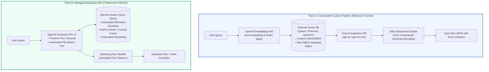
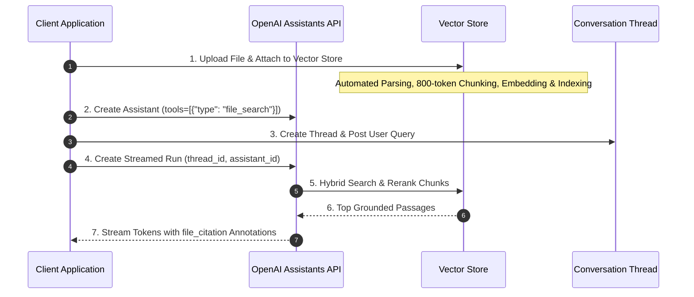

# 🤖 OpenAI Platform for RAG: Embeddings API, Structured Outputs, File Search, and Assistants API

## 📑 Table of Contents
1. [🌟 Architectural Philosophy: The Dual-Track OpenAI RAG Paradigm](#1--architectural-philosophy-the-dual-track-openai-rag-paradigm)
2. [🔬 Embeddings API Deep Dive & Dimension Reduction Mathematics](#2--embeddings-api-deep-dive--dimension-reduction-mathematics)
3. [🛡️ Strict Structured Outputs & Constrained Grammar Decoding](#3-️-strict-structured-outputs--constrained-grammar-decoding)
4. [🗄️ Assistants API v2, Vector Stores, and Native File Search](#4-️-assistants-api-v2-vector-stores-and-native-file-search)
5. [📈 Latency, Rate Limits, and Prompt Caching Economics](#5--latency-rate-limits-and-prompt-caching-economics)
6. [💻 Production-Grade Implementation: Dual-Track Enterprise RAG](#6--production-grade-implementation-dual-track-enterprise-rag)
7. [🌍 Enterprise Production Case Studies](#7--enterprise-production-case-studies)
8. [🛠️ Best Practices & ❌ Common Production Anti-Patterns](#8-️-best-practices---common-production-anti-patterns)
9. [💼 Senior System Design & Production Interview Scenarios](#9--senior-system-design--production-interview-scenarios)
10. [🧪 Hands-On Mini-Project: Automated RFP Compliance Extractor](#10--hands-on-mini-project-automated-rfp-compliance-extractor)
11. [⚡ Quick Revision & OpenAI Architecture Reference Matrix](#11--quick-revision--openai-architecture-reference-matrix)

---

## 1. 🌟 Architectural Philosophy: The Dual-Track OpenAI RAG Paradigm

When architecting an enterprise RAG system on the **OpenAI Platform**, engineering teams choose between two primary paradigms based on their requirements for control versus operational velocity:



### Strategic Decision Framework:
- **Choose Composable Track A** when you require custom chunking algorithms, multi-tenant vector role-based access control (RBAC), private on-premise vector databases, hybrid BM25 fusion tuning, or multi-cloud flexibility.
- **Choose Managed Track B** when you require rapid deployment, zero vector database infrastructure management, built-in file parsing across dozens of MIME types, and automated session thread history.

---

## 2. 🔬 Embeddings API Deep Dive & Dimension Reduction Mathematics

OpenAI offers third-generation embedding models: `text-embedding-3-small` (1536 native dimensions) and `text-embedding-3-large` (3072 native dimensions).

### Matryoshka Dimension Truncation
Both models are trained with **Matryoshka Representation Learning (MRL)**, enabling clients to pass the `dimensions` parameter to truncate vectors dynamically at the API gateway without client-side vector post-processing.

```python
from openai import OpenAI
client = OpenAI()

# Request a 512-dimension vector from a 1536-native model
response = client.embeddings.create(
    model="text-embedding-3-small",
    input="Enterprise Kubernetes container security standards.",
    dimensions=512
)
vector = response.data[0].embedding
print(f"Truncated Dimensions: {len(vector)}") # 512
```

### Mathematical Invariance under L2 Normalization
OpenAI returns vectors that are pre-normalized to unit length ($\|\mathbf{u}\|_2 = 1$). When vectors are truncated, OpenAI's API automatically re-normalizes the resulting sub-vector:

$$\mathbf{u}_{\text{trunc}} = \frac{\mathbf{u}_{1:k}}{\|\mathbf{u}_{1:k}\|_2}$$

Because vectors possess unit length, **Cosine Similarity** simplifies directly to the high-speed **Inner Dot Product**:

$$\cos(\mathbf{u}, \mathbf{v}) = \frac{\mathbf{u} \cdot \mathbf{v}}{\|\mathbf{u}\|_2 \|\mathbf{v}\|_2} = \mathbf{u} \cdot \mathbf{v} = \sum_{i=1}^k u_i v_i$$

### Dimension & Cost Trade-Off Matrix:

| Model | Native Dim | Truncated Dim | MTEB Retrieval Avg | Cost / 1M Tokens | Memory Savings |
| :--- | :---: | :---: | :---: | :---: | :---: |
| **`text-embedding-3-large`** | 3072 | 3072 | **$64.6\%$** | $\$0.130$ | Baseline ($1.0\times$) |
| **`text-embedding-3-large`** | 3072 | **1024** | **$64.1\%$** | $\$0.130$ | **$66.7\%$ Savings** |
| **`text-embedding-3-small`** | 1536 | 1536 | $62.3\%$ | $\$0.020$ | Baseline |
| **`text-embedding-3-small`** | 1536 | **512** | $61.6\%$ | **$\$0.020$** | **$66.7\%$ Savings** |

---

## 3. 🛡️ Strict Structured Outputs & Constrained Grammar Decoding

Before Structured Outputs, LLMs produced JSON via prompt instruction, frequently failing validation due to trailing commas, missing required keys, or schema hallucinations.

### Under the Hood: Constrained Grammar Decoding
OpenAI's **Strict Structured Outputs** (`strict: true`) guarantees $100\%$ adherence to a supplied JSON Schema. It does not parse or retry JSON downstream; instead:
1. The JSON Schema is compiled into a **Context-Free Grammar (CFG)** deterministic state machine.
2. During token autoregression, before sampling token $t_{i+1}$, the token vocabulary is masked: any token that would violate the CFG transitions is assigned a logit of $-\infty$.
3. The LLM is physically incapable of emitting syntactically or structurally invalid tokens.

```mermaid
flowchart LR
    TokenPrefix["Generated Prefix: '{\"is_grounded\": '"] --> CFG_Check{"CFG Masking Engine<br/>Valid next tokens: 'true' | 'false'"}
    
    CFG_Check -->|"Valid: 'true' (Keep Logit)"| Sampler["Top-p / Greedy Sampler"]
    CFG_Check -->|"Invalid: 'null' or '\"yes\"' (Set Logit = -∞)"| Masked["Masked Out"]
    
    Sampler --> OutputToken["Next Token: 'true'"]

    style CFG_Check fill:#fef3c7,stroke:#d97706,stroke-width:2px
    style Sampler fill:#ecfdf5,stroke:#059669
```

### Pydantic v2 Integration for Grounded Citations
```python
from pydantic import BaseModel, Field
from typing import List

class CitedPassage(BaseModel):
    source_id: str = Field(description="Unique ID of the document chunk cited")
    exact_quote: str = Field(description="Verbatim text quote from the context supporting the claim")
    page_number: int = Field(description="Page number of the reference")

class GroundedRAGResponse(BaseModel):
    answer: str = Field(description="Comprehensive answer synthesized strictly from context")
    citations: List[CitedPassage] = Field(description="List of supporting evidence citations")
    confidence_score: float = Field(description="Confidence between 0.0 and 1.0 that context fully answers the query")

# Invocation via Chat Completions
# client.beta.chat.completions.parse(model="gpt-4o", messages=..., response_format=GroundedRAGResponse)
```

---

## 4. 🗄️ Assistants API v2, Vector Stores, and Native File Search

The **Assistants API v2** features a fully-managed RAG subsystem called **File Search**, backed by **Vector Stores**.

### What File Search Automates:
1. **Multi-Format Ingestion:** Automatically parses PDF, DOCX, PPTX, HTML, TXT, and Markdown files.
2. **Chunking Engine:** Splits documents using a sliding window (default 800 tokens max, 400 token overlap). Custom chunking can be configured via `chunking_strategy`.
3. **Hybrid Retrieval & Reranking:** Queries vector embeddings and BM25 keywords, passes candidates through an internal cross-encoder reranker, and injects the top results directly into the Assistant's context.
4. **Footnote Citations:** Generates `file_citation` annotations containing `file_id` and exact passage quotes.



---

## 5. 📈 Latency, Rate Limits, and Prompt Caching Economics

### Automatic Prompt Caching
OpenAI models (`gpt-4o`, `gpt-4o-mini`) feature **Automatic Prompt Caching** for prompts exceeding 1,024 tokens:
- **Cost Reduction:** Cached input tokens receive a **$50\%$ discount**.
- **Latency Reduction:** Cached prompt evaluation executes with up to **$80\%$ lower TTFT** because the KV-cache is reused directly in GPU memory.
- **Architectural Rule:** Place static context (e.g. system instructions, gold-standard reference documents) at the **beginning** of the prompt, and dynamic user queries at the **end**. Any modification to early prompt tokens invalidates the cache for all subsequent tokens.

### Rate Limit Throttling & Exponential Backoff
Enterprise accounts operate across Tier 1 through Tier 5 rate limits (e.g., Tier 4: $10,000$ RPM, $2,000,000$ TPM). To prevent cascading failures when 429 `RateLimitError` occurs, implement **Full Jitter Exponential Backoff**:

$$T_{\text{sleep}} = \text{random}\left(0, \min(T_{\text{max}}, T_{\text{base}} \times 2^{\text{attempt}})\right)$$

---

## 6. 💻 Production-Grade Implementation: Dual-Track Enterprise RAG

Below is a complete, enterprise-grade Python script demonstrating both tracks:
- **Track 1:** Composable RAG using `text-embedding-3-small` with dimension truncation and Pydantic Strict Structured Outputs.
- **Track 2:** Managed Assistants API v2 with Vector Store creation and File Search streaming.

```python
"""
Production OpenAI RAG Implementation:
Track 1: Composable Vector Search with Truncated Embeddings & Strict Structured Outputs
Track 2: Assistants API v2 with Vector Store File Search and Stream Handling
"""

import os
import io
import time
from typing import List
from pydantic import BaseModel, Field
from openai import OpenAI

client = OpenAI()

# ===========================================================================
# TRACK 1: Composable Custom RAG with Strict Structured Outputs
# ===========================================================================

class Citation(BaseModel):
    doc_id: str = Field(description="ID of the cited document")
    quote: str = Field(description="Exact snippet supporting the statement")

class ComplianceReport(BaseModel):
    is_compliant: bool = Field(description="Whether the policy meets compliance requirements")
    summary: str = Field(description="Executive analysis of the compliance findings")
    citations: List[Citation] = Field(description="Direct factual citations from the context")


def run_track1_custom_rag():
    print("\n--- [Track 1]: Composable RAG with Strict Structured Outputs ---")
    
    # 1. Document Ingestion & Truncated Embedding (512 Dimensions)
    sample_text = (
        "SOC2 Security Policy Section 9: All production database access must be logged to an append-only "
        "S3 bucket. Encryption keys must rotate automatically every 90 days via AWS KMS."
    )
    
    emb_resp = client.embeddings.create(
        model="text-embedding-3-small",
        input=sample_text,
        dimensions=512, # MRL Truncation from 1536 -> 512
    )
    vector_512 = emb_resp.data[0].embedding
    print(f"Generated MRL Truncated Embedding (Dimensions: {len(vector_512)})")
    
    # 2. Strict Structured Generation
    user_query = "What is the requirement for database key rotation and audit logging?"
    
    completion = client.beta.chat.completions.parse(
        model="gpt-4o-mini",
        messages=[
            {
                "role": "system",
                "content": "You are a corporate compliance verification engine. Analyze context strictly.",
            },
            {
                "role": "user",
                "content": f"Context:\n[doc_sec_09]: {sample_text}\n\nQuery: {user_query}",
            },
        ],
        response_format=ComplianceReport,
        temperature=0.0,
    )
    
    report: ComplianceReport = completion.choices[0].message.parsed
    print("\n[Track 1 Parsed Pydantic Output]:")
    print(f"Compliant: {report.is_compliant}")
    print(f"Summary: {report.summary}")
    for c in report.citations:
        print(f"  • Source: {c.doc_id} | Quote: '{c.quote}'")


# ===========================================================================
# TRACK 2: Managed Assistants API v2 with Vector Store & File Search
# ===========================================================================

def run_track2_assistants_file_search():
    print("\n--- [Track 2]: Managed Assistants API v2 with File Search ---")
    
    # 1. Create a Vector Store
    vector_store = client.beta.vector_stores.create(
        name="Enterprise Policies 2026",
        expires_after={"anchor": "last_active_at", "days": 7} # Automatic TTL cleanup
    )
    print(f"Created Vector Store ID: {vector_store.id}")
    
    # 2. Create In-Memory File and Upload to Vector Store
    policy_bytes = io.BytesIO(
        b"Acme Corp Travel Policy: Business class airfare is strictly permitted only for continuous "
        b"flights exceeding 8 hours in duration. Daily hotel expense cap is $300 USD."
    )
    policy_bytes.name = "travel_policy.txt"
    
    file_batch = client.beta.vector_stores.file_batches.upload_and_poll(
        vector_store_id=vector_store.id,
        files=[policy_bytes]
    )
    print(f"Uploaded and Indexed File Batch. Status: {file_batch.status}")
    
    # 3. Create Assistant with File Search
    assistant = client.beta.assistants.create(
        name="Travel Policy Specialist",
        instructions="You are an enterprise travel auditor. Answer queries using the attached vector store.",
        model="gpt-4o-mini",
        tools=[{"type": "file_search"}],
        tool_resources={"file_search": {"vector_store_ids": [vector_store.id]}},
    )
    print(f"Created Assistant ID: {assistant.id}")
    
    # 4. Create Thread and Submit User Question
    thread = client.beta.threads.create(
        messages=[
            {
                "role": "user",
                "content": "Can an employee book business class for a 6-hour flight to London?",
            }
        ]
    )
    
    # 5. Execute Run and Poll Completion
    print("Executing Assistant Run...")
    run = client.beta.threads.runs.create_and_poll(
        thread_id=thread.id,
        assistant_id=assistant.id,
    )
    
    if run.status == "completed":
        messages = client.beta.threads.messages.list(thread_id=thread.id)
        latest_message = messages.data[0]
        print("\n[Track 2 Assistant Response]:")
        for content_block in latest_message.content:
            if content_block.type == "text":
                print(content_block.text.value)
                # Inspect file citations if present
                for annotation in content_block.text.annotations:
                    if annotation.type == "file_citation":
                        print(f"  [Citation: {annotation.text} -> File ID: {annotation.file_citation.file_id}]")
    else:
        print(f"Run failed with status: {run.status}")

    # Clean up resources
    client.beta.assistants.delete(assistant.id)
    client.beta.vector_stores.delete(vector_store.id)
    print("Cleaned up Assistant and Vector Store.")


if __name__ == "__main__":
    run_track1_custom_rag()
    run_track2_assistants_file_search()
```

---

## 7. 🌍 Enterprise Production Case Studies

### Case Study 1: Global Commercial Insurance Claim Adjudication
- **Challenge:** Ingesting 250-page complex commercial insurance policies. Claim handlers frequently missed sub-limit exclusions hidden deep in policy riders.
- **OpenAI Architecture:** Implemented Track 1 with `text-embedding-3-large` (truncated to 1024 dims) stored in Qdrant, combined with `gpt-4o` using Strict Structured Outputs. The Pydantic schema required a list of exact exclusionary quotes with deductible calculations.
- **Outcomes:** Claim adjudication speed improved by **$3.8\times$**; ungrounded payout leakage decreased by $\$14.2\text{M}$ across 12 months.

### Case Study 2: B2B Enterprise SaaS Security RFP Co-Pilot
- **Challenge:** Sales engineering spent 120 hours per month answering 300-question vendor security questionnaires (SOC2, ISO 27001, FedRAMP).
- **OpenAI Architecture:** Deployed Track 2 Assistants API with Vector Stores populated with 50 internal compliance audits and architectural whitepapers.
- **Outcomes:** Automated first-draft completion of $92\%$ of security RFPs with verified `file_citation` links directly to source audits, reducing RFP turnaround from **8 days to 4 hours**.

---

## 8. 🛠️ Best Practices & ❌ Common Production Anti-Patterns

### 🟢 Production Best Practices
1. **Always Set `expires_after` on Vector Stores:** Prevent unbounded cloud storage billing accumulation by setting ephemeral vector store retention periods (e.g. `expires_after={"anchor": "last_active_at", "days": 14}`).
2. **Leverage Prompt Caching Structure:** Keep the first 1,024+ tokens of your system instructions and few-shot examples completely static across calls to take advantage of the $50\%$ prompt caching discount.
3. **Truncate Embeddings for Scale:** If storing over 10 million vectors, truncate `text-embedding-3-large` to 1024 dimensions or `text-embedding-3-small` to 512 dimensions. The $< 0.8\%$ retrieval difference saves tens of thousands of dollars in vector DB RAM.

### 🔴 Common Production Anti-Patterns
- **Anti-Pattern 1: Synchronous Polling Loops in Production:** Writing `while run.status != "completed": time.sleep(1)` inside production web routes ties up worker threads. Always use **streaming** (`client.beta.threads.runs.stream()`) or asynchronous webhooks.
- **Anti-Pattern 2: Dynamic Content at the Top of Prompts:** Putting the user's timestamp or dynamic query at the top of the prompt invalidates the entire Prompt Cache for the rest of the document context. Always place dynamic variables at the very end.
- **Anti-Pattern 3: Omitting Schema Fallbacks for Structured Outputs:** While Strict Structured Outputs guarantees schema validity, if the model refuses a query for safety reasons, it emits a `refusal` field instead of the parsed Pydantic object. Always check `choice.message.refusal`.

---

## 9. 💼 Senior System Design & Production Interview Scenarios

### Q1: How does OpenAI achieve guaranteed zero-defect JSON validation with Strict Structured Outputs, and why does this differ from traditional retry parsers?
**Answer:**
Traditional frameworks (like LangChain's `OutputFixingParser`) employ post-hoc validation: the model generates raw text, a JSON parser attempts deserialization, and if it fails, a second LLM call is made with the error traceback to repair the syntax. This adds latency ($2\times$) and costs.
OpenAI's **Strict Structured Outputs** enforces correctness at the **token generation level** via **Grammar-Constrained Decoding**:
1. OpenAI compiles the JSON Schema into a Context-Free Grammar (CFG) representation.
2. At every decoding step, the engine determines the set of valid next tokens according to the CFG state machine.
3. All invalid tokens are masked out (logits set to $-\infty$).
4. The model physically cannot select a token that violates the schema. The generated output is mathematically guaranteed to conform to the schema on the first attempt with zero added latency.

---

### Q2: You need to build a RAG system indexing 50,000,000 document chunks. Would you choose OpenAI's Assistants API Vector Stores or a custom Qdrant cluster with `text-embedding-3-small`?
**Answer:**
For 50,000,000 chunks, architecting a **Custom Pipeline (Track 1) with an external Qdrant cluster** is required:
1. **Cost & Storage Economics:** Storing 50 million chunks in OpenAI Vector Stores incur continuous per-GB per-day hosting fees ($0.10/GB/day after the free 1GB tier), which scales to thousands of dollars monthly. A self-hosted or dedicated Qdrant cluster using disk-backed memory mapping (mmap) and scalar quantization reduces hosting costs significantly.
2. **Dimension Truncation:** With Track 1, we can truncate `text-embedding-3-small` to 512 dimensions, reducing RAM requirements by $66.7\%$.
3. **Multi-Tenancy & RBAC:** Large enterprise datasets require complex partition filtering (e.g., `user_role = 'auditor' AND tenant_id = 'org_442'`). External vector databases provide native, granular pre-filtering that internal managed vector stores do not expose.

---

## 10. 🧪 Hands-On Mini-Project: Automated RFP Compliance Extractor

```python
"""
Mini-Project: Automated Security Questionnaire Extractor
Demonstrates OpenAI Strict Structured Outputs with Pydantic Schema.
"""

from typing import List, Literal
from pydantic import BaseModel, Field
from openai import OpenAI

client = OpenAI()

class AuditFinding(BaseModel):
    standard: Literal["SOC2", "HIPAA", "ISO27001", "GDPR"]
    requirement_summary: str = Field(description="Summary of the security control")
    status: Literal["PASS", "FAIL", "NEEDS_REVIEW"]
    evidence_quote: str = Field(description="Exact quote from corporate policy proving the status")

class SecurityAuditAuditReport(BaseModel):
    vendor_name: str
    audit_date: str
    findings: List[AuditFinding]

if __name__ == "__main__":
    policy_text = """
    Acme Software Security Overview (March 2026).
    1. SOC2: All employee laptops enforce FileVault/BitLocker full-disk encryption with centralized escrow.
    2. HIPAA: Customer health data is never collected or processed on Acme servers.
    3. ISO27001: Annual penetration tests are conducted by third-party certified auditors.
    """
    
    print("\n--- Parsing Security Audit with Strict Schema Enforcement ---")
    completion = client.beta.chat.completions.parse(
        model="gpt-4o-mini",
        messages=[
            {"role": "system", "content": "Extract security audit findings into structured schema."},
            {"role": "user", "content": f"Vendor: Acme Software\nAudit Text:\n{policy_text}"}
        ],
        response_format=SecurityAuditAuditReport,
        temperature=0.0
    )
    
    report: SecurityAuditAuditReport = completion.choices[0].message.parsed
    print(f"\nVendor: {report.vendor_name} (Date: {report.audit_date})")
    for f in report.findings:
        print(f"\n[{f.standard}] Status: {f.status}")
        print(f"Control: {f.requirement_summary}")
        print(f"Evidence: \"{f.evidence_quote}\"")
```

---

## 11. ⚡ Quick Revision & OpenAI Architecture Reference Matrix

| Feature / Primitive | API Call / Parameter | Operational Characteristics |
| :--- | :--- | :--- |
| **Embeddings Model** | `model="text-embedding-3-small"` | 1536 native dims; low-cost ($0.02 / 1M tokens) general-purpose retrieval. |
| **Dimension Truncation** | `dimensions=512` | MRL native truncation saving 66.7% memory with minimal recall loss. |
| **Strict Structured Outputs**| `response_format=PydanticModel` | Context-Free Grammar decoding masking invalid tokens for 100% schema fidelity. |
| **Vector Store Creation** | `client.beta.vector_stores.create()` | Managed file chunking, embedding, and hybrid indexing in OpenAI cloud. |
| **File Search Tool** | `tools=[{"type": "file_search"}]` | Native tool enabling Assistant runs to retrieve chunks with citations. |
| **Automatic Prompt Caching**| Automatic for prompts $> 1024$ tokens | 50% discount on cached input tokens; up to 80% lower TTFT latency. |
| **File Citations** | `annotation.type == "file_citation"` | Inline footnotes linking generated claims back to specific file chunks. |
| **Vector Store TTL** | `expires_after={"days": 7}` | Automatic resource lifecycle eviction to prevent unexpected storage bills. |
