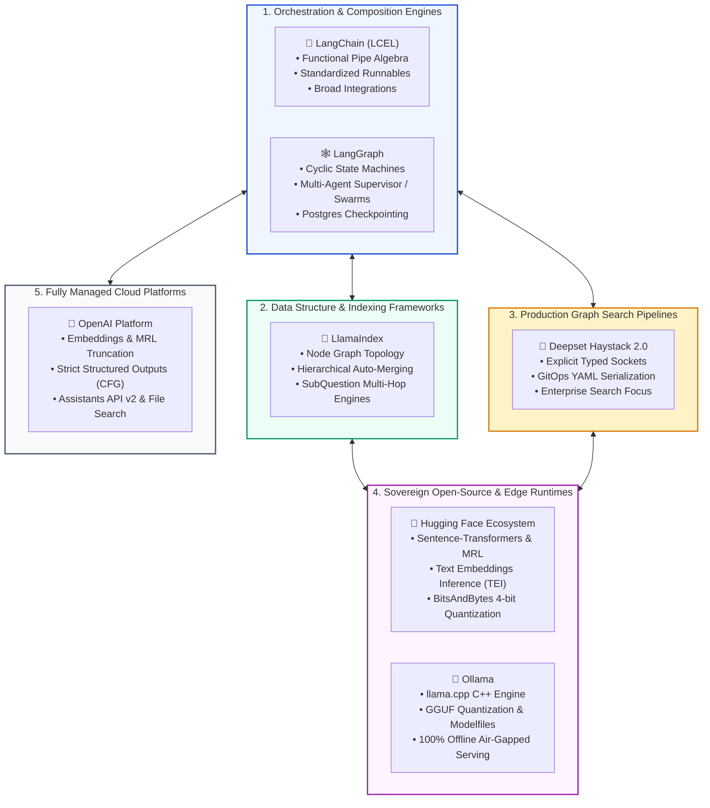
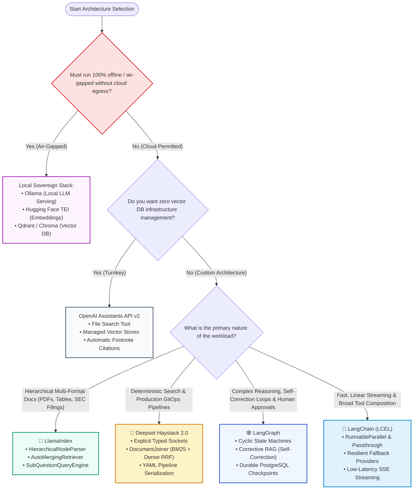
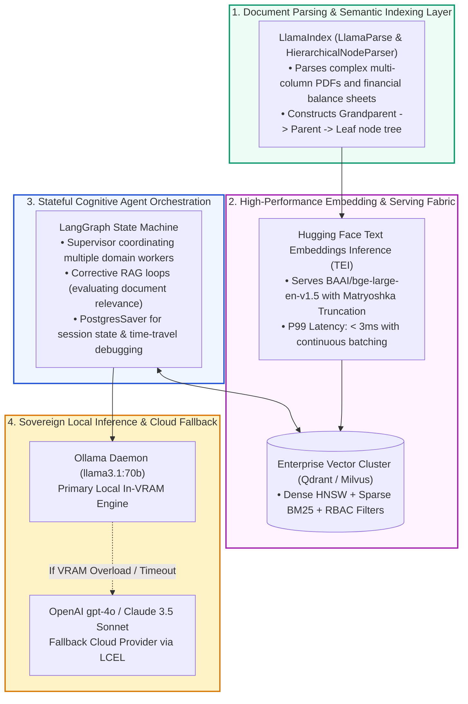

# 🛠️ Module 11: RAG Frameworks and Tools Comprehensive Comparison Guide

## 📑 Table of Contents
1. [🌟 Executive Summary & Modern RAG Ecosystem Taxonomy](#1--executive-summary--modern-rag-ecosystem-taxonomy)
2. [📊 Master 12-Dimensional Framework Evaluation Matrix](#2--master-12-dimensional-framework-evaluation-matrix)
3. [🗺️ Architectural Selection Decision Trees](#3-️-architectural-selection-decision-trees)
4. [🏗️ Enterprise Multi-Framework Hybridization Topologies](#4-️-enterprise-multi-framework-hybridization-topologies)
5. [🔄 Evolution & Migration Paths: From Prototype to Enterprise Scale](#5--evolution--migration-paths-from-prototype-to-enterprise-scale)
6. [📚 Module 11 Comprehensive Curriculum Index](#6--module-11-comprehensive-curriculum-index)
7. [⚡ Master Summary & Forward Horizon to Module 12](#7--master-summary--forward-horizon-to-module-12)

---

## 1. 🌟 Executive Summary & Modern RAG Ecosystem Taxonomy

The AI engineering ecosystem has evolved beyond simple wrapper scripts. Building an enterprise-grade Retrieval-Augmented Generation (RAG) platform requires balancing **orchestration flexibility, data representation fidelity, operational latency, stateful durability, and sovereign data privacy**.

Rather than viewing tools as interchangeable commodities, production architects categorize frameworks into **specialized architectural archetypes**:

---

## 2. 📊 Master 12-Dimensional Framework Evaluation Matrix

The table below synthesizes the engineering trade-offs of the leading frameworks across twelve mission-critical architectural dimensions:

| Architectural Dimension | 🦜 LangChain (LCEL) | 🦙 LlamaIndex | 🌾 Haystack 2.0 | 🕸️ LangGraph | 🤗 Hugging Face | 🦙 Ollama | 🤖 OpenAI Platform |
| :--- | :--- | :--- | :--- | :--- | :--- | :--- | :--- |
| **Primary Architectural Role** | Functional chain composition | Advanced data indexing & node graphs | Typed DAG enterprise search | Cyclic stateful agent runtime | Model hub & embedding inference | Edge/local GGUF LLM serving | Managed cloud APIs & File Search |
| **Execution Topology** | Linear DAG (Pipe Operator) | Ingestion trees & query engines | Typed Socket DAG | **Cyclic Finite State Machine** | Tensor operations & microservices | Local daemon & REST loop | Managed serverless runtimes |
| **Statefulness & Memory** | Ephemeral / In-Memory | Document store & chat history | Ephemeral socket states | **Durable Checkpoints (Postgres/SQLite)** | Stateless model inference | Ephemeral session context | Managed Threads & Vector Stores |
| **Cycle & Loop Support** | Weak (requires recursion) | Moderate (Workflows v0.11+) | Weak (explicit loop limits) | **Native & Comprehensive** | N/A (Model layer) | N/A (Model layer) | Weak (Runs model) |
| **Production Latency Overhead** | Very Low ($< 3\text{ms}$) | Low ($5 - 15\text{ms}$) | **Ultra-Low ($< 1\text{ms}$)** | Low ($5 - 10\text{ms}$ per super-step) | Sub-millisecond (via TEI) | Hardware bounded | Network bounded ($100 - 400\text{ms}$) |
| **Air-Gapped / Offline Ready** | Yes (with local models) | Yes (with local models) | Yes (100% on-premise) | Yes (with local models) | **Native & Complete** | **Native & Complete** | ❌ Cloud Only |
| **Data Structure Sophistication** | Basic `Document` class | **Hierarchical Node Graph** | Typed `Document` dataclass | Flexible Typed State Dictionaries | Raw Token Tensors / Datasets | Plain text / JSON | Managed Vector Store blobs |
| **Multi-Agent Coordination** | Basic agent executors | AgentRunner & Workflows | Agent components | **Supervisor, Swarm & Subgraphs** | N/A | N/A | Basic multi-assistant calls |
| **GitOps & IaC Serialization** | Partial (JSON configs) | Partial | **Complete (YAML/JSON)** | Graph schema export | Hugging Face Hub configs | Modelfile declarative specs | Assistant configuration API |
| **Hardware Acceleration** | Delegated to backends | Delegated to backends | Delegated to backends | Delegated to backends | **CUDA, FlashAttention-2, ROCm** | **CUDA, Apple Metal, ROCm** | Managed by cloud provider |
| **Type Safety & Contracts** | Moderate (`Runnable`) | High (Pydantic v2 schemas) | **Highest (`@component.output_types`)** | High (`TypedDict` / Pydantic) | PyTorch / Python typing | Low (REST API) | Strict Structured Outputs (CFG) |
| **Learning Curve** | Moderate | Moderate to Steep | Low to Moderate | Moderate to Steep | Steep (Deep learning knowledge) | **Very Low (Docker-like CLI)** | **Very Low (Standard REST API)** |

---

## 3. 🗺️ Architectural Selection Decision Trees

Choosing the optimal framework stack depends on your core constraints: latency, privacy, document complexity, and agentic cycles.

---

## 4. 🏗️ Enterprise Multi-Framework Hybridization Topologies

In sophisticated enterprise production deployments, engineering organizations rarely limit themselves to a single framework. Instead, they assemble a **best-of-breed hybrid topology** where each tool excels at its dedicated layer:

### Why this hybrid topology wins:
- **LlamaIndex** solves document fragmentation better than standard splitters through hierarchical parent-child linking.
- **Hugging Face TEI** reduces vector embedding costs to zero cloud fees with $10\times$ higher throughput than standard Python workers.
- **LangGraph** manages the complex agentic lifecycle, human-in-the-loop checkpoints, and reflection loops that linear chains cannot express.
- **Ollama** ensures corporate secrets never leave the enterprise perimeter, while maintaining transparent failover to cloud models if necessary.

---

## 5. 🔄 Evolution & Migration Paths: From Prototype to Enterprise Scale

| Growth Stage | Typical Tech Stack | Limitations Encountered | Strategic Migration Trigger | Next Evolution Target |
| :--- | :--- | :--- | :--- | :--- |
| **Stage 1: Hackathon / Prototype** | OpenAI API + Flat LangChain Chains | High API costs, rigid linear prompts, frequent JSON parsing errors | Unreliable hallucinations, inability to handle complex multi-page PDFs | **Migrate to LlamaIndex + Strict Structured Outputs** |
| **Stage 2: Departmental Pilot** | LlamaIndex flat index + hosted vector DB | Retrieval misses context due to fixed chunk boundaries; slow multi-hop queries | Fragmented search results in legal / technical documents | **Migrate to Hierarchical Indexing + AutoMergingRetriever** |
| **Stage 3: Cross-Team Enterprise Service** | Multiple independent RAG microservices | Lack of unified session state; pipeline failures cannot be resumed; GitOps drift | Complex agentic workflows needing cycles and human approvals | **Graduate to LangGraph + PostgreSQL Durable Checkpointing** |
| **Stage 4: Regulated Sovereign Scale** | Cloud-only proprietary APIs | Compliance violation (HIPAA / GDPR / Defense); runaway monthly cloud bills | Executive mandate for on-premise data sovereignty and cost control | **Deploy Hugging Face TEI + Ollama on Private GPU Infrastructure** |

---

## 6. 📚 Module 11 Comprehensive Curriculum Index

Explore the in-depth architectural guides, mathematical models, production code, case studies, and senior interview questions for each framework:

### 🦜 [11.1 LangChain Deep Dive](LangChain/README.md)
*Architecture, LCEL, Chains, Document Loaders, and Vector Stores*
- Transition from legacy chains to functional LangChain Expression Language (LCEL).
- Composition algebra, async concurrency fan-out, and event streaming.
- Production hybrid retrieval (BM25 + Dense) with Reciprocal Rank Fusion (RRF).
- Fallback resiliency and LangSmith observability.

### 🦙 [11.2 LlamaIndex Deep Dive](LlamaIndex/README.md)
*Data Framework Architecture, Hierarchical Indexing, and Query Engines*
- The data-centric paradigm: Documents, TextNodes, and relational graph links.
- Tree Index traversal complexity $\mathcal{O}(\log_b N)$ and summary aggregation.
- Solving the chunk size dilemma with `HierarchicalNodeParser` and `AutoMergingRetriever`.
- `SubQuestionQueryEngine` for multi-hop comparative document analysis.

### 🌾 [11.3 Deepset Haystack 2.0](Haystack/README.md)
*Component Architecture, Directed Acyclic Graph (DAG) Pipelines, and Production Serving*
- The ground-up Haystack 2.0 rewrite: decoupled `@component` contracts.
- Kahn's algorithm for topological sorting and compile-time socket type validation.
- `DocumentJoiner` for dense/lexical hybrid search fusion.
- Declarative GitOps pipeline serialization to YAML/JSON.

### 🕸️ [11.4 LangGraph](LangGraph/README.md)
*State Graph Mechanics, Multi-Agent Cycles, Persistence, and Dynamic Control Flow*
- Automata theory: Modeling cognitive workflows as Cyclic State Machines.
- Typed state schemas with monoidal reducers (`operator.add`).
- Durable persistence backends: `SqliteSaver` and `PostgresSaver`.
- Time-travel debugging, Human-in-the-Loop approval gates, and Corrective RAG (CRAG).

### 🤗 [11.5 Hugging Face Ecosystem](HuggingFace/README.md)
*Transformers, Sentence-Transformers, Datasets, and Hub Integration*
- Bi-encoders vs Cross-encoders: mathematical bounds and performance trade-offs.
- Contrastive loss formulations: Multiple Negatives Ranking Loss (InfoNCE).
- Matryoshka Representation Learning (MRL) for dynamic dimension truncation.
- High-throughput GPU serving with Text Embeddings Inference (TEI) and BitsAndBytes 4-bit NF4 quantization.

### 🦙 [11.6 Ollama](Ollama/README.md)
*Local LLM Serving, GGUF Quantization, Custom Modelfiles, and Private RAG Pipelines*
- Sovereign, air-gapped local AI architectures powered by `llama.cpp`.
- GGUF quantization mechanics: k-quants (`Q4_K_M`, `Q5_K_M`) and perplexity trade-offs.
- Modelfile engineering: context window expansion (`num_ctx 32768`) and system grounding.
- 100% offline, zero-data-leakage RAG implementation with local embeddings.

### 🤖 [11.7 OpenAI Platform](OpenAI/README.md)
*Embeddings API, Structured Outputs, File Search, and Assistants API*
- Composable custom pipelines vs fully managed Assistants API v2.
- Matryoshka dimension truncation on `text-embedding-3-small` / `large`.
- Context-Free Grammar (CFG) constrained decoding for guaranteed Strict Structured Outputs.
- Automated chunking, hybrid search, and footnote citations with Vector Stores and File Search.

---

## 7. ⚡ Master Summary & Forward Horizon to Module 12

Module 11 has established the complete technical, operational, and architectural mastery required to select, implement, and combine modern RAG frameworks. You now possess the insight to determine whether a given enterprise challenge requires a declarative LCEL stream, a hierarchical LlamaIndex node tree, a durable LangGraph cyclic state machine, a typed Haystack DAG, an air-gapped Ollama/HuggingFace sovereign cluster, or a managed OpenAI Assistants service.

### Up Next: Module 12 — Resources, Datasets & Production References
In **Module 12: Resources**, we explore the canonical literature, curated evaluation datasets, authoritative engineering blogs, and comprehensive indexes that underpin the modern RAG engineering profession:
- Foundational research papers (RAG, RETRO, Self-RAG, CRAG, HyDE, ColBERT).
- Golden benchmark datasets and evaluation corpora (MS MARCO, HotpotQA, BEIR).
- Enterprise glossaries and cross-framework API reference indexes.
