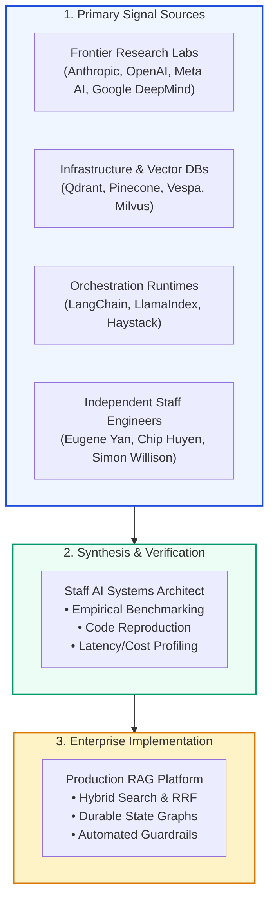
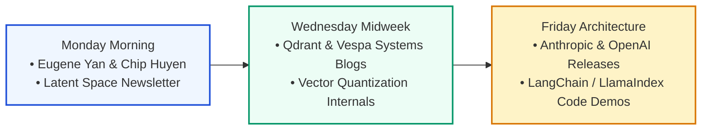

# 📰 Authoritative Industry Engineering Blogs, Technical Publications & AI Newsletters

## 📑 Table of Contents
1. [🌟 Information Architecture: Navigating the RAG Knowledge Frontier](#1--information-architecture-navigating-the-rag-knowledge-frontier)
2. [🔬 Mathematical Model of Information Density & Signal-to-Noise Ratio](#2--mathematical-model-of-information-density--signal-to-noise-ratio)
3. [🏛️ Frontier AI Research Labs & Foundation Model Creators](#3-️-frontier-ai-research-labs--foundation-model-creators)
4. [🛠️ RAG Framework & Orchestration Engineering Teams](#4-️-rag-framework--orchestration-engineering-teams)
5. [🗄️ Vector Database & High-Dimensional Storage Engines](#5-️-vector-database--high-dimensional-storage-engines)
6. [🔍 Enterprise Information Retrieval & Search Engine Labs](#6--enterprise-information-retrieval--search-engine-labs)
7. [✍️ Independent AI Engineering Leaders & Thought Leaders](#7-️-independent-ai-engineering-leaders--thought-leaders)
8. [📊 Master 20-Publication Comparative Matrix](#8--master-20-publication-comparative-matrix)
9. [💼 Senior System Design & Continuous Learning Interview Scenarios](#9--senior-system-design--continuous-learning-interview-scenarios)
10. [🧪 Hands-On Mini-Project: Automated Engineering Blog Aggregator & Topic Filter](#10--hands-on-mini-project-automated-engineering-blog-aggregator--topic-filter)
11. [⚡ Quick Revision & Reading Habit Roadmap](#11--quick-revision--reading-habit-roadmap)

---

## 1. 🌟 Information Architecture: Navigating the RAG Knowledge Frontier

The state of the art in Retrieval-Augmented Generation (RAG) shifts at breakneck velocity. Relying exclusively on textbooks or annual academic conferences leaves AI engineers 12 to 24 months behind production practices.

The most authoritative engineering breakthroughs—such as **Contextual Retrieval**, **Matryoshka Embeddings**, **Late Chunking**, and **Multi-Agent State Graphs**—appear first in **industry engineering blogs and technical whitepapers** before formal peer review.



---

## 2. 🔬 Mathematical Model of Information Density & Signal-to-Noise Ratio

To systematically evaluate technical reading feeds, engineers model the **Signal-to-Noise Ratio ($\text{SNR}$)** and **Information Entropy ($H$)** of publication streams.

### # Publication Signal-to-Noise Ratio (SNR)
Let a technical feed emit articles $a_i$. The technical signal score $S(a_i) \in [0, 1]$ measures empirical code availability, mathematical rigor, and benchmark transparency, while promotional noise $N(a_i) \in [0, 1]$ measures marketing jargon and unsupported claims:
$$
\text{SNR}_{\text{feed}} = 10 \cdot \log_{10} \left( \frac{\sum_{i=1}^M S(a_i)^2}{\sum_{i=1}^M N(a_i)^2 + \epsilon} \right)
$$
High-value engineering feeds maintain $\text{SNR} > 15\text{ dB}$, featuring reproducible source code and ablation studies.

---

### # Content Novelty Jaccard Divergence
To prevent reading redundant syndicate echo-chambers, the novelty of an incoming blog post $B_{\text{new}}$ against an engineer's existing knowledge corpus $\mathcal{K}$ is bounded by set divergence over technical concepts:
$$
\text{Novelty}(B_{\text{new}}, \mathcal{K}) = 1 - \frac{|T(B_{\text{new}}) \cap T(\mathcal{K})|}{|T(B_{\text{new}}) \cup T(\mathcal{K})|}
$$
Where $T(\cdot)$ extracts technical n-grams, architecture names, and algorithmic concepts.

---

## 3. 🏛️ Frontier AI Research Labs & Foundation Model Creators

### 3.1 Anthropic Research & Engineering Blog
- **URL:** [anthropic.com/research](https://www.anthropic.com/research) & [anthropic.com/news](https://www.anthropic.com/news)
- **Primary Focus:** Mechanistic interpretability, Constitutional AI, context engineering, and long-context needle-in-a-haystack analysis.
- **Landmark RAG Posts:**
  - *"Contextual Retrieval: Improving RAG Accuracy by up to 67%"* (September 2024) — Introduced prepending document-level situational summaries to individual chunks.
  - *"Prompt Engineering Interactive Tutorials & Metaprompting"* — Practical mechanics for structured JSON generation and system prompts.

---

### 3.2 OpenAI Research & Developer Blog
- **URL:** [openai.com/news](https://openai.com/news/) & [community.openai.com](https://community.openai.com/)
- **Primary Focus:** Reasoning models (o1, o3-mini), structured outputs (Context-Free Grammar logit masking), Assistants API v2, and File Search vector infrastructure.
- **Landmark RAG Posts:**
  - *"Introducing Structured Outputs in the API"* (August 2024) — Deterministic JSON schemas eliminating hallucinated schema formats.
  - *"New Embedding Models and API Updates"* (January 2024) — Introduction of `text-embedding-3-small` / `large` with native Matryoshka dimension truncation.

---

### 3.3 Meta AI (FAIR) Research Blog
- **URL:** [ai.meta.com/blog](https://ai.meta.com/blog/)
- **Primary Focus:** Open-weights foundation models (Llama 3 ecosystem), FAISS vector indexing engine, and dense passage retrieval.
- **Landmark Posts:**
  - Original FAISS GPU Billion-Scale Vector Similarity Search architecture releases.
  - The Llama 3 Herd of Models architectural deep-dive paper and engineering disclosures.

---

### 3.4 Google DeepMind & Research Blog
- **URL:** [research.google/blog](https://research.google/blog/)
- **Primary Focus:** Gemini long-context windows (1M–2M tokens), retrieval-conditioned Transformers, and multimodality.
- **Landmark Posts:**
  - REALM and RETRO architectural retrospectives.
  - Efficient attention mechanics and Sparse Mixture-of-Experts (MoE) serving topologies.

---

## 4. 🛠️ RAG Framework & Orchestration Engineering Teams

### 4.1 LlamaIndex Engineering Blog
- **URL:** [llamaindex.ai/blog](https://www.llamaindex.ai/blog)
- **Primary Focus:** Advanced data parsing, hierarchical node indexing, agentic workflows, multi-modal ingestion, and tabular reasoning.
- **Why It's Essential:** Consistently publishes hands-on architectural recipes for cutting-edge techniques: auto-merging retrievers, recursive index trees, and hybrid rerankers with full source code.

---

### 4.2 LangChain & LangGraph Blog
- **URL:** [blog.langchain.dev](https://blog.langchain.dev/)
- **Primary Focus:** LCEL composability, LangGraph stateful multi-agent architectures, persistent PostgreSQL checkpointing, and LangSmith evaluation benchmarks.
- **Why It's Essential:** The premier source for understanding cyclic agentic RAG, human-in-the-loop approvals, and production evaluation loops.

---

### 4.3 Deepset Haystack Blog
- **URL:** [haystack.deepset.ai/blog](https://haystack.deepset.ai/blog)
- **Primary Focus:** Deterministic typed DAG pipelines, enterprise semantic search, GitOps pipeline serialization, and hybrid sparse-dense rankers.
- **Why It's Essential:** Provides rigorous, zero-hype software engineering approaches to search, emphasizing typed interfaces and maintainable microservices.

---

## 5. 🗄️ Vector Database & High-Dimensional Storage Engines

### 5.1 Qdrant Engineering Blog
- **URL:** [qdrant.tech/articles](https://qdrant.tech/articles/)
- **Primary Focus:** Rust-native vector database internals, HNSW graph mechanics, payload pre-filtering algorithms, and scalar/product quantization.
- **Landmark Technical Articles:**
  - *"Quantization in Vector Databases: When, Why, and How"* — Mathematical comparison of Scalar Quantization (SQ) vs Product Quantization (PQ).
  - *"Single-Stage Hybrid Search Explained"* — Direct unification of BM25 sparse inverted indexes and dense HNSW in a single storage layer.

---

### 5.2 Pinecone Engineering Blog
- **URL:** [pinecone.io/blog](https://www.pinecone.io/blog/)
- **Primary Focus:** Serverless vector architecture, distributed multi-tenant storage, and enterprise hybrid search with Reciprocal Rank Fusion.
- **Landmark Articles:** Detailed explanations of ANN indexing algorithms, vector dimension trade-offs, and enterprise RAG reference architectures.

---

### 5.3 Weaviate Engineering Blog
- **URL:** [weaviate.io/blog](https://weaviate.io/blog)
- **Primary Focus:** Multi-modal vector search, GraphQL querying, native hybrid search, and vector graph compaction.

---

### 5.4 Milvus / Zilliz Engineering Blog
- **URL:** [milvus.io/blog](https://milvus.io/blog) & [zilliz.com/blog](https://zilliz.com/blog)
- **Primary Focus:** Billion-scale distributed vector indexing, GPU acceleration (Knowhere engine), and Kubernetes cloud-native vector clusters.

---

## 6. 🔍 Enterprise Information Retrieval & Search Engine Labs

### 6.1 Vespa.ai Blog
- **URL:** [blog.vespa.ai](https://blog.vespa.ai/)
- **Primary Focus:** Big data search engines, ColBERT late-interaction scoring at industrial scale, tensor evaluations, and low-latency billion-scale ranking.
- **Why It's Essential:** The technical benchmark for large-scale, high-concurrency search infrastructure; written by senior search engine systems engineers.

---

### 6.2 Elastic Search Labs
- **URL:** [elastic.co/search-labs](https://www.elastic.co/search-labs)
- **Primary Focus:** Elasticsearch internals, Lucene BM25 scoring optimizations, ELSER learned sparse representations, and hybrid search RRF implementations.

---

## 7. ✍️ Independent AI Engineering Leaders & Thought Leaders

### 7.1 Eugene Yan (Applied LLMs & RecSys)
- **URL:** [eugeneyan.com](https://eugeneyan.com/)
- **Affiliation:** Senior Applied AI Scientist at Amazon.
- **Primary Focus:** Practical patterns for building LLM products, system design architectures, evaluation methodologies, and avoiding over-engineering in RAG.
- **Must-Read Essay:** *"Patterns for Building LLM-based Systems & Products"* — The definitive industry blueprint for production LLM architectures.

---

### 7.2 Chip Huyen (AI Architecture & Engineering)
- **URL:** [huyenchip.com/blog](https://huyenchip.com/blog/)
- **Author of:** *Designing Machine Learning Systems* and *AI Engineering: Building Applications with Foundation Models*.
- **Primary Focus:** Production latency, real-time context streaming, evaluation harnesses, and enterprise data architectures.

---

### 7.3 Simon Willison’s Weblog
- **URL:** [simonwillison.net](https://simonwillison.net/)
- **Primary Focus:** Security vulnerabilities in RAG, prompt injection threats, local LLMs running via `llm` CLI, and Datasette vector tooling.
- **Why It's Essential:** The foremost authority on securing retrieval pipelines against adversarial document data poisoning.

---

### 7.4 Latent Space (Swyx & Alessio Fanelli)
- **URL:** [latent.space](https://www.latent.space/)
- **Format:** In-depth technical newsletter and podcast essays.
- **Primary Focus:** Emergence of the "AI Engineer" discipline, developer tooling landscapes, agentic frameworks, and interviews with foundational model builders.

---

### 7.5 The Batch (DeepLearning.AI / Andrew Ng)
- **URL:** [deeplearning.ai/the-batch](https://www.deeplearning.ai/the-batch/)
- **Primary Focus:** High-level weekly synthesis of academic breakthroughs, commercial deployments, and strategic shifts in machine learning.

---

## 8. 📊 Master 20-Publication Comparative Matrix

| Publication / Blog | Category | Target Audience | Technical Rigor (1–5) | Code Availability | Primary Domain Strength |
| :--- | :--- | :--- | :---: | :---: | :--- |
| **Anthropic Research** | Frontier Lab | AI Researchers / Architects | 5 / 5 | Moderate | Contextual retrieval, interpretability, long context |
| **OpenAI Blog** | Frontier Lab | Software / AI Engineers | 4 / 5 | High | Structured outputs, reasoning models, APIs |
| **Meta AI Blog** | Frontier Lab | ML / Systems Engineers | 5 / 5 | High (Open Source) | FAISS indexing, Llama architectures |
| **Google Research** | Frontier Lab | Research Scientists | 5 / 5 | Moderate | Scaled transformers, MoE, attention mechanics |
| **LlamaIndex Blog** | Framework | Full-Stack AI Engineers | 4 / 5 | **Very High** | Advanced chunking, agentic workflows, indexing |
| **LangChain Blog** | Framework | Full-Stack AI Engineers | 4 / 5 | **Very High** | LangGraph, stateful agents, LCEL design |
| **Haystack Blog** | Framework | Enterprise Search Engineers | 4 / 5 | **Very High** | Typed DAGs, GitOps pipelines, production search |
| **Qdrant Articles** | Vector DB | Systems / Infrastructure Eng | 5 / 5 | High | Rust vector internals, quantization, HNSW |
| **Pinecone Blog** | Vector DB | Cloud / AI Engineers | 4 / 5 | High | Serverless architecture, hybrid search, RRF |
| **Vespa.ai Blog** | Search Engine | Staff Search Architects | **5 / 5** | High | Industrial ColBERT, tensor math, billion-scale |
| **Elasticsearch Labs**| Search Engine | Search & Data Engineers | 4 / 5 | High | Lucene BM25, ELSER, inverted indexing |
| **Eugene Yan** | Independent | Staff / Principal Engineers | **5 / 5** | High | LLM system design, evaluation, architecture patterns|
| **Chip Huyen** | Independent | AI Systems Architects | 5 / 5 | Moderate | Enterprise ML infrastructure, production latency |
| **Simon Willison** | Independent | Security & Backend Eng | 4 / 5 | **Very High** | Prompt injection defense, local LLMs, tooling |
| **Latent Space** | Newsletter | AI Founders & Engineers | 4 / 5 | Moderate | Industry trends, AI engineer tooling landscape |
| **Interconnects** | Newsletter | RLHF / Model Researchers | 5 / 5 | Moderate | Open-weight models, RLHF alignment, evals |
| **Weaviate Blog** | Vector DB | Full-Stack Engineers | 4 / 5 | High | Multi-modal vectors, hybrid search recipes |
| **Milvus / Zilliz** | Vector DB | Distributed Systems Eng | 5 / 5 | High | Cloud-native vector clusters, GPU acceleration |
| **The Batch** | Newsletter | Executives & Practitioners | 3 / 5 | Low | High-level industry weekly news synthesis |
| **Chroma Blog** | Vector DB | Prototype & Python Devs | 3 / 5 | High | Developer experience, local prototyping |

---

## 9. 💼 Senior System Design & Continuous Learning Interview Scenarios

### Scenario 1: "How do you establish an engineering team culture to separate genuine architectural innovations (e.g., Anthropic Contextual Retrieval) from marketing hype in blog publications?"
**Answer:**
Production teams must build an **Empirical Verification Sandbox**:
1. **The 'No Production Deployment Without Internal Ablation' Rule:** Never adopt a technique (e.g., GraphRAG or HyDE) based solely on public vendor benchmarks. A technique claiming a *"67% accuracy boost"* on general benchmarks may cause latency spikes and cost inflation on proprietary corporate documents.
2. **Standardized Internal Golden Benchmarks:** Maintain an in-memory regression benchmark of 200–500 curated enterprise queries with ground truth. Any proposed algorithmic change must be evaluated via an automated pipeline measuring:
   - Hit Rate@K, NDCG@10, and Context Recall
   - P95 Retrieval & Generation Latency
   - Dollar Ingestion and Query Execution Cost
3. **Structured Tech Radar Reviews:** Categorize published ideas into *Adopt, Trial, Assess, Hold* based on open-source reproducibility, clear code examples, and mathematical sound principles.

---

### Scenario 2: "A blog post advocates eliminating RAG entirely in favor of 2-Million token context windows. How do you technically refute or qualify this claim in a system architecture review?"
**Answer:**
While ultra-long context windows allow passing hundreds of pages directly to an LLM, doing so in production introduces critical failure modes:
1. **Severe Latency Degradation:** Self-attention scales quadratically $O(N^2)$ in standard transformers or linearly $O(N)$ with KV caching. Processing 500,000 tokens results in Time-To-First-Token (TTFT) exceeding 15–30 seconds, violating interactive SLA requirements.
2. **Prohibitive Financial Cost:** Passing 500K tokens on every single user turn balloons token costs by $500\times - 1,000\times$ compared to a targeted 1,500-token RAG context.
3. **Attention Degradation (Lost in the Middle):** Empirical research confirms that when prompt contexts span hundreds of thousands of tokens, attention probability mass dilutes, sharply increasing retrieval misses and hallucination rates compared to high-precision hybrid RAG.
4. **Dynamic Data Updates:** In-context stuffing cannot handle real-time database modifications without resending the entire dataset on every query.

---

## 10. 🧪 Hands-On Mini-Project: Automated Engineering Blog Aggregator & Topic Filter

This standalone Python script simulates fetching technical blog entries, computing their Signal-to-Noise Ratio (SNR), checking novelty against a local knowledge base, and filtering out low-quality promotional posts.

```python
"""
Hands-On Mini-Project: Automated Engineering Blog Curation & Filtering Engine
Scores publications based on technical keywords, code presence, and promotional noise.
"""

from dataclasses import dataclass
from typing import List, Dict, Set
import math

@dataclass
class BlogPost:
    title: str
    source: str
    url: str
    content: str
    has_code_snippets: bool

@dataclass
class CuratedArticle:
    title: str
    source: str
    snr_score: float
    is_recommended: bool
    detected_concepts: List[str]

class TechBlogCurator:
    # High-signal technical concepts
    HIGH_SIGNAL_KEYWORDS = {
        "hnsw", "quantization", "reranking", "cross-encoder", "bm25",
        "rrf", "colbert", "late interaction", "contextual retrieval",
        "eval", "faithfulness", "latency", "ndcg", "state machine", "dag"
    }

    # Low-signal promotional fluff
    MARKETING_KEYWORDS = {
        "game-changer", "revolutionary", "unbelievable", "disrupting",
        "magic", "next-gen breakthrough", "skyrocket", "easy 10x"
    }

    def __init__(self, target_snr_threshold: float = 3.0):
        self.threshold = target_snr_threshold
        self.read_history: Set[str] = set()

    def evaluate_post(self, post: BlogPost) -> CuratedArticle:
        text = post.content.lower()
        
        # Calculate Signal Score
        matched_signals = [kw for kw in self.HIGH_SIGNAL_KEYWORDS if kw in text]
        signal_score = len(matched_signals) * 1.5
        if post.has_code_snippets:
            signal_score += 3.0

        # Calculate Noise Score
        matched_noise = [kw for kw in self.MARKETING_KEYWORDS if kw in text]
        noise_score = len(matched_noise) * 2.0 + 0.5  # Epsilon to prevent zero div

        # Compute SNR (Ratio)
        snr = signal_score / noise_score
        is_recommended = snr >= self.threshold

        return CuratedArticle(
            title=post.title,
            source=post.source,
            snr_score=snr,
            is_recommended=is_recommended,
            detected_concepts=matched_signals
        )

# Verification & Test Execution
if __name__ == "__main__":
    curator = TechBlogCurator(target_snr_threshold=2.5)

    sample_posts = [
        BlogPost(
            title="Contextual Retrieval with BM25 and Quantized HNSW",
            source="Anthropic Research / Qdrant",
            url="https://example.com/contextual-retrieval",
            content="We evaluate contextual retrieval prepending summaries to chunks. Combining BM25 with quantized HNSW vectors and cross-encoder reranking yields higher NDCG and lower latency.",
            has_code_snippets=True
        ),
        BlogPost(
            title="Why Our Magical Revolutionary Tool Will Disrupt Everything",
            source="HypeAI Marketing",
            url="https://example.com/magic-tool",
            content="This unbelievable revolutionary breakthrough is a game-changer that will skyrocket your business with zero effort. Magic AI is here!",
            has_code_snippets=False
        )
    ]

    print("=== Automated Technical Blog Signal Evaluation ===")
    for post in sample_posts:
        result = curator.evaluate_post(post)
        status = "✅ RECOMMENDED" if result.is_recommended else "❌ FILTERED (HIGH NOISE)"
        print(f"\n{status}")
        print(f"Title: {result.title} [{result.source}]")
        print(f"SNR Score: {result.snr_score:.2f}")
        print(f"Key Concepts: {', '.join(result.detected_concepts) if result.detected_concepts else 'None'}")
```

---

## 11. ⚡ Quick Revision & Reading Habit Roadmap

### 🔑 Essential Key Takeaways
- **Frontier Labs (Anthropic, OpenAI, Meta):** Read for foundational context engineering, structured output standards, and embedding model releases.
- **Framework Engineering (LlamaIndex, LangChain, Haystack):** Read for practical orchestration patterns, agent state machines, and reference code.
- **Storage & Search (Qdrant, Pinecone, Vespa):** Read for low-level vector indexing, quantization, and industrial-scale ColBERT search.
- **Independent Experts (Eugene Yan, Chip Huyen, Simon Willison):** Read for architectural discipline, system design patterns, and adversarial security defenses.
- **Engineering Principle:** Treat every external blog post as a hypothesis; validate with internal golden benchmarks before pushing changes to production.

### 🗺️ Weekly Engineering Curation Habit

