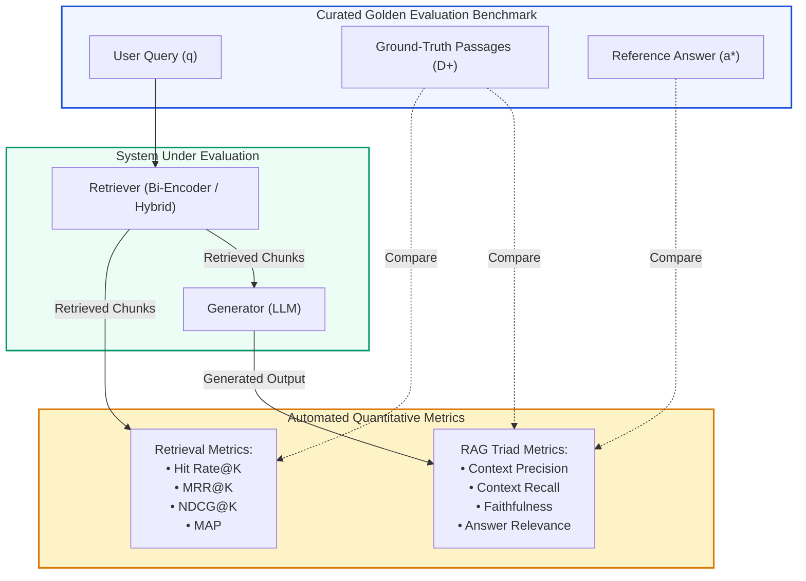
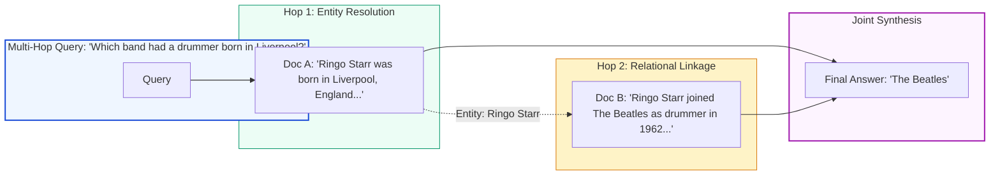
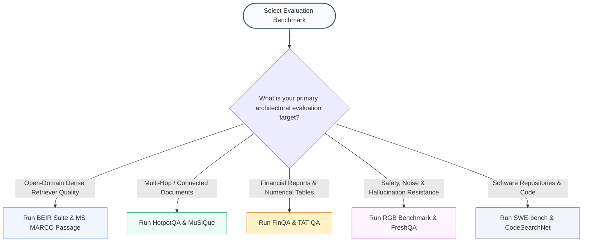

# 🧪 Curated Evaluation Datasets & Golden Benchmark Corpora for RAG Systems

## 📑 Table of Contents
1. [🌟 The Evaluation Imperative: Beyond Vibe Checks to Golden Benchmarks](#1--the-evaluation-imperative-beyond-vibe-checks-to-golden-benchmarks)
2. [🔬 Mathematical Formulations of Information Retrieval & QA Metrics](#2--mathematical-formulations-of-information-retrieval--qa-metrics)
3. [🏛️ Foundational Open-Domain Information Retrieval Benchmarks](#3-️-foundational-open-domain-information-retrieval-benchmarks)
4. [🧩 Multi-Hop, Relational & Complex Reasoning Benchmarks](#4--multi-hop-relational--complex-reasoning-benchmarks)
5. [🏢 Vertical & Enterprise Domain-Specific Datasets](#5--vertical--enterprise-domain-specific-datasets)
6. [📜 Long-Context, Pressure-Testing & Needle-in-a-Haystack Corpora](#6--long-context-pressure-testing--needle-in-a-haystack-corpora)
7. [🛡️ Robustness, Hallucination & Negative Rejection Benchmarks](#7-️-robustness-hallucination--negative-rejection-benchmarks)
8. [📊 Master 15-Benchmark Comparative Evaluation Matrix](#8--master-15-benchmark-comparative-evaluation-matrix)
9. [💼 Senior System Design & Evaluation Interview Scenarios](#9--senior-system-design--evaluation-interview-scenarios)
10. [🧪 Hands-On Mini-Project: Building an In-Memory Golden Dataset Benchmark Harness](#10--hands-on-mini-project-building-an-in-memory-golden-dataset-benchmark-harness)
11. [⚡ Quick Revision & Benchmark Selection Roadmap](#11--quick-revision--benchmark-selection-roadmap)

---

## 1. 🌟 The Evaluation Imperative: Beyond Vibe Checks to Golden Benchmarks

Deploying production Retrieval-Augmented Generation without rigorous, quantitative evaluation datasets is an operational anti-pattern. While qualitative spot-checking ("vibe checks") reveals superficial syntax, it fails to measure critical production failure modes:
- **Retrieval Silent Failures:** Failing to surface the true relevant passage among the top-$K$ candidates.
- **Context Distraction & Noise:** Degrading synthesis quality due to irrelevant or contradictory distractor passages.
- **Parametric Hallucination:** Generating fluent answers unsupported by the retrieved context.
- **Multi-Hop Reasoning Collapse:** Inability to link multiple isolated facts across distinct documents.

A **Golden Evaluation Corpus** consists of curated triples:
$$\mathcal{T} = \left\{ \left( q_i, \mathcal{D}_i^+, a_i^* \right) \right\}_{i=1}^N$$
Where:
- $q_i$ is the input query.
- $\mathcal{D}_i^+ = \{d_{i,1}, \dots, d_{i,m}\}$ is the ground-truth set of minimal supporting document passages.
- $a_i^*$ is the verifiable, human-curated reference answer.



---

## 2. 🔬 Mathematical Formulations of Information Retrieval & QA Metrics

Evaluating retrieval and generation requires established statistical and information retrieval formulas.

### # Precision@K and Recall@K
For a query $q$ with ground-truth relevant document set $\mathcal{D}^*$, and a system returning ranked list $\mathcal{R}_K = \{r_1, \dots, r_K\}$:
$$
\text{Precision}@K = \frac{|\mathcal{R}_K \cap \mathcal{D}^*|}{K}
$$

$$
\text{Recall}@K = \frac{|\mathcal{R}_K \cap \mathcal{D}^*|}{|\mathcal{D}^*|}
$$

---

### # Mean Average Precision (MAP)
Calculates the mean of Average Precision across a set of evaluation queries $\mathcal{Q}$:
$$
\text{AP}(q) = \frac{1}{|\mathcal{D}^*|} \sum_{k=1}^K \text{Precision}@k \cdot \mathbb{I}(r_k \in \mathcal{D}^*)
$$

$$
\text{MAP} = \frac{1}{|\mathcal{Q}|} \sum_{q \in \mathcal{Q}} \text{AP}(q)
$$
Where $\mathbb{I}(\cdot)$ is the binary indicator function returning $1$ if candidate $r_k$ is relevant, and $0$ otherwise.

---

### # Token-Level F1-Score for Question Answering
Measures harmonic mean of precision and recall between generated tokens $\mathcal{Y}$ and reference tokens $\mathcal{Y}^*$:
$$
P_{\text{tok}} = \frac{|\mathcal{Y} \cap \mathcal{Y}^*|}{|\mathcal{Y}|}, \quad R_{\text{tok}} = \frac{|\mathcal{Y} \cap \mathcal{Y}^*|}{|\mathcal{Y}^*|}
$$

$$
\text{F1}_{\text{token}} = \frac{2 \cdot P_{\text{tok}} \cdot R_{\text{tok}}}{P_{\text{tok}} + R_{\text{tok}}}
$$

---

## 3. 🏛️ Foundational Open-Domain Information Retrieval Benchmarks

### 3.1 MS MARCO (Microsoft Machine Reading Comprehension)
- **Creator & Origin:** Microsoft AI & Research (Bajaj et al., 2016 / 2018).
- **Scale:** 1,010,983 anonymized real-world Bing user queries; 8,841,823 passages extracted from 3.5M web pages.
- **Nature of Queries:** Natural, conversational search queries with non-uniform lengths, typos, and semantic ambiguities.
- **Why It Matters:** The industry standard for training and benchmarking dense bi-encoders (DPR, Contriever, BGE, Cohere) and cross-encoders. Every competitive embedding model reports MS MARCO MRR@10 and NDCG@10.

---

### 3.2 BEIR (Benchmarking Information Retrieval)
- **Creator & Origin:** Thakur et al. (2021) — UKP Lab, TU Darmstadt.
- **Scale:** Heterogeneous benchmark spanning **17 distinct datasets** across 9 diverse tasks and domains (COVID-19, bio-medical, finance, legal, news, Twitter).
- **Key Datasets Included:** TREC-COVID, NFCorpus, BioASQ, FiQA-2018, Robust04, DBPedia-Entity, SCIDOCS, Climate-FEVER, CQADupStack.
- **Core Principle (Zero-Shot Robustness):** Models are evaluated without task-specific fine-tuning. A model that achieves high scores on MS MARCO frequently experiences a $30\% - 50\%$ drop on BEIR due to domain distribution shifts.
- **Standard Metric:** NDCG@10.

---

### 3.3 Natural Questions (NQ)
- **Creator & Origin:** Google AI (Kwiatkowski et al., 2019).
- **Scale:** 307,373 training examples, 7,830 development examples, and 7,842 test queries from authentic Google search logs.
- **Structure:** Each query is paired with an entire Wikipedia article, containing both a "long answer" (the bounding HTML paragraph) and a "short answer" (specific entity or fact span).
- **Role in RAG:** Primary open-domain benchmark used in the original Lewis et al. RAG and Karpukhin et al. DPR papers to test open-book QA accuracy.

---

### 3.4 TREC Deep Learning Tracks (DL19, DL20, DL21, DL22, DL23)
- **Creator & Origin:** NIST (National Institute of Standards and Technology).
- **Nature:** High-quality shared tasks with human expert relevance assessments using multi-grade relevance scales ($0 = \text{not relevant}$, $1 = \text{related}$, $2 = \text{highly relevant}$, $3 = \text{perfectly relevant}$).
- **Significance:** Essential for computing fine-grained NDCG@10 scores, avoiding the false-negative pitfalls of unjudged documents in large web-scraped corpora.

---

## 4. 🧩 Multi-Hop, Relational & Complex Reasoning Benchmarks

Standard RAG pipelines frequently succeed when a question can be answered from a single chunk, but catastrophically fail when answering requires synthesizing multiple facts dispersed across different documents.



### 4.1 HotpotQA
- **Authors:** Yang et al. (2018) — Carnegie Mellon, Stanford, Université de Montréal.
- **Scale:** 112,779 Wikipedia-based question-answer pairs.
- **Key Distinctions:**
  - **Explicit Supporting Facts:** Every question requires finding two or more supporting Wikipedia paragraphs to answer.
  - **Bridge vs. Comparison Questions:** Contains both entity-chaining queries ("The director of film X was born in which city?") and comparative queries ("Who lived longer, Person A or Person B?").
  - Evaluates both answer correctness and supporting fact explanation retrieval (F1 score).

---

### 4.2 2WikiMultiHopQA
- **Authors:** Ho et al. (2020).
- **Scale:** 192,606 questions constructed using structured Wikidata knowledge graphs combined with Wikipedia passages.
- **Key Feature:** Provides explicit structured reasoning paths (entity-relation-entity triplets) alongside textual supporting facts, allowing precise localization of intermediate multi-hop retrieval failures.

---

### 4.3 MuSiQue (Multihop Questions via Single-hop Question Composition)
- **Authors:** Trivedi et al. (2022).
- **Scale:** 25,000 2-to-4 hop questions.
- **Why It Matters:** Addresses shortcut cheating in HotpotQA. In HotpotQA, LLMs can frequently answer multi-hop questions using single-hop lexical shortcuts or parametric memory. MuSiQue rigorously enforces connected reasoning chains that cannot be solved without retrieving all intermediate steps.

---

## 5. 🏢 Vertical & Enterprise Domain-Specific Datasets

General web benchmarks do not reflect the specialized terminology, dense tabular layouts, or regulatory stringency of enterprise RAG applications.

### 5.1 Financial Domain: FinQA & TAT-QA
- **FinQA (Chen et al., 2021):** 8,281 financial QA pairs based on S&P 500 earnings reports. Requires numerical extraction, percentage change calculations, and cross-table aggregation.
- **TAT-QA (Zhu et al., 2021):** 16,552 questions over hybrid financial data comprising both unstructured textual paragraphs and structured financial tables. Demands arithmetic reasoning (addition, subtraction, division) over retrieved cells.

---

### 5.2 Biomedical & Clinical Domain: PubMedQA & BioASQ
- **PubMedQA (Jin et al., 2019):** 273,000 biomedical questions synthesized from PubMed abstracts where the answer is labeled as `yes`, `no`, or `maybe`, accompanied by long-form clinical justifications.
- **BioASQ:** Ongoing international challenge providing curated biomedical corpora with semantic indexing, mesh terms, and expert-written medical answers.

---

### 5.3 Legal & Compliance Domain: LegalBench & CUAD
- **LegalBench (Guha et al., 2023):** Comprehensive benchmark with 162 legal reasoning tasks across contract law, corporate compliance, and statutory interpretation.
- **CUAD (Contract Understanding Atticus Dataset):** 13,000+ human-annotated legal contract provisions across 41 categories (e.g., governing law, non-compete clauses, termination rights).

---

### 5.4 Software Engineering & Codebases: SWE-bench & CodeSearchNet
- **SWE-bench (Jimenez et al., 2024):** 2,294 real-world software engineering issues collected from popular GitHub repositories. Models must retrieve across large codebases, locate relevant AST nodes, and generate valid diff patches that pass automated unit test suites.
- **CodeSearchNet (Husain et al., 2019):** 2 million (comment, code) pairs across Python, Go, Java, JavaScript, Ruby, and PHP for evaluating code snippet retrieval.

---

## 6. 📜 Long-Context, Pressure-Testing & Needle-in-a-Haystack Corpora

As LLM context windows expanded to 128K–2M tokens, dedicated benchmarks emerged to evaluate whether massive context windows negate the need for RAG.

### 6.1 LongBench (Bai et al., 2023)
- **Scale:** Bilingual (English and Chinese) multi-task benchmark containing 21 datasets across 6 categories (single-doc QA, multi-doc QA, summarization, few-shot learning, code, synthetic).
- **Context Length:** Average length spans $8\text{K} - 32\text{K}$ tokens.
- **Crucial Finding:** Standard long-context models show steep degradation on multi-document QA tasks compared to targeted RAG retrieval.

---

### 6.2 BAMBOO (Dong et al., 2023)
- **Scale:** 10 datasets across 5 tasks with contexts up to $16\text{K}$ tokens, rigorously filtered to prevent pre-training contamination by using post-2023 data.

---

### 6.3 Needle In A Haystack (NIAH) Testbed
- **Mechanism:** Inserts a completely out-of-distribution synthetic factual statement ("The special magic key to open the secret door is 48291") at variable percentage depths ($0\% \text{ to } 100\%$) across variable document lengths ($4\text{K} \text{ to } 128\text{K}$).
- **Reveals:** Visual heatmap of attention dead-zones and context degradation.

---

## 7. 🛡️ Robustness, Hallucination & Negative Rejection Benchmarks

A production RAG system must know when **not** to answer. Blindly generating text when the vector database returns irrelevant chunks leads to severe hallucinations.

### 7.1 RGB: The Retrieval-Augmented Generation Benchmark (Chen et al., 2024)
Evaluates RAG systems across four critical production robustness dimensions:
1. **Noise Robustness:** Can the model answer correctly when retrieved passages contain $90\%$ irrelevant distractor text?
2. **Negative Rejection:** When the retrieved context contains zero relevant facts, does the model refuse to answer, or does it hallucinate?
3. **Information Integration:** Can the system merge split information across multiple passages?
4. **Counterfactual Robustness:** If retrieved context contains false information that contradicts the model's pre-trained parametric memory, which does it prioritize?

---

### 7.2 FreshQA (Vu et al., 2023)
- **Nature:** 600 dynamic questions with rapidly shifting answers (e.g., current head of state, recent sports scores, changing stock ownership).
- **Significance:** Measures temporal recency and tests whether RAG pipelines successfully override stale pre-trained LLM knowledge with fresh retrieval results.

---

## 8. 📊 Master 15-Benchmark Comparative Evaluation Matrix

The table below contrasts the leading RAG and IR evaluation corpora:

| Dataset / Benchmark | Primary Domain | Task Type | Corpus Size / Examples | Primary Target Metric | Key Evaluation Focus |
| :--- | :--- | :--- | :--- | :--- | :--- |
| **MS MARCO** | Web General | Passage & Doc Retrieval | 1M queries / 8.8M passages | MRR@10, NDCG@10 | Baseline retrieval ranking quality |
| **BEIR** | 9 Heterogeneous Domains | Zero-Shot Retrieval | 17 diverse datasets | NDCG@10 | Domain transfer & out-of-distribution generalization |
| **Natural Questions** | Wikipedia / Web | Open-Domain QA | 307K train / 7.8K test | Exact Match (EM), F1 | Factoid retrieval & direct answer extraction |
| **TREC Deep Learning** | Web Search | Graded Relevance Search | 200-400 expert judged | NDCG@10, MAP | High-precision multi-grade relevance |
| **HotpotQA** | Wikipedia | Multi-Hop QA | 113K QA pairs | F1 Answer & F1 Support | Multi-document cross-referencing & bridge reasoning |
| **MuSiQue** | Wikipedia | Connected Multi-Hop QA | 25K 2-4 hop questions | F1 Answer, Hop Recall | Eliminates single-hop shortcut cheating |
| **FinQA** | Finance (S&P 500) | Numerical & Tabular QA | 8.2K earnings reports | Execution Accuracy, F1 | Cross-table math & earnings analysis |
| **TAT-QA** | Finance | Hybrid Text & Table QA | 16.5K QA pairs | Arithmetic EM, F1 | Mixed tabular cell calculation |
| **PubMedQA** | Biomedical | Clinical Literature QA | 273K medical abstracts | Accuracy, Macro-F1 | Clinical decision evidence grounding |
| **LegalBench** | Legal & Contracts | Legal Reasoning Tasks | 162 tasks across 6 areas | Accuracy, Sub-clause F1 | Regulatory compliance & contract clauses |
| **SWE-bench** | Software Engineering | Codebase Issue Resolving| 2.3K GitHub issues | Unit Test Pass Rate (%) | Large repo AST navigation & code patches |
| **LongBench** | Multi-domain Bilingual | Long-Context Stress Test | 21 datasets (8K-32K tokens)| Rouge-L, F1, Accuracy | Performance degradation in large contexts |
| **RGB** | News & Wikipedia | Robustness Diagnostic | 600 test instances | Rejection Rate, Accuracy | Negative rejection & noise resistance |
| **FreshQA** | Real-Time World Events | Fast-Changing Knowledge | 600 dynamic questions | Strict Accuracy (%) | Temporal freshness & hallucination prevention |
| **CUAD** | Legal Contracts | Contract Provision ID | 510 contracts / 13K labels| AUPR, Precision@80% | Deep legal contract clause localization |

---

## 9. 💼 Senior System Design & Evaluation Interview Scenarios

### Scenario 1: "Why do embedding models that score 85% on MS MARCO frequently drop below 45% on BEIR benchmarks, and how do you design an enterprise evaluation strategy to prevent this?"
**Answer:**
- **Root Cause of Performance Drop:** MS MARCO consists entirely of short web search queries from Bing matched to Wikipedia and web passages. Embedding models fine-tuned on MS MARCO overfit to this specific data distribution: typical sentence structures, general-purpose vocabulary, and moderate passage lengths.
- **BEIR Exposes Out-of-Distribution Vulnerabilities:** Datasets like BioASQ (biomedical Latin terms), FiQA (financial earnings reports), or Touché-2020 (argument retrieval) feature specialized terminology, domain-specific abbreviations, and entirely distinct semantic relation graphs. When zero-shot bi-encoders encounter these shifts, their dense embeddings suffer from semantic drift.
- **Enterprise Architectural Strategy:**
  1. **Synthetic Golden Set Generation:** Never evaluate enterprise RAG using only generic benchmarks. Extract 500 internal enterprise documents and generate synthetic $(Q, \text{Context}, A)$ triples using an LLM guided by user query personas.
  2. **Domain-Specific Hard Negatives:** Mine domain-specific hard negatives (e.g., similar product serial numbers or conflicting contract clauses) rather than using random in-batch negatives.
  3. **Hybrid Search Default:** Always pair dense vectors with sparse BM25/SPLADE. Lexical search acts as a safety anchor for specialized enterprise vocabulary that dense embeddings fail to resolve.

---

### Scenario 2: "How would you design a Negative Rejection and Hallucination benchmark for a customer-facing medical RAG assistant?"
**Answer:**
A safety-critical medical RAG assistant must strictly refrain from answering when authoritative evidence is missing, rather than generating unverified advice.

**Benchmark Architecture:**
1. **Tri-Partite Dataset Design:**
   - **Set A (True Positives - 40%):** Valid medical questions with explicitly supporting clinical literature retrieved in the corpus.
   - **Set B (Distractor / Noisy Context - 30%):** Valid medical questions paired with retrieved passages discussing related diseases or medications that do *not* contain the specific answer.
   - **Set C (Completely Unanswerable / Out-of-Corpus - 30%):** Medical questions whose answers are absent from the indexed database.
2. **Evaluation Metrics:**
   - **Negative Rejection Rate (NRR):** $\frac{|\text{Refusals on Set B and C}|}{|\text{Set B and C}|}$. Target $\ge 98\%$.
   - **Grounded Entailment Rate (Faithfulness):** Decompose the output into atomic claims and verify with an NLI classifier (e.g., DeBERTa-v3-large) or LLM Judge that every claim is entailed by the retrieved context. Target: $100\%$.
   - **Abstention Prompting:** Test whether the model emits the designated refusal token (e.g., `"I cannot find sufficient verified medical documentation to answer this question"`) whenever context relevance falls below threshold $\theta$.

---

## 10. 🧪 Hands-On Mini-Project: Building an In-Memory Golden Dataset Benchmark Harness

This standalone Python script implements a complete evaluation harness that runs automated Precision@K, Recall@K, MAP, and Token-F1 evaluations over a multi-document golden corpus.

```python
"""
Hands-On Mini-Project: Golden Dataset Evaluation Harness
Computes Precision@K, Recall@K, Mean Average Precision (MAP), and Token-F1.
"""

from dataclasses import dataclass
from typing import List, Dict, Set
import math

@dataclass
class GoldenTestCase:
    query_id: str
    query: str
    ground_truth_doc_ids: Set[str]
    reference_answer: str

@dataclass
class SystemOutput:
    query_id: str
    retrieved_doc_ids: List[str]
    generated_answer: str

class RAGEvaluationHarness:
    def __init__(self, golden_corpus: List[GoldenTestCase]):
        self.golden_corpus = {tc.query_id: tc for tc in golden_corpus}

    @staticmethod
    def compute_precision_at_k(retrieved: List[str], ground_truth: Set[str], k: int) -> float:
        top_k = retrieved[:k]
        if not top_k:
            return 0.0
        hits = sum(1 for doc in top_k if doc in ground_truth)
        return hits / k

    @staticmethod
    def compute_recall_at_k(retrieved: List[str], ground_truth: Set[str], k: int) -> float:
        if not ground_truth:
            return 0.0
        top_k = retrieved[:k]
        hits = sum(1 for doc in top_k if doc in ground_truth)
        return hits / len(ground_truth)

    @staticmethod
    def compute_average_precision(retrieved: List[str], ground_truth: Set[str], k: int = 10) -> float:
        if not ground_truth:
            return 0.0
        score = 0.0
        hits = 0
        for i, doc in enumerate(retrieved[:k], start=1):
            if doc in ground_truth:
                hits += 1
                score += hits / i
        return score / len(ground_truth)

    @staticmethod
    def compute_token_f1(prediction: str, ground_truth: str) -> float:
        pred_tokens = prediction.lower().replace(".", "").replace(",", "").split()
        gt_tokens = ground_truth.lower().replace(".", "").replace(",", "").split()
        
        if not pred_tokens or not gt_tokens:
            return 0.0

        common = set(pred_tokens) & set(gt_tokens)
        if not common:
            return 0.0

        precision = len(common) / len(pred_tokens)
        recall = len(common) / len(gt_tokens)
        return 2 * (precision * recall) / (precision + recall)

    def evaluate_system(self, system_outputs: List[SystemOutput], k: int = 3) -> Dict[str, float]:
        precisions, recalls, aps, f1s = [], [], [], []

        for out in system_outputs:
            if out.query_id not in self.golden_corpus:
                continue
            gt = self.golden_corpus[out.query_id]

            precisions.append(self.compute_precision_at_k(out.retrieved_doc_ids, gt.ground_truth_doc_ids, k))
            recalls.append(self.compute_recall_at_k(out.retrieved_doc_ids, gt.ground_truth_doc_ids, k))
            aps.append(self.compute_average_precision(out.retrieved_doc_ids, gt.ground_truth_doc_ids, k))
            f1s.append(self.compute_token_f1(out.generated_answer, gt.reference_answer))

        return {
            f"Mean_Precision@{k}": sum(precisions) / len(precisions),
            f"Mean_Recall@{k}": sum(recalls) / len(recalls),
            "MAP": sum(aps) / len(aps),
            "Mean_Token_F1": sum(f1s) / len(f1s)
        }

# Verification & Test Execution
if __name__ == "__main__":
    # 1. Define Golden Benchmark Dataset
    benchmark = [
        GoldenTestCase(
            query_id="q1",
            query="What is the standard latency of HNSW indexing in Qdrant?",
            ground_truth_doc_ids={"doc_101", "doc_102"},
            reference_answer="HNSW indexing in Qdrant delivers sub-10ms retrieval latency."
        ),
        GoldenTestCase(
            query_id="q2",
            query="How does Matryoshka Representation Learning enable storage compression?",
            ground_truth_doc_ids={"doc_205"},
            reference_answer="MRL compresses storage by truncating early vector dimensions while retaining semantic variance."
        )
    ]

    harness = RAGEvaluationHarness(benchmark)

    # 2. Simulate System Run
    system_predictions = [
        SystemOutput(
            query_id="q1",
            retrieved_doc_ids=["doc_101", "doc_999", "doc_102"],  # Hits doc_101 and doc_102
            generated_answer="Qdrant HNSW delivers sub-10ms latency for search queries."
        ),
        SystemOutput(
            query_id="q2",
            retrieved_doc_ids=["doc_205", "doc_301", "doc_302"],  # Hits doc_205 at rank 1
            generated_answer="MRL truncates vector dimensions to compress storage with minimal recall loss."
        )
    ]

    # 3. Compute Metrics
    results = harness.evaluate_system(system_predictions, k=3)
    
    print("=== Automated Golden Benchmark Evaluation Results ===")
    for metric, val in results.items():
        print(f"• {metric}: {val:.4f}")
```

---

## 11. ⚡ Quick Revision & Benchmark Selection Roadmap

### 🔑 Essential Key Takeaways
- **MS MARCO:** The universal baseline for web-scale search and general dense embedding pre-training.
- **BEIR:** The gold standard for zero-shot generalization across 17 heterogeneous vertical domains.
- **HotpotQA & MuSiQue:** The primary testbeds for multi-hop retrieval and reasoning across dispersed facts.
- **FinQA & TAT-QA:** Vital benchmarks for structured financial tables, balance sheets, and arithmetic reasoning.
- **RGB Benchmark:** Crucial diagnostic tool for testing noise resistance, counterfactual robustness, and negative rejection (abstaining from hallucination).
- **Golden Corpus Rule:** Always construct internal enterprise evaluation triples before optimizing chunking or vector hyperparameters.

### 🗺️ Visual Benchmark Selection Decision Tree

