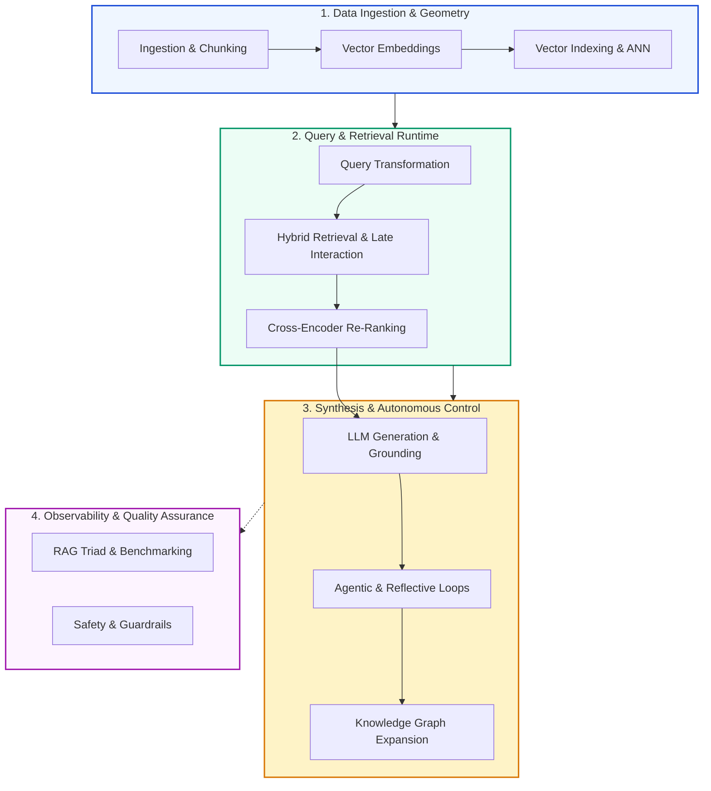
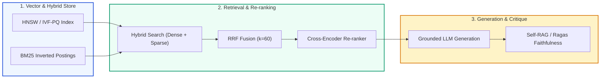

# 📖 The Comprehensive Enterprise RAG Glossary: 100+ Essential Terms & Concepts Defined

## 📑 Table of Contents
1. [🌟 Architectural Concept Ontology & Taxonomy](#1--architectural-concept-ontology--taxonomy)
2. [🔬 Mathematical Formulations of Core RAG Metrics & Operators](#2--mathematical-formulations-of-core-rag-metrics--operators)
3. [📚 Foundational Information Retrieval (IR) & Search](#3--foundational-information-retrieval-ir--search)
4. [🧬 Embeddings & Vector Representations](#4--embeddings--vector-representations)
5. [🗄️ Vector Databases, Indexing & ANN Algorithms](#5-️-vector-databases-indexing--ann-algorithms)
6. [📄 Document Processing, Chunking & Ingestion](#6--document-processing-chunking--ingestion)
7. [🔍 Query Transformation & Advanced Retrieval Strategies](#7--query-transformation--advanced-retrieval-strategies)
8. [🎛️ Re-Ranking & Context Management](#8-️-re-ranking--context-management)
9. [🤖 Generation, Memory & LLM Mechanics](#9--generation-memory--llm-mechanics)
10. [🕸️ Graph & Hierarchical Knowledge Architectures](#10-️-graph--hierarchical-knowledge-architectures)
11. [🔄 Agentic, Dynamic & Self-Reflective RAG](#11--agentic-dynamic--self-reflective-rag)
12. [🛡️ Evaluation, Observability & Safety Guardrails](#12-️-evaluation-observability--safety-guardrails)
13. [📊 Master Trade-Off Comparison Matrices](#13--master-trade-off-comparison-matrices)
14. [💼 Senior System Design & Terminology Interview Scenarios](#14--senior-system-design--terminology-interview-scenarios)
15. [🧪 Hands-On Mini-Project: Interactive RAG Concept & Metric Evaluator Engine](#15--hands-on-mini-project-interactive-rag-concept--metric-evaluator-engine)
16. [⚡ Quick Revision & 100-Term Essential Index](#16--quick-revision--100-term-essential-index)

---

## 1. 🌟 Architectural Concept Ontology & Taxonomy

Enterprise Retrieval-Augmented Generation (RAG) is not a single library or tool—it is an end-to-end discipline synthesizing **Information Retrieval (IR)**, **High-Dimensional Geometry**, **Distributed Systems**, and **Natural Language Generation (NLG)**.

To navigate this vocabulary, terms are structured across eight operational sub-domains:



---

## 2. 🔬 Mathematical Formulations of Core RAG Metrics & Operators

Precise definitions in enterprise RAG rely on underlying linear algebra and ranking mathematics.

### # Cosine Similarity Formula
Measures the directional alignment of two non-zero vectors $\mathbf{u}, \mathbf{v} \in \mathbb{R}^d$ independently of magnitude:
$$
\text{Cosine Similarity}(\mathbf{u}, \mathbf{v}) = \frac{\mathbf{u} \cdot \mathbf{v}}{\|\mathbf{u}\|_2 \|\mathbf{v}\|_2} = \frac{\sum_{i=1}^d u_i v_i}{\sqrt{\sum_{i=1}^d u_i^2} \sqrt{\sum_{i=1}^d v_i^2}}
$$

---

### # Normalized Discounted Cumulative Gain (NDCG@K)
Evaluates ranking quality accounting for graded relevance and position discounts up to position $K$:
$$
\text{DCG}@K = \sum_{i=1}^K \frac{2^{\text{rel}_i} - 1}{\log_2(i + 1)}, \quad \text{NDCG}@K = \frac{\text{DCG}@K}{\text{IDCG}@K}
$$
Where $\text{IDCG}@K$ is the Ideal DCG score achieved by an optimal monotonically descending relevance ordering.

---

### # Mean Reciprocal Rank (MRR)
Measures the speed at which a retrieval system surfaces the first relevant passage across a set of queries $\mathcal{Q}$:
$$
\text{MRR} = \frac{1}{|\mathcal{Q}|} \sum_{q \in \mathcal{Q}} \frac{1}{\text{rank}_q}
$$
Where $\text{rank}_q$ is the position of the first acceptable relevant document retrieved for query $q$.

---

### # Ragas Faithfulness Metric Formulation
Quantifies answer grounding against retrieved context by computing the ratio of context-deducible claims to total generated claims:
$$
\text{Faithfulness} = \frac{|\{c \in \mathcal{C}_{\text{answer}} \mid \text{Context} \models c\}|}{|\mathcal{C}_{\text{answer}}|}
$$
Where $\mathcal{C}_{\text{answer}}$ is the set of atomic factual statements extracted from the generation, and $\models$ denotes entailment.

---

## 3. 📚 Foundational Information Retrieval (IR) & Search

1. **BM25 (Best Matching 25):** A probabilistic sparse lexical retrieval algorithm scoring document relevance based on term frequency (TF) with saturation limits and inverse document frequency (IDF) with document length normalization.
2. **Term Frequency (TF):** The raw or sub-linearly scaled count of how often a search token appears in a candidate document.
3. **Inverse Document Frequency (IDF):** A logarithmic penalization weighting that downweights common words across an entire corpus, highlighting discriminative terms.
4. **Vocabulary Mismatch Problem:** The fundamental failure of lexical search occurring when queries and documents convey identical concepts using distinct words (e.g., *"myocardial infarction"* vs. *"heart attack"*).
5. **Inverted Index:** A core IR data structure mapping individual terms or n-grams to posting lists of document IDs containing those terms, enabling rapid boolean and frequency lookups.
6. **Precision@K:** The proportion of retrieved documents in the top-$K$ list that are relevant to the query.
7. **Recall@K:** The proportion of all existing relevant documents across the entire corpus that appear within the retrieved top-$K$ list.
8. **Dense Retrieval:** A search paradigm projecting queries and documents into continuous low-dimensional vector spaces ($\mathbb{R}^d$, where $d \in [256, 3072]$) via neural networks, scoring relevance via inner products.
9. **Sparse Retrieval:** A search paradigm representing text as high-dimensional, highly sparse vectors ($d \approx 30,000+$) aligned with lexical vocabularies, where non-zero weights represent term importance.
10. **Bi-Encoder:** An architecture utilizing two separate transformer encoders (or one shared encoder) to independently project queries and documents into a shared metric vector space.

---

## 4. 🧬 Embeddings & Vector Representations

11. **Vector Embedding:** A continuous, dense numerical array capturing latent semantic, syntactic, and conceptual properties of textual or multimodal input.
12. **Cross-Encoder:** A transformer model taking concatenated query-document pairs $([CLS] \circ Q \circ [SEP] \circ D)$ and applying full cross-attention across all token combinations to produce an absolute relevance score.
13. **Late Interaction (ColBERT):** A token-level retrieval architecture that independently encodes query and document tokens, then computes relevance via a fast sum of maximum cosine similarities (MaxSim operator).
14. **Matryoshka Representation Learning (MRL):** A training methodology forcing neural embeddings to pack the most significant semantic variance into early vector dimensions (e.g., first 256 or 512 of 1536), allowing index truncation without severe recall loss.
15. **Contextual Embeddings:** Vectors dynamically conditioned on surrounding text, ensuring identical polysemous words (e.g., *"bank"* of a river vs. commercial *"bank"*) produce different coordinate representations.
16. **Learned Sparsity (SPLADE):** A sparse retrieval technique where a neural model expands document text to include latent related terms directly into vocabulary logits, overcoming lexical mismatch while retaining inverted index speeds.
17. **L2 Normalization:** Scaling a vector such that its Euclidean norm $\|\mathbf{v}\|_2 = 1.0$, rendering dot products mathematically identical to cosine similarity: $\mathbf{u} \cdot \mathbf{v} = \cos(\theta)$.
18. **Dimensionality Reduction:** Compressing high-dimensional vector representations into smaller dimensionalities via PCA, UMAP, or t-SNE while preserving topological cluster distances.
19. **Anisotropic Embeddings:** A common geometric degeneracy in neural language models where vector embeddings cluster inside a narrow high-dimensional cone, artificially inflating cosine similarities.
20. **Isotropy Calibration:** Geometric whitening or centering techniques applied to embeddings to restore uniform spherical variance across all dimensions.

---

## 5. 🗄️ Vector Databases, Indexing & ANN Algorithms

21. **Approximate Nearest Neighbor (ANN):** Algorithmic heuristics that trade small amounts of retrieval recall for orders-of-magnitude faster sub-linear ($O(\log N)$ or $O(1)$) search latency.
22. **Hierarchical Navigable Small World (HNSW):** A multi-layer geometric graph indexing algorithm where top layers have long-range skip links and bottom layers contain dense local nearest-neighbor graphs.
23. **Inverted File Index (IVF):** An ANN partitioning technique dividing vector space into Voronoi cells via $k$-means; queries search only the centroids closest to their query vector (`nprobe`).
24. **Product Quantization (PQ):** A lossy vector compression technique dividing a $d$-dimensional vector into $m$ orthogonal sub-vectors, quantizing each sub-vector to a learned codebook centroid.
25. **Scalar Quantization (SQ):** Quantizing floating-point vector coordinates from 32-bit floats (`FP32`) to 8-bit integers (`INT8`), reducing RAM footprint by $75\%$ with negligible loss in cosine ranking.
26. **Euclidean Distance ($L_2$):** A spatial distance metric measuring the straight-line coordinate difference between vectors: $\|\mathbf{u} - \mathbf{v}\|_2 = \sqrt{\sum (u_i - v_i)^2}$.
27. **Inner Product / Dot Product ($IP$):** An unnormalized metric measuring both magnitude and directional alignment: $\sum u_i v_i$.
28. **Metadata Filtering (Pre-filtering):** Evaluating relational database predicates (e.g., `tenant_id == 'finance'`) prior to executing ANN vector search.
29. **Metadata Filtering (Post-filtering):** Fetching top-$K$ vectors via ANN search first, then discarding candidates that violate relational metadata predicates (risking low result counts).
30. **Single-Stage Hybrid Indexing:** Database architectures capable of storing inverted lexical indexes, dense vector graphs, and relational column stores within an atomic storage engine (e.g., Qdrant, Milvus, PostgreSQL pgvector).

---

## 6. 📄 Document Processing, Chunking & Ingestion

31. **Chunking:** The systematic decomposition of long documents into smaller, cohesive passages suitable for embedding context limits and downstream LLM windows.
32. **Fixed-Size Chunking:** Dividing text into arbitrary token or character blocks with uniform length and a fixed percentage of overlap.
33. **Recursive Character Chunking:** Dividing text hierarchically using natural linguistic delimiters (`\n\n`, `\n`, `.`, ` `, `""`) until chunk sizes fall below target token thresholds.
34. **Semantic Chunking:** Splitting text dynamically by embedding sequential sentences and inserting boundaries whenever the cosine similarity between consecutive sentences drops below a variance threshold.
35. **Sliding Window Chunking:** Stepping a window of fixed token width $W$ across text with stride $S$ (where overlap = $W - S$), preserving cross-boundary continuity.
36. **Parent-Document Retrieval (Small-to-Big):** Indexing small, highly focused child chunks for precise vector matching, but retrieving and passing their broader parent section to the LLM for synthesis.
37. **Contextual Retrieval (Anthropic):** Prepending 50–100 tokens of document-level contextual summary to every individual chunk prior to embedding and indexing.
38. **Optical Character Recognition (OCR):** Machine vision systems (Tesseract, PaddleOCR) converting rasterized scanned images and PDFs into digital text characters.
39. **Layout-Aware Document Parsing:** Vision-based parsers (Docling, LayoutLM) that detect multi-column reading orders, headings, headers, footers, and callouts.
40. **Table Extraction (Markdown/HTML):** Specialized ingestion pipelines that parse semi-structured tabular cells into structured row-column strings to preserve horizontal and vertical relationships.

---

## 7. 🔍 Query Transformation & Advanced Retrieval Strategies

41. **Query Rewriting:** Using an LLM to rephrase colloquial, ambiguous, or conversational queries into explicit, keyword-rich search formulations.
42. **Multi-Query Expansion:** Generating 3–5 distinct variations or perspectives of a single user question to improve search surface area across multiple retrievers.
43. **Hypothetical Document Embeddings (HyDE):** Prompting an LLM to generate a synthetic hypothetical answer to a query, then using that synthetic text's vector to retrieve authentic documents.
44. **Step-Back Prompting:** Prompting an LLM to derive an overarching high-level abstraction or foundational concept from a specific query to fetch broader background principles.
45. **Sub-Question Decomposition:** Breaking complex, compound multi-part questions into discrete sub-queries executed independently against specialized indexes.
46. **Reciprocal Rank Fusion (RRF):** A non-parametric rank aggregation method summing the reciprocal ranks of documents across multiple heterogeneous search runs.
47. **Hybrid Search:** Combining dense semantic vector retrieval (k-NN) and sparse lexical retrieval (BM25) to achieve both conceptual depth and exact keyword precision.
48. **Dense-Sparse Fusion:** Combining vector similarity and lexical scores via linear weighted interpolation: $\text{Score} = \alpha \cdot S_{\text{dense}} + (1 - \alpha) \cdot S_{\text{sparse}}$.
49. **Auto-Routing (Query Routing):** Using classification LLMs or lightweight embeddings to route incoming queries to the most appropriate database, index, or API.
50. **Temporal Filtering:** Constraining retrieval using timestamp metadata to prevent outdated information from contaminating time-sensitive answers.

---

## 8. 🎛️ Re-Ranking & Context Management

51. **Re-Ranking (Second-Stage Retrieval):** Passing top-$K$ candidate documents ($K \in [50, 100]$) retrieved by fast bi-encoders through a slower, high-precision cross-encoder to refine ranking down to top-$N$ ($N \in [3, 10]$).
52. **Lost in the Middle Effect:** The documented empirical tendency of autoregressive transformers to attend preferentially to the start and end of prompt contexts while ignoring middle content.
53. **Context Compression (LLMLingua):** Algorithmic pruning of low-perplexity tokens, stopwords, and filler phrases to compress context length while retaining core semantic content.
54. **Context Stuffing:** Naively dumping dozens of retrieved chunks into the prompt context, resulting in attention dilution, high latency, and increased hallucination.
55. **Maximal Marginal Relevance (MMR):** An iterative ranking algorithm that maximizes relevance to the query while penalizing redundancy against previously selected passages:
$$
\text{MMR} = \arg\max_{d_i \in R \setminus S} \left[ \lambda \cdot \text{sim}(d_i, q) - (1 - \lambda) \max_{d_j \in S} \text{sim}(d_i, d_j) \right]
$$
56. **Needle-in-a-Haystack (NIAH):** A diagnostic evaluation benchmark testing an LLM's capacity to locate a specific, isolated factual sentence inserted at arbitrary depths inside a long context.
57. **Attention Sinks:** The discovery that initial prompt tokens retain disproportionately high attention score mass regardless of semantic meaning, serving as numerical anchors for attention distributions.
58. **Cross-Encoder Scoring:** Generating raw unbounded logit relevance scores measuring mutual semantic entailment between queries and documents.
59. **Deduplication:** Removing identical or near-duplicate retrieved passages using Locality-Sensitive Hashing (LSH) or pairwise cosine similarity thresholds ($> 0.95$).
60. **Chunk Interleaving:** Strategic layout arrangement where the highest-scoring chunks are positioned alternately at the beginning and end of the LLM context prompt to combat positional bias.

---

## 9. 🤖 Generation, Memory & LLM Mechanics

61. **Parametric Memory:** Knowledge baked directly into the neural network's frozen weights during pre-training and fine-tuning.
62. **Non-Parametric Memory:** External factual knowledge stored in databases, vector indexes, or documents, dynamically fetched and presented in the context window.
63. **Grounding:** Constraining LLM generation to rely strictly on verifiable facts present within provided context documents.
64. **Extrinsic Hallucination:** Generated statements that cannot be confirmed or verified from either the provided context or general world knowledge.
65. **Intrinsic Hallucination:** Generated statements that directly contradict or misrepresent the facts provided in the reference retrieval context.
66. **In-Context Learning (ICL):** The capability of transformers to adapt generation behavior based on examples, instructions, and context supplied at inference time without gradient updates.
67. **Citation Generation:** Instructing or fine-tuning models to append bracketed document identifiers (e.g., `[Doc-3]`) to assertions made in the synthesized text.
68. **Chain-of-Thought (CoT):** Directing the LLM to generate intermediate reasoning steps before emitting a final answer, improving multi-hop deduction.
69. **Speculative Decoding / Speculative RAG:** Using a small, fast model to generate draft responses based on retrieved subsets, verified in parallel by a larger evaluator model.
70. **Structured Outputs (Constrained Decoding):** Forcing LLMs to conform strictly to JSON schemas or Pydantic models via Context-Free Grammar (CFG) logit masking during generation.

---

## 10. 🕸️ Graph & Hierarchical Knowledge Architectures

71. **Knowledge Graph (KG):** A structured network representation of real-world knowledge consisting of nodes (entities) connected by directed edges (relations).
72. **Subject-Predicate-Object (SPO) Triplet:** The atomic unit of a knowledge graph (e.g., `(Insulin, regulates, Blood Glucose)`).
73. **Entity Extraction (NER):** Natural Language Processing techniques identifying real-world entities (persons, drugs, companies) within raw text.
74. **Entity Resolution (Disambiguation):** Reconciling multiple distinct text strings referring to the same underlying entity (e.g., *"Alphabet Inc."* and *"Google"*).
75. **GraphRAG (Microsoft):** A framework using LLMs to extract entity-relationship graphs, apply hierarchical community clustering, and generate multi-level community summaries for global queries.
76. **Leiden Algorithm:** A hierarchical graph community detection algorithm that guarantees well-connected communities, optimizing modularity without leaving disconnected components.
77. **RAPTOR (Recursive Abstractive Processing for Tree-Organized Retrieval):** Recursively clustering text chunks using GMMs and generating abstractive summaries to build a hierarchical retrieval tree.
78. **HippoRAG:** An associative memory architecture using Personalized PageRank (PPR) over knowledge graphs to simulate hippocampal pattern completion.
79. **Graph Traversal Retrieval:** Fetching multi-hop connected entities by traversing relational edges across $N$ degrees of separation from seed query nodes.
80. **Hybrid Vector-Graph RAG:** Querying both vector indexes for semantic similarity and knowledge graphs for structured entity links, merging results for synthesis.

---

## 11. 🔄 Agentic, Dynamic & Self-Reflective RAG

81. **Agentic RAG:** Systems where an autonomous LLM acts as an agent, deciding when to retrieve, what tools to invoke, how to evaluate retrieved evidence, and when to terminate.
82. **Corrective RAG (CRAG):** A framework utilizing a lightweight retrieval evaluator to score retrieved documents; if confidence is low, it discards them and executes an automated web search.
83. **Self-RAG:** An architecture where the generator outputs explicit reflection tokens (`[Retrieve]`, `[IsRel]`, `[IsSup]`, `[IsUse]`) to steer dynamic retrieval and verify factual support.
84. **FLARE (Forward-Looking Active REtrieval):** Continuously monitoring token generation confidence; when confidence falls below a threshold, the provisional sentence is used as a query for dynamic retrieval.
85. **ReAct Paradigm:** An agent pattern alternating between **Reasoning** (thoughts) and **Acting** (tool invocations, database searches), observing environmental output before proceeding.
86. **Plan-and-Solve:** An agentic strategy where the LLM first creates an execution plan breaking a problem into discrete steps, then executes each step sequentially.
87. **Routing Agent:** A fast classifier agent determining whether a query requires vector search, SQL databases, public search engines, or direct parametric answering.
88. **Tool Calling (Function Calling):** The ability of an LLM to emit structured arguments to invoke predefined functions (calculators, search APIs, SQL clients).
89. **Self-Correction (Critique Loop):** An iterative process where an LLM reviews its draft answer against source documents, identifying factual errors and rewriting itself.
90. **Multi-Agent RAG Swarm:** Multiple specialized agents (e.g., Retriever Agent, Fact-Checker Agent, Writer Agent) collaborating via shared memory to solve complex retrieval tasks.

---

## 12. 🛡️ Evaluation, Observability & Safety Guardrails

91. **The RAG Triad:** A foundational evaluation framework assessing three core axes: **Context Relevance**, **Faithfulness (Grounding)**, and **Answer Relevance**.
92. **Context Relevance:** Measuring whether retrieved passages contain only relevant information required to answer the query, without extraneous noise.
93. **Answer Relevance:** Measuring whether the final generated response directly and completely answers the user's initial question.
94. **Context Recall:** Measuring whether the retrieved context contains all ground-truth facts necessary to formulate the ideal reference answer.
95. **LLM-as-a-Judge:** Using a strong foundation LLM (e.g., GPT-4o, Claude 3.5 Sonnet) prompted with strict rubrics to score retrieval and generation outputs automatically.
96. **Ragas:** An industry-standard evaluation framework providing automated reference-free and reference-based metrics for RAG pipelines.
97. **TruLens:** An open-source instrumentation and evaluation library designed to track and visualize the RAG Triad across multi-step execution traces.
98. **Semantic Caching:** Storing previous query-response pairs in a vector database; new queries exceeding a cosine similarity threshold (e.g., $> 0.96$) receive cached answers immediately, reducing cost and latency.
99. **NeMo Guardrails:** An open-source framework by NVIDIA enforcing conversational guardrails, topic boundaries, and safety policies on LLM inputs and outputs.
100. **Prompt Injection / Data Poisoning:** An adversarial attack where malicious text embedded in retrieved documents overrides system prompts to hijack model behavior.
101. **Air-Gapped RAG:** An enterprise deployment topology running fully isolated from external internet access using local LLMs (e.g., via Ollama/vLLM) and on-premise vector stores.

---

## 13. 📊 Master Trade-Off Comparison Matrices

### 13.1 Retrieval Paradigms Comparison

| Metric / Feature | 🔡 Sparse Lexical (BM25) | 🧬 Dense Vector (Bi-Encoder) | ⚡ Late Interaction (ColBERT) | 🕸️ Knowledge Graph (GraphRAG) |
| :--- | :--- | :--- | :--- | :--- |
| **Search Mechanism** | Inverted term postings | Inner product in $\mathbb{R}^d$ | MaxSim across token matrices | Relational graph traversal & communities |
| **Latency** | **$< 5\text{ms}$** | $10 - 25\text{ms}$ | $20 - 50\text{ms}$ | $100 - 1500\text{ms}$ |
| **Memory Footprint** | Low (Text postings) | Medium ($4-8\text{ bytes/dim}$) | High ($150\times$ token vectors) | High (Graph triples + node indexes) |
| **Out-of-Domain Vocabulary** | **Excellent (Exact matches)** | Poor (Embedding shift) | Strong (Token-level matching) | Moderate |
| **Conceptual Abstraction** | Poor (Fails synonymy) | **Excellent** | **Excellent** | **Superior (Relational semantics)** |
| **Global Corpus Summaries** | Impossible | Poor | Poor | **Native & Comprehensive** |
| **Setup & Indexing Cost** | Ultra-Low | Low to Moderate | Moderate | High (Extensive LLM extractions) |

---

### 13.2 Chunking Strategies Evaluation Matrix

| Chunking Strategy | Boundary Detection | Semantic Cohesion | Computational Cost | Best Suited For |
| :--- | :--- | :--- | :--- | :--- |
| **Fixed-Size (Overlap)** | Arbitrary token count | Low (Splits sentences) | **Zero (Fastest)** | Raw text benchmarks, quick prototypes |
| **Recursive Character** | Hierarchical separators | Medium-High | Low | General documentation, markdown, articles |
| **Semantic Chunking** | Consecutive cosine drops | **High** | High (Embeds every sentence)| Dense academic literature, legal contracts |
| **Parent-Child (Small-to-Big)**| Hierarchical split | **Very High** | Moderate | Complex enterprise manuals, manuals with footnotes |
| **Contextual Retrieval** | LLM prepends context | **Superior** | High (LLM pass per chunk) | High-value SEC filings, financial reports |

---

## 14. 💼 Senior System Design & Terminology Interview Scenarios

### Scenario 1: "Explain how you would architect a Hybrid Retrieval pipeline with Reciprocal Rank Fusion (RRF), and why RRF is preferred over raw score normalization."
**Answer:**
A production hybrid retrieval system executes two searches concurrently:
1. A **Sparse Lexical Search** (e.g., BM25 via Elasticsearch or OpenSearch) returning top-$K$ candidates based on exact term matches, acronyms, and product IDs.
2. A **Dense Semantic Search** (e.g., HNSW cosine search via Qdrant or Milvus) returning top-$K$ candidates based on semantic concept alignment.

**The Normalization Problem:** BM25 scores are unbounded ($[0, \infty)$), depending heavily on document lengths and corpus size, whereas dense vector cosine scores are bounded ($[-1, 1]$ or $[0, 1]$). Linearly combining them via $\alpha \cdot S_{\text{dense}} + (1 - \alpha) \cdot S_{\text{sparse}}$ requires delicate min-max calibration that breaks whenever new documents enter the corpus.

**The RRF Solution:** Reciprocal Rank Fusion discards arbitrary raw scores entirely and operates purely on **ordinal ranking positions**:
$$
\text{RRF\_Score}(d) = \frac{1}{k + r_{\text{dense}}(d)} + \frac{1}{k + r_{\text{sparse}}(d)}
$$
Setting $k=60$ dampens the influence of top outliers. RRF is scale-invariant, robust to score distribution shifts, requires zero hyperparameter retraining, and consistently outperforms linear weighting in real-world benchmark evaluations.

---

### Scenario 2: "What is the difference between Contextual Retrieval and Parent-Document Retrieval, and when would you choose one over the other?"
**Answer:**
- **Parent-Document Retrieval (Small-to-Big):** Operates on a two-tier structural split. It indexes small child chunks (e.g., 100 tokens) in the vector database to optimize vector search precision (preventing the chunk vector from being averaged out), but maintains a reference to a larger parent chunk (e.g., 800 tokens). Upon retrieval, the parent chunk is delivered to the LLM context window.
- **Contextual Retrieval (Anthropic):** Keeps standard chunk sizes (e.g., 300 tokens) but passes each chunk through a fast LLM during ingestion, prompting it to generate a 50–100 token situational prefix explaining the chunk's relationship to the broader document (e.g., *"This chunk discusses Q3 2024 revenue for Apple's Services division..."*). This contextual summary is prepended to the chunk before both vector embedding and BM25 indexing.

**Selection Decision:**
- Choose **Parent-Document Retrieval** when documents have a natural hierarchical structure (e.g., legal statutes with sub-clauses) and when ingestion cost must remain low, as it requires zero LLM calls during indexing.
- Choose **Contextual Retrieval** when chunks are frequently decontextualized (e.g., dense financial tables, balance sheets, transcripts where pronouns like *"it"* or *"the company"* dominate) and the organization can afford an offline LLM ingestion pass.

---

## 15. 🧪 Hands-On Mini-Project: Interactive RAG Concept & Metric Evaluator Engine

This self-contained Python program implements a searchable RAG glossary index, computes RRF and Faithfulness metrics mathematically, and provides interactive concept search.

```python
"""
Hands-On Mini-Project: Interactive RAG Concept & Metric Evaluator Engine
Implements glossary retrieval, mathematical RRF fusion, and faithfulness scoring.
"""

from dataclasses import dataclass
from typing import List, Dict, Set
import math

@dataclass
class TermDefinition:
    term: str
    category: str
    definition: str
    key_formula: str = "N/A"

class RAGGlossaryEngine:
    def __init__(self):
        self.glossary: Dict[str, TermDefinition] = {}

    def register_term(self, term: str, category: str, definition: str, formula: str = "N/A") -> None:
        self.glossary[term.lower()] = TermDefinition(term, category, definition, formula)

    def search_term(self, query: str) -> List[TermDefinition]:
        """Fuzzy keyword matching over term and definition."""
        q = query.lower()
        results = []
        for key, item in self.glossary.items():
            if q in key or q in item.definition.lower():
                results.append(item)
        return results

    @staticmethod
    def compute_rrf(dense_ranks: List[str], sparse_ranks: List[str], k: int = 60) -> Dict[str, float]:
        """Computes Reciprocal Rank Fusion score for documents from two ranked lists."""
        rrf_scores: Dict[str, float] = {}

        for rank, doc in enumerate(dense_ranks, start=1):
            rrf_scores[doc] = rrf_scores.get(doc, 0.0) + (1.0 / (k + rank))

        for rank, doc in enumerate(sparse_ranks, start=1):
            rrf_scores[doc] = rrf_scores.get(doc, 0.0) + (1.0 / (k + rank))

        return dict(sorted(rrf_scores.items(), key=lambda x: x[1], reverse=True))

    @staticmethod
    def compute_faithfulness(claims: List[str], verified_claims: Set[str]) -> float:
        """Computes mathematical faithfulness ratio."""
        if not claims:
            return 0.0
        supported_count = sum(1 for c in claims if c in verified_claims)
        return supported_count / len(claims)

# Verification & Test Run
if __name__ == "__main__":
    engine = RAGGlossaryEngine()

    # 1. Register foundational glossary terms
    engine.register_term(
        term="HNSW",
        category="Vector Indexing",
        definition="Hierarchical Navigable Small World geometric graph providing sub-linear ANN search.",
        formula="Search Complexity: O(log N)"
    )
    engine.register_term(
        term="RRF",
        category="Retrieval Strategy",
        definition="Reciprocal Rank Fusion merges ranked lists without requiring score calibration.",
        formula="Score(d) = sum(1 / (k + r_m(d)))"
    )
    engine.register_term(
        term="Faithfulness",
        category="Evaluation",
        definition="Ratio of claims in the generated response that are directly entailed by retrieved context.",
        formula="|Supported Claims| / |Total Claims|"
    )

    # 2. Test Glossary Lookup
    query = "graph"
    print(f"=== Glossary Search for: '{query}' ===")
    matches = engine.search_term(query)
    for m in matches:
        print(f"• [{m.category}] {m.term}: {m.definition} (Formula: {m.key_formula})")

    # 3. Test RRF Rank Aggregation
    print("\n=== Reciprocal Rank Fusion (RRF) Calculation ===")
    dense_results = ["doc_3", "doc_1", "doc_7", "doc_2"]
    sparse_results = ["doc_1", "doc_4", "doc_3", "doc_8"]
    
    fused_scores = engine.compute_rrf(dense_results, sparse_results, k=60)
    for doc_id, score in fused_scores.items():
        print(f"Ranked Candidate: {doc_id} -> RRF Score: {score:.6f}")

    # 4. Test Faithfulness Evaluation
    print("\n=== Faithfulness Metric Scoring ===")
    extracted_claims = [
        "Revenue increased by 14% in Q3",
        "Operating margins reached 28%",
        "The company acquired a quantum startup in Paris"
    ]
    context_supported_claims = {
        "Revenue increased by 14% in Q3",
        "Operating margins reached 28%"
    }
    faithfulness_score = engine.compute_faithfulness(extracted_claims, context_supported_claims)
    print(f"Total Claims: {len(extracted_claims)}")
    print(f"Supported Claims: {len(context_supported_claims)}")
    print(f"Calculated Faithfulness: {faithfulness_score * 100:.1f}%")
```

---

## 16. ⚡ Quick Revision & 100-Term Essential Index

### 🔑 Essential Key Takeaways
- **Sparse vs. Dense:** BM25 guarantees keyword and exact serial number precision; dense bi-encoders provide semantic and conceptual matching; hybrid search combines both.
- **Bi-Encoder vs. Cross-Encoder:** Bi-encoders are fast ($O(1)$ lookup via ANN) for candidate retrieval; cross-encoders are computationally heavy ($O(N)$ transformer passes) but deliver superior ranking accuracy as second-stage re-rankers.
- **RRF:** The gold standard for merging dense and sparse ranking lists; immune to raw score scaling differences.
- **RAG Triad:** Evaluate systems across **Context Relevance** (retrieval precision), **Faithfulness** (no hallucinations), and **Answer Relevance** (satisfies user intent).
- **Modern Paradigms:** High-performance systems employ **Contextual Retrieval** to enrich chunks, **GraphRAG** for global thematic queries, and **Agentic Self-Correction** for iterative query refinement.

### 🗺️ Visual Architecture Taxonomy

