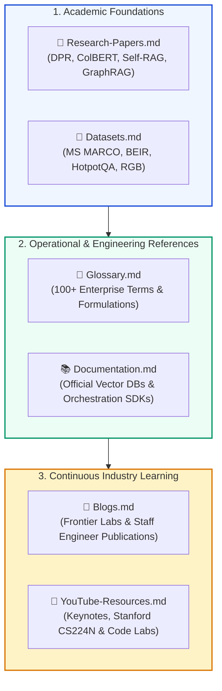
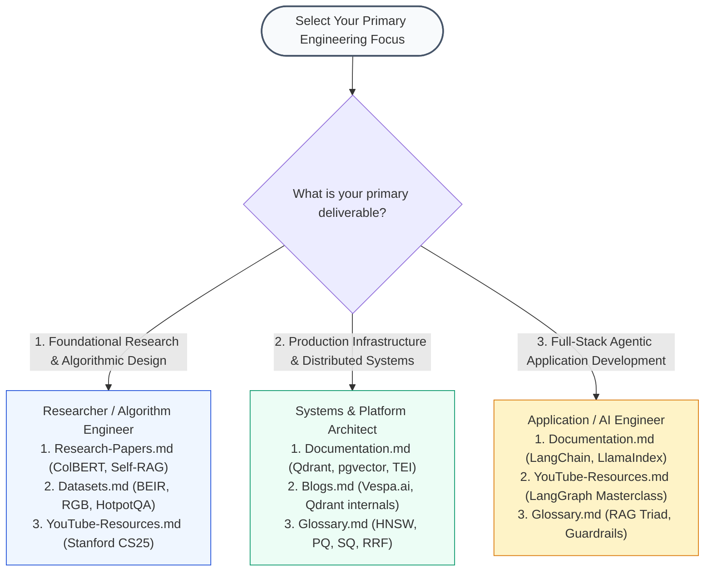
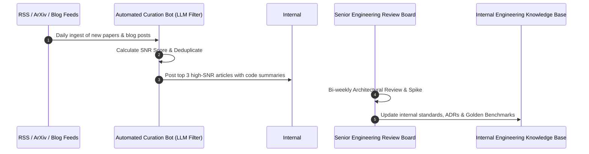

# 📚 Module 12: Curated Resources, Datasets, and Engineering References Directory

## 📑 Table of Contents
1. [🌟 Executive Summary & Module 12 Architectural Scope](#1--executive-summary--module-12-architectural-scope)
2. [🔬 Mathematical Formulations for Resource Quality & Knowledge Density](#2--mathematical-formulations-for-resource-quality--knowledge-density)
3. [🗺️ Master Module 12 Component Directory & Navigation Index](#3-️-master-module-12-component-directory--navigation-index)
4. [🎯 Learning Archetypes & Tailored Study Pathways](#4--learning-archetypes--tailored-study-pathways)
5. [📊 Resource Category Synthesis & Trade-Off Matrix](#5--resource-category-synthesis--trade-off-matrix)
6. [🏗️ End-to-End Enterprise Knowledge Ingestion Architecture](#6-️-end-to-end-enterprise-knowledge-ingestion-architecture)
7. [💼 Senior System Design & Knowledge Curation Interview Scenarios](#7--senior-system-design--knowledge-curation-interview-scenarios)
8. [🧪 Hands-On Mini-Project: Master Local RAG Knowledge Base & Reference Search Engine](#8--hands-on-mini-project-master-local-rag-knowledge-base--reference-search-engine)
9. [⚡ Quick Revision & Module 12 Mastery Roadmap](#9--quick-revision--module-12-mastery-roadmap)

---

## 1. 🌟 Executive Summary & Module 12 Architectural Scope

Building enterprise-grade Retrieval-Augmented Generation (RAG) systems requires more than knowing library syntax—it demands deep grounding in academic research, empirical benchmarks, precise terminology, and authoritative engineering documentation.

**Module 12: Resources** serves as the capstone reference library of the **RAG-Engineering** curriculum. It consolidates foundational academic breakthroughs, operational glossaries, evaluation benchmarks, engineering blogs, visual courses, and official SDK portals into a unified, cross-referenced directory.



---

## 2. 🔬 Mathematical Formulations for Resource Quality & Knowledge Density

### # Composite Resource Authority Score
To prevent engineering teams from chasing hype or outdated guides, external technical resources can be ranked using a multi-factor authority formulation:
$$
\text{Score}_{\text{resource}} = w_1 \cdot \text{Rep}(\text{Source}) + w_2 \cdot \text{Emp}(\text{Code}) + w_3 \cdot \text{Math}(\text{Rigor}) - w_4 \cdot \text{Age}(\Delta t)
$$
Where:
- $\text{Rep}(\text{Source}) \in [0, 1]$ represents peer-reviewed or first-party creator provenance.
- $\text{Emp}(\text{Code}) \in [0, 1]$ measures the presence of verifiable, reproducible source code.
- $\text{Math}(\text{Rigor}) \in [0, 1]$ measures formal proofs, loss formulations, or empirical statistical metrics.
- $\text{Age}(\Delta t)$ applies exponential discounting over time $\Delta t$ in months: $e^{-\lambda \Delta t}$.

---

### # Return on Engineering Learning Time (ROET)
For an engineering organization allocating study and research hours $H$, the effective return is measured by the reduction in production incident probability $P(\text{fail})$ and optimization of query latency $L$:
$$
\text{ROET} = \frac{\Delta P(\text{fail}) \cdot C_{\text{incident}} + \Delta L \cdot C_{\text{compute}}}{H}
$$

---

## 3. 🗺️ Master Module 12 Component Directory & Navigation Index

The files in this directory are structured to cover distinct aspects of the RAG engineering lifecycle:

| File Name | Canonical Topic Title | Primary Architectural Purpose |
| :--- | :--- | :--- |
| [Research-Papers.md](file:///e:/RAG-Engineering/12-Resources/Research-Papers.md) | **Foundational & Milestone RAG Research Papers** | Annotated reading list from 2020 to 2026 covering DPR, ColBERT, Self-RAG, RAPTOR, and GraphRAG. |
| [Glossary.md](file:///e:/RAG-Engineering/12-Resources/Glossary.md) | **The Comprehensive Enterprise RAG Glossary** | 100+ rigorous definitions spanning IR, vector geometry, indexing, query optimization, and evaluation metrics. |
| [Datasets.md](file:///e:/RAG-Engineering/12-Resources/Datasets.md) | **Curated Evaluation Datasets & Golden Benchmarks** | Benchmark corpora (MS MARCO, BEIR, HotpotQA, FinQA, RGB) for zero-shot testing, multi-hop QA, and noise rejection. |
| [Blogs.md](file:///e:/RAG-Engineering/12-Resources/Blogs.md) | **Authoritative Industry Engineering Blogs** | Curated index of frontier AI labs (Anthropic, OpenAI), vector DB internals (Qdrant), and staff engineer essays. |
| [YouTube-Resources.md](file:///e:/RAG-Engineering/12-Resources/YouTube-Resources.md) | **Curated Video Courses & Conference Keynotes** | Stanford CS224N lectures, Karpathy's transformer walkthroughs, Umar Jamil paper deep dives, and framework masterclasses. |
| [Documentation.md](file:///e:/RAG-Engineering/12-Resources/Documentation.md) | **Official Documentation Index** | Direct links and quick references for LangChain, LlamaIndex, Qdrant, Pinecone, pgvector, and cloud foundation model APIs. |

---

## 4. 🎯 Learning Archetypes & Tailored Study Pathways

Depending on your engineering role, prioritize your engagement across Module 12 components:



---

## 5. 📊 Resource Category Synthesis & Trade-Off Matrix

The matrix below contrasts the roles, refresh cadences, and failure modes across each resource category:

| Resource Category | Primary Target Metric | Update Frequency | Signal Lifetime | Primary Production Risk |
| :--- | :--- | :--- | :--- | :--- |
| **Research Papers** | Algorithmic Rigor & Proofs | High (Daily arXiv) | Long (3–7 Years) | Overfitting to academic benchmarks without production constraints |
| **Golden Datasets** | Empirical Generalization | Moderate (Annual) | Medium-Long (2–5 Years) | Data contamination in foundation model pre-training corpora |
| **Technical Glossaries** | Architectural Precision | Slow (Multi-Year) | Very Long (5–10 Years) | Lexical ambiguity across teams and stakeholder miscommunication |
| **Engineering Blogs** | Operational Best Practices | Weekly | Short-Medium (6–18 Months) | Commercial vendor bias and unreproducible marketing claims |
| **Video Masterclasses** | Intuition & Visual Systems | Monthly | Medium (1–3 Years) | Passive consumption without active coding reproduction |
| **Official Documentation**| API Contracts & Schemas | Continuous (Weekly) | Short (SDK Version Bound) | Deprecated methods, breaking changes, and migration failures |

---

## 6. 🏗️ End-to-End Enterprise Knowledge Ingestion Architecture

How can an enterprise keep its internal RAG developers continuously updated? Leading organizations implement a **Continuous Knowledge Ingestion Pipeline**:



---

## 7. 💼 Senior System Design & Knowledge Curation Interview Scenarios

### Scenario 1: "How do you systematically structure an enterprise knowledge repository to support both junior engineers learning RAG fundamentals and senior architects designing multi-cluster vector search?"
**Answer:**
A production-ready enterprise repository must implement a **Multi-Tiered Information Architecture**:
1. **Tier 1 — Foundational Onboarding (0–30 Days):**
   - Provide the **Glossary.md** and **YouTube-Resources.md** links (e.g., Karpathy's transformer breakdown and Stanford CS224N).
   - Require building an in-memory RAG pipeline with toy data to master tokenization, chunking, and bi-encoder cosine similarity.
2. **Tier 2 — Systems & Framework Mastery (30–90 Days):**
   - Direct engineers to **Documentation.md** and **11-Frameworks-and-Tools** (LangChain, LlamaIndex, Haystack).
   - Implement production patterns: asynchronous streaming, circuit-breaker fallbacks, and hybrid search with RRF.
3. **Tier 3 — Advanced Architectural Governance (Staff/Principal):**
   - Mandate tracking **Research-Papers.md** and **Datasets.md** (BEIR zero-shot evals, RGB noise robustness).
   - Require formal Architecture Decision Records (ADRs) with ablation benchmarks before introducing new indexing or graph algorithms.

---

### Scenario 2: "What is your approach to handling conflicting advice in authoritative industry resources (e.g., one blog advocating dense-only search, another advocating BM25-only, and another advocating GraphRAG)?"
**Answer:**
Conflicting advice in AI engineering stems from differing **data distribution characteristics** and **operational constraints**:
- **Root Cause Analysis:** Dense-only search advocates typically work with clean, conceptual natural language text (e.g., customer reviews or support FAQs). BM25 advocates typically operate over specialized catalogs with part numbers, serial codes, or medical nomenclatures. GraphRAG advocates operate over multi-document global synthesis tasks.
- **The Empirical Resolution Protocol:**
  1. Never adopt an opinion without running an internal ablation test.
  2. Take 200 real enterprise queries and evaluate them side-by-side using the **RAG Triad** (Context Precision, Faithfulness, Answer Relevance).
  3. Construct a Pareto frontier comparing **Hit Rate@K vs P95 Latency vs Cost per Query**.
  4. In $>90\%$ of enterprise scenarios, a balanced **Hybrid Search (Dense + BM25 with RRF)** provides the optimal Pareto trade-off.

---

## 8. 🧪 Hands-On Mini-Project: Master Local RAG Knowledge Base & Reference Search Engine

This self-contained Python script scans, parses, and indexes all markdown files inside this `12-Resources` directory, creating a local, searchable index that allows engineers to query across research papers, glossary definitions, and official docs.

```python
"""
Hands-On Mini-Project: Module 12 Local Reference Search Engine
Parses local Markdown files, builds an in-memory inverted index, and provides instant lookup.
"""

from dataclasses import dataclass
from typing import List, Dict, Tuple
import os
import re

@dataclass
class DocumentSection:
    filename: str
    section_title: str
    content: str

class LocalResourceSearcher:
    def __init__(self, directory_path: str):
        self.directory_path = directory_path
        self.sections: List[DocumentSection] = []
        self.index: Dict[str, List[int]] = {}

    def ingest_directory(self) -> None:
        """Parses markdown files in the target directory into structured sections."""
        if not os.path.exists(self.directory_path):
            return

        for filename in os.listdir(self.directory_path):
            if filename.endswith(".md") and filename != "README.md":
                filepath = os.path.join(self.directory_path, filename)
                with open(filepath, "r", encoding="utf-8", errors="ignore") as f:
                    text = f.read()
                
                # Split by markdown headers
                raw_sections = re.split(r'\n(?=##\s+)', text)
                for sec in raw_sections:
                    lines = sec.strip().split("\n")
                    if lines:
                        header = lines[0].replace("#", "").strip()
                        body = "\n".join(lines[1:])
                        self.sections.append(DocumentSection(filename, header, body))

        self._build_inverted_index()

    def _build_inverted_index(self) -> None:
        for idx, sec in enumerate(self.sections):
            tokens = set(re.findall(r'\b[a-zA-Z0-9_\-]{3,}\b', (sec.section_title + " " + sec.content).lower()))
            for t in tokens:
                if t not in self.index:
                    self.index[t] = []
                self.index[t].append(idx)

    def search(self, query: str, top_k: int = 3) -> List[Tuple[DocumentSection, int]]:
        query_tokens = re.findall(r'\b[a-zA-Z0-9_\-]{3,}\b', query.lower())
        match_counts: Dict[int, int] = {}

        for qt in query_tokens:
            if qt in self.index:
                for doc_idx in self.index[qt]:
                    match_counts[doc_idx] = match_counts.get(doc_idx, 0) + 1

        ranked = sorted(match_counts.items(), key=lambda x: x[1], reverse=True)
        return [(self.sections[idx], count) for idx, count in ranked[:top_k]]

# Verification & Test Execution
if __name__ == "__main__":
    current_dir = os.path.dirname(os.path.abspath(__file__)) if "__file__" in locals() else "."
    searcher = LocalResourceSearcher(current_dir)
    searcher.ingest_directory()

    print(f"Total Sections Indexed across Module 12: {len(searcher.sections)}")

    test_queries = ["ColBERT MaxSim", "BEIR benchmark", "Qdrant HNSW"]
    for q in test_queries:
        print(f"\n=== Search Results for: '{q}' ===")
        results = searcher.search(q, top_k=2)
        if not results:
            print("No matching sections found.")
        for sec, score in results:
            print(f"• [{sec.filename}] -> {sec.section_title} (Matches: {score})")
```

---

## 9. ⚡ Quick Revision & Module 12 Mastery Roadmap

### 🔑 Essential Key Takeaways
- **Research Papers (`Research-Papers.md`):** Keep DPR, ColBERT, Self-RAG, RAPTOR, and GraphRAG in your active architectural mental model.
- **Enterprise Glossary (`Glossary.md`):** Master the 100+ terms across bi-encoders, cross-encoders, HNSW, RRF, and the RAG Triad.
- **Evaluation Corpora (`Datasets.md`):** Evaluate beyond MS MARCO using BEIR for zero-shot testing, HotpotQA for multi-hop, and RGB for noise rejection.
- **Industry Engineering Blogs (`Blogs.md`):** Follow Anthropic, OpenAI, Qdrant, Vespa, Eugene Yan, and Chip Huyen for production-proven practices.
- **Video Courses (`YouTube-Resources.md`):** Combine Stanford CS224N theory with hands-on coding from Karpathy, Umar Jamil, and official framework channels.
- **Official Documentation (`Documentation.md`):** Pin documentation versions for LangChain, LlamaIndex, Qdrant, and foundation model providers to prevent production drift.

### 🗺️ Master Curriculum Progression

```mermaid
flowchart LR
    M00["00-01<br/>Fundamentals"] --> M02["02-04<br/>Ingestion & Retrieval"]
    M02 --> M05["05-07<br/>Pipelines & Agents"]
    M05 --> M08["08-09<br/>Evals & Deployment"]
    M08 --> M10["10<br/>Hands-On Projects"]
    M10 --> M11["11<br/>Frameworks & Tools"]
    M11 --> M12["12<br/>Resources & References"]

    style M00 fill:#eff6ff,stroke:#1d4ed8,stroke-width:1px
    style M02 fill:#ecfdf5,stroke:#059669,stroke-width:1px
    style M05 fill:#fef3c7,stroke:#d97706,stroke-width:1px
    style M08 fill:#fdf4ff,stroke:#a21caf,stroke-width:1px
    style M10 fill:#f1f5f9,stroke:#0f172a,stroke-width:1px
    style M11 fill:#e0f2fe,stroke:#0284c7,stroke-width:1px
    style M12 fill:#dbeafe,stroke:#1e40af,stroke-width:3px
```

