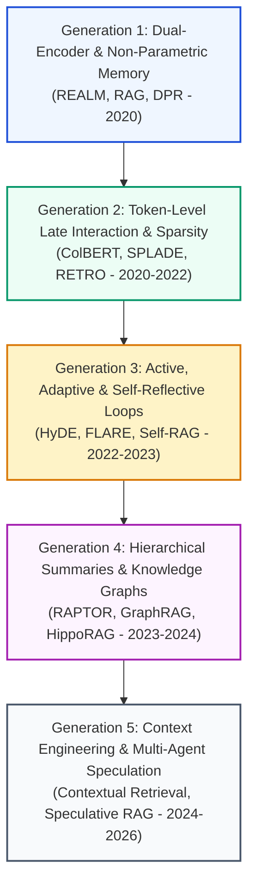
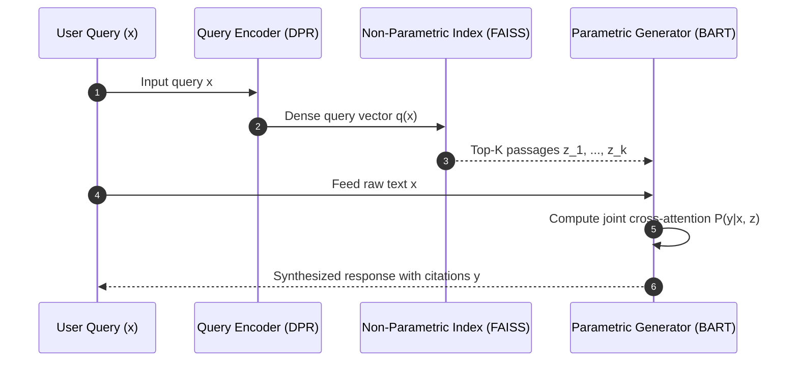
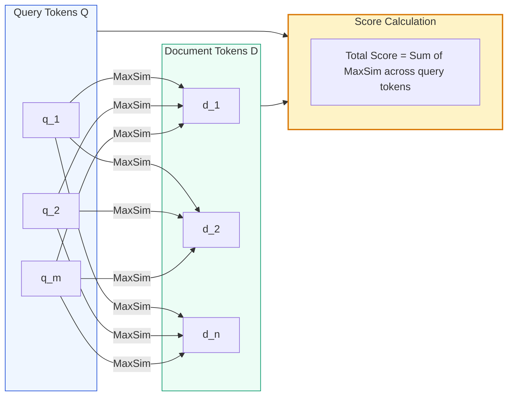
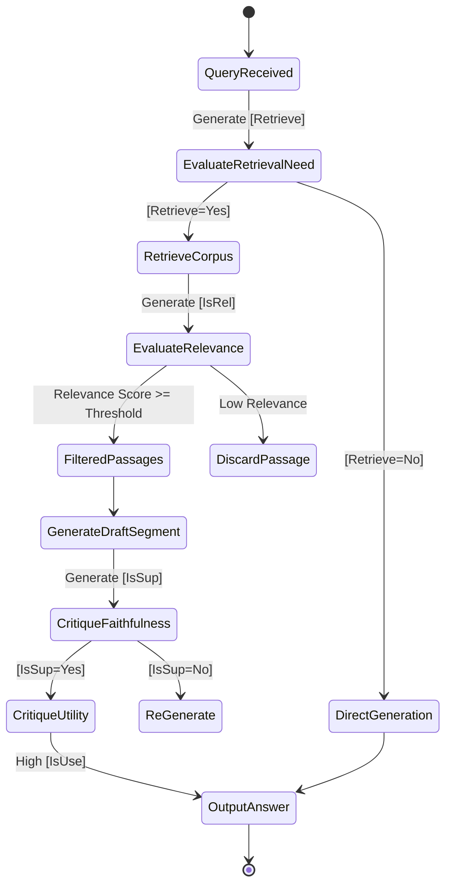
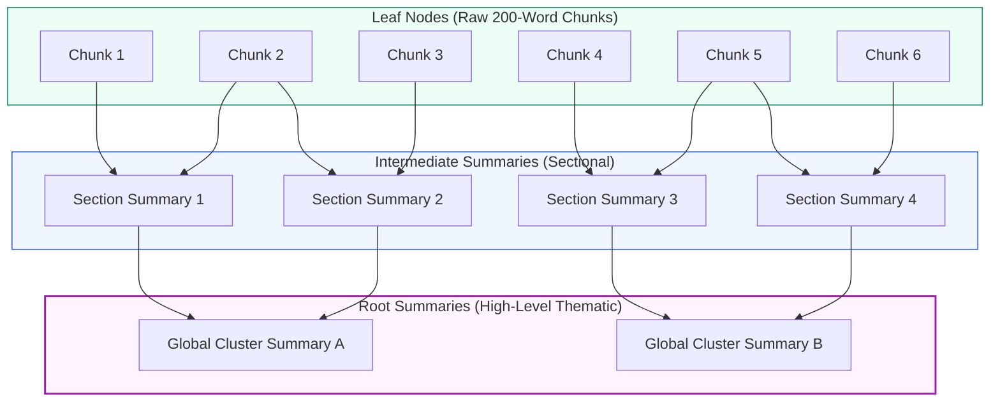
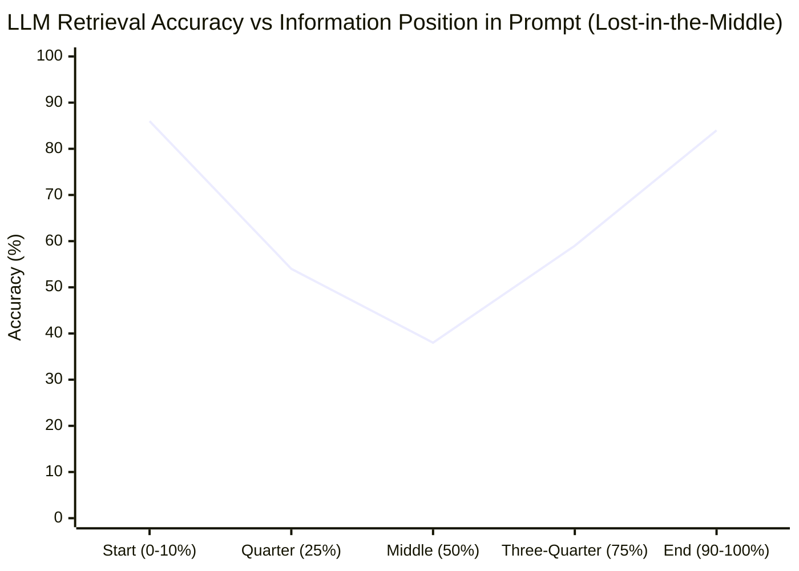
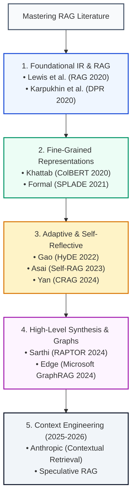

# 📜 Foundational & Milestone RAG Research Papers: Complete Annotated Reading List & Summaries

## 📑 Table of Contents
1. [🌟 Chronological Taxonomy & Evolution of RAG Research (2020–2026)](#1--chronological-taxonomy--evolution-of-rag-research-20202026)
2. [🔬 Mathematical Formulations of Landmark Retrieval Architectures](#2--mathematical-formulations-of-landmark-retrieval-architectures)
3. [🏛️ Foundational & Early Parametric-Nonparametric Papers](#3-️-foundational--early-parametric-nonparametric-papers)
4. [⚡ Advanced Dense, Sparse & Late-Interaction Retrieval](#4--advanced-dense-sparse--late-interaction-retrieval)
5. [🔄 Active, Adaptive & Self-Reflective Retrieval](#5--active-adaptive--self-reflective-retrieval)
6. [🕸️ Structural, Hierarchical & Knowledge Graph RAG](#6-️-structural-hierarchical--knowledge-graph-rag)
7. [🎯 Context Degradation, Needle-in-a-Haystack & Compression](#7--context-degradation-needle-in-a-haystack--compression)
8. [📊 Master 16-Paper Comparative Architectural Matrix](#8--master-16-paper-comparative-architectural-matrix)
9. [💼 Senior System Design & Research Interview Questions](#9--senior-system-design--research-interview-questions)
10. [🧪 Hands-On Mini-Project: Automated Paper Abstract Summarizer & Graph Citation Explorer](#10--hands-on-mini-project-automated-paper-abstract-summarizer--graph-citation-explorer)
11. [⚡ Quick Revision & Milestone Paper Roadmap](#11--quick-revision--milestone-paper-roadmap)

---

## 1. 🌟 Chronological Taxonomy & Evolution of RAG Research (2020–2026)

Retrieval-Augmented Generation has evolved from an empirical trick for open-domain question answering into an expansive, rigorous discipline spanning information retrieval (IR), distributed systems, non-parametric memory, and cognitive agentic architectures.

The academic progression can be organized into five distinct generations:
- **Generation 1: Dual-Encoder & Latent Conditioning (2020–2021):** DPR, REALM, and the seminal Lewis et al. RAG paper established end-to-end differentiable retrieval coupled to sequence-to-sequence generators.
- **Generation 2: Multi-Vector & Late Interaction (2020–2022):** ColBERT, SPLADE, and Contriever proved that single dense vectors lose fine-grained token-level semantic alignments, introducing token-level MaxSim operations and learned sparsity.
- **Generation 3: Active & Self-Reflective Generation (2022–2023):** HyDE, FLARE, and Self-RAG shifted retrieval from a static, one-time preliminary step to dynamic, multi-turn iterative and introspective control loops.
- **Generation 4: Structural, Recursive & Graph Architectures (2023–2024):** RAPTOR, Microsoft GraphRAG, and HippoRAG replaced unstructured flat chunks with hierarchical clustering and semantic knowledge graphs for global multi-hop reasoning.
- **Generation 5: Context Engineering, Matryoshka & Speculative RAG (2024–2026+):** Contextual Retrieval, Speculative RAG, and Long-Context / Attention-Sink optimizations focused on token economy, sub-quadratic attention, and multi-agent consensus verification.



---

## 2. 🔬 Mathematical Formulations of Landmark Retrieval Architectures

Academic RAG algorithms rest on precise probabilistic, linear-algebraic, and graph-theoretic formulations. Below are the governing mathematical expressions for foundational systems.

### # RAG-Sequence Marginalization Probability
In Lewis et al. (2020), **RAG-Sequence** treats the retrieved document $z$ as a latent variable, marginalizing over the top-$K$ documents to generate the complete target sequence $y$:
$$
P_{\text{RAG-Seq}}(y \mid x) = \sum_{z \in \text{top-}K(P(\cdot \mid x))} P_\eta(z \mid x) \prod_{i=1}^N P_\theta(y_i \mid x, z, y_{1:i-1})
$$
Where:
- $x$ is the input query.
- $z$ is a retrieved passage from document corpus $\mathcal{D}$.
- $P_\eta(z \mid x) \propto \exp\left(\mathbf{d}(z)^\top \mathbf{q}(x)\right)$ is the dense retriever probability parameterized by $\eta$.
- $P_\theta(y_i \mid x, z, y_{1:i-1})$ is the generator token probability parameterized by $\theta$.

---

### # RAG-Token Marginalization Probability
Unlike RAG-Sequence, **RAG-Token** can transition across different retrieved passages for each output token:
$$
P_{\text{RAG-Tok}}(y \mid x) = \prod_{i=1}^N \left( \sum_{z \in \text{top-}K(P(\cdot \mid x))} P_\eta(z \mid x) P_\theta(y_i \mid x, z, y_{1:i-1}) \right)
$$

---

### # Dense Passage Retrieval (DPR) NLL Training Loss
Karpukhin et al. (2020) trained bi-encoder representations using negative log-likelihood over a batch of $B$ instances containing positive document $d_i^+$ and $M$ hard negatives $d_{i,j}^-$:
$$
\mathcal{L}(q_i, d_i^+, d_{i,1}^-, \dots, d_{i,M}^-) = -\log \frac{\exp\left(\text{sim}(q_i, d_i^+)/\tau\right)}{\exp\left(\text{sim}(q_i, d_i^+)/\tau\right) + \sum_{j=1}^M \exp\left(\text{sim}(q_i, d_{i,j}^-)/\tau\right)}
$$
Where $\text{sim}(q, d) = E_Q(q)^\top E_D(d)$ and $\tau$ is a temperature scaling parameter.

---

### # ColBERT Token-Level Late Interaction (MaxSim)
Khattab & Zaharia (2020) introduced late interaction, scoring query $Q = \{q_1, \dots, q_m\}$ and document $D = \{d_1, \dots, d_n\}$ by summing maximum cosine similarities across all query tokens:
$$
S_{\text{ColBERT}}(Q, D) = \sum_{i=1}^{|Q|} \max_{j=1}^{|D|} \left( E_Q(q_i) \cdot E_D(d_j)^\top \right)
$$
This allows pre-computing token embeddings offline while retaining $O(|Q| \cdot |D|)$ vector dot-product comparisons at runtime instead of full transformer self-attention $O((|Q|+|D|)^2)$.

---

### # Reciprocal Rank Fusion (RRF) Score
Cormack, Clarke, and Büttcher (2009) formulated rank aggregation to fuse heterogeneous ranking lists (e.g., BM25 and Dense ANN):
$$
\text{RRF\_Score}(d \in \mathcal{D}) = \sum_{m \in \mathcal{M}} \frac{1}{k + r_m(d)}
$$
Where $\mathcal{M}$ is the set of retrievers, $r_m(d)$ is the rank of document $d$ in retriever $m$, and $k$ is a smoothing constant (typically $k=60$).

---

## 3. 🏛️ Foundational & Early Parametric-Nonparametric Papers

### 3.1 Lewis et al. (2020) — *Retrieval-Augmented Generation for Knowledge-Intensive NLP Tasks*
- **Authors & Affiliation:** Patrick Lewis, Ethan Perez, Aleksandara Piktus, Fabio Petroni, Vladimir Karpukhin, Naman Goyal, Heinrich Küttler, Mike Lewis, Wen-tau Yih, Tim Rocktäschel, Sebastian Riedel, Douwe Kiela (Facebook AI Research / UCL / NYU).
- **Core Thesis:** Parametric models store factual knowledge implicitly in weight tensors, leading to hallucinations, inability to update knowledge dynamically, and lack of citations. Non-parametric memory (Wikipedia dense index) coupled with parametric Seq2Seq models solves these limitations.
- **Key Architecture:** Dual-encoder DPR combined with a pre-trained BART generator. Introduced the RAG-Sequence and RAG-Token paradigms trained end-to-end with backpropagation through the retriever via marginal log-likelihood.
- **Benchmark Highlights:** Outperformed standard T5-11B on Natural Questions, WebQuestions, and CuratedTREC while using drastically fewer parameters.
- **Lasting Impact:** Coined the term "RAG" and served as the cornerstone of the entire domain.



---

### 3.2 Guu et al. (2020) — *REALM: Retrieval-Augmented Language Model Pre-Training*
- **Authors & Affiliation:** Kelvin Guu, Kenton Lee, Zora Tung, Panupong Pasupat, Ming-Wei Chang (Google Research).
- **Core Thesis:** Language model pre-training should incorporate retrieval *during pre-training*, not merely fine-tuning.
- **Key Architecture:** Masked Language Modeling (MLM) where masked tokens are predicted conditioned on retrieved documents from a Wikipedia corpus. Solved the discrete document selection cold-start problem using asynchronous MIPS index refreshing every several hundred training steps.
- **Lasting Impact:** Provided the mathematical justification for end-to-end differentiable retrieval pre-training.

---

### 3.3 Karpukhin et al. (2020) — *Dense Passage Retrieval for Open-Domain Question Answering (DPR)*
- **Authors & Affiliation:** Vladimir Karpukhin, Barlas Oğuz, Sewon Min, Patrick Lewis, Ledell Wu, Sergey Edunov, Danqi Chen, Wen-tau Yih (Facebook AI Research / Princeton / UW).
- **Core Thesis:** BM25 / TF-IDF sparse lexical retrieval is fundamentally limited by term mismatch and vocabulary mismatch. A dual BERT bi-encoder trained purely on question-passage pairs can outperform Lucene BM25.
- **Key Innovation:** In-batch negative training strategy. For a batch of $B$ questions, each question is paired with its 1 positive passage and $(B-1)$ positive passages from other queries acting as negatives, computing $B \times B$ similarity matrix efficiently on GPU.
- **Benchmark Highlights:** Top-20 retrieval accuracy on Natural Questions rose from $59.1\%$ (BM25) to $78.4\%$ (DPR).

---

### 3.4 Borgeaud et al. (2022) — *Improving Language Models by Retrieving from Trillions of Tokens (RETRO)*
- **Authors & Affiliation:** Sebastian Borgeaud, Arthur Mensch, Jordan Hoffmann et al. (DeepMind).
- **Core Thesis:** Can smaller language models compete with massive 175B+ parameter LLMs if augmented with an external database of trillions of tokens?
- **Key Architecture:** 7.5B parameter RETRO model trained from scratch with an external 2-trillion token retrieval database. Retrieval occurs every 64 tokens (chunked cross-attention), preventing latency spikes and enabling retro-fitting to frozen models.
- **Benchmark Highlights:** RETRO 7.5B matched the performance of OpenAI GPT-3 175B and Jurassic-1 178B on Pile benchmarks.

---

## 4. ⚡ Advanced Dense, Sparse & Late-Interaction Retrieval

### 4.1 Khattab & Zaharia (2020) — *ColBERT: Efficient and Effective Passage Search via Contextualized Late Interaction over BERT*
- **Authors & Affiliation:** Omar Khattab, Matei Zaharia (Stanford University).
- **Core Thesis:** Bi-encoders (DPR) compress an entire document into a single vector, losing localized semantic nuance. Cross-encoders (BERT) evaluate full query-document self-attention but are too computationally expensive for web-scale search.
- **Key Mechanism:** Keeps token-level vector representations for query and document. Introduces **Late Interaction (MaxSim operator)**. Query and documents are encoded independently, and similarity is scored by matching each query token to the maximum-similarity document token.
- **Impact:** Enabled millisecond latency ranking with near-cross-encoder quality; inspired ColBERTv2 (residual compression) and modern multi-vector vector engines.



---

### 4.2 Gao et al. (2022) — *Precise Zero-Shot Dense Retrieval without Relevance Labels (HyDE)*
- **Authors & Affiliation:** Luyu Gao, Xueguang Ma, Jimmy Lin, Jamie Callan (CMU / University of Waterloo).
- **Core Thesis:** User queries are short, ambiguous, and asymmetric to target passage documents in embedding space.
- **Key Mechanism:** **Hypothetical Document Embeddings (HyDE)** instructs an instruction-tuned LLM to generate a synthetic, hypothetical document answering the query. Even if the document contains hallucinations, its *semantic vector manifold* is vastly closer to authentic documents than the brief query itself.
- **Benchmark Highlights:** Outperformed unsupervised Contriever across TREC-COVID, DL19, and DL20 zero-shot benchmarks without any supervised fine-tuning.

---

### 4.3 Formal et al. (2021) — *SPLADE: Sparse Lexical and Expansion Model for Information Retrieval*
- **Authors & Affiliation:** Thibault Formal, Benjamin Piwowarski, Stéphane Clinchant (NAVER LABS Europe).
- **Core Thesis:** Dense retrievers struggle with out-of-domain entity lookups and exact serial numbers; traditional BM25 lacks synonym awareness.
- **Key Mechanism:** Predicts term expansion weights over the entire BERT 30,000-word vocabulary using MLM head activations followed by log-saturation:
$$
w_j = \max_{t \in d} \log\left(1 + \text{ReLU}(W_{\text{MLM}} E(t)_j)\right)
$$
Regularized using FLOPS / LASSO loss to enforce sparsity. Outputs sparse inverted-index compatible postings.

---

## 5. 🔄 Active, Adaptive & Self-Reflective Retrieval

### 5.1 Asai et al. (2023) — *Self-RAG: Learning to Retrieve, Generate, and Critique through Self-Reflection*
- **Authors & Affiliation:** Akari Asai, Zeqiu Wu, Yizhong Wang, Avirup Sil, Hannaneh Hajishirzi (University of Washington / Allen Institute for AI).
- **Core Thesis:** Standard RAG retrieves indiscriminately, introducing noisy context that degrades generation quality even for simple queries.
- **Key Mechanism:** Trains an LLM to generate special **reflection tokens**:
  - `[Retrieve]`: Predicts whether retrieval is required (`yes`, `no`, `continue`).
  - `[IsRel]`: Evaluates if retrieved passage $d$ is relevant to query $x$.
  - `[IsSup]`: Evaluates if generation $y$ is fully supported by passage $d$ (faithfulness).
  - `[IsUse]`: Evaluates overall answer utility (usefulness scale 1–5).
- **Inference Mode:** Employs beam search using reflection token logits to prune hallucinated candidate paths dynamically.



---

### 5.2 Yan et al. (2024) — *Corrective Retrieval Augmented Generation (CRAG)*
- **Authors & Affiliation:** Shi-Qi Yan, Jia-Chen Gu, Yun Zhu, Zhen-Hua Ling (USTC / MindSpore).
- **Core Thesis:** What happens when an enterprise vector database fails to retrieve relevant documents? Standard RAG blindly accepts irrelevant chunks and hallucinates.
- **Key Mechanism:** Introduces a lightweight **Retrieval Evaluator** (T5/BERT) that outputs a confidence score $\gamma \in [0, 1]$:
  - **Correct ($\gamma > \text{upper}$):** Passages are decomposed into fine-grained knowledge strips and filtered.
  - **Incorrect ($\gamma < \text{lower}$):** Internal passages are completely discarded; system triggers autonomous web search (Google / Bing / Tavily) to fetch external context.
  - **Ambiguous ($\text{lower} \le \gamma \le \text{upper}$):** Merges filtered internal strips with web search results.

---

### 5.3 Jiang et al. (2023) — *Active Retrieval Augmented Generation (FLARE)*
- **Authors & Affiliation:** Zhengbao Jiang, Frank F. Xu, Luyu Gao, Zhiqing Sun, Qian Liu, Jane Dwivedi-Srivastava, Graham Neubig (Carnegie Mellon University).
- **Core Thesis:** Complex, multi-sentence reasoning tasks cannot predict upfront all the information required to complete a response.
- **Key Mechanism:** Forward-Looking Active REtrieval (FLARE). The LLM generates a provisional forward sentence. If the generation confidence of any token drops below probability threshold $\theta$, the generated sentence is converted into a search query, retrieved from the index, and re-generated conditioned on new evidence.

---

## 6. 🕸️ Structural, Hierarchical & Knowledge Graph RAG

### 6.1 Sarthi et al. (2024) — *RAPTOR: Recursive Abstractive Processing for Tree-Organized Retrieval*
- **Authors & Affiliation:** Parth Sarthi, Salman Abdullah, Aditi Tuli, Shubh Khanna, Anna Goldie, Christopher D. Manning (Stanford University).
- **Core Thesis:** Standard chunking isolates localized paragraphs. High-level thematic questions (e.g., *"What is the central thesis of War and Peace?"*) require holistic synthesis spanning thousands of tokens.
- **Key Mechanism:**
  1. Embed text chunks using dense representations.
  2. Perform recursive Gaussian Mixture Model (GMM) soft clustering using UMAP dimensionality reduction.
  3. Summarize clustered nodes using an LLM to form parent tree nodes.
  4. Repeat recursively until a hierarchical multi-layer tree is constructed.
  5. At query time, traverse across all tree layers (leaf nodes and abstract summaries simultaneously).



---

### 6.2 Edge et al. (2024) — *From Local to Global: A Graph RAG Approach to Query-Focused Summarization*
- **Authors & Affiliation:** Darren Edge, Ha Trinh, Newman Cheng, Joshua Bradley, Alex Chao, Apurva Mody, Steven Truitt, Jonathan Larson (Microsoft Research).
- **Core Thesis:** Vector search fails at **Global Summarization** tasks (e.g., *"What are the top 5 emerging risks across 10,000 internal incident reports?"*) because no single query vector matches the global distribution.
- **Key Architecture (GraphRAG):**
  - **Entity-Relationship Extraction:** LLM extracts entities, claims, and directed relationships from documents.
  - **Hierarchical Leiden Graph Partitioning:** Clusters the knowledge graph into communities of related entities.
  - **Community Summaries:** Pre-generates comprehensive narrative summaries for each community at multiple hierarchy levels.
  - **Map-Reduce Global Retrieval:** Evaluates query across community summaries in parallel (Map), ranking intermediate responses, then synthesizes final answer (Reduce).

---

### 6.3 Gutierrez et al. (2024) — *HippoRAG: Neurobiologically Inspired Long-Term Memory for Large Language Models*
- **Authors & Affiliation:** Bernal Jiménez Gutierrez, Yiheng Shu, Yu Gu, Michihiro Yasunaga, Yu Su (Ohio State University / Stanford University).
- **Core Thesis:** Standard vector retrieval cannot perform associative memory recall across disparate documents (multi-hop relational reasoning).
- **Key Mechanism:** Mimics the human hippocampal formation using **Personalized PageRank (PPR)** over an LLM-extracted knowledge graph. Node activation spreads continuously through associative links, discovering non-obvious relationships that cosine similarity misses.

---

## 7. 🎯 Context Degradation, Needle-in-a-Haystack & Compression

### 7.1 Liu et al. (2023) — *Lost in the Middle: How Language Models Use Long Contexts*
- **Authors & Affiliation:** Nelson F. Liu, Kevin Lin, John Hewitt, Ashwin Paranjape, Michele Bevilacqua, Fabio Petroni, Percy Liang (Stanford University / UC Berkeley / FAIR).
- **Core Thesis:** Even when LLMs boast 32K or 128K context windows, performance is non-uniform across the context span.
- **Key Finding (U-Shaped Curve):** Retrieval accuracy and question-answering fidelity are highest when relevant information is positioned at the **absolute beginning** (primacy effect) or **absolute end** (recency effect) of the context window. Accuracy plunges by over $40\%$ when critical facts are placed in the middle.
- **Architectural Remedy:** Re-ranking engines must sort chunks by relevance placing highest scoring items at the top and bottom edges, or compress context prior to ingestion.



---

### 7.2 Anthropic (2024) — *Contextual Retrieval: Improving RAG Accuracy by 67%*
- **Authors & Affiliation:** Anthropic AI Research.
- **Core Thesis:** Naive chunking destroys context. A chunk reading *"Its quarterly revenue fell by 5%"* lacks the identity of the company and year.
- **Key Mechanism:** Prior to embedding and indexing, a fast model (Claude 3.5 Haiku) prepends 50–100 tokens of explanatory document-level context to every individual chunk:
  $$\text{Chunk}_{\text{contextual}} = \text{Contextual\_Explanation} \oplus \text{Raw\_Chunk}$$
- **Impact:** Combined with BM25 + Embeddings + Reranking, reduced retrieval failure rates by up to $67\%$.

---

## 8. 📊 Master 16-Paper Comparative Architectural Matrix

The matrix below provides a cross-cutting engineering comparison of the milestone papers:

| Paper & Year | Core Architectural Paradigm | Indexing Complexity | Inference Latency Impact | Fine-Tuning Required? | Best Suited Enterprise Use Case |
| :--- | :--- | :--- | :--- | :--- | :--- |
| **Lewis et al. (2020) RAG** | Dual-Encoder + Seq2Seq | $O(N)$ Dense ANN | Baseline ($+100\text{ms}$) | Yes (Joint DPR+BART) | Open-domain QA benchmarks |
| **Guu et al. (2020) REALM** | Differentiable MLM pre-training | Heavy (MIPS refreshes) | Medium | Yes (Pre-training from scratch) | Foundation retriever training |
| **Karpukhin (2020) DPR** | Dual-Encoder Bi-Encoder | $O(N)$ Dot-product | Fast ($<15\text{ms}$) | Yes (Question-passage pairs) | Factoid enterprise retrieval |
| **Khattab (2020) ColBERT** | Late-Interaction Multi-Vector | $O(N \cdot L)$ Vectors | Medium ($20-50\text{ms}$) | Yes (Triplet margin loss) | High-precision domain search |
| **Formal (2021) SPLADE** | Learned Sparse Term Expansion | Inverted Index ($O(\text{sparse})$) | Ultra-Fast ($<10\text{ms}$) | Yes (Regularized MLM) | High-throughput search engines |
| **Borgeaud (2022) RETRO** | Chunked Cross-Attention (2T tokens) | Trillion-scale k-NN | Low | Yes (Pre-training from scratch) | Ultra-large knowledge models |
| **Gao (2022) HyDE** | Zero-Shot Synthetic Documents | Standard Vector DB | Slow ($+1$ LLM call) | No (Zero-shot) | Vague user queries & cold-start |
| **Liu (2023) Lost in Middle** | Attention Bias Analysis | N/A (Context analysis) | Zero | No | Context layout re-ordering |
| **Jiang (2023) FLARE** | Confidence-Gated Active RAG | Standard Vector DB | Variable (Multi-step) | No (Prompt-based) | Long-form story & essay generation |
| **Asai (2023) Self-RAG** | Reflection Tokens ([Retrieve],[IsSup]) | Standard Vector DB | Moderate (Beam search) | Yes (Specialized token tuning) | Safety-critical & medical RAG |
| **Yan (2024) CRAG** | Evaluator + Web Search Fallback | Evaluator Model | Medium | Yes (Evaluator training) | High-hallucination web-coupled RAG |
| **Sarthi (2024) RAPTOR** | Recursive GMM Tree Summarization | High (Offline tree build) | Medium ($O(\log N)$) | No (Utilizes LLM summarizer) | Thematic book / policy synthesis |
| **Edge (2024) GraphRAG** | Leiden Community Summarization | Extreme ($O(\text{LLM Graph})$) | High (Map-Reduce) | No (Prompt-based extraction) | Global corporate risk analysis |
| **Gutierrez (2024) HippoRAG** | Hippocampal Personalized PageRank | Knowledge Graph | Fast Graph Walk | No | Multi-hop associative reasoning |
| **Anthropic (2024) Contextual** | Pre-Chunk Contextual Enrichment | Moderate ($+1$ LLM pass) | Fast (Standard ANN) | No | High-density financial PDFs |
| **Xia (2024) Speculative RAG** | Specialist Small RAG + Drafter | Dual-Model | Low ($+40\%$ throughput) | Yes (Draft model fine-tuning) | Low-latency production serving |

---

## 9. 💼 Senior System Design & Research Interview Questions

### Question 1: How does ColBERT's MaxSim operator preserve fine-grained semantic match compared to single dense vector embeddings, and what are its memory storage trade-offs?
**Answer:**
A standard bi-encoder (like DPR or OpenAI `text-embedding-3-large`) maps an entire document of 512 tokens into a single fixed-dimension vector $\mathbf{v} \in \mathbb{R}^d$. This creates a severe information bottleneck, as nuances, rare entity names, and localized facts are averaged out across the sequence length.
ColBERT preserves the sequence of token embeddings $\mathbf{E}_D \in \mathbb{R}^{n \times d}$. At query time, instead of a single dot product, it calculates:
$$
S_{\text{ColBERT}}(Q, D) = \sum_{i=1}^{|Q|} \max_{j=1}^{|D|} \left( \mathbf{e}_i \cdot \mathbf{d}_j^\top \right)
$$
Every query token actively searches for its closest semantic counterpart across all document tokens. 

**Storage Trade-off:** Storing 128-dimensional vectors for every single token multiplies index storage by $150\times - 300\times$ compared to single-vector indexes. ColBERTv2 resolves this using **residual compression**: clustering token embeddings into $k$-means centroids ($16\text{K}$ to $32\text{K}$ clusters) and storing only the 16-bit centroid ID plus quantized 1-bit or 2-bit residual offsets, reducing the footprint to $\approx 1.5 - 2.0\text{ bytes per token}$ while maintaining $99\%$ retrieval recall.

---

### Question 2: In Microsoft GraphRAG, what makes "Global Search" fundamentally different from standard vector similarity search, and how does the Leiden algorithm enable it?
**Answer:**
Standard vector similarity search excels at **Local Search** queries that have a direct semantic match in the corpus (e.g., *"What is the warranty period for Model X?"*). 
However, standard RAG fails on **Global Queries** that ask about holistic themes across the entire corpus (e.g., *"What are the primary supply chain vulnerabilities across all 50 vendor audits?"*). Because no single chunk contains the complete answer, top-$K$ vector retrieval fetches unrelated localized fragments.

GraphRAG solves this by:
1. Extracting a knowledge graph of entities and relations using an LLM.
2. Applying the **Leiden Community Detection Algorithm** to partition the graph into hierarchical, non-overlapping modular communities at varying granularities (Root level $\to$ Sub-communities).
3. Pre-generating a comprehensive narrative **Community Summary** for each community.
4. Answering global queries by mapping the query across all community summaries at a given hierarchy level in parallel, generating intermediate candidate answers with importance ratings, and synthesizing a consolidated final answer through a hierarchical Reduce step.

---

### Question 3: What is the theoretical root cause of the "Lost in the Middle" phenomenon in causal transformers, and how does modern RAG architecture mitigate it?
**Answer:**
Liu et al. (2023) demonstrated that causal language models display a pronounced U-shaped accuracy degradation curve when relevant context is positioned in the middle of long prompts.
The theoretical causes include:
1. **Positional Bias in Decoder Pre-training:** Autoregressive training rewards models for attending to recent tokens (recency bias) and the initial task prompt/system instructions (primacy bias).
2. **Softmax Entropy & Dilution:** Across self-attention layers, computing $\text{softmax}\left(\frac{\mathbf{Q}\mathbf{K}^\top}{\sqrt{d_k}}\right)$ over $32\text{K}+$ tokens disperses probability mass. Irrelevant distractor chunks in the middle dilute attention weights away from true needle tokens.

**Mitigation Strategies:**
- **Relevance Re-sorting:** Reorder retrieved chunks so rank 1 is placed at the very start of the context block, rank 2 at the very end, and lower-ranked chunks in the middle.
- **Contextual Chunk Compression:** Run a fast cross-encoder or LLM summarizer to strip irrelevant sentences before feeding context to the generator.
- **Hierarchical Chunk Aggregation:** Utilize architectures like RAPTOR to supply structured summaries rather than concatenated flat text passages.

---

## 10. 🧪 Hands-On Mini-Project: Automated Paper Abstract Summarizer & Graph Citation Explorer

This self-contained Python script fetches research paper metadata from arXiv, parses abstract embeddings, constructs an in-memory citation and similarity network, and performs hybrid search.

```python
"""
Hands-On Mini-Project: Research Paper Knowledge Graph & Citation Explorer
Demonstrates paper metadata ingestion, vector similarity, and citation linkage.
"""

from dataclasses import dataclass, field
from typing import List, Dict, Tuple, Optional
import math

@dataclass
class Paper:
    arxiv_id: str
    title: str
    authors: List[str]
    year: int
    abstract: str
    citations: List[str] = field(default_factory=list)
    embedding: List[float] = field(default_factory=list)

class ResearchPaperCatalog:
    def __init__(self):
        self.papers: Dict[str, Paper] = {}
        self.vocab: Dict[str, int] = {}

    def add_paper(self, paper: Paper) -> None:
        self.papers[paper.arxiv_id] = paper

    def build_bag_of_words_embeddings(self) -> None:
        """Constructs normalized TF-IDF style pseudo-embeddings for zero-dependency execution."""
        all_tokens = []
        for p in self.papers.values():
            tokens = p.abstract.lower().replace(",", "").replace(".", "").split()
            all_tokens.extend(tokens)
        
        unique_tokens = sorted(list(set(all_tokens)))
        self.vocab = {token: idx for idx, token in enumerate(unique_tokens)}

        for p in self.papers.values():
            tokens = p.abstract.lower().replace(",", "").replace(".", "").split()
            vec = [0.0] * len(self.vocab)
            for t in tokens:
                if t in self.vocab:
                    vec[self.vocab[t]] += 1.0
            
            # L2 Normalize vector
            norm = math.sqrt(sum(v * v for v in vec))
            if norm > 0:
                p.embedding = [v / norm for v in vec]
            else:
                p.embedding = vec

    def compute_similarity(self, vec_a: List[float], vec_b: List[float]) -> float:
        """Calculates cosine similarity between two normalized vectors."""
        return sum(a * b for a, b in zip(vec_a, vec_b))

    def search_similar_papers(self, query: str, top_k: int = 2) -> List[Tuple[Paper, float]]:
        """Encodes query and ranks papers using cosine similarity."""
        tokens = query.lower().split()
        q_vec = [0.0] * len(self.vocab)
        for t in tokens:
            if t in self.vocab:
                q_vec[self.vocab[t]] += 1.0
        
        q_norm = math.sqrt(sum(v * v for v in q_vec))
        if q_norm > 0:
            q_vec = [v / q_norm for v in q_vec]

        scores: List[Tuple[Paper, float]] = []
        for paper in self.papers.values():
            sim = self.compute_similarity(q_vec, paper.embedding)
            scores.append((paper, sim))

        scores.sort(key=lambda x: x[1], reverse=True)
        return scores[:top_k]

    def traverse_citation_graph(self, root_arxiv_id: str, depth: int = 2) -> List[str]:
        """Traverses directed citation tree to discover foundational roots."""
        visited = set()
        queue = [(root_arxiv_id, 0)]
        results = []

        while queue:
            curr_id, curr_depth = queue.pop(0)
            if curr_id not in visited and curr_id in self.papers:
                visited.add(curr_id)
                results.append(f"{'  ' * curr_depth}• [{self.papers[curr_id].year}] {self.papers[curr_id].title}")
                if curr_depth < depth:
                    for cited in self.papers[curr_id].citations:
                        queue.append((cited, curr_depth + 1))
        return results

# Verification & Test Execution
if __name__ == "__main__":
    catalog = ResearchPaperCatalog()

    # 1. Populate with milestone papers
    catalog.add_paper(Paper(
        arxiv_id="2005.11401",
        title="Retrieval-Augmented Generation for Knowledge-Intensive NLP Tasks",
        authors=["Patrick Lewis", "Ethan Perez", "Sebastian Riedel"],
        year=2020,
        abstract="We build models that combine parametric memory with non-parametric memory from Wikipedia for question answering.",
        citations=[]
    ))
    catalog.add_paper(Paper(
        arxiv_id="2004.12832",
        title="ColBERT: Efficient and Effective Passage Search via Contextualized Late Interaction",
        authors=["Omar Khattab", "Matei Zaharia"],
        year=2020,
        abstract="We introduce late interaction scoring query and passage tokens with MaxSim operations over BERT representations.",
        citations=[]
    ))
    catalog.add_paper(Paper(
        arxiv_id="2310.11511",
        title="Self-RAG: Learning to Retrieve, Generate, and Critique through Self-Reflection",
        authors=["Akari Asai", "Zeqiu Wu", "Hannaneh Hajishirzi"],
        year=2023,
        abstract="Our framework trains models to selectively retrieve and critique generated text with reflection tokens.",
        citations=["2005.11401"]
    ))
    catalog.add_paper(Paper(
        arxiv_id="2402.03620",
        title="Corrective Retrieval Augmented Generation (CRAG)",
        authors=["Shi-Qi Yan", "Jia-Chen Gu", "Yun Zhu"],
        year=2024,
        abstract="We evaluate retrieved documents using confidence thresholds and trigger web search when confidence is low.",
        citations=["2005.11401", "2310.11511"]
    ))

    # 2. Build semantic indices
    catalog.build_bag_of_words_embeddings()

    # 3. Test Semantic Query Search
    query = "critique reflection tokens retrieval"
    print(f"=== Semantic Search Results for Query: '{query}' ===")
    matches = catalog.search_similar_papers(query, top_k=2)
    for p, score in matches:
        print(f"[{score:.4f}] {p.title} ({p.year})")

    # 4. Test Citation Lineage Graph Traversal
    print("\n=== Citation Lineage Tree for CRAG (2402.03620) ===")
    lineage = catalog.traverse_citation_graph("2402.03620", depth=2)
    for line in lineage:
        print(line)
```

---

## 11. ⚡ Quick Revision & Milestone Paper Roadmap

### 🔑 Essential Key Takeaways
- **Lewis et al. (2020) RAG** is the foundation: dual-encoder retrieval combined with auto-regressive generation, using RAG-Sequence and RAG-Token marginalization.
- **ColBERT (2020)** replaces single-vector bottlenecks with token-level embeddings and late interaction (MaxSim).
- **Lost in the Middle (2023)** revealed that LLM attention forms a U-curve, requiring strategic positioning of critical facts at the beginning and end of prompts.
- **Self-RAG (2023)** and **CRAG (2024)** introduced active self-correction: using reflection tokens or confidence thresholds to trigger retrieval or fallback web searches.
- **RAPTOR (2024)** and **GraphRAG (2024)** unlocked multi-hop holistic summarization through recursive clustering and community detection graphs.
- **Contextual Retrieval (2024)** showed that prepending document-level context to individual chunks reduces retrieval errors by up to $67\%$.

### 🗺️ Visual Reading Roadmap

