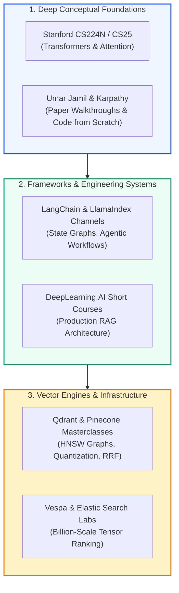
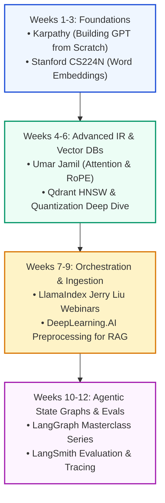

# 🎥 Curated YouTube Channels, Conference Keynotes, and Video Courses for RAG Engineers

## 📑 Table of Contents
1. [🌟 Visual & Auditory Learning in Modern AI Engineering](#1--visual--auditory-learning-in-modern-ai-engineering)
2. [🔬 Mathematical Models of Multimodal Video Ingestion & Retention](#2--mathematical-models-of-multimodal-video-ingestion--retention)
3. [🏛️ Academic Conference Channels & University Lecture Series](#3-️-academic-conference-channels--university-lecture-series)
4. [🧠 Deep Technical Paper Walkthroughs & Implementation Specialists](#4--deep-technical-paper-walkthroughs--implementation-specialists)
5. [🛠️ Official Framework Channels & Production Masterclasses](#5-️-official-framework-channels--production-masterclasses)
6. [🗄️ Vector Database Internals & Infrastructure Channels](#6-️-vector-database-internals--infrastructure-channels)
7. [🏆 Landmark Conference Keynotes & Must-Watch Seminars](#7--landmark-conference-keynotes--must-watch-seminars)
8. [📊 Master 16-Channel Comparative Curriculum Matrix](#8--master-16-channel-comparative-curriculum-matrix)
9. [💼 Senior System Design & Video Knowledge RAG Interview Scenarios](#9--senior-system-design--video-knowledge-rag-interview-scenarios)
10. [🧪 Hands-On Mini-Project: Automated Video Transcript Ingestion & Timestamp Search Engine](#10--hands-on-mini-project-automated-video-transcript-ingestion--timestamp-search-engine)
11. [⚡ Quick Revision & 12-Week Video Learning Roadmap](#11--quick-revision--12-week-video-learning-roadmap)

---

## 1. 🌟 Visual & Auditory Learning in Modern AI Engineering

Complex architectural systems—such as cyclic multi-agent state machines, geometric HNSW vector partitioning, and token-level late interaction—are often understood much faster when visualized dynamically.

High-yield video channels provide distinct learning value:
- **Interactive Code Walkthroughs:** Watching senior practitioners build, debug, and profile distributed RAG pipelines in real time.
- **Architectural Intuition:** Dynamic diagrams illustrating multi-hop reasoning, stateful graph cycles, and tensor operations.
- **First-Party Author Insights:** Landmark lectures delivered directly by the creators of seminal algorithms (e.g., Omar Khattab on ColBERT/DSPy, Andrej Karpathy on transformer tokenization).



---

## 2. 🔬 Mathematical Models of Multimodal Video Ingestion & Retention

### # Ebbinghaus Memory Retention Decay Model
Passive video consumption suffers from rapid exponential knowledge decay. Retention $R(t)$ over time $t$ (days) without active code reproduction is governed by:
$$
R(t) = e^{-\frac{t}{S_{\text{passive}}}}
$$
Where stability $S_{\text{passive}} \approx 1.2\text{ days}$. Integrating **active hands-on coding** immediately following a lecture increases memory stability by $5\times - 8\times$:
$$
R_{\text{active}}(t) = e^{-\frac{t}{S_{\text{active}}}}, \quad \text{where } S_{\text{active}} \approx 8.5\text{ days}
$$

---

### # Multimodal Video Temporal Alignment Score
When building RAG systems that index video corpora, temporal alignment between spoken transcripts $\mathbf{v}_{\text{audio}}$ and visual frame OCR/image embeddings $\mathbf{v}_{\text{frame}}$ at timestamp $t$ is calculated via:
$$
\text{Alignment}(t) = \frac{\mathbf{v}_{\text{audio}}(t) \cdot \mathbf{v}_{\text{frame}}(t)}{\|\mathbf{v}_{\text{audio}}(t)\|_2 \|\mathbf{v}_{\text{frame}}(t)\|_2}
$$
Passages exhibiting high alignment signify slides where spoken discourse directly explains visible code or architectural diagrams.

---

## 3. 🏛️ Academic Conference Channels & University Lecture Series

### 3.1 Stanford Online: CS224N (Natural Language Processing with Deep Learning)
- **Instructors:** Christopher D. Manning, Percy Liang et al.
- **Key Lectures:** Dense retrieval mechanisms, word vector mathematics, transformer self-attention, and language model pre-training.
- **Why It Matters:** Provides the foundational theoretical grounding required to understand modern vector embeddings and bi-encoder architectures.

---

### 3.2 Stanford CS25: Transformers United
- **Format:** Seminars featuring leading external researchers from OpenAI, Anthropic, Google DeepMind, and Stanford.
- **Key Topics:** Long-context attention mechanisms, state-space models (Mamba), retrieval augmentation, and reasoning models.

---

### 3.3 NeurIPS, ICLR & ACL Official Channels
- **Nature:** Official recorded presentations from the world's premier machine learning and computational linguistics conferences.
- **Must-Watch Playlists:** Information Retrieval oral sessions, Question Answering tracks, and Foundation Model evaluation workshops.

---

## 4. 🧠 Deep Technical Paper Walkthroughs & Implementation Specialists

### 4.1 Andrej Karpathy
- **Channel:** [@AndrejKarpathy](https://www.youtube.com/@AndrejKarpathy)
- **Signature Videos:**
  - *"Let's build GPT: from scratch, in code, spelled out."* (2.5 hours) — Line-by-line PyTorch implementation of transformer architectures.
  - *"Let's build the GPT Tokenizer"* — Crucial for understanding tokenization limits and chunk boundary truncation.
  - *"Intro to Large Language Models"* — The foundational mental model for pre-training, fine-tuning, and retrieval augmentation.

---

### 4.2 Umar Jamil
- **Channel:** [@umarjamilai](https://www.youtube.com/@umarjamilai)
- **Style:** Rigorous mathematical paper walkthroughs accompanied by clean, annotated PyTorch implementations from scratch.
- **Signature RAG Topics:**
  - Attention is All You Need: Mathematical decomposition.
  - RoPE (Rotary Position Embeddings) and FlashAttention-2 mechanics.
  - LoRA, QLoRA, and Mistral/Llama architectural breakdowns.

---

### 4.3 Yannic Kilcher
- **Channel:** [@YannicKilcher](https://www.youtube.com/@YannicKilcher)
- **Style:** Fast-paced, candid, whiteboard-annotated academic paper breakdowns.
- **Signature Topics:** Reviews of landmark papers including DPR, RETRO, ColBERT, and multimodal vision-language architectures.

---

### 4.4 James Briggs
- **Channel:** [@JamesBriggs](https://www.youtube.com/@JamesBriggs)
- **Focus:** Practical semantic search, dense vector embeddings, Pinecone tutorials, and hybrid retrieval recipes.
- **Why It's Essential:** The most accessible hands-on developer channel for bridging vector database concepts to real Python applications.

---

## 5. 🛠️ Official Framework Channels & Production Masterclasses

### 5.1 LangChain Official YouTube Channel
- **Channel:** [@LangChain](https://www.youtube.com/@LangChain)
- **Core Content:**
  - **LangGraph Masterclass Series:** Detailed tutorials on building cyclic state machines, multi-agent supervisors, and durable checkpointing.
  - **LangSmith Deep Dives:** Tracing, evaluating, and monitoring production RAG applications.
  - **Weekly Community Webinars:** Guest talks by enterprise teams deploying production RAG.

---

### 5.2 LlamaIndex YouTube Channel
- **Channel:** [@LlamaIndex](https://www.youtube.com/@LlamaIndex)
- **Core Content:**
  - **Jerry Liu Webinars:** Architectural evolutions from simple RAG to multi-agent data workflows.
  - **Advanced Indexing Demos:** Hierarchical node parsers, auto-merging retrievers, and structured table extraction.
  - **LlamaParse Tutorials:** Multimodal document parsing of complex financial PDFs.

---

### 5.3 DeepLearning.AI
- **Channel:** [@DeepLearningAI](https://www.youtube.com/@DeepLearningAI)
- **Signature Free Short Courses:**
  - *Building Systems with the ChatGPT API* (Andrew Ng & Isa Fulford).
  - *LangChain for LLM Application Development* (Harrison Chase).
  - *Advanced Retrieval for AI with Chroma* (Anton Troynikov).
  - *Preprocessing Data for RAG* (DeepLearning.AI & Unstructured.io).

---

## 6. 🗄️ Vector Database Internals & Infrastructure Channels

### 6.1 Qdrant Vector Search Channel
- **Channel:** [@Qdrant](https://www.youtube.com/@Qdrant)
- **Key Topics:** Rust vector engine internals, HNSW graph construction, scalar quantization ($75\%$ RAM reduction), single-stage hybrid search, and payload filtering performance.

---

### 6.2 Weaviate Community Channel
- **Channel:** [@Weaviate](https://www.youtube.com/@Weaviate)
- **Key Topics:** Vector search podcasts with leading AI researchers, multi-modal vector search, and hybrid BM25 + dense ranking.

---

### 6.3 Pinecone Official Channel
- **Channel:** [@Pinecone](https://www.youtube.com/@Pinecone)
- **Key Topics:** Serverless vector search mechanics, enterprise security in vector databases, and multi-tenant isolation.

---

## 7. 🏆 Landmark Conference Keynotes & Must-Watch Seminars

### 7.1 Andrej Karpathy: "State of GPT" (Microsoft Build 2023)
- **Significance:** The definitive 45-minute keynote explaining the four-stage training pipeline (Pre-training, SFT, RLHF, Retrieval Augmentation) and the role of RAG as an external working memory.

---

### 7.2 Omar Khattab: "DSPy & ColBERT: Compiling Declarative Language Model Pipelines" (Stanford Seminar)
- **Significance:** Outlines why brittle prompt engineering fails and how compiling language model programs with late-interaction retrieval guarantees verifiable correctness.

---

### 7.3 Harrison Chase & Jerry Liu: "The Future of RAG and AI Agents" (AI Engineer Summit)
- **Significance:** A joint architectural exploration of when static retrieval pipelines should transition into dynamic, tool-using, multi-agent supervisory networks.

---

## 8. 📊 Master 16-Channel Comparative Curriculum Matrix

| Channel / Source | Primary Focus | Technical Level | Theory vs Code | Best Suited For |
| :--- | :--- | :--- | :--- | :--- |
| **Andrej Karpathy** | Neural Networks from Scratch | Intermediate–Advanced | 50% Theory / 50% Code | Core Transformer & Tokenizer mechanics |
| **Umar Jamil** | Paper Walkthroughs in Code | Advanced | 40% Theory / 60% Code | PyTorch implementations of attention & models |
| **Stanford CS224N** | Formal NLP & Embeddings | Beginner–Advanced | 80% Theory / 20% Code | Mathematical foundations of language & IR |
| **LangChain Channel** | LangGraph & Agent Orchestration| Intermediate | 20% Theory / 80% Code | Building production multi-agent state graphs |
| **LlamaIndex Channel** | Advanced Ingestion & Indexing | Intermediate | 20% Theory / 80% Code | Complex PDF parsing, node graphs, Workflows |
| **DeepLearning.AI** | Structured Crash Courses | Beginner–Intermediate | 30% Theory / 70% Code | Rapid prototyping of RAG pipelines |
| **Qdrant Channel** | Vector DB Internals & Systems | Intermediate–Advanced | 40% Theory / 60% Code | HNSW tuning, quantization, Rust indexing |
| **James Briggs** | Applied Semantic Search | Beginner–Intermediate | 10% Theory / 90% Code | Pinecone, LangChain, fast vector recipes |
| **Yannic Kilcher** | Machine Learning Papers | Advanced | 90% Theory / 10% Code | Rapid intuition on breakthrough research papers |
| **Weaviate Podcast** | Industry & Research Interviews | Intermediate | 70% Theory / 30% Code | High-level architectural perspectives |
| **Pinecone Channel** | Managed Vector Search | Beginner–Intermediate | 30% Theory / 70% Code | Cloud vector setup, enterprise scaling |
| **FreeCodeCamp** | 5-to-10 Hour Full Courses | Beginner | 10% Theory / 90% Code | Zero-to-one developer bootcamps |
| **Vespa.ai Talks** | Industrial Search Infrastructure| Staff / Principal | 60% Theory / 40% Code | Billion-scale ColBERT and tensor search |
| **AI Engineer Summit** | Industry Keynotes & Case Studies| All Levels | 70% Theory / 30% Code | High-level trends and production war stories |
| **Stanford CS25** | Advanced Transformer Seminars | Advanced | 80% Theory / 20% Code | Long-context attention & frontier research |
| **StatQuest with Josh Starmer** | Visual Math Fundamentals | Beginner | 100% Theory (Visual) | Intuition for PCA, t-SNE, and Cosine Distance |

---

## 9. 💼 Senior System Design & Video Knowledge RAG Interview Scenarios

### Scenario 1: "How would you design a Multimodal Video RAG pipeline that allows employees to query 5,000 hours of recorded technical training videos and receive exact second-level jump timestamps?"
**Answer:**
A production Video RAG architecture must ingest, synchronize, and search across two complementary streams: **Audio Transcripts** and **Visual Video Frames**.

```mermaid
flowchart TD
    subgraph Ingestion ["Multimodal Ingestion Pipeline"]
        V["Raw MP4 Video File"]
        V -->|Demux Audio| A["16kHz Audio Track"]
        V -->|Keyframe Extraction| F["1 Frame every 5 seconds (Scene Change)"]
        
        A -->|Whisper Large-v3 (Word Timestamps)| T["Timestamped Transcript Segments"]
        F -->|OCR (PaddleOCR)| O["Extracted Slide Text / Code"]
        F -->|Vision Encoder (CLIP/SigLIP)| I["Image Embeddings"]
    end

    subgraph Indexing ["Synchronized Temporal Vector Index"]
        T & O -->|Hierarchical Text Chunker (30s Windows)| TXT_CHUNKS["Enriched Transcript Chunks<br/>(Transcript + Slide OCR)"]
        TXT_CHUNKS -->|Text Embedding| DENSE_IDX["Qdrant Vector DB<br/>Payload: video_id, start_ts, end_ts"]
        I -->|Visual Embedding| VIS_IDX["Visual Vector Collection"]
    end

    subgraph QueryExecution ["Runtime Timestamp Search"]
        Q["User Query"] --> DENSE_IDX & VIS_IDX
        DENSE_IDX & VIS_IDX -->|RRF Aggregation| BEST_CHUNK["Top Ranked Temporal Window"]
        BEST_CHUNK -->|Format Output| OUT["Deep-Link URL:<br/>https://video.corp.com/watch?v=123&t=142s"]
    end

    style Ingestion fill:#eff6ff,stroke:#1d4ed8,stroke-width:2px
    style Indexing fill:#ecfdf5,stroke:#059669,stroke-width:2px
    style QueryExecution fill:#fef3c7,stroke:#d97706,stroke-width:2px
```

**Key Engineering Tactics:**
1. **Timestamp Precision:** Use Whisper with word-level alignment (via dynamic time warping or phoneme recognition) so that every spoken word carries an exact `[start_ms, end_ms]`.
2. **Context Fusion:** Merge OCR text from slides with the concurrent spoken audio into a single unified chunk payload so visual diagrams and verbal descriptions reinforce each other.
3. **Temporal Rolling Window:** Chunk using 30-to-60 second overlapping windows with a 15-second stride, storing the precise `start_seconds` in the vector database payload for instant deep-linking.

---

## 10. 🧪 Hands-On Mini-Project: Automated Video Transcript Ingestion & Timestamp Search Engine

This self-contained Python script processes timestamped video transcripts, chunks them into coherent temporal windows, indexes them in memory, and performs semantic search returning exact deep-link timestamp URLs.

```python
"""
Hands-On Mini-Project: Video Transcript Semantic Search & Timestamp Retrieval
Demonstrates timestamp-aware chunking, vector scoring, and deep-link generation.
"""

from dataclasses import dataclass
from typing import List, Dict, Tuple
import math

@dataclass
class TranscriptWord:
    word: str
    start: float  # Seconds
    end: float    # Seconds

@dataclass
class VideoChunk:
    chunk_id: str
    video_id: str
    text: str
    start_time: float
    end_time: float
    embedding: List[float] = None

class VideoRAGEngine:
    def __init__(self, video_base_url: str = "https://youtube.com/watch?v="):
        self.video_base_url = video_base_url
        self.chunks: List[VideoChunk] = []
        self.vocab: Dict[str, int] = {}

    def build_temporal_chunks(self, video_id: str, words: List[TranscriptWord], window_seconds: float = 30.0, stride_seconds: float = 15.0) -> None:
        """Groups individual words into overlapping temporal time windows."""
        if not words:
            return

        total_duration = words[-1].end
        current_start = 0.0

        chunk_counter = 1
        while current_start < total_duration:
            current_end = current_start + window_seconds
            
            # Filter words falling within this temporal window
            window_words = [w for w in words if w.start >= current_start and w.start < current_end]
            
            if window_words:
                chunk_text = " ".join(w.word for w in window_words)
                chunk = VideoChunk(
                    chunk_id=f"{video_id}_c{chunk_counter}",
                    video_id=video_id,
                    text=chunk_text,
                    start_time=window_words[0].start,
                    end_time=window_words[-1].end
                )
                self.chunks.append(chunk)
                chunk_counter += 1

            current_start += stride_seconds

        self._index_chunks()

    def _index_chunks(self) -> None:
        """Builds bag-of-words pseudo-embeddings for zero-dependency execution."""
        all_tokens = []
        for c in self.chunks:
            tokens = c.text.lower().replace(",", "").replace(".", "").split()
            all_tokens.extend(tokens)
        
        unique = sorted(list(set(all_tokens)))
        self.vocab = {t: idx for idx, t in enumerate(unique)}

        for c in self.chunks:
            tokens = c.text.lower().replace(",", "").replace(".", "").split()
            vec = [0.0] * len(self.vocab)
            for t in tokens:
                if t in self.vocab:
                    vec[self.vocab[t]] += 1.0
            
            norm = math.sqrt(sum(v * v for v in vec))
            c.embedding = [v / norm for v in vec] if norm > 0 else vec

    def search_video_moments(self, query: str, top_k: int = 2) -> List[Tuple[VideoChunk, float, str]]:
        """Searches transcripts and generates clickable timestamped URLs."""
        tokens = query.lower().split()
        q_vec = [0.0] * len(self.vocab)
        for t in tokens:
            if t in self.vocab:
                q_vec[self.vocab[t]] += 1.0
        
        q_norm = math.sqrt(sum(v * v for v in q_vec))
        if q_norm > 0:
            q_vec = [v / q_norm for v in q_vec]

        scores = []
        for c in self.chunks:
            sim = sum(a * b for a, b in zip(q_vec, c.embedding))
            deep_link = f"{self.video_base_url}{c.video_id}&t={int(c.start_time)}s"
            scores.append((c, sim, deep_link))

        scores.sort(key=lambda x: x[1], reverse=True)
        return scores[:top_k]

# Verification & Test Execution
if __name__ == "__main__":
    engine = VideoRAGEngine()

    # 1. Mock timestamped transcript words from a technical talk
    mock_words = [
        TranscriptWord("welcome", 0.0, 0.5), TranscriptWord("everyone", 0.5, 1.2),
        TranscriptWord("today", 1.2, 1.8), TranscriptWord("we", 1.8, 2.0),
        TranscriptWord("discuss", 2.0, 2.8), TranscriptWord("hierarchical", 3.0, 3.8),
        TranscriptWord("navigable", 3.8, 4.5), TranscriptWord("small", 4.5, 5.0),
        TranscriptWord("world", 5.0, 5.5), TranscriptWord("graphs", 5.5, 6.2),
        TranscriptWord("in", 6.2, 6.5), TranscriptWord("qdrant", 6.5, 7.2),
        TranscriptWord("quantization", 32.0, 33.0), TranscriptWord("reduces", 33.0, 33.8),
        TranscriptWord("memory", 33.8, 34.5), TranscriptWord("consumption", 34.5, 35.5),
        TranscriptWord("by", 35.5, 35.8), TranscriptWord("seventy", 35.8, 36.4),
        TranscriptWord("five", 36.4, 36.8), TranscriptWord("percent", 36.8, 37.5)
    ]

    # 2. Ingest and create temporal rolling windows
    engine.build_temporal_chunks(video_id="dQw4w9WgXcQ", words=mock_words, window_seconds=20.0, stride_seconds=10.0)

    # 3. Search for specific technical discussion
    query = "quantization memory"
    print(f"=== Video Semantic Search for Query: '{query}' ===")
    results = engine.search_video_moments(query, top_k=1)
    
    for chunk, score, link in results:
        print(f"Similarity Score: {score:.4f}")
        print(f"Matched Time Span: {chunk.start_time:.1f}s – {chunk.end_time:.1f}s")
        print(f"Transcript Excerpt: \"{chunk.text}\"")
        print(f"Deep-Link Jump URL: {link}")
```

---

## 11. ⚡ Quick Revision & 12-Week Video Learning Roadmap

### 🔑 Essential Key Takeaways
- **Karpathy & Umar Jamil:** Essential for building mathematical intuition and transformer mechanics from scratch in PyTorch.
- **Stanford CS224N & CS25:** The premier academic foundation for natural language representation and cutting-edge attention mechanisms.
- **LangChain & LlamaIndex Channels:** The fastest way to learn production agentic patterns, state graphs, and document parsers.
- **Qdrant & Pinecone Channels:** The definitive resources for low-level vector indexing, HNSW tuning, and quantization.
- **Active Reproduction Rule:** Always code along; passive video watching produces rapid retention decay within 48 hours.

### 🗺️ 12-Week Structured Video Curriculum

