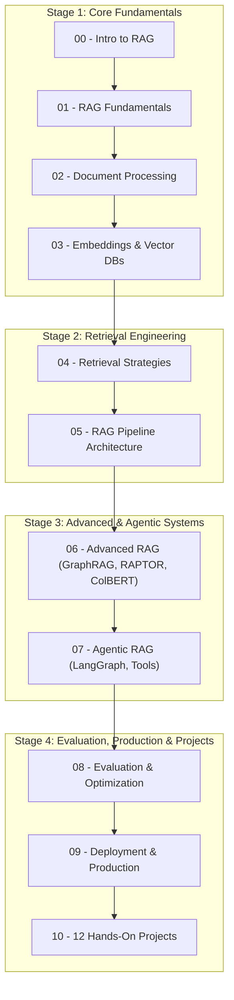

# RAG-Engineering: The Complete RAG Learning Journey

[](LICENSE)
[](https://www.python.org/)
[](https://python.langchain.com/)
[](https://www.llamaindex.ai/)

A comprehensive, production-oriented learning roadmap and implementation codebase for **Retrieval-Augmented Generation (RAG)**. Master everything from foundational vector math and document chunking to multi-agent architectures, GraphRAG, automated evaluation (RAGAS), and enterprise deployment.

---

## 🗺️ Visual Architecture Roadmap



---

## 📂 Repository Structure

```
RAG-Learning-Journey/
│
├── README.md
├── LICENSE
├── CONTRIBUTING.md
├── requirements.txt
├── .gitignore
│
├── 00-Introduction-to-RAG/
│   ├── README.md
│   ├── What-is-RAG.md
│   ├── Why-RAG.md
│   ├── RAG-vs-Fine-Tuning.md
│   ├── RAG-Architecture.md
│   ├── RAG-Workflow.md
│   └── RAG-Use-Cases.md
│
├── 01-RAG-Fundamentals/
│   ├── README.md
│   ├── LLM-Fundamentals.md
│   ├── Tokens-and-Context-Window.md
│   ├── Prompt-Engineering.md
│   ├── Embeddings.md
│   ├── Semantic-Search.md
│   ├── Vector-Similarity.md
│   ├── Cosine-Similarity.md
│   └── Notebook/
│
├── 02-Document-Processing/
│   ├── README.md
│   ├── Document-Loaders.md
│   ├── PDF-Processing.md
│   ├── Web-Scraping.md
│   ├── Text-Extraction.md
│   ├── Text-Cleaning.md
│   ├── Text-Splitting.md
│   ├── Chunking-Strategies.md
│   ├── Metadata-Extraction.md
│   └── Notebook/
│
├── 03-Embeddings-and-Vector-Databases/
│   ├── README.md
│   ├── Embedding-Models.md
│   ├── Dense-Embeddings.md
│   ├── Sparse-Embeddings.md
│   ├── Hybrid-Embeddings.md
│   ├── Vector-Database-Concepts.md
│   ├── Similarity-Metrics.md
│   ├── Indexing.md
│   ├── Metadata-Filtering.md
│   ├── FAISS/
│   ├── ChromaDB/
│   ├── Pinecone/
│   ├── Qdrant/
│   └── Weaviate/
│
├── 04-Retrieval-Strategies/
│   ├── README.md
│   ├── Semantic-Retrieval.md
│   ├── Keyword-Retrieval.md
│   ├── BM25.md
│   ├── Hybrid-Search.md
│   ├── Top-K-Retrieval.md
│   ├── MMR-Retrieval.md
│   ├── Metadata-Retrieval.md
│   ├── Multi-Query-Retrieval.md
│   ├── Query-Expansion.md
│   ├── Query-Rewriting.md
│   ├── Parent-Document-Retrieval.md
│   └── Contextual-Retrieval.md
│
├── 05-RAG-Pipeline/
│   ├── README.md
│   ├── Basic-RAG.md
│   ├── Advanced-RAG.md
│   ├── Indexing-Pipeline.md
│   ├── Retrieval-Pipeline.md
│   ├── Generation-Pipeline.md
│   ├── Context-Management.md
│   ├── Citation-and-Sources.md
│   ├── Hallucination-Reduction.md
│   └── Notebook/
│
├── 06-Advanced-RAG/
│   ├── README.md
│   ├── Reranking.md
│   ├── Cross-Encoder-Reranking.md
│   ├── ColBERT.md
│   ├── Self-RAG.md
│   ├── Corrective-RAG.md
│   ├── Adaptive-RAG.md
│   ├── GraphRAG.md
│   ├── RAPTOR.md
│   ├── HyDE.md
│   ├── Small-to-Big-Retrieval.md
│   └── Multi-Modal-RAG.md
│
├── 07-Agentic-RAG/
│   ├── README.md
│   ├── What-is-Agentic-RAG.md
│   ├── RAG-vs-Agentic-RAG.md
│   ├── AI-Agents.md
│   ├── Tool-Calling.md
│   ├── Agentic-Retrieval.md
│   ├── Query-Planning.md
│   ├── Multi-Agent-RAG.md
│   ├── LangGraph-RAG.md
│   ├── Memory-in-RAG.md
│   └── Human-in-the-Loop.md
│
├── 08-RAG-Evaluation-and-Optimization/
│   ├── README.md
│   ├── RAG-Evaluation.md
│   ├── Retrieval-Metrics.md
│   ├── Generation-Metrics.md
│   ├── Faithfulness.md
│   ├── Context-Precision.md
│   ├── Context-Recall.md
│   ├── Answer-Relevancy.md
│   ├── RAGAS.md
│   ├── DeepEval.md
│   ├── A-B-Testing.md
│   ├── Latency-Optimization.md
│   └── Cost-Optimization.md
│
├── 09-RAG-Deployment-and-Production/
│   ├── README.md
│   ├── FastAPI-RAG.md
│   ├── Streamlit-RAG.md
│   ├── Docker.md
│   ├── API-Development.md
│   ├── Cloud-Deployment.md
│   ├── Monitoring-and-Logging.md
│   ├── Caching.md
│   ├── Security.md
│   ├── Access-Control.md
│   └── Production-RAG.md
│
├── 10-Hands-On-Projects/
│   ├── 01-Simple-RAG-Chatbot/
│   ├── 02-PDF-Question-Answering/
│   ├── 03-Multiple-PDF-RAG/
│   ├── 04-Website-RAG-Chatbot/
│   ├── 05-Youtube-Video-RAG/
│   ├── 06-SQL-RAG-Assistant/
│   ├── 07-Codebase-RAG/
│   ├── 08-Hybrid-Search-RAG/
│   ├── 09-GraphRAG-Application/
│   ├── 10-Multi-Modal-RAG/
│   ├── 11-Agentic-RAG-Assistant/
│   └── 12-Production-Ready-RAG/
│
├── 11-Frameworks-and-Tools/
│   ├── LangChain/
│   ├── LlamaIndex/
│   ├── Haystack/
│   ├── LangGraph/
│   ├── HuggingFace/
│   ├── Ollama/
│   └── OpenAI/
│
├── 12-Resources/
│   ├── Research-Papers.md
│   ├── Blogs.md
│   ├── Documentation.md
│   ├── YouTube-Resources.md
│   ├── Datasets.md
│   └── Glossary.md
│
└── docs/
    ├── ROADMAP.md
    ├── ARCHITECTURE.md
    ├── PROJECT-IDEAS.md
    ├── LEARNING-TRACKER.md
    └── CHANGELOG.md
```

---

## 🚀 Quick Start Guide

### 1. Clone & Navigate
```bash
git clone https://github.com/your-username/RAG-Engineering.git
cd RAG-Engineering
```

### 2. Set Up Virtual Environment
```bash
python -m venv .venv

# On Windows (PowerShell):
.venv\Scripts\Activate.ps1

# On Linux/macOS:
source .venv/bin/activate
```

### 3. Install Dependencies
```bash
pip install -r requirements.txt
```

### 4. Configure Environment Variables
Create a `.env` file in the root directory:
```env
OPENAI_API_KEY=your_openai_api_key_here
COHERE_API_KEY=your_cohere_api_key_here
PINECONE_API_KEY=your_pinecone_api_key_here
QDRANT_URL=your_qdrant_url
```

---

## 🛠️ Module Overview

| # | Module | Core Focus |
|---|---|---|
| **00** | [Introduction to RAG](00-Introduction-to-RAG/README.md) | Why RAG, Architecture, Workflow, Use Cases, vs Fine-Tuning |
| **01** | [RAG Fundamentals](01-RAG-Fundamentals/README.md) | Transformers, Tokens, Embeddings, Cosine Similarity math |
| **02** | [Document Processing](02-Document-Processing/README.md) | Parsers (PDF, Web, Docs), Recursive & Semantic Chunking |
| **03** | [Embeddings & Vector DBs](03-Embeddings-and-Vector-Databases/README.md) | Dense vs Sparse, HNSW, FAISS, Chroma, Pinecone, Qdrant |
| **04** | [Retrieval Strategies](04-Retrieval-Strategies/README.md) | BM25, Hybrid Search (RRF), MMR, Query Rewriting, Parent-Doc |
| **05** | [RAG Pipeline](05-RAG-Pipeline/README.md) | Indexing, Retrieval, Context Management, Citations |
| **06** | [Advanced RAG](06-Advanced-RAG/README.md) | Rerankers, ColBERT, Self-RAG, CRAG, GraphRAG, RAPTOR, HyDE |
| **07** | [Agentic RAG](07-Agentic-RAG/README.md) | Autonomous ReAct loops, LangGraph, Multi-Agent Systems |
| **08** | [Evaluation & Optimization](08-RAG-Evaluation-and-Optimization/README.md) | RAGAS metrics, DeepEval, Latency & Token Cost optimization |
| **09** | [Deployment & Production](09-RAG-Deployment-and-Production/README.md) | FastAPI, Streamlit, Docker, Redis Caching, RBAC Security |
| **10** | [Hands-On Projects](10-Hands-On-Projects/README.md) | 12 Practical end-to-end applications from scratch |
| **11** | [Frameworks & Tools](11-Frameworks-and-Tools/README.md) | LangChain, LlamaIndex, Haystack, LangGraph, Ollama |
| **12** | [Resources](12-Resources/README.md) | Landmark Papers, Blogs, Official Docs, Benchmark Datasets |

---

## 💻 12 Hands-On Projects

1. **[01-Simple-RAG-Chatbot](10-Hands-On-Projects/01-Simple-RAG-Chatbot/README.md)**: Foundational document QA assistant.
2. **[02-PDF-Question-Answering](10-Hands-On-Projects/02-PDF-Question-Answering/README.md)**: Deep parsing and QA over single complex PDFs.
3. **[03-Multiple-PDF-RAG](10-Hands-On-Projects/03-Multiple-PDF-RAG/README.md)**: Cross-document research engine with source attribution.
4. **[04-Website-RAG-Chatbot](10-Hands-On-Projects/04-Website-RAG-Chatbot/README.md)**: Web crawler and documentation search assistant.
5. **[05-Youtube-Video-RAG](10-Hands-On-Projects/05-Youtube-Video-RAG/README.md)**: Timestamped video transcript search & QA.
6. **[06-SQL-RAG-Assistant](10-Hands-On-Projects/06-SQL-RAG-Assistant/README.md)**: Text-to-SQL assistant over relational schemas.
7. **[07-Codebase-RAG](10-Hands-On-Projects/07-Codebase-RAG/README.md)**: AST-aware repository code search and assistant.
8. **[08-Hybrid-Search-RAG](10-Hands-On-Projects/08-Hybrid-Search-RAG/README.md)**: Dense + Sparse BM25 with Reciprocal Rank Fusion.
9. **[09-GraphRAG-Application](10-Hands-On-Projects/09-GraphRAG-Application/README.md)**: Neo4j Knowledge Graph + Vector retrieval.
10. **[10-Multi-Modal-RAG](10-Hands-On-Projects/10-Multi-Modal-RAG/README.md)**: Multi-modal document retrieval (Text, Tables, Images).
11. **[11-Agentic-RAG-Assistant](10-Hands-On-Projects/11-Agentic-RAG-Assistant/README.md)**: Multi-step agent with LangGraph, web fallback & self-reflection.
12. **[12-Production-Ready-RAG](10-Hands-On-Projects/12-Production-Ready-RAG/README.md)**: Microservice with FastAPI, Chroma, Docker & RAGAS CI.

---

## 🤝 Contributing
Contributions are warmly welcomed! Please read [CONTRIBUTING.md](CONTRIBUTING.md) for guidelines on adding notes, fixing typos, and submitting projects.

## 📄 License
This repository is licensed under the [MIT License](LICENSE).
